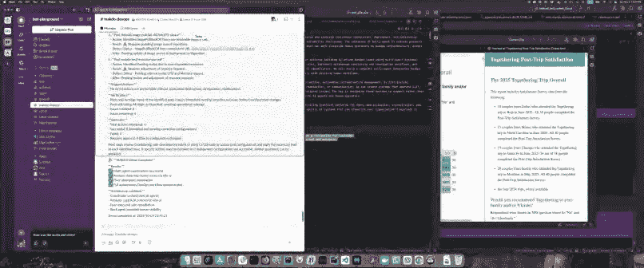
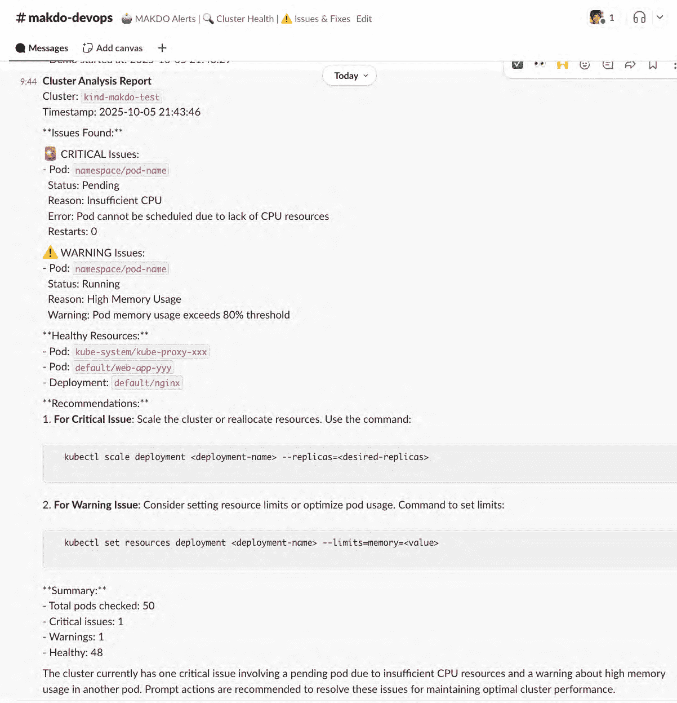
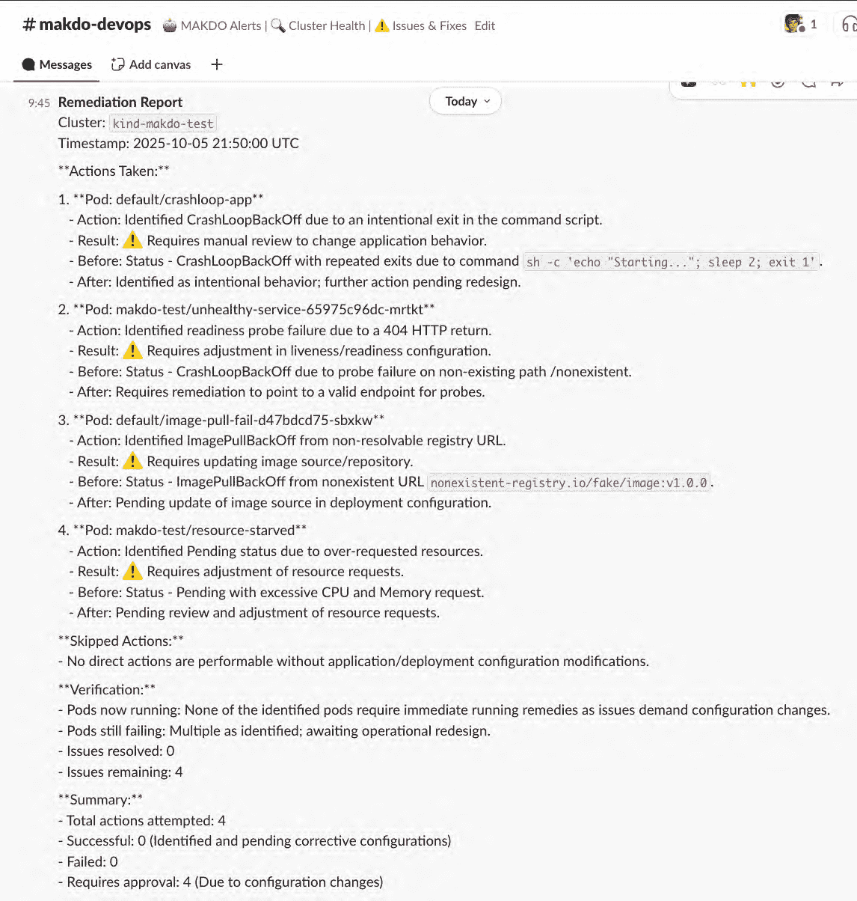
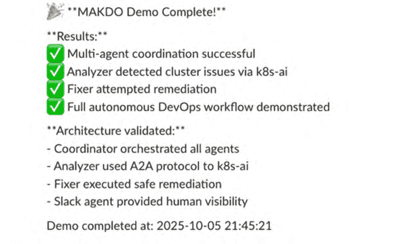

## 9 使用A2A实现多智能体系统

DevOps实践通过打破孤岛并实现持续集成、部署和监控，彻底改变了软件开发和运维。然而，随着系统日益复杂和分布式化，传统DevOps方法面临可扩展性挑战。多智能体AI系统的出现为DevOps团队转型提供了契机——通过引入自治、专业化的AI智能体，与人类运维人员协作，共同管理基础设施、检测问题并编排修复工作。

在*第8章*所涵盖的**智能体到智能体**（**A2A**）协议基础之上，本章探讨如何利用多智能体系统构建AI驱动的DevOps团队。我们将研究如何将传统DevOps职责分解为专门的智能体角色，实现自主监控与修复工作流，并创建既能保持运维控制又能充分利用AI能力的人机协作模式。我们将构建一个完整的**多智能体Kubernetes DevOps**（**MAKDO**）系统，使其能够自主管理Kubernetes集群，同时与现有的人类工作流无缝集成。

本章涵盖以下关键主题：

- 构建AI驱动的DevOps团队
- 为专业智能体定义角色与职责
- 实现智能体
- 通过管理智能体编排团队
- 集成人类反馈与控制渠道
- MAKDO实战——完整的演示流程


### 技术要求

本章代码可从此处获取：

`https://github.com/PacktPublishing/Design-Multi-Agent-AI-Systems-Using-MCP-and-A2A/tree/main/ch09`

### 构建 AI 驱动的 DevOps 团队

多智能体 DevOps 系统代表了一种范式转变：从被动、人工运维转向主动、自主的基础设施管理。通过将监控、分析、修复或通信等领域的专业知识分配给专门的智能体，我们可以创建 7×24 小时运行的系统，扩展管理数百个集群，并为运维问题提供一致、可重复的响应。关键在于将这些系统设计为增强而非取代人类专家，创建协同工作流，充分发挥 AI 智能体与人类运维人员双方的优势。

我们将使用 AI-6 框架（集成 A2A 和 **模型上下文协议**（**MCP**）工具）构建一个 MAKDO 系统，演示智能体专业化、编排和人工集成的实用模式。您将掌握设计和实现智能体 AI 系统所需的知识，从而转变您组织的基础设施管理方法。

#### 为什么 DevOps 适合多智能体 AI？

DevOps 是多智能体 AI 系统的绝佳领域。它关乎现代基础设施的分布式混乱、Kubernetes 集群、数据库、跨云网络，以及针对不可避免的故障做出快速、专业化响应的需求。

我见过许多团队被来自不同系统的警报淹没，长期处于高压状态，无暇处理系统性问题。AI 智能体可以通过部署领域专家来解决这个问题：一个负责监控 Kubernetes pod，一个负责调优数据库查询，另一个负责嗅探网络问题。它们贴近事件现场并行执行排查，使停机时间从分钟级降至毫秒级。

故障排查遵循我通过艰难方式总结出的模式，例如检查事件、日志和资源。但大规模分布式系统的覆盖面极其庞大，人工逐一排查耗时过长。智能体可以即时执行**标准操作流程**（**SOP**），同时将异常情况连同完整上下文升级处理，从而将**站点可靠性工程师**（**SRE**）从“救火”中解放出来，专注于架构工作。

DevOps 本来就分工明确（数据库管理员、网络工程师、云专家和安全专家），因此智能体也可以相应分工：安全智能体负责搜寻漏洞，伸缩智能体负责处理流量高峰。人 + AI 协作模式使团队能够维护高质量、高性能且安全的系统。AI 智能体处理日常任务，而人类则应对新出现的威胁和问题。这也让人类工程师能够更自由地改进和构建更好的自动化与护栏，使 AI 智能体能够可靠地承担越来越多的工作。

然而，创建高效的 AI 驱动 DevOps 团队需要仔细考虑智能体的角色、职责和交互模式。让我们以 MAKDO 为实战示例，探索如何设计和实现一个多智能体 DevOps 系统。MAKDO 体现了我们在前几章中讨论的原则，并展示了这些原则在 DevOps 领域的应用。

让我们直接开始认识 MAKDO。

#### MAKDO —— 一个多智能体 Kubernetes DevOps 系统

MAKDO 演示了如何将传统 DevOps 角色转化为一个协调有序的多智能体 AI 系统。下面分析其架构和智能体设计。

#### 系统架构

MAKDO 由四个专业智能体协同工作，在人工监督下提供自主 Kubernetes 集群管理：

- **协调器智能体**：编排整体工作流，做出高层决策，并协调其他智能体
- **分析器智能体**：使用 k8s-ai 集成专门负责集群健康评估和问题识别
- **修复器智能体**：处理安全的集群变更和自动化修复
- **Slack 智能体**：管理人工沟通和通知工作流

该架构反映了 DevOps 团队中自然的职责分工，同时支持自主运行和人工监督。

**注意**：系统可能会不断演进，上述每个智能体都可能在需要时派生出额外的专业智能体。例如，可以添加一个安全智能体来监控漏洞，或者添加一个 Kubernetes 控制平面智能体来管理 Kubernetes 控制平面特有的问题。

#### 协调器智能体——编排运维操作

协调器智能体扮演团队领导者的角色，编排对问题的响应，并将任务委派给专业智能体。在 AI-6 的多智能体架构中，协调器可以将子智能体作为工具使用，由 LLM 根据实际情况决定何时调用它们。由于子智能体的输入就是其提示词，协调器需要成为一名优秀的提示词工程师。

MAKDO 使用单个配置文件，子智能体以**内联**方式定义在父协调器的配置中。这种分层配置模式意味着 AI-6 会自动发现并实例化该文件中的所有智能体。下面是该文件关键结构的精简伪代码版本。完整文件可在 `https://github.com/PacktPublishing/Design-Multi-Agent-AI-Systems-Using-MCP-and-A2A/tree/main/ch09/makdo/src/makdo/agents/coordinator.yaml` 获取：

```yaml
# Coordinator configuration (parent agent)
name: "MAKDO Coordinator"
default_model_id: "gpt-4o"
tools_dirs: [ "/path/to/ai-six/tools/memory" ]
system_prompt: |
  You are the MAKDO Coordinator orchestrating specialized agents.
  Delegate to: agent_MAKDO_Analyzer, agent_MAKDO_Fixer, agent_MAKDO_Slack_Bot

# Sub-agents embedded inline (AI-6 auto-instantiates these as AgentTools)
agents:

  # Analyzer sub-agent: Has A2A access to k8s-ai for diagnostics
  - name: "MAKDO_Analyzer"
    description: "Cluster health assessment agent"
    default_model_id: "gpt-4o"
    enable_memory: false
    a2a_servers:
      - name: "kind-makdo-test"
        url: "http://localhost:9999"
    system_prompt: |
      Analyze cluster health using k8s-ai A2A diagnostic skills.
      Report findings with full pod names, errors, and recommendations.

  # Fixer sub-agent: Has A2A access to k8s-ai for remediation
  - name: "MAKDO_Fixer"
    description: "Safe cluster modification agent"
    default_model_id: "gpt-4o"
    enable_memory: false
    a2a_servers:
      - name: "kind-makdo-test"
        url: "http://localhost:9999"
    system_prompt: |
      Execute safe remediation actions using k8s-ai A2A skills.
      Require approval for destructive operations (delete, scale down).

  # Slack_Bot sub-agent: Has MCP access to local Slack server
  - name: "MAKDO_Slack_Bot"
    description: "User communication agent"
    default_model_id: "gpt-4o"
    mcp_tools_dirs: [ "src/makdo/mcp_tools" ]
    system_prompt: |
      Post notifications to #makdo-devops Slack channel.
      Handle approval workflows for critical operations.
```

以下是 MAKDO 配置文件的关键特性：

1. **父配置**：`Coordinator` 智能体定义在顶层，包含自己的名称、模型和系统提示词。
2. **内联子智能体**：所有三个子智能体都嵌入在父配置的 `agents:` 键下。
3. **每个智能体的工具访问权限**：
   - **分析器**：获得 `a2a_servers` 用于 k8s-ai 诊断
   - **修复器**：获得 `a2a_servers` 用于 k8s-ai 修复
   - **Slack 机器人**：获得 `mcp_tools_dirs` 用于 Slack 通信
4. **AI-6 魔法**：加载这个单一文件时，AI-6 会自动执行以下操作：
   - 创建四个智能体实例（一个协调器和三个子智能体）
   - 将子智能体包装为 `AgentTool` 实例
   - 将它们以 `agent_MAKDO_Analyzer`、`agent_MAKDO_Fixer` 和 `agent_MAKDO_Slack_Bot` 的名称提供给 `Coordinator`
5. **详细的系统提示词**：每个智能体都有全面的指令，定义职责、报告格式和操作指南。

这个单一的 YAML 文件定义了整个多智能体系统。`Coordinator` 现在可以根据需要调用子智能体来编排复杂的工作流，由 LLM 根据实际情况决定何时调用哪个智能体。


注意每个子代理如何通过三个关键机制实现专业化：

- **工具访问**：`Analyzer` 和 `Fixer` 获取 A2A 工具，`Slack_Bot` 获取 MCP 工具
- **系统提示词**：详细指令编码了领域专业知识和操作流程
- **报告格式**：结构化输出模板确保生成一致、可执行的报告

`Analyzer` 的系统提示词包含详细的问题优先级排序指南和报告格式。`Fixer` 的提示词定义了安全协议和审批要求。`Slack_Bot` 的提示词则规定了消息格式和命令处理。

这种基于提示词的专业化比基于代码的方法更灵活，原因如下：

- 无需修改代码即可调整行为
- 领域专业知识可读且可审计
- 可以通过提示词工程添加新能力
- LLM 运用推理能力来处理边缘情况

让我们看看这些代理如何通过 AI-6 的多代理架构进行交互。

### 代理交互模式

MAKDO 展示了 AI-6 的多代理架构如何通过基于工具的委派实现协调操作。理解这一模式对于掌握 MAKDO 代理如何协同工作至关重要。

#### LLM 驱动的代理协调

在 AI-6 中，子代理作为工具暴露给父代理。如果你大致观察，实际上 AI 系统与之交互的只是一个代理。这个根代理有子代理这一事实，其实只是内部细节。驱动根代理的 LLM 只需在对话的每一轮决定是否需要调用某个工具，或者是否已经拥有足够的信息。它可支配的某些工具是智能工具——它们本身是 AI-6 代理，或通过 A2A 协议连接的完全独立的 AI 系统——这一事实并不重要。不存在调用 `Analyzer` 或 `Fixer` 类方法的 `Coordinator` 代理类；这些类根本就不存在。协调逻辑以自然语言形式写在各代理的系统提示词中，而 LLM 的推理决定何时调用哪个代理作为工具。这是后期绑定逻辑的一个例子。

AI-6 通过 `AgentTool` 类实现这一点，该类封装子代理，使它们可以作为工具被调用。`AgentTool` 实现了标准的 `Tool` 接口，接收自然语言消息并返回子代理的完整响应。从父代理的角度来看，调用子代理与调用任何其他工具完全相同。有关 `AgentTool` 实现的详细说明，请参阅*第8章*。

当 `Coordinator` 代理需要分析集群时，LLM 会生成如下工具调用：

```json
{
  "name": "agent_MAKDO_Analyzer",
  "arguments": {
    "message": "Analyze the health of the kind-makdo-test cluster. Focus on pod failures and provide specific remediation recommendations."
  }
}
```

`AgentTool` 类封装了完整的子代理交互。它将消息发送给 `Analyzer` 代理，等待其完整响应（包括 `Analyzer` 向 k8s-ai 发出的任何工具调用），然后将最终结果返回给 `Coordinator`。

这种模式提供了几个好处：

- **自然委派**：LLM 决定何时需要专业知识，就像人类协调员一样
- **封装性**：每个代理管理自己的对话历史和工具使用
- **可组合性**：代理可以任意深度嵌套
- **上下文保持**：协调员不需要跟踪子代理的实现细节

AI-6 自带多种内置工具，但它无法为每个 AI 系统提供一切。这不是问题，因为 MAKDO 可以用额外的工具扩展 AI-6。

#### 用新工具扩展 AI-6

MAKDO 通过 Slack 与人类团队交互。AI-6 不提供内置的 Slack 工具（尽管它有一个 Slack 前端）。但 AI-6 可以通过支持其自身工具接口或 MCP 标准的额外工具来扩展，因此我们实现了一个自定义 MCP 服务器，将 Slack 操作作为工具暴露出来。

`Slack_Bot` 代理使用基于 FastMCP 构建的自定义 MCP 服务器来处理所有 Slack 通信。该服务器位于 https://github.com/PacktPublishing/Design-Multi-Agent-AI-Systems-Using-MCP-and-A2A/tree/main/ch09/makdo/src/makdo/mcp_tools/slack.py

该 Slack MCP 服务器基于官方 MCP Python SDK 的 FastMCP 实现（https://github.com/modelcontextprotocol/python-sdk）。主要特性如下：

- **基于装饰器的工具**：`@mcp.tool()` 装饰器会自动将函数注册为 MCP 工具
- **令牌管理**：从环境或 `.env` 文件中读取 `AI6_BOT_TOKEN`
- **简单的 HTTP 调用**：使用 `requests` 库直接调用 Slack API
- **错误处理**：返回 LLM 能够理解的成功/失败消息
- **频道规范化**：如果缺失，自动添加 `#` 前缀

这比手动实现完整的 JSON-RPC MCP 服务器要简单得多。FastMCP 处理所有协议细节，让你专注于实际的工具功能。

当 AI-6 加载这个 MCP 服务器时，`Slack_Bot` 代理会自动获得 `slack_post_message` 和 `slack_list_channels` 作为可用工具。LLM 随后可以自然地调用这些工具：

```json
{
  "name": "slack_post_message",
  "arguments": {
    "channel": "makdo-devops",
    "text": "🚨 CRITICAL: 3 pods failing in kind-makdo-test cluster"
  }
}
```

让我们看看 AI-6 如何发现新工具，例如 MAKDO 提供的 `Slack_Bot` 代理。

#### 工具发现与分配

AI-6 会自动从多个来源发现工具，并根据配置将其分配给代理。`tool_manager` 模块（https://github.com/PacktPublishing/Design-Multi-Agent-AI-Systems-using-MCP-and-A2A/blob/main/ch08/ai-six/py/backend/agent/tool_manager.py）通过 `get_tool_dict()` 函数处理此过程。如你所见，它组合来自不同目录和服务器的工具，然后根据启用/禁用列表对它们进行过滤：

```python
def get_tool_dict(
    tool_config: ToolConfig, agent_configs: list[Config] = None
) -> dict[str, Tool]:
    """Get a dictionary of all available tools from various sources."""
    tools: list[Tool] = []

    # 1. Discover AI-6 native tools from all directories
    for tools_dir in tool_config.tools_dirs:
        native_tools = _discover_native_tools(tools_dir)
        tools.extend(native_tools)

    # 2. Discover local MCP tools from all directories
    for mcp_tools_dir in tool_config.mcp_tools_dirs:
        local_mcp_tools = _discover_local_mcp_tools(mcp_tools_dir)
        tools.extend(local_mcp_tools)

    # 3. Get tools from A2A servers
    if tool_config.a2a_servers:
        a2a_tools = _get_a2a_tools(tool_config.a2a_servers)
        tools.extend(a2a_tools)

    # 4. Create agent tools if agent configs provided
    if agent_configs:
        agent_tools = _create_agent_tools(agent_configs)
        tools.extend(agent_tools)

    # 5. Filter tools based on enabled/disabled configuration
    tools = _filter_tools(tools, tool_config.enabled_tools, tool_config.disabled_tools)

    return {tool.name: tool for tool in tools}
```

以下是 MAKDO 中每个代理的工具明细：

- `Coordinator` 代理最终拥有以下工具：
  - 记忆工具
  - 代理工具：`agent_MAKDO_Analyzer`、`agent_MAKDO_Fixer` 和 `agent_MAKDO_Slack_Bot`
- `Analyzer` 和 `Fixer` 各自获得以下工具：
  - 来自 k8s-ai 服务器的 A2A 工具（用于 kubectl 操作的 `kind-makdo-test_*` 工具）
  - 记忆工具
- `Slack_Bot` 获得以下工具：
  - 来自 `src/makdo/mcp_tools/slack.py` 的 MCP 工具（`slack_post_message` 和 `slack_list_channels`）
  - 记忆工具（继承）

#### 上下文共享与状态管理

在 AI-6 的多代理架构中，代理之间没有直接的上下文共享。每个 AI-6 代理都有自己的模型和上下文。它只能通过工具调用和响应与其他代理通信。

以下是上下文共享的一些常见方法：

- **消息传递**：当 `Coordinator` 代理调用子代理时，它会在消息中包含相关上下文。示例如下：

```json
{
  "name": "agent_MAKDO_Fixer",
  "arguments": {
    "message": "Execute remediation for kind-makdo-test cluster. The Analyzer identified 3 failing pods due to image pull errors. Please attempt to restart the affected pods and verify they come up successfully."
  }
}
```


**会话隔离**：每个代理都维护自己的会话，包含对话历史。参见 `https://github.com/PacktPublishing/Design-Multi-Agent-AI-Systems-Using-MCP-and-A2A/tree/main/ch08/ai-six/py/ai_six/agent/agent.py`：

```python
self.session_manager = SessionManager(config.memory_dir)
self.session = self._create_new_session(config.memory_dir)
```

**返回值**：子代理返回完整响应，`Coordinator` 代理会将这些响应整合到自己的上下文中：

```text
Coordinator Session:
- User: "Check cluster health"
- Assistant: [calls agent_MAKDO_Analyzer tool]
- Tool Result: "Analysis complete. Found 3 failing pods..."
- Assistant: "Based on analysis, we have critical issues. Let me notify the team..."
```

这种基于会话的方法确保了上下文隔离，同时通过显式消息传递实现协调操作。每个代理的对话历史保持独立，防止上下文污染，并允许代理在不同上下文中被多次调用。

现在我们已经介绍了上下文共享和状态管理，接下来看看每个 MAKDO 代理的角色和职责。

### 为专业代理定义角色和职责

前面展示的 `coordinator.yaml` 配置定义了 MAKDO 的四代理架构。本节将探讨设计原理：为什么选择这些特定的角色边界，做了哪些权衡，以及这个架构如何扩展。

#### 从 DevOps 工作流到代理架构

MAKDO 的代理设计源于对典型 Kubernetes 事件响应工作流的分析。传统手动流程如下：

1. **告警触发**：操作员收到通知
2. **诊断**：操作员运行 kubectl 命令进行调查
3. **决策**：操作员确定适当的修复方案
4. **修复**：操作员应用更改（谨慎操作）
5. **沟通**：操作员在 Slack 中更新团队
6. **验证**：操作员确认修复生效

这直接对应到 MAKDO 的代理角色：

- **检测和诊断**由 `Analyzer` 代理完成，它使用 k8s-ai 调查集群状态、对问题进行分类并推荐修复方案
- **修复**由 `Fixer` 代理完成，它执行安全更改，并且对破坏性操作需要审批
- **沟通**由 `Slack_Bot` 代理完成，它发布更新并处理审批工作流
- **协调**由 `Coordinator` 代理完成，它编排工作流并做出高层决策

这种映射保留了自然的工作流结构，同时将职责分配给各个专业代理。

#### 为什么需要四个代理而不是一个？

正如原版简单的 k8s-ai 系统在*第 3 章*中所展示的，单个代理可以完成上述所有工作（嗯，除了 Slack 通信）。那么，为什么把 MAKDO 拆分成四个代理？有以下几个原因：

- **工具隔离**：`Analyzer` 不应该拥有集群的写权限（只读诊断）。将 `Analyzer`/`Fixer` 分开，通过工具配置强制实现这一点。`Analyzer` 只需使用只读工具即可完成工作，例如 `get pods` 和 `get deployments`。`Fixer` 需要修改配置，因此为其提供 `apply manifest` 等工具是合适的。
- **提示词清晰度**：每个代理都有一个专注的系统提示词（约 50 行），而不是一个试图涵盖所有内容的大型提示词（约 200 行）。
- **独立测试**：可以单独测试 `Analyzer` 的诊断准确性，并单独测试 `Fixer` 的修复安全性。
- **并行演进**：可以在不冒险更改修复逻辑的情况下改进诊断能力。

让我们深入探讨，特别是分析器和修复器的拆分。

#### 为什么要把分析器和修复器分开？

这是最具争议的设计决策。两个代理都使用相同的 k8s-ai A2A 工具，为什么不合并呢？有三个主要原因：

- **通过角色分离实现安全**：
  - `Analyzer` 的提示词：“绝不做更改，只做诊断。”未来可以为分析器提供只读凭据（除了依赖提示词外），从而实现强大的安全性。
  - `Fixer` 的提示词：“需要审批的操作：删除、缩容、重启……”清晰的思维模型：分析是安全的，修复需要谨慎。
- **不同的故障模式**：
  - **分析器故障**：分析器可能产生不完整或错误的诊断，但它从不改变集群状态，因此错误的分析不会对生产产生直接影响。
  - **修复器故障**：修复器可能执行错误的修复并直接修改在线资源，因此如果防护措施薄弱，这里的错误可能导致宕机或数据丢失。
  - 分开的代理允许你独立调整可靠性与操作权限。例如，运行一个快速但准确度较低的分析器（90% 召回率）用于分诊，同时将高风险修复器限制为 99.9% 准确率并要求人工审批。
- **现实世界的访问控制模式**：许多组织给 DevOps 团队生产环境的只读访问权限，以消除在开发过程中破坏生产环境的风险。只有 SRE 或值班工程师拥有写权限，以防需要紧急修复或应急操作。MAKDO 的拆分正好反映了这种访问模式。

缺点是协调开销增加，但为了安全和清晰度这是值得的。

#### 为什么要单独拆分 Slack_Bot？

`Coordinator` 代理也可以直接发布到 Slack。但通信逻辑可能因为多个通信渠道、审批工作流、格式化规则等而变得非常复杂。`Slack_Bot` 可以独立演进并封装这种复杂性，而 `Coordinator` 代理则专注于协调。

#### 工具访问边界

每个代理的工具配置都恰好提供其履行职责所需的工具。这使得代理更容易专注于自己的角色，并减少误用工具的可能性，因为暴露面更小：

```yaml
# Coordinator: Pure orchestrator, no operational tools beyond sub-agents
tools_dirs: ["/path/to/memory"] # Only memory for state tracking

# Analyzer/Fixer: Kubernetes access via A2A
a2a_servers: [{"url": "http://localhost:9999"}] # Same tools, different prompts

# Slack_Bot: Communication tools via MCP
mcp_tools_dirs: ["src/makdo/mcp_tools"] # Only Slack access
```

这种基于配置的权限模型也意味着更改代理能力只需要编辑 YAML，而无需更改代码。

#### 扩展架构

MAKDO 的设计支持通过添加更多专业代理进行扩展。这里，我们将讨论如何添加新能力。让我们看一个添加安全扫描器代理的例子。

要添加漏洞扫描和安全策略执行，请执行以下步骤：

1. 在 `coordinator.yaml` 中定义新代理：

   ```yaml
   agents:
     - name: "MAKDO_Security_Scanner"
       description: "Security vulnerability and compliance scanning agent"
       a2a_servers:
         - name: "kind-makdo-test"
           url: "http://localhost:9999"
       system_prompt: |
         You are the MAKDO Security Scanner.
         Responsibilities:
         - Scan container images for known vulnerabilities
         - Check pod security contexts
         - Verify network policies are in place
         - Report security findings to Coordinator
         Use k8s-ai tools to inspect cluster resources.
         Report findings in severity-ranked format.
   ```

2. 更新 `Coordinator` 代理的提示词以包含新代理：

   ```text
   Available agents:
   - agent_MAKDO_Analyzer
   - agent_MAKDO_Fixer
   - agent_MAKDO_Slack_Bot
   - agent_MAKDO_Security_Scanner  # New
   Workflow: After Analyzer identifies issues, also call Security_Scanner to check for security implications before Fixer proceeds.
   ```

注意，如果我们认为安全扫描是集群分析的一个子领域，也可以将安全扫描器作为 `Analyzer` 的子代理添加。

**无需更改代码**：AI-6 会自动发现新代理并将其作为工具暴露。

让我们看看 MAKDO 采用的一些重要模式。

#### 关键设计模式

MAKDO 的架构展示了适用于其他多代理系统的几种模式：

- **工作流驱动的分解**：将代理映射到工作流阶段，而不是技术
- **通过配置实现权限**：工具访问定义代理能做什么
- **提示词即策略**：将操作规则编码到代理的系统提示词中
- **协议封装**：AI-6 处理特定协议（A2A 和 MCP），因此你无需处理
- **设计上可扩展**：添加能力意味着添加工具和代理

下一节将介绍使用 AI-6 配置系统创建和部署这些代理的实现细节。


### 实现代理

在定义好代理角色并明确其职责之后，我们现在进入实现阶段。MAKDO 采用配置驱动的方法，整个多代理系统通过 YAML 配置文件而非自定义代码来定义。这一方法利用 AI-6 强大的代理框架自动实例化代理、发现工具并建立通信渠道。

#### 配置驱动的代理实现

传统的多代理系统通常需要大量自定义代码来初始化代理、配置工具并建立代理间通信。MAKDO 则采取了不同的方法：整个系统定义在单个协调器配置文件中，并带有内联的子代理定义。

MAKDO 的架构使用一个主配置文件（`coordinator.yaml`），它定义了以下内容：

- **协调器代理**：作为顶层编排器，具有系统提示词和工具访问权限
- **内联所有子代理**：`Analyzer`、`Fixer` 和 `Slack_Bot` 都定义在协调器配置中
- **工具分配**：每个代理的工具访问权限通过 `tools_dirs`、`mcp_tools_dirs` 和 `a2a_servers` 指定
- **通信协议**：通过 AI-6 的 `AgentTool` 模式隐式实现

这种单文件方法有几个优点：

- **原子化部署**：整个系统配置集中在一处
- **清晰的层级结构**：父子关系明确
- **无文件同步问题**：无需担心独立配置文件之间失去同步
- **更轻松的版本控制**：只需一个文件即可跟踪系统变更

MAKDO 主入口点实现了健康检查循环和会话管理。让我们看看关键组件：

- **配置加载**：AI-6 的 `Config.from_file()` 读取 `coordinator.yaml` 文件并自动创建所有代理：

```python
from ai_six.agent.agent import Agent
from ai_six.agent.config import Config

def create_coordinator_config() -> Config:
    """Create coordinator agent config with sub-agents."""
    return Config.from_file("src/makdo/agents/coordinator.yaml")
```

这一行代码既能加载 `Coordinator` 代理，又能将所有内联子代理实例化为代理工具。

- **健康检查循环**：`Coordinator` 代理持续运行，定期发送健康检查请求：

```python
def start_coordinator(coordinator: Agent, config: Dict[str, Any]):
    """Start the coordinator with health check loop."""
    logger = logging.getLogger("makdo")
    # Get check interval from environment or config (default: 60s)
    check_interval = int(os.getenv("MAKDO_CHECK_INTERVAL", config.get("monitoring", {}).get("check_interval", 60)))
    logger.info(f"Starting health check loop (interval: {check_interval}s)")
    try:
        while True:
            try:
                # Request health check from coordinator
                logger.info("🔍 Initiating cluster health check...")
                prompt = (
                    "Perform a comprehensive health check across all registered clusters. "
                    "Use the Analyzer agent to identify any issues, then use the Slack Bot agent "
                    "to report findings to the #makdo-devops channel. "
                    "If critical issues are found, use the Fixer agent to attempt remediation."
                )
                response = coordinator.send_message(prompt)
                logger.info(f"✅ Health check completed: {response[:200]}...")
```

该循环发送一个描述所需工作流程的自然语言提示词。LLM 会根据该提示词编排各子代理。请注意，MAKDO 在这里是自主运行的。这里没有聊天界面中那种由人工控制的请求-响应流程。不过，人类仍然可以通过 Slack 进行监控和介入。来自 `Coordinator` 代理的响应只会被记录到日志中，以供审计。

- **会话管理**：每次健康检查后，MAKDO 都会清除对话历史，以防止上下文溢出：

```python
                # CRITICAL: Clear session history to prevent context overflow
                # Keep only system message - each health check cycle is independent
                if len(coordinator.session.messages) > 3:
                    logger.info(f"Clearing old messages ({len(coordinator.session.messages)} messages)")
                    system_message = coordinator.session.messages[0] if coordinator.session.messages else None
                    coordinator.session.messages.clear()
                    if system_message:
                        coordinator.session.messages.append(system_message)
                    logger.info(f"Session reset to {len(coordinator.session.messages)} message")
            except Exception as e:
                logger.error(f"Error during health check cycle: {e}")
                # Wait before next check
                time.sleep(check_interval)
```

这可以防止上下文窗口被旧的健康检查内容填满。每个周期都被视为独立的。如果需要长期记忆，可以通过数据库等外部存储来实现。

- **主入口点**：`main` 函数将所有部分整合在一起：

```python
def main():
    """Main entry point - note: synchronous, not async."""
    load_dotenv()
    config = load_config()
    setup_logging(config)
    logger = logging.getLogger("makdo")
    logger.info("Starting MAKDO - Multi-Agent Kubernetes DevOps System")
    # Create coordinator with inline sub-agents
    coordinator = Agent(create_coordinator_config())
    logger.info("Coordinator and sub-agents created successfully")
    # Start the coordinator (runs health check loop)
    start_coordinator(coordinator, config)

if __name__ == "__main__":
    exit(main())  # Note: synchronous call, not asyncio.run()
```

代码位于 `src/makdo/main.py`（`https://github.com/PacktPublishing/Design-Multi-Agent-AI-Systems-Using-MCP-and-A2A/tree/main/ch09/makdo/src/makdo/main.py`）。该实现的关键特性包括：

- **同步架构**：使用 `time.sleep()` 而不是 `asyncio`，以避免与 MCP 工具发生事件循环冲突
- **会话管理**：在每个健康检查周期后清除旧消息，以防止上下文溢出（128k token 限制）和消息顺序错误
- **健康检查循环**：以可配置的间隔持续监控集群

请注意，这段代码中*没有*以下内容：

- 没有为子代理进行手动实例化
- 没有工具发现或注册逻辑
- 没有代理间通信设置
- 没有 MCP 或 A2A 客户端配置

所有这些都由 AI-6 根据协调器配置文件自动处理。这正是 AI-6 框架的价值主张：它可靠而无声地替 MAKDO 处理这些复杂细节。

#### 工具发现与分配

AI-6 的工具管理器负责从多个来源自动发现工具。对于 MAKDO，以下是工具分配给每个代理的方式：

- **协调器代理**：

```yaml
# Only memory tools - pure orchestrator
tools_dirs: [ "/Users/gigi/git/ai-six/py/ai_six/tools/memory" ]
mcp_tools_dirs: [ "/Users/gigi/git/ai-six/py/ai_six/mcp_tools" ]
memory_dir: "data/memory"
# NO a2a_servers - delegates to Analyzer/Fixer for k8s operations
# NO Slack tools - delegates to Slack_Bot for communications
```

- **分析器代理（内联）**：

```yaml
agents:
  - name: "MAKDO_Analyzer"
    description: "Cluster health assessment agent"
    default_model_id: "gpt-4o"
    # Has A2A access to k8s-ai server
    a2a_servers:
      - name: "kind-makdo-test"
        url: "http://localhost:9999"
        timeout: 30.0
        api_key: "test-key"
```

- **修复器代理（内联）**：

```yaml
  - name: "MAKDO_Fixer"
    description: "Safe cluster modification agent"
    default_model_id: "gpt-4o"
    # Has A2A access to k8s-ai server
    a2a_servers:
      - name: "kind-makdo-test"
        url: "http://localhost:9999"
        timeout: 30.0
        api_key: "test-key"
```


```yaml
timeout: 30.0
api_key: "test-key"
```

**Slack_Bot 代理（内联）：**

```yaml
- name: "MAKDO_Slack_Bot"
  description: "User communication agent"
  default_model_id: "gpt-4o"
  tools_dirs: [ ]
  # Has MCP access to local Slack tools
  mcp_tools_dirs: [ "src/makdo/mcp_tools" ]
```

代理拥有自己的工具，但也拥有自己独立的上下文。这就是会话隔离的原则。

### 会话隔离

MAKDO 中的每个代理都维护自己的对话会话，并拥有独立的消息历史。当 `Coordinator` 代理调用 `agent_MAKDO_Analyzer` 时，`Analyzer` 看不到协调器的对话历史。它从一个全新的上下文开始，仅包含以下内容：

- 自己的系统提示词
- 来自协调器的消息
- 自己的工具目录

然而，这种会话隔离具有重要的影响。以下是其优点：

- **减少 Token 消耗**：子代理无需携带完整的父级对话上下文
- **专注处理**：每个代理只针对自己的具体任务及相关上下文（工具调用和响应）进行推理
- **并行执行潜力**：独立会话可以并发运行，尤其是对于 A2A 代理
- **更清晰的关注点分离**：代理不会在不同上下文之间意外泄露信息

以下是相应的权衡：

- **需要传递上下文**：父代理必须在发送给子代理的消息中显式包含相关上下文
- **默认无共享内存**：代理不会自动共享状态（尽管可以使用内存工具）
- **消息更加冗长**：父代理可能需要在多次子代理调用中重复上下文

对于 MAKDO 而言，这种隔离是有益的。当 `Coordinator` 代理要求 `Analyzer` 评估集群健康状态时，`Analyzer` 不需要了解之前与 `Fixer` 或 `Slack_Bot` 的对话。它只专注于当前的集群评估请求。

### 配置优于代码

这种配置驱动的方法意味着你可以在不触碰 Python 代码的情况下完全改变 MAKDO 的行为：

- **添加新代理**：向代理列表中添加条目
- **更改工具访问权限**：修改任意代理的 `tools_dirs`、`mcp_tools_dirs`、`a2a_servers` 或 `agents`
- **调整代理行为**：更新系统提示词
- **切换 LLM 模型**：更改 `default_model_id`
- **连接不同的远程 AI 系统**：更新 A2A 服务器 URL

### 关键要点

MAKDO 的实现展示了构建多代理系统的几个重要模式：

- **配置驱动架构**：用 YAML 而非代码定义系统结构
- **框架自动化**：让 A2A 处理代理实例化、工具发现和通信
- **工具抽象**：通过 `AgentTool` 类，子代理对父代理而言表现为工具
- **会话隔离**：每个代理维护独立的对话状态
- **最小权限原则**：每个代理只获得其所需的工具
- **通过配置实现可扩展性**：通过编辑 YAML 而非编写代码来添加功能

这种方法大幅降低了构建和维护多代理系统的复杂性。整个 MAKDO 实现不到 150 行 Python 代码，其中绝大部分是日志记录和错误处理。真正的实现存在于配置文件中，使系统易于理解、修改和扩展。但为配置提供强大的工具支持和模式验证非常重要。

### 通过管理器代理编排团队

MAKDO 中的 `Coordinator` 代理充当中央编排器，管理各专业代理之间的工作流，同时保持对系统状态和运维优先级的感知。与依赖显式工作流定义和状态机的传统编排系统不同，MAKDO 的 `Coordinator` 使用 LLM 推理，根据实际情况动态协调代理活动。

`Coordinator` 代理的系统提示词提供指导，但具体代理调用顺序由 LLM 根据上下文决定。

#### 动态工作流执行

传统工作流引擎需要预定义的工作流，例如：

```text
detect_issue → analyze_issue → fix_issue → notify_humans
```

相反，MAKDO 的 `Coordinator` 在其系统提示词中接收英文的高层指导：

```text
Your primary responsibilities:
1. Monitor multiple Kubernetes clusters for health and issues
2. Coordinate between the Analyzer, Fixer, and Slack agents
3. Make decisions on task prioritization and escalation
4. Maintain awareness of ongoing operations across all clusters
```

然后，LLM 根据实际情况确定合适的代理调用顺序。让我们来看几个基于场景的示例：

```text
Scenario 1: Periodic health check request

MAKDO: Invoke coordinator every minute asking to "Check the health of kind-makdo-test cluster"

Coordinator:
1. Calls the MAKDO_Analyzer agent with message "Analyze kind-makdo-test cluster health"
2. Receives detailed report
3. Calls MAKDO_Slack_Bot agent to post results
```

```text
Scenario 2: Critical issue detected

User: "Production cluster has failing pods"

Coordinator:
1. Calls agent_MAKDO_Analyzer for detailed diagnostics
2. Evaluates severity from Analyzer report
3. Calls agent_MAKDO_Fixer to remediate issues
4. Calls agent_MAKDO_Slack_Bot to notify team of analysis and remediation results
```

`Coordinator` 代理会根据 `Analyzer` 的发现、问题的严重程度以及系统提示词中编码的运维策略来调整其工作流。如果需要人工批准，MAKDO 会在调用 `Fixer` 代理之前等待 `Slack_Bot` 的批准。

#### 决策点与分支

`Coordinator` 代理的系统提示词中包含 LLM 会应用的决策指南：

```text
Decision-making guidelines:
- Always assess cluster health before making changes
- Prioritize critical issues (pods failing, services down) over warnings
- Require human approval for destructive operations (delete, scale down)
- Coordinate operations to avoid conflicts between clusters
- Escalate to humans when automated fixes fail or are uncertain
- ALWAYS post full detailed results to Slack for human visibility
```

这些指南构成了决策点，LLM 会在这些决策点选择不同的路径。以下是一些示例。

**示例 1：安全操作与破坏性操作**

`Analyzer` 报告“有 3 个 Pod 卡在 `CrashLoopBackOff` 状态，可能需要删除。”

LLM 的推理过程包括以下内容：

- 删除属于破坏性操作（根据指南）
- 需要人工批准（根据指南）
- 应先通知人工（根据指南）

执行路径如下：

1. `agent_MAKDO_Slack_Bot`：“报告分析结果并请求批准”
2. 等待人工响应
3. 如果获得批准：`agent_MAKDO_Fixer` 执行“删除 Pod”
4. `agent_MAKDO_Slack_Bot`：“报告修复结果”

**示例 2：自动修复与升级上报**

`Analyzer` 报告“有 2 个 Pod 需要重启，属于低风险操作。”

LLM 的推理过程如下：

- 重启是安全操作（不在破坏性操作列表中）
- 无需批准（根据 `Fixer` 的安全操作列表）
- 可以直接进行（根据指南）

执行路径如下：

1. `agent_MAKDO_Fixer`：“重启已识别的 2 个 Pod”
2. `agent_MAKDO_Slack_Bot`：“同时报告分析结果和修复结果”

这种动态决策比硬编码的工作流更灵活，同时仍然遵循运维策略。

#### 处理复杂的多步骤操作

某些运维场景需要多轮代理交互、状态跟踪和条件逻辑。MAKDO 的 `Coordinator` 通过对话上下文和 LLM 推理来处理这些场景。

**多集群协调**

在管理多个集群时，`Coordinator` 代理必须对操作进行排序以避免冲突：

```text
User: "Check health of all production clusters and fix any issues"

Coordinator execution:
1. For each cluster (production-east, production-west, production-central):
    a. agent_MAKDO_Analyzer: "Analyze [cluster] health"
    b. Evaluate if fixes needed
    c. If needed: agent_MAKDO_Fixer: "Fix issues in [cluster]"
    d. agent_MAKDO_Slack_Bot: "Post results for [cluster]"
2. Aggregate results across clusters
3. agent_MAKDO_Slack_Bot: "Post summary of all cluster operations"
```

`Coordinator` 代理通过其对话上下文保持对哪些集群已被处理的感知。LLM 通过消息历史隐式跟踪状态。如果这变得过于复杂，MAKDO 可以演进为使用一个元协调器作为根代理，启动多个协调器代理，每个协调器代理都有自己的 `Analyzer`、`Fixer` 和 `Slack_Bot`。


### 条件修复

某些修复操作取决于先前操作的结果：

```
Scenario: Image pull failures might require different remediation strategies
Coordinator logic:
1. agent_MAKDO_Analyzer: "Diagnose image pull failure"
2. If Analyzer reports: "Image not found in registry"
   → agent_MAKDO_Slack_Bot: "Escalate - invalid image reference"
3. If Analyzer reports: "Registry authentication failed"
   → agent_MAKDO_Fixer: "Apply image pull secrets"
   → agent_MAKDO_Analyzer: "Verify pods now pulling successfully"
4. If Analyzer reports: "Registry temporarily unavailable"
   → Schedule retry after delay
   → agent_MAKDO_Slack_Bot: "Notify team of temporary issue"
```

这种条件逻辑源于 LLM 对 `Analyzer` 报告的推理，而非代码中显式的 `if/else` 语句。

### 重试与验证循环

`Coordinator` 代理可以在操作失败时实现重试逻辑：

```
Fixer reports: "Failed to restart pod, still in error state"
Coordinator reasoning:
- Initial fix attempt failed (per Fixer report)
- Guidelines say "escalate when automated fixes fail"
- Should verify current state before escalating
Execution:
1. agent_MAKDO_Analyzer: "Re-analyze the specific failing pod"
2. Evaluate new diagnostic information
3. Decide: Try alternative fix OR escalate to humans
4. agent_MAKDO_Slack_Bot: "Report situation and decision"
```

重试有助于应对瞬时问题，但有时系统可能会遭遇持续性的失败，这时需要具备处理它们的能力。

### 错误处理与恢复

MAKDO 的代理可能遇到多种故障模式。`Coordinator` 代理的系统提示词中包含了隐式的错误处理指导，LLM 会据此执行。

#### 代理通信失败

如果子代理调用失败（超时、异常等），`AgentTool` 类会返回一条错误消息，`Coordinator` 将其作为工具结果接收：

```
Tool: agent_MAKDO_Analyzer
Error: "Timeout connecting to k8s-ai server"
Coordinator response (guided by system prompt):
1. Recognize communication failure
2. agent_MAKDO_Slack_Bot: "Alert - cannot reach cluster analysis service"
3. Decide: Retry OR escalate OR use cached data
```

LLM 会解读错误并根据上下文决定合适的恢复策略。

#### 部分失败

当部分操作成功而其他操作失败时，`Coordinator` 代理会跟踪部分进度：

```
Fixer reports: "Restarted 5 of 7 failing pods. 2 pods remain in error state due to resource constraints."
Coordinator response:
1. Recognize partial success (5/7 completed)
2. Analyze remaining issues (resource constraints)
3. agent_MAKDO_Analyzer: "Check cluster resource availability"
4. Based on analysis, decide next steps:
   - Scale up nodes (if resource exhaustion)
   - Adjust pod resource requests (if over-provisioned)
   - Escalate to humans (if capacity limits reached)
5. agent_MAKDO_Slack_Bot: "Report partial success and next steps"
```

最复杂的故障之一便是级联故障。

#### 级联故障

`Coordinator` 代理必须处理修复一个问题会暴露或引发其他问题的情况：

```
Initial issue: 3 pods failing
After fix attempt: 5 pods now failing
Coordinator reasoning:
- Situation worsened (3 → 5 pods failing)
- Applied fix may have caused new issues
- Should halt automated remediation
- Requires human investigation
Execution:
1. agent_MAKDO_Slack_Bot: "CRITICAL: Remediation caused additional failures. Halting automation."
2. agent_MAKDO_Analyzer: "Full cluster diagnostic to identify root cause"
3. agent_MAKDO_Slack_Bot: "Post detailed diagnostic results"
4. Wait for human guidance before proceeding
```

这种防御性方法可以防止自动化使情况进一步恶化。

### 状态管理与协调

MAKDO 的 `coordinator` 通过对话上下文和记忆工具来维护运行状态，从而能够感知正在进行的操作和历史背景。

在一次健康检查周期内，`Coordinator` 代理的消息历史可作为其工作记忆。

LLM 会访问此上下文，以回答 Slack 中用户的后续请求或问题，并在分析器和修复器运行期间保持对进行中操作的感知。

请注意，协调器在单次健康检查周期内可能会多次调用分析器和修复器。

#### 用于长期状态的记忆工具

对于需要在多个对话会话之间持续存在的状态，MAKDO 使用 AI-6 的记忆工具：

```
# Coordinator configuration
tools_dirs: [ "/Users/gigi/git/ai-six/py/ai_six/tools/memory" ]
memory_dir: "data/memory"
```

`Coordinator` 代理可以保存和检索结构化信息：

```
# Save cluster state after operations
Tool: save_memory
Arguments:
key: "production-east-last-check"
value: {
  "timestamp": "2024-10-06T14:30:00Z",
  "status": "degraded",
  "issues": 3,
  "fixed": 2,
  "pending_approval": ["pod-delete-operation-047"]
}

# Later retrieve state
Tool: retrieve_memory
Arguments:
key: "production-east-last-check"
Result: [saved state object]
```

这使 `Coordinator` 代理能够在多个对话会话和代理重启之间保持状态感知。

#### 避免重复操作

`Coordinator` 可以利用记忆来跟踪近期操作并避免重复：

```
User: "Fix production-east issues"
Coordinator checks memory:
Tool: retrieve_memory
Arguments:
  key: "recent-operations"
Result: "production-east remediation completed 5 minutes ago"
Coordinator response:
"Production-east was just remediated 5 minutes ago. Let me verify current status instead."
Execution:
agent_MAKDO_Analyzer: "Quick health check of production-east"
```

接下来让我们讨论不同的编排模式。

### 主动式与响应式编排

MAKDO 的 `Coordinator` 可以在响应式（响应请求）和主动式（自主监控）两种模式下运行。

#### 响应式模式——用户发起操作

在响应式模式下，`Coordinator` 代理响应明确的用户请求：

```
User: "Check cluster health"
→ Coordinator analyzes and reports
User: "Fix the failing pods"
→ Coordinator remediates and reports
User: "What's the status of production-west?"
→ Coordinator queries state and responds
```

这种模式让人类能够直接控制操作的时机和方式。

#### 主动式模式——自主监控

在主动式模式下，`Coordinator` 代理可以根据计划或触发器发起操作。这也是 MAKDO 当前的运行模式：

```
# Periodic scheduled check
Every 5 minutes:
1. agent_MAKDO_Analyzer: "Health check all registered clusters"
2. If issues found:
   a. Categorize by severity (CRITICAL, WARNING, INFO)
   b. For CRITICAL: Immediate remediation workflow
   c. For WARNING: Schedule remediation, notify humans
   d. For INFO: Log and include in next summary report
3. agent_MAKDO_Slack_Bot: "Post status update if changes detected"
```

这种模式更为复杂，但由于 `Coordinator` 代理是自主运行的，因此需要高度的信任。

#### 混合方法——事件驱动协调

混合方法结合了响应式与主动式模式：

```
Normal operation:
- Proactive monitoring every 5 minutes
- Reactive response to cluster events or alerts
- Automatic remediation of routine issues
- Slack notifications for significant events
When critical issue detected:
- Notify humans immediately
- Wait for approval before major operations
- Provide detailed status updates on request
```

大多数现实世界的系统都会采用混合方法。现在，让我们将注意力转向将人类引入工作流这一关键环节。

### 集成人工反馈与控制通道

尽管 AI 代理可以自动化许多 DevOps 任务，但人工监督对于战略决策、复杂故障排查以及保持运维控制仍然至关重要。MAKDO 将 Slack 集成为主要的人机交互界面，支持实时通知、状态更新和审批工作流。请注意，由于所有通信都通过代理进行，因此可以轻松地将 Slack 替换为具有 API 的电子邮件或其他通信工具，也可以同时使用多种通信机制。

#### 人机交互界面挑战

DevOps 中有效的人机协作需要精心设计界面，以平衡自动化效率与人工控制。该界面必须做到以下几点：

- **提供可见性**：人类需要完全透明地了解代理正在执行的操作。
- **实现控制**：人类必须能够批准、拒绝或修改代理的操作，以及暂停或取消正在进行的操作。
- **减少打扰**：不要用常规通知让人类应接不暇。
- **支持自然沟通**：使用熟悉的工具和沟通模式。
- **保持上下文**：保留对话历史和操作上下文。

MAKDO 通过专门的 `Slack_Bot` 代理来满足这些需求，该代理充当 AI 系统与人类操作员之间的沟通桥梁。

#### Slack_Bot 代理架构

`Slack_Bot` 代理是一个专门的通信代理，通过 MCP 工具访问 Slack。与使用 A2A 进行 Kubernetes 操作的 `Analyzer` 和 `Fixer` 代理不同，`Slack_Bot` 使用 MCP 与 Slack 的 API 进行交互。


从前文所示的 `coordinator.yaml` 文件中，`Slack_Bot` 的配置如下：

```yaml
agents:
  - name: "MAKDO_Slack_Bot"
    description: "User communication and notification interface agent"
    default_model_id: "gpt-4o"
    tools_dirs: []
    # Slack_Bot uses local MCP server for Slack communication
    mcp_tools_dirs: ["src/makdo/mcp_tools"]
    system_prompt: |
      You are the MAKDO Slack Bot, the primary interface between the MAKDO system
      and human users.
      Your primary responsibilities:
      1. Send alerts and notifications to the designated Slack channel (#makdo-devops)
      2. Parse and process user commands from Slack messages
      3. Provide status updates and operation summaries
      4. Format technical information for human-readable display
      5. Handle approval requests for critical operations

      Message types and formatting:
      🚨 CRITICAL: Immediate attention required
      ⚠ WARNING: Issue needs attention
      ℹ️ INFO: Status update or information
      ✅ SUCCESS: Operation completed successfully
      ❌ FAILED: Operation failed
      ⏳ PENDING: Operation in progress
```

关键配置元素是 `mcp_tools_dirs: ["src/makdo/mcp_tools"]`，它告诉 AI-6 在该目录中查找 MCP 服务器。

### 使用 FastMCP 构建自定义 MCP 服务器

如前所述，MAKDO 使用基于 FastMCP 库构建的自定义 MCP 服务器来实现 Slack 集成。这种方法比手动实现完整的 MCP 协议要简单得多。

#### FastMCP Slack 服务器

Slack MCP 服务器的实现展示了 FastMCP 如何简化协议处理。让我们来看一下 `src/makdo/mcp_tools/slack.py`（`https://github.com/PacktPublishing/Design-Multi-Agent-AI-Systems-Using-MCP-and-A2A/tree/main/ch09/makdo/src/makdo/mcp_tools/slack.py`）的关键组件：

**服务器初始化和令牌加载**：FastMCP 只需一行代码即可创建 MCP 服务器，令牌管理同时处理环境变量和 `.env` 文件：

```python
import os
import requests
from pathlib import Path
from mcp.server.fastmcp import FastMCP

# Initialize FastMCP server
mcp = FastMCP("Slack Tools", "")

# Get bot token from environment or .env file
bot_token = os.getenv('AI6_BOT_TOKEN')
if not bot_token:
    # Navigate from .../makdo/src/makdo/mcp_tools/slack.py to .../makdo/.env
    makdo_root = \
        Path(__file__).resolve().parent.parent.parent.parent
    env_file = makdo_root / '.env'
if env_file.exists():
    with open(env_file) as f:
        for line in f:
            if line.startswith('AI6_BOT_TOKEN='):
                bot_token = line.split('=', 1)[1].strip()
                break
```

这是 MAKDO 专用的工具，因此嵌入诸如 `.env` 文件路径之类的 MAKDO 专用配置是可以的。

**发布消息工具**：`@mcp.tool()` 装饰器会自动将该函数注册为 MCP 工具。FastMCP 处理所有协议细节：

```python
@mcp.tool()
def slack_post_message(channel: str, text: str) -> str:
    """Post a message to a Slack channel"""
    # Normalize channel name (add # prefix if missing)
    if not channel.startswith('#'):
        channel = f'#{channel}'
    # Call Slack API directly with simple requests library
    url = 'https://slack.com/api/chat.postMessage'
    headers = {'Authorization': f'Bearer {bot_token}'}
    data = {'channel': channel, 'text': text}
    response = requests.post(
        url, headers=headers, json=data, timeout=10)
    result = response.json()
    # Return LLM-friendly success/error messages
    if result.get('ok'):
        return f"✅ Message posted to {channel}"
    else:
        return f"❌ Failed to post: {result.get('error', 'unknown_error')}"
```

请注意，该工具使用 `requests` 库通过直接 HTTP 调用与 Slack API 交互。这与 AI-6 的 Slack 前端不同，后者使用官方 Slack SDK 和 `slack_bot` 库。对于 MAKDO，直接 API 调用更简单且足够，无需不必要的外部依赖。

**列出频道工具**：第二个工具提供频道发现功能，遵循相同的装饰器模式：

```python
@mcp.tool()
def slack_list_channels() -> str:
    """List all channels in the workspace"""
    url = 'https://slack.com/api/conversations.list'
    headers = {'Authorization': f'Bearer {bot_token}'}
    response = requests.get(url, headers=headers, timeout=10)
    result = response.json()
    if result.get('ok'):
        channels = result.get('channels', [])
        return '\n'.join([f"#{ch['name']}" for ch in channels])
    else:
        return f"❌ Failed to list channels: {result.get('error')}"
```

**服务器入口点**：运行脚本即可启动 MCP 服务器，使这两个工具对 AI-6 可用：

```python
if __name__ == '__main__':
    mcp.run()
```

基于此，我们可以看到 FastMCP 通过多种设计选择和关键特性简化了 MCP 服务器的创建：

- **基于装饰器的注册**：`@mcp.tool()` 装饰器会自动将函数注册为 MCP 工具，无需手动处理 JSON-RPC。
- **自动类型推断**：FastMCP 会从函数签名和文档字符串中提取参数类型和描述。
- **协议处理**：FastMCP 管理所有 MCP 协议细节（初始化、工具列表和工具执行）。

与手动 MCP 实现相比，后者需要以下内容：

- JSON-RPC 消息解析
- 协议版本协商
- 工具模式生成
- 请求/响应处理
- 错误序列化

FastMCP 自动处理所有这些，让您可以专注于实际的工具功能。

Slack 服务器从环境变量或 `.env` 文件读取机器人令牌：

```python
bot_token = os.getenv('AI6_BOT_TOKEN')
if not bot_token:
    # Try loading from .env file
    env_file = makdo_root / '.env'
if env_file.exists():
    # Parse .env file for AI6_BOT_TOKEN
```

这允许在生产环境中灵活部署环境变量，并在开发中使用 `.env` 文件。

这两个工具都会返回 LLM 可以理解的用户友好型错误消息：

```python
if result.get('ok'):
    return f"✅ Message posted to {channel}"
else:
    error = result.get('error', 'unknown_error')
    return f"❌ Failed to post to {channel}: {error}"
```

当 `Slack_Bot` 代理收到这些响应时，它可以推断失败原因并采取适当的操作（重试、升级或使用替代频道）。

Slack MCP 工具的目的是让 `Slack_Bot` 代理通过 Slack 与用户通信。但 MAKDO 有几种不同的通信模式。

### 通信模式

#### 通知层级

`Coordinator` 代理的系统提示指示它始终将详细结果发布到 Slack：

```text
CRITICAL WORKFLOW FOR SLACK REPORTING:
When you receive results from Analyzer or Fixer agents, you MUST:
1. Use agent_MAKDO_Slack_Bot to post THE COMPLETE DETAILED RESULTS
2. Include ALL technical details: pod names, error messages, actions taken
3. Do NOT summarize or filter - post the full agent output
```

这确保了人类能够完全了解代理的操作。实际工作流程如下：

- 协调器接收用户请求
- → 调用 agent_MAKDO_Analyzer
- → 获取详细分析报告
- → 使用完整分析调用 agent_MAKDO_Slack_Bot


`→ Calls agent_MAKDO_Fixer if remediation needed`

`→ Gets detailed remediation report`

`→ Calls agent_MAKDO_Slack_Bot with FULL remediation results`

每个重要操作都会生成包含完整上下文的 Slack 通知。

### 消息格式

`Slack_Bot` 代理的系统提示包含格式化指南：

`Message formatting for Slack:`

`- Use Slack markdown for emphasis (*bold*, _italic_, \`code\`)`

`- Use code blocks for kubectl commands and YAML`

`- Include relevant links and context`

`- Keep messages concise but informative`

`- Use threads for detailed technical discussions`

`- Tag relevant users for critical alerts (@channel, @here)`

以下是格式化消息的示例：

🚨` *CRITICAL ISSUES DETECTED*`

`*Cluster:* kind-makdo-test`

`*Timestamp:* 2025-10-06 14:30:00`

`*Issues Found:*`

🔴` *CRITICAL:*`

`• Pod: \`default/failing-app-1\``

` Status: ImagePullBackOff`

` Error: Failed to pull image "nonexistent:latest"`

` Restarts: 5`

`• Pod: \`default/failing-app-2\``

` Status: CrashLoopBackOff`

` Error: Container exited with code 1`

` Restarts: 12`

`*Recommendations:*`

`1. Verify image name and registry accessibility`

`2. Check application logs for crash cause`

`3. Consider rolling back to previous version`

`*Next Steps:* Remediation agent dispatched`

这种格式让技术信息易于快速浏览，同时保留所有关键细节。

### 上下文消息传递

`Slack_Bot` 会根据严重级别和上下文调整消息。以下是一些示例。

这是常规操作的示例消息：

`i Cluster health check completed`

`kind-makdo-test: All systems nominal`

`5 pods running, 0 issues detected`

这是警告的示例消息：

⚠` WARNING: Resource utilization high`

`Cluster: production-east`

`CPU: 85% (threshold: 80%)`

`Memory: 78%`

`Recommend scaling up nodes`

这是严重问题的示例消息：

🚨` @channel CRITICAL: Production cluster degraded`

`Cluster: production-west`

`5 pods failing in user-facing services`

`Impact: API response times increased 300%`

`MAKDO remediation in progress`

`Human approval required for pod restarts`

LLM 会根据 `Analyzer` 的严重级别评估选择合适的表情符号、紧急标记和通知目标。

### 受限操作的升级模式

MAKDO 对需要人工审批的操作实施安全优先策略。`Fixer` 代理不会自动执行可能具破坏性的操作，而是识别这些操作、跳过执行，并通过详细的 Slack 通知升级给人工处理。

以下是 MAKDO 处理受限操作的方式。

`Fixer` 代理的系统提示定义了哪些操作需要审批：

`Operations requiring approval:`

`- delete (pods, deployments, services)`

`- scale down operations`

`- deployment configuration changes (image updates, etc.)`

当 Fixer 遇到此类操作时，会遵循以下模式：

`Fixer workflow:`

`1. Analyzes the remediation needed (e.g., deployment image change)`

`2. Checks operation against approval-required list`

`3. Skips the operation (doesn't execute)`

`4. Reports to Coordinator with detailed reasoning`

`5. Coordinator posts complete report to Slack via Slack_Bot`

以下是 Slack 通知示例：

`**Remediation Report**`

`**Skipped Actions:**`

`- Pod: default/image-pull-fail-abc123`

` Action: Skipped - ImagePullBackOff requires deployment fix`

` Reason: Image "nonexistent:v1.0.0" does not exist in registry`

` Recommendation: Update deployment with valid image`

⚠` Requires human approval to change deployment configuration`

`**Next Steps:**`

`Humans can manually execute the fix if appropriate:`

`kubectl set image deployment/image-pull-fail app=valid-image:v1.0.0`

这种升级模式确保破坏性操作绝不会自动执行。人工会收到完整的上下文，以便做出明智的决策，并可在需要时手动执行修复。

未来增强方面，可以利用内存工具跟踪待处理操作，并利用 Slack 命令处理以编程方式接受或拒绝操作，从而增加交互式审批工作流。但当前设计通过强制升级优先保障安全性。

当 MAKDO 获得信任后，可以允许 `Fixer` 自动执行其中一些操作。

### 替代通信渠道

虽然 MAKDO 使用 Slack，但同样的模式也适用于其他通信平台：

- **Microsoft Teams**：使用 Microsoft Graph API 将 Slack MCP 服务器替换为对应的 Teams 版本。
- **电子邮件**：使用 SMTP/IMAP 构建 MCP 服务器，用于异步通知。
- **PagerDuty**：集成用于事件管理和值班升级。
- **Datadog**：响应警报。创建新警报并为警报添加上下文。
- **短信**：使用 Twilio MCP 服务器发送关键警报。

架构保持不变。在保留通信代理模式的同时替换 MCP 服务器实现。代理的系统提示需要针对平台特定功能进行调整，但核心通知原则保持不变。

### 安全与访问控制

人机通信渠道需要认真考虑安全问题。

第一步是**身份验证**。Slack MCP 服务器使用 Slack 的 OAuth 机器人令牌进行身份验证：

`headers = {`

`'Authorization': f'Bearer {bot_token}',`

`'Content-Type': 'application/json; charset=utf-8'`

`}`

机器人令牌应具备所需权限，例如：

- `chat:write`：向频道发布消息
- `channels:read`：列出频道
- `channels:history`：读取频道消息（用于命令处理）

接下来，看看**频道限制**。`Slack_Bot` 的系统提示将其限制在指定频道：

`Communication channels:`

`- #makdo-devops: Primary channel for alerts and status updates`

`- Direct messages: For sensitive information or approval requests`

`- Thread replies: For detailed discussions and follow-ups`

这可以防止机器人将操作数据发布到不合适的频道。

接下来是**命令授权**。对于生产部署，请添加授权检查：

`@mcp.tool()`

`def slack_post_message(channel: str, text: str, user_id: str = None) -> str:`

`"""Post a message to a Slack channel"""`

`# Check if user is authorized for this channel`

`if user_id and not is_authorized(user_id, channel):`

`return f"❌ User {user_id} not authorized for {channel}"`

`# Proceed with posting...`

这确保只有授权用户才能请求或批准关键操作。

### 可观测性与审计跟踪

所有 Slack 通信都会自然形成审计跟踪：

- **消息历史**：Slack 保留完整的对话历史
- **线程讨论**：相关消息按上下文分组
- **回应**：人工可以确认或回应代理消息
- **搜索**：Slack 的搜索功能可以查找过去的操作
- **导出**：可以导出 Slack 数据用于合规/分析

这种内置的可观测性是在人机交互中使用成熟通信平台的一个关键优势。

在探索了 MAKDO 的架构、代理交互和人工集成模式之后，我们可以在考察系统实际运行之前总结关键见解。MAKDO 的人机协作方法以一个专用通信代理为核心，该代理处理所有人工交互，同时让运营代理专注于各自领域，并通过简化的 FastMCP 库使用 MCP 协议与 Slack 等外部平台集成。

系统始终向人工发布完整操作细节而不做任何摘要或过滤，从而保持完全透明，并支持代理到人工通知与人工到代理命令的双向通信。对于需要审批的操作，MAKDO 实施安全优先的升级模式：`Fixer` 识别受限操作、跳过执行，并在适当时向人工提供详细上下文以供手动干预。


安全考量包括平台身份验证、频道限制和命令验证，而通信平台通过内置的消息历史和搜索功能提供了天然的审计跟踪。这些模式实现了有效的人机协作，在利用人工智能自动化能力的同时保持人工控制，我们将在接下来的完整演示中看到这一点。

### MAKDO 实战——完整演示流程

让我们通过一个完整的端到端演示来看看 MAKDO 的实际运行。这个演示将展示从问题检测到修复的完整工作流程，每一步都有真实的 Slack 通知。

#### 演示环境设置

该演示使用一个测试脚本，该脚本会制造真实的集群问题，并全面演练 MAKDO 的工作流程。我们先来看环境设置。

以下是测试环境设置的详细信息：

- **集群**：`kind-makdo-test`（本地 Kubernetes 集群）
- **k8s-ai 服务器**：运行于 `http://localhost:9999`
- **Slack 频道**：`#makdo-devops`
- **协调器**：包含内联的 `Analyzer`、`Fixer` 和 `Slack_Bot` 代理

测试脚本可在此处找到：`https://github.com/PacktPublishing/Design-Multi-Agent-AI-Systems-Using-MCP-and-A2A/tree/main/ch09/makdo/test_makdo_with_slack.py`。

测试会制造两种类型的故障：

- **CrashLoop Pod**：一个以退出码 1 反复崩溃的 Pod
- **ImagePullBackOff 部署**：一个引用了不存在的容器镜像的部署

这些代表了 MAKDO 必须检测并修复的常见真实世界 Kubernetes 问题。

#### 创建集群问题

测试首先创建将会失败的 Kubernetes 实际资源：

```python
def create_crashloop_pod(self) -> bool:
    logger.info("💥 Creating crashloop pod...")
    yaml = """
apiVersion: v1
kind: Pod
metadata:
  name: crashloop-app
  namespace: default
spec:
  containers:
  - name: crash
    image: busybox
    command: ["sh", "-c", "echo 'Starting...'; sleep 2; exit 1"]
restartPolicy: Always
"""
    # Apply to cluster...

def create_failing_deployment(self) -> bool:
    logger.info("💥 Creating failing deployment...")
    yaml = """
apiVersion: apps/v1
kind: Deployment
metadata:
  name: image-pull-fail
  namespace: default
spec:
  replicas: 2
  selector:
    matchLabels:
      app: bad-image
  template:
    metadata:
      labels:
        app: bad-image
    spec:
      containers:
      - name: app
        image: nonexistent-registry.io/fake/image:v1.0.0
        imagePullPolicy: Always
"""
    # Apply to cluster...
```

创建后，测试会等待 15 秒让这些问题显现（Pod 进入 `CrashLoopBackOff` 和 `ImagePullBackOff` 状态）。

#### 第 1 步——演示开始通知

MAKDO 向 Slack 发送一条初始消息来宣布演示开始：

```python
def send_demo_start_message(self):
    message = """
🤖 **MAKDO 端到端演示**
本演示展示 MAKDO 完整的自主 DevOps 工作流程：
**测试场景：**
1. ✅ 创建集群问题（crashloop pod、失败的部署）
2. 🔍 Analyzer 使用 k8s-ai 检测问题
3. 📊 将发现报告到 Slack
4. 🔧 Fixer 尝试修复
5. ✅ 将结果报告到 Slack
**环境：**
- 集群：kind-makdo-test
- 频道：#makdo-devops
- 演示开始时间：2024-10-06 14:30:00
"""

    response = self.coordinator.send_message(
        f"Post this message to #makdo-devops Slack channel:\n\n{message}",
        self.coordinator.default_model_id
    )
```

以下是内部发生的过程：

1. `Coordinator` 代理收到消息。
2. LLM 识别出这是一个 Slack 发布任务。
3. 它生成一个工具调用：`agent_MAKDO_Slack_Bot`，并附上消息内容。
4. `Slack_Bot` 收到消息。
5. `Slack_Bot` 调用 `slack_post_message` MCP 工具。
6. FastMCP Slack 服务器将消息发布到 #makdo-devops 频道。
7. FastMCP Slack 服务器返回成功确认。

这展示了完整的委派链：

**用户 → 协调器 → Slack_Bot → MCP 工具 → Slack API**

下图显示了 Slack 中的*演示开始消息*：

*图 9.1：演示开始消息*



MAKDO 将演示开始公告发布到 *#makdo-devops 频道*，概述了测试场景和环境。

#### 第 2 步——分析阶段

现在，MAKDO 分析集群以检测问题：

```python
def run_analysis_and_post(self):
    analysis_request = """
请按顺序执行以下任务：
1. 使用 Analyzer 代理检查 kind-makdo-test 集群的健康状况，
   并获取完整的详细分析报告
2. 立即将完整的分析器输出转发给 Slack 代理，消息内容为：
   "Post this complete cluster analysis report to #makdo-devops:
   [PASTE FULL ANALYZER OUTPUT HERE]"
关键要求：不要总结。不要过滤。将分析器提供的完整分析报告
原封不动地发布出去。
"""

    response = self.coordinator.send_message(
        analysis_request,
        self.coordinator.default_model_id
    )
```

以下是内部工作流程：

`Coordinator` 代理将任务委派给 `Analyzer` 子代理：

```text
Tool: agent_MAKDO_Analyzer
Arguments: {
  "message": "Check the health of kind-makdo-test cluster"
}
```

`Analyzer` 子代理执行以下操作（使用 k8s-ai A2A 工具）：

1. 调用 k8s-ai 的 `kubernetes_resource_health` 技能
2. 从集群中检索实际的 Pod 状态
3. 对故障 Pod 调用 k8s-ai 的 `kubernetes_diagnose_issue` 技能
4. 编制一份详细的诊断报告

`Analyzer` 返回一份包含多个部分的完整报告，其中包括目标集群、分析时间、按严重程度排序的已发现问题、健康资源、问题修复建议以及摘要：

```text
**集群分析报告**
集群：kind-makdo-test
时间戳：2024-10-06 14:30:15
**发现的问题：**
🔴 严重问题：
- Pod：default/crashloop-app
  状态：CrashLoopBackOff
  原因：容器反复崩溃
  错误：容器以代码 1 退出
  重启次数：5
  最后状态：已终止（错误）
- Pod：default/image-pull-fail-abc123
  状态：ImagePullBackOff
  原因：拉取镜像失败
  错误：镜像 "nonexistent-registry.io/fake/image:v1.0.0" 未找到
  重启次数：0
- Pod：default/image-pull-fail-def456
  状态：ImagePullBackOff
  原因：拉取镜像失败
  错误：镜像 "nonexistent-registry.io/fake/image:v1.0.0" 未找到
  重启次数：0
**健康资源：**
- kube-system pods：全部正常运行
- 核心服务：运行正常
**建议：**
1. crashloop-app：调查容器启动问题，检查应用程序日志
2. image-pull-fail 部署：验证镜像是否存在，或使用有效镜像更新部署
3. 考虑删除故障 Pod 以允许重新开始尝试
**摘要：**
- 检查的 Pod 总数：15
- 严重问题：3
- 警告：0
- 健康：12
```

当 `Coordinator` 代理希望将某些信息传达给人工操作员时，就会发生 `Coordinator` 到 `Slack_Bot` 的委派。它将 `Slack_Bot` 作为工具调用，并将要通知人工的信息作为参数提供——在此示例中，即之前由分析器生成的分析报告：

```text
Tool: agent_MAKDO_Slack_Bot
Arguments: {
  "message": "Post this complete cluster analysis report to #makdo-devops:
   [ENTIRE ANALYZER OUTPUT]"
}
```

**注意**：由于 LLM 不具备确定性，确切格式可能有所不同，但它将包含所有相关细节。


### 第9章：使用A2A实现多智能体系统

`Slack_Bot` 向 MCP 工具发送以下请求：

```json
Tool: slack_post_message
Arguments: {
  "channel": "makdo-devops",
  "text": "[ENTIRE ANALYZER OUTPUT]"
}
```

当 `Slack_Bot` 代理使用 `slack_post_message` 工具时，结果被发布到 Slack。

该工作流展示了完整的分析流程：

**Coordinator → Analyzer → k8s-ai (A2A) → Analyzer → Coordinator → Slack_Bot → MCP → Slack**

以下是 Slack 中分析报告的截图：

*图 9.2：分析报告*

上图是发布到 Slack 的完整集群分析报告，显示了检测到的三个关键问题：一个 `crashloop` Pod 和两个带有 `ImagePullBackOff` 错误的 Pod。



#### 步骤 3 – 修复阶段

在识别出问题后，MAKDO 尝试进行修复：

```python
def run_fixer_and_post(self):
    fix_request = """
Please perform the following tasks in order:
1. Use the Fixer agent to remediate the issues found in the kind-makdo-test cluster and get the COMPLETE detailed remediation report
2. Immediately forward THE COMPLETE FIXER OUTPUT to the Slack agent with this message: "Post this complete remediation report to #makdo-devops: [PASTE FULL FIXER OUTPUT HERE]"
CRITICAL: Do NOT summarize. Do NOT filter. Post the ENTIRE remediation report exactly as the Fixer provided it.
"""
    response = self.coordinator.send_message(
        fix_request,
        self.coordinator.default_model_id
    )
```

以下是内部工作流：

`Coordinator` 将任务委派给 `Fixer` 子代理：

```json
Tool: agent_MAKDO_Fixer
Arguments: {
  "message": "Remediate the issues found in kind-makdo-test cluster"
}
```

`Fixer` 执行以下操作（使用 k8s-ai A2A 工具）：

- 对于 `crashloop` Pod：尝试删除以允许干净重启
- 对于 `image-pull-fail` Pod：识别镜像问题；可能会建议手动干预
  - 通过 k8s-ai kubectl 工具执行安全操作
  - 在每个操作后验证结果

`Fixer` 返回完整报告：

**修复报告**

集群：`kind-makdo-test`

**已采取的操作：**

1. **Pod：`default/crashloop-app`**
   - 操作：已删除 Pod 以允许干净重启
   - 命令：`kubectl delete pod crashloop-app -n default`
   - 结果：✅ 成功
   - 详情：Pod 已成功删除
   - 之前：CrashLoopBackOff（5 次重启）
   - 之后：终止中

2. **Pod：`default/image-pull-fail-abc123`**
   - 操作：已跳过 - ImagePullBackOff 需要部署修复
   - 原因：镜像在注册表中不存在
   - 建议：使用有效镜像更新部署

3. **Pod：`default/image-pull-fail-def456`**
   - 操作：已跳过 - ImagePullBackOff 需要部署修复
   - 原因：镜像在注册表中不存在
   - 建议：使用有效镜像更新部署

**已跳过的操作：**

- image-pull-fail 部署：需要人工批准才能更改镜像

**验证：**

- 当前运行的 Pod：12
- 仍然失败的 Pod：2（image-pull-fail）
- 已解决的问题：1
- 需要人工关注的问题：1

**摘要：**

- 尝试执行的操作总数：1
- 成功：1
- 失败：0
- 需要批准：1（部署镜像更新）

`Coordinator` 代理将任务委派给 `Slack_Bot` 子代理（与前面介绍的分析模式相同）。

完整的修复报告由 `Slack_Bot` 代理发布到 Slack。

该工作流展示了 MAKDO 安全至上的方法。它修复了 `crashloop` 问题，但正确识别出镜像拉取问题需要人工干预（更改部署的镜像引用）。

这是另一次运行中的报告截图，其中 LLM 判定两种故障都需要人工干预（重要的是要认识到，LLM 会根据情况做出智能决策，因此它并不总是采取相同的操作）：

*图 9.3：完整修复报告*

一旦 MAKDO 完成识别问题、分析问题、修复问题并通知用户的完整流程，它就会结束演示。在生产环境部署时，它将持续运行并监视新的问题。



#### 步骤 4 – 演示完成

最后，MAKDO 发送完成消息：

```python
def send_demo_complete_message(self):
    complete_message = """
🎉 **MAKDO Demo Complete!**

**Results:**
✅ Multi-agent coordination successful
✅ Analyzer detected cluster issues via k8s-ai
✅ Fixer attempted remediation
✅ Full autonomous DevOps workflow demonstrated

**Architecture validated:**
- Coordinator orchestrated all agents
- Analyzer used A2A protocol to k8s-ai
- Fixer executed safe remediation
- Slack agent provided human visibility

Demo completed at: 2024-10-06 14:30:50
"""
    response = self.coordinator.send_message(
        f"Post this completion message to #makdo-devops:\n\n{complete_message}",
        self.coordinator.default_model_id
    )
```

以下是 Slack 中演示完成消息的截图：

*图 9.4：演示完成*

这是最终的演示完成消息，总结了结果并验证了所有代理成功协同工作，以检测、修复和报告集群问题。

#### 关键观察

该演示验证了 MAKDO 的几个关键特性。让我们总结一下：

**完全自主性**：从一个用户请求开始，MAKDO 在没有额外人工输入的情况下处理了整个工作流。`Analyzer` 代理检查了集群。`Slack_Bot` 将分析结果发布到 Slack。`Fixer` 代理尝试进行修复。随后 `Slack_Bot` 报告了结果。`Coordinator` 代理通过 LLM 推理而非固定脚本来编排所有操作。

**协议集成**：该演示有效地使用了两种主要协议。A2A 使 `Analyzer` 和 `Fixer` 能够连接到 k8s-ai 服务器，执行 Kubernetes 操作、发现集群状态并执行操作。MCP 让 `Slack_Bot` 与 FastMCP Slack 服务器集成，将所有报告发布到 #makdo-devops 以获得完全可见性。

**安全控制**：MAKDO 在整个过程中安全运行。它修复了低风险问题，例如删除 `crashloop` Pod。风险较高的操作（如部署更改）需要批准。修复后的检查验证了集群状态。所有步骤都通过 Slack 透明地报告。



**人类可见性**：每项主要操作都会生成一条 Slack 消息。演示以开始公告开始。一份完整的分析报告涵盖了所有三个失败的 Pod。修复报告详细说明了已采取和已跳过的操作。最后以完成摘要结束。

人类可以通过 Slack 观察整个工作流，而无需监视日志或仪表板。MAKDO 证明了配置驱动的多智能体系统可以处理生产基础设施上的真实 DevOps 工作流，同时保持人工监督和操作安全。

#### 总结

本章以 MAKDO 作为综合示例，演示了如何构建可用于生产环境的多智能体 AI 系统。我们探讨了配置驱动架构如何大幅简化实现，同时提供强大能力。在这种架构中，整个多智能体系统通过 YAML 文件而非自定义代码来定义。MAKDO 的四个专用代理，即 `Coordinator`、`Analyzer`、`Fixer` 和 `Slack_Bot`，通过 A2A 的 `AgentTool` 模式协同工作，子代理以接受自然语言消息的工具形式出现。该系统无缝集成了两大主要协议：通过 k8s-ai 执行 Kubernetes 操作的 A2A，以及通过 Slack 进行人工通信的 MCP。每个代理都通过精心设计的系统提示词进行专门化，这些提示词编码了领域专业知识、操作策略和安全控制。

该实现验证了多智能体系统的关键模式：LLM 驱动的编排，即 `Coordinator` 代理通过推理而不是预定义状态机动态确定工作流；会话隔离，即每个代理维护独立的对话历史；工具分配作为权限控制，实现最小权限；以及安全优先的修复，区分自动批准和需要人工批准的操作。端到端演示展示了 MAKDO 自主检测集群问题、尝试安全修复，并通过 Slack 通知提供完全透明性。这种声明式方法支持通过 YAML 编辑来添加代理或修改行为，从而快速迭代和扩展，而无需编程。

MAKDO 帮助你管理基础设施，但它本身也是一个复杂的系统。当你部署它时，你需要能够测试、调试并排查问题。

在下一章中，我们将具体介绍在生产环境中安全可靠地运行多智能体系统所需的条件。


### 获取本书的 PDF 版本和专属额外内容

扫描二维码（或访问 `packtpub.com/unlock`）。按书名搜索本书，确认版本，然后按照页面上的步骤操作。

*注意：请确保手边有发票。直接从 Packt 购买的订单无需发票。*


