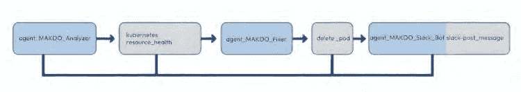
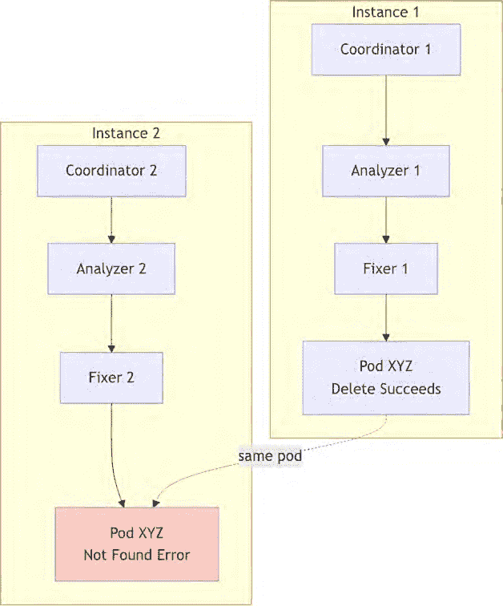
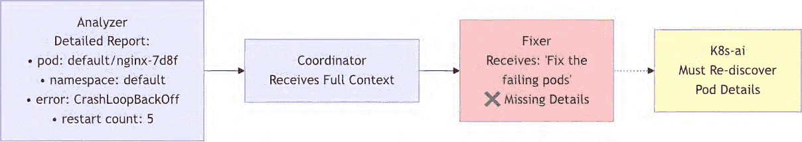
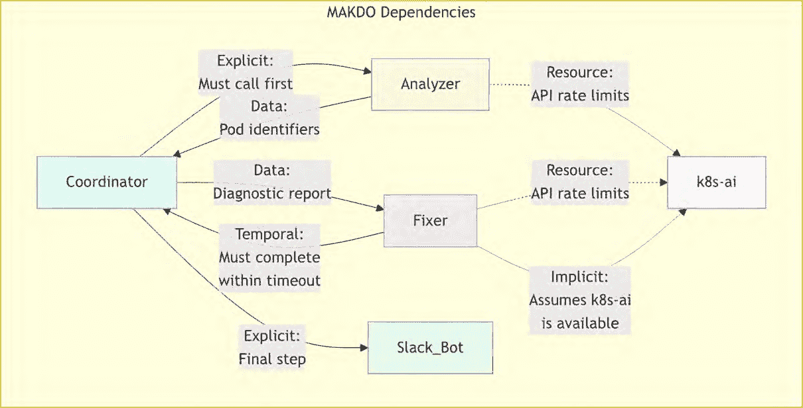
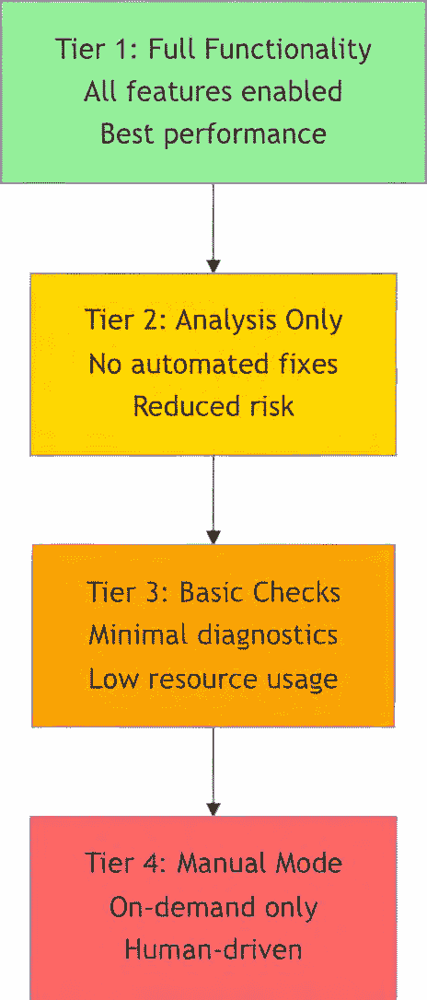
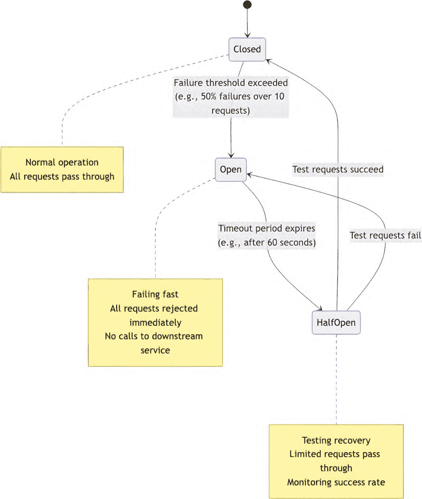

## 10 多智能体系统的测试、调试与故障排除

在上一章中，我们构建了 MAKDO，这是一个用于 Kubernetes DevOps 的完整多智能体系统。我们看到了 `Coordinator`、`Analyzer`、`Fixer` 和 `Slack_Bot` 智能体如何使用 MCP 和 A2A 协同工作，来自动化集群健康监控与修复。我们实现了该系统，通过 MCP 将其连接到 k8s-ai 和 Slack 等外部工具，并端到端地运行了它。

构建多智能体系统是一回事；让它们在生产环境中可靠运行又是另一回事。多智能体系统会以传统软件不会出现的方式失效。智能体会产生幻觉。它们会误用工具。它们在智能体之间交接工作时会丢失上下文。协调会中断。这些失败往往是非确定性的，难以复现。

本章涵盖了高效测试、调试和排障多智能体系统所需的全部内容。我们首先探讨常见的失败模式，如幻觉和协调中断。然后，我们探索使智能体行为可见的插桩与可观测性策略。接着，我们深入调试工具使用并诊断智能体之间的协调失败。最后，我们讨论如何通过冗余、优雅降级、重试逻辑和人工升级模式来设计韧性。在本章中，我们使用 MAKDO 作为具体示例，在实践中阐释这些概念。

本章涵盖以下关键主题：

- 智能体系统中的常见失败模式
- AI 智能体的插桩与可观测性
- 调试工具使用与函数调用链
- 诊断多智能体工作流中的协调失败
- 设计韧性与可恢复性

那么，让我们开始吧！

### 智能体系统中的常见失败模式

理解多智能体系统如何失败，是构建健壮、生产就绪的智能体 AI 系统的第一步。与传统软件中失败通常是确定性和可复现的不同，AI 智能体的失败可能非常微妙、依赖上下文，并且难以诊断。请记住，多智能体系统的每一轮都可能涉及数十次或数百次 LLM 调用，与工具执行交错进行，这使得失败面大大增加。此外，LLM 会引入非确定性，导致对于完全相同的输入，多次运行的一致性无法保证。

本节探讨你在使用智能体系统时最常遇到的失败模式。

#### 智能体幻觉

智能体幻觉是指智能体生成看似合理但在事实上不正确或从未真实发生过的信息。在智能体系统中，这可能特别危险，因为幻觉可能嵌入到工具调用、推理链或报告结果中。让我们探讨它是如何发生的：

- **捏造的工具响应**：智能体可能声称已经成功执行了某个工具，但实际上并未执行，或者报告从未发生过的结果。例如，一个智能体可能说“我已经将应用程序部署到生产环境”，而它只执行了试运行命令；或者声称“数据库查询返回了 1,523 条记录”，而实际上查询失败了。

  在 MAKDO 中，`Fixer` 智能体可能报告“成功重启了 Pod default/nginx-abc123”，但实际上它从 k8s-ai 收到了超时，从未确认重启成功。协调器收到这条捏造的成功消息后，会告诉 `Slack_Bot` 通知人类问题已解决，而此时 Pod 仍在故障中。

- **臆造上下文**：智能体可能引用并不存在的文件、配置或资源。一个智能体可能说“我检查了 `config.yaml` 文件并找到了该设置”，而实际上仓库中根本没有这个文件。

  MAKDO 的 `Analyzer` 在报告问题时可能会幻觉生成 Pod 名称。它可能声称“Pod default/payment-service-7f9d8 正在失败”，而实际失败的 Pod 名为 `default/payment-service-7f9d8c`。当 `Fixer` 智能体尝试使用这个幻觉名称进行修复时，k8s-ai 返回“未找到 Pod”，实际问题却得不到解决。

- **错误的关联与因果**：智能体可能错误地将事件或动作关联起来。一个智能体可能说“部署失败是因为最近的 DNS 变更”，而实际上该 DNS 变更与真正的失败原因毫无关系。

  例如，`Analyzer` 智能体可能看到某个 Pod 在部署更新后不久开始失败，于是得出结论认为是部署导致了失败。实际上，Pod 失败是因为镜像仓库暂时不可用，这与部署完全无关。`Analyzer` 智能体的错误诊断导致 `Fixer` 智能体回滚了一个本无问题的部署。

- **推理中的合成数据**：在多步推理过程中，智能体可能引入听起来合理但虚构的数据点，这些数据点会级联到后续步骤，最终导致自信但错误的结论。

  例如，在分析资源限制时，MAKDO 的 `Analyzer` 可能编造内存使用量，比如“Pod 已使用了其 2GB 限制中的 2.3GB”，而 k8s-ai 从未报告过这些具体指标。这些虚构数据会进入 Slack 报告，从而误导人类运维人员对实际资源状况的判断。错误的指标远比没有指标更糟糕，因为它们可能导致基于虚假信息做出破坏性的操作。

以下是一些减少幻觉的缓解策略：

- 要求智能体引用实际的工具输出，而不是进行总结。
- 实施严格的验证层，将声称的动作与实际执行日志进行核对。
- 使用带有明确成功/失败指示器的结构化输出。
- 使用独立的验证工具交叉验证智能体的声明。
- 将工具执行日志与智能体的叙述分开记录。
- 为智能体输出添加置信度评分和不确定性确认。

幻觉是一个真实存在的问题，但 LLM 在减少幻觉发生方面正在不断改进，同时我们也可以使用上述缓解策略来控制这一问题。然而，随着智能体 AI 系统借助更多工具扩展其能力范围，工具使用方面的问题会变得更加严重。

#### 错误的工具使用与工具误用

错误的工具使用是指智能体为当前任务调用了不正确的工具，这可能是由于误解了工具的目的，或错误解读了任务要求。这可能导致无效甚至有害的操作。工具误用则是指智能体使用了正确的工具，但使用方式不正确、低效或危险。与幻觉（智能体编造信息）不同，工具误用涉及真实执行但未能达到预期目标的工具调用，例如以下几种情况：

- **无效的工具参数**：智能体可能构造出语法正确但语义不正确的工具调用。例如，部署智能体可能指定了错误的集群名称，或使用了已弃用的 API 版本，导致下游静默失败。

  或者，智能体可能在需要绝对路径时传入了相对路径。

  MAKDO 的 `Fixer` 可能以错误的命名空间调用 k8s-ai 的 `delete_pod` 技能。当故障 Pod 实际位于 `"default"` 命名空间时，它发送了 `namespace: "production"`。k8s-ai 工具执行成功（生产环境中没有该名称的 Pod），但实际故障的 Pod 依然未被处理。`Fixer` 智能体报告成功，协调器智能体继续推进，问题持续存在。

- **工具链错误**：当智能体需要依次使用多个工具时，它们可能跳过必要的中间步骤，或以错误的顺序执行。考虑一个在检出正确分支之前就运行测试的代码审查智能体，或一个在验证配置之前就应用配置的部署智能体。

  协调器智能体可能告诉 `Fixer` 智能体“重启故障 Pod 并验证其健康状态”。`Fixer` 智能体通过 k8s-ai 删除了 Pod，但从未回调确认新 Pod 是否成功启动。它向协调器智能体报告“修复完成”，却没有检查 Kubernetes 是否真的重新调度了该 Pod。如果 Pod 由于资源限制无法重启，那么在下一次健康检查周期之前，不会有人注意到。

- **不恰当的工具选择**：智能体可能为任务选择错误的工具，例如在需要执行更新时使用了删除操作，或者在简单的查询就能满足需求时调用了昂贵的搜索 API。智能体也可能在明显需要使用工具时完全不使用工具，或者在一个工具就足够时使用多个工具。


- **资源密集型模式**：代理可能会以有效但极其低效的方式使用工具，例如在循环中逐个调用 API 而不是使用批量操作，或重复获取相同数据而不进行缓存。
- **危险的参数组合**：代理可能会以产生意外副作用的方式组合有效参数。同时设置强制标志和递归标志单独使用时可能有效，但一起使用会导致数据丢失。

以下是一些减少错误工具使用和滥用的缓解策略：

- 精心整理并记录工具的能力和限制
- 最小化每个代理可用工具的数量，以降低选择复杂性
- 通过语义检查实施严格的工具输入验证
- 在工具描述中嵌入工具使用指南
- 为危险操作添加安全护栏（确认提示、试运行模式）
- 监控工具使用模式以检测低效或可疑行为
- 使用工具调用验证代理在执行前审查计划的操作
- 实施防止某些参数组合的护栏
- 仔细管理工具权限和访问级别
- 在代理提示中提供工具使用模式示例

这些缓解策略的组合可以显著减少工具使用失败。然而，即使 LLM 没有产生幻觉并正确使用了所有可用工具，有时它们仍然无法正确遵循指令。

### 指令遵循不佳

代理可能会误解或未充分遵循用户指令，导致任务执行不正确或不完整。这种失败模式尤其令人沮丧，因为代理看似在正常工作，但产生的结果与要求不符。以下是一些示例：

- **选择性关注指令**：代理可能只关注部分指令，而忽略关键约束或要求。例如，用户要求“部署到暂存环境并在 Slack 上通知团队”，但代理只执行了部署，忘记了通知步骤。或者指令指定“使用 Python 3.11”，但代理默认使用任何可用版本。协调者的系统提示可能说：“在 Analyzer 和 Fixer 完成后，始终将详细结果发布到 Slack。”但在处理健康检查时，协调者调用 `Analyzer`，收到报告，然后立即调用 `Fixer`，而没有发布到 Slack。直到所有修复完成后才记得通知人类，因此团队在尝试修复之前看不到发现的问题。
- **过度泛化**：代理可能将特定指令解释得过于宽泛。当被要求“修复登录函数中的 bug”时，代理可能会重构整个认证系统，引入不必要的更改和潜在的新问题。
- **泛化不足**：相反，代理可能将指令解释得过于狭窄。当被要求“更新所有配置文件”时，代理可能只更新带有 `.config` 扩展名的文件，而遗漏了同样包含配置的 `.yaml`、`.json` 或 `.toml` 文件。
- **忽略隐含需求**：经验丰富的开发人员理解代理可能遗漏的隐含约束。“添加一个新的 API 端点”隐含地意味着添加测试、文档和适当的错误处理，但代理可能只添加最基本的最小端点代码。
- **长对话中的指令丢失**：随着对话变长，代理可能会丢失早期指令或约束。初始要求如“保持向后兼容性”或“遵循现有命名约定”可能会在代理专注于最新消息时被遗忘。
- **歧义处理不当**：当指令模糊时，代理可能会在未寻求澄清的情况下做出假设。“让它更快”可能意味着优化运行时间、减少延迟或提高吞吐量，但代理会在未确认的情况下选择一种解释。
- **优先级混淆**：当给定多个任务或约束时，代理可能无法理解哪些是关键任务，哪些是可选的。“快速部署修复，但确保测试通过”可能导致代理为了速度而跳过测试，而测试通过应该是不可妥协的。

以下是一些改善指令遵循的缓解策略：

- 将复杂指令分解为明确的编号步骤
- 使用结构化格式，如检查清单或需求列表
- 同时包含正向指令（“做 X”）和负向约束（“不要做 Y”）
- 在长对话中重复关键约束
- 要求代理在执行前确认其理解
- 提供正确和错误结果的示例
- 对需求使用明确的优先级标记（“必须”、“应该”、“可以”）
- 实施指令验证代理，检查任务计划是否与原始请求一致
- 维护跨对话轮次持续存在的“需求上下文”
- 使用具有专门用于约束、目标和成功标准的部分的结构化提示

指令遵循是 LLM 提供商的重点关注领域，他们投入大量精力进行训练，因为这至关重要。加上强大的缓解策略，你可以得到一个能够正确遵循指令的可靠系统。但即使正确遵循了指令，有时代理式 AI 系统仍可能陷入持续空转的状态，无法收敛到最终响应，只是一次又一次地调用更多工具，永无止境。

### 无限循环与失控代理

代理系统可能会在代理反复尝试相同的失败操作或陷入循环推理模式时进入无限循环，例如以下几种情况：

- **无学习重试循环**：代理遇到错误，使用相同参数重试相同操作，再次失败，然后无限重复。当代理不保留先前尝试的记忆或不分析操作失败的原因时，这种情况很常见。

  例如，MAKDO 的 `Fixer` 试图删除一个不存在的 Pod（也许它已被删除）。k8s-ai 返回“找不到 Pod”。`Fixer` 代理将其解释为暂时性错误，并重试相同的删除命令。它再次失败。`Fixer` 代理不断重试，没有意识到 Pod 已经不存在，消耗大量 API token，直到达到重试限制。

- **循环委派**：在多代理系统中，代理可能来回委派任务而没有任何进展。例如，代理 A 向代理 B 寻求帮助，代理 B 认为代理 A 更合适，然后它们无限循环。请注意，这不是层级委派的问题，在层级委派中，父代理总是将任务委派给子代理。

- **资源耗尽**：失控代理可能消耗过多的 API token，进行数千次工具调用，或生成大量日志数据，导致成本超支和系统不稳定。

  例如，MAKDO 健康检查循环中的一个 bug 导致它每秒钟启动一次新的健康检查，而不是每 60 秒一次。每次检查都会调用 `Analyzer`，而 `Analyzer` 会发出多个 k8s-ai 请求。几分钟内，MAKDO 进行数千次 LLM 调用，反复分析相同的集群状态。OpenAI API 账单飙升，k8s-ai 服务器日志填满磁盘。

以下是一些防止无限循环和失控代理的缓解策略：

- 实施具有指数退避的最大迭代限制
- 跟踪代理操作历史并检测重复模式
- 使用在连续失败后停止执行的熔断器
- 通过警报和自动切断监控资源消耗
- 在代理提示中实施明确的终止标准
- 添加预算，使代理只能花费合理数量的资源

利用这些策略可以确保单个代理不会卡住。在多代理系统中，即使每个代理本身运行良好，当代理之间的沟通或协调失败时，也会出现系统性问题。

### 沟通与协调崩溃

多代理系统依赖于代理之间的有效沟通。当这种沟通崩溃时，整个系统可能失败。以下要点探讨了这种情况是如何发生的：

- **消息格式不兼容**：代理可能生成其他代理无法解析格式的输出。例如，一个代理输出 JSON，而另一个代理期望 YAML，或者发送方和接收方之间的字段名不匹配。

- **交接中的上下文丢失**：当任务在代理之间委派时，早期交互中的关键上下文可能会丢失。例如，支持代理将任务移交给技术代理，但忘记包含客户的账户详细信息或之前的故障排除步骤。

  另一个例子是协调者告诉 `Analyzer`：“检查集群健康。”`Analyzer` 发现三个失败的 Pod，并返回包含 Pod 名称、命名空间和错误消息的详细报告。然后 `Coordinator` 代理告诉 `Fixer` 代理：“修复这些问题”，但没有传递需要修复哪些特定的 Pod。`Fixer` 不得不再次调用 k8s-ai 来重新发现失败的 Pod，使诊断工作加倍并浪费 token。

- **竞态条件**：当多个代理并发处理相关任务时，它们可能相互干扰。例如，两个部署代理可能同时修改同一配置，或者多个代理可能锁定彼此需要的资源。

  另一个例子是两个 MAKDO 实例同时运行（可能是误启动的）。两个协调者都为其 `Analyzer` 代理调用同一个集群。两个 `Analyzer` 代理都识别出同一个失败的 Pod。两个协调者都告诉各自的 `Fixer` 代理删除它。两个 `Fixer` 代理都调用 k8s-ai 删除该 Pod。第一个成功，

### 多代理系统的测试、调试与故障排除

而第二个却收到“找不到 pod”。第二个`Fixer`向协调器报告失败，协调器在Slack上发布错误消息“修复失败”，而实际上Pod已被第一个实例成功删除。

#### 目标冲突

不同代理针对不同目标进行优化，可能会产生相互矛盾的效果。例如，成本优化代理会缩减资源，而性能代理则会扩展资源。

以下是一些改善通信与协调的缓解策略：

- 定义严格的带验证的消息模式
- 使用结构化的交接协议，包含强制上下文字段
- 实现分布式协调机制，如锁或共识协议
- 建立清晰的代理层级结构和冲突解决策略
- 维护所有代理都可访问的共享状态

复杂的多代理系统通常需要在准确性和质量与速度和成本之间进行权衡。这也会影响单个代理，但在多代理系统中，延迟会加剧。如果响应太慢，可能为时已晚，或者用户体验不佳。让我们看看如何解决这些问题。

#### 超时和延迟问题

现实世界中的代理系统在时间限制下运行，延迟问题可能会在系统中级联传播：

- **工具执行超时**：外部工具可能耗时超过预期，导致代理超时或基于不完整信息做出决策。例如，数据库查询运行缓慢、部署超时或API调用挂起。
- **级联延迟**：当代理相互依赖时，延迟会加剧。如果代理A等待代理B 30秒，而代理B又等待代理C 30秒，代理C也需要30秒才响应，那么用户将经历不可接受的90秒以上响应时间。
- **代理卡死**：代理可能正在等待永远不会到来的响应——一个永远不会触发的webhook、一个永远不会创建的文件，或一条在传输中丢失的消息。

以下是一些处理超时和延迟问题的缓解策略：

- 为每个工具和代理交互设置合理的超时时间
- 并行运行独立任务以减少总体延迟
- 实现异步模式，使代理不会阻塞在慢操作上
- 添加进度指示器和部分结果流式传输
- 针对操作超时设计优雅降级方案
- 使用带退避机制的超时感知重试逻辑
- 考虑为代理之间传递的数据打上TTL时间戳，以便刷新过期数据

好了，我们已经缓解了超时和延迟问题，但故事还没有结束。LLM是无状态的，但代理式AI系统是有状态的。管理这种状态并非易事。

#### 状态管理和一致性错误

在多个代理和工具执行之间维护一致的状态具有挑战性：

- **过期状态**：代理基于过时的信息做出决策。例如，代理检查部署是否就绪。起初检查成功，但等到代理执行下一步操作时，部署已经出现问题。
- **状态同步失败**：在分布式系统中，不同代理可能对当前状态持有不同视图。例如，代理A认为资源存在，而代理B看到资源已被删除。
- **部分失败**：当多步骤操作中途失败时，系统可能处于不一致状态。例如，基础设施只配置了一半，或者某些配置已应用而另一些未应用。
- **内存泄漏和上下文膨胀**：随着对话变长，代理可能积累过多上下文，导致性能下降或超过token限制。

以下是一些改善状态管理和一致性的缓解策略：

- 实现具有回滚能力的事务类模式
- 使用版本号或时间戳检测过期状态
- 采用分布式状态管理系统
- 实现定期状态协调
- 设置上下文窗口限制并实现智能上下文剪枝
- 将复杂任务拆分为可由不同代理处理的更小、可管理的子任务

#### 安全和权限故障

代理系统通常以提升的权限运行，这使得安全故障尤其危险，例如以下方面：

- **权限提升**：代理可能尝试执行本不该有权限的操作，可能是由于错误配置，或通过学会以意外方式利用工具
- **凭据泄露**：代理可能在错误消息或工具输出中无意地记录、传输或暴露敏感凭据
- **恶意输入利用**：精心构造的用户输入可能操纵代理行为，使其执行非预期操作或绕过安全检查
- **审计追踪缺口**：如果没有适当的日志记录，可能无法确定代理采取了哪些操作，从而使安全调查变得困难

以下是一些增强安全和权限的缓解策略。其中大多数是适用于任何系统的通用最佳实践，但在代理系统中尤为关键：

- 对所有工具访问实施最小权限原则
- 在高风险操作前添加显式权限检查
- 对所有输入到代理的数据进行清理和验证
- 切勿在代理提示词或工具参数中包含凭据
- 维护所有代理行为的全面审计日志
- 对敏感操作使用人工审批环节

如你所见，多代理系统有许多可能失败的方式。通过理解这些常见故障模式，你可以设计更健壮的代理，实施有效的监控，并构建故障排除策略，以便在问题出现时快速诊断和解决。

另一个重要方面是可观测性。

#### AI代理的插桩与可观测性

可观测性对于理解代理式AI系统内部发生的事情至关重要。与传统软件不同，传统软件可以用调试器逐行查看代码，而AI代理通过一系列难以追踪的LLM调用、工具执行和状态转换来运行。有效的插桩将这些“黑盒”系统转变为“玻璃盒”系统，让你能够精确看到每一步发生的情况。

正如在*从黑盒到玻璃盒：LLM可观测性实践*（https://medium.com/@the.gigi/from-black-box-to-glass-box-llm-observability-in-action-150266e995d2）中所探讨的，全面的可观测性需要捕获多层信息，包括发送给LLM的提示词、收到的响应、调用的工具、中间推理步骤以及最终结果。

在本节中，我们将探讨代理系统插桩的最佳实践，包括核心可观测性原语、结构化日志格式、专门的LLM可观测性工具、要跟踪的关键指标、实时监控策略、调试技术和隐私考虑。

#### 核心可观测性原语

构建可观测的代理系统始于对基础操作进行插桩。让我们分解一下你应该捕获的关键可观测性原语。

#### LLM调用追踪

每次与LLM的交互都应记录完整上下文，包括完整提示词、模型参数（temperature、max tokens等）、完整响应、token使用量、延迟以及任何错误。这将为所有AI决策创建审计追踪。

对于MAKDO，你需要捕获所有四个代理的每一次LLM交互。当协调器决定调用`Analyzer`时，记录协调器的提示词（包括系统消息和对话历史）、使用的模型（GPT-4o）、生成的工具调用（`agent_MAKDO_Analyzer`，带有特定消息）、token数量和延迟。当`Analyzer`处理请求时，也要记录它与LLM的类似交互。这将创建完整的决策轨迹，展示MAKDO为何采取每个操作。

#### 工具执行日志

捕获每次工具调用，包括输入参数、执行持续时间、输出结果以及成功/失败状态。对于错误，包含堆栈跟踪，以及关于调用该工具原因的背景信息。

在MAKDO中，记录从`Analyzer`和`Fixer`到k8s-ai的每次A2A调用。捕获技能名称（`kubernetes_resource_health`）、参数（`cluster name`、`namespace`）、k8s-ai的完整响应以及时序。同时记录`Slack_Bot`的MCP工具调用（`slack_post_message`，包含频道和消息内容）。调试时，你可以精确重建每个代理发送给外部系统的数据以及它们收到的响应。


### 代理状态快照

定期捕获代理的内部状态，包括工作记忆、对话历史、累积的上下文和决策依据。这有助于理解状态如何随时间演变。在计算机使用或浏览器自动化场景中，应在每个代理动作后捕获屏幕截图。

### 跨度与追踪层级

将日志组织为层级化追踪，用户请求创建父跨度，每个代理动作（LLM 调用、工具执行和子代理委派）创建子跨度。这类似于微服务中的分布式追踪。

一次 MAKDO 健康检查会创建如下的跨度层级：

```
Health check (root) → Coordinator LLM call → agent_MAKDO_Analyzer tool call → Analyzer
LLM call → kubernetes_resource_health A2A call → Analyzer LLM call (processing results)
→ agent_MAKDO_Slack_Bot tool call → slack_post_message MCP call
```

每个跨度都有计时和状态。如果 Slack 通知失败，你可以通过层级结构向后追踪，精确查看哪些调用成功以及失败发生在哪里。

### 元数据增强

为每个操作标记上下文元数据，如用户 ID、会话 ID、代理类型、任务类别和环境（开发/暂存/生产）。这支持跨多个维度的筛选和分析。

为 MAKDO 操作标记 `cluster_name: "kind-makdo-test"`、`health_check_cycle: 47`、`agent_type: "analyzer"` 和 `operation_type: "diagnostics"`。当你需要调试为什么 `Analyzer` 持续错误识别 Pods 时，查询该特定集群上的所有 `Analyzer` 诊断操作，并检查多个健康检查周期中的模式。

### 结构化日志与追踪格式

原始日志难以查询和分析。结构化日志使可观测性数据可查询且可操作。这是任何生产级系统的最佳实践，但对复杂的代理式 AI 系统尤为重要。大多数语言都有成熟的结构化日志库（例如，Python 的 `structlog`、Node.js 的 `Winston` 和 Go 的 `Logrus`）。利用这些库一致地输出结构化日志。以下是一些建议遵循的最佳实践：

- **JSON 结构化事件**：以一致的模式输出结构化 JSON 日志，包括时间戳、追踪 ID、跨度 ID、父跨度 ID、事件类型和事件特定字段。这支持高效查询和聚合。
- **标准化事件类型**：定义事件分类法，如 `agent.start`、`agent.complete`、`llm.request`、`llm.response`、`tool.invoke`、`tool.complete` 和 `error.occurred`。一致的事件类型支持自动化分析。
- **关联 ID**：使用关联 ID 关联跨代理、服务和系统的相关操作。单个用户请求应有一个贯穿整个系统的关联 ID。
- **模式语义化版本控制**：随着可观测性模式演进，对其进行版本管理，以便解析历史日志并保持分析工具的向后兼容性。

### LLM 专用可观测性工具

针对基于 LLM 的系统，已经出现了多种专业工具：

- **Datadog LLM 可观测性**：Datadog 提供专门的 LLM 可观测性能力，可自动捕获并可视化 LLM 交互。它追踪提示模板、模型调用、令牌用量、延迟指标以及跨多个 LLM 提供商的成本分析。Datadog 的 LLM 可观测性与 LangChain 和 LlamaIndex 等流行框架集成，为代理式应用提供开箱即用的插桩支持。它能以极少的代码改动追踪多轮对话、代理工作流和工具使用模式。我在 Invisible Platforms（`https://getinvisible.com/`，已被 Perplexity 收购）使用 OpenTelemetry（`https://opentelemetry.io/`）和 Datadog LLM 可观测性实现了一个 LLM 可观测性解决方案。它对于诊断棘手问题和性能瓶颈非常宝贵。

  关键特性包括以下内容：

  - 自动捕获提示和完成内容
  - 按请求追踪令牌用量和成本
  - 延迟百分位数和性能分析
  - 错误率监控和告警
  - 与现有 APM 和基础设施监控集成

- **LangSmith**：LangChain 的可观测性平台提供 LangChain 应用的详细追踪，包括代理推理链、工具使用和检索步骤。它提供可视化界面，用于探索追踪和调试代理行为。
- **Weights & Biases (W&B)**：为 LLM 应用提供提示追踪、模型性能监控和实验比较。它特别适用于追踪提示工程迭代和对不同代理配置进行 A/B 测试。
- **Helicone**：为 LLM API 提供实时监控、缓存和分析。通过统一界面，跨多个 LLM 提供商追踪成本、延迟和成功率。
- **自定义插桩框架**：许多团队以 OpenTelemetry 为基础构建自定义可观测性层，为标准分布式追踪添加 LLM 特定的上下文和元数据。

### 代理性能的指标与 KPI

你无法管理无法度量的东西。定义量化指标来追踪代理的健康和性能，建立正常运行的基线，并在出现问题及时发生时发现。这些指标有多重用途：帮助理解系统行为、证明基础设施投资合理性、优化成本，以及向利益相关者证明价值。

**成功率指标**告诉你代理是否真的在完成分配的任务。任务完成率下降可能表明提示漂移、环境变化或工具可靠性下降。以下是示例成功率指标：

- 任务完成率（成功完成任务的百分比）
- 首次尝试成功率（无需重试即完成）
- 工具调用成功率（成功的工具调用百分比）

**性能指标**揭示系统的响应速度以及代理的运行效率。每个任务的高 LLM 调用次数可能表明推理模式低效或存在不必要的重试，从而推高成本和延迟。以下是示例性能指标：

- 端到端延迟（从用户请求到最终响应）
- LLM 调用延迟（p50、p95、p99 百分位数）
- 工具执行延迟
- 每个任务的 LLM 调用次数
- 每个任务的工具调用次数

**成本指标**对于生产系统至关重要，因为令牌用量直接转化为云账单。每个请求的成本突然飙升可能表明代理失控、提示词低效，或者代理使用了超出必要的高价模型。以下是示例成本指标：

- 每个请求的令牌用量（提示令牌 + 完成令牌）
- 每个请求的成本（基于模型定价）
- 每次成功完成任务的成本
- 成本效率（成功完成数 / 总成本）

**质量指标**评估代理是否生成了正确、有用的输出。这些指标通常更难自动测量，但对于理解超越简单成功/失败的真实性能至关重要。以下是示例质量指标：

- 幻觉率（检测到的捏造信息）
- 指令遵循准确率
- 输出格式合规率
- 用户满意度评分（如果有）

**系统健康指标**提供性能下降的早期预警信号。超时率上升可能先于系统完全故障，让你在用户受到严重影响之前有时间调查和补救。以下是示例系统健康指标：

- 按错误类型统计的错误率
- 超时率
- 重试率
- 熔断器激活次数

### 实时监控与告警

被动的可观测性是不够的，因为只在出现问题后才查看所收集的指标，就像装好了安全摄像头却只在抢劫发生后回看录像。你需要通过主动监控和告警在问题影响用户之前将其捕获。目标是从被动救火转变为主动的问题检测。让我们讨论一些检测这些问题的最佳方法：

- **异常检测**帮助你捕获未预见的问题。自动检测异常模式，如错误率突然飙升、延迟异常增加或意外的工具使用模式。使用统计基线（如与均值的标准差）或机器学习模型来识别异常。这对于故障模式可能不可预测且依赖上下文的代理式系统尤其有价值。
- **基于阈值的告警**是已知严重情况的安全网。为关键阈值设置告警，如错误率超过 5%、平均延迟超过 10 秒或每小时成本超过预算限额。这些阈值需要仔细调优，以尽量减少误报，同时确保不遗漏真实事件。过多嘈杂的告警会导致告警疲劳，团队会忽略通知。
- **趋势分析**揭示缓慢发展的问题，避免其演变为危机。随时间追踪指标以识别逐渐退化。平均延迟缓慢增加或成功率下降可能表明在问题变得严重之前已经存在潜在问题。


这种“温水煮青蛙”式的情形尤为危险，因为没有任何单一数据点会触发警报，但累积效应会显著降低用户体验。

**成本失控检测**对于基于 LLM 的系统至关重要，因为成本可能会失控。实时监控 token 使用量和成本，以便在失控智能体消耗完你的全部预算之前发现它们。当每小时支出超出预期模式时发出警报，尤其是在你预期使用量较低的非高峰时段。如果没有适当的成本监控，凌晨2点发生并引发死循环的生产事故，可能在任何人察觉之前就花掉数千美元。

**与事件管理的集成**可确保警报在正确的时间送达正确的人。将可观测性工具连接到 PagerDuty 或 Opsgenie 等事件管理系统，实现待命告警和升级。定义升级策略，确保关键警报不会在 Slack 频道中被淹没，并确保始终有人负责响应生产问题。

现在，凭借可靠的可观测性数据，让我们看看如何调试智能体 AI 系统。

### 利用可观测性数据进行调试

可观测性数据只有在能够有效支持调试时才最有价值。收集数据的系统与支持调试的系统之间的区别在于，工程师能否快速回答诸如“为什么这个特定请求失败了？”或“昨天和今天之间发生了什么变化？”之类的问题。良好的可观测性数据应让根因分析像侦探工作一样，所有线索都摊在面前，而不是像大海捞针。

-   **追踪回放**是理解智能体行为的时光机。捕获完整的追踪，以便回放智能体的执行过程，准确了解发生了什么。包含所有提示词、响应、工具调用和中间状态，以重建事件的精确顺序。在调试非确定性故障时，这非常宝贵，因为你可以看到导致故障的实际提示词和响应，而不仅仅是关于“应该发生什么”的假设。

-   **上下文搜索**将原始日志转化为可查询的知识。支持按用户请求、错误信息、智能体类型或任何元数据字段搜索日志。“查找过去一小时内 Agent X 的所有失败部署”应该是一个简单的查询，而不是复杂的日志解析工作。使用一致元数据的结构化日志让这一切成为可能；花时间做好埋点，调试时就能节省成倍的时间。

-   **相关性分析**帮助你发现数据中的隐藏关系。分析指标之间的关系：增加提示词长度是否与更高的错误率相关？某些工具是否比其他工具有着更高的延迟？一天中的时段是否影响成功率？这些洞察往往能揭示出单独查看指标时并不明显的优化机会或潜在缺陷。

-   **对比调试**对于间歇性问题尤为有效。并排比较成功和失败的执行过程，以识别差异。成功的智能体做了哪些失败的智能体没有做的事情？它们是否使用了不同的工具、调用了更少的 LLM 次数，还是处理了不同的输入格式？这种技术常常能揭示决定成败的关键差异。

-   **时间序列可视化**能让表格数据中不可见的模式显现出来。使用 Grafana 或 Datadog 仪表板等工具，可视化指标随时间的变化。通过视觉发现模式、异常和趋势——人类识别视觉模式的能力远强于逐列扫描数字。在精心设计的仪表板上，延迟突然飙升或错误率逐渐上升都会立刻变得一目了然。

### 隐私与安全考虑

全面的可观测性如果处理不当，会带来泄露敏感信息的风险。可观测性系统一旦发生数据泄露，可能会暴露客户数据、商业机密或安全漏洞。必须通过以下方式谨慎地平衡可见性与安全性之间的这种张力：

-   **个人身份信息（PII）脱敏**应在埋点层自动执行并强制实施，而不是依靠人工。自动从日志中脱敏 PII。用户名、地址、电子邮件地址、信用卡号、社会安全号码及其他敏感数据绝不应出现在日志中。使用正则表达式或基于机器学习的检测，在日志写入前识别并脱敏 PII。更理想的是，从一开始就把埋点设计为不捕获 PII，只记录用户 ID 等标识符，并可通过授权且经审计的查询与客户数据关联。

-   **提示词净化**需要仔细考虑记录哪些内容。如果完整提示词包含用户数据或敏感的业务信息，请谨慎记录。可以考虑只记录经过净化或匿名化的版本，或将提示词单独记录并施以更严格的访问控制。对于高安全性应用，可以对提示词做哈希处理，只存储哈希值，这样既能检测重复问题，又不会暴露实际内容。

-   **访问控制**应遵循最小权限原则。根据角色限制对可观测性数据的访问，因为并非所有人都应看到包含客户数据的生产日志。工程师可能出于调试目的需要访问，但这种访问应被记录且可审计。可以考虑为紧急访问实施破玻璃（break-glass）流程，并自动通知安全团队。一些组织针对不同的安全层级维护独立的可观测性系统。

-   **保留策略**必须权衡相互冲突的需求。确定可观测性数据的保留时长，在调试需求、存储成本和合规要求之间取得平衡。近期数据应立即可用，而较旧的数据可以归档到更便宜的存储中，或进行聚合以减少数据量。许多法规要求特定的保留期限或最大保留上限，因此请确保你的策略符合适用规则。

-   **合规性**不是可选项。根据你的领域和司法辖区，确保可观测性实践符合 GDPR、HIPAA、SOC2 或其他标准等法规。这包括数据驻留要求（数据可以存储在哪里）、与可观测性供应商的数据处理协议，以及客户数据的删除权。将可观测性实践记录为合规审计的一部分，并随着法规的演变定期审查它们。

有了强大的可观测性基础设施，你就拥有了有效调试的基础。现在，让我们深入探讨调试工具使用和函数调用链这一具体挑战，这是智能体系统中最常见、也最令人沮丧的调试场景之一。

### 调试工具使用和函数调用链

工具使用是智能体与现实世界交互的环节，也是最常出错的地方。智能体可能会调用错误的工具、传递无效参数、误解工具结果，或者将工具错误地链接在一起。与停留在 LLM 内部的纯推理错误不同，工具使用失败会带来实际后果：部署失败、数据库更新错误或集成中断。调试这些问题需要同时理解智能体原本打算做什么，以及实际发生了什么。

#### 理解工具调用生命周期

让我们再次回顾 AI 系统、AI 框架、智能体和 LLM 如何与工具交互，并考量失败模式。每次工具调用都会经历一个可预测的生命周期，每个阶段都可能发生失败：

-   智能体根据其对任务和可用工具的理解来决定调用哪个工具。如果工具描述含糊不清、智能体误解了任务，或者多个工具看起来同样适用，这个决定就可能出错。

-   智能体为工具调用构造参数，将抽象意图转化为具体的实参。当智能体缺乏必要信息、误解参数语义，或生成语法有效但语义错误的值时，参数构造就会失败。


主机AI系统验证并调用工具，根据模式检查参数并执行实际操作。验证可以捕获明显的错误，但语义问题会漏掉。工具执行本身可能因外部因素而失败：API超时、权限错误或资源不可用。

工具返回结果，智能体必须解释这些结果。即使工具调用成功，如果智能体错误解释结果、忽略重要警告或未能验证操作是否达到预期效果，也可能引发问题。

理解这一生命周期有助于你精准定位故障发生的位置。工具调用从未发生，表明存在决策问题。工具调用参数无效，表明存在构建问题。工具调用已执行但未达到目标，表明存在解释问题。

### 追踪函数调用链

多步骤智能体工作流会创建工具调用链，每个智能体将下一个智能体作为依赖于先前结果的工具调用来调用。这些链会很快变得复杂：

- **线性链**是最简单的：工具A → 工具B → 工具C。调试线性链意味着验证每一步并确保上下文在步骤之间正确流转。链中任何一环断裂都会导致下游故障。

  MAKDO的典型工作流就是一个线性链。

  *图10.1：MAKDO典型工作流*

  

  如果Slack通知始终未到达，请向后追溯：`Slack_Bot`是否被调用？它是否收到了正确的消息？MCP工具是否执行？Slack API令牌是否有效？链中的每个环节都必须成功，整个工作流才能完成。

- **条件链**根据中间结果进行分支：工具A →（成功则：工具B，失败则：工具C）。智能体必须正确解释结果并选择正确的路径。调试需要同时理解分支逻辑以及条件是否被正确评估。请记住，所有决策都由LLM做出，因此提示设计对于诱导正确的逻辑至关重要。

  协调器根据`Analyzer`的结果做出条件决策。如果`Analyzer`报告`CrashLoopBackOff`，则调用`Fixer`。如果报告`ImagePullBackOff`，则跳过`Fixer`并通过`Slack_Bot`上报给人类。如果协调器总是选择错误的分支（例如针对`ImagePullBackOff`调用`Fixer`），问题出在其系统提示或它如何解释`Analyzer`的报告结构上。

- **并行链**并发执行多个工具：（工具A + 工具B + 工具C）→ 工具D。这样效率更高，但引入了协调挑战。所有并行操作都完成了吗？是否有失败？智能体在继续执行工具D之前是如何汇总结果的？

- **递归链**涉及智能体将自身作为工具调用（例如AI-6子代理）或创建循环：工具A → 工具B → 工具A（使用不同参数）。这些链条可能很强大，但如果终止条件管理不当，也容易陷入无限循环。

调试链时，从故障点向后追溯。哪个工具调用失败了？它的输入是什么？这些输入来自哪里？这种考古式的方法常常揭示出根因发生在链中更早的几步。

让我们来看一些常见的工具使用反模式和调试策略。

### 常见的工具使用反模式

以下是智能体系统中常见的工具误用模式。识别这些反模式有助于你快速定位可能的根本原因：

- **僵尸参数**：智能体包含了工具忽略或无法识别的参数。这通常发生在工具API变更但智能体提示未更新时，或者智能体基于类似工具幻觉出一些参数。僵尸参数很隐蔽，因为工具调用“成功”了，但行为却不符合预期。

  例如，`Fixer`调用k8s-ai的`delete_pod`时附带了一个额外参数：`force: true`。k8s-ai不支持`force`参数（它没有通过A2A接口暴露该参数）。k8s-ai忽略该参数并执行普通删除。`Fixer`以为执行了强制删除，但实际上执行的是优雅删除。在调试为什么Pod需要30秒才能终止时，你会发现强制删除标志并未生效，因为k8s-ai静默地忽略了它。

- **过早优化**：智能体试图在一次工具调用中完成过多操作，传递复杂的嵌套结构或同时执行多个操作。这使调试更加困难，并且常常因为工具不支持这种复杂用法而失败。将操作拆分为更小、更简单的工具调用通常更可靠。这在具有大量命令和选项的复杂CLI工具中很常见，例如kubectl、`git`或`bash`（bash可以运行主机上安装的任何其他命令，包括安装新命令）。

  例如，`Analyzer`试图通过一次k8s-ai调用诊断所有命名空间中的所有Pod，传递了一个复杂的查询结构。k8s-ai返回部分结果或超时。更好的方法是每个命名空间调用一次`kubernetes_resource_health`，然后在`Analyzer`中聚合结果。这样工具调用更简单，执行更可靠，并且在某个命名空间失败时更容易调试。

- **假设状态**：智能体假设资源存在或处于某种状态，而不进行验证。它尝试更新一个不存在的文件，部署到一个离线的集群，或查询一个尚未创建的数据库表。在可能的情况下，执行操作前务必验证前置条件。

- **忽略错误**：智能体收到工具的错误响应，却继续执行，仿佛操作已经成功。这通常是因为智能体过度优化了正常路径，没有正确处理错误响应。随着后续工具对不存在或状态无效的数据进行操作，故障会级联放大。

- **疯狂重试**：智能体不改变任何东西就反复重试失败的操作。当等待先前操作完成时，这有时是正确的。然而，如果工具调用因参数无效而失败，使用相同参数重试仍会失败。有效的重试需要改变参数、等待外部条件变化，或者完全换一种方法。

让我们看看调试和预防这些问题的策略。

### 工具使用的调试策略

当工具调用出错时，我们需要一种系统化的调试方法。以下策略十分有效：

- **回放并检查**：捕获确切的工具调用（名称、参数和上下文）并单独回放。在智能体外部它能成功吗？如果能，问题出在智能体调用它的方式上。如果不能，问题出在工具本身或其依赖上。

- **参数验证**：独立验证每个参数是否合理。不要只检查类型——还要验证语义。这个文件路径有效吗？这个集群名称存在吗？这个ID格式正确吗？创建智能体在执行高风险操作前可以调用的验证工具，或者编写带有验证逻辑的包装器，并将这些包装器作为工具暴露出来。

- **结果验证**：在工具调用成功后，验证操作是否达到了预期意图。API可能返回“200 OK”，但由于业务逻辑错误，实际上并未执行操作。应让智能体明确检查资源是否已创建、文件是否已写入或配置是否已应用。同样，这可以通过一个包装工具来实现，该工具在调用真实工具后执行验证。

- **差异分析**：将失败的工具调用与成功的调用进行对比。有什么不同？参数？时机？上下文？环境因素？通常，差异会揭示出根本原因。

- **影子工具**：实现影子工具，只记录调用而不实际执行。在开发期间使用这些工具来验证智能体是否在允许真实操作之前正确调用工具。这对于删除或部署等破坏性操作尤其有价值。

为了降低工具使用错误的发生率，请考虑在智能体AI系统中构建护栏。

### 构建工具使用护栏

预防胜于调试。你应该构建护栏，在工具使用错误引发问题之前将其拦截。以下是一些有效的护栏：

- **模式验证**：强制执行严格的参数模式，并在执行前拒绝无效的工具调用。使用JSON Schema或类似的验证来捕获类型错误、缺少必填字段或超出允许范围的值。

- **试运行模式**：为所有破坏性操作支持试运行或预览模式。智能体可以通过调用带`dry_run=true`的工具来查看将要发生什么，而无需实际执行。这可以在许多错误影响生产之前将其捕获。

- **确认提示**：对于高风险操作，要求明确确认。智能体描述它将要执行的操作，并且必须在执行前进行确认。这为人在回路的审查提供了一个自然的断点。

- **工具兼容性检查**：当智能体将工具串联使用时，验证输出格式是否符合输入要求。如果工具A返回JSON，而工具B期望YAML，请在执行前捕获这种不兼容。

- **速率限制和熔断器**：通过限制工具在时间窗口内的调用次数，防止工具使用失控。如果智能体在一分钟内调用同一个工具50次，那一定是出了问题。系统应暂停执行并提醒人类进行调查。

我们已经深入介绍了如何诊断、调试以及构建护栏来解决工具使用问题。接下来，让我们考虑如何诊断在多智能体系统中普遍存在的协调失败。


### 诊断多代理工作流中的协调失败

多代理系统的力量源自协调。多个代理协同工作，以完成任何单个代理都无法独立处理的复杂任务。然而，这种协调也引入了难以诊断的新故障模式。与具有明确根本原因的单代理故障不同，协调失败通常源于代理之间的交互，因此更难隔离和调试。

当代理协调不当，症状可能很微妙：任务部分完成、工作重复、操作冲突，或系统看似挂起的莫名死锁。这些故障无法简单归入传统调试类别，因为问题不在于某个单一组件，而在于组件之间的交互方式。

本节提供系统性方法，用于诊断多代理工作流中的协调失败、理解故障发生的位置，并实施预防策略。

#### 理解协调失败模式

诊断协调失败的第一步，是识别失败正在发生，并理解系统的交互模式。协调失败会以不同于单代理故障的特征模式显现。下面讨论一些常见的协调失败症状。

首先是**部分任务完成**，这是协调失败最清晰的信号之一。整体任务看似“完成”，但关键步骤缺失。例如，代理A完成自己的工作并移交给代理B，但代理B从未收到工作，或不知道该如何处理。结果是任务完成了80%却陷入停滞。用户反馈“有些东西不正常”，但说不清到底哪里出了问题。单个代理在各自狭窄的任务上都成功了，而整体目标却失败了。下图说明了这一概念：


*图10.2：当代理D从未启动时，部分任务完成导致工作流停在80%*

在MAKDO中，协调代理调用`Analyzer`代理，获取诊断报告，然后调用`Fixer`代理进行修复。`Fixer`成功删除了故障Pod。但协调代理从未调用`Slack_Bot`通知团队。修复已完成，集群已恢复，但人类无从得知。他们几小时后查看Slack，没有看到任何更新，不知道问题是否已解决，可能会手动干预一个已经解决的问题。

另一种失败模式是**重复工作**，当多个代理执行相同工作而不知另一代理已处理时发生。例如，两个部署代理都部署同一服务，两个数据处理代理都转换同一数据集，或两个客服代理都响应同一工单。这会浪费资源，并可能引发竞态条件或不一致状态。症状通常可见于指标：工具调用次数异常高、重复日志条目，或用户对单个请求收到多个响应。参见下图：



*图10.3：两个MAKDO实例同时处理同一个Pod导致重复工作*

由于时序缺陷，两个MAKDO健康检查周期几乎同时开始。两个协调器分别调用其`Analyzer`代理检查同一集群。两个`Analyzer`代理都识别出相同的三个故障Pod并上报。两个协调器随后分别调用其`Fixer`代理。两个`Fixer`代理都试图通过k8s-ai删除相同的Pod。第一个成功，而第二个收到“pod not found”错误。两者都向Slack发布独立报告，用重复通知和相互冲突的结果让团队感到困惑。

另一个关键失败模式是**冲突操作**，当代理因不共享上下文或目标而各做各的、相互掣肘时发生。一个代理扩展基础设施，另一个则收缩；一个代理关闭工单，另一个则升级；一个代理标记数据删除，另一个则归档。系统在矛盾状态之间反复震荡，可能永远无法收敛到期望结果。这些冲突常表现为审计日志中频繁的状态变化，或配置来回振荡的资源。

**死锁和挂起**是最令人沮丧的协调失败。系统在没有任何明确错误的情况下停止进展。例如，代理A等待代理B，而代理B也在等待代理A，或者代理等待被其他代理锁定的资源，形成循环依赖。症状是延迟指标不断上升，任务永远无法完成，最终超时。用户感知是系统“冻结”或无响应：

*图10.4：死锁与循环等待，代理A和代理B相互等待*

**交接中的上下文丢失**表现为代理询问已经提供的信息、重复提问，或做出忽略工作流早期关键上下文的决策。例如，客户向代理A解释问题，代理A移交给代理B，但代理B又让客户重新解释问题。或者代理A发现配置问题，但代理B在提出建议时没有考虑它。这种降级体验让用户沮丧，并降低任务成功率。参见下图：


*图10.5：协调代理委托给Fixer时，Analyzer的详细信息在交接中丢失*

`Analyzer`识别出三个故障Pod并提供详细信息：Pod名称、命名空间、错误消息和重启次数。协调器收到这份完整报告。但当委托给`Fixer`时，协调器只说“修复集群中故障的Pod”，没有传递具体Pod名称或细节。`Fixer`不得不再次调用k8s-ai重新发现哪些Pod故障，浪费时间和令牌。因为上下文没有在交接中保留，诊断工作重复进行了两次。

最后是**消息顺序问题**，当代理接收到乱序消息，导致状态混乱或错误决策。例如，代理B先处理“取消”消息，然后才处理最初的“创建”消息，导致试图取消尚不存在的东西。或者代理在最终结果之前收到部分结果，缓存部分数据，并基于不完整信息做出决策。症状包括关于缺失资源的莫名错误，或与执行日志不一致的状态。

#### 代理交互模式及其失败模式

要诊断协调失败，你需要理解系统中代理之间的交互方式。不同的交互模式有不同的失败模式，需要不同的调试方法。

**顺序工作流**涉及代理在链条中逐个传递工作：代理A → 代理B → 代理C → 代理D。每个代理必须完成自己的工作并成功移交给下一个代理。失败通常发生在交接边界。例如，代理B没有收到代理A的工作，或代理C收到代理B的不完整数据。调试需要检查交接协议：传输了什么数据、数据如何格式化、接收代理如何知道工作已到达？线性追踪执行过程，识别哪个交接失败以及为什么失败。

**层级委派**涉及父代理将子任务委派给专门的子代理，然后聚合结果。例如，协调代理将“部署应用”分解为“配置基础设施”（委派给代理A）、“配置服务”（委派给代理B）和“运行冒烟测试”（委派给代理C）等子任务。




父代理必须正确分解任务、将子任务指派给合适的子代理、跟踪进度并汇总结果。当任务被指派给错误的子代理、子任务之间的依赖关系未被遵守，或者父代理错误整合结果（将部分失败视为成功）时，就会发生故障。

MAKDO采用层级委派模式。协调器是父代理，而`Analyzer`、`Fixer`和`Slack_Bot`是子代理。协调器必须正确安排它们的调用顺序：先调用`Analyzer`进行诊断，然后调用`Fixer`根据诊断进行修复，再调用`Slack_Bot`进行通知。如果协调器在`Analyzer`之前调用`Fixer`，修复就会在没有诊断的情况下进行。如果并行调用它们，`Fixer`可能会在`Analyzer`完成之前启动，从而丢失有关需要修复内容的关键上下文。

### 对等协作

涉及同等地位的代理协同工作，通常需要协商分工。多个客服代理可能都有能力处理同一个工单，因此需要一套协议来防止多个代理响应同一个请求。

调试对等协作需要理解共识机制：代理如何决定誰来负责哪个任务？常见模式包括主节点选举（一个代理被选举为主节点并分派工作）、基于令牌的协调（持有令牌即获权工作）以及乐观并发（代理尝试执行工作并在发生冲突时解决冲突）。追踪协作协议，找到共识在何处破裂。

### 事件驱动协调

涉及代理响应发布到共享事件总线或消息队列的事件。例如，代理A发布一个“用户注册”事件，代理B订阅该事件并发发送欢迎邮件，代理C订阅该事件并创建客户档案。这种模式是松耦合的。代理之间不直接了解彼此，只了解事件。当事件丢失、乱序投递或重复处理时会发生故障。调试需要事件总线的可观测性：事件发布了吗？哪些代理收到了？它们成功处理了吗？事件驱动的协调故障往往不留直接痕迹，因为发布代理不知道订阅者是否处理了事件。深度可观测性至关重要。

### 共享状态协调

涉及代理通过共享数据结构（如数据库、缓存或分布式状态存储）进行协调。例如，代理A将数据写入数据库，代理B读取数据并根据数据做出决策。这种模式需要仔细关注一致性、锁和事务边界。故障原因包括竞态条件（两个代理在任何一方写入之前读取）、读取陈旧数据（代理B读取了代理A已更新的旧数据）或锁竞争（代理无限期等待获取锁）。调试时需要检查读写的时间时机，并理解存储系统的一致性保证。

务必绘制多代理工作流图，标明所使用的模式。许多真实系统会组合多种模式，例如用层级委派进行任务分解、用事件驱动协调实现松耦合、用共享状态跟踪整体工作流进度。

理解交互模式对调试至关重要，因为每种模式都有特定的故障模式和特定的诊断技术。

### 追踪依赖和数据流

协调故障通常源于代理之间损坏的依赖关系或数据流异常。本节介绍追踪代理依赖关系和代理间信息流动的技术。

代理间依赖的类型包括：

-   **显式依赖**是在代码或配置中定义的依赖。例如，代理B的任务定义包含`depends_on: [Agent_A]`字段，或者代理C的输入模式要求代理B的输出。这类依赖相对容易调试，因为它们在文档中有记录。检查依赖图是否准确反映工作流中的实际依赖。

  是否存在缺失的依赖？造成死锁的循环依赖？引用了不存在的代理或资源的依赖？

-   **隐式依赖**更加隐蔽。它们在实际中存在，但未被编排系统捕获。例如，代理B假设某个数据库表存在，而该表本应由代理A创建，但两者没有正式的依赖关系。代理C假设API密钥已配置，而密钥处理由代理D负责，但代理D是异步运行的，可能在代理C启动时尚未完成。

  这些隐式依赖导致的故障很难诊断，因为系统对依赖的理解与现实不符。修复方法通常是添加适当的依赖声明，或重新设计工作流以消除假设，从而将隐式依赖显式化。

-   **数据依赖**指代理需要来自先前阶段的特定数据。代理B需要代理A查找的客户ID，代理C需要代理B创建部署URL。追踪系统中的数据流：每个代理是否都收到其所需的数据？数据是否以某种方式被转换或过滤，从而丢失关键信息？是否存在代理将其视为必填而导致字段缺失时出现故障的可选字段？查找模式不匹配、预期数据缺失时错误处理缺失、或过于严格的验证拒绝有效输入等问题。

  在MAKDO中，`Fixer`依赖`Analyzer`提供具体的Pod标识符。如果`Analyzer`返回模糊摘要（“几个Pod失败”）而不是精确名称（“default/nginx-7d8f、default/api-server-5c9b”），`Fixer`就无法行动。此时数据依赖已断裂。`Fixer`可能基于不完整信息尝试修复，遗漏某些Pod，或者不得不再次调用k8s-ai以获取所需细节。

-   **时间依赖**涉及定时约束。例如，代理B必须在代理A完成后运行，同时也要在五分钟窗口过期前运行。或者代理C依赖外部系统处于某种随时间变化的状态。这类依赖特别棘手，因为它们取决于执行时机，使得故障不可确定。当代理快速执行时工作流可能成功，但在网络延迟或资源竞争时失败。诊断时间依赖可通过为所有协调事件添加时间戳并寻找规律：故障是否与延迟增加相关联？是否发生高负载时期？添加显式超时处理，并考虑不假定紧密时间的异步模式。

-   **资源依赖**涉及代理需要访问共享资源，如API速率限制、数据库连接、计算实例或共享状态锁。如果多个代理竞争有限资源，部分代理可能失败或经历延迟。追踪资源分配：代理是否获得所需资源？资源在使用后是否正确释放？是否存在代理无限期持有资源导致资源泄漏？将资源利用指标与代理执行轨迹同时监控，将资源耗尽与协调故障关联起来。

分布式追踪系统（OpenTelemetry、Jaeger和Zipkin）等工具对可视化依赖关系非常有价值。它们显示span之间的父子关系，使你能够看到哪些代理依赖哪些代理、每个步骤耗时多少、以及故障发生在依赖图的何处。如果没有分布式追踪，从日志中重建依赖关系将繁琐且容易出错。


下图展示了所有智能体之间的依赖关系：

*图 10.6：MAKDO 依赖类型，展示了智能体之间的显式、隐式、数据、时间和资源依赖*

正如我们本章前面所讨论的，多智能体系统中的状态管理非常具有挑战性。让我们来看看如何调试共享状态和同步问题。

### 管理共享状态和检测死锁

当多个智能体共享状态或竞争资源时，协调变得尤其具有挑战性。本节将介绍调试状态同步问题和检测死锁的技巧。



#### 状态同步挑战

许多多智能体系统维护一个共享状态，多个智能体会读取和更新该状态。当智能体对该状态持有不一致的视图，或并发更新导致数据损坏时，就会发生故障。以下是一些有用的技巧和原则，可以减少甚至预防此类故障：

-   **一致性模型**决定了你的状态存储提供什么样的保证。强一致性意味着所有智能体在同一时间看到的是相同的状态。例如，如果智能体A写入了一个值，智能体B会立即看到它。最终一致性意味着写入会异步传播。智能体B可能会在一段时间内看到过期状态。大多数分布式数据库出于性能和可用性的考虑，默认提供最终一致性。理解你的一致性模型对于调试至关重要：如果你假定是强一致性，而实际是最终一致性，你就会看到一些神秘的故障，即智能体基于过期的数据做出决策。

-   **读己之写一致性**确保智能体立即看到自己的更新，即使其他智能体可能还看不到这些更新。这可以防止出现令人困惑的场景，比如一个智能体写入一个值，然后立即读回一个不同的值。请验证你的状态存储是否提供了读己之写一致性，或者在应用层通过缓存最近的写入来实现它。

-   **乐观并发控制**假定冲突很少发生，并在冲突发生时检测到它们。例如，智能体带着版本号读取数据，进行更新，然后带着版本号写回。如果在此期间另一个智能体修改了数据（版本号已更改），则写入失败，该智能体必须重试。这在低竞争场景下效果很好，但在高并发下会失效。可以通过检查日志中反复出现的写入失败和版本冲突来诊断此类问题。请注意，某些数据（如计数器或累加器）天然不受冲突影响，因为它们的更新是可交换的。

-   **悲观锁**通过让智能体在访问共享状态之前获取锁来防止冲突。例如，智能体A锁定一条记录，更新它，然后释放锁。这防止了冲突，但如果智能体以不同的顺序锁定多个资源，或者智能体在持有锁时崩溃，可能会导致死锁。通过跟踪锁的获取和释放来诊断锁定问题，查找那些被持有时间意外过长或从未被释放的锁。利用基于过期时间的锁，在超时后自动释放，以防止永久性锁死。

状态同步模式包括几种常见方法：

-   **主节点选举**：一个智能体成为主节点并管理共享状态，其他智能体从主节点读取
-   **分布式共识**：智能体使用像 Raft 或 Paxos 这样的协议来就状态变更达成一致
-   **命令查询职责分离（CQRS）**：将写入（命令）和读取（查询）的智能体分离，采用异步同步
-   **事件溯源**：将状态存储为一系列事件，智能体通过重放事件来构建状态

每种模式在复杂性、性能和一致性保证方面都有权衡。根据你的需求进行选择，并确保所有智能体正确实现所选择的模式。

诊断状态损坏需要将预期状态（基于操作序列）与实际状态进行比较。系统可以通过重放操作日志来重建应该发生的情况，然后与实际的数据存储状态进行比较。差异表明状态更新逻辑中存在缺陷，或者存在并发更新相互干扰的竞争条件。使用数据库事务日志或审计日志来查看写入的确切顺序，并找出损坏发生的位置。

#### 检测和解决死锁

死锁是一种特别令人头疼的协调故障，在这种情况下，智能体会无限期地相互等待，导致无法取得任何进展。系统似乎挂起了，但没有任何明显的错误。以下是死锁的类型：

-   **经典死锁**发生在智能体持有一个资源的同时等待其他资源时：
    -   智能体A持有锁X并等待锁Y
    -   智能体B持有锁Y并等待锁X
    -   两者都无法继续
    通过跟踪锁的获取并寻找循环等待模式来检测此问题。通过强制锁序（所有智能体按相同顺序获取锁）或使用超时（如果在*N*秒内未获得锁，则释放所有锁并重试）来解决此问题。

-   **消息死锁**发生在请求-响应模式中：
    -   智能体A向智能体B发送请求并等待响应
    -   智能体B向智能体A发送请求并等待响应
    -   因为双方都在等待，所以都无法响应
    通过使用异步消息模式代替同步请求-响应，或者确保智能体在等待响应时能够处理传入的请求（非阻塞处理程序）来防止此问题。

请注意，顺序或层级交互设计（如 MAKDO）不太容易出现消息死锁，因为智能体不会相互循环等待。点对点和事件驱动模式更容易受影响。

-   **依赖死锁**发生在任务调度中：
    -   任务A依赖任务B完成
    -   任务B依赖任务A完成
    -   两者都无法开始
    你可以通过在执行前分析依赖图是否存在循环来检测此问题。通过重新设计工作流来消除循环依赖，从而解决此问题。

-   **资源死锁**发生在资源有限的情况下：
    -   智能体A持有资源X并等待资源Y
    -   智能体B持有资源Y并等待资源X
    -   两者无限期等待
    你可以通过跟踪资源分配，并查找那些在持有其他资源的同时等待资源的智能体来检测此问题。你可以通过基于超时的资源获取来解决此问题（如果在超时时间内无法获得所有需要的资源，则释放已持有的资源并重试），或者在开始工作之前预分配所有需要的资源。

请注意，这与资源耗尽不同，资源耗尽是指智能体因为资源根本不可用而失败。死锁涉及循环等待，而资源耗尽涉及资源的不可用性。

调试死锁需要在死锁发生时捕获所有智能体的状态：每个智能体在做什么？它持有哪些资源？它在等待什么？线程转储（对于基于线程的智能体）或状态快照（对于事件驱动的智能体）可以提供这些信息。当你将等待关系可视化为有向图时，死锁会以循环的形式出现。

调试多智能体系统需要投入大量精力，无论是在前期收集必要的数据来帮助你排除故障，还是在问题实际发生时。如果可能，最好还是投资于预防，这样你就可以立即消除整个类别的问题。让我们看看如何构建协调护栏来帮助你做到这一点。


### 构建协调护栏

预防胜于调试。在您的多智能体系统中构建以下护栏，以便在协调错误导致故障之前捕获它们：

- **依赖验证**：在执行前检查依赖图是否存在问题。是否存在循环依赖？是否依赖不存在的智能体？是否缺少必需的依赖？在部署时进行验证，并拒绝无效的工作流定义。

- **超时强制**：确保没有智能体会无限期等待。为所有智能体间通信、工具执行和资源获取设置最大超时时间。当超时发生时，优雅地失败并给出清晰的错误消息，而不是无限期挂起。指数退避和抖动等重试协议有助于避免重试期间出现惊群问题。

- **幂等性要求**：确保智能体能够安全地重试操作。标记哪些操作是幂等的，哪些不是。对于非幂等操作，实现检测并跳过重复执行的机制。

- **状态验证**：定期检查共享状态是否一致且有效。运行后台作业来验证不变量：“所有账户余额之和等于总存款减去提款”，或“分配给智能体的每个任务都引用现有智能体 ID”。当不变量被违反时发出警报。尽可能构建自动修复不一致的能力。

- **断路器**：防止级联故障。例如，如果智能体 B 持续失败，智能体 A 应停止调用它，而不是产生更多故障。实现断路器模式，检测故障率，并在某个智能体不健康时暂时暂停智能体间通信。如果您追求高可用性，请准备后备智能体，以便在主智能体失败时接管。

- **协调测试**：验证智能体是否正确交互。编写集成测试，演练多智能体工作流，包括如下边界情况：

    - 如果智能体 B 速度慢或无响应会发生什么？
    - 如果智能体 A 向智能体 B 发送格式错误的数据会发生什么？
    - 如果消息乱序传递会发生什么？
    - 如果两个智能体同时尝试更新同一资源会发生什么？

这些护栏在协调错误进入生产环境之前捕获它们。

### 设计弹性和可恢复性

即使有最好的护栏，一些故障也是不可避免的。但整个系统必须能够恢复并继续运行。这需要明确的设计选择。让我们看看需要什么。

大规模多智能体 AI 系统必须为弹性和可恢复性而设计。故障是不可避免的，因此系统必须优雅地处理错误，从故障中恢复，并以最小的中断继续运行。除了众所周知远非简单的标准分布式系统挑战之外，多智能体系统还因智能体交互、共享状态和工具依赖而引入了新的复杂性。整个生态系统必须具有弹性，而不仅仅是单个组件。让我们看看构建弹性多智能体 AI 系统的关键策略。我们之前已经提到了一些，但现在我们将更深入地介绍它们。

#### 冗余和故障转移机制

冗余是弹性的核心原则。关键组件应有冗余实例，以便在其中一个失败时接管。在多智能体 AI 系统中，最重要的方面之一是 LLM 提供商。依赖单一 LLM 提供商会造成单点故障。如果该提供商出现停机、限流或性能下降，您的整个系统都会受到影响。为了降低此风险，请实施多提供商策略。

设计您的智能体，使其能够根据可用性、成本或性能在多个 LLM 提供商（例如 OpenAI、Anthropic 和 Google Gemini）之间切换。抽象 LLM 接口，以便智能体可以互换地使用任何提供商。

冗余的另一个维度是您的智能体使用的模型。如果智能体围绕特定模型构建，具有高度调优的提示并依赖内置工具，那么它可能难以切换模型。尽可能将智能体设计为模型无关，允许它们以最小的更改使用不同的模型。这可能涉及标准化提示、工具接口和响应解析。如果您确实需要针对特定模型进行优化，请准备备用模型，以便在紧急情况下使用，即使它们不如主模型优化。

特别注意您的智能体可用的工具。某些模型（例如 GPT-5）带有紧密集成的内置工具（例如代码解释器或 Web 浏览器）。如果您的智能体依赖这些工具，请确保在切换模型时有替代工具可用。例如，如果智能体使用的代码解释器工具变得不可用，请设置后备机制来使用外部代码执行服务。

当通过工具（例如数据库或 API）与外部服务交互时，实施故障转移策略。如果一个服务端点不可达，请准备备用端点或可替代的服务。使用基于 DNS 的负载均衡或服务发现将请求路由到健康实例。理想情况下，工具本身可以隐式实现重试和故障转移逻辑，这样智能体就不需要直接处理。但如果不可能（例如，使用第三方 MCP 工具时），您要么需要构建一个实现故障转移的包装工具，要么通过将其暴露为一层备用工具并指示智能体管理故障转移来让智能体处理它。

#### 优雅降级策略

当发生故障时，系统应优雅地降级，而不是完全失败。优雅降级意味着在保持核心操作的同时减少功能。多智能体系统可能禁用非必要功能、降低质量或放慢处理速度，而不是完全关闭。关键是在资源受限或组件失败时，优先处理关键工作流，并牺牲不太重要的工作流。

为您的多智能体系统定义降级级别。例如，级别 1 是完整功能，所有功能正常工作。级别 2 可能禁用分析或日志记录以减少负载。级别 3 可以切换到更简单、更快的模型，这些模型精度较低但更可靠。级别 4 可能禁用自动修复，仅执行诊断。每个级别都保留一些价值，同时消耗更少的资源或依赖更少的组件。设计智能体以检测它们运行在哪个级别，并相应调整行为。对于 MAKDO，降级模型可能如下所示：

- 级别 1 运行完整的健康检查，进行详细分析和自动修复
- 级别 2 跳过自动修复，仅向 Slack 报告问题以供人工干预
- 级别 3 执行基本健康检查，不进行详细诊断
- 级别 4 完全暂停健康检查，仅响应明确的用户请求

实施功能标志或熔断开关，允许操作员在事件期间禁用特定功能。如果 `Fixer` 智能体开始做出错误决策，熔断开关可以禁用自动修复，同时保持诊断和通知运行。如果 k8s-ai 变慢或不可靠，可回退到更简单的 kubectl 命令执行基本操作。如果 Slack 宕机，则缓冲通知并在服务恢复时投递，或通过电子邮件发送警报作为备用通道。

系统会适应可用的情况，而不是因为某个组件不可用而失败。

*图 10.7：MAKDO 从完整功能到手动模式的降级级别*



有时，故障是暂时的，与其优雅降级，不如重试。但分类和处理故障既是一门艺术，也是一门科学。


### 重试逻辑和熔断器

瞬态故障在分布式系统中很常见。网络故障、临时 API 速率限制或短暂的服务过载，都可能导致操作失败，即使底层系统本身是健康的。重试逻辑通过在延迟后自动重试失败的操作来处理这些瞬态故障。关键在于区分值得重试的瞬态故障和永远不会成功的永久性故障。重试网络超时有意义，而重试无效的 API 密钥则没有。设计重试逻辑时要识别可重试错误，并在遇到永久性故障时快速放弃。

为重试实现带抖动（jitter）的指数退避算法。从短延迟（100 毫秒）开始，每次重试后将延迟加倍（200 毫秒、400 毫秒、800 毫秒）。添加随机抖动，以避免惊群问题（thundering herd problem）——即许多代理同时重试，压垮失败的服务。设置最大延迟上限（例如 30 秒），并限制总重试次数（例如 5 次）。记录每次重试尝试及其失败原因的上下文，以便识别模式。对于 MAKDO，如果 k8s-ai 返回 *503 服务不可用错误*，则使用指数退避重试。如果返回 *401 未授权错误*，则立即失败，因为重试无法修复无效的凭据。如果 `Fixer` 尝试删除 Pod 时遇到超时，则在放弃并通过 Slack 升级到人工处理前重试几次。

#### 熔断器

熔断器通过停止向不健康服务发送请求来防止级联故障。熔断器监视对下游服务操作的失败率。当失败超过阈值（例如，10 个请求中失败率达到 50%）时，熔断器打开，所有请求立即失败而不被尝试。这给失败的服务提供了恢复时间，而不会被请求轰炸。在超时周期（例如 60 秒）之后，熔断器进入半开状态，并允许少量测试请求通过。如果这些请求成功，熔断器关闭，恢复正常操作；如果失败，熔断器保持打开状态。熔断器对于多代理系统至关重要，因为一个缓慢或失败的服务可能会阻塞许多等待响应的代理。

在 MAKDO 中，如果 k8s-ai 变得无响应，并且每个 `Analyzer` 请求都超时，熔断器会在多次失败后打开。后续的健康检查将完全跳过调用 k8s-ai，并立即向 Slack 报告降级状态，而不是让每个协调器都等待 30 秒超时。这可以防止整个 MAKDO 系统在某个依赖发生故障时陷入停顿。

*图 10.8：熔断器状态根据失败率和超时在关闭、打开和半开之间转换*



### 检查点与状态恢复

当情况变糟时，你可以重试，或者暂停然后稍后继续；你不想丢失失败之前已完成的重要工作。这正是检查点（checkpointing）非常有用的地方。

多代理工作流可能长时间运行，并涉及不同代理之间的多个昂贵步骤。如果某个代理在工作流中途崩溃，系统需要在不从头开始的情况下恢复。请注意，对于几秒钟内完成的快速工作流，这不是必需的；但对于需要数分钟或更长时间的工作流，检查点通常至关重要。

检查点会在关键节点保存工作流的状态，以便在失败后恢复。每个检查点都会捕获已完成的工作、已产生的数据以及待完成的任务。当代理从崩溃中恢复时，它会加载最近的检查点并从中继续，而不是重做已经成功的工作。

在工作流的自然边界处设计检查点。在每个代理完成其工作之后、委派给下一个代理之前，保存一个检查点。将检查点存储在持久化存储中，例如数据库或分布式键值存储，而不是代理内存中。在检查点中包含足够的上下文以恢复工作：输入参数、中间结果、已运行的代理以及剩余步骤。添加元数据（如时间戳、工作流 ID 和关联 ID），以便在分布式系统中跟踪检查点。对于 MAKDO，检查点位于 `Analyzer` 完成并返回诊断报告之后。如果协调器在调用 `Fixer` 之前崩溃，接替的协调器可以加载检查点，看到分析已完成，并直接进入修复阶段。如果没有检查点，整个健康检查将重新开始，浪费 `Analyzer` 的工作，并使解决问题的时间加倍。`Fixer` 还应在每个修复步骤完成后设置检查点，这样如果它崩溃并重启，可以从上次的位置继续。`Slack_Bot` 不需要检查点，因为最坏的情况是它会重新发送一次通知。

实现幂等恢复，以安全地处理部分失败。从检查点恢复时，系统可能会重新执行一些在崩溃前已部分完成的操作。将操作设计为幂等的，以便重新执行产生相同的结果。如果 `Fixer` 删除了一个 Pod，但在更新检查点之前崩溃，恢复时可能会尝试再次删除同一个 Pod。k8s-ai 应该优雅地处理这种情况，如果 Pod 已经不存在，则返回成功。在检查点中存储操作 ID 或事务令牌，以检测并跳过重复操作。定期清理旧检查点，避免存储无限增长。工作流成功完成后，删除其检查点。对于失败的工作流，保留检查点更长时间以用于调试。在检查点频率和开销之间取得平衡。

在每次工具调用后设置检查点会增加延迟和存储成本。而只在工作流的开始和结束时设置检查点则意味着失败时会丢失更多工作。请根据系统的可靠性要求和运营成本找到合适的粒度。

### 人工升级模式

并非所有故障都能自动处理。有些情况需要人工干预，涉及判断或审批。多代理系统需要清晰的升级模式，在适当的时候将人类引入环路。关键在于尽早升级，让人能够防止损害，但又不能过于激进，使人类不堪重负。这意味着系统必须足够智能，只针对关键决策请求人类反馈，并避免对每一个操作都进行通知或请求许可。例如，如果系统需要分析 100 份文档，并且每读一份都请求权限，那么人工审批者会觉得很繁琐，整体流程也会更慢（例如，人工审批者去吃午饭了）。

基于置信度、风险评估和故障严重程度来设计升级规则。高置信度、低风险的操作可以自动进行。低置信度或高风险的操作应等待人工批准。

定义将人类引入环路的明确触发器。代理无法分类的未知错误需要人工判断。低于阈值的低置信度分数表明存在不确定性，需要人工审查。影响生产系统或关键资源的操作在继续之前需要获得批准。多次重试尝试通常表明存在需要调查的永久性故障。降级模式运行意味着功能减弱，团队应该知晓。对于 MAKDO，`Analyzer` 可能会识别出 `Fixer` 不知道如何修复的问题，而 `Fixer` 可能因权限不足而无法修复某个问题。k8s-ai 不可用意味着系统无法执行诊断，人类需要知道这一点。每条通知都应包含丰富的上下文：什么失败了、为什么失败、尝试了什么、有哪些可用选项。协调器应收集信息，并告诉 `Slack_Bot` 代理，以清晰的操作事项通知人类，使团队确切地知道需要做出什么决策。

为人类提供可操作的选项，而不仅仅是通知。不要说“健康检查失败”，而要说“default 命名空间中有 3 个 Pod 正在崩溃循环。选项 1：删除并重启它们（自动）。选项 2：先调查日志（手动）。选项 3：忽略并等待下一次健康检查。” 包括按钮或命令，让人类可以直接从 Slack 批准操作，而无需切换上下文。升级请求应设置时限和默认操作。如果人类在 15 分钟内未响应，要么采取最安全的默认操作，要么进一步升级给值班工程师。跟踪升级模式以识别反复出现的问题。如果同一类型的故障总是需要人工干预，这表明应改进代理能力或增加自动化。如果人类总是选择同一个选项，请考虑将其设为自动默认选项。目标是持续改进——随着代理学会自主处理更多情况，随着时间推移需要升级的次数越来越少。


至此，我们深入探讨多智能体 AI 系统的测试、调试和故障排除的内容就到此结束。

#### 小结

在本章中，我们探讨了测试、调试和排查多智能体 AI 系统时所面临的独特挑战。我们介绍了设计有效测试以验证智能体间协调、追踪依赖关系和数据流以识别故障、管理共享状态和检测死锁，以及构建防护栏以防止协调错误的策略。我们还讨论了如何通过冗余、优雅降级、重试逻辑、检查点和人工升级模式来设计弹性和可恢复性。多智能体系统带来了超越传统软件系统的新复杂性，但通过精心设计和稳健的工具，可以有效管理这些挑战，构建可靠且可维护的多智能体 AI 系统。别忘了，你可以在系统中加入内省式 AI 智能体，它们将帮助监控、调试，甚至在问题出现时自动修复。

在下一章中，我们将探讨如何在实际环境中部署和运维多智能体 AI 系统。

#### 订阅免费电子书

新框架、不断演进的架构、研究发布、生产故障——*AI_Distilled* 将纷繁信息提炼为一份面向从事 LLM 和生成式 AI 系统一线工作的工程师和研究人员的每周简报。立即订阅，即可免费获得一本电子书，以及每周有助于您保持专注和了解最新动态的见解。

请访问 `https://packt.link/8Oz6Y` 订阅，或扫描下方二维码。


