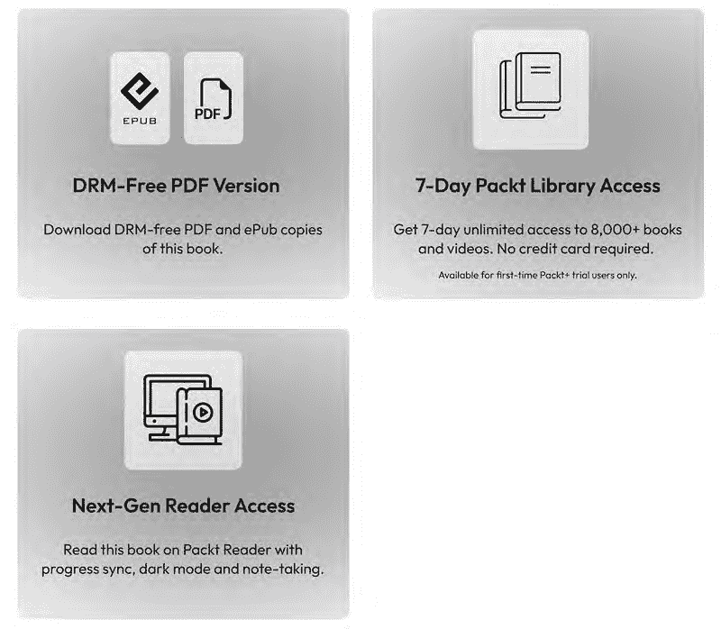

## 13 解锁您的专属福利

您的这本书包含以下专属福利：

按照以下指南解锁。整个过程只需几分钟，且只需完成一次。

### 三步解锁本书的免费福利

**第 1 步**

请准备好您的购买凭证，供*第 3 步*使用。如果您有纸质书，请用手机扫描并保存为 PDF、JPG 或 PNG 格式。

如需有关查找购买凭证的更多帮助，请访问 `https://www.packtpub.com/en-us/unlock?step=1.`

**第 2 步**

扫描二维码或访问 `packtpub.com/unlock`。

在打开的页面上（桌面端类似*图 13.1*），按书名搜索本书，然后选择正确的版本。

如果您直接从 Packt 购买本书，则无需凭证。完成*第 2 步*后，您即可立即访问专属内容。

**注意**

*图 13.1：Packt 桌面端解锁落地页*

**第 3 步**

选择书籍后，登录您的 Packt 账户，或免费创建一个。然后上传您的购买凭证（PDF、PNG 或 JPG，最大 10 MB）。按照屏幕上的说明完成整个过程。

**需要帮助**

如果您遇到问题需要帮助，请访问 `https://www.packtpub.com/unlock-benefits/help` 获取关于如何查找购买凭证等的详细常见问题解答。此二维码将带您进入帮助页面。

如果问题仍未解决，请联系 `customercare@packt.com`。

**注意**

`packtpub.com`

订阅我们的在线数字图书馆，即可完整访问超过 7,000 本图书和视频，以及行业领先的工具，帮助您规划个人发展并推进职业生涯。

如需了解更多信息，请访问我们的网站。

### 为何订阅？

- 借助来自 4,000 多位行业专业人士的实用电子书和视频，花更少时间学习，用更多时间编码
- 通过专为您量身打造的技能计划提升学习效果
- 每月免费获得一本电子书或一个视频
- 支持全文搜索，便于快速获取关键信息
- 可复制粘贴、打印和收藏内容

在 `www.packtpub.com`，您还可以阅读一系列免费技术文章，订阅多种免费新闻资讯，并享受 Packt 图书和电子书的专属折扣和优惠。

### 您可能还喜欢的其他图书

如果您喜欢这本书，您可能还会对 Packt 的以下其他图书感兴趣：

**利用生成式 AI 与 RAG 解锁数据**

Keith Bourne

ISBN: 9781806381654

- 利用本体驱动的知识库构建基于图计算的 RAG 智能体
- 构建语义缓存以提高响应速度并减少幻觉
- 编写用于工作、情景、语义和程序记忆的记忆流水线
- 使用 LangMem 和提示词优化策略实现智能体学习
- 集成检索、生成和整合，打造自我改进的智能体
- 为可扩展、自适应的 AI 系统设计缓存和记忆模式
- 在生产级 RAG 流水线中使用 Neo4j、LangChain 和向量数据库

**多智能体系统的上下文工程**

Denis Rothman

ISBN: 9781806690053

- 开发记忆模型，以保留短期和跨会话上下文
- 打造语义蓝图，并使用 MCP 驱动多智能体编排
- 实现具有可验证引用的高保真 RAG 流水线
- 应用防护措施，抵御提示注入和数据投毒
- 在 AI 工作流中实施审核和策略驱动控制
- 在法律、营销等领域复用上下文引擎
- 在生产环境中部署可扩展、可观测的上下文引擎

### Pack 正在寻找像您一样的作者

如果您有兴趣成为 Packt 的作者，请访问 `authors.packt.com` 并立即申请。我们已与成千上万像您一样的开发者和技术专业人士合作，帮助他们与全球技术社区分享见解。您可以提交一般申请，申请我们正在招募作者的具体热门主题，或提交自己的想法。

### 分享您的想法

读完 *使用 MCP 和 A2A 设计多智能体 AI 系统* 后，我们非常期待听到您的想法！扫描下方二维码，直接前往本书的 Amazon 评论页面分享您的反馈。

您的评论对技术社区和我们都非常重要，它将帮助我们确保提供优质的内容。

