# 分布式AI系统


*献给我的父母，Chuntao He 和 Zongyuan Wu。*

*—— Fuheng Wu*

## 序言

我与 Fuheng Wu 相识多年。我们曾在 Bloomberg 和 Uber 共事，此后也一直留在同一个领域——在我先后前往 Meta、Anyscale 和 NVIDIA 的同时，我们始终交流分布式 AI 方面的心得。在 Uber 时，我们经常交换技术想法：我当时在开发 OpenSearch，而他正在用 Petastorm 构建分布式 AI 系统，并在 Michelangelo 上用 Horovod 训练模型。我近距离见证了他那种生产优先的本能——那些调试会话、集群故障，以及在真实约束下交付产品的压力。

当他告诉我他在写这本书时，我毫不怀疑它会以那些经验为基础，而非教科书式的抽象。这种区分从来没有像现在这么重要，因为 AI 已经进入一个进步越来越不仅取决于更好模型、还取决于能够训练和服务这些模型的系统的时代。

这一转变正发生在技术史上最具变革性的时代之一。人工智能的快速演进——从小众统计模型发展到拥有数十亿乃至数万亿参数的大型语言模型和多模态系统——从根本上改变了我们与计算的关系。然而，尽管这些模型的数学表达仍然优雅地植根于深度学习基础，执行它们的工程现实却在复杂性上爆炸式增长。如今，AI 进步的瓶颈已不再仅仅是算法创造力；从根本上看，这是一项系统工程挑战。

在单个 GPU 上构建神经网络已经成为一种商品化任务，被现代软件库抽象封装。然而，要把同一个网络扩展到数千个专用芯片上进行分布式训练，或者为数百万并发用户编排低延迟、高吞吐的推理，则完全是另一回事。它要求对物理硬件、高速网络拓扑、内存管理技巧、复杂软件编排以及算法细节具备深刻的多学科掌握。在这个领域，一个位置不当的通信瓶颈就可能让硬件利用率从极高的效率跌到爬行速度，使数百万美元的算力基础设施闲置。

在很长一段时间里，分布式 AI 领域的知识处于各自孤立的状态。想要掌握这一领域的工程师不得不将零散的学术论文、碎片化的博客文章、精英科技公司的内部经验以及混乱的开源仓库文档拼凑在一起。并行性理论层面的高层解释与运行稳定、容错工作负载所需的实际代码之间，存在一道明显的鸿沟——从在 HPC 集群上启动多节点训练，到在生产环境中可靠地服务模型。

*分布式 AI 系统：构建面向生产 AI 的可扩展训练、推理和服务系统的实用指南*是业界亟需的全面蓝图——也是我希望 Fuheng 多年前就能写出来的书。

Fuheng Wu 在这本书中完成了一件了不起的事。他揭开了 AI 基础设施工程这个黑箱的神秘面纱。这本书并没有将训练、推理和集群管理视为彼此孤立的领域，而是把它们当作一个整合的生命周期。它系统地带读者走完完整的运维流水线——从理解构成物理基石的芯片和高速互连，到掌握 PyTorch DDP、FSDP、DeepSpeed ZeRO 优化，以及用于多节点扩展的 Megatron 风格张量并行、流水线并行和专家并行。

关键是，这本书认识到训练只是成功的一半。在现实世界的 AI 部署中，高效地服务这些模型才是决定 AI 经济和工程可行性的成败所在。通过深入讲解分布式推理基础、vLLM 和 SGLang，Fuheng 为工程师提供了驯服内存碎片、释放巨大吞吐量的工具。本书还涵盖如何在 HPC 集群上使用 SLURM 运行多节点训练，以及如何使用 Kubernetes、GPU 调度和可观测性搭建生产服务栈——这样你的系统不仅理论上可行，还能在实际负载下保持弹性和可维护性。

无论你是希望将模型扩展到单个加速器极限之外的机器学习工程师，是负责构建现代 AI 集群的平台工程师，还是设计下一代企业 AI 基础设施的架构师，这本书都将成为你的权威指南。Fuheng 那种动手优先、代码优先的方法，把令人望而生畏的基础设施挑战转化为可预测、可重复的工程方法论。

在阅读这些章节时，我建议你不仅要吸收代码，还要深入研究资源估算、内存管理和网络通信的底层模式。今天的框架难免会演化，但本书中精心阐述的分布式系统原理将在未来多年里继续构成 AI 基础设施的基石。

*Gang Zhao*

*NVIDIA、Anyscale、Meta、Uber 资深工程师*

*2026 年 6 月*

## 贡献者

### 关于作者

**Fuheng Wu** 是 Oracle Generative AI 的首席机器学习技术负责人，专注于企业 AI 工作负载的分布式训练、推理和 GPU 系统。他交付了 Oracle 大规模视觉与文档 AI 模型以及 Oracle Code Assist（Oracle 的 AI 编程助手）的核心组件，并合著了关于使用 ONNX Runtime 进行高性能深度学习的 Microsoft–Oracle 博客。作为新加坡–MIT 联盟的毕业生，他在 MIT 跟随 Gilbert Strang 学习了线性代数；他的职业生涯起步于 NetEase 的应用机器学习工作，随后在华尔街从事量化金融——在 Bloomberg 为可转换债券定价，在 WorldQuant 开发算法交易策略——之后加入 Uber，在 Michelangelo 上使用 Petastorm 和 Horovod 构建分布式训练系统。

Fuheng 在 PyTorch Distributed、DeepSpeed、Megatron 风格并行、Kubernetes GPU 集群和生产级 LLM 服务方面拥有丰富的实践经验。他为 SGLang、vLLM、genai-bench、pyLLaMA、chatLLaMA 和 HiQ 等开源项目做出了贡献，并且是 *《AI 与机器学习数学》* 的作者。他在得克萨斯大学奥斯汀分校 McCombs 商学院讲授生成式 AI 基础，并指导准备参加 AI 奥林匹克竞赛的学生。他还以 Xuan Xin 的笔名创作了诗意回忆录 *《云之上：从山泉到硅谷 AI 前沿》* 和音乐专辑 *《让我们训练模型》*（2024），将深度学习和 AI 概念谱成音乐。

在技术之外，他还是一名禅宗书法家和志愿数学辅导老师。

*感谢以下人士对本书早期草稿提供详细反馈：*

*Liu Yong — 新加坡国立大学博士，Huaizheng Zhang — ByteDance 高级研究科学家，Junwei Zhang — GenAI | 工程师 | 版主 | 18K+ 关注者 | 前 Uber、DoorDash，Junnan Li — Salesforce 研究总监；时间序列、CUA 与多模态 AI（BLIP），Jerry Liu — LlamaIndex 联合创始人/CEO，Henry Mao — smithery.ai 联合创始人 | 曾任 Jenni.ai 联合创始人（已退出），Doris Xin — Disarray CEO 兼联合创始人 | 加州大学伯克利分校计算机科学博士 | 曾任 LinkedIn、Google、Databricks，You Yang — 新加坡国立大学教授，Juncong Jack Wu — 2026 年美国 AI 奥林匹克全国赛铜牌；加拿大 AI 奥林匹克全国预选赛杰出荣誉榜、国家队选拔前 18 名；USACO 银级*


## 关于审校者

**Xuanyu Zhang** 是一名机器学习工程师，专攻分布式AI基础设施、大语言模型服务与推理性能优化。他的工作聚焦于现代生成式AI背后的系统层，包括模型服务运行时、推测解码、量化、连续批处理、GPU性能工程，以及大规模模型的多GPU和多节点部署。

Xuanyu 曾在 Apple、Together AI 和 Mistral AI 等领先科技与AI公司从事生产级机器学习与AI基础设施方面的工作。在这些岗位中，他为大规模模型推理的高性能系统的设计、优化和部署做出了贡献，在尖端AI研究与可靠生产工程之间架起桥梁。他的经验既涵盖实际系统实现，也涵盖对分布式训练和推理架构的深入技术评估。

作为 *分布式AI系统* 一书的审校者，Xuanyu 以行业实践者的视角审阅了本书，特别关注书中关于大语言模型训练和推理系统的讲解与练习的准确性、清晰性和实用性。他审校的重点是确保内容在技术上严谨、便于工程师和研究人员理解，并以真实世界的AI基础设施挑战为根基。


## 前言

如今，大型AI模型的参数量已达到数十亿甚至数万亿规模。训练和部署这些模型不再是单GPU就能完成的任务，而是一个分布式系统问题。你通常需要同时考虑GPU内存、高速互联、集合通信、作业调度器、推理批处理以及生产环境的可观测性——往往在一周内就要全部涉及。许多资源只把某一层解释得很好：这里讲训练框架，那里讲推理引擎，其他地方讲Kubernetes指南。但一直缺少一条从分布式训练、推理到生产环境部署的完整路径，并配有可运行代码，让你能在自己的硬件上执行。

本书就是这条路径。书中配有动手实践代码示例，引导你从零开始构建分布式AI系统，涵盖从分布式训练、推理到生产部署的全部内容。目标不是背诵API，而是建立直觉：为什么梯度同步会卡住、FSDP何时优于DDP、PagedAttention如何改变推理服务的经济性、调优前应该剖析哪些指标。如果你逐章完成书中的示例，就能将工作负载从单GPU扩展到多节点集群，并部署更快、内存效率更高且更易运维的推理系统。框架会不断演进，而本书中的系统模式是经久不衰的。

### 本书面向的读者

本书面向需要在规模化场景下训练或部署大型AI模型的机器学习工程师、AI研究员和DevOps工程师。平台工程师、HPC集群管理员和云架构师也能通过本书提升技能。开始学习需要具备Python和PyTorch基础知识的初步理解。了解分布式系统、集群调度器或容器编排的相关知识会有帮助，但不是必需条件——本书会从资源估算、数据准备和硬件基础开始，自底向上讲解这些概念。

### 本书涵盖的内容

- *第1章《现代分布式AI导论》*，介绍资源估算、数据准备，以及你使用PyTorch完成的第一个分布式训练示例。
- *第2章《GPU硬件、网络与并行策略》*，涵盖GPU架构、高速互联以及本书后续使用的各种并行策略。
- *第3章《使用PyTorch DDP进行分布式训练》*，讲解单节点和多节点集群上的数据并行，包括调试和性能调优。
- *第4章《使用全分片数据并行（FSDP）实现扩展》*，讲解参数分片、混合分片和检查点技术，用于内存高效的训练。
- *第5章《DeepSpeed与Megatron：超越状态分片》*，涵盖DeepSpeed ZeRO优化和Megatron风格的张量并行、流水线并行和专家并行，以及如何选择不同框架。
- *第6章《分布式推理与vLLM》*，介绍推理基础、PagedAttention、连续批处理以及用于服务部署的张量/专家并行。
- *第7章《使用SGLang进行跨请求优化》*，探讨结构化生成、基数注意力（radix attention）和基于路由的服务优化。
- *第8章《使用SLURM运行分布式训练》*，展示如何在HPC集群上启动和管理多节点训练任务。
- *第9章《生产级LLM服务栈》*，构建包含Kubernetes、GPU调度、路由和可观测性的完整服务栈。
- *第10章《分布式基准测试与性能优化》*，涵盖基准测试方法、剖析工具和系统性性能调优。
- *第11章《分布式AI的演进格局》*，综述新兴趋势，包括MoE架构、边缘-云协同和未来方向。

### 如何充分利用本书

你需要一台至少配备一块NVIDIA GPU的机器才能运行大部分示例；多GPU和多节点配置会在后面关于分布式训练和推理的章节中使用。Linux是全书主要的运行环境，所有代码示例都使用Python和PyTorch。熟悉命令行、虚拟环境和基本深度学习概念（模型、优化器、损失函数）将帮助你更快上手。

我们建议克隆示例代码仓库，并按顺序完成各章节的练习——前面的章节会建立硬件和并行概念，供后面章节在此基础上展开。当你没有本地GPU访问权限时，带有多个GPU的云笔记本（例如Kaggle）可以替代部分练习，如第1章所述。对于以集群为主的章节，SLURM环境或带有GPU节点的本地Kubernetes集群是理想之选，但并非严格必需，理解启动模式和配置并不要求实际环境。


### 下载示例代码文件

你可以从 GitHub 的 `https://github.com/PacktPublishing/Distributed-AI-Systems` 下载本书的示例代码文件。如果代码在出版后有更新，你可以在 GitHub 上找到最新版本。你也可以访问 Packt 网站上的本书页面，在搜索框中输入书名来下载代码文件。点击链接进入本书的产品页面，然后查看 Support 部分。

我们还有其他代码包，来自我们丰富的图书和视频目录，可在 `https://github.com/PacktPublishing/` 获取。快去看看吧！

### 下载彩色图片

我们还提供一份 PDF 文件，其中包含本书使用的截图/图表的彩色图片。你可以在这里下载：`https://packt.link/gbp/9781807301712`。

### 排版约定

本书通篇使用了多种文本约定。

`CodeInText`：表示文本中的代码词、数据库表名、文件夹名、文件名、文件扩展名、路径名、虚拟 URL、用户输入和 Twitter 用户名。例如：将下载的 `WebStorm-10*.dmg` 磁盘映像文件作为系统中的另一个磁盘挂载。

代码块如下所示：

```python
import json
from sglang import Engine

llm = Engine(model_path="Qwen/Qwen2.5-0.5B-Instruct")
schema = {
    "type": "object",
    "properties": {"name": {"type": "string"}, "age": {"type": "number"}},
    "required": ["name", "age"],
}
```

任何命令行输入或输出都按如下方式书写：

```bash
docker pull lmsysorg/sglang:latest-runtime
```

**粗体**：表示新术语、重要词语或重要信息。例如，菜单或对话框中的文字在文本中会以这种形式出现。例如：`wordByWord()` 函数使用*正则表达式来分割*输入文件每一行中的单词。

### 联系我们

我们始终欢迎读者的反馈。

**一般反馈**：如果你对本书的任何方面有疑问，或有任何一般性反馈，请发送电子邮件至 `customercare@packt.com`，并在邮件主题中注明书名。

**勘误**：尽管我们已尽一切努力确保内容的准确性，但错误仍在所难免。如果你在本书中发现了错误，我们将不胜感激。请访问 `http://www.packt.com/submit-errata`，点击 **Submit Errata**（提交勘误），并填写表单。

**盗版**：如果你在互联网上发现我们作品的任何非法拷贝，请向我们提供地址或网站名称，我们将不胜感激。请通过 `copyright@packt.com` 联系我们，并附上相关材料的链接。

**如果你想成为作者**：如果你有擅长的主题，并且有兴趣撰写或参与编写一本书，请访问。

警告或重要说明以如下形式出现。

**注意**

### 随书免费权益

本书附带免费权益，以支持你的学习。立即激活即可获得访问权限（说明请参阅“*如何解锁*”部分）。

以下是你购买后可立即解锁内容的快速概览：

**如何解锁**

扫描二维码（或访问 `packtpub.com/unlock`）。按名称搜索本书，确认版本，然后按照页面上的步骤操作。


*注意：请备好发票。直接从 Packt 购买的商品无需提供。*

### 分享你的想法

读完《*分布式 AI 系统*》后，我们很乐意听到你的想法！扫描下方二维码，直接进入本书的亚马逊评论页面并分享你的反馈。

`https://packt.link/r/1807301710`

你的评论对我们和技术社区都很重要，将帮助我们确保提供高质量的内容。


## 1 现代分布式 AI 导论

*构建从单 GPU 到分布式集群的可扩展 AI 系统*

*分布式系统就是这样一种系统：一台你甚至不知道其存在的计算机发生故障，也会让你的计算机无法使用。*

*莱斯利·兰波特，1987年*

### 概述

现代 AI 模型已经发展到单块 GPU 无法承载的地步。大语言模型现在的参数规模从数十亿到超过一万亿不等。在一块 GPU 上训练具有数百亿参数的模型需要数月时间，如果它们甚至能放入内存的话。大规模服务这些模型则需要分布式架构。

本章将介绍资源估算、在分布式训练、微调或推理之间进行选择的决策框架，以及帮助你上手的实际示例。

### 为什么现代 AI 需要分布式

*图 1.1：模型参数 vs. 年份*

几年前，你可以在单块 GPU 上训练大多数模型。ImageNet 上的 ResNet-50 只需几天时间。如今，在单块 GPU 上训练 70B 参数的语言模型需要数月时间，如果它甚至能放入内存的话。模型变大了，数据集也变大了，单 GPU 训练变得不切实际。

如*图 1.1* 所示，近年来模型参数的指数级增长显而易见。从*表 1.1* 所列的最新模型来看，其规模一目了然[1]。GPT-4 拥有超过 1 万亿参数，而前沿模型还在继续推向远超这一规模的水平[2]。训练它们需要数千块 GPU 协同工作[3]。即便是像 Llama 2（70B 参数）这样较小的模型，也需要多块 GPU 才能装进内存，更不用说高效训练了。

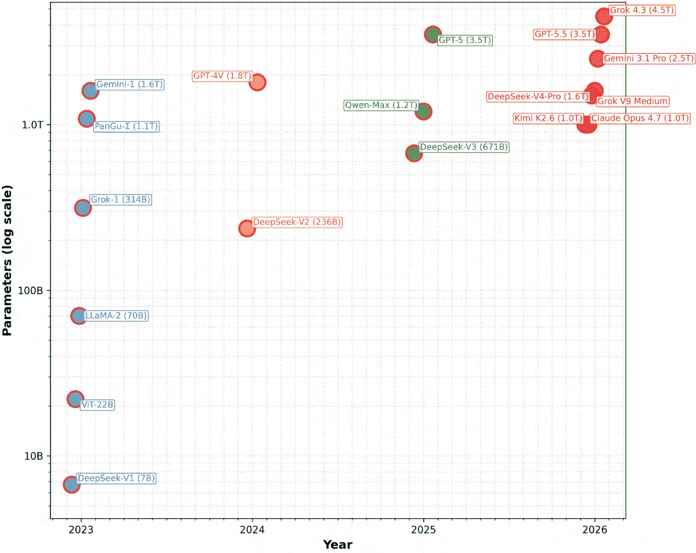

这不仅仅是训练问题——在生产环境中大规模服务这些模型，需要能够处理数千个并发请求的分布式推理架构。

单机 AI 的时代已经结束；现代 AI 系统在设计上天生就是分布式的。根据 PyTorch 的分布式训练文档，分布式训练是将训练工作负载分散到多个工作节点上，这对于大型模型和深度学习中计算密集型任务尤其有益。此外，行业报告指出，训练万亿参数模型需要数千万美元的基础设施投资[4]，这使得分布式计算不仅成为现代 AI 发展的技术必需，更是经济上的必然要求。

| 模型 | 参数量 | 公司 | 年份 |
| --- | --- | --- | --- |
| ViT-22B | 22B | Google | 2023 |
| Grok-1 | 314B | xAI | 2023 |
| Gemini-1 | 1.6T | Google | 2023 |
| LLaMA-2 | 70B | Meta | 2023 |
| PanGu-Σ | 1.085T | Huawei | 2023 |
| DeepSeek-V1 | 6.7B | DeepSeek | 2023 |
| GPT-4V | ~1.8T | OpenAI | 2024 |
| DeepSeek-V2 | 236B | DeepSeek | 2024 |
| Qwen-Max | ~1.2T | Alibaba | 2025 |
| GPT-5 | ~2–5T | OpenAI | 2025 |
| DeepSeek-V3 | 671B | DeepSeek | 2025 |
| Gemini 3.1 Pro | ~2–3T | Google | 2026 |
| Grok 4.3 | ~3–6T | xAI | 2026 |
| Claude Opus 4.7 | ~1T+ | Anthropic | 2026 |
| GPT-5.5 | ~2–5T | OpenAI | 2026 |
| Kimi K2.6 | 1T | Moonshot AI | 2026 |
| DeepSeek-V4-Pro | 1.6T | DeepSeek | 2026 |
| Grok V9 Medium | 1.5T | xAI | 2026 |
| Claude Mythos 5 | ~10T | Anthropic | 2026 |

*表 1.1：大型 AI 模型对比*

### 规模挑战

以 70B 参数模型为例。在全精度（FP32）下，仅模型权重就需要 280GB 内存。目前没有任何主流的数据中心 GPU 能容纳这么大的内存——即使是 H200（141 GB）和 B200（192 GB）也不够（*第 2 章*将讨论 GPU 代际和内存趋势）。仅加载模型就需要多块 GPU，更不用说训练了。

训练这些模型需要数千 GPU 小时。单 GPU 训练运行需要数月时间。数据集也极为庞大——数以万亿计的 token。要高效加载和预处理这些数据，需要*分布式流水线*。

这种不匹配显而易见：模型规模和计算需求呈*指数级*增长，而单 GPU 的内存和计算能力充其量只是*线性*增长。

*图 1.2：增长错配：模型指数级增长 vs. GPU 线性增长*

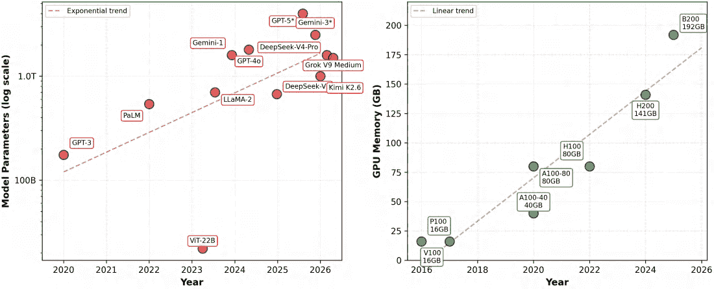


### 估算模型资源需求

在开始训练或部署之前，你需要知道自己需要多少内存和计算资源。如果估算错误，你可能会遇到内存不足的错误，或者浪费钱在过度配置的基础设施上。

内存占用取决于你在存储什么。仅就模型权重而言，计算很简单。FP32 中每个参数占用 4 字节，FP16/BF16 占用 2 字节，Int8 占用 1 字节，Int4 占用 0.5 字节。对于一个 7B 参数的模型，FP32 需要 28GB，BF16（或 FP16）需要 14GB，Int8 需要 7GB，Int4 需要 3.5GB。

以下是常见精度格式的快速参考：

| 格式 | 字节 | 格式细节 | 主要用途 |
|---|---|---|---|
| FP32 | 4 | 32位浮点数（1个符号位，8个指数位，23个尾数位） | 训练、高精度推理 |
| BF16 | 2 | 16位 bfloat（1个符号位，8个指数位，7个尾数位） | 训练（首选）、推理 |
| FP16 | 2 | 16位浮点数（1个符号位，5个指数位，10个尾数位） | 推理 |
| FP8 E4M3 | 1 | 8位浮点数（1个符号位，4个指数位，3个尾数位） | 推理（激活值、权重） |
| FP8 E5M2 | 1 | 8位浮点数（1个符号位，5个指数位，2个尾数位） | 训练（梯度存储） |
| MXFP8 | ~1 | E4M3 + 32值块缩放 | Blackwell训练 |
| NVFP4 | ~0.5 | E2M1 + 16值块缩放 | Blackwell推理 |
| Int8 | 1 | 8位整数 | 量化推理 |
| Int4 | 0.5 | 4位整数 | 量化推理（极限压缩） |

注意 FP8 有两种格式：E4M3（精度更高，用于推理激活值和权重）和 E5M2（动态范围更广，用于存储）。两者每个参数都占用 1 字节，但用途不同。在 NVIDIA Blackwell 上，**MXFP8** 通过更精细的块缩放改进了 Hopper 风格的逐张量 FP8；**NVFP4** 将推理（以及某些训练栈）推进到 8 位以下。两者都使用微缩放——实际内存略高于每个值的标称位数。硬件背景见*第 2 章*，FP8 训练见*第 5 章*。

对于训练，BF16（bfloat16）比 FP16（float16）更受青睐。BF16 与 FP32 具有相同的指数范围（8 位），但尾数位减少（7 位），因此与 FP32 具有相同的动态范围。这使得训练更加稳定——更不容易上溢或下溢。FP16 的指数范围较小（5 位），这可能在训练过程中导致数值问题。现代 GPU（A100、H100）拥有针对 BF16 优化的张量核心（Tensor Core）。对于推理，FP16 和 BF16 都可用，但为了与训练保持一致，仍然首选 BF16。

但模型权重只是开始。在训练期间，你还需要空间来存储梯度、优化器状态和激活值。对于推理，你需要为注意力机制准备 KV 缓存。KV 缓存对 LLM 推理至关重要——它存储序列中先前 token 的键值对，使模型无需为每个新 token 重新计算整个序列的注意力。这大大加快了自回归生成，但它需要大量内存，且随批量大小和序列长度增长。总内存需求可能比仅模型权重高出数倍。

#### 训练内存需求

训练需要的内存远多于推理。你需要存储模型权重、梯度（每个参数一个）、优化器状态以及前向传播产生的激活值。

#### 优化器状态

优化器状态的大小取决于你使用的优化器。以随机梯度下降（SGD）为例：模型权重根据以下公式更新：

其中：
- wt：第 t 次迭代时的模型参数
- wt+1：更新后的参数
- gt：损失关于参数的梯度，在第 t 次迭代时（gt = ∇w L(wt)）
- η：学习率（用于 SGD 和自适应矩估计（Adam））

框出的变量就是我们需要在内存中保留的内容。SGD 只需要学习率 η（一个标量）来更新参数。看这个公式，你在反向传播过程中计算 gt，然后从 wt 中减去 η gt。优化器状态只是 η——内存可忽略不计。你需要存储 wt（模型权重）和 gt（梯度），但不需要额外的优化器张量。

自适应矩估计（Adam）的公式更复杂：

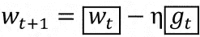

变量定义如下：
- β1：一阶矩（均值）的衰减率
- β2：二阶矩（非中心方差）的衰减率
- mt-1：来自上一步的一阶矩估计
- vt-1：来自上一步的二阶矩估计
- ε：用于数值稳定性的小常数
- t：用于偏差校正的迭代索引

Adam 需要更多内存。公式显示它维护两个逐参数张量：mt-1（一阶矩估计）和 vt-1（二阶矩估计）。mt-1 和 vt-1 都与 wt 形状相同——每个参数一个值。因此 Adam 需要存储 mt-1（1 倍模型大小）和 vt-1（1 倍模型大小），优化器状态总计为 2 倍模型大小。

β1 和 β2 是超参数——标量常量（通常 β1=0.9，β2=0.999）。你只需将它们作为配置存储一次，而不是每个参数都存储。η（学习率）和 ε 也是如此——它们是标量，内存可忽略不计。只有与 wt 形状相同的张量（每个参数一个值）才需要显著内存：wt、gt、mt-1 和 vt-1。

这就是为什么 Adam 的优化器状态需要 2 倍模型大小，而 SGD 的开销几乎为零。AdamW（带解耦权重衰减的 Adam）与 Adam 的内存需求相同——两者都维护 mt-1 和 vt-1，总计 2 倍模型大小。唯一的区别在于权重衰减的应用方式（AdamW 直接将其应用于参数，而 Adam 将其加到梯度上）。

以下是常见优化器优化器状态内存需求的总结：

| 优化器 | 优化器状态 | 内存占用 |
|---|---|---|
| SGD | 学习率 η（标量） | ~0× |
| SGD+Momentum | vt-1（速度/动量） | 1× |
| Nesterov | vt-1（速度/动量） | 1× |
| Adagrad | 累积梯度平方 | 1× |
| RMSProp | vt-1（二阶矩） | 1× |
| Adam | mt-1（一阶矩）+ vt-1（二阶矩） | 2× |
| AdamW | mt-1（一阶矩）+ vt-1（二阶矩） | 2× |
| Adafactor | 行和列统计量（分解） | ~0.5× |
| LAMB | mt-1（一阶矩）+ vt-1（二阶矩） | 2× |
| Lion | mt-1（仅一阶矩） | 1× |
| Nadam | mt-1（一阶矩）+ vt-1（二阶矩） | 2× |
| AMSGrad | mt-1（一阶矩）+ vt-1（二阶矩）+ vmax | 3× |
| SparseAdam | mt-1（一阶矩）+ vt-1（二阶矩，稀疏） | 2× |
| Shampoo | 每个参数的左右预条件矩阵 | \>2×（因情况而异） |
| AdaBelief | mt-1（一阶矩）+ st-1（置信项） | 2× |

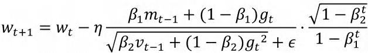

该表仅显示优化器状态。无论使用哪种优化器，你仍然需要存储模型权重（1 倍）和梯度（1 倍）。

#### 激活输出

激活层（如 ReLU、GELU、sigmoid）没有参数——它们只是逐元素应用的函数。但它们的输出（激活输出，通常简称为“激活值”）在训练期间需要存储在内存中。

考虑下面这个简单的三层深度神经网络 `SimpleDNN`：

*图 1.3：SimpleDNN*

数据流为 x → z → h → ŷ，经过 Linear → Sigmoid → Linear 层，其中输入 x 通过第一个线性层产生 z，然后通过 sigmoid 激活产生 h，最后通过第二个线性层产生预测 ŷ。PyTorch 中的代码如下：

```python
class SimpleDNN(nn.Module):
    def __init__(self, input_dim, output_dim, hidden_dim=1, bias=False):
        super(SimpleDNN, self).__init__()
        self.linear1 = nn.Linear(input_dim, hidden_dim, bias=bias) # x -> z
        self.activation = nn.Sigmoid() # z -> h
        self.linear2 = nn.Linear(hidden_dim, output_dim, bias=bias) # h -> y_hat

    def forward(self, x):
        z = self.linear1(x) # z = W_1 * x
        h = self.activation(z) # h = sigmoid(z)
        y_hat = self.linear2(h) # y_hat = W_2 * h
        return y_hat
```

前向传播如下：

为了使用反向传播计算梯度，我们应用链式法则。

对于：

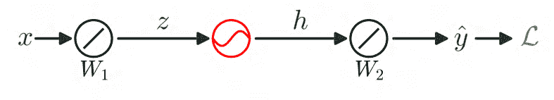
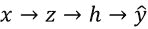
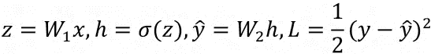
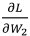
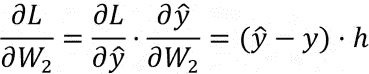


梯度依赖于 h——即 sigmoid 层的激活输出。要计算这个梯度，你需要将 h 存储在内存中。

对于 $\frac{\partial L}{\partial W_1}$，链式路径更长：

展开每一项：$\frac{\partial L}{\partial \hat{y}}$（需要 $\hat{y}$）、$\frac{\partial \hat{y}}{\partial z}$（需要 $h$）、$\frac{\partial z}{\partial h}$（需要 $W_2$）和 $\frac{\partial h}{\partial W_1}$（需要输入 $x$）。

$$
\frac{\partial L}{\partial W_1} = \frac{\partial L}{\partial \hat{y}} \cdot \frac{\partial \hat{y}}{\partial z} \cdot \frac{\partial z}{\partial h} \cdot \frac{\partial h}{\partial W_1}
$$

这个梯度同时需要 h（sigmoid 层的激活输出）和 x（输入数据）。这就是为什么在正向传播过程中，激活输出和输入数据必须保存在内存中，直到反向传播期间计算出它们的梯度。

一个有趣的发现是，我们并不需要 z。观察梯度计算过程，要计算 $\frac{\partial L}{\partial W_1}$，我们需要 $\frac{\partial h}{\partial z}$。对于 sigmoid 函数，其导数为 σ′(z) = σ(z)(1 − σ(z)) = h(1 − h)。由于我们在正向传播时已经存储了 h，因此可以直接利用 h 计算导数，无需原始的 z 值。这是 sigmoid 及其他一些激活函数的性质——它们的导数可以用其输出来表示，因此你无需存储预激活值。

然而，并非所有激活函数都如此。某些激活函数的导数显式地依赖于输入值 z，而不仅仅是输出 h。这意味着你无法仅从 h 计算导数——需要存储原始的 z 值。

为了弄清楚哪些激活函数需要存储预激活值 z，哪些可以仅从激活后的值 h 计算导数，让我们来考察常见激活函数的导数：


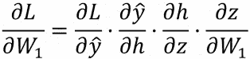
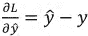
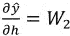
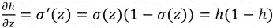
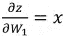
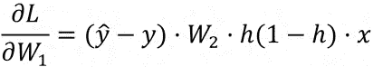
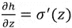
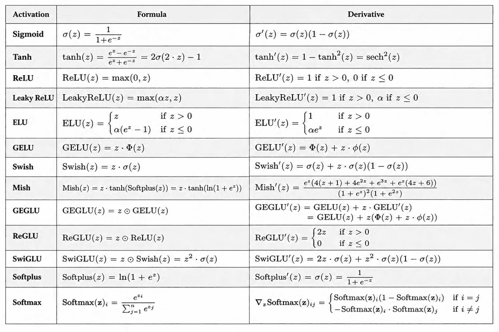

### 激活函数表格约定

上述所有激活函数都是逐元素的（每个输出仅依赖于其对应的输入），唯一例外是 Softmax，它是向量值的（接收向量输入并产生总和为 1 的概率分布）。Softmax 的导数是雅可比矩阵，用 ∇z 表示。Leaky ReLU 和 ELU 中的参数 α 是一个常值超参数（Leaky ReLU 通常取 α = 0.01，ELU 通常取 α = 1.0）。GLU（门控线性单元）系列（GEGLU、ReGLU、SwiGLU）是门控激活函数，使用逐元素乘法 ⊙ 将两个分支组合：一个分支保持不变（z），另一个分支应用激活函数。在实践中，GLU 变体通常为两个分支分别使用独立的线性投影，但此处展示的简化形式对两个分支使用相同的输入 z。

#### 注意

观察这些导数，我们可以根据导数能否仅用输出 h 来表示，对激活函数进行分类：

- **导数仅用输出即可表示**：Sigmoid、Tanh 和 Softplus 属于这一类。正如我们在 sigmoid 中看到的，σ′(z) = h(1 − h) 仅依赖于 h。类似地，tanh′(z) = 1 − h² 和 Softplus′(z) = σ(z) 都可以由输出计算得出。对于这些函数，在正向传播过程中只需存储 h。
- **导数需要输入 z 的**：ReLU、Leaky ReLU、ELU、GELU、Swish、Mish 以及 GLU 系列（GEGLU、ReGLU、SwiGLU）需要存储 z，因为它们的导数显式地包含 z 或依赖于 z 的符号。对于 ReLU，计算导数时需要知道 z > 0 还是 z ≤ 0。对于 GELU、Swish、Mish 和 GLU 变体，导数公式中显式包含 z，因此无法仅从 h 恢复出 z。

让我们详细考察 GELU 和 Swish，以说明它们为什么需要存储 z。对于 GELU（高斯误差线性单元），其精确形式使用了累积分布函数：

$$
\mathrm{GELU}(z) = z \cdot \Phi(z)
$$

其中 Φ 是标准正态分布的累积分布函数。其导数为：

$$
\mathrm{GELU}'(z) = \Phi(z) + z \cdot \phi(z)
$$

其中 ϕ 是标准正态的概率密度函数（PDF）。该导数在 $z \cdot \phi(z)$ 项中显式地包含了 z。

在实践中，为了计算效率，GELU 通常使用 tanh 进行近似。

$$
\mathrm{GELU}(z) \approx \frac{1}{2} z \left(1 + \tanh\left(\sqrt{2/\pi}\,(z + c z^3)\right)\right)
$$

其中 c ≈ 0.044715 为常数。该近似的导数为：

- $\frac{1}{2}\left(1 + \tanh\left(\sqrt{2/\pi}\,(z + c z^3)\right)\right)$
- $\frac{1}{2} z \left(1 - \tanh^2\left(\sqrt{2/\pi}\,(z + c z^3)\right)\right) \cdot \sqrt{2/\pi}\,(1 + 3c z^2)$

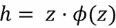
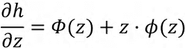
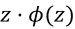
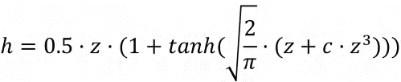
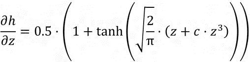
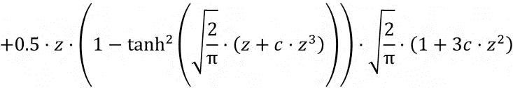

即使使用 tanh 近似，导数仍然在多个项中显式包含 z，包括 z 本身以及 tanh 参数内部的 z² 和 z³。由于 tanh 不容易求逆，且表达式中多处涉及 z，因此无法仅从 h 恢复出 z。所以，无论你使用精确的 GELU 形式还是 tanh 近似，在反向传播期间都需要存储原始的 z 值来计算导数。

类似地，Swish（也称为 SiLU，Sigmoid 线性单元）的定义为：

$$
\mathrm{Swish}(z) = z \cdot \sigma(z)
$$

其导数为：

$$
\mathrm{Swish}'(z) = \sigma(z) + z \cdot \sigma(z)(1 - \sigma(z))
$$

同样，导数显式地包含 z，你无法仅用 h 来表示它。要计算导数，你需要 z 和 σ(z)，这意味着要存储原始的 z 值。

在实践中，像 PyTorch 这样的框架会存储在反向传播期间计算梯度所需的任何中间值。对于导数可以用其输出表示的激活函数（如 sigmoid），框架可能只存储激活后的值。对于导数需要输入的激活函数（如 GELU 或 Swish），框架会存储预激活值。自动求导系统会根据计算图中的运算自动确定需要保存的内容，从而确保梯度能够正确计算，同时在可能的情况下尽量减少内存占用。

在正向传播过程中，你计算并存储所有层的激活输出（简称为“激活值”）。在反向传播过程中，你从最后一层开始逐层计算梯度。每一层都需要其激活输出来计算梯度。一旦你计算了某层的梯度并更新了其参数，就可以释放该层的激活输出——它们不再需要了。然而，在反向传播过程中存在重叠：在计算某一层的梯度时，内存中仍然保留着更早层的激活输出。当激活值（来自正向传播）和梯度（来自反向传播）同时存在时，内存占用达到峰值。

激活值的内存占用随批量大小和序列长度而扩展——更大的批量或更长的序列意味着需要存储更多的激活输出。梯度检查点（gradient checkpointing）等技术通过重新计算激活值而非全部存储，来用计算换内存。

### 训练阶段

在训练过程中，训练循环的不同阶段内存占用各不相同。了解每个组件在何时被需要，有助于你估算峰值内存需求并发现优化机会。

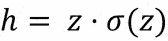
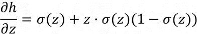
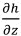

```python
for epoch in range(num_epochs):
    model.train()  # set to training mode
    for x_batch, y_batch in dataloader:  # iterate over batches
        optimizer.zero_grad()  # 1. clear gradients
        y_hat = model(x_batch)  # 2. forward pass
        loss = criterion(y_hat, y_batch)  # 3. compute loss
        loss.backward()  # 4. backward pass
        optimizer.step()  # 5. update parameters
```

让我们分解每一步发生的过程以及内存中存储了什么：

第 2 步（正向传播）：模型从输入 `x_batch` 计算预测值 `y_hat`。在此过程中，它会存储反向传播所需的中间激活值（如前面例子中的 h）。此时，内存中包含：模型权重 $w_t$、激活值，以及来自前一次迭代的优化器状态（如 Adam 的 $m_{t-1}$ 和 $v_{t-1}$）。

第 4 步（反向传播）：`loss.backward()` 计算所有参数的梯度 $g_t = \nabla_w L(w_t)$。这需要正向传播期间存储的激活值。此时内存中包含：$w_t$、激活值（仍然需要）、梯度 $g_t$ 和优化器状态。

第 5 步（优化器更新）：`optimizer.step()` 使用梯度 $g_t$ 和优化器的内部状态将参数从 $w_t$ 更新为 $w_{t+1}$。对于 Adam，这意味着使用 $m_{t-1}$ 和 $v_{t-1}$ 以及 $g_t$ 来计算更新量。此步骤之后，优化器状态被更新（例如，$m_{t-1}$ 变为 $m_t$，$v_{t-1}$ 变为 $v_t$）并存储以供下一次迭代使用。此时激活值不再需要，可以释放。

激活值、梯度和优化器状态并不会同时存在于内存中。在正向传播期间，只有激活值被实际使用——梯度尚不存在，而优化器状态虽然从前一次迭代一直保留，但不会被访问。在反向传播期间，激活值和梯度会发生重叠，因为你需要激活值来计算梯度。在优化器更新步骤中，梯度和优化器状态会发生重叠，因为优化器同时使用两者来更新参数。激活值通常在反向传播完成后被释放，因此它们不会与优化器状态重叠。

峰值内存使用发生在反向传播期间，此时激活值和梯度同时位于内存中。反向传播之后，激活值可以被释放，因此优化器更新步骤只需要梯度和优化器状态。


*图 1.4：训练内存时间线*

如*图 1.4*所示，该时间线展示了使用 Adam 优化器训练 7B 模型时训练循环中的内存使用情况，假设**全程使用 BF16**——权重、梯度和优化器状态（m, v）均以每参数 2 字节存储。这是一个清晰的教学示例。许多生产环境使用**混合精度**的方式有所不同：前向和反向传播使用 BF16（通过 `torch.autocast`），但优化器状态——有时还包括权重主副本——使用 FP32，这会推动优化器内存达到约 56 GB（4 字节 × 2 状态 × 7B 参数），而非 28 GB。

下面说明每个阶段如何对应代码。在第 2 行（`y_hat = model(x_batch)`），前向传播计算并存储激活值。内存使用量为权重（14 GB）加优化器状态（28 GB）加激活值（12 GB），总计 54 GB。此时梯度尚不存在。

在第 4 行（`loss.backward()`），反向传播阶段出现内存峰值。在反向传播过程中，既需要激活值来计算梯度，也需要存储计算出的梯度。内存使用量为权重（14 GB）加优化器状态（28 GB）加激活值（12 GB）加梯度（14 GB），总计 68 GB。这是峰值，因为激活值和梯度在内存中同时存在。

在第 5 行（`optimizer.step()`），反向传播完成后，激活值可以被释放。优化器使用梯度和其内部状态来更新参数。内存使用量为 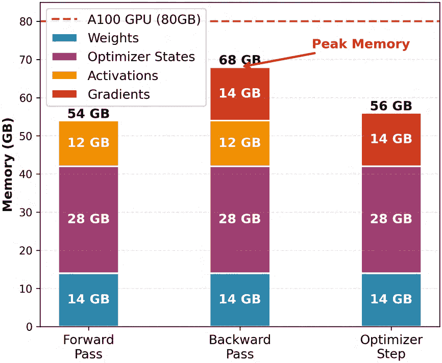 权重（14 GB）加优化器状态（28 GB）加梯度（14 GB），总计 56 GB。不再需要激活值。

68 GB 的峰值内存出现在 `loss.backward()`（第 4 行）期间，此时激活值和梯度同时在内存中。这就是为什么在遇到内存不足错误时，减小批大小、使用**梯度累积**（运行几个较小的微批次，仅在最后一个微批次之后调用 `optimizer.step()`——有效批大小不变，峰值激活内存更低）、或使用梯度检查点会有所帮助：前两种方法在反向传播期间缩减激活内存；检查点则以额外计算换取更少的激活存储。

#### 内存分解：

对于相同的 7B Adam 配置（全程 BF16）：模型权重（14 GB）+ 梯度（14 GB）+ 优化器状态（28 GB）= **56 GB 固定开销**，不含激活值。激活值根据批大小和序列长度额外增加 8–16 GB——时间线中采用 12 GB，因此在反向传播期间达到 **68 GB 峰值**（56 + 12）。因此，每块 GPU 的完整范围是 **64–72 GB**（56 GB + 8–16 GB 激活值），这不是与图中分开的独立估算。若使用 SGD，可以在优化器状态上节省 28 GB，但 Adam 的自适应学习率通常收敛更快，因此在大多数情况下这种权衡是值得的。这就是为什么在此内存占用下，7B 模型使用 Adam 训练至少需要一块 A100（80 GB）；FP32 优化器状态或主权重会进一步提高要求。如果没有分片（FSDP、DeepSpeed）或本书后续介绍的其他技术，较小的 GPU 无法满足需求。

### 推理内存需求

推理内存需求与训练不同，主要包含模型权重和用于注意力计算的键值（KV）缓存。KV 缓存存储序列中先前 token 的预计算键-值对，通过避免对整个序列历史进行冗余的注意力计算，实现高效的自回归生成。虽然这一优化显著加速了推理，但 KV 缓存引入了与批大小、序列长度和模型深度线性扩展的内存开销——*第 6 章*将详细讨论其容量计算。

推理的内存占用受三个主要因素影响：模型大小、批大小和序列长度。对于使用 BF16 精度的 70B 参数模型，模型权重约消耗 140 GB。在批大小为 32、序列长度为 2048 的情况下，KV 缓存额外增加 20–40 GB，导致总内存需求达到 160–180 GB。这超出了单块 A100 GPU（80 GB）的容量，因此推理工作负载需要多 GPU 配置或模型并行策略。

对于具有超长上下文窗口的模型，内存需求变得更为苛刻。例如，`meta-llama/Llama-4-Scout-17B-16E-Instruct` 模型支持 1000 万 token 的上下文窗口。尽管它是一个拥有 16 个专家的 17B 参数混合专家（MoE）模型——每个 token 仅激活部分专家——但在完整上下文长度下，单序列的 KV 缓存就可能超过 1 TB 内存[5]。这种规模的内存需求使单节点推理架构不可行，使得拥有数十块 GPU 的分布式推理系统不仅是有益的，而且是根本必要的。超长上下文模型的计算和内存需求使分布式系统成为唯一可行的部署架构。

#### GPU 需求估算

估算 GPU 需求需要同时考虑模型内存和运营开销。对于训练工作负载，计算从模型的内存占用开始，在此基础上必须添加 10–20% 的安全余量，以容纳通信缓冲区和框架开销。以使用 BF16 精度的 13B 参数模型为例：每块 GPU 的基础内存需求约为 72 GB。加上安全余量后，这一数字增加到 85 GB。由于一块 A100 GPU 提供 80 GB 内存，该配置需要使用模型并行或全分片数据并行（FSDP）策略，至少需要 2 块 GPU。

推理需求遵循类似的计算方法，将模型权重与 KV 缓存内存相结合。BF16 下的 70B 参数模型仅权重就需要 140 GB。在考虑 KV 缓存开销后，总内存需求达到 160–180 GB。这至少需要 2 块 A100 GPU；或者，Int8 量化可以将权重内存降至约 70 GB，在精心管理 KV 缓存的情况下，可能实现单 GPU 部署。

#### 实际部署考量

实际部署会在基础模型需求之外引入额外的内存开销。PyTorch 框架通常消耗 1–2 GB，操作系统需要 5–10 GB。分布式训练架构为每块 GPU 额外分配 2–5 GB 用于通信缓冲区。检查点操作会造成临时内存峰值，必须在容量规划中予以考虑。一种保守的做法是在基础估算上增加 20–30% 的缓冲，以容纳这些开销和运行波动。

内存优化策略在实际部署中起着关键作用。使用 BF16 的混合精度训练（推理时可使用 FP16/BF16）相比 FP32 可将内存消耗降低约 50%，而对模型精度的影响极小。对于推理工作负载，Int8 量化可以进一步将内存需求减半，同时保持可接受的精度损失。通过 `nvidia-smi` 等工具监控实际内存使用情况，可以为理论估算提供实证验证。需要认识到，激活内存随批大小线性扩展；当遇到内存不足（OOM）错误时，减小批大小是最直接的缓解策略。

快速参考表[6]：

| 模型规模 | FP32 权重 | BF16 权重 | 训练（BF16+Adam） | 推理（BF16） |
|---|---|---|---|---|
| 1B | 4 GB | 2 GB | ~8 GB | 2–4 GB |
| 7B | 28 GB | 14 GB | ~60–70 GB | 14–20 GB |
| 13B | 52 GB | 26 GB | ~110–130 GB | 26–35 GB |
| 70B | 280 GB | 140 GB | ~600–700 GB | 140–180 GB |

#### 从经典 ML 到基础模型的演进

从经典机器学习到现代基础模型的演进，代表了计算需求和架构范式的根本性转变。经典机器学习模型设计为在单台机器上运行，传统算法——包括线性回归、逻辑回归、决策树、随机森林、支持向量机（SVM）和梯度提升方法（XGBoost、LightGBM）——通常包含数千到数百万个参数，并在完全适合系统内存的数据集上进行训练。

深度学习时代引入了具有数亿参数的模型，以 ResNet 和 BERT 等架构为代表。虽然这些模型需要 GPU 加速，但在单设备配置上仍然可以管理。当代基础模型时代从根本上改变了这一格局：模型现在拥有数十亿到数万亿的参数（例如 GPT-4、Gemini、LLaMA），分布式系统成为架构上的先决条件而非优化手段。

这种向分布式 AI 的转变实现了突破性的能力，包括能够理解和生成类人文本、代码和多模态内容的模型。这一转变也推动了企业采用，各类组织大规模部署 AI 系统用于生产工作负载。此外，分布式架构通过跨多个计算节点的并行实验实现更快的迭代周期，从而加速了研究进展。


### 现代 AI 模型生命周期

构建 AI 模型并非一蹴而就的过程，而是一个循环：收集数据、训练模型、部署模型、观察其表现，然后回头改进数据或模型。每个阶段都会为下一阶段提供输入。

*图 1.5：现代 AI 模型生命周期*

如*图 1.5*所示，该生命周期始于数据工程：收集、整理、转换、验证、清洗并准备数以 TB 计的数据用于训练。接下来是训练，涉及前向传播、反向传播、梯度下降、超参数调优，甚至微调。训练完成后，模型会通过量化、ONNX 转换、算子融合和 CUDA 内核优化来进行推理优化。部署之前，全面的基准测试会通过精确率与召回率指标、工程性能剖析、瓶颈分析和压力测试来评估模型性能，同时分布式评估可加速大规模数据集上的测试。生产部署需要自动扩缩容、调度、负载均衡、可观测性、API 网关和监控基础设施，以处理每秒数千个请求。生产环境反馈能够确定数据收集优先级和模型故障模式，通过为后续数据工程工作和模型改进提供信息，完成整个循环。

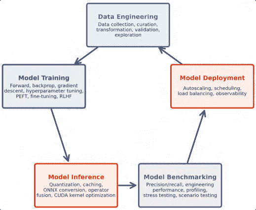

本书重点关注训练、推理、基准测试和部署所需的分布式技术。数据工程只会简单介绍，并非本书重点。分布式数据处理固然重要，但已是一个非常成熟的领域。Spark、Dask 和 Ray 已经存在多年。本书重点关注 AI 特有的分布式挑战：训练大模型、优化推理以及大规模提供服务。

#### 训练：学习阶段

训练是从数据中学习模型参数。其过程遵循固定模式：对模型进行前向传播、计算损失、反向传播以计算梯度，再通过梯度更新来调整参数。这个过程会在多个 epoch（轮次）中迭代进行，直到模型收敛。

训练需要在内存中存储激活值、梯度和优化器状态。计算密集且高度迭代。在分布式训练中，你需要跨设备频繁进行梯度同步，以保持所有模型副本一致。挑战包括梯度同步开销、大模型的内存限制、可能持续数天到数周的长训练时间，以及容错和检查点保存的需求。

在 1 万亿 token 上训练一个 7B 参数的模型，通常需要 8 块 A100 GPU（每块 80GB）和大约 2 周的持续训练。你需要仔细进行梯度同步，以维持所有 GPU 上的训练稳定性。

#### 推理：预测/生成阶段

推理是从训练好的模型生成预测。与训练不同，你只需要一次前向传播——不需要梯度、反向传播或优化器状态。内存需求更低，因为你只需要模型权重和注意力机制的 KV 缓存。每个请求的计算量更低，但你需要高吞吐量来同时服务大量请求。通信需求很少，通常仅在分布式推理时才会用到。

挑战包括延迟（交互式应用需要亚秒级响应）、吞吐量（每秒数千个请求）、通过 KV 缓存管理实现高效内存使用，以及有效的批处理和调度。为聊天场景部署 70B 参数模型，需要 vLLM 或 SGLang 等优化推理引擎、持续批处理以最大化 GPU 利用率，以及针对变长序列的细致 KV 缓存管理。

#### 服务：生产系统

服务是指为模型提供可靠、可扩展的访问入口。这不仅仅是运行推理，而是构建一个包含模型运行器、API 网关、负载均衡器和监控的生产系统。需求包括高可用性、容错性和可观测性。在大规模场景下，你需要面对多模型、多租户的系统。

挑战包括系统可靠性与正常运行时间、多模型路由与负载均衡、通过 GPU 利用率和自动扩缩容实现成本优化，以及用于调试的可观测性。一个生产级 LLM 服务平台可能包含多个模型变体（不同尺寸、微调版本）、A/B 测试基础设施、金丝雀部署流水线，以及分布式追踪与监控。

以下是 *训练 vs 推理 vs 服务* 的对比表：

| 方面 | 训练 | 推理 | 服务 |
|--------|----------|-----------|---------|
| 目标 | 学习参数 | 生成预测 | 提供访问 |
| 内存 | 高（激活值 + 梯度） | 中（权重 + KV 缓存） | 不定 |
| 计算 | 迭代、密集 | 单次前向传播 | 请求驱动 |
| 通信 | 频繁（梯度） | 中等 | API 级别 |
| 延迟 | 数小时到数天 | 毫秒到秒 | 毫秒 |
| 吞吐量 | 每秒样本数 | 每秒 token 数 | 每秒请求数 |

### 决策框架：何时需要分布式系统？

分布式系统会带来复杂性、通信开销和成本。只有在不得已时才使用它们，而不是因为你想用。

#### 决策树：快速参考

如*图 1.6*所示，决策框架总结为下面的决策树。首先确定你的使用场景：训练（或微调）还是推理与服务。

#### 理解决策树

在训练或微调时，首先要检查模型是否能装进内存。以 BF16 计算模型大小（参数 × 2 字节）。如果超过单块 GPU 的容量，你就需要 FSDP 或张量并行等模型并行或参数并行技术。一个 13B 模型仅权重就需要 26GB。再加上 Adam 优化器状态，总共需要 78GB，这已经非常接近 80GB 的 A100 上限了。

如果模型可以装入内存，但训练要拖上数周或数月，数据并行可以加速。在 8 块 GPU 上训练一个 7B 模型处理 1T token 大约需要两周，而在单块 GPU 上则需要数月。

当模型大小和训练时间都可控时，你的微调方法就很重要了。LoRA 和 QLoRA 等参数高效方法会改变局面。70B 模型上的 QLoRA 可以装进 48GB GPU，因为它只训练适配器权重；而同一模型的完整微调则需要多块 GPU。但如果基础模型本身装不下，无论你选择哪种训练方法，你仍然需要模型并行。

当数据加载成为瓶颈时，大型数据集可以从分布式数据加载中受益。多 TB 级别的数据集非常适合使用数据并行。

对于推理或服务，逻辑类似。如果模型超过单块 GPU 内存，请使用模型并行。一个 70B 模型以 BF16 存储需要 140GB 的权重空间。加上 KV 缓存，大约需要 160-180GB，这至少需要 2 块 A100 GPU。如果内存足够，但你需要高吞吐量——每秒数千个请求——可以使用多块 GPU 进行分布式推理。

需要高吞吐量和亚秒级延迟的实时服务通常需要张量并行或多个推理实例。当内存和吞吐量都在单块 GPU 的范围内时，坚持使用单块 GPU，并使用 vLLM 或 SGLang 等优化引擎来最大化效率。

*图 1.6：决策框架：何时需要分布式系统？*

### 动手实践：运行分布式训练

我们先从一个简单的基线开始，建立性能参考点，然后转向分布式训练，亲眼看看加速效果。

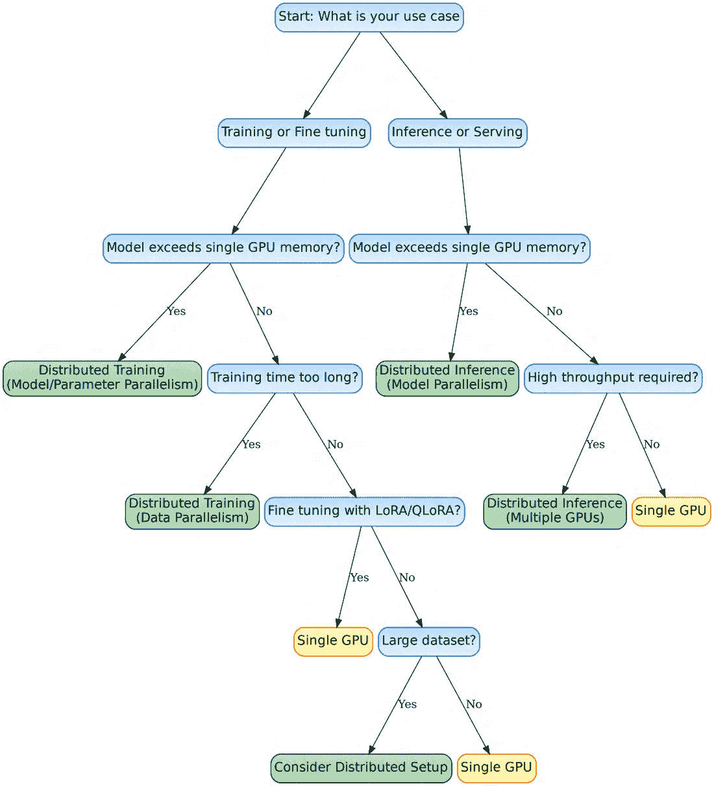


#### 环境设置

本书中，我们将使用 PyTorch 作为主要框架，代码可以从本书的 git 仓库中克隆。

```
git clone https://github.com/PacktPublishing/Distributed-AI-Systems
```

要运行代码，最好你能访问多 GPU 机器，例如 A10、A100 或 H100/H200 甚至 B200。如果你本地无法访问多 GPU，Kaggle 提供免费的多 GPU 环境。登录 `https://www.kaggle.com`，点击 Create，然后选择 Notebook。

*图 1.7：Kaggle 笔记本创建*


创建 Jupyter 笔记本后，进入 Settings → Accelerator 并选择 GPU T4 x2。

*图 1.8：Kaggle GPU 设置*

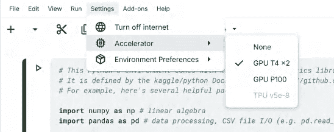

现在你应该有 2 个 T4 GPU 可用。要验证 GPU 设置，请运行 `code/check_cuda.py` 中的代码：

```
1 import torch
2 print(f"CUDA available: {torch.cuda.is_available()}")
3 print(f"Number of GPUs: {torch.cuda.device_count()}")
4 for i in range(torch.cuda.device_count()):
5     props = torch.cuda.get_device_properties(i)
6     vram_gb = props.total_memory / (1024**3)
7     print(f"GPU {i}: {props.name} ({vram_gb:.1f} GB)")
```

代码说明：

- 2：检查系统上 CUDA 是否可用
- 3：获取 GPU 总数
- 5：检索当前 GPU 的属性
- 6：将内存从字节转换为 GB

*图 1.9：GPU 设置 - 2 个 Tesla T4 GPU*

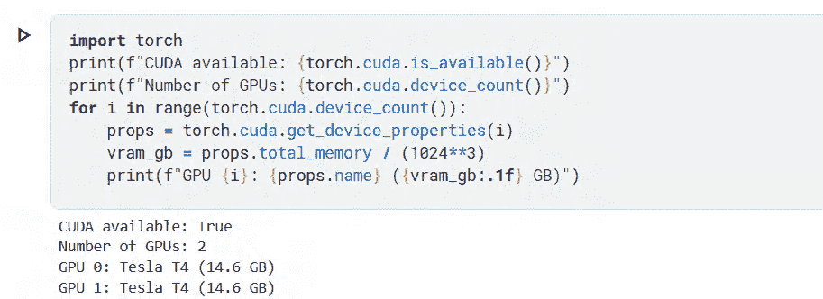

如*图 1.9*所示，运行此命令应显示你可用的 GPU。

#### 单 GPU 基线

我们将使用 ResNet18，这是一个轻量级的 18 层卷积神经网络，专为图像分类设计。它足够小，可以快速训练，同时有效演示分布式训练的概念。对于数据集，我们将使用 FashionMNIST——包含 10 个服装类别的 70,000 张灰度图像（28×28 像素）。它是 MNIST 的直接替代品，难度稍高，非常适合快速实验。

运行基线训练脚本：

```
python code/single_gpu_baseline.py
```

经过 3 个 epoch 后，你应该会看到类似如下的输出：

```
Epoch 1/3, Loss: 0.4164, Accuracy: 84.94%
Epoch 2/3, Loss: 0.2936, Accuracy: 89.17%
Epoch 3/3, Loss: 0.2531, Accuracy: 90.58%
Total training time: 8.78s
```

你的具体结果会因硬件而异，但损失和准确率值应大致相似。这个基线为我们提供了参考点——我们将在分布式版本中使用相同的模型架构进行公平比较。

#### 多 GPU 分布式训练

现在让我们运行分布式版本。该脚本在 FashionMNIST 上使用相同的 ResNet18 模型，但将工作分配给多个 GPU。

```
torchrun --nproc_per_node=2 code/multi_gpu_ddp.py
```

或者使用启动脚本：

```
bash code/launch_torchrun.sh
```

##### ResNet18 与 FashionMNIST

来自 torchvision 的 ResNet18 专为 3 通道 RGB 图像设计，但 FashionMNIST 使用 1 通道灰度图像。为了将 ResNet18 适配到 FashionMNIST，我们修改两个层：(1) 替换第一个卷积层，使其接受 1 个输入通道而非 3 个：`model.conv1 = nn.Conv2d(1, 64, kernel_size=7, stride=2, padding=3, bias=False)`。(2) 替换最后一个全连接层，使其为 FashionMNIST 输出 10 个类别：`model.fc = nn.Linear(model.fc.in_features, 10)`。这些最小的改动使 ResNet18 能够处理 FashionMNIST 的灰度图像，同时保留其余架构的经过验证的设计。

**注意**

使用 2 个 GPU，你会看到相似的损失和准确率值，但训练在 5.91 秒内完成，而不是 8.78 秒——**1.48 倍加速**。

我们测试了从 1 到 8 个 GPU 的扩展，看看性能如何提升：

| GPU 数 | 训练时间 | 加速比 |
|------|---------------|---------|
| 1 | 8.78s | 1.00× |
| 2 | 5.91s | 1.48× |
| 4 | 3.69s | 2.38× |
| 6 | 2.92s | 3.01× |
| 8 | 2.44s | 3.60× |

*图 1.10：FashionMNIST 扩展性能*

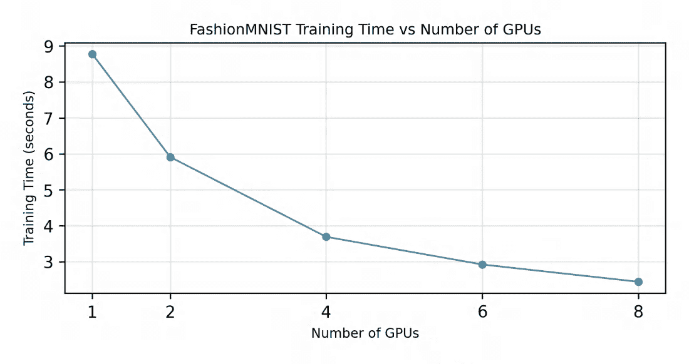

使用 8 个 GPU，训练时间从 8.78 秒降至 2.44 秒，实现了 **3.6 倍加速**。添加更多 GPU 可显著减少训练时间并加速开发周期。随着工作负载变大，加速效果会更加明显，我们将在接下来看到。

#### 扩展训练：CIFAR-10 与 20 个 epoch

为了更真实的工作负载，我们在 CIFAR-10 上使用 20 个 epoch 测试了 ResNet18。CIFAR-10 比 FashionMNIST 更大、更复杂，有 50,000 张训练图像，使用 32×32 像素的 3 通道 RGB 图像。这能更好地展示分布式训练的优势。

运行单 GPU 基线：

```
python code/single_gpu_extended.py --epochs 20
```

然后测试分布式训练：

```
torchrun --nproc_per_node=2 code/multi_gpu_ddp_extended.py --epochs 20
torchrun --nproc_per_node=4 code/multi_gpu_ddp_extended.py --epochs 20
torchrun --nproc_per_node=6 code/multi_gpu_ddp_extended.py --epochs 20
torchrun --nproc_per_node=8 code/multi_gpu_ddp_extended.py --epochs 20
```

结果显示出了更好的扩展性：

| GPU 数 | 训练时间 | 加速比 |
|------|---------------|---------|
| 1 | 73.00s (1.22 min) | 1.00× |
| 2 | 46.47s (0.77 min) | 1.57× |
| 4 | 27.72s (0.46 min) | 2.63× |
| 6 | 21.24s (0.35 min) | 3.44× |
| 8 | 18.20s (0.30 min) | 4.01× |

*图 1.11：CIFAR-10 扩展性能*

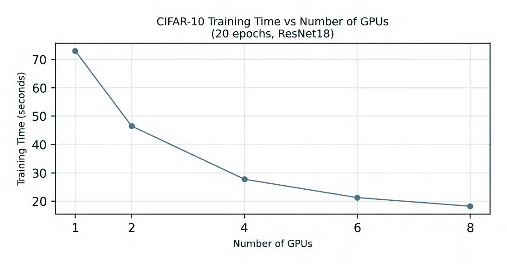

使用 8 个 GPU，训练时间从 73 秒降至 18.2 秒，实现了 **4.01 倍加速**——优于 FashionMNIST 的结果。每个 epoch 更大的计算工作量意味着梯度同步在总时间中占用的比例更小。使用 20 个 epoch，通信开销在更多的训练步骤中被摊销。每个 GPU 在通信步骤之间有足够的计算工作，以最大化并行效率。

这证明了为什么分布式训练对于大规模模型训练至关重要。随着每一步计算量的增加，通信的相对成本降低，从而带来更好的扩展效率。对于拥有数十亿参数的模型，分布式训练的扩展效果更佳，随着计算在训练时间中占据主导地位，加速比接近线性扩展。这里展示的 DDP 方法使用数据并行，其中每个 GPU 持有模型的完整副本并处理不同的数据。这是最简单的分布式训练形式，适用于单个 GPU 能容纳的模型。对于超出单 GPU 内存的更大模型，后续章节将探讨高级并行策略，例如张量并行（将模型层拆分到多个 GPU 上）、流水线并行（将模型阶段拆分到多个 GPU 上），以及结合多种并行技术的混合方法。

#### 分布式推理：吞吐量扩展

训练侧重于减少收敛时间，而推理侧重于吞吐量——每秒能处理多少个请求。分布式推理允许多个 GPU 同时处理不同的请求，大幅提升吞吐量。

我们在 FashionMNIST 上对 ResNet18 推理进行了基准测试，以衡量吞吐量扩展。与训练不同，推理没有梯度同步开销——每个 GPU 只是独立处理分配给它的请求。这使得分布式推理在服务场景中非常高效。

有两种常见的分发推理请求的方法。数据拆分模式（`multi_gpu_inference.py`）使用 `DistributedSampler` 将请求预先分配给 GPU，每个 GPU 处理固定子集的数据。这种方法对于批处理简单且高效。请求拆分模式（`multi_gpu_inference_queue.py`）以轮询方式动态分配请求，每个 GPU 按分配处理请求，模拟真实的队列系统。这种模式更适合请求异步到达的生产服务。

运行基准测试。从单 GPU 基线开始：

```
python code/single_gpu_inference.py --requests 1000
```

然后使用数据拆分模式测试分布式推理：

```
torchrun --nproc_per_node=2 code/multi_gpu_inference.py --requests 1000
torchrun --nproc_per_node=4 code/multi_gpu_inference.py --requests 1000
torchrun --nproc_per_node=8 code/multi_gpu_inference.py --requests 1000
```

以及请求拆分模式：

```
torchrun --nproc_per_node=2 code/multi_gpu_inference_queue.py \
 --requests 1000
```


示例基准测试结果：

| GPU 数 | 模式 | 时间 | 吞吐量 | 加速比 |
| --- | --- | --- | --- | --- |
| 1 | 基线 | 1.85s | 541.00 req/s | 1.00× |
| 2 | 数据拆分 | 0.98s | 1025.45 req/s | 1.89× |
| 2 | 请求拆分 | 1.22s | 819.09 req/s | 1.51× |

使用 2 个 GPU 并采用数据拆分模式，我们实现了 **1.89× 的加速比**，吞吐量几乎翻倍。数据拆分模式能够实现接近线性的扩展，因为每个 GPU 处理独立的请求，协调开销极小。请求拆分模式的吞吐量略低（1.51×），原因是轮询分配存在开销，且所有 GPU 都需要遍历数据集，但它对于生产环境中请求异步到达的动态请求处理更为灵活。

这两种模式都展示了分布式推理的强大能力：吞吐量几乎随 GPU 数量线性扩展，非常适合需要高请求速率的工业生产负载。这里展示的推理模式使用数据并行，适用于可以单卡部署的模型。对于超出单 GPU 内存的大语言模型，后续章节将探讨专家并行、序列并行、张量并行等高级技术，以及 vLLM 和 SGLang 等推理服务框架。

### PyTorch 分布式 AI 基础

现在你已经亲眼看到了分布式训练和推理的实际运行，接下来让我们理解支撑它们工作的基本概念和 API。

#### 分布式 AI 技术栈

分布式 AI 系统由多层构成，从高层框架一直到底层物理硬件。理解这个技术栈有助于你排查问题、优化性能，并对使用哪些工具做出明智的决策。

虽然该技术栈适用于所有分布式框架（PyTorch、JAX、TensorFlow），但本书主要以 PyTorch 为例。相关概念同样适用于其他框架，但 API 和实现细节有所不同。我们将在全书中聚焦于 PyTorch 的分布式 API。

*图 1.12：分布式 AI 技术栈：从框架层到物理层*

最顶层是框架层。这是你编写代码的地方——PyTorch 的 `torch.distributed` 模块、`DDP`、`FSDP` 等等。当你定义模型并调用 `loss.backward()` 时，PyTorch 会处理梯度计算并决定何时

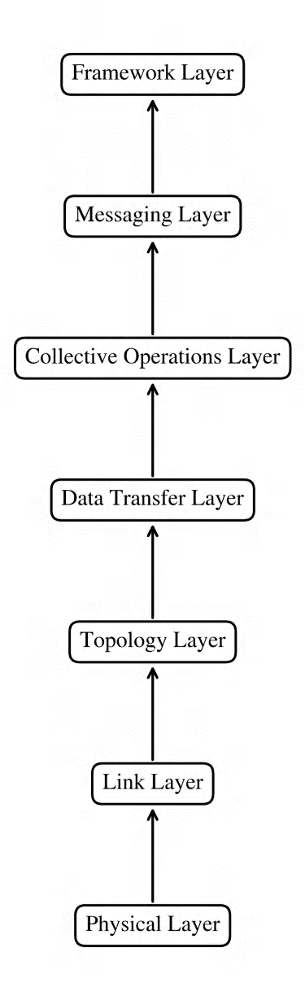

需要进行通信。在这一层，你不必考虑网络数据包或硬件链路。你只需编写训练循环，让 PyTorch 编排分布式操作。

在框架之下，PyTorch 会将你的张量组织成桶（bucket）。DDP 不会单独发送每个梯度张量，而是将多个张量组合在一起。这减少了通信开销。如果你有成千上万个小的梯度张量，逐个发送会很低效。分桶会将它们批量组合，从而减少网络调用次数。这个过程是自动发生的——你无法直接控制，但理解它有助于你在调试通信耗时超预期的问题时找到原因。

集合通信操作层定义了要使用的通信模式。AllReduce 对所有 rank 的梯度求和并将结果分发给所有人。AllGather 收集来自所有 rank 的数据。Broadcast 将数据从某一个 rank 发送到所有其他 rank。这些是 DDP 等更高级 API 所使用的原语。当 DDP 同步梯度时，它底层就是在调用 AllReduce。这一层定义了需要发生什么，而不是如何实现。

数据传输层是实际实现所在。NCCL（NVIDIA 集合通信库）是 GPU 训练中最常见的后端。它以针对 NVIDIA GPU 优化的方式实现 AllReduce 和其他集合操作。GLOO 是基于 CPU 的后端，在你没有 GPU 时很适合用于测试。PyTorch 默认对 GPU 后端使用 NCCL，对 CPU 后端使用 GLOO，这覆盖了大多数使用场景。MPI 是另一种选择，主要用于 CPU 集群。当你使用 `backend="nccl"` 初始化进程组时，你就是在选择由哪个库来负责实际的数据移动。

网络拓扑决定了设备之间的连接方式。在环形拓扑中，GPU 组成一个环——每个 GPU 将数据发送给环中的下一个。这种方式简单但可能产生瓶颈。胖树拓扑提供了设备之间的多条路径，减少了拥塞。网格拓扑和环形网格（Torus）拓扑则在复杂度和带宽之间提供了不同的权衡。拓扑会影响 NCCL 的路由方式，进而影响带宽和延迟。

物理链路负责承载数据。NVLink 以高带宽连接单节点内的 GPU——每个 GPU 约 600 GB/s–1.8 TB/s，具体取决于代际（见*第 2 章*）。当一台机器中有多个 GPU 时，它们通过 NVLink 通信。支持 RDMA（远程直接内存访问）的 InfiniBand 可以在不涉及 CPU 的情况下实现跨节点直接内存访问。这对多节点训练至关重要。PCIe 连接 GPU 与 CPU，以太网速度较慢但更常见。链路层决定了可用的原始带宽。

最底层是物理硬件——GPU 负责并行计算，TPU 负责张量运算（见*第 2 章*），CPU 负责协调。这一层决定了你的原始计算能力和内存上限。上层无论做多少优化，都无法突破这里的硬件限制。

当你在代码中调用 `dist.all_reduce()` 时，请求会沿着整个技术栈层层向下传递。PyTorch 将你的张量组织成桶，调用 AllReduce 集合操作，NCCL 利用它发现的网络拓扑来实现该操作，数据在节点内通过 NVLink 链路传输，在节点间通过 InfiniBand 链路传输，最终结果回到 GPU 内存中。

理解这一流程有助于你调试通信缓慢或分布式作业挂起的问题。是拓扑问题？链路带宽问题？还是集合操作本身的问题？了解技术栈可以帮助你缩小排查范围。

既然我们已经了解了各层如何组合在一起，接下来看看在 PyTorch 中会用到的基本概念。核心构件是进程组、rank 和通信原语。它们构成了所有分布式操作的基础，无论你是使用 DDP 或 FSDP 进行数据并行训练、实现自定义并行策略，还是构建分布式推理系统。

#### 进程组与 Rank

在分布式训练中，多个进程协同工作。每个进程运行在不同的 GPU 或节点上。PyTorch 将这些进程组织成一个进程组。在进程组中，每个进程都有一个唯一的 rank——一个从 0 开始的整数标识符。进程的总数称为世界大小（world size）。

“世界”（world）一词指的是整个分布式作业——参与训练或推理任务的所有进程。世界大小是所有节点和 GPU 上的进程总数。例如，如果你在 2 个节点上训练，每个节点有 4 个 GPU，那么你的世界大小就是 8。

如果你有 4 个 GPU，就会有 4 个进程。进程 0 运行在 GPU 0 上，进程 1 运行在 GPU 1 上，以此类推。rank 告诉每个进程应该使用哪个 GPU 以及处理哪部分数据。

rank 有两种类型：全局 rank 和局部 rank。全局 rank 在整个分布式作业（世界）的所有进程中是唯一的，取值范围为 0 到 world_size - 1。局部 rank 只在单个节点内唯一，每个节点都从 0 开始。例如，在一个每个节点有 4 个 GPU 的 2 节点配置中，节点 0 有局部 rank 0-3（全局 rank 0-3），节点 1 也有局部 rank 0-3（全局 rank 4-7）。局部 rank 通常对应该节点上的 GPU 索引，这就是为什么在分布式代码中经常会看到 `torch.cuda.set_device(local_rank)`。

##### 初始化进程组

在进行任何分布式操作之前，你需要初始化进程组。这会告诉 PyTorch 进程之间应该如何通信。GPU 训练最常见的后端是 NCCL（NVIDIA 集合通信库）。


基本的初始化模式如下所示：

```python
import torch.distributed as dist

def setup(rank, world_size):
    dist.init_process_group(
        backend="nccl", # Use NCCL for GPU communication
        rank=rank, # This process's rank
        world_size=world_size # Total number of processes
    )
    torch.cuda.set_device(rank) # Set which GPU this process uses
```

验证你的分布式环境是否正常工作的最简单测试位于 `code/distributed_basic_test.py` 中。这是一个基础的分布式测试，用于验证进程组初始化和通信。它没有使用 DDP，只是测试多个进程能否相互通信。

使用多块 GPU 测试：

```bash
torchrun --nproc_per_node=2 code/distributed_basic_test.py
```

如果你只有一块 GPU，但仍想测试分布式逻辑，可以在单块 GPU 上模拟多个进程：

```bash
CUDA_VISIBLE_DEVICES=0 torchrun --nproc_per_node=2 code/multi_gpu_simulation.py
```

无论采用哪种方式，你都会看到不同进程打印出 "Rank 0 says hello" 和 "Rank 1 says hello"，从而确认你的分布式环境正常工作。

当你开始使用 `torchrun` 运行分布式训练或推理时，可能会注意到一个关于 `OMP_NUM_THREADS` 的警告。这是因为 PyTorch 想要控制 CPU 线程的使用，以避免使你的系统过载。你可以在 `torchrun` 命令之前设置 `OMP_NUM_THREADS=4`（或任何适合你系统的值）来消除该警告：

```bash
OMP_NUM_THREADS=4 torchrun --nproc_per_node=2 code/distributed_basic_test.py
```

在 `torchrun` 启动之前，在你的 shell 中设置它——在 Python 脚本内部设置不会生效，因为 `torchrun` 会在启动你的进程之前检查环境。

### 集合通信操作

集合通信操作是分布式通信的基石。它们定义了数据如何在进程之间流动。每种操作都有特定的适用场景。理解它们有助于你针对自己的任务选择合适的操作，并排查通信问题。

PyTorch 提供了八种主要的集合通信操作。让我们通过代码示例逐一介绍。

#### AllReduce

*图 1.13：AllReduce 操作：跨所有 Rank 进行归约*

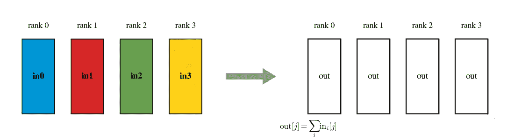

如*图 1.13*所示，AllReduce 是分布式训练中最常用的操作。它跨所有 rank 执行归约（求和、最大值、最小值），并将结果存储在每个 rank 的缓冲区中。这是一种全对全的通信模式，每个 rank 都贡献数据，每个 rank 都接收聚合后的结果。

AllReduce 是数据并行训练的基本构建块。在分布式数据并行（DDP）中，每个 rank 在反向传播过程中基于其本地数据分片计算梯度。为了确保模型一致性，这些本地梯度必须在所有 rank 之间同步。DDP 使用 AllReduce 将所有 rank 的梯度求和，并将平均后的结果分发回每个 rank[7]。执行 AllReduce 后，所有 rank 拥有相同的梯度值，从而使它们能够同步更新模型参数。如果没有 AllReduce，每个 rank 将仅使用其本地梯度更新参数，从而导致模型发散和训练不稳定。

归约操作可以是 SUM（最常用于梯度）、MAX（用于寻找最大值）、MIN（用于寻找最小值）或 PRODUCT（很少使用）。对于梯度同步，使用 SUM，结果通常除以 world_size 来计算平均值。这种平均化确保有效批量大小随 rank 数量扩展——使用 8 块 GPU 训练时，每一步处理的数据量是单 GPU 训练的 8 倍。

AllReduce 比先执行 Reduce 再执行 Broadcast 的等效序列更高效。虽然两者都能达到相同的结果，但 NCCL 将 AllReduce 优化为单一操作，使用环形 AllReduce（ring AllReduce）或树形 AllReduce（tree AllReduce）等算法，从而最大限度地减少通信步骤和带宽使用。例如，环形算法只需要 (world_size - 1) 个通信步骤，而 Reduce+Broadcast 序列需要 2 × (world_size - 1) 个步骤。

```python
# Each rank has different input
tensor = torch.tensor([rank + 1, rank + 2, rank + 3], device=device)
# After all_reduce with SUM, all ranks have the same result
dist.all_reduce(tensor, op=dist.ReduceOp.SUM)
# Result: [sum(1..world_size), sum(2..world_size+1), sum(3..world_size+2)]
```

运行演示：

```bash
OMP_NUM_THREADS=1 torchrun --nproc_per_node=2 code/collective-operation/demo_allreduce.py
```

AllReduce 的通信成本随数据大小和 world size 的扩展而增长，但像 NCCL 的环形 AllReduce 这样的优化实现可以实现接近线性的扩展效率。对于拥有数百万参数的大型模型，AllReduce 可能成为瓶颈，这就是为什么梯度压缩、分桶（bucketing）以及通信与计算重叠等技术对性能至关重要。

#### AllGather

*图 1.14：AllGather 操作：从所有 Rank 收集数据*

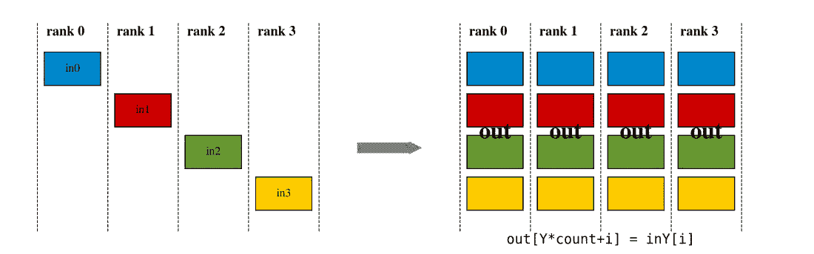

如*图 1.14*所示，AllGather 从所有 rank 收集数据，并将拼接后的结果分发给每个 rank。每个 rank 贡献 N 个值，每个 rank 接收 world_size × N 个值。输出按 rank 索引排序，rank 0 的数据排在最前面，之后是 rank 1 的数据，依此类推。这是一种全对全的通信模式，每个 rank 既向其他所有 rank 发送数据，也接收来自其他所有 rank 的数据。

当你需要每个 rank 都拥有分布在各 rank 上的完整数据视图时，AllGather 至关重要。与 AllReduce 对数据进行聚合（求和、最大值、最小值）不同，AllGather 保留所有单独的贡献并对其进行拼接。这使得 AllGather 非常适合从所有 GPU 收集嵌入、特征表示或中间激活，以用于注意力机制、跨 rank 批归一化或分布式评估指标等全局操作。

在全分片数据并行（FSDP）训练中，AllGather 用于在前向和反向传播之前重建完整的参数分片。每个 rank 持有模型参数的一个分片，AllGather 收集所有分片，以便每个 rank 可以在完整模型上进行计算。计算完成后，使用 ReduceScatter 重新分配分片。这种模式允许训练超出单 GPU 内存限制的模型，同时保持参数一致性。

其他常见用途包括：从所有 rank 收集预测结果以进行集成评估，在 transformer 模型中收集特征图以用于跨 rank 注意力，收集统计数据以用于分布式批归一化，以及在语言模型训练中同步嵌入或 token 表示。AllGather 还用于流水线并行，用于从不同的流水线阶段收集输出。

```python
# Each rank has different input
input_tensor = torch.tensor([rank * 10 + 1, rank * 10 + 2], device=device)
# Prepare output list
output_list = [torch.zeros_like(input_tensor) for _ in range(world_size)]
dist.all_gather(output_list, input_tensor)
# All ranks now have: [rank0_data, rank1_data, ..., rankN_data]
```

运行演示：

```bash
OMP_NUM_THREADS=1 torchrun --nproc_per_node=2 code/collective-operation/demo_allgather.py
```

AllGather 的通信成本随数据大小和 world size 的扩展而增长。每个 rank 发送 N 个值并接收 world_size × N 个值，因此总数据移动量为 world_size² × N。这种二次方扩展使得 AllGather 在较大的 world size 下开销较高，这就是为什么 FSDP 和其他分片策略会选择性地使用 AllGather，并将其与 ReduceScatter 结合以最大程度地减少通信开销。


#### 广播（Broadcast）

如*图1.15*所示，广播将数据从根进程复制到所有其他进程。最初只有根进程需要拥有数据。操作完成后，所有进程都拥有相同的数据。这是一种一对多的通信模式，也是分布式系统中数据分发的最简单形式。

广播对于分布式训练的初始化至关重要。开始训练时，通常由0号进程加载模型权重、优化器状态或检查点数据。这些数据必须分发给所有进程，使每个进程都以相同的模型参数启动。如果没有广播，每个进程都需要独立加载相同的数据，这将浪费I/O带宽和存储访问。广播能够确保所有进程以同步的状态开始训练。

*图1.15：广播操作：将数据从根进程发送到所有进程*

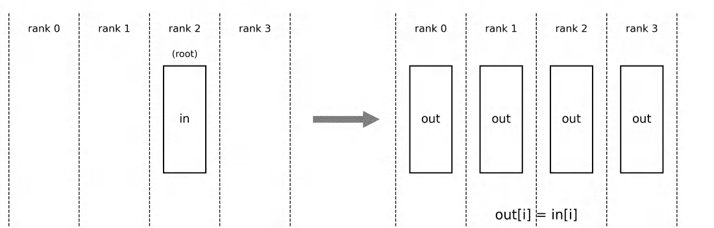

使用广播可以在从磁盘加载模型权重后进行分发、共享超参数（学习率、批大小、训练配置）、同步随机种子以确保结果可复现，以及发送控制信号或标志来协调分布式执行。在自定义并行策略中，广播用于复制模型分片或同步流水线各阶段的状态。

广播也是其他集合操作的基础构件。如“AllReduce”一节所述，AllReduce可以分解为“归约”（将数据收集到根进程）后接“广播”（将结果分发回所有进程）。然而，NCCL将AllReduce优化为单个操作，使其比两步分解更高效。

#### AllReduce 分解

“归约散播（ReduceScatter）”后接“全收集（AllGather）”等价于AllReduce。有些系统使用这种分解进行优化，尤其是在FSDP中，ReduceScatter和AllGather操作可以与计算重叠，从而隐藏通信延迟。

**注意**

```python
root = 0
if rank == root:
    tensor = torch.tensor([10.0, 20.0, 30.0], device=device)
else:
    tensor = torch.zeros(3, device=device)
# After broadcast, all ranks have [10.0, 20.0, 30.0]
dist.broadcast(tensor, src=root)
```

运行演示：

```bash
OMP_NUM_THREADS=1 torchrun --nproc_per_node=2 code/collective-operation/demo_broadcast.py
```

广播的通信开销随数据大小增长，但与进程数量无关——无论全局进程数（world size）是多少，根进程发送的数据量都是相同的。这使得广播能够高效地将大张量（如模型权重）分发到多块GPU上，因为带宽被所有接收进程分摊。

#### 归约（Reduce）

如*图1.16*所示，归约执行与AllReduce相同的归约操作，但只有根进程接收结果。其他进程的缓冲区保持不变。这是一种多对一的通信模式，数据从所有进程流向单个目标。

当只有一个进程需要聚合结果时，归约比AllReduce更高效。由于AllReduce会将结果分发给所有进程，因此需要额外的广播步骤，而归约可以避免这一步骤。当聚合数据仅用于日志记录、检查点保存或决策制定等集中式操作时，这可以节省带宽并降低通信开销。

*图1.16：归约操作：仅将归约结果发送到根进程*

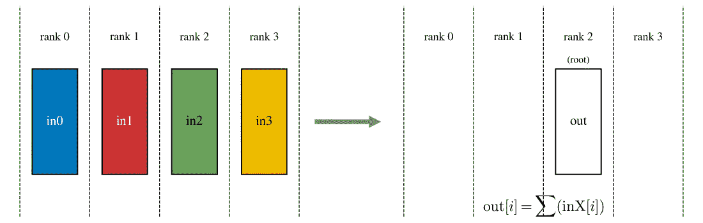

归约的主要用途是收集所有进程的指标和统计信息到0号进程。训练过程中，每个进程在其数据分片上计算本地指标（损失、准确率、梯度范数）。归约会聚合这些指标，使0号进程能够记录全局统计信息、使用聚合值保存检查点，或基于全局状态做出训练决策（早停、学习率调度）。其他常见用途包括：收集所有进程的验证结果、聚合性能分析数据以进行性能分析，以及汇总错误计数或收敛指标以用于分布式监控。

与AllReduce确保所有进程具有同步状态不同，归约保持其他进程的缓冲区不变。这意味着归约结束后，只有根进程拥有聚合结果，其他进程仍然保留各自原始的本地值。如果你需要所有进程都拥有该结果，应改用AllReduce，或在归约之后接一个广播操作。

```python
root = 0
tensor = torch.tensor([rank + 1, rank + 2, rank + 3], device=device)
dist.reduce(tensor, dst=root, op=dist.ReduceOp.SUM)
# Only root has the sum; other ranks unchanged
```

运行演示：

```bash
OMP_NUM_THREADS=1 torchrun --nproc_per_node=2 code/collective-operation/demo_reduce.py
```

归约后接广播等价于AllReduce。然而，NCCL将AllReduce优化为单个操作，使其比显式的两步序列更高效。只有当你确实需要在单个进程上获得聚合结果，且不需要将其分发回其他进程时，才应使用归约。

#### 收集（Gather）

如*图1.17*所示，收集操作将所有进程的数据收集到根进程。每个进程发送N个值，根进程接收按进程索引排序并拼接的 world_size × N 个值。这是一种多对一的通信模式，数据从所有进程流向单个目标。

收集是散布（Scatter）的逆操作，在分布式训练的集中式操作中至关重要。与全收集（AllGather）将收集到的数据分发回所有进程不同，收集只将数据发送到根进程，因此当只有一个进程需要完整数据集时效率更高。它对于I/O操作、日志记录、检查点保存和集中式决策制定尤其有用。

收集的主要用途是将所有进程的结果收集到0号进程进行处理或保存。训练过程中，每个进程在其本地数据分片上计算预测、指标或中间结果。收集操作将这些结果汇总，使0号进程能够聚合它们、保存检查点、记录全局统计信息或执行集中式评估。其他常见用途包括：收集验证预测以进行集成评估，收集特征表示以进行集中分析，从所有进程收集调试信息，以及聚合模型输出以进行最终推理或服务。

*图1.17：收集操作：从所有进程收集数据到根进程*

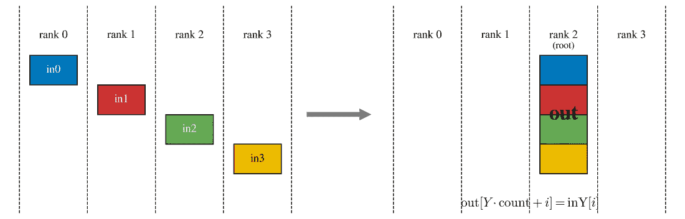

输出顺序是确定性的——0号进程的数据排在前面，接着是1号进程的数据，依此类推。在重建分布式数据结构或当进程顺序对下游处理很重要时，这种顺序至关重要。根进程必须预先分配输出列表，为所有进程的贡献预留空间，而非根进程则传递 `None` 作为输出列表参数。

```python
root = 0
input_tensor = torch.tensor([rank * 10 + 1, rank * 10 + 2], device=device)
if rank == root:
    output_list = [torch.zeros_like(input_tensor) for _ in range(world_size)]
    dist.gather(input_tensor, output_list, dst=root)
    # Root has all data concatenated
else:
    dist.gather(input_tensor, None, dst=root)
```

运行演示：

```bash
OMP_NUM_THREADS=1 torchrun --nproc_per_node=2 code/collective-operation/demo_gather.py
```

收集的通信开销随数据大小和全局进程数（world size）增长。根进程接收 world_size × N 个值，因此带宽需求随进程数量线性增加。对于大型数据集，这可能在0号进程处形成瓶颈，这就是当所有进程都需要收集到的数据时首选AllGather的原因，因为AllGather会将带宽负载分散到所有进程。

#### 散布（Scatter）

*图1.18：散布操作：将数据从根进程分发到所有进程*

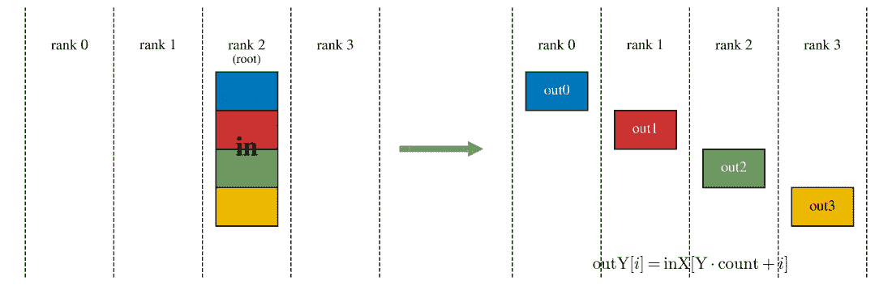

如*图1.18*所示，散布是收集的逆操作。根进程将数据分发给所有进程，每个进程接收到不同的数据块。这是一种一对多的通信模式，其中单个源将不同数据分发给多个目的地。

当数据需要在各进程间分区时，散布对于初始化分布式训练至关重要。与向所有进程发送相同数据的广播不同，散布向每个进程发送不同的数据块，从而实现数据并行，每个进程处理数据的一个唯一子集


数据集。这对于分发无法容纳在单个 rank 上的大型数据集，或者当你想要预先对数据进行分区以实现高效分布式处理时特别有用。

Scatter 的主要用途是分发数据块：将一个 rank 上的不同数据块分发到所有 rank，例如将大型数据集拆分到多个 GPU 上。根 rank 准备一个张量列表，每个 rank 对应一个张量，Scatter 负责分发这些张量，使得 rank 0 收到第一个数据块，rank 1 收到第二个数据块，依此类推。其他常见用途包括：在自定义并行策略中分发模型分片、在数据并行处理中将输入批次拆分到各个 rank、分发因 rank 而异的配置参数，以及使用 rank 特定数据初始化分布式状态。

根 rank 必须准备一个包含 world_size 个张量的 scatter_list，且每个张量形状相同。每个 rank 会收到与其 rank 索引对应的张量。非根 rank 为 scatter_list 参数传入 `None`，因为它们不需要提供输入数据。所有 rank 都必须预先分配具有正确形状的 output_tensor，以接收各自的数据块。

```python
root = 0
if rank == root:
    scatter_list = [torch.tensor([r * 10 + 1, r * 10 + 2], device=device) for r in range(world_size)]
output_tensor = torch.zeros(2, device=device)
if rank == root:
    dist.scatter(output_tensor, scatter_list=scatter_list, src=root)
else:
    dist.scatter(output_tensor, scatter_list=None, src=root)
# Each rank receives its chunk
```

运行演示：

```bash
OMP_NUM_THREADS=1 torchrun --nproc_per_node=2 code/collective-operation/demo_scatter.py
```

Scatter 的通信开销随数据量大小缩放，但从根 rank 的视角来看，它与 world size 无关——无论 rank 数量是多少，根 rank 发送的数据总量相同。然而，在实践中，Scatter 通常不如使用 DistributedSampler 进行数据分区高效，因为 DistributedSampler 无需在分发前将所有数据加载到 rank 0 上。

#### 归约-散播（ReduceScatter）

*图 1.19：ReduceScatter 操作：先归约，再散播*

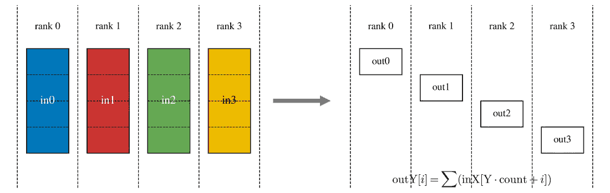

如*图 1.19*所示，ReduceScatter 结合了 Reduce 和 Scatter 两种操作。它先对所有 rank 执行归约，然后将结果按等大小分块散播。每个 rank 根据其 rank 索引收到不同的数据块。这是分片并行策略中的关键操作，能够实现高效的梯度同步和参数更新分发。

ReduceScatter 是全分片数据并行（FSDP）训练的基础。在 FSDP 中，模型参数被分片到各个 rank 上，每个 rank 只持有总参数的一部分。在反向传播过程中，每个 rank 为其本地参数分片计算梯度。然而，由于参数是分片的，所有 rank 的梯度必须先被归约，再重新分发，这样每个 rank 才能用对应的梯度分片更新自己的参数分片。ReduceScatter 能够在单一步骤中高效完成此操作，避免了分别执行 Reduce 和 Scatter 所带来的额外开销。

ReduceScatter 的输入在每个 rank 上被组织为一个张量列表，其中每个张量对应一个分片，该分片将与其他 rank 的相应分片进行归约。归约之后，每个 rank 收到与之 rank 索引对应的归约结果分块。这种模式确保 rank 0 获得归约结果的第一个分块，rank 1 获得第二个分块，依此类推，从而保持分片与参数分布的对齐。

在 FSDP 及其他需要每个 rank 都获得归约结果分片的分片并行策略中使用 ReduceScatter。具体包括 FSDP 中的梯度同步（归约梯度并分发分片）、优化后的参数更新分发、大模型训练中跨微批次的梯度累积，以及需要按分片进行归约的自定义分片策略。

```python
# Each rank has input of size world_size * N
input_list = [torch.tensor([rank * 10 + i, rank * 10 + i + 1], device=device) for i in range(world_size)]
input_tensor = torch.cat(input_list)
# Each rank receives a chunk of the reduced result
output_tensor = torch.zeros(2, device=device)
dist.reduce_scatter(output_tensor, input_list, op=dist.ReduceOp.SUM)
```

运行演示：

```bash
OMP_NUM_THREADS=1 torchrun --nproc_per_node=2 code/collective-operation/demo_reducescatter.py
```

ReduceScatter 的通信开销与 AllReduce 类似，但输出是分发的而非复制的。每个 rank 发送 world_size × N 个值（用于归约）并接收 N 个值（即其分片），因此在只需要分片的情况下，它比 AllReduce 具有更高的内存使用效率。ReduceScatter 之后接 AllGather 与 AllReduce 等价，一些系统利用这种分解来优化性能，尤其是在 FSDP 中，可以将这些操作与计算重叠执行。

#### 全到全（AlltoAll）

*图 1.20：AlltoAll 操作：全到全通信*

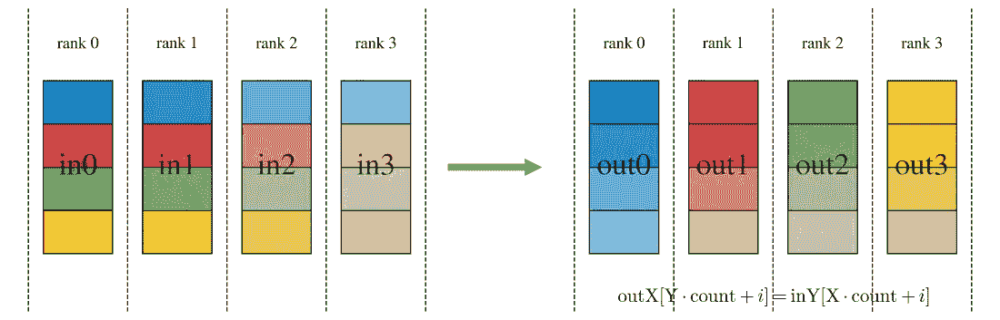

如*图 1.20*所示，AlltoAll 是最通用的操作。每个 rank 向其他所有 rank 发送不同的数据。每个 rank 提供 world_size 个数据块，并收到 world_size 个数据块——分别来自其他每个 rank。这就形成了一个完整的全到全通信模式，其中每个 rank 同时与其他所有 rank 交换数据。

AlltoAll 是最复杂、最通用的集合通信操作，能够实现其他集合通信无法表达的复杂通信模式。与 AllGather（将所有 rank 的数据拼接起来）不同，AlltoAll 允许每个 rank 向每个目标 rank 发送不同的数据，从而形成一种个性化的通信模式。这种灵活性使得 AlltoAll 成为张量并行的关键操作，因为张量并行的不同部分需要按照特定模式在各个 rank 之间进行交换。

AlltoAll 的主要用途是张量并行，其中模型层被拆分到各个 rank 上，不同的张量切片需要在各 rank 间进行交换。例如，在列并行线性层中，每个 rank 持有权重矩阵的不同列切片。在前向传播期间，输入激活值必须分发到各个 rank（每个 rank 一份切片）；而在反向传播期间，输出梯度必须被收集并重新分发。AlltoAll 能够高效处理这些复杂的交换模式。其他常见用途包括：Transformer 模型中的序列并行（交换序列分块）、混合专家模型（Mixture-of-Experts）中的专家并行（将 token 路由到不同专家），以及需要任意数据交换的自定义并行策略。

每个 rank 准备一个包含 world_size 个数据块的 input_list，其中 chunk[i] 会被发送给 rank i。AlltoAll 执行完成后，每个 rank 收到一个 output_list，其中 output_list[i] 包含从 rank i 接收到的数据。这会在所有 rank 之间形成完整的数据置换，从而实现简单集合通信无法达成的复杂通信拓扑。

```python
# Each rank prepares data to send to each other rank
input_list = []
for dst_rank in range(world_size):
    chunk = torch.tensor([rank * 100 + dst_rank * 10 + 1,
                          rank * 100 + dst_rank * 10 + 2], device=device)
    input_list.append(chunk)
# Each rank receives data from all ranks
output_list = [torch.zeros(2, device=device) for _ in range(world_size)]
dist.all_to_all(output_list, input_list)
```

运行演示：

```bash
OMP_NUM_THREADS=1 torchrun --nproc_per_node=2 code/collective-operation/demo_alltoall.py
```

AlltoAll 在所有集合通信中开销最高，因为它要求每个 rank 都向其他每个 rank 发送数据。总数据移动量为 world_size² × chunk_size，因此开销随 world size 呈二次方增长。这使得 AlltoAll 在较大 world size 下代价高昂，因此它只在张量并行和其他先进并行策略中有选择地使用，这些场景中通信模式无法用更简单的集合通信来表达。


#### 选择合适的操作

那么，什么时候该用哪种操作呢？对于梯度同步，AllReduce（参见*图 1.13*）是标准选择。当你包装模型时，DDP 会自动使用它——不需要你自己调用。如果你需要从所有 rank 收集 embedding 或指标，AllGather（参见*图 1.14*）正是你所需要的。它向每个 rank 提供一份来自所有其他 rank 的数据副本。

当你有一个 rank 上的数据需要发送给其他所有 rank 时，Broadcast（参见*图 1.15*）是最简单的选择。可以把它看作一对多的通信。其逆向操作是 Gather（参见*图 1.17*）——当所有 rank 都有数据，而你需要将这些数据收集到一个 rank（通常是 rank 0）上进行日志记录或保存时使用。Scatter（参见*图 1.18*）则相反，它从一个 rank 向其他所有 rank 分发不同的数据块。

对于像 FSDP 这样的分片并行策略，你会看到 ReduceScatter（参见*图 1.19*）和 AlltoAll（参见*图 1.20*）。ReduceScatter 将归约和散射结合起来，当每个 rank 只需要结果的一个分片时，这种方式非常高效。AlltoAll 是最一般的情况，即每个 rank 都向其他每个 rank 发送不同的数据。这体现在张量并行中。

大多数时候，你不会直接调用这些操作。DDP 会在梯度同步期间为你处理 AllReduce（参见*图 1.13*）。FSDP 在底层使用 ReduceScatter（参见*图 1.19*）和 AllGather（参见*图 1.14*）。但理解每个操作的作用，在你调试通信缓慢的原因，或需要实现标准 API 未覆盖的自定义并行策略时，会很有帮助。

### DistributedDataParallel（DDP）

在各种分布式训练策略中，DDP 是最容易理解和使用的一种。它只需要对单 GPU 训练代码做极少的改动，也是分布式训练最常见的起点。本节提供 DDP 的简要概述。*第 3 章*将深入介绍 DDP 的具体实现、优化技巧和最佳实践。

#### AlltoAll 需要 NCCL

AlltoAll 需要 NCCL 后端。GLOO（CPU 后端）不支持它。如果你在使用 `--use_cpu` 时看到错误，请切换到 GPU 模式。之所以存在这一限制，是因为 AlltoAll 复杂的通信模式能从 NCCL 这类针对 GPU 优化的通信库中显著受益。

DDP 包装模型以实现数据并行分布式训练。当你用 DDP 包装模型时，PyTorch 会自动在所有进程间同步梯度。每个进程在本地数据上计算梯度，然后 DDP 在更新模型之前对这些梯度求平均。

DDP 假设每个进程都有完整的模型副本。只有数据被划分——每个进程在不同子集上训练，但每个训练步骤之后所有进程都保持相同的模型参数。当你的模型能放入单个 GPU 时，DDP 效果很好。对于更大的模型，FSDP（全分片数据并行）会将模型分片到多个 GPU 上，同时仍使用数据并行。后续章节将介绍 FSDP 以及其他并行策略，如张量并行和流水线并行。

用 DDP 包装模型：

```python
from torch.nn.parallel import DistributedDataParallel as DDP
model = YourModel().cuda(rank)
model = DDP(model, device_ids=[rank])
```

包装之后，像在单 GPU 训练中那样使用该模型即可。DDP 会在 `loss.backward()` 期间处理同步。

#### DistributedSampler

每个进程应在不同的数据上训练，因此你需要一个 DistributedSampler。它会对数据集进行切分，使每个进程获得独有的子集。如果没有它，所有进程都会看到相同的数据，这就违背了分布式训练的目的。

```python
from torch.utils.data import DataLoader, DistributedSampler
sampler = DistributedSampler(
    dataset,
    num_replicas=world_size,  # Total number of processes
    rank=rank  # This process's rank
)
dataloader = DataLoader(dataset, batch_size=32, sampler=sampler)
```

在每个 epoch 开始时调用 `sampler.set_epoch(epoch)`，以确保跨 epoch 的数据打乱能正确工作。

#### 启动分布式任务

现代方法是使用 `torchrun`，它会自动处理进程的生成：

```bash
torchrun --nproc_per_node=2 code/multi_gpu_ddp.py
```

这会在当前机器上启动 2 个进程。对于多节点训练，还需要指定 `--nnodes`、`--node_rank` 和 `--master_addr`。

该命令使用了几种我们已经介绍过的分布式原语：`init_process_group()` 用于建立通信，`barrier()` 用于同步数据集下载，`DistributedSampler` 用于划分数据，`DDP` 则会在 `loss.backward()` 期间在内部使用 `allreduce()` 同步梯度。

本章逐一讲解了分布式 AI 系统的资源估算、决策框架和实践示例。核心思想很简单：先估算自己的需求，再判断是否真的需要分布式系统。不要想当然地认为自己需要它们——先计算内存和算力需求，检查模型是否装得下，然后再考虑分布式。

既然我们已经理解了何时以及为何使用分布式系统，接下来就需要了解运行它们的硬件。下一章将探讨 GPU 硬件、网络拓扑，以及使分布式 AI 成为可能的基础并行策略。理解这些基础知识，对于就使用哪种分布式方法做出明智决策至关重要。

### 代码摘要

- `torch.distributed`：PyTorch 中用于分布式计算的核心模块（训练和推理）
- `dist.init_process_group()`：使用后端（NCCL、Gloo）初始化用于分布式通信的进程组
- `dist.all_reduce()`：对所有 rank 上的张量执行归约（求和、最大值、最小值等），并将结果存储在所有 rank 上
- `dist.all_gather()`：集合操作，从所有 rank 收集张量并在所有 rank 上拼接起来
- `dist.broadcast()`：将张量从源 rank 广播到所有其他 rank
- `dist.reduce()`：将来自所有 rank 的张量归约到单个目标 rank（通常是 rank 0）
- `dist.gather()`：将来自所有 rank 的张量收集到单个目标 rank
- `dist.scatter()`：将来自源 rank 的张量列表分发到所有其他 rank
- `dist.reduce_scatter()`：对所有 rank 上的张量进行归约，并将结果分发到所有 rank
- `dist.all_to_all()`：从每个 rank 向其他每个 rank 发送不同的数据块

#### 参考资料

波浪号（~）表示近似的参数量。许多大模型是闭源的，因此确切的参数量并未公开。这些近似值基于对模型架构、训练成本和行业估算的推断。

Wu，《大模型参数的谎言》，*夏洛特之夏*（日记），2026年6月7日。`https://wu-99.com/diary/20260607.html#the-llm-parameter-lie`。讨论了 MoE 总参数与激活参数的对比、基于回归的探针的不可靠性、对前沿闭源模型的行业估算（GPT-4 总参数约 1.76T，Claude Opus 4.x 约 5T MoE，GPT-5/Gemini 3.1 处于约 2T–5T 区间），以及首个被公开讨论的约 10T 级模型 Claude Mythos 5（每个 token 激活约 800B–1.2T 参数）。

SemiAnalysis，《GPT-4 架构、基础设施、训练数据集、成本、视觉、MoE》，2023；Epoch AI，《机器学习三个时代的计算趋势》，2023

Epoch AI，《GPU 性价比趋势》，2024；SemiAnalysis，《训练大型语言模型的成本》，2023；OpenAI，《GPT-4 技术报告》，2023

vLLM 中的 Llama 4 - `https://blog.vllm.ai/2025/04/05/llama4.html`

训练估算假设使用 Adam 优化器和适中的批大小。实际值会因架构、序列长度和批大小的不同而变化。

AllReduce 是分布式训练中最常见的集合通信操作。

### 练习

#### 进程组初始化

实现一个函数，以正确的错误处理初始化分布式进程组。

**要求：**

- 函数签名：`setup_distributed(rank, world_size, backend='nccl')`
- 使用 `torch.distributed.init_process_group()` 初始化进程组
- 为当前 rank 设置 CUDA 设备：`torch.cuda.set_device(rank)`
- 为 CUDA 不可用的情况添加错误处理


- 如果成功则返回 `True`，否则返回 `False`
- 打印一条消息，指示使用 rank 和 world_size 初始化成功

**测试你的函数：**

```python
import torch.distributed as dist
import os

# Simulate rank and world_size from environment
rank = int(os.environ.get('RANK', 0))
world_size = int(os.environ.get('WORLD_SIZE', 1))

if setup_distributed(rank, world_size):
    print(f"Rank {rank}/{world_size} initialized successfully")
    dist.destroy_process_group()
```

#### 手动实现 AllReduce

使用 AllReduce 实现一个手动梯度平均函数，模拟 DDP 内部的工作方式。

**要求：**

- 函数签名：`average_gradients(model, world_size)`
- 遍历模型中的所有参数
- 对于每个 `requires_grad=True` 的参数：
  - 使用 `dist.all_reduce()` 并设置 `op=dist.ReduceOp.SUM` 来对所有 rank 的梯度求和
  - 将梯度除以 `world_size` 得到平均值
  - 处理梯度可能为 `None` 的情况（跳过这些参数）

**测试你的函数：**

```python
import torch
import torch.nn as nn
import torch.distributed as dist

# Create a simple model
model = nn.Linear(10, 1).cuda()
loss_fn = nn.MSELoss()

# Forward and backward pass
x = torch.randn(32, 10).cuda()
y = torch.randn(32, 1).cuda()
output = model(x)
loss = loss_fn(output, y)
loss.backward()

# Average gradients across ranks
average_gradients(model, world_size=2)

# Verify gradients are averaged (should be same on all ranks after all_reduce)
print(f"Gradient on rank {rank}: {model.weight.grad}")
```

#### 带验证的 Broadcast

实现一个函数，将张量从 rank 0 广播到所有其他 rank，并验证结果。

**要求：**

- 函数签名：`broadcast_and_verify(tensor, root=0)`
- 如果当前 rank 是 root：创建或使用提供的张量
- 如果当前 rank 不是 root：创建一个相同形状的零张量
- 使用 `dist.broadcast()` 将数据从 root 发送到所有 rank
- 广播后，验证所有 rank 的数据是否相同
- 返回广播后的张量以及一个布尔值，指示验证是否通过

**测试你的函数：**

```python
import torch
import torch.distributed as dist

rank = dist.get_rank()
world_size = dist.get_world_size()

if rank == 0:
    # Root rank creates data
    data = torch.tensor([1.0, 2.0, 3.0, 4.0, 5.0], device='cuda')
else:
    data = None

result, verified = broadcast_and_verify(data, root=0)
print(f"Rank {rank}: {result}, Verified: {verified}")
```

#### DistributedSampler 包装器

为 `DistributedSampler` 创建一个包装器类，自动处理 epoch 设置。

**要求：**

- 类名：`AutoEpochDistributedSampler`
- 继承自 `torch.utils.data.distributed.DistributedSampler`
- 重写 `__iter__()`，在内部 epoch 计数器上自动调用 `set_epoch()`
- 添加 `reset()` 方法以重置 epoch 计数器
- 添加 `get_epoch()` 方法以返回当前 epoch 编号
- 每次调用 `__iter__()` 时，采样器应递增 epoch 计数器

**测试你的函数：**

```python
from torch.utils.data import Dataset, DataLoader
import torch.distributed as dist

# Dummy dataset
class DummyDataset(Dataset):
    def __init__(self, size=100):
        self.data = list(range(size))

    def __len__(self):
        return len(self.data)

    def __getitem__(self, idx):
        return self.data[idx]

dataset = DummyDataset(100)

sampler = AutoEpochDistributedSampler(
    dataset,
    num_replicas=world_size,
    rank=rank
)

dataloader = DataLoader(dataset, batch_size=10, sampler=sampler)

# Iterate through epochs - epoch should auto-increment
for epoch in range(3):
    for batch in dataloader:
        pass
    # Process batch
    print(f"Epoch {sampler.get_epoch()} completed")
```

#### 梯度同步计时

编写一个脚本，测量使用 AllReduce 进行梯度同步所花费的时间。

**要求：**

- 函数签名：`measure_sync_time(model, num_iterations=10)`
- 创建一个大小可配置（参数数量）的模型
- 运行前向和反向传播
- 对所有梯度执行 `dist.all_reduce()` 操作并计时
- 返回平均同步时间（毫秒）
- 使用不同的模型大小（1M、10M、100M 参数）和不同的 world size 进行测试
- 打印结果，展示同步时间如何随模型大小和 world size 变化

**测试你的函数：**

```python
import torch
import torch.nn as nn
import time
import torch.distributed as dist

def create_model(num_params):
    """Create a simple model with approximately num_params parameters"""
    # Simple linear layers to approximate parameter count
    layers = []
    # Rough calculation: for Linear(in, out), params = in * out + out
    # This is simplified - adjust as needed
    return nn.Sequential(
        nn.Linear(1000, num_params // 2000),
        nn.ReLU(),
        nn.Linear(num_params // 2000, 10)
    ).cuda()

model_sizes = [1e6, 10e6, 100e6]  # 1M, 10M, 100M parameters

for size in model_sizes:
    model = create_model(int(size))
    sync_time = measure_sync_time(model, num_iterations=10)
    print(f"Model size: {size/1e6:.1f}M params, "
          f"Avg sync time: {sync_time:.2f} ms, "
          f"World size: {dist.get_world_size()}")
```

#### 预期学习成果

完成这些练习后，你应该能够：

- 计算不同模型大小和精度下的内存需求
- 正确初始化分布式进程组
- 理解 DDP 中梯度同步的工作原理
- 有效使用集合通信操作（AllReduce、Broadcast）
- 使用 DistributedSampler 进行数据划分
- 测量并分析分布式训练中的通信开销

#### 获取本书的 PDF 版本及更多内容

扫描二维码（或访问 `packtpub.com/unlock`）。按名称搜索本书，确认版本，然后按照页面上的步骤操作。

*注意：请保管好您的发票。直接从 Packt 购买的商品不需要发票。*


## 2 GPU 硬件、网络与并行策略

*理解分布式 AI 的硬件拓扑和并行策略*

*创新不仅关乎芯片，更关乎整个技术栈。*

*黄仁勋*

### 计算能力：AI 集群与指标

在*第 1 章*中，我们确立了分布式 AI 为何至关重要——模型规模已超出单 GPU 的容量，模型需求与硬件能力之间的计算差距还在不断扩大。现在我们需要了解支撑分布式训练成为可能的硬件基础。在深入 GPU 细节之前，让我们退一步，理解我们真正构建的是什么：提供巨大计算能力的 AI 集群。

数字在这里很重要——当你训练一个 70B 参数的模型时，你不只是使用几个 GPU。你是在协调成百上千个 GPU，而它们的连接方式决定了你的训练任务是几天还是几周完成。

#### 什么是计算能力？

计算能力（或算力）衡量的是一个系统每秒能执行多少次运算。对于 AI 工作负载，我们关心的是**每秒浮点运算次数（FLOPS）**。这个规模是指数级的：像 H200 这样的单个现代 GPU 在执行 FP16 运算时能达到约 1,000 TFLOPS（teraFLOPS，即每秒 10^12 次运算）。一个由 1000 个这样的 GPU 组成的集群可提供大约 1,000 PFLOPS（petaFLOPS，即每秒 10^15 次运算），或 1


## 第2章：GPU硬件、网络与并行策略

EFLOPS（exaFLOPS，每秒10^(18)次运算）：1000块GPU × 1000 TFLOPS = 10⁶ TFLOPS = 1000 PFLOPS = 1 EFLOPS。

但关键在于：原始FLOPS数字并不能说明全部问题。峰值吞吐量取决于精度——FP64用于传统HPC，FP32作为训练基线，FP16/BF16用于现代AI训练，FP8及更低精度用于推理和量化（参见*第1章*中的精度格式表）。当有人说“这个集群提供500 PFLOPS”时，要问清楚是什么精度：HPC集群可能报的是FP64，而AI集群报的是FP16或BF16。同一硬件在不同的测量格式下会表现出截然不同的数字。

对AI计算需求的增长一直惊人。大型语言模型所需的计算资源在几年内会按数量级增长，具体取决于工作负载和模型扩展；而同期硬件能力仅增长约3倍。这种差距正是分布式训练并非可选项的原因——它是**唯一途径**，能在合理时间内训练现代模型。

如*图2.1*所示，模型内存需求呈指数级增长，而单GPU内存容量增长则更为平缓。这一不断扩大的差距使得分布式训练不仅有益，而且对于在合理时间范围内训练现代大规模模型至关重要[1]。

*图2.1：GPU内存容量与模型内存需求对比*

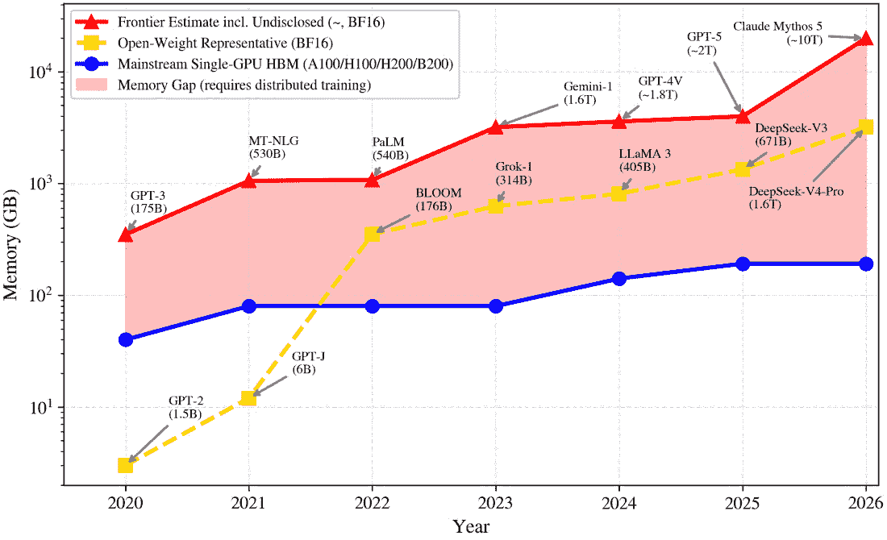

### 为什么需要集群？

单个GPU，即使是高端型号，也不足以应对现代AI工作负载。一个70B参数、FP16权重的模型，仅存储模型就需要约140 GB。再加上梯度、优化器状态和激活值，每个训练步骤就需要超过500 GB。这超出了任何单个GPU的承载能力。

**集群**是由高速网络连接的计算机（节点）组，作为一个整体协同工作。每个节点通常拥有多块GPU、CPU、内存和存储。关键思路是，通过在多个节点之间协调工作，你可以：

- **扩展内存**：将模型参数、梯度、优化器状态分布到各GPU上
- **扩展算力**：通过并行化工作来处理更大批次或加快训练
- **扩展存储**：处理无法放在单台机器上的数据集

*图2.2：AI集群*

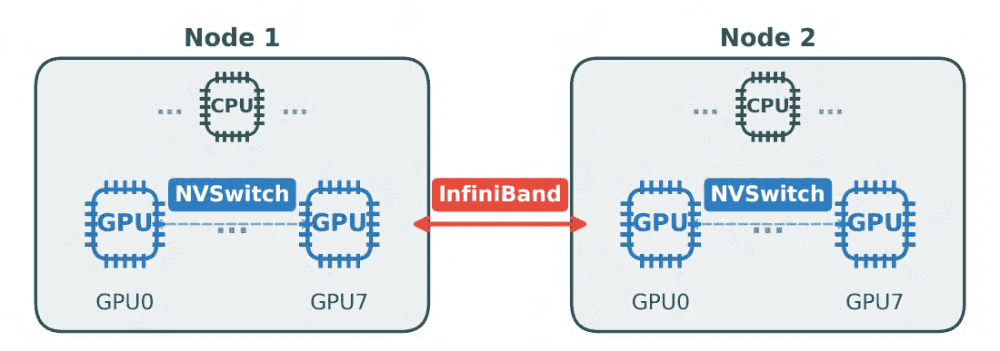

如*图2.2*所示，AI集群由多个节点组成，每个节点包含多块CPU和GPU（现代系统通常每节点8块GPU）。节点内，GPU通过NVSwitch连接，以NVLink速度提供全互联（Ampere–Hopper系统上每GPU 300–900 GB/s，Blackwell B200上最高1.8 TB/s；所有数字均为每GPU双向聚合）。节点间，GPU通过InfiniBand（每条链路200–400 Gb/s）等高速网络通信，从而在整个集群上实现分布式训练和推理。这种架构可以在所有可用资源之间协调工作。

图中所示的集群展示了如何通过将模型参数、梯度、优化器状态分布到各GPU来扩展内存，同时通过跨节点并行化工作负载来扩展算力。每个节点作为独立服务器运行，拥有自己的CPU、内存和存储，但高速网络连接（节点内NVSwitch、节点间InfiniBand）使它们能够作为一个统一系统，共同处理大规模AI工作负载。

集群并不新鲜——在高性能计算（HPC）领域已使用数十年。AI的不同之处在于通信模式。HPC工作负载通常进行大规模、低频次的数据交换。AI训练则进行频繁、较小规模的数据交换（每一步都进行梯度同步），这使得网络带宽和延迟至关重要。我们将在*第8章*讨论如何在SLURM管理的集群上运行分布式训练任务。

### AI集群：为训练和推理而生

**AI集群**是专门为AI工作负载设计的集群。与处理多样化工作负载的通用云数据中心不同，AI集群针对深度学习的独特特征进行了优化：

**对于训练**，AI集群需要：

- **高带宽互连**：梯度同步在每一步训练时发生。如果通信缓慢，GPU就会空转等待梯度。节点内NVLink（Ampere–Hopper上每GPU 300-900 GB/s，Blackwell B200上最高1.8 TB/s）和节点间InfiniBand（每条链路200-400 Gb/s）是标配。
- **大聚合内存**：模型参数、梯度和优化器状态在GPU之间分片。即使采用FSDP等技术（参见*第4章*），一个70B模型可能也需要8-16块GPU才能装进内存。
- **快速存储**：训练数据集很大（ImageNet为150 GB，文本数据集可达数TB）。你需要快速的并行文件系统或节点间对象存储，外加每个节点上的快速本地NVMe（见下文CPU配对）。

**对于推理**，需求则有所不同（参见*第6章*和*第9章*）：

- **更低延迟的网络**：训练关注带宽，推理关注延迟。用户期望毫秒级响应，而不是秒级。
- **高效的内存使用**：注意力机制的KV缓存可能占用大量内存。你需要在缓存大小（用于更长上下文）与内存限制之间取得平衡。
- **负载均衡**：推理工作负载具有突发性。你需要高效地将请求路由到各GPU，并应对流量高峰。

硬件拓扑——GPU在节点内如何连接、节点之间如何互联——直接影响哪些并行策略可行。所有GPU通过NVSwitch（全互联）连接的集群可以有效地使用张量并行。而GPU仅通过PCIe连接的集群，在通信密集型策略上会举步维艰。

### AI集群的关键指标

在评估或优化AI集群时，你需要具体的指标。原始FLOPS数字只是营销——真正重要的是你多高效地利用硬件。以下是真正重要的指标：

**模型FLOPS利用率（MFU）**是衡量训练效率最重要的指标。它衡量你实际使用峰值硬件FLOPS的百分比：

`MFU = (Model FLOPs per iteration / Iteration time) / Peak FLOPS`

MFU告诉你当前是受计算约束，还是受其他因素限制。一个优化良好的集群在大模型上可能达到40-60%的MFU。如果MFU偏低（比如20%），你很可能遇到了内存带宽限制、通信瓶颈或内核启动效率低下的问题。

例如，在H100 GPU上训练一个70B参数Transformer模型，你可能会看到：

- **每轮迭代的理论FLOPs**：约860 TFLOP（取决于批次大小、序列长度）
- **迭代时间**：约2.0秒
- **每秒实际FLOPS**：约860 TFLOP / 2.0秒 ≈ 430 TFLOPS
- **H100峰值FLOPS**：约989 TFLOPS（BF16）
- **MFU**：430/989 ≈ 43%

这使你处于许多团队在大模型上追求的40-60%区间。如果MFU低得多（比如20%），你很可能遇到了内存带宽限制、通信开销，或批次大小不足以让GPU保持忙碌。

你也可以在自己的训练任务上做同样的检查。首先计算每一步接触多少token——在单块GPU上，通常是微批次大小乘以序列长度；如果要看整个集群，再乘以数据并行宽度。对于稠密Transformer，一个可用的FLOP估计值大约是每个token的参数数量的六倍（前向和反向合计）[2]。你的训练日志会给出步长时间；用这些FLOPs除以墙钟秒数，再除以你训练精度下数据手册上的峰值矩阵乘法速率——在H100上就是BF16或FP16，而不是营销幻灯片上的FP8数字。上面的70B示例只是将这些部分代入一行公式而已。

**线性扩展**衡量性能随集群规模扩展的效果。公式为：

`Linear scaling = (Multi-GPU throughput) / (Single-GPU throughput × GPU count)`


完美扩展对应 1.0（100%）。在实践中，优化良好的集群通常能看到 0.7-0.9。如果扩展率低于 0.5，说明存在通信瓶颈。

**GPU 利用率**更简单——它表示 GPU 用于计算与等待的时间百分比。

你可以用以下命令查看：

`nvidia-smi --query-gpu=utilization.gpu --format=csv,noheader`

高利用率（90%+）是好的，但它不能告诉你是否使用了正确的内核，或者通信是否阻塞了计算。MFU 的信息量更大。

**通信效率**衡量你对网络带宽的利用情况：

`Communication efficiency = Actual bandwidth / Theoretical bandwidth`

对于 InfiniBand HDR（200 Gb/s），你也许能达到 180 Gb/s 的实际带宽，即 90% 的效率。如果效率较低，可能存在拓扑问题、数据包丢失或通信模式欠佳。

**吞吐量**（每秒样本数或每秒 token 数）是你关心的训练速度指标。有两种衡量方式：

- **集群吞吐量**（所有 GPU 上每秒处理的 token 总数）：`Throughput_cluster = (Global batch size × Sequence length) / Total training time`
- **单 GPU 吞吐量**（每个 GPU 每秒处理的 token 数）：`Throughput_per_GPU = (Global batch size × Sequence length) / (Total training time × GPU count)`

吞吐量越高越好，但你需要与收敛性进行权衡——更大的批次可能每次迭代训练更快，但需要更多迭代才能收敛。

**资源利用率**分解了时间的去向：

- **GPU 计算时间**：实际的矩阵乘法
- **内存传输时间**：在 CPU 与 GPU 之间或 GPU 之间移动数据
- **通信时间**：梯度同步、AllReduce 操作
- **空闲时间**：等待数据、同步或其他瓶颈

优化良好的集群会将 70-80% 的时间用于计算，10-20% 用于通信，空闲时间极少。

**能效**对大型集群很重要。**每瓦 FLOPS** 用于衡量计算效率：

`FLOPS/Watt = Total FLOPS / Total power consumption`

H100 在 FP16 下大约能提供 1.4 TFLOPS/瓦。越高越好——这意味着相同的电费能获得更多计算量。

**PUE（电源使用效率）**衡量数据中心效率：

`PUE = Total facility power / IT equipment power`

PUE 为 1.0 表示所有电力都用于 IT 设备（在实践中不可能）。真实数据中心通常能达到 1.2-1.5。越低越好——意味着浪费在冷却和开销上的电力更少。

**可靠性指标**在运行长达数周的训练任务时很重要：

- **MTBF（平均故障间隔时间）**：系统故障之间的平均时间。对于 10,000 个 GPU 的集群，你可能每隔几小时就会遇到一次故障。
- **可用性**：系统正常运行的时间百分比。生产集群的目标是 99% 以上。
- **MTTR（平均恢复时间）**：从故障中恢复的平均时间。良好的集群在几分钟内即可恢复，而不是几小时。

**通信延迟**对分布式训练至关重要。AllReduce 延迟应满足：

- **节点内（NVLink）**：对于典型梯度大小应小于 1 ms
- **节点间（InfiniBand）**：节点间通信应小于 5 ms
- **P99 延迟**：第 99 百分位延迟比平均值更重要——一个慢节点可能导致整个训练任务停滞。

在基准测试集群时，你需要在不同规模下测量这些指标：8 个 GPU、64 个 GPU、512 个 GPU、2048 个 GPU。随规模增大而变差的指标（如线性扩展或通信效率）会告诉你瓶颈在哪里。

在打好这个基础之后，让我们来研究使集群正常运行的硬件组件。我们将从 CPU 开始，它编排整个系统；然后转向真正执行计算的 GPU；接着介绍替代加速器、互连技术；最后讨论如何根据集群拓扑选择并行策略。

### 中央处理器（CPU）

虽然 GPU 在分布式训练中承担主要计算任务，但 CPU 扮演着至关重要的支持角色。理解 CPU 架构有助于优化数据加载、管理 GPU 协调以及调试性能瓶颈。

#### CPU 架构基础

CPU 围绕**冯·诺依曼架构**构建：一个包含算术逻辑单元（ALU）、控制单元（CU）和存储单元（寄存器）的中央处理器。与面向吞吐量优化的 GPU 不同，CPU 为延迟而优化——支持复杂控制逻辑的快速单线程执行。

关键区别在于：CPU 将大部分芯片面积用于控制逻辑和缓存，而不是计算单元。现代 CPU 可能有 8-64 个核心，每个核心都具备复杂的乱序执行、分支预测和多级缓存。GPU 则拥有数千个为并行负载优化的简单核心。

在分布式训练中，CPU 负责：

- **数据加载与预处理**：从磁盘读取数据、解码图像、对文本进行分词（tokenize）
- **编排**：启动 GPU 内核、管理进程组、处理通信
- **系统管理**：内存分配、进程调度、网络协议栈

如果 CPU 成为瓶颈，GPU 就会闲置等待数据。这就是数据加载流水线如此重要的原因——你需要足够的 CPU 核心和快速存储，才能让 GPU 持续获得数据。

#### CPU-GPU 交互

*图 2.3：CPU-GPU 交互*

当你运行分布式训练时，会发生以下过程：

- **CPU 启动 GPU 内核**：你的 Python 代码（在 CPU 上运行）调用 PyTorch，生成 CUDA 内核。CPU 通过 PCIe 将这些内核发送到 GPU。
- **CPU 管理内存**：CPU 分配 GPU 内存，将数据从 CPU 内存传输到 GPU 内存，并协调多 GPU 通信。
- **CPU 处理通信**：对于多节点训练，CPU 进程负责网络通信（InfiniBand、以太网），并与 NCCL 协调 GPU 集合通信。

如*图 2.3*所示，CPU 与 GPU 之间的 PCIe 连接常常是瓶颈。PCIe Gen 4 x16 每个方向约 31.5 GB/s（双向约 63 GB/s），而 GPU 之间的 NVLink 在 Ampere–Hopper 架构上每个 GPU 可达 300-900 GB/s（Blackwell B200 上双向聚合最高 1.8 TB/s）。这就是为什么你会希望 GPU 之间直接通过 NVLink 通信，而不是经过 CPU。

#### NUMA 与 CPU 亲和性

现代服务器有多个 CPU 插槽（NUMA 节点）。每个插槽拥有自己的内存控制器和 PCIe 通道。连接到不同插槽的 GPU 具有不同的内存访问模式。

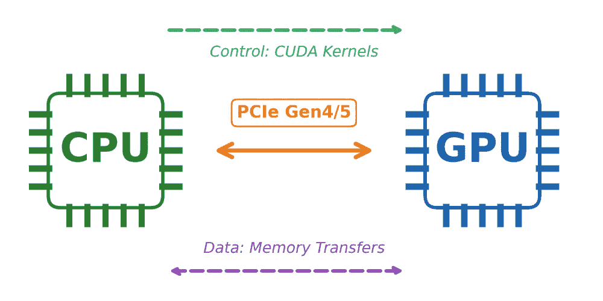

你可以通过以下命令检查 NUMA 拓扑：

`numactl --hardware`

对于分布式训练，尽量让进程与其 GPU 位于同一 NUMA 节点上。这可以降低内存访问延迟。PyTorch 不会自动完成这一点——你可能需要在启动任务时手动设置 CPU 亲和性，或使用 `numactl`。

#### 分布式训练的 CPU 需求

对于典型的 8-GPU 服务器：

- **CPU 核心**：每个 GPU 至少需要 2-4 个 CPU 核心用于数据加载和编排。8-GPU 系统至少应有 16-32 个 CPU 核心。
- **内存**：CPU 内存应为 GPU 内存的 1.5-2 倍，用于数据暂存。对于 8×80GB 的 GPU，你至少需要 1 TB 的 CPU 内存。
- **PCIe 通道**：每个 GPU 需要 PCIe x16。8-GPU 系统需要 128 条 PCIe 通道，这通常意味着双路 CPU（AMD EPYC 或 Intel Xeon）。
- **NVMe 存储**：对于 8-GPU 训练节点，目标是从本地 NVMe（例如 2 到 4 块 PCIe Gen4/Gen5 硬盘，通常为 RAID-0）获得 **约 10–20 GB/s 的聚合顺序读取**，以免数据加载器和检查点 I/O 拖慢 GPU。TB 级数据集通常存放在集群并行文件系统上；但本地 NVMe 对每节点缓存和临时空间仍然很重要。

CPU 不需要是最新一代——它并不负责计算。但它需要足够的核心和 PCIe 带宽来让 GPU 保持忙碌。现在，让我们转向承担主要计算工作的组件：GPU。

### 图形处理器（GPU）

在构建分布式训练系统时，GPU 架构很重要。自 2010 年以来，NVIDIA 一直在迭代 GPU 设计，每一代都会带来影响你设计训练流水线的变化。以下是你需要了解的、可能遇到的 GPU 相关信息。

#### 理解 GPU 内存与计算架构

GPU 是为吞吐量而生，而非延迟。与优化快速单线程执行的 CPU 不同，GPU 集成了数千个简单核心，并优先考虑高带宽内存访问。在训练大型模型时，这种设计会带来回报——但这也意味着你需要以不同的方式思考内存和计算。


## GPU 硬件、网络与并行策略

内存层次结构很重要。寄存器最快但容量极小。共享内存（L1 缓存）速度快但容量有限。L2 缓存位于共享内存和设备 DRAM 之间，而设备 DRAM 是 GPU 的主内存。当你看到“内存不足”错误时，通常是设备 DRAM 已满，而非缓存已满。

*图 2.4：GPU 内存层次结构架构*

如*图 2.4*所示，GPU 内存层次结构由多个层级组成，每个层级具有不同的特性：寄存器提供最高的带宽和最低的延迟，但容量极小；L1/共享内存提供快速访问，但每个流式多处理器（SM）的容量有限；L2 缓存提供更大的共享缓存，带宽中等；而显存（HBM/GDDR）提供最大的容量，但相对于更小的内存层级，延迟更高、带宽更低。这一层次结构反映了内存设计中的基本权衡：更高的带宽和更低的延迟以容量减小为代价，而更大的容量则需要接受更高的延迟和更低的带宽。

有一点常常让人困惑：内存带宽往往比计算更早成为瓶颈。如果你的内核受内存限制，增加计算能力也无济于事。你可以通过性能分析来发现这一点——如果 GPU 利用率很低但内存带宽已用尽，那么你就受到了内存限制。

要了解你的硬件配置，可以查看 GPU 规格：

```
nvidia-smi \
    --query-gpu=name,memory.total,pcie.link.gen.max,pcie.link.width.max \
    --format=csv
```

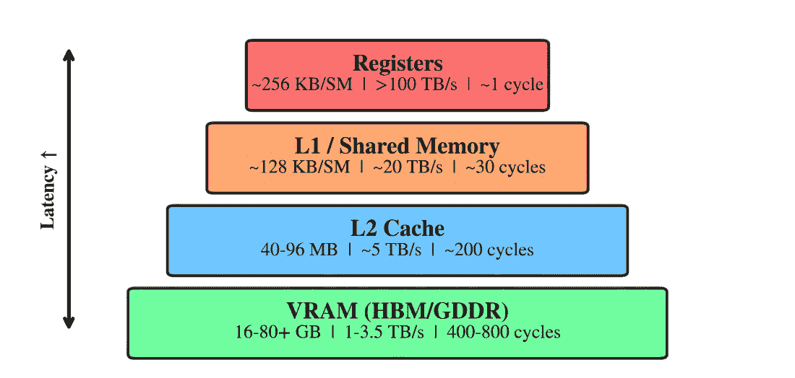

下面是在不同系统上可能看到的结果。一个配备 8 个 GPU 的 H200 系统：

```
$ nvidia-smi --query-gpu=name,memory.total,pcie.link.gen.max,pcie.link.width.max \
    --format=csv
name, memory.total [MiB], pcie.link.gen.max, pcie.link.width.max
NVIDIA H200, 143771 MiB, 5, 16
NVIDIA H200, 143771 MiB, 5, 16
...
```

这是 PCIe 第 5 代，16 通道，每个方向约 64 GB/s。将其与消费级 RTX 4090 比较：

```
NVIDIA GeForce RTX 4090, 24564 MiB, 4, 16
```

PCIe 第 4 代，同样是 16 通道，但每个方向只有约 31.5 GB/s（双向约 63 GB/s）。PCIe 连接是 GPU 与 CPU 通信的通道，但对于多 GPU 通信，你需要更快的方式。

但 PCIe 只是其中一部分。对于多 GPU 通信，你需要 NVLink——一种完全绕开 CPU 的直接 GPU 到 GPU 连接。要查看系统实际具有的连接，运行：

```
nvidia-smi topo -m
```

这会显示拓扑矩阵。输出可能很密集，但你需要关注以下内容：

如果在 GPU 之间看到 `NV18`、`NV12` 或 `NV4`，说明你有 NVLink。这很好——在 Ampere–Hopper 架构上，这些链接可提供每 GPU 300-900 GB/s 的双向聚合带宽（Blackwell B200 上最高 1.8 TB/s），远超 PCIe。在配置良好的系统（如 DGX 或 HGX 机箱）中，你会看到所有 GPU 通过 NVSwitch 以 NVLink 相连，这意味着每个 GPU 都能以全速与其他 GPU 通信。

如果在 GPU 之间看到 `PIX` 或 `PXB`，说明它们仅通过 PCIe 连接。这也能工作，但你会更快遇到带宽限制。你还可能看到 `NODE` 或 `SYS`，这意味着连接跨越了 NUMA 边界——这也是导致速度变慢的一个因素。

下面是一个来自带 NVSwitch 的 H200 系统的真实示例。所有 8 个 GPU 之间都显示 `NV18` 连接：

| | GPU0 | GPU1 | GPU2 | GPU3 | GPU4 | GPU5 | GPU6 | GPU7 |
|---|---|---|---|---|---|---|---|---|
| GPU0 | X | NV18 | NV18 | NV18 | NV18 | NV18 | NV18 | NV18 |
| GPU1 | NV18 | X | NV18 | NV18 | NV18 | NV18 | NV18 | NV18 |

这是理想的配置。每个 GPU 都能以 NVLink 速度与其他所有 GPU 通信。在标准服务器中，你可能看到某些 GPU 仅通过 `PIX` 或 `PXB` 连接，这意味着它们走的是 PCIe。这仍然可以工作，但在通信密集型操作中，你需要更谨慎地选择配对哪些 GPU。

还有一点：注意 CPU 亲和性列。GPU 0-3 可能位于 NUMA 节点 0，而 GPU 4-7 位于 NUMA 节点 1。如果你进行多节点训练，尽量让进程保持在同一个 NUMA 节点上——跨 NUMA 通信会增加延迟。

#### 关键架构里程碑

- **截至帕斯卡架构（2016）：** 费米和帕斯卡架构奠定了 CUDA 以及用于多 GPU 系统的早期 NVLink——如今你不太可能在生产环境的 AI 集群中看到它们。
- **Volta 和 Ampere 架构（2017–2020）：** Volta 架构引入了张量核心；A100（Ampere 架构）增加了 TF32/BF16、NVLink 3.0（每 GPU 600 GB/s）和 NVSwitch。A100 在推理和较老的训练集群中仍然常见，但新的大规模训练构建已经转向更新架构。
- **Hopper 架构（2022）** 是当前分布式训练的主力。H100 带来了 FP8、用于动态精度切换的 Transformer Engine，以及 NVLink 4.0（每 GPU 900 GB/s，双向聚合）。H200 保持相同的计算能力，但增加了 HBM3e 容量（141 GB，而 H100 为 80 GB）——当模型状态和激活值占用大量内存时，这一点很重要。
- **Blackwell 架构（2024）** 是当今构建新集群时 NVIDIA 的高端训练世代。路线图已经列出了诸如 Vera Rubin 等后续产品，因此在做出承诺之前，请向供应商或云服务商确认 SKU 列表和交付周期。B200 将 NVLink 带宽翻倍至每 GPU 1.8 TB/s（双向聚合），采用双芯片封装（每个模块包含两个芯片），并将 HBM 带宽提升至每 GPU 8 TB/s——在大规模训练中，其 transformer 训练吞吐量约为 H100 的 2 倍。在同一世代中，高内存版本的 Blackwell（例如 B300 级 GPU）为超大型模型增加了 HBM 容量；它们通常以更高功耗和更严格的散热要求来换取额外的容量余量。

#### 这些数字对训练意味着什么

在为分布式训练选择 GPU 时，你需要关注三件事：

- **内存容量与带宽**：一个 70B 参数、FP16 权重的模型，仅模型本身就需要约 140 GB。再加上梯度、优化器状态（Adam 使用模型大小的 2 倍）和激活值，每个训练步骤就需要 500+ GB。H100 有 80 GB HBM3，H200 有 141 GB，B200 有 192 GB（更高内存的 Blackwell 变体如 B300 级 GPU 则有 288 GB）。更多内存意味着可以使用更大的批量大小或需要更少的 GPU。HBM 带宽也很重要。A100 为 2 TB/s，H100 为 3 TB/s，B200 为 8 TB/s（均为每 GPU）。然而，跨 GPU 的梯度同步通常主要受互连带宽（NVLink/InfiniBand）的制约。HBM 带宽主要影响本地操作，如归约内核和融合算子——更高的 HBM 带宽意味着更快的本地归约和内存受限操作。
- **计算吞吐量**：这是张量核心的用武之地。H100 在 FP16 下可提供约 1 PFLOP，而 B200 达到 2.25 PFLOP。但原始 FLOPS 并不能说明全部问题——你需要查看实际使用的精度。FP8 训练比 FP16 快 2 倍，但并非所有模型都能在 FP8 下良好训练。Hopper 的 Transformer Engine（Blackwell 延续了这一特性）会在训练过程中自动在 FP8 和 FP16 之间切换；NVIDIA 的 H100 架构白皮书报告称，在启用 FP8 和 Transformer Engine 时，**transformer 工作负载的训练吞吐量相对于 A100 最高可提升 6 倍**[3]——但这对每个模型或技术栈来说并非保证。
- **互连带宽**：NVLink 带宽（每 GPU，双向聚合）决定了 GPU 同步梯度的速度。A100 为 600 GB/s，H100 为 900 GB/s，B200 为 1.8 TB/s（均为每 GPU 双向聚合）。当你进行数据并行时，每一步都要执行 AllReduce 操作。NVLink 越快，通信开销就越低。

#### 图形处理单元（GPU）产品系列

NVIDIA 根据需求以不同的形态提供 GPU：

- **HGX（超大规模 GPU 交换）** 是一种基板模块，由 OEM 集成到服务器中。HGX H100 拥有 8 个通过 NVSwitch 连接的 H100 GPU，总共提供 640 GB HBM、每 GPU 900 GB/s 的 NVLink，以及整个基板约 3.6 TB/s 的 NVSwitch 对分带宽。你可以从 Dell、Supermicro 或 Inspur 等服务器供应商处购买，他们会添加 CPU、存储和网络。
- **DGX（深度 GPU 加速）** 是 NVIDIA 的完整系统。DGX H100 是一台预集成服务器，包含 8 个 H100、AMD EPYC CPU、NVMe 存储和 InfiniBand 网络。它价格更高，但附带优化的软件栈和支持。大多数 AI 公司使用 DGX 系统进行训练——它们经过充分测试、有完善文档，而且开箱即用。
- **SuperPOD** 可扩展到单台服务器之外。DGX SuperPOD 通过 InfiniBand 连接多个 DGX 系统（通常为 32-64 个节点），创建一个拥有数千个 GPU 的集群。GB200 SuperPOD 连接 8 个 GB200 NVL72 单元（每个单元有 72 个 GPU，按 NVIDIA 规格，每个机架的 NVLink 容量约为 130 TB/s），总计 576 个 GPU，并在机架之间提供额外的 NVLink 交换。

GB200 NVL72 很有意思——它是一个液冷机架单元，包含 36 个 GB200 超级芯片（共 72 个 GPU），通过 NVLink 连接。NVIDIA 将其宣传为“单一巨型 GPU”，因为 NVLink 以非常高的带宽将整个机架连接在一起——但这只是营销话术，并非编程模型。你仍然需要以显式并行方式运行 72 个 GPU（TP/PP/DP、集合通信，以及刻意安排的张量放置）；框架会帮你对模型进行分片。不要期望透明


统一内存类似于CPU NUMA。其好处是对于万亿参数训练实现快速的机架内通信，而不是像单一逻辑设备那样无需分布式代码。

### 选择合适的GPU

对于大多数分布式训练，你将面临H100、H200或B200之间的选择。以下是决策树：

- **H100**：仍然是主力。80 GB内存，3 TB/s带宽，900 GB/s NVLink。性能和可用性平衡良好。如果你现在正在构建集群并需要经过验证的硬件，请选择它。
- **H200**：与H100相同的算力，但内存为141 GB。如果你受内存限制——比如更大的模型、更长的序列，或者想要更大的批次大小，请选择它。额外的内存成本更高，但可以减少所需的GPU数量。
- **B200**：用于训练的旗舰Blackwell产品——192 GB HBM，8 TB/s内存带宽，每GPU 1.8 TB/s NVLink。当你需要最大吞吐量并能获得容量时使用它；双芯片设计提供约2倍于H100的算力，但价格更高，且供应情况因季度和地区而异。

需要注意的一点：**可用性**与规格表同样重要。需求激增和产品过渡往往让较旧的GPU仍在生产中，而较新的SKU正在爬坡，因此交货周期、云配额以及哪一代产品最容易购买可能每个季度都在变化。在最终确定设计之前，请向供应商或云提供商确认任何积压订单的传闻——过去周期中，高需求部件的等待时间曾达数月之久，而随着新芯片出货，这种等待会缓解或再次出现。Blackwell之外的产品路线图公告可能重新洗牌你实际能采购到的产品，所以当你准备购买时，请再次确认。

对于推理，考量有所变化。B200的FP4性能（20 PFLOP）使其在高吞吐量推理中很有吸引力，但每次请求的成本比峰值FLOPS更重要。许多推理部署仍在使用A100甚至消费级GPU，因为它们更便宜且足够用。

### 重要的架构特性

**张量核心**是秘密武器。它们是专用单元，执行矩阵乘法的速度比CUDA核心快10-100倍。每个现代训练框架（PyTorch、TensorFlow、JAX）都会通过cuBLAS和cuDNN自动使用它们。你不需要编写特殊代码——只需确保使用FP16/BF16/FP8精度。

**Transformer Engine**（Hopper和Blackwell）在训练期间自动在FP8和FP16之间切换。它监控激活统计信息，在安全时使用FP8，在需要精度时使用FP16——这就是前面引用的高达6倍Transformer训练速度提升的来源[3]。

**MIG（多实例GPU）**在A100和H100上允许你将单个GPU划分为多个虚拟GPU。每个分区获得专用的内存和算力。这对于希望向多个客户出租GPU时间的云提供商很有用，但对于训练大型模型，你会需要完整的GPU。

**NVLink-C2C**在Grace Hopper系统中以900 GB/s带宽（聚合双向）连接CPU和GPU。这使GPU可以直接访问CPU内存，对于不适合GPU内存的模型很有用。Grace CPU拥有512 GB LPDDR5X，因此GH200系统总可寻址内存为608 GB（96 GB GPU + 512 GB CPU）。

在设计分布式系统时，这些架构细节决定了你的并行策略。高NVLink带宽意味着张量并行是可行的。大内存意味着你可以容纳更大的模型或使用更少的GPU。快速的HBM意味着你可以处理更大的批次而不会触及内存带宽限制。

虽然NVIDIA GPU主导着分布式训练领域，但了解替代加速器仍然值得。Google的张量处理单元（TPU）提供了一种专门为神经网络优化的不同架构方法，而神经处理单元（NPU）则代表了另一种特定领域的选项。了解这些替代方案有助于选择硬件或在平台之间移植代码。

### 张量处理单元（TPU）

Google的张量处理单元（TPU）提供了与GPU不同的架构方法。TPU是专用集成电路（ASIC），从头开始为神经网络工作负载而设计。如果你在Google工作或使用Google Cloud，你会遇到TPU。了解它们与GPU的不同之处有助于选择硬件或在平台之间移植代码。

#### TPU为何存在

Google在2013年开始设计TPU，当时他们意识到在CPU上运行神经网络成本过高。他们的预测：如果人们每天使用3分钟的语音搜索，并采用基于神经网络的语音识别，他们将需要将数据中心容量翻倍。CPU无法经济地扩展，而当时的GPU（2013年）也没有针对神经网络进行优化。

TPU v1于2016年出货——从设计到部署仅15个月。对于芯片来说，这很快。第一块硅片没有经过任何掩膜修改就能工作，这很罕见。关键的洞察是：神经网络不需要CPU或GPU的灵活性。它们主要是矩阵乘法，所以你可以制造一块芯片，把一件事情做到极致。

#### TPU架构：脉动阵列

TPU的核心是**矩阵乘法单元（MXU）**，它使用**脉动阵列**架构。与使用数千个带寄存器和缓存的CUDA核心的GPU不同，脉动阵列是一个处理单元（PE）的网格，数据像心跳一样流过阵列——因此称为“脉动”。

工作原理如下：数据不是将中间结果存储在寄存器中以后再取回，而是直接从一个PE流向下一个PE。每个PE将两个值相乘，并将结果传递给邻居。这消除了大部分内存访问，因为数据在流过阵列时被重复使用。对于矩阵乘法，这非常高效——每个输入值只需读取一次，然后多次复用。

TPU v1拥有256×256脉动阵列（65,536个PE），运行频率为700 MHz，INT8运算性能约为92 TOPS。TPU v2及更高版本使用128×128阵列，但每颗芯片有多个MXU。脉动设计意味着TPU擅长密集矩阵乘法，但在其他操作上不如GPU灵活。

#### TPU历代产品

Google的产品线经历了几次跳跃式演进，这些至今仍出现在论文和pod设计中：**v1（2016）**仅用于推理（通过PCIe的INT8）；**v2**增加了BF16训练、HBM和芯片间链路；**v4**增加了用于嵌入的**稀疏核心**、数千芯片的**3D环面**pod，以及**光路交换（OCS）**。早期代际在GCP上已不再提供，但这些里程碑解释了旧文献中的术语。

在Google Cloud上，当前相关的公共TPU系列包括**v5e/v5p**、**Trillium**、**TPU7x/Ironwood**，以及更新的第八代**TPU 8t/8i**产品线，但可用性取决于地区、配额和部署模式。峰值FLOPS、每芯片内存、pod规模和地区可用性每代都在变化，但软件栈保持不变：**通过XLA使用JAX或TensorFlow**，配合下一节提到的`jax.jit`和pod分片。请查看Google Cloud TPU文档 `https://cloud.google.com/tpu/docs` 了解你可以绑定哪些SKU。

#### TPU Pod架构

**TPU Pod**是Google对TPU集群的称呼。与使用InfiniBand交换机的GPU集群不同，TPU Pod使用自定义互连。较新的代际扩展了pod规模和网络结构细节；以下概念来自v2–v4设计，但仍能描述流量在环面上的大致流动方式：

- **2D环面**（早期pod）：芯片呈网格状排列，每个芯片有四个邻居（边缘环绕）。本地带宽良好；距离较远的配对需要更多跳数。


- **3D 环面拓扑**（自 v4 起）：每个芯片有六个邻居（带环绕的 3D 网格）。
- 在相同芯片数量下，直径比 2D 更短——在 pod 规模下尤为重要。
- **光路交换（OCS）**：在 v4 规模上引入——MEMS 光开关在芯片之间路由光信号，转换损耗更低。路由可以重新配置以实现容错。

环面拓扑与 GPU 集群的 Clos/胖树网络不同。环面拓扑更便宜（交换机更少、布线更简单），并且本地通信延迟更低，但在扩展和负载均衡方面灵活性较差。Clos 网络是无阻塞的（任何输入都可以同时以全带宽与任何输出通信），而环面网络可能会出现拥塞。

### TPU 与 GPU：何时选用哪种

#### 以下情况使用 TPU：

- 你在 Google 工作或使用 Google Cloud Platform
- 你的工作负载主要是稠密矩阵乘法（Transformer、CNN）
- 你希望特定模型获得最大性能（Google 为其模型优化了 TPU 软件栈）
- 你正在 Google 规模（数千颗芯片）下进行训练

#### 以下情况使用 GPU：

- 你需要灵活性（不同的模型架构、研究工作）
- 你正在使用 PyTorch（TPU 有官方支持，但 GPU 是一等公民）
- 你需要在本地或多云环境运行
- 你的工作负载包含稀疏运算或不规则模式
- 你需要实用的调试手段——XLA 错误晦涩难懂、性能分析工具不如 NVIDIA Nsight 强大，而且除非你是 Google/GCP 的大客户，否则几乎得不到公共社区支持

#### 性能特点：

TPU 擅长稠密矩阵运算。每颗芯片的峰值 FLOPS 因代际而异（v4 约为 275 TFLOPS BF16；Trillium、Ironwood 和第八代 SKU 更高——参见 GCP 规格）——v4 时代每颗芯片大致相当于 Ampere 级别，而非 H100 级别（稠密 BF16/FP16 约 990 TFLOPS）。当 XLA 和工作负载与软件栈相匹配时，端到端的 Transformer 训练在 pod 规模下仍然具有竞争力。

GPU 更具通用性。它们能更好地处理稀疏运算、自定义内核和混合工作负载。

TPU 软件栈（XLA 编译器）经过高度优化，但灵活性较低。你将模型编译为 XLA，由编译器生成优化代码。对于受支持的操作，这可能比 GPU 更快，但更难调试。

**调试与工具链：** 在 GPU 上，你有成熟的工具（`nvidia-smi`、Nsight、PyTorch profiler）和庞大的社区。在 TPU 上，故障通常表现为**晦涩难懂的 XLA 编译错误**（编译器日志冗长，几乎没有行级上下文），性能分析工具也不够成熟，帮助主要来自 **GCP/Google 渠道**——达不到 Stack Overflow 那种深度。对于正在学习分布式训练的团队来说，这种摩擦与 FLOPS 和每小时价格一样，都是实实在在的成本。

#### 成本与可用性：

TPU 仅在 Google Cloud 上提供，无法直接购买。

GPU 定价因云服务商和可用性而异。H100 很昂贵，但可以从多家供应商处获得。

TPU 在 GCP 上按小时计费。对于大规模训练，如果你的工作负载匹配，TPU 可能具有成本效益。

### TPU 编程模型

TPU 通过 **XLA（加速线性代数）** 运行。你编写 TensorFlow 或 JAX 代码，XLA 会将其降级为 TPU 指令。这与 GPU 的工作流程不同：在 GPU 上，你通常依赖 CUDA 内核和 cuDNN 等库，而不是整个程序的编译步骤。

代价是启动时间。首次运行会编译整个计算图，可能需要几分钟；后续运行会复用已编译的二进制文件，速度快得多。GPU 通常启动更快，但每步的运行时开销可能更大。

对于多芯片训练，TensorFlow 的分布式策略仍然很常见。在 JAX 中，使用 `jax.jit` 配合**分片注解**——在设备网格上使用 `PartitionSpec` 和 `NamedSharding`——来描述张量如何映射到整个 pod；当你需要显式的逐芯片逻辑时，使用 `jax.shard_map`。在环面拓扑上，张量放置仍然很重要：对张量进行分片，使大部分流量保持在邻居之间，其余部分交给 XLA 优化。糟糕的布局在调试时仍会表现为训练步骤缓慢或令人困惑的错误。

### 稀疏核（自 v4 起）

**稀疏核（Sparse Core）** 首次亮相于 TPU v4，并保留在此后面向训练的各代产品中（包括嵌入密集的 **TPU 8t** 工作负载）。嵌入层将离散 ID 映射为稠密向量；这种访问是不规则的，不适合纯粹的脉动阵列矩阵乘法。稀疏核单元通过专用的 HBM 路径获取并处理这些查找操作——这是算法与硬件的协同设计，而 GPU 通常用软件来处理。

如果你训练推荐模型或带有大型嵌入表的模型，请检查你的 GCP SKU 是否包含稀疏核（Sparse Core）。对于纯 Transformer 工作负载，它的影响较小。

除了 GPU 和 TPU 之外，另一类加速器已经出现：神经处理单元（NPU），它代表了更广泛的领域专用 AI 芯片类别。虽然 NPU 在大规模训练中不太常见，但值得了解，因为它们代表了灵活性与效率之间的另一种权衡。

### 神经处理单元（NPU）

**神经处理单元（NPU）** 代表了另一种思路：针对 AI 工作负载优化的领域专用架构（DSA）芯片。NPU 是专用集成电路（ASIC），从零开始为神经网络运算而设计，以通用灵活性换取效率。

#### NPU 的独特之处

NPU 围绕 **AI 核心（AI Cores）** 构建——这些专用单元针对矩阵乘法、卷积和其他神经网络原语进行了优化。早期的 GPU 源于图形处理；如今用于训练的 GPU 也依赖类似的专用模块（Tensor Core、矩阵单元），因此历史上“GPU 与 NPU”的叙事，与其说是根本不同的芯片设计，不如说同样关乎**软件与上市策略**。

这种架构权衡是一个有用的心智模型，而不是一条硬性边界：

- **CPU** —— 通用控制与编排
- **GPU** —— 面向吞吐量的并行处理器，拥有庞大的软件栈
- **NPU** —— 以 AI 为先的设计，以灵活性换取效率

**融合趋势：** 这些界限正在模糊。现代数据中心 GPU 每一代都越来越不像“图形芯片”——NVIDIA 的 **Tensor Core** 是面向训练和推理的领域专用矩阵引擎，AMD 的 **MI300X**（CDNA3）也将芯片的大部分用于矩阵单元和 HBM，看起来非常像 NPU。纯粹的 NPU 在软件上仍然不同（专有软件栈、侧重边缘场景），但当你选择硬件时，你通常是在比较**专业化程度**，而不是三个截然不同的物种。生态系统（CUDA/ROCm、PyTorch、NCCL）仍然比幻灯片上的标签更重要。

你仍然会遇到混合部署的格局。**华为昇腾**（910C 及之后版本）将数据中心 NPU 与机架级 **SuperPoD** 系统相结合，采用定制互连——这在中国和一些出口市场很常见。**AWS Trainium** 是亚马逊在 EC2 上的训练 ASIC，从 **Trainium2** 实例一直到多机架集群。**Google 的 Edge TPU** 是独立的低功耗边缘推理产品线，而不是上一节提到的云端 TPU pod。在软件栈和供应链适合你的工作负载的地区，**寒武纪 MLU** 等区域供应商也很重要。规格和 SKU 变化很快——在确定硬件之前，请查阅供应商文档。

#### NPU 架构：AI 核心与内存

NPU 架构以 **AI 核心（AI Cores）** 为中心——这是用于神经网络运算的专用计算单元。每个 AI 核心通常包括：

- **矩阵乘法单元**：针对 GEMM（通用矩阵乘法）运算优化
- **向量处理单元**：用于逐元素运算、激活、归一化
- **专用单元**：用于池化、卷积、注意力等运算

内存层级结构至关重要。NPU 使用与 GPU 类似的高带宽内存（HBM），但内存子系统通常更简单——缓存层级更少，通向计算单元的路径更直接。这降低了延迟，但需要仔细的内存管理。

如今，面向训练的数据中心 NPU 通常每颗芯片配备 **64–128+ GB HBM**，BF16/FP16 峰值算力达到**数百 TFLOPS**（因供应商而异——远超早期 200–300 TFLOPS 的级别）。其架构仍然以每颗芯片上众多 AI 核心和以矩阵运算为主的执行为中心。

#### 训练型与推理型 NPU

与 GPU 一样，NPU 也分为训练和推理两种变体：

##### 训练型 NPU 需要：

- 高精度支持（FP32、BF16、FP16），以实现稳定的梯度计算
- 大容量内存，用于存储模型参数、梯度和优化器状态
- 高带宽互连，以支持多芯片训练
- 灵活性，以支持各种模型架构

##### 推理型 NPU（如 Edge TPU）则优先考虑：

- 较低精度（INT8、INT4），以提高效率
- 较低功耗，以适应边缘部署
- 较低延迟，以满足实时应用
- 成本效益，以支持大规模部署

同一颗芯片很少能两者兼优。训练需要灵活性和精度；推理需要效率和低成本。


#### NPU 软件栈

NPU 软件栈通常比 GPU 生态系统更具专有性。每个供应商都提供自己的框架和运行时（例如，MindSpore、CANN）。与适用于所有 NVIDIA GPU 的 CUDA 不同，NPU 软件通常是供应商特有的。

这造成了锁定风险：为一家供应商的 NPU 编写的代码无法在其他 NPU 上运行，除非进行大量移植。与 CUDA 在 GPU 领域的主导地位相比，生态系统是碎片化的。

然而，一些框架正在尝试对此进行抽象。PyTorch 对一些 NPU 后端提供了实验性支持，ONNX Runtime 可以面向多个 NPU 供应商。但体验并不像 GPU 开发那样无缝。

#### NPU 与 GPU：何时选择哪个

##### 选择 NPU 的情况：

- 你有 NPU 优化的特定工作负载（某些模型类型或操作）
- 你在构建边缘设备，能效比灵活性更重要
- 你与提供 NPU 优化解决方案的供应商合作
- 你需要针对特定用例的 NVIDIA GPU 替代方案

##### 选择 GPU 的情况：

- 你需要灵活性（研究、不同的模型架构）
- 你想要最大的生态系统（PyTorch、TensorFlow、JAX 都有顶级的 GPU 支持）
- 你需要在多个云或本地运行
- 你在做通用机器学习工作，而不仅仅是特定的 NPU 优化工作负载

**性能比较**：对于 NPU 优化的特定工作负载，NPU 可以匹配或超过 GPU。对于某些模型，训练性能可媲美 A100。但 GPU 拥有更广泛的模型支持和更好的软件生态系统。

**成本**：NPU 价格因供应商和地区而异。GPU 生态系统的成熟度通常使 GPU 成为大多数用例的更好选择，但对于特定工作负载或地区，NPU 可能更具成本效益。

#### NPU 互连和扩展

与 GPU 一样，NPU 需要高带宽互连来进行分布式训练。NPU 供应商使用定制的集合通信服务和互连。NPU 集群可以扩展到数千个芯片，类似于 GPU 集群。

互连拓扑很重要。NPU 系统通常使用分层架构，包括芯片到芯片、节点到节点和集群级互连。理解这种拓扑有助于设计分布式训练策略。

一个挑战：NPU 互连通常是专有的。与作为开放标准的 InfiniBand 不同，NPU 互连是供应商特有的。这可能会使多供应商集群变得困难。

#### NPU 格局

NPU 看起来与 GPU 不同。NVIDIA 仍然主导着全球 GPU 训练；NPU 分布在超大规模云厂商、地区和短产品周期中。特斯拉已逐步关闭 Dojo；Graphcore 被软银收购，不再是独立的比较点。你实际会遇到的是**超大规模云栈**——AWS 上的 **Trainium**、华为云上的 **Ascend SuperPoD**——以及边缘部件，如 **Google 的 Edge TPU**，每个都有各自的集合通信和编译器。

对于分布式训练，在供应商栈与你的框架和地区匹配的情况下，NPU 是可行的，但预计**比 CUDA/NCCL 更多的移植工作**。GPU 仍然是多云和研究灵活性的默认选择；NPU 可以在特定部署中凭借 **成本、本地性或调优工作负载** 获胜。

现在我们已经介绍了计算硬件（CPU、GPU、TPU 和 NPU），我们需要了解这些组件如何进行通信。互连技术——芯片如何相互通信——通常是分布式训练的瓶颈。快速互连可实现高效的梯度同步和数据移动，而慢速互连可能会严重损害性能，无论你的计算硬件有多强大。

### 高速互连：网络骨干

GPU 连接方式有几种，哪种重要取决于你谈论的是节点内通信还是节点间通信。

#### 在单个服务器内：

**PCIe** 是默认选项。每个 GPU 通过 PCIe 连接到 CPU，如果没有 NVLink，GPU 也通过 CPU 相互通信。这可行，但这是最慢的选择——通常为 16-64 GB/s，具体取决于 PCIe 代次。延迟也更高，因为一切都要经过 CPU。

**NVLink** 是 NVIDIA 的直接 GPU 到 GPU 互连。当两个 GPU 之间有 NVLink 时，它们可以直接通信，无需涉及 CPU。带宽更高——在 Ampere–Hopper 上每个 GPU 为 300-900 GB/s（Blackwell B200 上最高 1.8 TB/s），双向聚合。问题是并非所有系统都有它，即使有，也不是所有 GPU 对都连接。

**NVSwitch** 是你在 DGX 或 HGX 等高端系统中看到的。它本质上是一个通过 NVLink 连接所有 GPU 的交换机，提供全连接（all-to-all）能力。每个 GPU 可以同时以全 NVLink 速度与其他每个 GPU 通信。这是你在节点内进行大规模分布式训练时所需要的。

#### 跨多个服务器：

**InfiniBand** 是多节点 GPU 集群的标准。当你在多台服务器上运行分布式训练时，不同节点上的 GPU 需要进行通信，这就是 InfiniBand 的用武之地。它提供高带宽、低延迟的网络——通常每个端口 200-400 Gb/s（25-50 GB/s），具有亚微秒级延迟。现代系统使用 InfiniBand HDR（200 Gb/s）或 NDR（400 Gb/s）。

使 InfiniBand 快速的关键特性是 **RDMA（远程直接内存访问）**。RDMA 允许网络适配器直接读写内存，无需涉及 CPU 或内核。InfiniBand 从一开始就设计为原生支持 RDMA——它内置于协议中。当你使用 InfiniBand 时，默认获得 RDMA。

你会在 `nvidia-smi topo -m` 输出中看到 InfiniBand NIC——这些是将服务器连接到集群网络的网络接口卡。当 NCCL 进行多节点通信时，它使用 **GPUDirect RDMA**，这是 NVIDIA 的实现，将 RDMA 扩展到 GPU 内存。这允许数据直接从一节点的 GPU 内存传输到另一节点的 GPU 内存，完全绕过 CPU 和系统 RAM。这就是它如此之快的原因。

**以太网** 是多节点网络的另一个选项。有两种类型：

标准以太网（TCP/IP）可行，但速度较慢。每个端口为 10-100 Gb/s，延迟更高，因为一切都要经过内核网络栈。对于小型集群或在成本重要时，它可以工作，但随着规模扩大，你会看到性能下降。

**RoCE（融合以太网上的 RDMA）** 是有趣的一种。顾名思义，它是以太网上的 RDMA，而不是 InfiniBand。所以 RDMA 并非 InfiniBand 独有——它是一种可以在不同网络技术上实现的能力。RoCE v2 提供相同的 RDMA 优势（GPU 到 GPU 直接内存访问，绕过 CPU），但运行在标准以太网基础设施上。带宽相当——100-400 Gb/s，具体取决于 NIC——但延迟通常高于 InfiniBand，并且需要正确的交换机配置（DCB/PFC）以避免负载下的数据包丢失。

实际区别：InfiniBand 是专为 HPC 工作负载而构建的，在大规模下往往更可靠。RoCE 适用于已经使用以太网基础设施的情况，但你需要仔细调优（DCB/PFC、无损网络）。

对于大多数本地集群，InfiniBand 仍然是默认选择。如果你已有以太网基础设施，RoCE 是一个可行的替代方案。带宽和延迟仍然主导着大规模梯度同步，因此请基准测试你的环境实际提供的内容。

如果你购买硬件，DGX 系统是预集成的——NVIDIA 为你提供完整的系统，包括 GPU、CPU、网络（包括 InfiniBand）和软件栈。HGX 更加模块化——它是 OEM 用来构建定制服务器的基板设计。两者都可以包括用于节点内通信的 NVSwitch 和用于节点间通信的 InfiniBand。

要实际测量互连带宽，你可以使用 NCCL 测试或编写简单的基准测试。`code/bandwidth_test.py` 脚本提供了一个基本的单 GPU 测试。对于多 GPU 节点内，你可以使用 `nccl-tests`。对于节点间集群，NCCL 测试将显示 InfiniBand 带宽。

理解硬件只是故事的一半。要编写高效的分布式训练代码，你还需要了解芯片如何被编程。编程模型（你如何编写代码）和执行模型（硬件如何运行它）是不同的层，了解两者有助于调试性能或在不同平台之间移植代码。

### 芯片编程系统：SPMD 和 CUDA

了解芯片如何被编程有助于你编写高效的分布式训练代码。编程模型（你如何编写代码）和执行模型（硬件如何运行它）是不同的层，了解两者有助于调试性能或在不同平台之间移植代码。

#### 编程模型与执行模型

**编程模型** 是面向开发者的抽象。它们定义了你如何组织代码、使用哪些概念（线程、块、内核）以及如何表达并行性。你使用编程模型编写代码。

**执行模型** 描述了硬件实际如何运行你的代码。硬件可能执行 SIMD 指令，但你使用线程对其进行编程。编译器弥合了这一差距。

对于分布式训练，你通常工作在编程模型级别（PyTorch、TensorFlow、JAX），但理解执行模型有助于在出错或需要优化时解决问题。

#### SPMD：单程序多数据

**SPMD（单程序多数据）** 是 CUDA 使用的编程模型。其思想是：你编写一个程序（内核），它运行在多个线程上，每个线程处理不同的数据。


这是一个简单的 CUDA 内核，用于将两个向量相加：

```c
__global__ void vectorAdd(float *A, float *B, float *C, int N) {
    int i = blockIdx.x * blockDim.x + threadIdx.x;
    if (i < N) {
        C[i] = A[i] + B[i];
    }
}
```

你可以通过以下方式启动它：

`vectorAdd<<<numBlocks, threadsPerBlock>>>(A, B, C, N);`

每个线程执行相同的代码（`vectorAdd`），但 `threadIdx.x` 为每个线程提供了唯一的 ID，因此它们处理不同的数组元素。这就是 SPMD：单程序、多数据元素。

SPMD 不同于 SIMD（单指令、多数据）。SIMD 是一种执行模型——硬件同时针对多个数据元素执行一条指令。SPMD 是一种编程模型——你编写代码时仿佛每个线程都是独立的，尽管硬件可能以 SIMD 方式执行它们。

#### CUDA 的执行模型：SIMT

NVIDIA GPU 使用 **SIMT（单指令、多线程）** 执行 SPMD 程序。其工作方式如下：

##### 线程层级

- **线程**：最小的执行单元。每个线程拥有自己的寄存器，并且可以独立执行。
- **线程束（Warp）**：由 32 个线程组成的一组线程，它们一起执行。这是硬件调度单元。
- **线程块（Block）**：一组线程（通常为 128-1024 个）可以共享内存并同步。
- **网格（Grid）**：执行同一内核的线程块集合。

##### 线程束执行

当你启动一个内核时，GPU 会将线程分组为线程束。线程束中的所有 32 个线程同时执行同一条指令（SIMD 风格），但每个线程操作不同的数据。如果线程束中的线程走不同的分支（分支发散），线程束会依次执行两条路径，这会损害性能。

##### 细粒度多线程（FGMT）

GPU 使用 FGMT 来隐藏内存延迟。当一个线程束在等待内存时，调度器会切换到另一个准备执行的线程束。这样即使单个线程束停滞，执行单元也能保持忙碌。

这就是 GPU 利用率重要的原因。如果有足够的线程束，GPU 可以通过在它们之间切换来隐藏延迟。如果没有足够的并行度，线程束就会空闲等待内存，利用率随之下降。

#### 为什么选择 SIMT 而不是 SIMD？

SIMT（GPU 使用的模型）比传统 SIMD（CPU 用于矢量化的模型）更灵活：

- **数据对齐**：SIMD 要求数据对齐且连续。SIMT 则不然——每个线程可以独立访问不同的内存位置。这使得不规则的内存访问模式更容易处理。
- **分支发散**：在 SIMD 中，如果某个元素走了不同的分支，你需要执行两条路径并屏蔽结果。SIMT 处理得更好——线程可以发散，尽管这仍然会带来性能开销。
- **编程模型**：SIMT 允许你编写标量代码（一个线程对应一个元素），然后编译为 SIMD 执行。你不需要手动向量化或考虑向量宽度。
- **动态分组**：SIMT 硬件会动态地将线程分组为线程束。编写代码时你不需要知道线程束大小——硬件会处理。

#### CUDA 线程索引

理解线程索引对于编写正确的 CUDA 内核至关重要。每个线程都有以下标识符：

- `threadIdx.x/y/z`：线程在其线程块内的位置（从 0 到 blockDim.x-1）
- `blockIdx.x/y/z`：线程块在网格中的位置
- `blockDim.x/y/z`：每个线程块中的线程数（启动时设置）
- `gridDim.x/y/z`：网格中的线程块数

要计算一维网格中的全局线程 ID：

```c
int i = blockIdx.x * blockDim.x + threadIdx.x;
```

对于二维网格（常用于图像处理）：

```c
int row = blockIdx.y * blockDim.y + threadIdx.y;
int col = blockIdx.x * blockDim.x + threadIdx.x;
```

关键要点在于：你使用这些索引来确定每个线程处理哪些数据。如果你有 N 个元素并启动 M 个线程，线程 i 处理元素 i（并带有边界检查）。

#### CUDA 中的内存层级

CUDA 暴露了与硬件对应的内存层级：

- **寄存器**：最快，每个线程私有。数量有限（通常每个 SM 为 64KB）。
- **共享内存**：快，在线程块内共享。用于通信和缓存。通常每个 SM 为 48KB 或 96KB。
- **全局内存**：慢但容量大。所有线程都可以访问。这是 GPU 的 DRAM（HBM）。
- **常量内存**：只读、可缓存。适合不会变化的值。
- **纹理内存**：可缓存，针对二维访问模式优化。

对于分布式训练，你主要使用全局内存（模型权重、激活值、梯度）。但在编写自定义内核或优化数据加载时，理解共享内存会很有帮助。

#### 框架如何使用 CUDA

当你编写如下 PyTorch 代码时：

```python
output = torch.matmul(input, weight)
```

PyTorch 不会即时生成 CUDA 内核，而是调用来自 cuBLAS（用于矩阵乘法）或 cuDNN（用于卷积）等库的预编译内核。这些库经过了高度优化，并使用了以下技术：

- **内核融合**：将多个操作合并到一个内核中，以减少内存流量
- **基于分块的算法**：将大型矩阵分解为适合共享内存的分块
- **Tensor Core 使用**：在可用时自动使用 Tensor Core

在分布式训练中，你很少直接编写 CUDA 内核。但在以下情况下，理解 CUDA 的工作原理会有所帮助：

- 调试性能问题（为什么我的 GPU 利用率很低？）
- 编写自定义操作（也许你需要一个融合内核）
- 理解框架的局限性（为什么 PyTorch 不能做某件事？）

#### 分布式训练中的 SPMD

SPMD 自然延伸到分布式训练中。每个 GPU 运行相同的程序（你的训练脚本），但处理不同的数据：

- **数据并行**：每个 GPU 获得不同的批次。模型相同，数据不同。
- **模型并行**：每个 GPU 获得不同的模型层。数据相同，模型部分不同。

通信原语（AllReduce、AllGather 等）在 GPU 之间进行协调，但每个 GPU 仍然执行相同的程序结构。

这就是为什么分布式训练框架（DDP，参见*第 3 章*；FSDP，参见*第 4 章*）与单 GPU 训练感觉相似——你仍然在编写 SPMD 代码，只是添加了通信。

### AMD 及其他替代方案

AMD GPU 使用不同的执行模型。AMD 的 CDNA 架构（MI300X）使用 **SIMD 执行单元**，而不是 SIMT。每个计算单元（CU）有 4 个 SIMD 单元，调度器会选择使用哪个 SIMD 单元。

ROCm（AMD 的 CUDA 替代品）提供了类似 CUDA 的编程接口，但硬件执行方式不同。这可能会导致性能差异——为 NVIDIA GPU 优化的代码在 AMD GPU 上可能无法同样高效地运行。

对于分布式训练，如果可能的话，坚持使用 NVIDIA。其生态系统（CUDA、cuDNN、NCCL）成熟且优化良好。AMD 正在追赶，但 NVIDIA 在软件支持方面仍然具有优势。

现在我们了解了单个芯片的工作原理及其编程方式，接下来需要理解在分布式训练中多个芯片如何进行通信。通信模式和原语决定了梯度和数据在 GPU 之间流动的效率。

### 分布式通信：模式与原语

*第 1 章*定义了 Broadcast、AllReduce、AllGather、ReduceScatter 以及其他原语，并配有图表和可运行演示。这些调用描述了不同 rank 之间*必须*发生什么；在生产环境中，**NCCL**（PyTorch 默认的 GPU 后端，`backend="nccl"`）通过上述互联来实现它们。仅使用 CPU 或调试任务可以改用 Gloo。你会在后续章节中再次看到的训练映射：**AllReduce** 用于 DDP 梯度同步（*第 3 章*）；

**ReduceScatter**和**AllGather**用于FSDP式分片（*第4章*）；**AllGather**则用于张量并行中的每一层（见下文）。

900 GB/s的NVLink或400 Gb/s的InfiniBand端口是上限，而不是你的AllReduce吞吐量。集合通信会增加启动延迟，NCCL可能会根据消息大小和拓扑选择环形或树形算法。框架还会隐藏部分开销：DDP将梯度分桶，使得AllReduce可以与反向计算重叠（*第3章*）。这就是为什么互连部分以NCCL基准测试结束——真正限制训练的是有效的集合通信带宽，而不是幻灯片上的峰值数字。

NCCL发现的拓扑与你用`nvidia-smi topo -m`（后面的动手实践）检查的相同：GPU之间的NVLink与PCIe，用于节点间流量的NIC。当通信缓慢或挂起时，在改变并行策略之前，试试这些方法：

- `NCCL_DEBUG=INFO` — 打印NCCL选择了哪些路径和算法（NVLink、PCIe、InfiniBand）。运行一个短作业；长期生产运行请关闭。
- `NCCL_IB_DISABLE=1` — 禁用InfiniBand/RoCE，使流量回退到TCP套接字。有助于隔离有问题的IB配置；在应通过IB训练的集群上使用`NCCL_IB_DISABLE=0`（或不设置）。
- `NCCL_TOPO_FILE=/path/to/topo.xml` — 当拓扑可见性错误时（容器、奇怪的PCIe树、部分GPU集合），覆盖自动发现的拓扑。很少用到；XML格式请参阅NCCL文档。

在多节点集群上，设置`NCCL_SOCKET_IFNAME`（例如`ib0`），以便NCCL使用互连部分提到的高速NIC，而不是管理以太网端口。其他标志将在*第3章*的DDP故障排除中介绍。

本章末尾的动手实践将形成闭环：在`topo -m`之后，用`torchrun`运行`code/allreduce_microbench.py`（与*第1章*中的`distributed_basic_test.py`相同的启动模式），在真实链路上测量AllReduce。将打印出的总线带宽与上面的NVLink和InfiniBand范围进行比较——这个差距告诉你并行策略还能带来多少提升空间。

在明确了链路、集合通信和NCCL行为之后，下一个问题是如何在GPU之间拆分模型和批次：接下来就是各种并行策略。

### 并行：核心策略

有几种方法可以在GPU之间拆分工作。每种方法都有权衡，你通常会组合使用它们。但首先，让我们把术语弄清楚——对于什么算“模型并行”、什么算“数据并行”，存在很多混淆。

关键区别很简单：**你是在分片计算还是状态？**如果单个样本的前向传播需要多个GPU才能完成，那就是模型并行。如果每个GPU独立处理样本，而你只是同步梯度或分片优化器状态，那就是数据并行。

#### 并行分类表

下表提供了用于大模型训练和推理的所有并行化和扩展技术的标准分类。分类基于**被分片的是什么**：计算、模型状态还是数据。

| 并行 | 类别 | 子类别 | 阶段 | 实现 |
| --- | --- | --- | --- | --- |
| 数据并行（DP） | 数据 | 模型复制，数据分片 | 训练 | PyTorch DDP（*第3章*）/ Horovod |
| 全分片数据并行（FSDP） | 状态 | 全状态分片 | 训练 | PyTorch FSDP（*第4章*） |
| ZeRO-1 | 状态 | 优化器状态分片 | 训练 | DeepSpeed（*第5章*） |
| ZeRO-2 | 状态 | 优化器 + 梯度分片 | 训练 | DeepSpeed（*第5章*） |
| ZeRO-3 | 状态 | 参数 + 梯度 + 优化器分片 | 训练 | DeepSpeed（*第5章*） |
| 张量并行（TP） | 计算 | 层内（隐藏/头）切分 | 训练/推理 | Megatron-LM（*第5章*） |
| 序列并行 | 计算 | 序列长度维度切分 | 训练 | Megatron-LM（*第5章*） |
| 上下文并行 | 计算 | 长上下文注意力/KV切分 | 推理 | vLLM（*第6章*）/ SGLang（*第7章*） |
| 流水线并行（PP） | 计算 | 层间/阶段切分 | 训练/推理 | GPipe / DeepSpeed PP（*第5章*） |
| 专家并行（MoE EP） | 计算 | 稀疏条件计算 | 训练/推理 | DeepSpeed-MoE（*第5章*） |
| 算子/操作内并行 | 计算 | 通用操作级分片（SPMD） | 训练/推理 | XLA SPMD / JAX `jit` + 分片 / PyTorch DTensor |

#### 判定并行的三个问题

要对任何并行技术进行分类，请问三个问题：

1. **它是否切分计算？** 前向/反向传播本身是否被分割到多个设备，还是只分割模型状态（参数、梯度、优化器状态）？
2. **单个样本是否必须跨设备？** 处理一个样本是否需要多个设备，还是每个设备可以独立处理样本？
3. **它是否引入了新的设备间协作？** 是否需要新的通信模式，还是使用现有的原语如AllReduce？

**答案告诉你什么：**

- **模型并行**（计算类别）：对问题1和2回答“是”。示例：TP、PP、EP、序列并行、上下文并行。
- **状态分片**（状态类别）：对问题1和2回答“否”，对问题3回答“是”。示例：FSDP（*第4章*）、ZeRO（*第5章*）。这些不是模型并行——它们分片状态，但不切分计算。
- **数据并行**（数据类别）：对问题1和2回答“否”，对问题3回答“是”。示例：DDP（*第3章*）。每个GPU独立处理不同的样本。

#### 数据并行：复制式和分片式

**复制式数据并行（DDP）**（见*第3章*）是最简单的。你在每个GPU上复制整个模型，并将批次拆分到多个GPU上。每个GPU独立处理不同的数据样本，然后使用AllReduce同步梯度。它易于实现，当模型能放进单个GPU时效果很好。缺点是你在每个GPU上都存储完整的模型，因此内存使用量随GPU数量扩展。

**分片式数据并行（FSDP/ZeRO）**不复制模型。相反，你在GPU之间分片参数、梯度和优化器状态。FSDP（见*第4章*）分片这三者。ZeRO（见*第5章*）有多个阶段——阶段1分片优化器状态，阶段2增加梯度，阶段3增加参数。两者都能让你用同样数量的GPU训练大得多的模型。

FSDP和ZeRO**不是模型并行**——它们分片状态，而不是计算。每个GPU仍然独立处理样本。只是你不再在每个GPU上存储完整的模型状态。

#### 模型并行：计算分片

模型并行意味着单个样本的计算被拆分到多个GPU上。有几种方式可以实现：

- **张量并行（TP）**将单个层拆分到多个GPU上。不是复制一个层，而是拆分权重矩阵。例如，如果你有一个4096×4096权重矩阵的线性层，你可以在两个GPU上把它拆成两个4096×2048的矩阵。在前向传播期间，每个GPU计算输出的一部分，然后使用AllGather合并结果。这让你能容纳更大的层，但每一层都要进行通信，成本可能很高。
- **序列并行**沿着序列长度维度拆分计算。在Megatron-LM（见*第5章*）等系统中，这通常与张量并行结合使用。不同的GPU处理同一序列中不同的token位置。对于注意力计算成为瓶颈的超长序列，它非常有用。
- **上下文并行**类似于序列并行，但专门针对长上下文场景。它将注意力计算和KV缓存管理拆分到多个GPU上，使你能够处理无法放进单个GPU的上下文窗口。这对于长提示（见*第6章*）的推理尤为重要。


## GPU 硬件、网络与并行策略

### 流水线并行（PP）

流水线并行（PP）按模型的深度维度进行切分。GPU 0 处理第 0-10 层，GPU 1 处理第 11-20 层，以此类推。你将微批次依次送入各个流水线阶段，以保持所有 GPU 忙碌。挑战在于流水线气泡——当一个阶段提前完成、而下一个阶段尚未就绪时，GPU 就会闲置。合理的调度安排至关重要。

#### 专家并行（EP）

专家并行（EP）适用于 MoE（混合专家，Mixture of Experts）模型。你将不同的专家分布在多张 GPU 上，token 会被路由到对应的专家。如果你有 64 个专家和 8 张 GPU，每张 GPU 大约存放 8 个专家。棘手之处在于负载均衡——某些专家获得的流量比其他专家更多，因此你需要良好的路由策略。这仍然属于模型并行，因为单个样本的前向传播可能需要多张 GPU（不同的 token 由不同的专家处理）。

#### 组合策略

在实践中，你会组合使用这些策略。一个 70B 模型的常见配置可能是：使用 FSDP（*第 4 章*）来提升内存效率，再配合一定的张量并行（*第 5 章*）来处理最大的层，如果 GPU 数量足够，还可以加上流水线并行。对于 MoE 模型，你可以采用专家并行，并在各专家组之间使用数据并行。

#### 组合模式（混合并行）

下表展示了常见的组合模式。这些模式是基础策略的组合，而非新的基础策略本身：

| 组合模式 | 构成的基础策略 | 典型应用场景 | 代表性系统 |
| --- | --- | --- | --- |
| DP + TP | 数据 + 计算 | 大规模密集 LLM 训练 | Megatron-LM（*第 5 章*） |
| DP + PP | 数据 + 计算 | 内存受限的深层模型 | GPipe + DDP（*第 3 章*） |
| DP + TP + PP | 数据 + 计算 | 数千 GPU 规模的训练 | Megatron-DeepSpeed（*第 5 章*） |
| DP + EP | 数据 + 计算 | 稀疏 MoE 模型 | DeepSpeed-MoE（*第 5 章*） |
| FSDP + TP | 状态 + 计算 | 内存高效的大规模 LLM | PyTorch FSDP（*第 4 章*） + Megatron（*第 5 章*） |
| ZeRO-3 + PP | 状态 + 计算 | 超大规模模型 | DeepSpeed（*第 5 章*） |
| TP + 上下文并行 | 计算 + 计算 | 长上下文推理 | vLLM（*第 6 章*） / SGLang（*第 7 章*） |

大多数人不会从零开始实现这些策略——你可以使用 PyTorch 的 DDP（*第 3 章*）/FSDP（*第 4 章*）、DeepSpeed 的 ZeRO（*第 5 章*），或者像 Megatron-LM（*第 5 章*）这样的库来处理张量并行的细节。但理解底层原理有助于在出现问题的时候进行排查。

#### 策略选择：如何选择合适的方法

下面给出一个系统性的思考方式。

#### 训练策略决策树

*图 2.5* 提供了一个系统性的决策树，用于指导你的训练策略选择。

**第 1 步：完整的模型副本能否放入单台设备？**

如果可以，请使用**复制式数据并行（DDP）**（参见*第 3 章*）。它很简单，只要通信不成为瓶颈，就能获得不错的加速效果。这是大多数模型的起点。

如果不行，则转向分片式数据并行。

**第 2 步：使用分片式数据并行（FSDP/ZeRO）**

FSDP（参见*第 4 章*）或 ZeRO-3（参见*第 5 章*）会对参数、梯度和优化器状态进行分片。仅此一步或许就已足够——在添加模型并行之前，请先尝试这种方法。

**第 3 步：单个样本的计算是否会被拆分到多个设备上？**

如果你仍然受内存限制，或者希望获得更高的吞吐量，则可能需要拆分计算。这正是真正的模型并行发挥作用的地方。

**第 4 步：计算如何拆分？**

- **张量/注意力头/隐藏维度**：使用**张量并行**（参见*第 5 章*）。适合单张 GPU 无法容纳的大层。由于每一层都需要通信，因此需要快速互联（NVLink 或高带宽 InfiniBand）。
- **序列长度**：使用**序列并行**（参见*第 5 章*）。对于超长序列，通常与张量并行结合使用。
- **层/阶段**：使用**流水线并行**（参见*第 5 章*）。适合 GPU 数量充足、可以按层切分的深层模型。需要注意流水线气泡。
- **专家/稀疏路由**：使用**专家并行**（参见*第 5 章*）。仅适用于 MoE 模型。需要良好的负载均衡。

**第 5 步：混合组合**

大多数大型模型都会使用组合策略：

- **DP + TP**：节点间使用数据并行，节点内使用张量并行
- **DP + PP**：数据并行与流水线阶段相结合
- **DP + TP + PP**：三者组合，用于超大规模模型
- **DP + EP**：数据并行与专家并行相结合，用于 MoE 模型

**第 6 步：系统级优化**

如果内存仍然不足：

- **激活检查点**：在反向传播期间重新计算激活值（几乎总是与 FSDP 配合使用，参见*第 4 章*）
- **CPU/NVMe 卸载**：将优化器状态或参数从 GPU 上移出（速度较慢，但可以支持更大的模型）

*图 2.5：训练策略决策树*

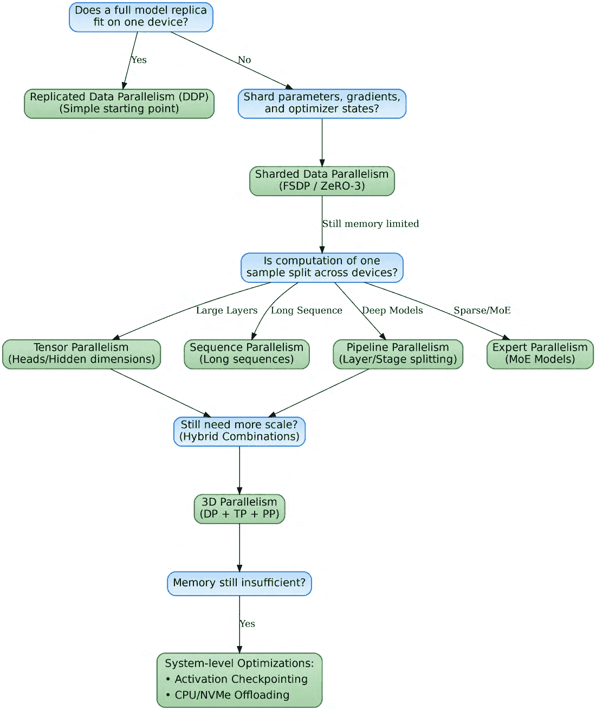

#### 训练的关键考量

**网络拓扑很重要。** 如果你的系统中某些 GPU 对之间通过 NVLink 连接，而其他 GPU 对之间通过 PCIe 连接，请尽量将通信密集的操作（如张量并行）放在 NVLink 连接的 GPU 对上。PyTorch 和大多数框架不会自动完成这一安排，因此你可能需要手动设置进程组或设备放置。

**互联速度决定了哪些方案可行。** 张量并行在每一层都需要通信，因此你需要快速互联（节点内使用 NVLink，节点间使用 InfiniBand）。如果只有 PCIe，请避免使用张量并行——坚持使用 FSDP/ZeRO 或流水线并行。

**内存与吞吐量的权衡。** FSDP/ZeRO 能最大化内存效率，但不一定能提升吞吐量。张量并行可以提升吞吐量（通过拆分大层），但每张 GPU 的内存占用会更高。如果你有足够的 GPU 并能保持流水线满载，流水线并行也可以提升吞吐量。

**从简单开始，仅在需要时增加复杂度。** 大多数模型仅用 DDP 或 FSDP 即可完成训练。每增加一种并行策略，都会带来额外的复杂度和潜在的故障模式。

#### 推理策略决策树

推理与训练有着不同的约束条件（参见*第 6 章*和*第 9 章*）。你不需要存储梯度或优化器状态，但需要处理注意力机制的 KV 缓存，而且在许多场景下，延迟比吞吐量更重要。*图 2.6* 提供了一个系统性的决策树，用于指导你的推理策略选择。

**第 1 步：你要扩展的是单个请求还是多个请求？**

如果你要服务多个请求，请从**请求级并行**开始（参见*第 7 章*）：

- **批处理**：将多个请求分组为批次，以提高 GPU 利用率
- **多个模型副本**：运行模型的多个副本，以服务更多并发请求
- **负载均衡服务**：在多个副本之间分发请求

如果你要扩展单个请求（例如，超大规模模型或长上下文），则应转向模型并行。

**第 2 步：模型计算能否放入单台设备？**

如果可以，请使用优化内核进行**单 GPU 推理**：

- **FlashAttention**：经过优化的注意力内核，可减少内存占用并提升速度
- **量化**：INT8/INT4 量化，可减少内存占用并提高吞吐量
- **内核融合**：合并操作以减少内核启动开销

如果不行，你需要模型并行推理。

**第 3 步：计算如何拆分？**

- **张量/注意力头/隐藏维度**：使用**张量并行**。在 vLLM（参见*第 6 章*）和 TensorRT-LLM 等推理系统中很常见。需要快速互联。
- **长上下文/KV**：使用**上下文并行**（参见*第 6 章*）。对于上下文窗口无法放入单张 GPU 的长上下文推理至关重要。它将注意力计算和 KV 缓存拆分到多张 GPU 上。
- **层/阶段**：使用**流水线并行**。在推理中不如在训练中常见，但对于需要保持低延迟的超大规模模型很有用。
- **专家**：使用**专家并行**。仅适用于 MoE 模型。将 token 路由到不同 GPU 上的专家。

**第 4 步：瓶颈是内存还是 KV 缓存？**

对于推理而言，KV 缓存可能成为主要的内存瓶颈，尤其是在长上下文和大量并发请求的情况下。请使用系统级的服务技术：

- **KV 缓存分页 / PagedAttention**：将 KV 缓存内存虚拟化，使你能够服务的并发请求数量超过 GPU 内存原本能容纳的上限。用于 vLLM（参见*第 6 章*）。
- **KV 缓存分离**：将 KV 缓存存储在独立的设备上或 CPU 内存中，按需获取。对于超长上下文很有用（参见*第 6 章*）。
- **CPU/NVMe 卸载**：将模型参数或 KV 缓存从 GPU 上移出。速度较慢，但可以服务更大的模型或更多的并发请求（参见第 9 章）。


*图 2.6：推理策略决策树*

#### 推理的关键考虑因素

- **延迟与吞吐量。** 推理服务关注 TTFT 和每 token 延迟；模型并行每层都会增加通信开销——仅在必要时使用（*第 6 章*，*第 9 章*）。

- **KV 缓存。** 与训练不同，在长上下文和高并发场景下，内存主要由 KV 缓存占用；PagedAttention 及相关技术至关重要（*第 6 章*）。

- **批处理与副本。** 在求助于张量并行（TP）之前，先对请求进行复制和批处理（*第 6 章*，*第 7 章*，*第 9 章*）。

- **量化。** 使用 INT8/INT4 通常可以在不重新训练的情况下将模型适配到单张 GPU 上（*第 6 章*）。

- **从简单开始。** 在采用 TP/PP 之前，先使用单 GPU 搭配量化和融合内核（*第 6 章*）。

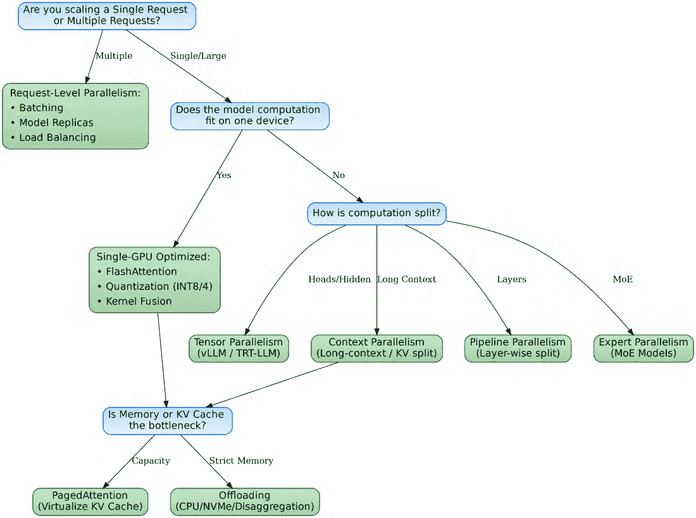

### 实用技巧

- **先分析再优化。** 使用 `nvidia-smi` 监控内存使用情况，并使用 PyTorch 的性能分析器查看时间消耗在哪里。你可能认为通信是瓶颈，但实际上可能是数据加载或其他原因。

- **在 GPU 集合通信中使用 NCCL。** 它经过优化并自动处理 NVLink。其他后端（GLOO、MPI）速度较慢。

- **混合精度很有帮助。** FP16 或 BF16 可将内存和带宽占用减半。大多数模型使用它都能正常训练，而且加速效果显著。

- **注意 NUMA。** 如果你使用多路（multi-socket）系统，尽量将进程保持在同一个 NUMA 节点上。跨 NUMA 通信会增加延迟。

- **先在小规模上测试。** 在扩展到多个节点之前，先在 2-4 张 GPU 上验证你的并行策略。小规模调试要容易得多。

### 动手实践：硬件检查与带宽测试

在设计分布式训练策略之前，了解硬件拓扑和带宽特性至关重要。本动手实践部分将带你检查 GPU 硬件、测量内存带宽以及测试 GPU 间通信的性能。

#### 环境设置

代码示例位于 `code/` 目录中。如果尚未克隆，请先克隆仓库：

```
git clone https://github.com/PacktPublishing/Distributed-AI-Systems
cd Distributed-AI-Systems/chapter2-gpu-hardware-networking-and-parallelism-strategies
```

运行这些示例需要一台至少配备一张 GPU（最好多张）的机器。对于多 GPU 测试，你需要 2 张或更多通过 NVLink 或 PCIe 连接的 GPU。

#### 步骤 1：检查 GPU 硬件

首先验证你的 GPU 环境并收集基本硬件信息。运行 `check_cuda.py` 脚本（预计**远不到一秒**）：

```
python code/check_cuda.py
```

该脚本会显示重要的 GPU 信息：

```python
import torch
print(f"CUDA available: {torch.cuda.is_available()}")
print(f"Number of GPUs: {torch.cuda.device_count()}")
for i in range(torch.cuda.device_count()):
    props = torch.cuda.get_device_properties(i)
    vram_gb = props.total_memory / (1024**3)
    print(f"GPU {i}: {props.name}")
    print(f" Total memory: {vram_gb:.1f} GB")
    print(f" Compute capability: {props.major}.{props.minor}")
    print(f" Multiprocessors: {props.multi_processor_count}")
```

**代码解释：**

- 2：检查系统上 CUDA 是否可用
- 3：获取 GPU 总数
- 5：获取每张 GPU 的属性
- 6：将内存从字节转换为 GB

H100 系统上的示例输出：

```
CUDA available: True
CUDA version: 12.1
Number of GPUs: 8
GPU 0: NVIDIA H100
 Total memory: 80.0 GB
 Compute capability: 9.0
 Multiprocessors: 132
...
```

这确认了你的 GPU 已被检测到，并显示了内存容量、计算能力和流多处理器数量。计算能力（H100 为 9.0）表示支持哪些 CUDA 特性。

#### 步骤 2：检查硬件拓扑

要了解 GPU 之间的连接方式，请使用 `nvidia-smi` 检查拓扑（运行**即时完成**——无需训练任务）：

```
nvidia-smi topo -m
```

这会显示一个连接矩阵，展示 GPU 之间的连接方式。请关注：

- `NV18`, `NV12`, `NV4`：NVLink 连接（好——高带宽）
- `PIX` 或 `PXB`：PCIe 连接（较慢，但仍可用）
- `NODE` 或 `SYS`：跨越 NUMA 边界（增加延迟）

显示 NVLink 连接的示例输出：

```
 GPU0 GPU1 GPU2 GPU3 GPU4 GPU5 GPU6 GPU7
GPU0 X NV18 NV18 NV18 NV18 NV18 NV18 NV18
GPU1 NV18 X NV18 NV18 NV18 NV18 NV18 NV18
```

所有 GPU 都显示 `NV18` 连接，意味着每张 GPU 都能以 NVLink 速度与其他 GPU 通信——非常适合张量并行和其他通信密集型策略。

你还可以检查 PCIe 代次和带宽：

```
nvidia-smi --query-gpu=name,memory.total,pcie.link.gen.max,pcie.link.width.max --format=csv
```

这会显示 PCIe Gen 4/5 和 x16 宽度，它们决定了 CPU-GPU 带宽（每个方向约 31-64 GB/s）。

#### 步骤 3：测量单 GPU 内存带宽

在测试 GPU 间通信之前，先测量单 GPU 内存带宽以建立基线。这会告诉你每张 GPU 的最大内存吞吐量：

```
python code/bandwidth_test.py
```

在现代 GPU 上预计**耗时几秒**（针对 64 MB 张量进行 200 次预热式迭代）。

该脚本通过在 GPU 内存内复制数据来测量带宽。每次 `copy_` 会读取 `a` 并写入 `b`，因此每次迭代我们计算 **2×** 张量大小（读写流量合计）：

```python
import torch
import time
size_mb = 64
iterations = 200
nbytes = size_mb * 1024 * 1024
a = torch.randn(nbytes // 4, device='cuda')
b = torch.empty_like(a)
# Warmup
for _ in range(10):
    b.copy_(a)
torch.cuda.synchronize()
# Benchmark
t0 = time.time()
for _ in range(iterations):
    b.copy_(a)
torch.cuda.synchronize()
t1 = time.time()
bytes_moved = 2 * nbytes * iterations  # read a + write b per iteration
bandwidth_gb_per_s = bytes_moved / (1024**3) / (t1 - t0)
print(f"Effective bandwidth (read+write): {bandwidth_gb_per_s:.2f} GB/s")
```

**代码解释：**

- 6：在 GPU 上创建张量（float32 = 每个元素 4 字节）
- 7：创建相同大小的空张量
- 10：在 GPU 内存内复制数据
- 18：每次复制移动 2× nbytes（从 `a` 读取，写入 `b`）

示例结果（取决于硬件）：

```
GPU Memory Bandwidth Test
Data size: 64 MB
Iterations: 200
Effective bandwidth (read+write): 1980.45 GB/s
```

典型的有效复制带宽（读写合计）：

- **H100**：2-3 TB/s（2000-3000 GB/s）
- **A100**：1.5-2 TB/s（1500-2000 GB/s）
- **H200**：2-3 TB/s（2000-3000 GB/s）

如果你测得的带宽明显偏低，可能存在内存带宽饱和或其他瓶颈。这个基线有助于你判断内存带宽是否限制了训练性能。

#### 步骤 4：基准测试 GPU 间通信

对于分布式训练，GPU 间通信带宽往往比单 GPU 内存带宽更为关键。`allreduce_microbench.py` 脚本用于衡量多 GPU 上的 AllReduce 性能——使用与*第 1 章*中运行 `distributed_basic_test.py` 相同的方式通过 `torchrun` 启动。使用下面的默认配置（100 MB 张量，50 次迭代），在 2-4 张 GPU 上预计**大约几秒到几十秒**——不是几分钟。

```
torchrun --nproc_per_node=2 code/allreduce_microbench.py
```

对于 4 张 GPU：

```
torchrun --nproc_per_node=4 code/allreduce_microbench.py
```

该脚本对 `dist.all_reduce` 进行计时，并报告两个带宽数值。**算法带宽（Algorithm bandwidth）** 是 NCCL 基准测试所使用的：每个 rank 持有 `size_mb`，所有 `n` 个 rank 都参与，因此有效吞吐量为 `n × size / time`。**总线带宽（Bus bandwidth）** 则根据环形 AllReduce 中实际跨互联网络传输的数据量进行调整——在 `n` 个 rank 上，每个 rank 约为其张量大小的 `2×(n−1)/n`，即每次迭代**总计** `2×(n−1)×size`：

```python
import torch.distributed as dist
size = size_mb * 1024 * 1024 // 4
# float32 elements per GPU
tensor = torch.ones(size, device=f'cuda:{local_rank}')
for _ in range(warmup):
    dist.all_reduce(tensor, op=dist.ReduceOp.SUM)
torch.cuda.synchronize()
start = time.time()
for _ in range(iterations):
    dist.all_reduce(tensor, op=dist.ReduceOp.SUM)
torch.cuda.synchronize()
elapsed = time.time() - start
size_bytes = size_mb * 1024 * 1024
n = world_size
alg_bytes = size_bytes * n * iterations
bus_bytes = size_bytes * 2 * (n - 1) * iterations  # ring: 2*(n-1)/n per rank × n ranks
alg_bw_gb_s = alg_bytes / (1024**3) / elapsed
bus_bw_gb_s = bus_bytes / (1024**3) / elapsed  # equals alg_bw * 2*(n-1)/n
```

**代码解释：**

- 3：每张 GPU 上以 float32 元素计数的张量大小


5. AllReduce 对所有 rank 上的张量求和
15. Ring AllReduce 每次迭代在网络中移动约 ~2×(n−1)×size 字节（NCCL 可能改用 tree 算法）

2 个使用 NVLink 的 GPU 的示例输出（数值因硬件和驱动而异）：

```text
AllReduce Benchmark Results
World size: 2 GPUs
Tensor size: 100 MB per GPU
Iterations: 50
Total time: 0.248 seconds
Algorithm bandwidth: 40322.58 MB/s (39.38 GB/s)
Bus bandwidth (ring estimate): 40322.58 MB/s (39.38 GB/s)
```

当 `n = 2` 时，ring 因子 `2×(n−1)/n` 为 1，因此算法带宽和总线带宽一致。对于 4 个 GPU，在 ring 模型下总线带宽是算法带宽的 `1.5×`。

预期 **AllReduce 总线带宽**（与消息大小相关；100 MB 处于合理范围内）：

- **使用 NVLink 连接的 GPU**：通常为数十 GB/s 到低数百 GB/s
- **仅使用 PCIe 连接的 GPU 对**：通常约 10–50 GB/s

这些是有效的集合通信吞吐量数字，而不是数据手册中引用的 **NVLink 峰值链路** 规格（Ampere–Hopper 上每个 GPU 为 300–900 GB/s，Blackwell B200 上最高 1.8 TB/s）。如果你看到的 AllReduce 带宽远低于上述范围，请使用 `nvidia-smi topo -m` 检查拓扑。仅通过 PCIe 连接的 GPU 会显示出明显更低的带宽，这会影响哪些并行策略是可行的。

#### 第 5 步：分析结果

将你测得的带宽与理论值进行比较：

| 指标 | 你的系统 | 预期范围 | 备注 |
| --- | --- | --- | --- |
| 单 GPU HBM | ? GB/s | H100：2-3 TB/s；A100：1.5-2 TB/s | 数值较低表示存在内存瓶颈 |
| GPU 间 AllReduce（NVLink） | ? GB/s | 数十至低数百 GB/s（总线） | 来自步骤 4：与消息大小相关 |
| GPU 间 AllReduce（PCIe） | ? GB/s | 约 10–50 GB/s（总线） | 比 NVLink 慢得多 |

**这些数字意味着什么：**

- **HBM 带宽高但 GPU 间带宽低**：你的系统适合单 GPU 工作负载，但在通信密集的并行方式（张量并行、频繁的 AllReduce）中会遇到困难。优先选择 FSDP/ZeRO 或流水线并行。
- **GPU 间带宽高（NVLink）**：你的系统可以高效地使用张量并行和其他通信密集型策略。所有 GPU 通过 NVSwitch 连接是理想情况。
- **GPU 间带宽低（仅 PCIe）**：避免使用张量并行——通信开销将占主导。坚持使用通信不那么频繁的 FSDP/ZeRO 或流水线并行。

这些测量结果有助于你为硬件选择合适的并行策略。在后面的章节中，我们将了解 DDP、FSDP 等框架如何使用这些通信原语，但理解底层带宽特性有助于调试性能问题。

对于实际工作负载，你会使用 PyTorch 或 DeepSpeed 中的高级 API，但当事情不如预期时，了解底层发生的情况会有所帮助。

有了这一硬件基础，我们就可以开始构建分布式训练系统了。在*第 3 章*中，我们将深入探讨 PyTorch DDP（DistributedDataParallel），这是实现复制式数据并行最常用的方式。DDP 是分布式训练的主力——大多数生产训练流水线都在使用它，理解它的工作原理对于构建可扩展的 AI 系统至关重要。我们将涵盖设置、常见陷阱、调试技术以及如何针对你的工作负载进行优化。

### 代码汇总

- `nvidia-smi`：用于监控 GPU 状态和利用率的命令行工具
- `torch.cuda.device_count()`：获取可用 CUDA 设备数量
- `torch.cuda.get_device_name()`：获取 CUDA 设备名称
- `torch.cuda.is_available()`：检查 CUDA 是否可用
- `torch.distributed.get_world_size()`：获取分布式组中的进程总数
- `torch.distributed.get_rank()`：获取当前进程的 rank
- `torch.distributed.get_backend()`：获取后端名称（例如 'nccl'、'gloo'）
- `nvidia-ml-py`：用于查询 NVIDIA GPU 信息的 Python 库
- `ibstat`：检查 InfiniBand 适配器状态的命令

### 注释与参考文献

GPU 内存容量数据来自 NVIDIA 规格：A100（2020 年，80GB）、H100（2022 年，80GB HBM3）、H200（2023 年，141GB HBM3e）、B200（2024 年，192GB）；每一代新产品通常会增加 HBM 容量和 NVLink 带宽，因此后续旗舰 GPU 也遵循同样的趋势，尽管图中显示的是具有代表性的已部署 SKU。

模型内存需求根据已公布的参数量（参见 @tbl:model-comparison）并使用 BF16 精度（每个参数 2 字节）计算得出：GPT-3 175B（2020 年，约 350GB）、LLaMA-2 70B（2023 年，约 140GB）、DeepSeek-V2 236B（2024 年，约 472GB）、DeepSeek-V3 671B（2025 年，约 1342GB）、DeepSeek-V4-Pro 1.6T（2026 年，约 3200GB）。图中使用这些已公开的里程碑数值；更大的近似数值（表中以 ~ 标记）被省略。所示数值仅代表模型权重的单 GPU 内存需求；实际训练还需要额外内存来存储梯度、优化器状态和激活值，因此更进一步需要分布式训练。

Chowdhery 等人，《PaLM: Scaling Language Modeling with Pathways》，《Journal of Machine Learning Research》24（2023）：1–113，附录 B（每个 token 6N 次矩阵乘法 FLOPs 和模型 FLOPs 利用率）。Kaplan 等人，《Scaling Laws for Neural Language Models》，arXiv:2001.08361，2020。

NVIDIA，《NVIDIA H100 Tensor Core GPU Architecture》，白皮书，2022 年，`https://resources.nvidia.com/en-us-hopper-architecture`（Transformer Engine 与 FP8；在 Transformer 模型上的训练吞吐量比 A100 最高可提升 6 倍）。如需查看大型语言模型训练的独立审计结果，请参阅 NVIDIA，《Breaking MLPerf Training Records with NVIDIA H100 GPUs》，技术博客，2023 年，`https://developer.nvidia.com/blog/breaking-mlperf-training-records-with-nvidia-h100-gpus/`（MLPerf Training 3.0；使用 Transformer Engine 和 FP8 的 GPT-3 175B 与 BERT）。

### 练习

#### GPU 硬件检查器

实现一个全面的 GPU 硬件检查函数，用于收集可用 GPU 的详细信息。

**要求：**

函数签名：`inspect_gpu_hardware()`

为每个 GPU 返回一个包含以下键的字典：

- `name`：GPU 名称
- `memory_total_gb`：总内存（GB）
- `memory_free_gb`：可用内存（GB）
- `compute_capability`：计算能力，以字符串表示（例如 "9.0"）
- `multiprocessor_count`：流式多处理器数量
- `cuda_version`：CUDA 版本

处理 CUDA 不可用的情况（返回空列表）

打印一个格式化汇总表，显示所有 GPU 信息

**测试你的函数：**

```python
import torch

gpu_info = inspect_gpu_hardware()
print(f"Found {len(gpu_info)} GPU(s)")
for i, info in enumerate(gpu_info):
    print(f"\nGPU {i}:")
    print(f" Name: {info['name']}")
    print(f" Memory: {info['memory_total_gb']:.1f} GB total, "
          f"{info['memory_free_gb']:.1f} GB free")
    print(f" Compute Capability: {info['compute_capability']}")
    print(f" Multiprocessors: {info['multiprocessor_count']}")
```

#### 内存需求计算器

实现一个函数，用于计算在不同精度和优化器配置下训练模型的内存需求。

**要求：**

函数签名：`calculate_training_memory(num_params, precision='bf16', optimizer='adam', batch_size=1, seq_length=2048)`

计算以下各项的内存：

- 模型参数（权重）
- 梯度（与参数大小相同）
- 优化器状态：
  - Adam：参数大小的 2 倍（动量 + 方差）
  - SGD：参数大小的 1 倍（仅动量）
- 激活值：近似为 `batch_size × seq_length × hidden_size × num_layers × bytes_per_element`
- 精度选项：'fp32'（4 字节）、'bf16'/'fp16'（2 字节）、'int8'（1 字节）
- 返回一个包含明细的字典：`{'parameters': ..., 'gradients': ..., 'optimizer': ..., 'activations': ..., 'total': ...}`
- 所有值以 GB 为单位

**测试你的函数：**

```python
# 70B parameter model with BF16, Adam optimizer
memory = calculate_training_memory(
    num_params=70e9,
    precision='bf16',
    optimizer='adam',
    batch_size=4,
    seq_length=2048
)
print("Memory Requirements (GB):")
for key, value in memory.items():
    print(f" {key}: {value:.2f} GB")
```

### 拓扑检测与分析

实现一个函数，解析 `nvidia-smi topo -m` 的输出以检测 GPU 互连拓扑。


## GPU 硬件、网络与并行策略

##### 需求：

函数签名：

`analyze_gpu_topology()`

使用 `subprocess` 运行 `nvidia-smi topo -m` 并捕获输出。

解析拓扑矩阵以识别：

- 通过 NVLink 连接的 GPU（查找 NV18、NV12、NV4）
- 仅通过 PCIe 连接的 GPU（查找 PIX、PXB）
- 全连接（所有 GPU 均可通过 NVLink 与其他所有 GPU 通信）

返回一个字典，包含：

- `num_gpus`：GPU 数量
- `nvlink_pairs`：通过 NVLink 连接的 GPU 对列表
- `pcie_only_pairs`：仅通过 PCIe 连接的 GPU 对列表
- `has_all_to_all_nvlink`：布尔值，表示是否所有 GPU 之间都有 NVLink
- `recommended_parallelism`：基于拓扑的建议并行策略

##### 测试你的函数：

```python
import subprocess

topology = analyze_gpu_topology()
print(f"Number of GPUs: {topology['num_gpus']}")
print(f"NVLink pairs: {topology['nvlink_pairs']}")
print(f"PCIe-only pairs: {topology['pcie_only_pairs']}")
print(f"All-to-all NVLink: {topology['has_all_to_all_nvlink']}")
print(f"Recommended strategy: {topology['recommended_parallelism']}")
```

#### 并行策略选择器

实现一个函数，根据模型大小、硬件拓扑和训练需求推荐并行策略。

**需求：**

函数签名：

```python
recommend_parallelism_strategy(model_size_gb, num_gpus, topology_info,
                               has_nvlink_all_to_all, training_type='training')
```

考虑：

- 模型大小与单 GPU 内存
- 拓扑（NVLink 全连接 vs. 仅 PCIe）
- 训练与推理需求

返回一个字典，包含：

- `primary_strategy`：主要并行方式（DDP、FSDP、TP、PP 或混合）
- `reasoning`：选择该策略的原因说明
- `alternative_strategies`：其他可行选项列表
- `estimated_gpu_count`：所需的最少 GPU 数量
- `memory_per_gpu_gb`：每块 GPU 的估算内存

**测试你的函数：**

```python
# 70B model (140 GB in BF16) on 8 GPUs with NVLink all-to-all
strategy = recommend_parallelism_strategy(
    model_size_gb=140,
    num_gpus=8,
    topology_info={'has_all_to_all_nvlink': True},
    has_nvlink_all_to_all=True,
    training_type='training'
)
print(f"Recommended: {strategy['primary_strategy']}")
print(f"Reasoning: {strategy['reasoning']}")
print(f"Estimated GPUs needed: {strategy['estimated_gpu_count']}")
print(f"Memory per GPU: {strategy['memory_per_gpu_gb']:.1f} GB")
```

#### 预期学习成果

完成这些练习后，你应该能够：

- 使用 PyTorch 和 CUDA API 以编程方式查询 GPU 硬件属性
- 计算使用不同精度和优化器训练大型模型所需的内存
- 解析并解读来自 `nvidia-smi` 的 GPU 拓扑信息
- 识别 GPU 之间的 NVLink 与 PCIe 连接
- 根据模型大小和硬件拓扑推荐合适的并行策略
- 理解 GPU 互连与并行效率之间的关系

## 使用 PyTorch DDP 进行分布式训练

### 使用 DistributedDataParallel 跨多 GPU 扩展训练

*对终极算法的探索，就是对规模的探索。*

*理查德·萨顿*

### DDP 的内部工作原理

在*第 2 章*中，我们探讨了使分布式训练成为可能的硬件基础和并行策略。现在我们转向实际实现：**DistributedDataParallel（DDP）**，这是 PyTorch 进行数据并行分布式训练的标准方法。DDP 是你真正跨多个 GPU 扩展训练的方式——无论是单台机器内的 GPU，还是分布在集群中的 GPU。

其核心思路非常优雅：在每个 GPU 上复制模型，将数据分片到各个 GPU，并在每次反向传播后同步梯度。每个 GPU 处理不同的数据批次，独立计算梯度，然后所有 GPU 将各自的梯度取平均。这样既保证了每个模型副本保持同步，又利用了并行计算的优势。

*图 3.1：DDP 工作流程*

*图 3.1* 展示了完整的 DDP 训练工作流程。数据从数据加载器流向每个 GPU 的数据分片，经过前向和反向传播，然后在更新模型参数之前，所有 GPU 同步梯度。神奇之处发生在反向传播过程中——DDP 使用高效的集合通信原语（如 AllReduce）自动聚合来自所有进程的梯度，并确保每个进程拥有相同的更新后参数。

### 基本流程

按照*图 3.1* 所示的工作流程，以下是 DDP 在单个训练步骤中发生的事情：

1. **前向传播**：每个进程在自己的数据分片上执行前向计算。所有进程上的模型完全相同，但得益于 `DistributedSampler`，每个进程看到的数据不同。如图所示，数据从数据加载器流向每个 GPU 的数据分片，然后经过模型进行前向计算。

2. **反向传播**：每个进程在本地计算梯度。这正是 DDP 发挥作用的地方——DDP 并不会让每个进程独立更新自己的模型，而是收集所有梯度。反向传播在所有 GPU 上并行计算每个参数的梯度。

3. **梯度同步**：DDP 使用 AllReduce（在 GPU 上通过 NCCL）对所有进程的梯度求和，然后除以 `world_size`，使每个 rank 都持有平均梯度——这与使用全局批次在单块 GPU 上得到的更新相同。这是图 3.1 中心展示的关键同步步骤，所有 GPU 的梯度在此聚合。

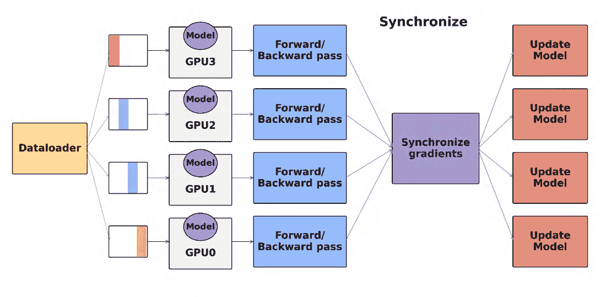

4. **参数更新**：每个进程使用同步后的梯度执行优化器更新步骤。由于所有进程以相同的参数开始，并应用了相同的梯度，最终会得到完全相同的参数。最后一步使用同步后的梯度更新每个模型副本，从而在所有进程间保持一致性。

这就是**数据并行**：模型被复制，而数据被分片。每块 GPU 处理不同的批次，梯度取平均。与之相对的是**模型并行**（将在后续章节介绍），后者将模型本身拆分到多块 GPU 上。

### 数据并行（DP）与分布式数据并行（DDP）对比

在 DDP 之前，PyTorch 提供了 `DataParallel`（DP），目前仍然可用，但不推荐使用，官方文档建议改用 `DistributedDataParallel`，即使在单机多 GPU 训练中也是如此。DP 采用单进程、多线程的方法，只能在单台机器上运行。它有几个局限：Python 的 GIL 阻碍了真正的并行；所有梯度同步都在 GPU 0 上完成，形成瓶颈；并且无法跨多台机器扩展。

**分布式数据并行（DDP）** 解决了这些局限。

DDP 使用多进程架构而不是多线程。每个 GPU 在自己的进程中运行，这避免了 Python 的 GIL 限制，实现了真正的并行。与 DP 不同，DDP 可以扩展到通过网络连接的多台机器。你不受限于单台机器内的 GPU——你可以在集群中成百上千块 GPU 上进行训练。

通信效率也更高。DDP 使用优化的集合通信原语，如 Ring AllReduce 和树算法。这些原语将工作分发到所有 GPU，而不仅仅是 GPU 0。梯度同步不是由一块 GPU 包办，而是每块 GPU 都参与其中。这消除了困扰 DP 的单 GPU 瓶颈。

DDP 还将梯度同步与计算重叠。当一个梯度桶正在同步时，下一个桶可以开始计算。这隐藏了通信延迟，使整体训练更快。所有 GPU 平等地参与梯度同步，在整个系统中形成均衡的负载。

基于这些原因，DDP 是分布式训练的标准——即使在单机上也要使用它。


### 梯度分桶：为什么它很重要

如果DDP对每个梯度张量单独进行同步，你就会有成千上万次小的AllReduce操作。每次AllReduce都有开销——网络延迟、内核启动开销、同步成本。解决方案是**梯度分桶**：DDP将小的梯度张量分组到桶中，并对整个桶执行AllReduce。

其工作原理如下：DDP分析你模型的参数顺序（即它们在`model.parameters()`中出现的顺序）。它根据大小将连续的参数分组成桶。当反向传播到达某个桶的边界时，DDP会为该桶触发一次AllReduce。默认桶大小为25 MB，但你可以通过`bucket_cap_mb`进行调整。

*图3.2：梯度分桶：按大小分桶的参数*

*图3.2*展示了参数分段和桶边界。分桶减少了通信开销，但存在一个权衡：更大的桶意味着更少的AllReduce调用（更少的开销），但同步更晚（梯度要到桶准备好后才可用）。更小的桶意味着更早的同步，但开销更大。对于大多数模型，默认的25 MB效果很好，但对于非常大或非常小的模型，你可能需要调整它。

### 通信与计算的重叠

真正的性能提升来自**通信与计算的重叠**。当DDP正在为一个桶执行AllReduce时，你的反向传播可以继续为下一个桶计算梯度。这会将通信延迟隐藏在计算之后。

*图3.3：反向计算与AllReduce的重叠*

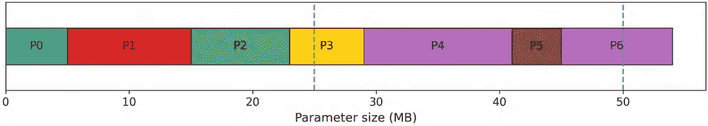


*图3.3*展示了这种重叠。DDP通过以下方式实现重叠：

- 异步启动AllReduce操作
- 使用CUDA流将通信内核与计算内核重叠
- 按桶的就绪顺序处理（不一定是参数顺序）

要让重叠生效，你需要在桶边界之间有足够的计算量。如果你的模型参数很少或层非常小，可能没有足够的计算可供重叠。在这种情况下，你会看到通信时间占主导地位，重叠的帮助不大。

你可以通过性能分析（profiling）来检查重叠是否生效。如果你看到AllReduce操作与反向计算同时发生，说明重叠正在生效。如果AllReduce在所有梯度计算完成后才顺序发生，说明重叠没有生效（可能你的模型太小，或者有同步点阻塞了它）。

### AllReduce操作

AllReduce是使DDP工作的核心集合操作。如*第1章*所述（参见"集合操作"一节），AllReduce从所有进程获取梯度，对它们求和，并将结果分发回所有进程。在GPU上，DDP使用NCCL（NVIDIA集体通信库）通过**环形AllReduce**和**树形AllReduce**等算法高效实现AllReduce，NCCL会根据你的硬件拓扑自动选择这些算法。

*图3.4：环形AllReduce：四个rank按顺时针方向传输数据*


*图3.4*展示了**环形拓扑**：rank按逻辑环排列，数据沿一个方向（例如顺时针）流动。在环形AllReduce中，每个rank持有完整张量的一个数据块。在第一阶段（reduce-scatter），每个rank将自己的数据块发送给下一个rank，并从上一个rank接收，累加部分和，这样经过N-1步（对于N个rank）后，每个rank拥有一个数据块的完整和。在第二阶段（all-gather），rank之间交换这些归约后的数据块，直到每个rank都拥有完整的归约结果。环形算法是带宽最优的：无论N是多少，它只移动张量大小的2·(N-1)/N倍，并且高效地使用环中的每条链路。当NCCL检测到树形布局具有更低延迟或更适合物理互连（例如NVLink、PCIe或网络）的拓扑时，它可能会选择**树形AllReduce**（或其他变体）。

了解当前正在使用哪种算法有助于调试性能问题。如果梯度同步缓慢，可能的原因包括：(1) NCCL选择了与你的拓扑不匹配的算法（例如，在非物理环的网络结构上使用环形算法）；(2) 网络或互连带宽已饱和；(3) 消息体过小，无法摊薄集合通信的固定成本。你可以通过`NCCL_DEBUG=INFO`或PyTorch性能分析器查看NCCL的选择和计时；将AllReduce时间与理论环形成本（张量大小除以每链路带宽）进行比较，可以判断你是受带宽限制还是受延迟限制。

### 混合精度与梯度缩放

使用**FP16**混合精度时，梯度可能会下溢（变为零），因为FP16的指数范围很窄。解决方案是**梯度缩放**：在反向传播之前将损失乘以一个缩放因子，然后在优化器步骤之前还原梯度。**BF16**与FP32共享指数范围，因此下溢很少发生，通常不需要`GradScaler`——在支持的硬件上，`autocast(dtype=torch.bfloat16)`通常就足够了。

*图3.5：AMP + DDP：缩放、反向、AllReduce、还原、更新*

*图3.5*展示了这一流程。DDP与PyTorch的自动混合精度（AMP）配合使用。下面的流程适用于**带有`GradScaler`的FP16**：

1. 缩放损失：`loss = loss * scale`
2. 反向传播：`loss.backward()`（梯度也被缩放）
3. DDP AllReduce：同步缩放后的梯度
4. 还原：在优化器步骤之前将梯度除以缩放因子
5. 更新缩放因子：根据梯度溢出检测调整缩放因子


关键在于，DDP在梯度**缩放后**才同步它们。每个进程缩放自己的梯度，然后DDP对缩放后的梯度求和。AllReduce之后，所有进程拥有相同的缩放后梯度，这些梯度会在优化器步骤之前被还原。

如果你在DDP中使用FP16 AMP，请使用`GradScaler`：在将模型包装成DDP之前创建它，并在每个进程（不仅仅是rank 0）上调用`scaler.step()`和`scaler.update()`。对于BF16训练，通常不需要scaler。

### 缓冲区同步

DDP不仅同步梯度——它还同步**缓冲区**。缓冲区是不需要梯度的模型参数，比如BatchNorm的运行时均值和方差。在前向传播期间，DDP将缓冲区从rank 0广播到所有其他rank，以确保一致性。这是自动发生的，但有一个性能方面的考量：缓冲区同步会增加通信开销。如果你的模型有很多缓冲区或缓冲区很大，这可能会拖慢训练速度。你可以用`broadcast_buffers=False`禁用它，但前提是你确信缓冲区不需要同步（例如，你没有使用BatchNorm，或者你在手动同步缓冲区）。

对于大多数模型，保持`broadcast_buffers=True`（默认值）是正确的选择。BatchNorm和类似的层需要同步的统计数据，才能在分布式训练中正常工作。

### DDP前向传播实现细节

理解DDP在前向传播期间如何保持模型一致性，有助于调试。在PyTorch中，所有模型都继承自`torch.nn.Module`，它维护两个关键的字典：

- `_parameters`：需要梯度的网络参数
- `_buffers`：持久化的非参数数据（例如，BatchNorm的运行时均值和方差）

DDP通过`_sync_module_states`确保模型一致性，该函数会在所有进程之间同步`_parameters`和`_buffers`。这发生在两个地方：

1. **在DDP初始化期间**：当你创建DDP模型时，它会将初始参数和缓冲区从rank 0同步到所有其他rank。
2. **在每次前向传播之前**：如果`broadcast_buffers=True`（默认值），DDP会在前向传播前同步缓冲区，以确保所有进程拥有相同的缓冲区值。


这种同步确保所有进程以完全相同的模型状态启动，这对于在训练期间保持一致性至关重要。

### DDP 计算–通信重叠的实现

DDP 中的重叠机制是通过自动求导钩子（autograd hooks）、参数分桶（parameter bucketing）和归约器（reducer）组件实现的。其工作原理如下：

**自动求导钩子（Autograd Hooks）**：DDP 在模型参数上注册钩子。这些钩子在反向传播过程中计算梯度时被触发。钩子函数将参数梯度标记为“就绪”以进行归约。

**参数分桶（Parameter Bucketing）**：归约器根据 `bucket_cap_mb` 设置将参数梯度组织到桶中。参数大致按照 `model.parameters()` 的逆序分配到桶中（逆序是因为反向传播期间梯度是按逆序计算的）。这确保同一桶中的梯度几乎同时就绪。

**归约器（Reducer）**：当一个桶中的所有梯度都就绪后，归约器会为该桶启动一个异步 AllReduce 操作。在 AllReduce 进行期间，反向传播会继续为下一个桶计算梯度，从而实现重叠。

**未使用的参数（Unused Parameters）**：如果某个参数在前向传播中未被使用（例如在条件模型中），它的梯度永远不会就绪，导致桶永远等待。设置 `find_unused_parameters=True` 会告诉 DDP 分析计算图以识别未使用的参数，并在不等待其梯度的情况下将其标记为就绪。这会增加开销，但可以防止挂起。

关键要点：DDP 不会在开始通信前等待所有梯度。相反，一旦桶就绪，它就会立即通信这些梯度，使通信与正在进行的计算重叠。

### 设置单节点 DDP

最简单的 DDP 设置是单节点多 GPU：一台机器配备多个 GPU。大多数人都从这里开始，这也是你在开发和较小规模训练中会使用的方式。

#### 使用 torchrun（推荐）

启动 DDP 训练的现代方式是使用 `torchrun`（在较旧的 PyTorch 版本中为 `torch.distributed.run`）。`torchrun` 负责进程创建、环境变量设置和错误处理。在大多数情况下，它是推荐的启动器。

这是一个最小示例。将其保存为脚本，或使用本章目录中提供的 `code/train_ddp_single_mini.py`。

```python
import os
import torch
import torch.distributed as dist
import torch.nn as nn
from torch.nn.parallel import DistributedDataParallel as DDP
from torch.utils.data.distributed import DistributedSampler

def setup():
    """Initialize process group and set device."""
    # torchrun sets these environment variables automatically
    rank = int(os.environ['RANK'])
    local_rank = int(os.environ['LOCAL_RANK'])
    world_size = int(os.environ['WORLD_SIZE'])

    # Set device for this process
    torch.cuda.set_device(local_rank)
    device = torch.device(f'cuda:{local_rank}')

    # Initialize process group
    dist.init_process_group(backend='nccl')

    return rank, local_rank, world_size, device

def cleanup():
    """Clean up process group."""
    dist.destroy_process_group()

def main():
    rank, local_rank, world_size, device = setup()

    # Create model and move to device
    model = nn.Linear(10, 1).to(device)
    model = DDP(model, device_ids=[local_rank])

    # Create dummy data
    data = torch.randn(64, 10).to(device)
    target = torch.randn(64, 1).to(device)

    # Training step
    optimizer = torch.optim.SGD(model.parameters(), lr=0.01)
    loss_fn = nn.MSELoss()

    for epoch in range(10):
        # DistributedSampler would go here for real data
        optimizer.zero_grad()
        output = model(data)
        loss = loss_fn(output, target)
        loss.backward()
        optimizer.step()

        if rank == 0:
            print(f'Epoch {epoch}, Loss: {loss.item():.4f}')

    cleanup()

if __name__ == '__main__':
    main()
```

使用以下命令启动它（在章节目录中运行，或传入脚本路径）：

```bash
torchrun --nproc_per_node=4 code/train_ddp_single_mini.py
```

这会启动 4 个进程，每个 GPU 一个（假设你有 4 个 GPU）。`torchrun` 会自动设置 `RANK`、`LOCAL_RANK`、`WORLD_SIZE`、`MASTER_ADDR` 和 `MASTER_PORT` 环境变量。

示例输出如下所示：

```text
Epoch 0, Loss: 1.3706
Epoch 1, Loss: 1.3595
Epoch 2, Loss: 1.3488
Epoch 3, Loss: 1.3386
Epoch 4, Loss: 1.3287
Epoch 5, Loss: 1.3193
Epoch 6, Loss: 1.3103
Epoch 7, Loss: 1.3016
Epoch 8, Loss: 1.2932
Epoch 9, Loss: 1.2852
```

#### 理解环境变量

使用 `torchrun` 时，这些环境变量会被**自动**设置：

*图 3.6：单节点 4 个 GPU 的 RANK、LOCAL_RANK、WORLD_SIZE*

*图 3.6* 展示了单节点四个 GPU 的 RANK 和 LOCAL_RANK（如上面的 `torchrun --nproc_per_node=4` 示例所示）。变量：

- **RANK**：此进程的全局排名（0 到 WORLD_SIZE-1）
- **LOCAL_RANK**：此节点内的本地排名（0 到每节点 GPU 数 - 1）
- **WORLD_SIZE**：总进程数
- **MASTER_ADDR**：主节点的 IP 地址（对于单节点，这是 localhost）
- **MASTER_PORT**：进程组初始化端口（torchrun 会选择空闲端口）

对于单节点训练，你通常只需要关心 `LOCAL_RANK`（用于设置此进程使用哪个 GPU）和 `RANK`（用于标识主进程以进行日志记录/检查点保存）。

#### 使用 DistributedSampler

数据并行的关键是确保每个进程看到不同的数据。`DistributedSampler` 通过在不同进程间对数据集进行分片来实现这一点。

*图 3.7：DistributedSampler 跨 rank 对数据集分片*


*图 3.7* 说明了完整数据集如何被分割成连续、不重叠的分片：每个 rank 获得一个不同的索引段（例如，对于四个 rank 和 N 个样本，rank 0 获得索引 (0 … ⌈N/4⌉ - 1)，rank 1 获得接下来的四分之一，依此类推），因此任何样本都不会被多个进程看到，并且所有分片的并集覆盖整个数据集。

```python
from torch.utils.data import DataLoader, Dataset
from torch.utils.data.distributed import DistributedSampler

class MyDataset(Dataset):
    def __init__(self, size=1000):
        self.data = torch.randn(size, 10)
        self.labels = torch.randn(size, 1)

    def __len__(self):
        return len(self.data)

    def __getitem__(self, idx):
        return self.data[idx], self.labels[idx]

def get_dataloader(rank, world_size, batch_size=32):
    dataset = MyDataset(size=1000)
    # Create DistributedSampler
    sampler = DistributedSampler(
        dataset,
        num_replicas=world_size,
        rank=rank,
        shuffle=True,  # Shuffle data each epoch
        drop_last=True,  # avoids DDP sync issues
    )
    # Create DataLoader with sampler
    dataloader = DataLoader(
        dataset,
        batch_size=batch_size,
        sampler=sampler,
        num_workers=4,
        pin_memory=True,  # Faster CPU->GPU transfer
    )
    return dataloader, sampler

def train():
    rank, local_rank, world_size, device = setup()
    dataloader, sampler = get_dataloader(rank, world_size)
    model = create_model().to(device)
```


```python
37 | model = DDP(model, device_ids=[local_rank])
38 | for epoch in range(10):
39 |     # CRITICAL: Set epoch for DistributedSampler
40 |     # This ensures different shuffling each epoch
41 |     sampler.set_epoch(epoch)
42 |     for batch_idx, (data, target) in enumerate(dataloader):
43 |         data = data.to(device)
44 |         target = target.to(device)
45 |         # Training step...
46 |         pass
47 | cleanup()
```

A runnable version of this pattern is in `code/train_ddp_sampler.py`. From the chapter directory, run:

可运行版本位于 `code/train_ddp_sampler.py`。在章节目录下运行：

```text
$ export CUDA_VISIBLE_DEVICES=0,1,2,3
$ torchrun --nproc_per_node=4 code/train_ddp_sampler.py
```

Example output:

示例输出：

```text
Epoch 0 avg loss: 1.2798
Epoch 1 avg loss: 1.2930
Epoch 2 avg loss: 1.2105
Epoch 3 avg loss: 1.2596
Epoch 4 avg loss: 1.0808
Epoch 5 avg loss: 1.0864
Epoch 6 avg loss: 1.0570
Epoch 7 avg loss: 1.0612
Epoch 8 avg loss: 1.0212
Epoch 9 avg loss: 0.9214
Done.
```

`DistributedSampler` assigns each process a disjoint subset of the dataset. For example, with 4 processes and 1000 samples, each process receives 250 samples. Shuffling is controlled by the sampler: set `shuffle=True` on the sampler, and leave the DataLoader's `shuffle` at its default (or omit it), since the sampler already determines the order of indices.

`DistributedSampler` 为每个进程分配数据集的一个不相交子集。例如，4 个进程和 1000 个样本时，每个进程获得 250 个样本。打乱顺序由采样器控制：在采样器上设置 `shuffle=True`，并将 DataLoader 的 `shuffle` 保持默认（或省略），因为采样器已经决定了索引的顺序。

At the start of each epoch you must call `sampler.set_epoch(epoch)`. This seeds the sampler's shuffle with the epoch index so that each epoch sees a different ordering. If you omit this call, every epoch will iterate over the data in the same order.

在每个 epoch 开始时，你必须调用 `sampler.set_epoch(epoch)`。这会用 epoch 索引为采样器的打乱操作设置种子，使每个 epoch 看到不同的顺序。如果省略此调用，每个 epoch 都会以相同的顺序遍历数据。

The `drop_last` argument matters for synchronization. When it is `True`, the sampler drops the last incomplete batch so that every rank performs the same number of steps; that avoids one rank running ahead and blocking in collective calls. If you set `drop_last=False` (for instance to use every sample in a small dataset), some ranks may have one extra batch. In that case the training loop should use DDP's `join()` context so that ranks that finish early wait for the others; otherwise the process can deadlock.

`drop_last` 参数对同步很重要。当它为 `True` 时，采样器会丢弃最后一个不完整的批次，以便每个 rank 执行相同数量的步骤；这避免某个 rank 领先并在集合调用中阻塞。如果你设置 `drop_last=False`（例如在小数据集中使用每个样本），某些 rank 可能会多一个批次。在这种情况下，训练循环应使用 DDP 的 `join()` 上下文，让提前完成的 rank 等待其他 rank；否则进程可能会死锁。

### DataLoader internals for distributed training

### 分布式训练中的 DataLoader 内部机制

Understanding how `DataLoader` works internally helps optimize data loading performance. When you create a `DataLoader` with `num_workers > 0`, PyTorch uses multi-process data loading.

理解 `DataLoader` 的内部工作原理有助于优化数据加载性能。当你创建 `num_workers > 0` 的 `DataLoader` 时，PyTorch 会使用多进程数据加载。

#### Single-process vs Multi-process

#### 单进程 vs 多进程

The `DataLoader` chooses between `_SingleProcessDataLoaderIter` (for `num_workers=0`) and `_MultiProcessDataLoaderIter` (for `num_workers > 0`) based on the `num_workers` parameter.

`DataLoader` 根据 `num_workers` 参数在 `_SingleProcessDataLoaderIter`（用于 `num_workers=0`）和 `_MultiProcessDataLoaderIter`（用于 `num_workers > 0`）之间进行选择。

*Figure 3.8: DataLoader with workers, index and result queues*

*图 3.8：带 workers、索引队列和结果队列的 DataLoader*

*Figure 3.8* illustrates the execution flow when `num_workers > 0`. The main process enqueues batch indices into the index queue. Each worker process maintains its own copy of the dataset, dequeues batch indices, loads, and preprocesses the corresponding data, and enqueues the resulting batch tensors into the result queue. The main process then consumes batches from the result queue for training. The annotation "while workers prefetch" highlights that training on the current batch overlaps with workers preparing subsequent batches, enabling pipeline parallelism between data loading and computation. This design decouples data loading from model computation through inter-process queues, reducing input pipeline bottlenecks.

*图 3.8* 展示了 `num_workers > 0` 时的执行流程。主进程将批次索引入队到索引队列。每个 worker 进程维护自己的数据集副本，从索引队列取出批次索引，加载并预处理相应数据，然后将处理后的批次张量入队到结果队列。主进程随后从结果队列中取出批次进行训练。标注“当 workers 预取时”强调当前批次的训练与 workers 准备后续批次重叠，实现了数据加载和计算之间的流水线并行。这种设计通过进程间队列将数据加载与模型计算解耦，减少了输入流水线瓶颈。


#### Multi-process data loading

#### 多进程数据加载

Multi-process data loading works as follows:

多进程数据加载的工作方式如下：

- **Main process**: Creates an index queue and a result queue. It also spawns worker processes.
- **Worker processes**: Each worker process:
  - Reads indices from the index queue
  - Fetches corresponding data from the dataset
  - Applies transforms/preprocessing
  - Puts processed data into the result queue
- **Prefetching**: While the main process is using the current batch for training, workers are already loading the next batch. This overlaps data loading with computation.
- **Pin memory**: If `pin_memory=True`, a separate thread copies data from CPU to GPU memory asynchronously, further overlapping data transfer with computation.
- **DistributedSampler integration**: When using `DistributedSampler`, each process's `DataLoader` only sees the indices assigned to that process. The sampler ensures no data overlap between processes.

- **主进程**：创建索引队列和结果队列，并生成 worker 进程。
- **Worker 进程**：每个 worker 进程：
  - 从索引队列读取索引
  - 从数据集中获取相应数据
  - 应用变换/预处理
  - 将处理后的数据放入结果队列
- **预取（Prefetching）**：当主进程使用当前批次进行训练时，workers 已经在加载下一批次。这使数据加载与计算重叠。
- **固定内存（Pin memory）**：如果 `pin_memory=True`，一个单独的线程会异步地将数据从 CPU 复制到 GPU 内存，进一步使数据传输与计算重叠。
- **DistributedSampler 集成**：当使用 `DistributedSampler` 时，每个进程的 `DataLoader` 只看到分配给该进程的索引。采样器确保进程之间没有数据重叠。

#### Performance tips

#### 性能提示

- Set `num_workers` per rank (each process spawns its own workers, so the node runs `num_workers × world_size` workers in total). A practical start is `min(8, cpu_cores_per_node / gpus_per_node / 2)` on each rank.
- Use `pin_memory=True` for faster CPU-to-GPU transfer.
- Set `prefetch_factor=2` (default) to prefetch batches ahead.
- Use `persistent_workers=True` to keep workers alive between epochs (reduces startup overhead).

- 为每个 rank 设置 `num_workers`（每个进程生成自己的 workers，因此节点总共运行 `num_workers × world_size` 个 workers）。实用的起点是每个 rank 上 `min(8, cpu_cores_per_node / gpus_per_node / 2)`。
- 使用 `pin_memory=True` 以获得更快的 CPU 到 GPU 传输。
- 设置 `prefetch_factor=2`（默认值）以提前预取批次。
- 使用 `persistent_workers=True` 让 workers 在 epoch 之间保持存活（减少启动开销）。

### Device selection best practices

### 设备选择最佳实践

When setting up DDP, you need to assign each process to a GPU. The standard approach:

在设置 DDP 时，你需要将每个进程分配到一个 GPU。标准做法如下：

```python
local_rank = int(os.environ['LOCAL_RANK'])
torch.cuda.set_device(local_rank)
device = torch.device(f'cuda:{local_rank}')
```

This ensures process 0 uses GPU 0, process 1 uses GPU 1, etc. Always use `LOCAL_RANK` for device selection—don't use `RANK` (which is global across all nodes).

这确保进程 0 使用 GPU 0，进程 1 使用 GPU 1，依此类推。在选择设备时始终使用 `LOCAL_RANK`——不要使用 `RANK`（它是跨所有节点的全局值）。

You can also set `CUDA_VISIBLE_DEVICES` before launching to restrict which GPUs are visible:

你也可以在启动前设置 `CUDA_VISIBLE_DEVICES` 来限制哪些 GPU 可见：

```text
CUDA_VISIBLE_DEVICES=0,1,2,3 torchrun --nproc_per_node=4 code/train_ddp_multi_mini.py
```

This makes only GPUs 0-3 visible, and `LOCAL_RANK` will map to these GPUs (LOCAL_RANK 0 → GPU 0, LOCAL_RANK 1 → GPU 1, etc.).

这只会让 GPU 0-3 可见，并且 `LOCAL_RANK` 将映射到这些 GPU（LOCAL_RANK 0 → GPU 0，LOCAL_RANK 1 → GPU 1，依此类推）。

### A complete single node example

### 一个完整的单节点示例

Here's a complete example that trains a small CNN on CIFAR-10 with DDP. It uses **torchrun** (as earlier), so rank and world size come from the environment:

以下是一个完整的示例，使用 DDP 在 CIFAR-10 上训练一个小型 CNN。它使用 **torchrun**（如前所述），因此 rank 和 world size 来自环境：

```python
import torch
import torch.nn as nn
import torch.distributed as dist
import torch.optim as optim
from torch.nn.parallel import DistributedDataParallel as DDP
from torch.utils.data.distributed import DistributedSampler
import torchvision
import torchvision.transforms as transforms
import os

def setup():
    rank = int(os.environ['RANK'])
    local_rank = int(os.environ['LOCAL_RANK'])
    world_size = int(os.environ['WORLD_SIZE'])
    dist.init_process_group(backend='nccl')
    torch.cuda.set_device(local_rank)
    return rank, local_rank, world_size

def cleanup():
    dist.destroy_process_group()

class Net(nn.Module):
    def __init__(self):
        super().__init__()
        self.conv1 = nn.Conv2d(3, 6, 5)
        self.pool = nn.MaxPool2d(2, 2)
        self.conv2 = nn.Conv2d(6, 16, 5)
        self.fc1 = nn.Linear(16 * 5 * 5, 120)
        self.fc2 = nn.Linear(120, 84)
        self.fc3 = nn.Linear(84, 10)

    def forward(self, x):
        x = self.pool(torch.relu(self.conv1(x)))
        x = self.pool(torch.relu(self.conv2(x)))
        x = x.view(-1, 16 * 5 * 5)
        x = torch.relu(self.fc1(x))
        x = torch.relu(self.fc2(x))
        x = self.fc3(x)
        return x

def get_dataloader(rank, world_size, batch_size=128):
    transform = transforms.Compose([
        transforms.ToTensor(),
        transforms.Normalize((0.5, 0.5, 0.5), (0.5, 0.5, 0.5))
    ])
    trainset = torchvision.datasets.CIFAR10(
        root='./data', train=True, download=True, transform=transform
    )
    sampler = DistributedSampler(
        trainset, num_replicas=world_size, rank=rank, shuffle=True
    )
    trainloader = torch.utils.data.DataLoader(
        trainset, batch_size=batch_size, sampler=sampler,
        num_workers=4, pin_memory=True
    )
    return trainloader, sampler

def main():
    rank, local_rank, world_size = setup()
    device = torch.device(f'cuda:{local_rank}')
    model = Net().to(device)
    model = DDP(model, device_ids=[local_rank])
    criterion = nn.CrossEntropyLoss()
    optimizer = optim.SGD(model.parameters(), lr=0.001, momentum=0.9)
    trainloader, sampler = get_dataloader(rank, world_size)
    for epoch in range(10):
        sampler.set_epoch(epoch)
        model.train()
        for batch_idx, (data, target) in enumerate(trainloader):
            data, target = data.to(device), target.to(device)
```


```python
optimizer.zero_grad()
output = model(data)
loss = criterion(output, target)
loss.backward()
optimizer.step()

if rank == 0 and batch_idx % 100 == 0:
    print(f'Epoch {epoch}, Batch {batch_idx}, Loss: {loss.item():.4f}')

if rank == 0:
    print('Training finished')

cleanup()

if __name__ == '__main__':
    main()
```

可运行版本位于 `code/train_ddp_cifar10.py`。在章节目录下运行：

```bash
torchrun --nproc_per_node=4 code/train_ddp_cifar10.py
```

将 `4` 替换为你的 GPU 数量；若要限制使用的设备，可在命令前设置 `CUDA_VISIBLE_DEVICES`。首次运行时，CIFAR-10 会下载到 `./data`（相对于当前工作目录）。只有 rank 0 打印损失和最终消息；其他 rank 静默运行。该示例固定使用 10 个 epoch；生产环境中，应通过配置或命令行让 epoch 数（及其他超参数）可配置。

与最小示例的模式相同：一个入口点，环境变量由 torchrun 设置。

### 设置多节点 DDP

多节点 DDP 在多个机器上为每个 GPU 运行一个进程。你既获得扩展能力（单节点放不下的模型，或使用多 GPU 更快训练），也有清晰的布局：每台机器是一个*节点*，进程总数是*world size*。

#### 多节点架构

*图3.9：2 节点 × 2 GPU（多节点）下的 RANK 和 LOCAL_RANK*


*图3.9* 展示了两个节点、每个节点两块 GPU 的布局：WORLD_SIZE 为 4，RANK 为 0–3。节点 0 运行 RANK 0 和 1 的进程（各自的 LOCAL_RANK 为 0 和 1）；节点 1 运行 RANK 2 和 3（在该节点上 LOCAL_RANK 同样为 0 和 1）。同样的模式可以扩展——例如 4 个节点 × 每节点 8 块 GPU，world size 为 32，每个节点 8 个进程。

通信开销遵循该布局。同一节点内的 GPU 使用 NVLink（数百 GB/s）；不同节点上的 GPU 使用 InfiniBand 或以太网，单链路较慢（数十 GB/s），但仍能提供较高的总带宽。NCCL 利用这一点：先在每个节点内部执行归约，再跨节点归约，最后将结果广播回去——从而降低跨节点流量。

#### 启动多节点训练

多节点训练要求所有进程就“在哪里会合”以及“进程总数”达成一致。也就是说，需要指定：主节点的地址和端口、节点总数，以及每个节点的 rank。一种做法是在每个节点上运行 `torchrun`，并将这些作为标志传入；torchrun 会为你设置 `MASTER_ADDR`、`MASTER_PORT`、`WORLD_SIZE`、`NODE_RANK` 和 `NNODES`（以及每个进程的 `RANK`、`LOCAL_RANK`）。SLURM 等作业调度器（见下文）是另一种常见方式——它们会根据作业布局设置相同的变量。

对于上面的 2 节点 × 2 GPU 布局，在每个节点上运行以下命令。在主节点（节点 0）上：

```bash
torchrun --nnodes=2 --nproc_per_node=2 --node_rank=0 \
    --master_addr=<master_ip> --master_port=29500 code/train_ddp_multi_mini.py
```

在工作节点（节点 1）上：

```bash
torchrun --nnodes=2 --nproc_per_node=2 --node_rank=1 \
    --master_addr=<master_ip> --master_port=29500 code/train_ddp_multi_mini.py
```

将 `<master_ip>` 替换为主节点的实际 IP。可以用以下命令查看：

```bash
hostname -I
```

或者，如果你有多个网络接口：

```bash
ip addr show | grep inet
```

对于更大规模的运行（例如 4 节点 × 8 GPU），使用同样的模式，并在相应节点上设置 `--nnodes=4`、`--nproc_per_node=8` 和 `--node_rank=0,1,2,3`。

#### 使用 SLURM 启动多节点训练

大多数 HPC 集群使用 SLURM 进行作业调度。我们将在*第8章*中详细介绍 SLURM 和多节点启动；下面是一个最小示例，对应前面使用的 2 节点 × 2 GPU 布局：

```bash
#!/bin/bash
#SBATCH --job-name=ddp_train
#SBATCH --nodes=2
#SBATCH --ntasks-per-node=2
#SBATCH --gres=gpu:2
#SBATCH --time=24:00:00
#SBATCH --partition=gpu

# Get node list
export MASTER_ADDR=$(scontrol show hostnames $SLURM_JOB_NODELIST | head -n 1)
export MASTER_PORT=29500
export WORLD_SIZE=$SLURM_NTASKS
export RANK=$SLURM_PROCID
export LOCAL_RANK=$SLURM_LOCALID

# Launch training
srun python code/train_ddp_multi_mini.py
```

或者将 `torchrun` 与 SLURM 结合使用：

```bash
#!/bin/bash
#SBATCH --job-name=ddp_train
#SBATCH --nodes=2
#SBATCH --ntasks-per-node=2
#SBATCH --gres=gpu:2
#SBATCH --time=24:00:00

export MASTER_ADDR=$(scontrol show hostnames $SLURM_JOB_NODELIST | head -n 1)
export MASTER_PORT=29500

srun torchrun --nnodes=$SLURM_NNODES --nproc_per_node=2 \
    --node_rank=$SLURM_NODEID --master_addr=$MASTER_ADDR --master_port=$MASTER_PORT \
    code/train_ddp_multi_mini.py
```

对于更大规模的作业（例如 4 节点 × 8 GPU），在 torchrun 版本中设置 `--nodes=4`、`--ntasks-per-node=8`、`--gres=gpu:8` 和 `--nproc_per_node=8`。

#### 网络配置

对于多节点训练，网络带宽和延迟很重要。InfiniBand 优于以太网，原因如下：

- 带宽更高：单链路 200-400 Gb/s，而以太网为 10-100 Gb/s
- 延迟更低：亚微秒级，而以太网为微秒级
- 支持 RDMA：GPU 到 GPU 的直接内存访问

如果使用 InfiniBand，请确保：

- 所有节点位于同一个 InfiniBand 子网中
- NCCL 能够检测到 InfiniBand 接口（如有需要，设置 `NCCL_IB_DISABLE=0`）
- 防火墙允许主端口通过（或对集群网络禁用防火墙）

你可以按如下方式测试连通性。原始 InfiniBand 带宽测试（`ib_write_bw`）是可选的；nccl-tests https://github.com/NVIDIA/nccl-tests（例如 `all_reduce_perf`）更接近 DDP 的实际使用，因为它会在你的集群网络上运行 NCCL 集合通信：

```bash
# Optional: raw IB bandwidth
ib_write_bw # on node 0
ib_write_bw <node0_ip> # on node 1

# Recommended: NCCL collective benchmark (after building nccl-tests)
# ./build/all_reduce_perf -b 8 -e 128M -f 2 -g <gpus_per_node>
```

#### 多节点的环境变量

多节点训练使用与单节点相同的环境变量——`RANK`、`LOCAL_RANK`、`WORLD_SIZE`、`MASTER_ADDR` 和 `MASTER_PORT`——它们全部由 torchrun 或你的作业启动器设置（参见“理解环境变量”）。在多节点环境中，`MASTER_ADDR` 必须是主节点的真实 IP 地址，而不是 localhost，并且每个节点必须使用相同的 `MASTER_PORT`（在主节点上选择一个空闲端口——连续作业复用 `29500` 时，可能会在 socket 处于 `TIME_WAIT` 状态时遇到“address already in use”错误）。Torchrun 还会设置 `NODE_RANK`（当前节点的索引，从 0 到 num_nodes−1）和 `NNODES`。使用 SLURM 启动时，你通常会将节点索引和节点数从 `$SLURM_NODEID` 和 `$SLURM_NNODES` 传给 torchrun。

在首次运行多节点任务之前，请确认几项集群基本配置，否则可能会导致挂起或莫名其妙的慢作业：

- **软件栈一致**：每个节点上的 CUDA 驱动、NCCL 和 PyTorch 构建版本应保持一致。某个 rank 使用了较旧的驱动——或不同的 PyTorch 构建——通常是 `init_process_group` 挂起和令人费解的 NCCL 错误的常见来源。

- **`MASTER_ADDR` 应是 IP，而不是主机名**：每个节点都必须能在集群网络上访问到相同的地址。如果主机名在不同节点上解析结果不同（或仅在主节点上可解析），即使启动命令看起来正确，也会导致会合失败。

- **选择正确的网络接口**：在具有多个网卡（管理以太网加 InfiniBand）的机器上，NCCL 可能会绑定到错误的接口。将 `NCCL_SOCKET_IFNAME` 设置为集群网络接口（例如 `ib0`；用 `ip addr` 查看）。调试缓慢的跨节点 AllReduce 时，可参见“性能问题”一节中的示例。

#### 一个完整的多节点示例

同一个训练脚本既可以用于单节点，也可以用于多节点；只有启动命令不同。可运行版本位于 `code/train_ddp_multi_mini.py`。其结构如下：

```python
import os
import torch
import torch.distributed as dist
import torch.nn as nn
from torch.nn.parallel import DistributedDataParallel as DDP

def setup():
    """Initialize process group. Works for both single-node and multi-node 
    (torchrun sets env vars)."""
```

```python
def setup():
    rank = int(os.environ['RANK'])
    local_rank = int(os.environ['LOCAL_RANK'])
    world_size = int(os.environ['WORLD_SIZE'])
    torch.cuda.set_device(local_rank)
    dist.init_process_group(backend='nccl')
    return rank, local_rank, world_size

def main():
    rank, local_rank, world_size = setup()
    if rank == 0:
        print(f'Initialized process group: world_size={world_size}')
        print(f'Master: {os.environ.get("MASTER_ADDR")}:{os.environ.get("MASTER_PORT")}')
    # Create model
    model = nn.Linear(10, 1).to(local_rank)
    model = DDP(model, device_ids=[local_rank])
    # Training loop...
    # (same as single-node example)
    dist.destroy_process_group()

if __name__ == '__main__':
    main()
```

多节点启动（2×2 布局）。在每个节点上设置环境变量，然后运行 torchrun（节点 0 使用 `NODE_RANK=0`，节点 1 使用 `NODE_RANK=1`）：

```bash
export MASTER_ADDR=<master_ip> # IP of node 0
export MASTER_PORT=29500
export NODE_RANK=0 # 0 on master, 1 on worker node
torchrun --nnodes=2 --nproc_per_node=2 --node_rank=$NODE_RANK \
    --master_addr=$MASTER_ADDR --master_port=$MASTER_PORT code/train_ddp_multi_mini.py
```

### 调试与故障排查

DDP 训练可能以多种方式失败。大多数失败可分为几类：挂起、结果错误、内存不足错误或性能问题。下面让我们逐一介绍每类问题的常见原因和解决方法。

#### 挂起：最常见的问题

DDP 挂起通常是由不匹配的集合操作引起的。每个进程必须以相同顺序调用相同的集合操作。如果某个进程调用 `all_reduce`，而另一个进程在等待其他内容，那么一切都会挂起。

**症状**：训练开始后在某个特定点挂起，通常是在 `init_process_group` 期间或第一次反向传播期间。

**常见原因**：

- **WORLD_SIZE 不匹配**：如果各进程的 `WORLD_SIZE` 值不同，初始化会挂起

```python
# WRONG: Different processes see different world_size
world_size = torch.cuda.device_count() # Might differ per node
# RIGHT: Use environment variable set by launcher
world_size = int(os.environ['WORLD_SIZE'])
```

- **条件集合操作**：如果某些进程跳过了集合调用，其他进程会一直等待而挂起

```python
# WRONG: Only rank 0 calls all_reduce
if rank == 0:
    dist.all_reduce(tensor)
# RIGHT: All processes call all_reduce
dist.all_reduce(tensor)
```

- **防火墙阻止端口**：如果 `MASTER_PORT` 被阻止，进程无法通信

```bash
# Test if port is accessible
telnet <master_ip> <master_port>
# Or use a different port
export MASTER_PORT=29501
```

- **进程组 / NCCL 超时**：PyTorch 的进程组看门狗超时是在 Python 中设置的，而不是通过 `NCCL_TIMEOUT` 环境变量（PyTorch 不读取该名称）。默认值为 30 分钟。对于较慢的集群或大型任务，请为 `init_process_group` 传入更大的 `timeout`：

```python
from datetime import timedelta

dist.init_process_group(
    backend='nccl',
    timeout=timedelta(minutes=60), # default is 30 minutes
)
```

对于 NCCL 后端，只有在启用阻塞等待时，该超时才会对集合操作生效。请在 `init_process_group` 之前设置这些环境变量（PyTorch 2.2+ 的名称；旧版本使用不带 `TORCH_` 前缀的 `NCCL_ASYNC_ERROR_HANDLING` 和 `NCCL_BLOCKING_WAIT`）：

```bash
export TORCH_NCCL_ASYNC_ERROR_HANDLING=1
export TORCH_NCCL_BLOCKING_WAIT=1
```

对于挂起调试，可添加针对性的 NCCL 日志（详细但可读）：

```bash
export NCCL_DEBUG=INFO
export NCCL_DEBUG_SUBSYS=INIT,COLL
```

**调试挂起**：

添加日志以查看每个进程卡在何处：

```python
import logging
logging.basicConfig(level=logging.INFO)

def setup():
    rank = int(os.environ['RANK'])
    local_rank = int(os.environ['LOCAL_RANK'])
    logging.info(f'Rank {rank}: Starting setup')
    torch.cuda.set_device(local_rank)
    logging.info(f'Rank {rank}: Set device')
    dist.init_process_group(backend='nccl')
    logging.info(f'Rank {rank}: Initialized process group')
    return rank
```

先使用单进程运行以测试基本正确性：

```bash
# Test single-process first
CUDA_VISIBLE_DEVICES=0 python code/train_ddp_multi_mini.py # Should work without DDP
# Then test with torchrun
torchrun --nproc_per_node=1 code/train_ddp_multi_mini.py # Single process with DDP
# Then scale up
torchrun --nproc_per_node=2 code/train_ddp_multi_mini.py
```

#### 结果错误或梯度不一致

有两个问题经常被混淆。**损失不下降或发散**通常表示存在真正的 bug（数据分片、全局批大小缩放后的学习率、缺少 `set_epoch()` 等）。使用相同命令在不同运行中得到**不同的损失值**通常是正常的——除非启用缓慢的确定性模式，否则 CUDA 和 NCCL 并非完全确定性。

**症状**：

- 损失不下降或发散 → 视为 bug（请参阅下面的**当损失停滞或发散时**）
- 相同种子下不同运行得到不同的曲线 → 通常是预期情况；仅在回归测试中才追求比特级可重现性

**当损失停滞或发散时**，请检查以下各项：

- **缺少 DistributedSampler.set_epoch()**：没有它，所有 epoch 都会以相同顺序看到数据

```python
# WRONG: Same data order every epoch
for epoch in range(10):
    for data, target in dataloader:
        # Training...

# RIGHT: Shuffle data each epoch
for epoch in range(10):
    sampler.set_epoch(epoch) # CRITICAL
    for data, target in dataloader:
        # Training...
```

- **各 rank 的随机种子不同**：如果每个进程以不同方式为 RNG 设置种子，各 rank 会产生不一致，训练看起来可能出错。请在每个 rank 上使用相同的种子设置：

```python
# Set seeds on all processes
def set_seed(seed):
    torch.manual_seed(seed)
    torch.cuda.manual_seed_all(seed)
    np.random.seed(seed)
    random.seed(seed)

# Call this after setup(), before creating model
set_seed(42)
```

- **数据泄漏**：如果 `DistributedSampler` 使用不正确，各进程可能会看到重叠的数据

```python
# WRONG: Using shuffle=True in DataLoader with DistributedSampler
dataloader = DataLoader(dataset, shuffle=True, sampler=sampler) # Conflict!
# RIGHT: Shuffle in sampler, not DataLoader
sampler = DistributedSampler(dataset, shuffle=True)
dataloader = DataLoader(dataset, sampler=sampler) # No shuffle=True here
```

当不同运行结果不同但损失看起来正常时，这通常是 CUDA/NCCL 的非确定性，而不是 DDP bug。为了增强回归测试的可重现性（会降低训练速度）：

```python
torch.backends.cudnn.deterministic = True
torch.backends.cudnn.benchmark = False
torch.use_deterministic_algorithms(True)
```

**验证正确性**：

使用相同的全局批大小和学习率比较单 GPU 与多 GPU 的**损失趋势**。它们不必逐步匹配；如果存在较大的系统性差距（例如使用 4 个 GPU 时损失差 4 倍），则表明存在设置错误，例如每个 GPU 的批大小错误，或梯度被求和而非取平均。

#### CUDA 显存不足

扩展到多个 GPU 时，OOM 错误很常见。问题在于 DDP 会复制模型到每个 GPU 上，因此内存使用量会随 GPU 数量线性增长。

**症状**：训练期间出现 `RuntimeError: CUDA out of memory`。

**常见原因**：

- **批大小过大**：即使使用 DDP，每个 GPU 的批大小也很重要

```python
# If global batch size is 128 and you have 4 GPUs
# Per-GPU batch size should be 32, not 128
global_batch_size = 128
per_gpu_batch_size = global_batch_size // world_size
```


**梯度累积**：如果进行梯度累积，请确保对梯度进行清零。

```python
# WRONG: Gradients accumulate across accumulation steps
for i, (data, target) in enumerate(dataloader):
    loss = model(data, target)
    loss.backward()  # Gradients accumulate!
    if (i + 1) % accumulation_steps == 0:
        optimizer.step()

# RIGHT: Zero gradients at the start of accumulation
optimizer.zero_grad()
for i, (data, target) in enumerate(dataloader):
    loss = model(data, target)
    loss = loss / accumulation_steps  # Scale loss
    loss.backward()
    if (i + 1) % accumulation_steps == 0:
        optimizer.step()
        optimizer.zero_grad()
```

**大激活值**：某些模型（例如长序列的 transformer）的激活值会占用大量内存。

**解决方案**：

- **减小批次大小**：降低每块 GPU 上的批次大小。
- **梯度检查点**：通过重新计算激活值，用计算换取内存。

```python
from torch.utils.checkpoint import checkpoint

# Replace
output = model(x)

# With
output = checkpoint(model, x)
```

- **混合精度**：使用 FP16/BF16 将内存占用减半。

```python
from torch.cuda.amp import autocast, GradScaler

scaler = GradScaler()

for data, target in dataloader:
    optimizer.zero_grad()
    with autocast():
        output = model(data)
        loss = criterion(output, target)
    scaler.scale(loss).backward()
    scaler.step(optimizer)
    scaler.update()
```

- **仅在工作间隙清理缓存**：`torch.cuda.empty_cache()` 会将已保留但未使用的内存返还给驱动程序；它**不会**降低活跃训练步骤期间的峰值内存。在训练循环内调用它会强制同步并拖慢训练——应在独立作业或进程之间使用，而不是每次迭代都调用。

#### 性能问题

如果训练可以运行但速度缓慢，瓶颈通常是通信、数据加载或低效的内核。

**症状**：GPU 利用率低，或训练速度慢于预期。

**常见原因**：

- **数据加载瓶颈**：如果 CPU 无法跟上 GPU 的速度，GPU 就会闲置。

```python
# Increase num_workers
dataloader = DataLoader(dataset, num_workers=8, pin_memory=True)

# Or use prefetching
from torch.utils.data import DataLoader
dataloader = DataLoader(dataset, num_workers=8, prefetch_factor=2)
```

- **批次大小过小**：如果批次大小太小，GPU 无法被充分利用。

```python
# Increase batch size (if memory allows)
batch_size = 128
# Instead of 32
```

- **通信开销**：如果模型较小或通信较慢，AllReduce 将占主导地位。

```python
# Profile to see where time is spent
with torch.profiler.profile(
    activities=[torch.profiler.ProfilerActivity.CPU, torch.profiler.ProfilerActivity.CUDA],
    record_shapes=True,
) as prof:
    # Training step
    pass
print(prof.key_averages().table(sort_by="cuda_time_total"))
```

- **NCCL 拓扑低效**：NCCL 可能会选择次优算法或错误的网络接口（参见“设置多节点 DDP”下的多节点检查清单）。

```bash
# Set NCCL debug to see what algorithm is used
export NCCL_DEBUG=INFO
# Force specific algorithm (advanced, usually not needed)
export NCCL_IB_DISABLE=0
export NCCL_SOCKET_IFNAME=ib0 # cluster fabric NIC, not management Ethernet
```

**调试性能**：使用 PyTorch profiler 来识别瓶颈：

```python
from torch.profiler import profile, record_function, ProfilerActivity

with profile(
    activities=[ProfilerActivity.CPU, ProfilerActivity.CUDA],
    record_shapes=True,
    profile_memory=True,
) as prof:
    with record_function("training_step"):
        # Your training step
        output = model(data)
        loss = criterion(output, target)
        loss.backward()
        optimizer.step()

# Print results
print(prof.key_averages().table(sort_by="cuda_time_total", row_limit=20))
```

**检查 GPU 利用率**：

```bash
# Monitor GPU utilization
watch -n 1 nvidia-smi
# Or use dstat
dstat -cdngy
```

#### 网络调试

对于多节点训练，网络问题很常见。请使用 NCCL 调试：

```bash
# Enable NCCL debug logging
export NCCL_DEBUG=INFO
export NCCL_DEBUG_SUBSYS=INIT,COLL

# Test NCCL connectivity
python -c "import torch; torch.distributed.init_process_group('nccl'); print('OK')"
```

**检查 InfiniBand 连接**：

```bash
# List InfiniBand devices
ibdev2netdev

# Optional: raw IB bandwidth
ib_write_bw # On one node
ib_write_bw <other_node_ip> # On another node

# Recommended for DDP: NCCL collective tests (nccl-tests)
```

有关何时优先使用 nccl-tests（https://github.com/NVIDIA/nccl-tests）而不是原始 `ib_write_bw`，请参阅上面的“网络配置”部分。

### 分析 DDP 性能

在优化 DDP 之前，您需要了解时间花在了哪里。PyTorch 的 profiler 能够提供关于 DDP 计算-通信重叠、梯度同步开销和数据加载瓶颈的详细洞察。

#### 使用 torch.profiler.profile 进行 DDP 分析

`torch.profiler.profile` 上下文管理器会捕获 CPU 和 CUDA 操作的详细计时信息。对于 DDP，您需要分析以下内容：

- 前向传播时间
- 反向传播时间（梯度计算）
- AllReduce 通信时间
- 计算与通信的重叠
- 数据加载时间

下面是一个对 DDP 训练进行性能分析的完整示例：

```python
import torch
import torch.nn as nn
from torch.nn.parallel import DistributedDataParallel as DDP
from torch.profiler import profile, record_function, ProfilerActivity
import torch.distributed as dist

def train_with_profiling(model, dataloader, optimizer, criterion,
                         num_iterations=10):
    """Train with profiling to analyze DDP performance."""
    rank = dist.get_rank()

    # Create profiler
    with profile(
        activities=[ProfilerActivity.CPU, ProfilerActivity.CUDA],
        record_shapes=True,
        profile_memory=True,
        with_stack=True,  # Enable stack traces for deeper analysis
    ) as prof:
        with record_function("training_loop"):
            for i, (data, target) in enumerate(dataloader):
                if i >= num_iterations:
                    break

                data = data.cuda(rank, non_blocking=True)
                target = target.cuda(rank, non_blocking=True)

                # Forward pass
                with record_function("forward_pass"):
                    output = model(data)
                    loss = criterion(output, target)

                # Backward pass (where DDP communication happens)
                with record_function("backward_pass"):
                    loss.backward()

                # Optimizer step
                with record_function("optimizer_step"):
                    optimizer.step()
                    optimizer.zero_grad()

        # Print profiling results (only on rank 0 to avoid duplicate output)
        if rank == 0:
            # Print key averages sorted by CUDA time
            print("=" * 20)
            print("DDP Performance Profile - Key Averages")
            print("=" * 20)
            print(prof.key_averages().table(
                sort_by="cuda_time_total",
                row_limit=30
            ))

            # Print events sorted by self CUDA time (excludes child operations)
            print("\n" + "=" * 80)
            print("Top Operations by Self CUDA Time")
            print("=" * 20)
            print(prof.key_averages().table(
                sort_by="cuda_time_total",
                row_limit=20
            ))

            # Export to Chrome trace format for visualization
            prof.export_chrome_trace("ddp_trace.json")
            print("\nChrome trace exported to ddp_trace.json")
            print("Open chrome://tracing or https://ui.perfetto.dev/ to visualize")

    return prof
```

可运行的脚本位于 `code/profile_ddp.py`。在章节目录下运行（使用 2 块或更多 GPU，如果有多块 GPU，也可以省略 `CUDA_VISIBLE_DEVICES`）：

```bash
CUDA_VISIBLE_DEVICES=0,1 torchrun --nproc_per_node=2 code/profile_ddp.py
```

第 0 个 rank 会打印关键的 profile 表，并将 `ddp_trace.json` 写入当前工作目录。

PyTorch 的 `export_chrome_trace()` 会生成一个 Chrome trace JSON 文件——即 CPU 和 CUDA 事件的时间线。图 3.10 展示了一次典型的 DDP 运行。这些查看器足以发现 AllReduce 重叠和数据加载空隙；若要针对多 GPU 和多节点运行进行内核级 NCCL 分析或跨 rank 可视化，请改用 NVIDIA Nsight Systems（`nsys`）（参见第 10 章）。

要检查时间线：

1. 在 Chrome 中打开 `chrome://tracing`，或在任意浏览器中打开 ui.perfetto.dev（https://ui.perfetto.dev/）。
2. 加载导出的 `.json` 文件（在 Perfetto 中，将文件拖到页面上即可）。

Chrome 和 Perfetto 会按**流**来组织 CUDA 事件。DDP 在默认流上执行反向计算，并在单独的通信流上启动 NCCL AllReduce（参见本章前面的重叠机制）。这些条形在时间上重叠，但位于不同的流上。


行表示重叠；同一流上的事件按顺序发生，无论水平对齐如何。

- **AllReduce 操作：** `nccl:all_reduce` 或跨 rank 的类似梯度同步操作。
- **重叠指标：** 反向计算内核（例如 `ConvolutionBackward0`、`LinearBackward`）与 AllReduce 在不同流上并发运行。
- **通信开销：** AllReduce 时间占总步骤时间的比例——低于 20% 为良好，20–40% 可接受，超过 40% 则表明存在瓶颈。这些区间取决于模型规模和集群拓扑（NVLink 上的小模型可能接近 5%；以太网上的大模型可能接近 50%，这仍在预期之内）。
- **桶边界：** 反向传播期间有多个 AllReduce 操作——每个梯度桶一个。

*图 3.10：DDP 运行的 Chrome Tracing 视图*


#### 分析计算–通信重叠

DDP 性能的关键指标是通信是否与计算重叠。在追踪中，寻找通信流上的 AllReduce 与计算流上的反向内核并发运行——而不仅仅是同一行上相邻的框。

这是一个专门剖析反向传播以分析重叠的示例：

```python
def analyze_ddp_overlap(model, loss):
    """Analyze computation-communication overlap in DDP backward pass."""
    rank = dist.get_rank()
    with profile(
        activities=[ProfilerActivity.CUDA],
        record_shapes=True,
        with_stack=True,
    ) as prof:
        with record_function("backward_with_ddp"):
            loss.backward()
    if rank == 0:
        # Look for AllReduce operations
        events = prof.key_averages()
        # Filter for NCCL AllReduce operations
        allreduce_ops = [e for e in events if 'nccl' in e.key.lower() and 'allreduce' in e.key.lower()]
        backward_ops = [e for e in events if 'backward' in e.key.lower() or 'gradient' in e.key.lower()]
        print("=" * 20)
        print("DDP Overlap Analysis")
        print("=" * 20)
        print(f"AllReduce operations found: {len(allreduce_ops)}")
        print(f"Backward operations found: {len(backward_ops)}")
        # Check if AllReduce overlaps with backward compute
        total_allreduce_time = sum(e.cuda_time_total for e in allreduce_ops)
        total_backward_time = sum(e.cuda_time_total for e in backward_ops)
        print(f"\nTotal AllReduce time: {total_allreduce_time / 1000:.2f} ms")
        print(f"Total backward compute time: {total_backward_time / 1000:.2f} ms")
        # If backward time >> AllReduce time, overlap is working
        if total_backward_time > total_allreduce_time * 1.5:
            print("✓ Good overlap: Computation time exceeds communication time")
            print("  This indicates AllReduce is happening concurrently with gradient computation")
        else:
            print("⚠ Limited overlap: Communication time is significant")
            print("  Consider: larger bucket size, faster interconnects, or larger models")
        # Export trace for detailed visualization
        prof.export_chrome_trace("ddp_overlap_trace.json")
```

一个仅执行此重叠分析的可运行脚本位于 `code/profile_ddp_overlap.py`。在章节目录下运行：

`torchrun --nproc_per_node=2 code/profile_ddp_overlap.py`

Rank 0 会打印 AllReduce 与反向时间，并写入 `ddp_overlap_trace.json`。使用该脚本的最小模型（单个线性层）时，反向计算可以忽略不计，因此你通常会看到 “Total backward compute time: 0.00 ms” 和 “Limited overlap”——这是预期行为；对于更大的模型，反向时间占主导地位，重叠变得可见。

示例输出：

```text
DDP Overlap Analysis
=====================
AllReduce operations found: 1
Backward operations found: 1
Total AllReduce time: 1.06 ms
Total backward compute time: 0.00 ms
⚠ Limited overlap: Communication time is significant
  Consider: larger bucket size, faster interconnects, or larger models
...
```

#### 剖析多节点 DDP

对于多节点训练，你需要将节点间通信与节点内通信分开剖析：

```python
def profile_multi_node_ddp(model, dataloader, optimizer, criterion):
    """Profile DDP with focus on inter-node vs intra-node communication."""
    rank = dist.get_rank()
    local_rank = rank % torch.cuda.device_count()
    with profile(
        activities=[ProfilerActivity.CPU, ProfilerActivity.CUDA],
        record_shapes=True,
    ) as prof:
        # Training step
        for data, target in dataloader:
            data = data.cuda(local_rank)
            target = target.cuda(local_rank)
            output = model(data)
            loss = criterion(output, target)
            loss.backward()
            optimizer.step()
            optimizer.zero_grad()
            break
            # Profile just one iteration
    if rank == 0:
        events = prof.key_averages()
        # Analyze NCCL operations
        nccl_ops = [e for e in events if 'nccl' in e.key.lower()]
        print("=" * 20)
        print("Multi-Node DDP Communication Analysis")
        print("=" * 20)
        for op in nccl_ops[:10]:  # Top 10 NCCL operations
            print(f"{op.key}: {op.cuda_time_total / 1000:.2f} ms")
        # Export for detailed analysis
        prof.export_chrome_trace(f"ddp_multinode_rank{rank}.json")
```

一个可运行脚本位于 `code/profile_ddp_multinode.py`。在章节目录下运行：

`torchrun --nproc_per_node=2 code/profile_ddp_multinode.py`

Rank 0 会打印前 10 个 NCCL 操作，并写入 `ddp_multinode_rank0.json`。

示例输出：

```text
Multi-Node DDP Communication Analysis
====================================
nccl:all_reduce: 0.18 ms
ncclKernel_AllReduce_Sum_f32_RING_LL: 0.18 ms
```

#### 示例：在 CIFAR-10 上剖析 ResNet50

为了练习剖析更大的模型，请使用 `code/profile_ddp_resnet50.py` 中的脚本。它在剖析器下使用 DDP 在 CIFAR-10 上运行 ResNet50 5 次迭代。Rank 0 打印主要操作（按 CUDA 时间排序）的表格，并在当前工作目录中导出 `resnet50_ddp_trace.json`。CIFAR-10 会在首次运行时下载到 `./data`。在章节目录下运行：

`torchrun --nproc_per_node=2 code/profile_ddp_resnet50.py`

在 chrome://tracing 或 Perfetto UI https://ui.perfetto.dev/ 中打开 `resnet50_ddp_trace.json`，并使用之前相同的检查清单：查找 AllReduce 操作，它们是否与反向计算重叠，以及通信时间与总步骤时间的比较。使用 ResNet50 时，与之前脚本中的最小线性模型相比，你应该会看到更多的反向计算和更清晰的重叠情况。

### 优化 DDP 性能

完成剖析并确定瓶颈后，按以下顺序进行优化：当内存或有效批大小受限时，使用混合精度和梯度累积；数据加载器调优和重叠卫生（`no_sync()`，避免反向中的阻塞同步）；最后是 `bucket_cap_mb`，当剖析显示反向传播受通信限制时。

#### 混合精度训练

混合精度（FP16 或 BF16）可减少内存使用并提高吞吐量。PyTorch 的自动混合精度（AMP）提供了一种直接的使用方式：

```python
from torch.cuda.amp import autocast, GradScaler

scaler = GradScaler()

for epoch in range(10):
    for data, target in dataloader:
        optimizer.zero_grad()
        # Forward pass in mixed precision
        with autocast():
            output = model(data)
            loss = criterion(output, target)
        # Backward pass with scaling
        scaler.scale(loss).backward()
        # Optimizer step with unscaling
        scaler.step(optimizer)
        scaler.update()
```

`GradScaler` 在反向之前缩放损失，以便较小的梯度不会下溢；它还会检测溢出（inf 或 NaN），当检测到溢出时跳过优化器步骤，并随时间调整缩放因子。FP16 使用 5 位指数和 10 位尾数，可能会下溢


轻松地。BF16使用8位指数（与FP32相同）和7位尾数，因此稳定性更好，精度损失更小。在训练中，通常更倾向于使用BF16；在推理中，通常使用FP16，而且速度可能更快。当硬件支持时，可以这样使用BF16：

```python
# Use BF16 (if supported)
with autocast(dtype=torch.bfloat16):
    output = model(data)
```

使用DDP时，应在将模型包装进DDP之前创建scaler，并且必须在每个进程上调用`scaler.step()`和`scaler.update()`。当检测到溢出时，scaler会跳过优化器步骤。

#### 梯度累积

梯度累积可以在不增加内存占用的情况下模拟更大的批大小：参数每隔几步才更新一次，而梯度在这些步骤中累积。模式如下：

```python
accumulation_steps = 4
optimizer.zero_grad()
for i, (data, target) in enumerate(dataloader):
    output = model(data)
    loss = criterion(output, target) / accumulation_steps
    # AllReduce only on the last micro-batch in each window
    if (i + 1) % accumulation_steps != 0:
        with model.no_sync():
            loss.backward()
    else:
        loss.backward()
        optimizer.step()
        optimizer.zero_grad()
# If the epoch ends mid-window, step the remaining gradients once
if (i + 1) % accumulation_steps != 0:
    optimizer.step()
    optimizer.zero_grad()
```

这适用于以下情况：所需的批大小超出内存容量、为了训练稳定性需要更大的有效批大小，或者数据集大小无法被每一步的批大小整除。使用DDP时，`backward()`默认会触发AllReduce，因此需要用`model.no_sync()`包裹中间微批次，并且只在每个累积窗口的最后一次反向传播中执行AllReduce——否则，每个优化器步骤要付出`accumulation_steps`次集合通信的代价，而不是一次。

#### 通信重叠优化

DDP的设计目的是将通信（AllReduce）与反向计算重叠，从而让梯度同步不会为每一步时间增加全部开销。能够实现多少重叠取决于训练循环和数据管线的设置方式。以下三个方面值得注意。

1. **避免在反向传播中进行阻塞操作**：不要在反向传播过程中调用`synchronize()`或任何阻塞操作：

   ```python
   # WRONG: Blocks and prevents overlap
   loss.backward()
   torch.cuda.synchronize()  # Blocks!
   optimizer.step()

   # RIGHT: Let DDP handle synchronization
   loss.backward()
   optimizer.step()  # DDP synchronizes automatically
   ```

2. **使用异步数据加载**：保持数据加载管线忙碌：

   ```python
   dataloader = DataLoader(
       dataset,
       batch_size=batch_size,
       num_workers=8,  # Parallel data loading
       pin_memory=True,  # Faster CPU->GPU transfer
       prefetch_factor=2,  # Prefetch batches
   )
   ```

3. **通过性能分析验证重叠**：使用分析器查看AllReduce是否与计算重叠：

   ```python
   with torch.profiler.profile(
       activities=[ProfilerActivity.CUDA],
       record_shapes=True,
   ) as prof:
       loss.backward()
       # Check if AllReduce overlaps with backward compute
   print(prof.key_averages().table())
   ```

#### 调整桶大小

DDP将梯度分组到桶（bucket）中以便进行AllReduce。默认桶大小为25 MB，但你可以调整它：

```python
model = DDP(
    model,
    device_ids=[local_rank],
    bucket_cap_mb=50  # Increase from default 25 MB
)
```

较大的桶意味着更少的AllReduce调用和更低的通信开销，但梯度会在反向传播中较晚同步。较小的桶可以更早地同步梯度，并在慢速互连上改善重叠，但代价是更多的AllReduce调用。较大的桶通常适用于大模型、NVLink等快速互连，或者当性能分析显示通信占主导时。较小的桶更适合小模型、慢速或跨节点链接，或者当通信缓冲区的内存有限时。

可以通过对几个选项（例如10、25、50和100 MB）进行性能分析，为每个选项运行一小段训练，并比较吞吐量来找到合适的值。对于大多数设置来说，默认的25 MB是一个合理的起点。

```python
bucket_sizes = [10, 25, 50, 100]  # MB
for bucket_size in bucket_sizes:
    model = DDP(model, device_ids=[local_rank], bucket_cap_mb=bucket_size)
    # Run training for a few iterations
    # Measure throughput
    # Record results
```

#### 查找未使用的参数

默认情况下，DDP假设所有参数都会收到梯度。如果某些参数没有收到（例如在条件模型中），DDP将一直等待永远不会到达的梯度而挂起。

启用`find_unused_parameters=True`：

```python
model = DDP(
    model,
    device_ids=[local_rank],
    find_unused_parameters=True  # Slower but handles unused params
)
```

设置`find_unused_parameters=True`会增加开销，因为DDP必须遍历计算图来确定哪些参数会收到梯度；最好仅在模型确实有未使用的参数时才启用它。在可能的情况下，通过调整模型结构使每个参数都能收到梯度，可以避免这种开销；对于条件模型，这可能需要进行一些重构。

#### 静态图优化

当计算图在迭代之间保持不变时，启用`static_graph=True`可以让DDP优化通信：

```python
model = DDP(
    model,
    device_ids=[local_rank],
    static_graph=True  # Graph structure is static
)
```

使用`static_graph=True`时，DDP会假设已使用和未使用的参数集合是固定的，并且每次迭代的图结构都相同；随后它可以相应地优化通信模式。这自然适用于没有条件逻辑的模型，或任何已验证图结构为静态的模型。经过几次训练迭代后，可以通过DDP的内部日志检查给定模型是否可以使用静态图：

```python
# After training for a few iterations
ddp_logging_data = model._get_ddp_logging_data()
can_set_static_graph = ddp_logging_data.get("can_set_static_graph", False)
if can_set_static_graph:
    print("Can enable static_graph=True")
```

### 检查点与恢复分布式任务

优化DDP训练后，你会希望定期保存进度。长时间的训练任务需要检查点，而在使用DDP时，你需要正确保存和恢复模型状态、优化器状态以及随机数生成器状态。下面的模式使用仅rank-0执行的`torch.save`，这适用于复制的DDP权重；在更大规模下，将所有完整状态汇集到一个rank会成为写入瓶颈。对于并行分片保存，PyTorch提供了`torch.distributed.checkpoint`（DCP）——每个rank写入自己的分片——将在*第4章*中介绍。

#### 保存检查点

只有rank 0应该写入检查点以避免竞争条件：

```python
def save_checkpoint(model, optimizer, epoch, loss, filepath):
    rank = dist.get_rank()
    if rank == 0:
        checkpoint = {
            'epoch': epoch,
            'model_state_dict': model.module.state_dict(),  # Note: .module
            'optimizer_state_dict': optimizer.state_dict(),
            'loss': loss,
        }
        # Save scaler state if using AMP
        if scaler is not None:
            checkpoint['scaler_state_dict'] = scaler.state_dict()
        torch.save(checkpoint, filepath)
        print(f'Checkpoint saved: {filepath}')
    # All processes wait for rank 0 to finish
    dist.barrier()
```

保存DDP模型状态时，必须通过`model.module.state_dict()`从底层模块获取状态字典，而不是直接从DDP包装器本身（`model.state_dict()`）获取，因为DDP包装器将其真实模型暴露为`.module`属性。

#### 加载检查点

每个进程都会加载同一个检查点文件，以便所有副本从相同的状态恢复：

```python
def load_checkpoint(model, optimizer, filepath, scaler=None):
    rank = dist.get_rank()
    # All processes load from the same file
    checkpoint = torch.load(filepath, map_location=f'cuda:{rank}')
    # Load model state
    model.module.load_state_dict(checkpoint['model_state_dict'])
    # Load optimizer state
    optimizer.load_state_dict(checkpoint['optimizer_state_dict'])
    # Load scaler state if using AMP
    if scaler is not None and 'scaler_state_dict' in checkpoint:
        scaler.load_state_dict(checkpoint['scaler_state_dict'])
    start_epoch = checkpoint['epoch'] + 1
    best_loss = checkpoint['loss']
```


```python
    if rank == 0:
        print(f'Checkpoint loaded: {filepath}')
        print(f'Resuming from epoch {start_epoch}')
    return start_epoch, best_loss
```

### 保存 RNG 状态以实现可复现性

完全可复现的恢复需要保存并恢复随机数生成器状态（PyTorch、CUDA，以及可选的 Python 和 NumPy）。以下代码将 RNG 状态存储在检查点中：

```python
def save_checkpoint_with_rng(model, optimizer, epoch, filepath):
    rank = dist.get_rank()
    if rank == 0:
        checkpoint = {
            'epoch': epoch,
            'model_state_dict': model.module.state_dict(),
            'optimizer_state_dict': optimizer.state_dict(),
            'rng_state': torch.get_rng_state(),
            'cuda_rng_state': torch.cuda.get_rng_state_all(),
        }
        # Also save Python and NumPy RNG if used
        import random
        import numpy as np
        checkpoint['python_rng_state'] = random.getstate()
        checkpoint['numpy_rng_state'] = np.random.get_state()
        torch.save(checkpoint, filepath)

def load_checkpoint_with_rng(model, optimizer, filepath):
    rank = dist.get_rank()
    checkpoint = torch.load(filepath, map_location=f'cuda:{rank}')
    model.module.load_state_dict(checkpoint['model_state_dict'])
    optimizer.load_state_dict(checkpoint['optimizer_state_dict'])
    # Restore RNG states
    torch.set_rng_state(checkpoint['rng_state'])
    torch.cuda.set_rng_state_all(checkpoint['cuda_rng_state'])
    import random
    import numpy as np
    random.setstate(checkpoint['python_rng_state'])
    np.random.set_state(checkpoint['numpy_rng_state'])
    return checkpoint['epoch']
```

### 原子检查点

如果进程在写入时崩溃，部分写入的文件可能会损坏检查点。原子写入——先写入临时文件，再将其重命名为最终路径——可确保磁盘上的检查点要么完整、要么不存在：

```python
import os
import tempfile

def save_checkpoint_atomic(model, optimizer, epoch, filepath):
    rank = dist.get_rank()
    if rank == 0:
        # Write to temporary file first
        temp_file = filepath + '.tmp'
        checkpoint = {
            'epoch': epoch,
            'model_state_dict': model.module.state_dict(),
            'optimizer_state_dict': optimizer.state_dict(),
        }
        torch.save(checkpoint, temp_file)
        # Atomic rename
        os.rename(temp_file, filepath)
        print(f'Checkpoint saved: {filepath}')
    dist.barrier()
```

### 检查点最佳实践

检查点应按固定时间表写入（例如每 N 个 epoch 或每 N 次迭代），并且应保留多个检查点，而不是覆盖单个文件。只有 rank 0 应写入存储以避免竞争条件；写入完成后，`dist.barrier()` 确保所有进程在训练继续之前都能看到检查点。

定期验证保存的检查点能否正确加载，可避免在恢复训练或从故障中恢复时出现意外。

相同的检查点模式（仅 rank 0 写入、屏障、原子保存、启动时加载）也用于容错和弹性训练，在这些场景中工作进程可能会在失败后重启；参见*弹性数据并行*。

现在我们已经介绍了 DDP 设置、调试、性能分析、优化和检查点的要点，接下来让我们探索 DDP 为特殊用例提供的一些高级特性。

### 高级 DDP 特性

DDP 拥有几个面向特殊用例的高级特性：梯度钩子（gradient hooks）、通信钩子（communication hooks），以及用于不均衡输入的 join()。当您需要自定义梯度同步或处理边缘情况时，这些特性让您可以对 DDP 的行为进行细粒度控制。

#### 梯度钩子

可以在参数上注册钩子，以便在反向传播过程中检查或修改梯度。钩子接收梯度张量，并且必须返回一个梯度（可以是原梯度，也可以是修改后的梯度）。由于模型被包裹在 DDP 中，因此需要通过 `model.module.*` 访问参数：

```python
def gradient_hook(grad):
    # Inspect or modify gradient
    print(f'Gradient norm: {grad.norm().item()}')
    return grad  # Must return gradient

# Register hook on a parameter
model.module.fc.weight.register_hook(gradient_hook)
```

使用以下命令运行一个简单示例：

```bash
torchrun --nproc_per_node=2 code/ddp_gradient_hook.py
```

会产生类似如下的输出：

```text
[rank 0] gradient norm: 5.7640
Gradient hook ran during backward.
```

此类钩子通常用于梯度裁剪、在训练期间记录或监控梯度范数，或在优化器更新权重之前对每个参数应用其他修改。

#### 通信钩子

通信钩子用自定义逻辑取代 DDP 默认的梯度同步。每个 bucket 会调用一次钩子；钩子接收该 bucket 的缓冲区，执行所需的任何规约或变换操作，并且必须返回一个 future，该 future 以（可能被修改过的）张量完成，以便 DDP 可以继续运行。注册一个执行普通 AllReduce 的钩子如下所示：

```python
def allreduce_hook(state, bucket):
    """Custom hook that does AllReduce on gradient bucket."""
    tensor = bucket.buffer()
    # Custom AllReduce (e.g., with compression)
    dist.all_reduce(tensor, async_op=False)
    # Return future (DDP expects this)
    fut = torch.futures.Future()
    fut.set_result(tensor)
    return fut

# Register hook
model.register_comm_hook(state=None, hook=allreduce_hook)
```

可运行的示例位于 `code/ddp_comm_hook.py`。在章节目录下运行：

```bash
torchrun --nproc_per_node=2 code/ddp_comm_hook.py
```

当每个 bucket 被规约时，输出会从钩子内部打印出来；例如：

```text
[rank 0] comm hook: AllReduce on bucket (numel=2048)
[rank 0] comm hook: AllReduce on bucket (numel=1024)
[rank 0] comm hook: AllReduce on bucket (numel=64)
```

典型应用包括梯度压缩（例如量化或稀疏化）、自定义规约操作和梯度过滤。通信钩子属于高级功能：不正确的实现可能会破坏 DDP 或导致训练出错，因此最好仅在对同步语义有充分理解时才使用它们。

#### 使用 join() 处理不均衡输入

当不同进程拥有不同数量的数据（不均衡输入）时，某些 rank 会比其他 rank 更早完成迭代；此时 DDP 会挂起，因为剩余的进程仍在等待集合通信。`join()` 上下文管理器可以避免这种情况，它让提前完成的进程参与虚拟 AllReduce 操作，从而与仍在训练的 rank 保持同步。训练循环需要用 `model.join()` 包裹：

```python
from torch.nn.parallel import DistributedDataParallel as DDP

model = DDP(model, device_ids=[local_rank])

# Wrap training loop with join()
with model.join():
    for data, target in dataloader:
        # Training step
        output = model(data)
        loss = criterion(output, target)
        loss.backward()
        optimizer.step()
```

可运行的示例位于 `code/ddp_join_demo.py`：rank 0 有两个批次，rank 1 有三个批次，因此如果没有 `join()`，当 rank 0 提前完成时运行就会挂起。在章节目录下：

```bash
torchrun --nproc_per_node=2 code/ddp_join_demo.py
```

示例输出：

```text
Running with join(): rank 0 has 2 batches, rank 1 has 3 batches.
[rank 0] step 1 done.
[rank 0] step 2 done.
join() demo finished (no hang).
```

rank 0 完成自己的两步之后，会在两个进程退出之前，为 rank 1 的第三步参与虚拟 AllReduce。

当数据集大小不能被 batch size × `world_size` 整除、不同进程的数据集大小不同，或使用动态批处理时，`join()` 都是合适的。

#### 最佳实践与常见模式

以下实践可让 DDP 训练保持可靠和高效：验证顺序、启动方式选择、可复现性、数据加载、性能分析和检查点。

**始终先验证单进程。** 在扩展到多个 GPU 之前，应先验证单 GPU 训练：

```bash
# Test without DDP first
CUDA_VISIBLE_DEVICES=0 python code/train_ddp_multi_mini.py
# Then test with DDP (single process)
torchrun --nproc_per_node=1 code/train_ddp_multi_mini.py
# Then scale up
torchrun --nproc_per_node=4 code/train_ddp_multi_mini.py
```

**使用 torchrun 进行启动。** `torchrun` 是推荐的启动器：它负责进程的创建和清理，设置所需的环境变量（例如 `RANK`、`LOCAL_RANK`、`WORLD_SIZE`），比手动生成进程产生更清晰的错误信息，并且支持弹性


在需要重启时进行训练。只有当启动器无法满足特定的部署或调度需求时，才需要手动生成进程。

**设置随机种子以确保可复现性。** 应在所有进程上设置随机种子：

```python
def set_seed(seed):
    torch.manual_seed(seed)
    torch.cuda.manual_seed_all(seed)
    np.random.seed(seed)
    random.seed(seed)
    torch.backends.cudnn.deterministic = True
set_seed(42)  # After setup(), before creating model
```

**先剖析再优化。** 猜测哪里慢并不可靠；性能剖析才能找出瓶颈：

```python
with torch.profiler.profile(
    activities=[ProfilerActivity.CPU, ProfilerActivity.CUDA],
    record_shapes=True,
) as prof:
    # Training step
    pass
print(prof.key_averages().table(sort_by="cuda_time_total"))
```

**监控 GPU 利用率。** 可以通过 `watch -n 1 nvidia-smi` 或 `dstat` 等工具实时查看 GPU 利用率：

```sh
# Real-time monitoring
watch -n 1 nvidia-smi
# Or use dstat
dstat -cdngy
```

利用率低通常意味着数据加载或通信存在瓶颈。

**使用混合精度。** 对大多数训练而言，混合精度（FP16/BF16）能减少内存占用，并且通常只需极少的代码改动就能让吞吐量翻倍；除非有特定理由不启用，否则值得开启。

**保留检查点。** 长时间的训练任务经常失败；应定期保存检查点，并测试加载是否正常。

**尽早测试多节点。** 多节点训练与单节点训练有不同的故障模式（网络问题、硬件差异）；如果计划使用多节点，应尽早测试。

### 弹性数据并行

**弹性数据并行**在数据并行训练的基础上增加了容错能力和可选的弹性。在标准 DDP 中，单个节点或进程故障会导致整个任务失败。在共享或可抢占集群上进行长时间或多日训练时，往往无法承受这种情况：你希望训练能够从故障中恢复，并且在某些环境中，随着节点加入或离开，可以扩大或缩小工作进程数量。弹性数据并行通过在 DDP 已有的梯度同步逻辑周围添加一层*进程与容错*层来解决这个问题。

在 PyTorch 中，这一进程层内置于 `torchrun`。它会启动并监控工作进程、检测崩溃，并重新运行称为 **rendezvous（会合）** 的协调步骤，以便形成新的工作进程组——节点数量可以相同，也可以不同。梯度同步仍由每个工作进程内部的 DDP 完成；弹性层不实现 AllReduce 或任何训练逻辑，它只管理进程生命周期和恢复。因此在实际使用中，弹性数据并行就是 DDP（梯度同步）加上 `torchrun` 在启用弹性时所提供的容错进程管理。

你使用的启动工具与之前相同：`torchrun`。如果不带任何弹性或 rendezvous 选项，它的行为与静态启动器相同，你的任务就是普通的 DDP。当你添加 `--max-restarts`、`--rdzv-id`、`--rdzv-backend`、`--rdzv-endpoint`——以及可选的节点范围，如 `--nnodes=MIN:MAX`——时就启用了容错或弹性。如果某个 rank 崩溃，启动器会停止所有工作进程，再次运行 rendezvous，重新生成工作进程组，并再次调用你的训练脚本。如果你的脚本会加载和保存检查点，训练就可以从最后保存的状态恢复；DDP 本身并不知道发生了重启。有两种模式可用：**容错**（节点数固定；工作进程最多重启 `--max-restarts` 次，全局规模不变）和**弹性**（`--nnodes=MIN:MAX`，因此节点可以离开或加入，全局规模可在不同轮次之间变化）。完整的 API、启动选项和实现细节，请参阅官方 **Torch Distributed Elastic**（TDE）文档。[1]

#### 弹性训练的工作原理

工作进程通过 **rendezvous** 形成。节点连接到一个 rendezvous 端点（例如运行 `c10d` 后端的主机和端口），并等待所需数量的参与者达到要求——对于弹性任务，可以是 MIN 和 MAX 之间的任意数量。随后 rendezvous 完成，每个进程收到全局 `RANK` 和 `WORLD_SIZE`。这些值在重启或成员变更后可能发生变化，因此训练脚本不能对它们做硬编码假设；当全局规模变化时，有效的全局批次大小也会变化（每个 rank 的批次大小 × 全局规模），这会改变梯度噪声和基于步数的学习率调度——调整规模后立即出现的损失尖峰通常是这种动态变化所致，而不是 DDP 的 bug。

每个节点运行一个**弹性代理（elastic agent）**，它负责启动和监控本地工作进程、参与 rendezvous，并在节点故障或离开时重启工作进程组：代理会停止所有工作进程、运行新的 rendezvous，然后重启。代理之间通过** rendezvous 后端**进行协调。**c10d** 后端使用 TCP store，不需要额外服务；你只需传入 `--rdzv-backend=c10d` 和 `--rdzv-endpoint=host:port`（端口默认为 29400）。**etcd** 和 **etcd-v2** 后端使用 etcd 服务器（必须启用 v2 API）；建议优先使用 etcd-v2，因为 etcd 后端是旧版，未来可能被移除。

#### 启动弹性训练

在每个节点上运行相同的 `torchrun` 命令（或让作业调度器来执行）。在**单节点**上，使用 localhost 上的 rendezvous 端点即可直接运行容错训练：

```bash
torchrun --nnodes=1 --nproc_per_node=2 --max_restarts=2 \
    --rdzv_id=elastic_one_node --rdzv_backend=c10d \
    --rdzv_endpoint=127.0.0.1:29400 \
    code/train_elastic_checkpoint.py
```

每个 GPU 启动一个进程；如果某个进程失败，启动器最多重启整个进程组 `--max-restarts` 次。脚本 `train_elastic_checkpoint.py` 会加载和保存检查点，因此重启后训练可以从最后一个 epoch 继续。

**多节点弹性**（2–4 个节点，每个节点 2 个 GPU，最多 3 次重启）：在每个节点上运行相同的命令，将端点替换为主节点的主机名或 IP：

```bash
torchrun --nnodes=2:4 --nproc_per_node=2 --max_restarts=3 \
    --rdzv_id=my_job --rdzv_backend=c10d \
    --rdzv_endpoint=MASTER_HOST:29400 \
    code/train_elastic_checkpoint.py
```

`--rdzv_id` 在所有节点上必须相同；`--rdzv_endpoint` 是运行 c10d store 的主机和端口（即主节点）。对于节点数固定的**容错**模式（无弹性），请使用 `--nnodes=2` 而不是 `--nnodes=2:4`。

只有训练脚本保存检查点时，重启过程中的进度才能保留：启动时加载最新检查点（如果存在），进行训练，并定期保存（例如每个 epoch）。只有 rank 0 应该写入；请使用临时文件然后重命名，以实现原子写入（参见本章前面的检查点部分）。上述命令中使用的脚本 `code/train_elastic_checkpoint.py` 就遵循这种模式。当工作进程失败时，为了获得更清晰的错误摘要（包括 traceback），可以给入口函数加上来自 `torch.distributed.elastic.multiprocessing.errors` 的 `@record` 装饰器。[2]

#### 何时使用弹性训练

弹性或容错训练适用于以下场景：长时间运行（数天或数周）且无法承受单个节点故障导致全部进度丢失的任务；节点故障或被抢占频繁的不可靠或共享集群；或在运行期间需要扩大或缩小节点数量的场景（仅弹性模式）。对于短任务或稳定、专用的集群，使用普通 `torchrun` 的标准 DDP 更简单，通常也足够了。

#### 完整示例：带 transformer 的 DDP

脚本 `code/train_transformer_ddp.py` 将 DDP 设置、带 `set_epoch()` 的 `DistributedSampler`、混合精度（autocast 和 GradScaler）以及 rank 0 上的按 epoch 保存检查点整合在一起，使用一个小型 GPT 风格 transformer（嵌入、位置编码、transformer 块、下一个 token 预测）。它使用一个**模拟数据集**（随机 token ID），因此你无需下载真实数据即可运行；当你换成真实数据集时，同样的接线方式依然适用。要尝试真实数据，你可以接入一个已分词的语料库（例如 NanoGPT[3] 的数据管线、C4 或 OpenWebText 等公开数据集的一小部分，或任何返回整数 token 序列的 `Dataset`）。

在章节目录下，可以使用以下命令启动脚本：

```bash
$ torchrun --nproc_per_node=8 code/train_transformer_ddp.py
```

在脚本中，可以将模拟数据集或模型替换为真实数据或更大的架构。DDP、AMP 和检查点逻辑保持不变。这种模式——一个入口点、用 `torchrun` 启动、以及一个加载和保存检查点的训练循环——正是能够扩展到许多 GPU 并从故障中恢复的关键，它可以直接迁移到生产工作负载中。

### 总结

DDP 是 PyTorch 分布式训练的基础。在本章中，我们介绍了 DDP 的内部工作原理、如何为单节点和多节点训练进行设置、如何调试常见问题、如何分析和优化性能，以及如何处理检查点、异步训练和弹性扩展等高级场景。


理解 DDP 的工作原理——梯度同步、分桶、重叠——有助于你编写高效的训练代码，并在出现问题时进行调试。我们探讨的关键概念包括：

- **梯度同步**：DDP 使用 AllReduce 在所有进程间聚合梯度，确保模型一致性
- **计算-通信重叠**：DDP 将梯度同步与计算重叠，以隐藏通信延迟
- **进程管理**：使用 `torchrun` 启动和管理 DDP 进程
- **数据分片**：使用 `DistributedSampler` 确保每个进程看到不同的数据
- **性能优化**：性能分析、混合精度、梯度累积、重叠卫生和桶调优
- **容错能力**：针对长时间运行任务的检查点与弹性训练

DDP 成熟、优化良好，适用于大多数分布式训练场景。然而，对于无法在单个 GPU 上容纳的超大模型，你需要超越 DDP，使用 FSDP（全分片数据并行）等技术，我们将在下一章介绍。FSDP 通过将模型参数分片到多个 GPU 上扩展了 DDP，使得训练任何单个 GPU 内存都无法容纳的模型成为可能。

### 代码摘要

- `torch.distributed.init_process_group()`：初始化分布式通信的进程组
- `DistributedDataParallel`：PyTorch 用于数据并行分布式训练的封装
- `DistributedSampler`：在多个进程间划分数据集的采样器
- `torch.distributed.all_reduce()`：在所有 rank 之间对张量求和的集合操作
- `torch.distributed.barrier()`：同步组内的所有进程
- `torch.distributed.get_rank()`：获取当前进程的 rank
- `torch.distributed.get_world_size()`：获取进程总数
- `torchrun`：PyTorch 分布式训练启动器
- `torch.nn.parallel.DistributedDataParallel`：DDP 封装类
- `torch.distributed.destroy_process_group()`：清理进程组

#### 参考

- `https://docs.pytorch.org/docs/stable/distributed.elastic.html`
- PyTorch Elastic 错误文档：`https://pytorch.org/docs/stable/elastic/errors.html`
- `https://github.com/karpathy/nanoGPT`

### 练习

#### 实现手动梯度同步

使用 `torch.distributed` 原语手动实现梯度同步，以理解 DDP 内部的工作方式。

**要求：**

函数签名：

```python
def sync_gradients(model: nn.Module, world_size: int) -> None:
    """使用 AllReduce 在所有的 rank 间同步梯度。"""
    pass
```

- 遍历所有 `requires_grad=True` 的模型参数
- 使用 `dist.all_reduce()` 配合 `ReduceOp.SUM` 求和梯度
- 除以 `world_size` 计算平均值
- 处理梯度为 `None` 的参数（跳过它们）

**测试你的实现：**

```python
import torch
import torch.nn as nn
import torch.distributed as dist

# 简单模型
model = nn.Linear(100, 10).cuda()
# 前向和反向
x = torch.randn(32, 100).cuda()
y = torch.randn(32, 10).cuda()
loss = nn.MSELoss()(model(x), y)
loss.backward()
# 手动同步梯度
sync_gradients(model, world_size=dist.get_world_size())
# 验证：所有 rank 上的梯度应完全相同
print(f"Rank {dist.get_rank()}: weight grad sum = {model.weight.grad.sum().item():.4f}")
```

#### 比较 DP 与 DDP 性能

编写一个基准测试脚本，比较 DataParallel（DP）和 DistributedDataParallel（DDP）的性能。

**要求：**

- 创建一个 ResNet-50 模型用于基准测试
- 为 DP 和 DDP 实现训练循环
- 测量：
  - 吞吐量（样本数/秒）
  - 每个设备的 GPU 内存使用量
  - GPU 利用率百分比
- 使用 2、4 和 8 个 GPU（如果可用）运行
- 绘制扩展效率：`efficiency = (N_gpu * throughput_N) / (1 * throughput_1)`

**测试你的实现：**

```python
import torch
import torch.nn as nn
from torchvision.models import resnet50
import time

def benchmark_dp(model, batch_size, num_iterations):
    """对 DataParallel 进行基准测试。"""
    model = nn.DataParallel(model)
    # ... 训练循环
    return throughput

def benchmark_ddp(model, batch_size, num_iterations, rank, world_size):
    """对 DistributedDataParallel 进行基准测试。"""
    model = DDP(model, device_ids=[rank])
    # ... 训练循环
    return throughput

# 比较结果
dp_throughput = benchmark_dp(resnet50().cuda(), batch_size=64, num_iterations=100)
ddp_throughput = benchmark_ddp(resnet50().cuda(), batch_size=64, num_iterations=100, rank, world_size)
print(f"DP throughput: {dp_throughput:.1f} samples/sec")
print(f"DDP throughput: {ddp_throughput:.1f} samples/sec")
print(f"DDP speedup: {ddp_throughput/dp_throughput:.2f}x")
```

#### 实现梯度分桶

实现 DDP 梯度分桶的简化版本，以理解通信优化。

**要求：**

类签名：

```python
class GradientBucketer:
    def __init__(self, model: nn.Module, bucket_size_mb: float = 25.0):
        """使用模型和桶大小初始化分桶器。"""
        pass

    def create_buckets(self) -> list[list[nn.Parameter]]:
        """根据大小将参数分组到桶中。"""
        pass

    def sync_bucket(self, bucket: list[nn.Parameter]) -> None:
        """同步单个桶的梯度。"""
        pass

    def sync_all(self) -> None:
        """按逆序同步所有桶。"""
        pass
```

- 将参数分组到约 `bucket_size_mb` 兆字节的桶中
- 将每个桶内的梯度扁平化，以实现高效的 AllReduce
- 按逆序同步桶（先最后一层，与 DDP 一致）
- 测量并报告每个桶的通信时间

**测试你的实现：**

```python
from torchvision.models import resnet50

model = resnet50().cuda()
bucketer = GradientBucketer(model, bucket_size_mb=25.0)

# 展示桶结构
buckets = bucketer.create_buckets()
for i, bucket in enumerate(buckets):
    size_mb = sum(p.numel() * 4 / 1e6 for p in bucket)
    print(f"Bucket {i}: {len(bucket)} params, {size_mb:.1f} MB")

# 前向/反向
x = torch.randn(32, 3, 224, 224).cuda()
loss = model(x).sum()
loss.backward()

# 同步并计时
import time
start = time.time()
bucketer.sync_all()
print(f"Total sync time: {(time.time() - start) * 1000:.1f} ms")
```

#### 实现容错 DDP 训练

创建一个带检查点和自动故障恢复的训练脚本。

**要求：**

- 定期保存检查点（每 N 步）
- 检查点应包含：
  - 模型状态字典
  - 优化器状态字典
  - 学习率调度器状态
  - 当前 epoch 和 step
  - 随机状态（torch、numpy、python）
- 实现从最新检查点自动恢复
- 处理 rank 0 保存并使用 barrier 同步
- 通过终止并重启训练来测试恢复

**测试你的实现：**

```python
import torch
import torch.distributed as dist
from torch.nn.parallel import DistributedDataParallel as DDP

class FaultTolerantTrainer:
    def __init__(self, model, optimizer, checkpoint_dir, save_every=100):
        self.model = model
        self.optimizer = optimizer
        self.checkpoint_dir = checkpoint_dir
        self.save_every = save_every
        self.step = 0
        self.epoch = 0

    def save_checkpoint(self):
        """保存检查点（仅 rank 0）。"""
        pass

    def load_checkpoint(self) -> bool:
        """如果存在则加载最新检查点。若加载成功返回 True。"""
        pass

    def train_step(self, batch):
        """单步训练，含周期性检查点保存。"""
        pass

# 使用示例
trainer = FaultTolerantTrainer(model, optimizer, "./checkpoints")
if trainer.load_checkpoint():
    print(f"Resumed from step {trainer.step}")
for epoch in range(trainer.epoch, num_epochs):
    for batch in dataloader:
        trainer.train_step(batch)
```

#### 使用 NCCL 分析通信模式

编写一个脚本，分析 DDP 训练期间的 NCCL 通信模式。


#### 要求

- 使用 `torch.cuda.Event` 测量通信时间
- 对不同的集合通信操作进行性能剖析：
  - AllReduce（梯度同步）
  - Broadcast（参数同步）
  - AllGather（如使用）
- 测量带宽利用率：`bandwidth = data_size / time`
- 与理论峰值带宽进行比较
- 生成一份展示通信瓶颈的报告

#### 测试你的实现

```python
import torch
import torch.distributed as dist

def profile_allreduce(tensor_size_mb: float, num_iterations: int = 10):
    """Profile AllReduce performance."""
    tensor = torch.randn(int(tensor_size_mb * 1e6 / 4)).cuda()
    # Warmup
    for _ in range(3):
        dist.all_reduce(tensor)
    torch.cuda.synchronize()
    # Profile
    start = torch.cuda.Event(enable_timing=True)
    end = torch.cuda.Event(enable_timing=True)
    start.record()
    for _ in range(num_iterations):
        dist.all_reduce(tensor)
    end.record()
    torch.cuda.synchronize()
    time_ms = start.elapsed_time(end) / num_iterations
    bandwidth_gbps = (tensor_size_mb * 2 / 1000) / (time_ms / 1000)  # Ring AllReduce: 2x data
    return time_ms, bandwidth_gbps

# Test different sizes
for size_mb in [1, 10, 100, 500]:
    time_ms, bw = profile_allreduce(size_mb)
    print(f"Size: {size_mb:4d} MB, Time: {time_ms:6.2f} ms, Bandwidth: {bw:.1f} GB/s")
```

#### 预期学习成果

完成这些练习后，你应该能够：

- 从底层理解梯度同步的工作原理
- 比较和对比 DP 与 DDP 的性能特征
- 实现梯度分桶以优化通信
- 构建容错的分布式训练系统
- 对 NCCL 通信模式进行性能剖析和分析
- 识别并解决 DDP 训练中的通信瓶颈

#### 获取本书 PDF 版本及更多内容

扫描二维码（或访问 `packtpub.com/unlock`）。按书名搜索本书，确认版本，然后按照页面上的步骤操作。

*注意：请随手备好你的发票。直接从 Packt 购买则无需发票。*


## 4 使用完全分片数据并行（FSDP）进行扩展

*通过参数分片训练超出单块 GPU 内存容量的模型*

> *数据中心是新的计算单元。*
>
> *NVIDIA CEO 黄仁勋*

### 从 DDP 到 FSDP

**完全分片数据并行（FSDP）**是一种训练策略，它将模型参数、梯度和优化器状态在多个设备之间进行分片，使每个设备只持有完整模型的一小部分。在*第 3 章*中，我们使用了 DDP，它会在每块 GPU 上复制整个模型——当模型能够放入单块 GPU 内存时，这种方法很有效。当模型（加上梯度和优化器状态）超过该内存时，DDP 就不再可行。FSDP 通过将模型及其训练状态分布到各 GPU 上来解决这一问题，因此你可以训练超过任意单个设备内存容量的模型。

PyTorch 为 GPU 训练提供了两个主要的 FSDP API，另外还有一个用于 TPU 的独立实现：

- **FSDP1**（`FullyShardedDataParallel`）：使用扁平参数方法的原始包装器类。
- **FSDP2**（`fully_shard()`）：较新的逐参数分片设计，通过 `fully_shard()` 访问。更简单、更灵活，也是 PyTorch 正在发展的方向。
- **通过 SPMD 的 FSDP**（`SpmdFullyShardedDataParallel`）：用于 XLA/TPU 设备，使用 GSPMD 进行自动并行化。

在本章中，当我们讨论适用于两种 API 的通用技术——参数分片、all-gather、reduce-scatter——时，会使用不带数字的 **FSDP**。当需要区分时，我们会明确写出 **FSDP1** 或 **FSDP2**。

本章重点介绍用于 GPU 训练的 FSDP2——对于 CUDA 设备上的新项目，这是推荐的方法。FSDP1 仍然有效，并继续在生产代码库中使用；例如，Wan2.2 将 PyTorch FSDP 与 DeepSpeed Ulysses 结合用于多 GPU 推理。[1] 下面我们先简要总结 FSDP1，然后重点介绍 FSDP2。对于 TPU 训练，请参阅*通过 SPMD 的 FSDP（用于 TPU/XLA）*。

### 为什么 FSDP 能够训练超出内存容量的模型

基本思路很简单：不是在每块 GPU 上都保留完整模型，而是将模型拆分。每块 GPU 只持有参数的一个分片。在前向传播中，你 **all-gather** 所需的参数。在反向传播中，你在本地分片上计算梯度，然后通过 **reduce-scatter** 在 GPU 间进行聚合。

但让我们深入探讨一下为什么这一点很重要。使用 DDP 训练大型模型时，每块 GPU 需要存储：

- **模型参数**：即权重本身。对于一个 7B 参数的 BF16 模型，就是 7B × 2 字节 = 14 GB。
- **梯度**：与参数大小相同。BF16 下还需要 14 GB。
- **优化器状态**：对于 Adam，动量和方差在 FP32 下是参数大小的 2 倍。即 7B × 4 字节 × 2 = 56 GB。
- **激活值**：取决于批大小和序列长度，但对于大型模型来说很容易达到数十 GB。

因此，对于一个使用 Adam 的 7B 模型，仅参数、梯度和优化器状态每块 GPU 就需要 14 + 14 + 56 = 84 GB——这已经超过 80 GB H100 的容量，而且还没有算上激活值。混合精度 Adam 还会保留一份 FP32 的权重主副本（对于 7B 模型约多出 28 GB），所以 DDP 实际的内存占用更接近 112 GB。使用 FSDP 时，这些组件会被分片到各 GPU 上：每台设备持有每个组件的 1/N（N = GPU 数量）。使用 8 块 GPU 时，上述三项每块 GPU 为 84 / 8 = 10.5 GB，从而为激活值留出空间。在实践中，这正是同一个 7B 模型在 8 块 GPU 上可以用 FSDP 放下、而在单块 80 GB GPU 上用 DDP 却放不下的区别。

*图 4.1：7B 模型下每块 GPU 的内存：DDP 与 FSDP 对比*

*图 4.1* 展示了这一对比：使用 DDP 时，每块 GPU 保存完整的 84 GB（参数、梯度和优化器状态），超出了 80 GB 设备的容量；使用 FSDP 时，每块 GPU 的内存占用降至 84/N，在 8 块 GPU 时每块 GPU 只有 10.5 GB，为激活值留下了空间。

### FSDP 的工作原理

FSDP 背后的核心思想来自微软研究院 2019 年发表的 ZeRO（零冗余优化器）论文。[2] ZeRO 发现，在数据并行训练中，每块 GPU 都持有模型、梯度和优化器状态的完整副本，其中大部分是冗余的。通过将这些内容在 GPU 间进行分区，并只在需要时进行聚合，你可以在不改变底层数据并行算法的情况下训练更大规模的模型。我们将在*第 5 章*详细介绍 ZeRO；这里重点讨论 PyTorch 对这些思想的原生实现。

PyTorch 的 FSDP 使用两种集合通信操作来实现这一思想。在前向传播中，当某一层需要其参数时，FSDP 会从所有 GPU 上 **all-gather** 这些参数——临时重建完整的参数张量（参见*第 1 章*）。该层计算完成后，被聚合的参数随即被释放。在反向传播中，梯度会在完整的（临时聚合的）参数上本地计算，然后在 GPU 间进行 **reduce-scatter**，使每块 GPU 最终得到聚合梯度中属于自己的分片（参见*第 1 章*）。


*图 4.2：FSDP：前向中的 All-Gather，反向中的 Reduce-Scatter*

*图 4.2* 展示了这两个步骤。在左图（前向）中，每个 rank 持有一个参数分片（1/N）；经过 All-Gather 后，每个 rank 都临时拥有完整参数。在右图（反向）中，每个 rank 拥有完整梯度；经过 Reduce-Scatter 后，每个 rank 只保留归约后梯度的分片（1/N）。

关键的洞察在于，你不需要同时持有所有参数。神经网络是按层顺序处理的——先经过第 1 层，再经过第 2 层，依此类推。FSDP 利用这一点：为当前层 all-gather 参数，使用完毕后在进入下一层之前将其释放。这就是为什么激活检查点与 FSDP 配合得很好：它能减少激活内存，为临时 all-gather 出的参数腾出空间。

**注意：激活值不会被分片**

FSDP 只对参数、梯度和优化器状态进行分片——不分片激活值。在前向和反向过程中，每块 GPU 仍然会为其负责的那部分 batch 存储激活值，因此激活内存仍然是每块 GPU 各自的成本。诸如激活检查点之类的技术（在反向传播中重新计算激活值，而不是存储它们）通常与 FSDP 一起使用，以便为临时 all-gather 出的参数释放空间。

### FSDP1 与 FSDP2：演进

PyTorch 最初的 FSDP（2021 年发布，通常称为 FSDP1）采用了**扁平参数**设计，该设计借自 FairScale 的实现。它将包装模块中的所有参数展平为一个连续的 `FlatParameter` 张量，然后在 GPU 间对该张量进行分片。这种方法有效，但存在局限：同一组中的所有参数必须共享相同的 dtype，冻结参数需要单独分组，而且展平操作使编译器更难优化通信模式。


**FSDP2**（于2024年通过 PyTorch RFC #114299[3] 引入）采用了不同的方法：使用带有 `Shard(0)` 的 DTensor 进行**逐参数分片**。它不是将参数展平，而是将每个参数张量单独在维度 0 上进行分片。形状为 (4096, 1024) 的线性层权重在 4 个 GPU 上会变成四个形状为 (1024, 1024) 的分片——每个 rank 持有四分之一的行。没有展平，也没有 `FlatParameter` 类。当维度 0 不能被世界大小整除时，FSDP2 会对张量进行填充；非常小的参数可能会被复制而不是分片。

*图 4.3：FSDP1 与 FSDP2 的参数布局*

*图 4.3* 展示了这种差异。FSDP1（左）将参数 W1、W2、W3 拼接成一个单一的扁平张量，然后在各 rank 之间分片。FSDP2（右）则独立地在维度 0 上对每个参数进行分片——每个 rank 持有每个参数的一个切片。


逐参数设计更简单（约 3k 行代码，而 FSDP1 约 14k 行），也更灵活。你可以混合使用不同的数据类型（某些参数用 fp8，其他用 bf16），在同一个分组中保留冻结参数和可训练参数，无需收集即可保存分片检查点，并让编译器看到单个参数以实现更好的优化。集合通信是相同的——All-Gather 和 Reduce-Scatter——但参数布局从根本上不同。

### 原始 FSDP（FSDP1）

**原始 FSDP**（通常称为 FSDP1）是 `torch.distributed.fsdp` 中的包装类 `FullyShardedDataParallel`。它将每个被包装模块的参数展平为单个 `FlatParameter` 对象（该类的一个实例），并在各 rank 之间进行分片；同样的 all-gather 和 reduce-scatter 思想也适用。用法与 DDP 类似：你包装模型（或通过 `wrap()` 包装子模块），然后像往常一样训练。

```python
from torch.distributed.fsdp import FullyShardedDataParallel as FSDP
from torch.distributed.fsdp import ShardingStrategy

model = FSDP(
    model,
    sharding_strategy=ShardingStrategy.FULL_SHARD,  # ZeRO-3 style
    device_id=torch.cuda.current_device(),
)
```

你可以使用 `FSDP.set_state_dict_type()` 以及 `StateDictConfig` / `OptimStateDictConfig` 进行检查点保存；混合精度通过 `MixedPrecision` 配置。

尽管 FSDP2 是新项目的推荐 API，但 FSDP1 仍然具有技术上的相关性，而不仅仅是简单的遗留惯性。以 **Wan2.2** 为例，这是一个仍然使用 FSDP1 的开源视频生成模型。[1]

- 首先，Wan2.2 依赖 DeepSpeed Ulysses 进行序列并行，以处理高分辨率视频帧。Ulysses 使用特定的 all-to-all 模式来分布注意力头，这些模式已经针对 FSDP1 的接口进行了加固。虽然 FSDP2 的 `DeviceMesh` 是为多维并行设计的，但 FSDP + Ulysses 混合设置通常会发现在 `distributed_c10d` 组调用中，FSDP1 的钩子更稳定、更可预测。
- 其次，Mixture-of-Experts 架构（总计 27B / 14B 激活参数）需要对非均匀分片进行精确控制。FSDP1 通过 `ModuleWrapPolicy` 提供的手动包装策略，使开发人员在跨时间步动态交换或卸载专家时能够进行细粒度控制——对于这种用例，通常比 FSDP2 的 `fully_shard` 注解更容易调试。
- 第三，该模型使用 UMT5-XXL 进行文本编码，这是一个巨大的冻结参数块。Hugging Face 生态系统中许多优化的 T5 包装器都是为 FSDP1 的 `ShardedGradScaler` 和自动包装策略而构建的。将整个流水线（编码器 + DiT + VAE）迁移到 FSDP2 需要重写 T5 集成，以避免混合版本导致的分布式错误。

当你遇到或扩展此类项目时，理解 FSDP1 的包装类风格和扁平参数行为就变得至关重要。

### FSDP2：逐参数分片 API

对于新项目，FSDP2 提供了更简洁的设计。FSDP2 不是将模块包装在一个类中，而是使用 `fully_shard()` 作为就地修改模块的函数——更具功能性和组合性。这与原始 FSDP 有很大不同，原始 FSDP 使用的是类似于 DDP 的包装类。

以下是该 API 的样子。一个完整的可运行示例位于 `code/train_fsdp2.py`：

`torchrun --nproc_per_node=2 code/train_fsdp2.py`

核心模式：

```python
from torch.distributed.fsdp import fully_shard, MixedPrecisionPolicy
from torch.distributed.device_mesh import init_device_mesh

# Initialize device mesh
mesh = init_device_mesh("cuda", (world_size,))

# Apply FSDP to your model
fully_shard(
    model,
    mesh=mesh,
    mp_policy=MixedPrecisionPolicy(param_dtype=torch.bfloat16),
)
```

与原始 FSDP 的关键区别在于，`fully_shard()` 会就地修改模型。它不会返回包装后的模型——你的模型直接变成 FSDP 模型。这使得它更容易与其他变换组合，并且与 `torch.compile` 配合得更好。

关于具有分层分片（每个 block 分别包装）的最小 transformer 示例，请参阅 `code/fsdp2_basic.py`：

`torchrun --nproc_per_node=2 code/fsdp2_basic.py`

### 设备网格：基础

`DeviceMesh` 是 PyTorch 中的一个新抽象，表示设备的逻辑排列。对于 FSDP，你通常使用一维网格（所有 GPU 在单一维度上）：

```python
from torch.distributed.device_mesh import init_device_mesh

# 1D mesh for standard FSDP (4 GPUs)
mesh = init_device_mesh("cuda", (4,))
```

这会创建一个所有 GPU 沿单一维度排列的网格。对于 4 个 GPU，就是 `[0, 1, 2, 3]`。

对于非常大的集群，跨所有 GPU 的完全分片可能会产生过多的跨节点通信。混合分片数据并行（HSDP）通过仅在每个节点内分片参数并在节点间复制来解决这个问题——用一些内存换取减少的节点间流量。我们将在 *混合分片* 中详细介绍 HSDP；现在，先看看如何设置二维网格：

```python
# 2D mesh for hybrid sharding
# 2 nodes × 4 GPUs per node = 8 GPUs total
mesh = init_device_mesh("cuda", (2, 4))
```

这会将 GPU 排列在二维网格中，适用于需要在节点内分片但在节点间复制的超大规模训练。

*图 4.4：设备网格：1D（FSDP）与 2D（HSDP）*

*图 4.4* 展示了这两种网格配置。在一维网格（左图）中，标记为 R0–R3 的四个 GPU 形成单个分片组——每个 GPU 持有每个参数的不同分片。在二维网格（右图）中，N0 和 N1 代表两个物理节点（例如，通过 InfiniBand 连接的两台服务器）。在每个节点内，GPU 沿维度 1（绿色箭头）分片，因此 N0 中的 R0–R3 各自持有不同的参数分片。跨节点时，位于相同位置的 GPU 沿维度 0（红色箭头）共享相同的分片——N0 中的 R0 和 N1 中的 R4 持有相同的数据。这种混合方法将大量的 all-gather 流量保持在快速的节点内互联（NVLink）中，而只通过较慢的节点间网络交换梯度。


### 关键参数

`fully_shard()` 函数接受多个控制分片行为的参数。`mesh` 参数指定用于分片的 `DeviceMesh`——标准 FSDP 通常使用一维网格，混合分片（HSDP）使用二维网格。

最重要的参数是 `reshard_after_forward`，它控制内存与通信之间的权衡。当设置为 `True`（默认值）时，参数会在每一层前向传播后立即重新分片，从而释放内存，但在反向传播时需要额外的 all-gather。这对应于 ZeRO-3 的行为。将其设置为 `False` 会在前向传播后保留参数在内存中，这会使用更多内存，但消除了反向传播中的 all-gather——类似于 ZeRO-2。你还可以传递一个整数来重新分片到中间大小；例如，`reshard_after_forward=2` 仅跨 2 个 GPU 而不是所有 GPU 分片，模拟 ZeRO++ 的混合参数零（hpZ）。

对于大多数内存受限的场景，默认值 `True` 是正确的选择。如果你有内存余量且通信是瓶颈，可以尝试 `False`。

*图 4.5：reshard_after_forward：True 与 False*


*图 4.5* 比较了这两种模式。每一行展示了一个两层模型的前向（Fwd）和后向（Bwd）传递。彩色块分别表示：AG（All-Gather，紫色）用于收集分片参数，L1/L2（Compute，黄色）用于层计算，RS（Reduce-Scatter，红色）用于分发梯度。当 `reshard_after_forward=True`（上方）时，参数在每层前向传递后即被释放（标记为“free”），并在后向传递中需要再次进行全收集（all-gather）——这样可保持较低内存占用，但会使全收集通信量翻倍。当 `False`（下方）时，参数在前向传递后仍保留在内存中（标记为“keep”），因此后向传递完全跳过全收集——峰值内存更高，但通信量更少。

混合精度通过 `mp_policy` 配置。你可以指定 `param_dtype` 用于参数存储（例如 `torch.bfloat16`），指定 `reduce_dtype` 用于梯度归约（通常为 `torch.float32` 以保证数值稳定性），还可以选择指定 `output_dtype` 用于层输出：

```python
mp_policy = MixedPrecisionPolicy(
    param_dtype=torch.bfloat16,
    reduce_dtype=torch.float32,
)
```

由于 FSDP2 按参数进行分片，而不是展平为单个缓冲区，因此你可以自由混用不同的数据类型——某些层使用 fp8，另一些层使用 bf16。原始的 FSDP 要求同一组中的所有参数共享相同的数据类型。

最后，当 GPU 内存耗尽时，`offload_policy` 可启用 CPU 卸载：

```python
from torch.distributed.fsdp import CPUOffloadPolicy

fully_shard(
    model,
    mesh=mesh,
    offload_policy=CPUOffloadPolicy(pin_memory=True),
)
```

卸载会带来性能开销，因此应将其视为穷尽其他内存优化手段后的最后手段。性能下降幅度因 PCIe 代数、CPU 内存带宽和优化器状态大小而异——对于 CPU 卸载，经验上的粗略范围是 20%–50%。

### 分层分片

除了这些每次调用时的参数外，FSDP2 还允许你控制在模型层次结构中放置分片边界的位置。你可以在不同层级应用 `fully_shard()`——例如，包装各个 transformer 块的同时保持 embedding 层不分片：

```python
# Shard each transformer layer individually
for layer in model.transformer.layers:
    fully_shard(layer, mesh=mesh)

# Don't shard the embedding layer (it's small)
# fully_shard(model.embedding, mesh=mesh) # Skip this
```

这让你可以细粒度地控制哪些部分会被分片。较小的层（如 embedding 层）可能不会从分片中受益，反而会增加通信开销，因此你可以让它们保持不分片。

*图 4.6* 对比了这两种方法。两个面板都展示了一个 transformer 模型，包含 embedding 层（Embed）、四个 transformer 块（Block 0–3）和一个输出头（Head）。红色虚线框表示 FSDP 单元边界。使用分层分片（左）时，通过在循环中调用 `fully_shard(block)` 将每个 transformer 块包装为独立的 FSDP 单元，而 embedding 和输出头保持不分片。这意味着 all-gather 和 reduce-scatter 在块边界处发生，从而支持预取（当前块计算时即可收集下一个块的参数）和细粒度的内存管理（同一时刻只需要一个块的完整参数驻留内存）。使用扁平分片（右）时，单个 `fully_shard(model)` 调用将整个模型包装为一个 FSDP 单元。这更简单，但需要一次性收集所有参数，导致更高的峰值内存。

*图 4.6：分层分片与扁平分片*

### 完整可运行示例：使用 FSDP 进行 T5 摘要生成

`code/FSDP/` 目录下有一个完整可运行的示例，它使用 FSDP1 和 FSDP2 训练 **T5（FLAN-T5）**[4] 进行文本摘要，包含检查点、混合精度和示例训练日志。

该示例提供三个入口点，以便你在同一任务和模型上比较单 GPU 训练、FSDP1 和 FSDP2：

- **FSDP1**：`T5_training_FSDP1.py` 使用 `FullyShardedDataParallel`、`ShardingStrategy.FULL_SHARD`、混合精度以及 FSDP1 风格的状态字典处理来包装 FLAN-T5。当你处理仍依赖原始 FSDP API 的代码库时，请使用此脚本。
- **FSDP2**：`T5_training_FSDP2.py` 使用 `fully_shard()` 和分布式检查点（DCP）API；这是新项目的推荐脚本。
- **单 GPU 基线**：`T5_training_Single.py` 在单个 GPU 上训练相同模型（不使用 FSDP），可用于检查正确性以及比较内存和吞吐量。

所有脚本都位于 `code/FSDP/` 中。在运行训练脚本之前，请在 `code/FSDP/` 目录下运行以下命令下载 WikiHow 数据集：

```bash
bash download_dataset.sh
```


从而将 CSV 文件下载到 `data/` 中。该目录下的 README 介绍了模型选择（flan-t5-small 到 flan-t5-xxl）、显存要求和命令行选项。

#### 运行示例

单 GPU 基线：

```bash
python code/FSDP/T5_training_Single.py
```

FSDP1（2 个 GPU）：

```bash
torchrun --nnodes 1 --nproc_per_node 2 code/FSDP/T5_training_FSDP1.py
```

FSDP2（2 个 GPU）：

```bash
torchrun --nnodes 1 --nproc_per_node 2 code/FSDP/T5_training_FSDP2.py
```

较大的模型（例如 `--model-name google/flan-t5-xl` 或 `google/flan-t5-xxl`）可能需要较小的批量大小。

#### 对比

以下数据来自在 H200 GPU 上的示例运行。单 GPU 训练将完整模型保留在一台设备上；当模型能够放入内存时，它在每个 GPU 上可以获得最高的迭代吞吐量（it/s），但在使用 2 个 GPU 时，由于批量数据被分发，每个 epoch 完成的墙钟时间更短（例如 XL：49 秒 vs 91 秒）。单 GPU 训练无法扩展到超出单个 GPU 内存的模型，例如 FLAN-T5-XXL。FSDP1 和 FSDP2 将参数、梯度和优化器状态分片到多个 GPU 上，因此每个 GPU 的内存占用下降，可以训练更大的模型。

对于较小的 FLAN-T5-XL（3B）模型，单 GPU 训练可以放入单块 H200；使用 2 个 GPU 时，FSDP1 将每个 GPU 的内存占用大致减半，并且每个 epoch 的墙钟时间更短（49 秒 vs 91 秒）。这种加速主要来自将批量数据分散到两个 GPU 上——每个 GPU 的迭代速率（it/s）几乎不变——而不是因为 FSDP 让每一步更快。表 4.1 给出了具体数字。

| 模式 | GPU 数 | 内存/GPU | 峰值内存/GPU | 吞吐量 | 时间/epoch |
| --- | --- | --- | --- | --- | --- |
| 单 GPU | 1 | ~43 GB | ~58 GB | ~4.36 it/s | ~91 s |
| FSDP1 | 2 | ~22 GB | ~33 GB | ~4.09 it/s | ~49 s |

*表 4.1：FLAN-T5-XL（3B）：单 GPU vs FSDP1（2 个 GPU）。示例运行于 H200 GPU*

对于 FLAN-T5-XXL（11B 参数），即使在 H200（140 GB）上，单 GPU 训练也会内存不足（OOM）。表 4.2 比较了在 2 个 GPU 上的 FSDP1 和 FSDP2。

| 模式 | GPU 数 | 内存/GPU | 峰值内存/GPU | 吞吐量 | 时间/epoch |
| --- | --- | --- | --- | --- | --- |
| 单 GPU | 1 | OOM | OOM | — | — |
| FSDP1 | 2 | ~84 GB | ~105 GB | ~1.96 it/s | ~101 s |
| FSDP2 | 2 | ~84 GB | ~105 GB | ~1.86 it/s | ~106 s |

*表 4.2：FLAN-T5-XXL（11B）上单 GPU、FSDP1 和 FSDP2 的对比。示例运行于 H200 GPU*

该表显示，在此设置下 FSDP1 和 FSDP2 的内存和吞吐量几乎相同。这里选择 FSDP2 并非因为原始速度，而是因为它具有更简单的 API、与 `torch.compile` 更紧密的集成，以及通过 DCP 实现的分片检查点，这些在任务和代码库不断增长时更为重要。

#### 代码分析

以下代码片段展示了 T5 示例如何实现加载、分层分片和混合精度。

*FSDP1：策略与包装器。* 在 FSDP1 中，**策略**是传入包装器的配置对象：**混合精度策略**指定参数和梯度的数据类型（例如 bfloat16），以节省内存并加速计算；**包装策略**是一个可调用对象，它告诉 FSDP 应将哪些子模块包装为独立的 FSDP 单元（此处为每个 `T5Block`），这样分片是分层的，all-gather/reduce-scatter 发生在块边界处。脚本从 `get_policies` 获取这两者，然后用 `FSDP` 包装器类包装已加载的模型。下面的代码片段来自 `T5_training_FSDP1.py` 和 `policies/wrapping.py`。

```python
# get_policies (T5_training_FSDP1.py): mixed precision + wrap policy
def get_policies(cfg, rank):
    mixed_precision_policy = None
    if cfg.mixed_precision:
        # e.g. policies.bfSixteen for bfloat16
        mixed_precision_policy = policies.bfSixteen
    wrapping_policy = policies.get_t5_wrapper()  # targets T5Block
    return mixed_precision_policy, wrapping_policy

# Wrap policy (policies/wrapping.py): wrap each T5Block as an FSDP unit
def get_t5_wrapper():
    from torch.distributed.fsdp.wrap import transformer_auto_wrap_policy
```


```python
return functools.partial(
    transformer_auto_wrap_policy,
    transformer_layer_cls={T5Block},
)

# Apply FSDP (T5_training_FSDP1.py): model already from setup_model()
mixed_precision_policy, t5_auto_wrap_policy = get_policies(train_config, rank)
model = FSDP(model,
    auto_wrap_policy=t5_auto_wrap_policy,
    mixed_precision=mixed_precision_policy,
    sharding_strategy=fsdp_config.sharding_strategy,
    device_id=torch.cuda.current_device(),
    limit_all_gathers=fsdp_config.limit_all_gathers)
```

*FSDP2：混合精度策略。* FSDP2 使用 `MixedPrecisionPolicy`（不是 FSDP1 的 `MixedPrecision` 对象）。脚本调用 `get_policies(train_config, rank)` 从配置构建策略；随后通过 `fsdp_kwargs["mp_policy"]` 将该策略传入每次 `fully_shard(...)` 调用。下面的代码片段来自 `T5_training_FSDP2.py`。

```python
from torch.distributed.fsdp import fully_shard, MixedPrecisionPolicy

def get_policies(cfg, rank):
    """Establish mixed precision policy for FSDP2 (no wrap policy; sharding is explicit)."""
    mp_policy = None
    if cfg.mixed_precision:
        bfloat_available = bfloat_support()
        if bfloat_available and not cfg.use_fp16:
            mp_policy = MixedPrecisionPolicy(
                param_dtype=torch.bfloat16,
                reduce_dtype=torch.bfloat16,
            )
            if rank == 0:
                print("bFloat16 enabled for mixed precision - using MixedPrecisionPolicy")
        elif cfg.use_fp16:
            mp_policy = MixedPrecisionPolicy(
                param_dtype=torch.float16,
                reduce_dtype=torch.float16,
            )
    return mp_policy

# In fsdp_main: get policy once, then pass into every fully_shard call
mp_policy = get_policies(train_config, rank)
fsdp_kwargs = {}
if mp_policy is not None:
    fsdp_kwargs["mp_policy"] = mp_policy

# ... later: fully_shard(block, **fsdp_kwargs) and fully_shard(model, **fsdp_kwargs)
```

*FSDP2：加载模型，然后对每个块和根进行分片。* 模型通过 `from_pretrained` 加载并移到设备上。没有自动包装策略：脚本显式遍历 `model.encoder.block` 和 `model.decoder.block`（每个元素都是 `T5Block`），并调用 `fully_shard(block, **fsdp_kwargs)`，使每个块成为独立的分片单元，然后调用 `fully_shard(model, **fsdp_kwargs)` 包裹根。顺序很重要——子模块先于根分片。

请注意，此示例省略了 `mesh` 参数。在单进程组（常见情况）下运行时，`fully_shard()` 会从全局大小推断默认 mesh。对于多维并行（例如 HSDP），您需要像前面章节展示的那样显式传递 `mesh`。下面的代码片段来自 `T5_training_FSDP2.py`。

```python
from torch.distributed.fsdp import fully_shard

model = T5ForConditionalGeneration.from_pretrained(model_name)
model = model.to(device)

# fsdp_kwargs already holds mp_policy from get_policies()
# Shard encoder blocks (each T5Block becomes one FSDP unit)
if hasattr(model, 'encoder') and hasattr(model.encoder, 'block'):
    for block in model.encoder.block:
        fully_shard(block, **fsdp_kwargs)

# Shard decoder blocks
if hasattr(model, 'decoder') and hasattr(model.decoder, 'block'):
    for block in model.decoder.block:
        fully_shard(block, **fsdp_kwargs)

# Shard the entire model (root); children must already be sharded
fully_shard(model, **fsdp_kwargs)
```

对于即使在加载时也无法放入内存的模型，请参阅 *初始化最佳实践*（meta device、`to_empty` 和 `reset_parameters`）。

### 使用 FSDP2 检查点

模型完成分片并开始训练后，您需要保存检查点。长时间运行可能会失败——硬件错误、抢占、bug——丢失数天的进度令人痛苦。使用 FSDP2，检查点比以前更简单：由于分片状态字典与训练表示一致，每个 rank 只需直接保存自己的分片。无需收集到 rank 0，也无需在加载时重新分片。保存和加载在本地完成，速度更快，内存占用更少。

有两种方法：使用分布式检查点（DCP）API，或手动处理分片状态字典。

#### 使用 DCP API（推荐）

DCP API 是保存和加载 FSDP2 检查点的推荐方式。它处理了分片状态字典的所有复杂性。完整可运行的示例位于 `code/fsdp2_checkpoint_dcp.py`：

```bash
torchrun --nproc_per_node=2 code/fsdp2_checkpoint_dcp.py
```

关键函数是 `save_checkpoint_dcp` 和 `load_checkpoint_dcp`：

```python
from torch.distributed.checkpoint.state_dict import (
    get_model_state_dict, get_optimizer_state_dict,
    set_model_state_dict, set_optimizer_state_dict, StateDictOptions,
)
import torch.distributed.checkpoint as dcp

def save_checkpoint_dcp(model, optimizer, epoch, checkpoint_dir):
    """Save checkpoint using DCP API."""
    model_state_dict = get_model_state_dict(
        model=model,
        options=StateDictOptions(full_state_dict=False, cpu_offload=True),
    )
    optim_state_dict = get_optimizer_state_dict(
        model=model, optimizers=optimizer,
        options=StateDictOptions(full_state_dict=False, cpu_offload=True),
    )
    checkpoint_path = os.path.join(checkpoint_dir, f"epoch_{epoch}")
    dcp.save({"model": model_state_dict, "optimizer": optim_state_dict, "epoch": epoch},
             checkpoint_id=checkpoint_path)

def load_checkpoint_dcp(model, optimizer, checkpoint_dir, epoch):
    """Load checkpoint using DCP API."""
    checkpoint_path = os.path.join(checkpoint_dir, f"epoch_{epoch}")
    opt = get_optimizer_state_dict(model, optimizers=optimizer,
                                   options=StateDictOptions(full_state_dict=False))
    state_dict = {"model": get_model_state_dict(model,
                                                options=StateDictOptions(full_state_dict=False)),
                  "optimizer": opt,
                  "epoch": 0}
    dcp.load(state_dict, checkpoint_id=checkpoint_path)
    set_model_state_dict(model, state_dict["model"],
                         options=StateDictOptions(full_state_dict=False))
    set_optimizer_state_dict(model, optimizers=optimizer,
                             optim_state_dict=state_dict["optimizer"],
                             options=StateDictOptions(full_state_dict=False))
    return state_dict["epoch"]
```

保存路径很简单：每个 rank 使用 `dcp.save` 写入自己的分片。加载则不那么直观——`dcp.load` **不会**返回新的状态字典。相反，您需要在此 rank 上对已经初始化并分片的模型和优化器调用 `get_model_state_dict` 和 `get_optimizer_state_dict` 来构建一个**模板**。将该字典传给 `dcp.load`；DCP 会从检查点分片中**就地**填充每个条目。模板告诉 DCP 应当期望哪些键、形状和分片布局；跳过它——即在模型于每个 rank 上构建和分片之前就进行加载——是形状不匹配或未初始化参数错误的常见来源。最后的 `set_model_state_dict` 和 `set_optimizer_state_dict` 调用完成了 PyTorch 文档中记载的加载路径；它们对优化器状态尤其必要，即使模型参数已经通过模板引用就地更新。无需收集到 rank 0，也无需广播——每个 rank 只读取自己的分片。

#### 手动分片检查点

如果您需要更多控制，可以手动处理分片状态字典。方法如下：

```python
def save_checkpoint_manual(model, optimizer, epoch, checkpoint_dir):
    """Manually save sharded checkpoint."""
    rank = torch.distributed.get_rank()
    # Get sharded state dict
    model_sd = model.state_dict()  # Already sharded
```


## 使用完全分片数据并行（FSDP）进行扩展

```python
# Get optimizer state dict (also sharded)
optim_sd = optimizer.state_dict()

checkpoint_path = os.path.join(checkpoint_dir, f"epoch_{epoch}")
os.makedirs(checkpoint_path, exist_ok=True)

# Each rank saves its shard
model_path = os.path.join(checkpoint_path, f"model_rank_{rank}.pt")
optim_path = os.path.join(checkpoint_path, f"optim_rank_{rank}.pt")
torch.save(model_sd, model_path)
torch.save(optim_sd, optim_path)

# Save metadata on rank 0
if rank == 0:
    metadata = {"epoch": epoch, "world_size": torch.distributed.get_world_size()}
    torch.save(metadata, os.path.join(checkpoint_path, "metadata.pt"))
print(f"Checkpoint saved to {checkpoint_path}")

def load_checkpoint_manual(model, optimizer, checkpoint_dir, epoch):
    """Manually load sharded checkpoint."""
    rank = torch.distributed.get_rank()
    checkpoint_path = os.path.join(checkpoint_dir, f"epoch_{epoch}")

    # Each rank loads its shard
    model_path = os.path.join(checkpoint_path, f"model_rank_{rank}.pt")
    optim_path = os.path.join(checkpoint_path, f"optim_rank_{rank}.pt")
    model_sd = torch.load(model_path, map_location="cpu")
    optim_sd = torch.load(optim_path, map_location="cpu")
    model.load_state_dict(model_sd)
    optimizer.load_state_dict(optim_sd)

    if rank == 0:
        metadata = torch.load(os.path.join(checkpoint_path, "metadata.pt"))
        print(f"Checkpoint loaded from {checkpoint_path}, epoch {metadata['epoch']}")
    return epoch
```

手动方法能带来更多控制权，但需要谨慎处理分片后的状态字典。对于大多数使用场景，推荐使用 DCP API。

### 用于评估的完整状态字典

有时你需要一个完整（未分片）的状态字典，例如为了保存最终模型用于推理或与他人共享。你可以将所有分片收集到 rank 0：

```python
def save_full_checkpoint(model, optimizer, epoch, checkpoint_path):
    """Save full (unsharded) checkpoint on rank 0."""
    rank = torch.distributed.get_rank()

    # Get full state dict (gathers all shards to rank 0)
    model_state_dict = get_model_state_dict(
        model=model,
        options=StateDictOptions(
            full_state_dict=True,  # Gather all shards
            cpu_offload=True,
        ),
    )

    optim_state_dict = get_optimizer_state_dict(
        model=model,
        optimizers=optimizer,
        options=StateDictOptions(
            full_state_dict=True,
            cpu_offload=True,
        ),
    )

    # Only rank 0 saves
    if rank == 0:
        checkpoint = {
            "model": model_state_dict,
            "optimizer": optim_state_dict,
            "epoch": epoch,
        }
        torch.save(checkpoint, checkpoint_path)
        print(f"Full checkpoint saved to {checkpoint_path}")

    torch.distributed.barrier()
```

这会将所有分片收集到 rank 0，虽然占用更多内存，但你会得到一个可以在任意数量 GPU 上加载的单一检查点文件。

### 预取：优化通信

解决检查点问题之后，下一个关注点就是性能。FSDP 会增加通信开销——每次前向传播都需要一次 all-gather 来重建参数，每次反向传播都需要一次 reduce-scatter 来处理梯度。像 NVLink 这样的高速互连可以降低这种开销，但无法彻底消除。

隐藏这种延迟的一种方法是预取：在当前层仍在计算时，就开始获取下一层的参数。关键的洞见在于，现代 GPU 可以在不同的硬件单元上并发执行计算和通信（计算使用 CUDA 流，传输使用 NVLink/PCIe）。如果计算的时间长于通信，all-gather 会在需要之前就已完成，你就不需要付出任何延迟代价。

*图 4.7：预取时间线：无预取与有预取*


*图 4.7* 展示了其中的差异。未启用预取时（上图），每一层都必须等待其 all-gather（AG）完成才能开始计算——这些操作是串行的。启用预取后（下图），当 L₀ 层正在计算时，L₁ 层的 all-gather 会在另一个流上并行进行。等到 L₀ 计算完成，L₁ 的参数已经就绪。由于通信被隐藏在计算背后，总时间得以缩短。

#### 前向预取

在处理当前层的同时，前向预取会为后续各层预先执行 all-gather：

```python
def set_modules_to_forward_prefetch(model, num_to_forward_prefetch):
    """Set forward prefetching for transformer layers."""
    for i, layer in enumerate(model.layers):
        if i >= len(model.layers) - num_to_forward_prefetch:
            break

        layers_to_prefetch = [
            model.layers[i + j] for j in range(1, num_to_forward_prefetch + 1)
        ]
        layer.set_modules_to_forward_prefetch(layers_to_prefetch)
```

这会告诉每一层为接下来的 `num_to_forward_prefetch` 层预取参数。当第 `i` 层在计算时，它已经在为第 `i+1`、`i+2` 层等执行 all-gather 了。

#### 后向预取

后向预取与此类似，但针对的是反向传播。它会为梯度计算预取所需参数：

```python
def set_modules_to_backward_prefetch(model, num_to_backward_prefetch):
    """Set backward prefetching for transformer layers."""
    for i, layer in enumerate(model.layers):
        if i < num_to_backward_prefetch:
            continue

        layers_to_prefetch = [
            model.layers[i - j] for j in range(1, num_to_backward_prefetch + 1)
        ]
        layer.set_modules_to_backward_prefetch(layers_to_prefetch)
```

这样会在为当前层计算梯度的同时，预取前面各层的参数。

#### 何时使用预取

当你的模型有很多层（10 层以上）且每一层都有足够的计算量来隐藏通信延迟时，预取的效果最好。如果层很小，或者互连已经很快（NVLink、高带宽 InfiniBand），收益就会变小——额外的调度逻辑甚至可能带来新的开销。

实用建议：先不使用预取。对训练循环进行性能分析，如果通信成为瓶颈，再尝试加入预取，设置 `num_to_forward_prefetch=2` 和 `num_to_backward_prefetch=2`，然后根据分析器给出的结果再做调整。

### 激活检查点与卸载

激活检查点几乎总是与 FSDP 搭配使用。与其在前向传播时存储所有激活值，不如在反向传播时重新计算它们。这可以将激活内存减少 50-80%，在内存已经受限的情况下尤为关键。

#### 为什么激活检查点对 FSDP 很重要

使用 FSDP 时，你已经在分片参数、梯度和优化器状态了。但激活值仍可能成为内存瓶颈，尤其是在 batch size 较大或序列较长的情况下。激活检查点用计算换内存：在反向传播时重新计算激活值，而不是存储它们。

激活内存随模型架构和 batch size 的规模而变化。对于一个 transformer，粗略估算公式为：

激活内存 ≈ L × B × S × H × 每元素字节数 × k

其中 L 是层数，B 是 batch size，S 是序列长度，H 是隐藏维度，k 是一个系数（通常为 10–20），用于计入注意力和 MLP 块中的中间张量。这不是一个精确的公式——实际内存取决于实现细节，例如注意力分数是否被具体化、MLP 的扩展比例以及框架开销。但它能给出正确的数量级。以一个 7B 模型（L=32, H=4096）为例，序列长度为 2048、batch size 为 8、使用 fp16：

32 × 8 × 2048 × 4096 × 2 × 12 ≈ 52 GB

使用激活检查点时，你只存储每个被检查点化的块的输入，而不是所有中间张量，从而将内存减少 50–80%。代价是在反向传播时重新计算激活值（前向传播大约慢 30%，但反向传播差别不大，因为你本来就要计算梯度）。

#### 使用激活检查点

最简单的方法是对整个模型启用检查点：

```python
from torch.utils.checkpoint import checkpoint

# After applying FSDP
fully_shard(model, mesh=mesh)

# Wrap forward pass with checkpointing
def forward_with_checkpoint(x):
    return checkpoint(model, x)
```

但你也可以更有针对性。对于 transformer，通常是对单个层启用检查点：

```python
class TransformerBlockWithCheckpoint(nn.Module):
    def __init__(self, args: ModelArgs, use_checkpoint=False):
```


```python
super().__init__()
self.use_checkpoint = use_checkpoint
self.attention_norm = nn.LayerNorm(args.dim)
self.attention = Attention(args)
self.ffn_norm = nn.LayerNorm(args.dim)
self.feed_forward = FeedForward(
    args.dim, hidden_dim=4 * args.dim, dropout_p=args.dropout_p
)

def forward(self, x):
    if self.use_checkpoint:
        # Checkpoint the entire block
        return checkpoint(self._forward_impl, x)
    else:
        return self._forward_impl(x)

def _forward_impl(self, x):
    h = x + self.attention(self.attention_norm(x))
    out = h + self.feed_forward(self.ffn_norm(h))
    return out
```

然后为某些层启用检查点：

```python
# Checkpoint every other layer to balance memory and speed
for i, layer in enumerate(model.layers):
    layer.use_checkpoint = (i % 2 == 0)
```

### CPU 卸载

CPU 卸载将参数、梯度和优化器状态移动到 CPU 内存中，以训练速度变慢为代价释放 GPU 内存。FSDP2 API 支持这一功能：

```python
from torch.distributed.fsdp import CPUOffloadPolicy

fully_shard(
    model,
    mesh=mesh,
    offload_policy=CPUOffloadPolicy(pin_memory=True),
)
```

分片参数会在每次 all-gather 之前被复制到 GPU；梯度计算和优化器步骤在 CPU 上运行。这会带来显著开销，但对于非常大的模型可能是必要的。实际减速取决于 PCIe 代次（3.0 对 4.0 对 5.0）、CPU 内存带宽、NUMA 拓扑以及优化器状态大小——根据经验，20-50% 是常见的，但具体情况会有所不同。如果 CPU 内存也耗尽，NVMe 卸载是 DeepSpeed ZeRO-Infinity 的一项功能（*第 5 章*），并非 FSDP2 原生提供的功能。

#### 何时使用卸载

CPU 卸载应该放在优化序列的后期。如果你已经启用了全分片和激活检查点，并尽可能减小了批量大小和序列长度，但仍然遇到内存不足（OOM），那么卸载就有意义。对于大多数模型，全分片加上激活检查点就足够了，无需涉及卸载。

### 性能优化

一旦 FSDP 正常工作，你就会希望优化性能。主要瓶颈是通信（all-gather/reduce-scatter）和激活内存。让我们看看如何进行分析和优化。

#### FSDP 训练性能分析

使用 PyTorch 的分析器来了解时间花费在哪里。完整的可运行示例位于 `code/fsdp2_profile.py`：

```bash
torchrun --nproc_per_node=2 code/fsdp2_profile.py
```

关键模式是用 `profile()` 包裹训练循环，并使用 `record_function()` 标记不同阶段：

```python
from torch.profiler import profile, record_function, ProfilerActivity

rank = dist.get_rank()

with profile(
    activities=[ProfilerActivity.CPU, ProfilerActivity.CUDA],
    record_shapes=True,
    profile_memory=True,
) as prof:
    for i in range(num_iterations):
        with record_function("forward"):
            output = model(data)
            loss = criterion(output, target)
        with record_function("backward"):
            loss.backward()
        with record_function("optimizer"):
            optimizer.step()
            optimizer.zero_grad()
    if rank == 0:
        print(prof.key_averages().table(sort_by="cuda_time_total", row_limit=30))
        prof.export_chrome_trace(f"fsdp_trace_rank{rank}.json")
```

只有 rank 0 会打印并导出跟踪结果。由于 FSDP 在所有 rank 上同步执行相同的操作，时间模式几乎相同——通常只需要检查单个 rank 的跟踪记录即可。如果怀疑存在负载不均衡或掉队者（stragglers），可以移除 `if rank == 0` 守卫，从所有 rank 导出跟踪记录并进行比较。

跟踪文件 `fsdp_trace_rank0.json` 采用 Chrome 跟踪格式。有关如何打开和解释这些跟踪记录，请参阅*第 3 章*。简而言之：在 Chrome 中打开 `chrome://tracing`，点击 “Load”，然后选择 `.json` 文件。在时间线中，查找 all-gather 和 reduce-scatter 操作——理想情况下它们应与计算重叠。如果发现它们阻塞了，预取（prefetching）可能会有所帮助。还要检查峰值内存使用情况（`profile_memory=True` 可启用此功能），以判断激活是否超出了预期。

#### 优化通信

如果分析器显示通信是瓶颈，你有几种选择。预取（前面介绍过）可以将通信与计算重叠。如果有内存余量，设置 `reshard_after_forward=False` 可以避免反向传播中的 all-gather——参数在正向传播后保持不分片，因此反向传播时无需再次获取它们：

```python
fully_shard(model, mesh=mesh, reshard_after_forward=False)
```

这是用内存换速度。只有在分析后确认有余量时才使用。

硬件也很重要。节点内的 NVLink 和节点间的 InfiniBand 会带来很大差异。请检查 NCCL 是否确实在使用它们：

```bash
export NCCL_IB_DISABLE=0 && NCCL_DEBUG=INFO
```

调试输出将显示 NCCL 检测到了哪些互连。

#### 优化激活内存

如果激活内存是瓶颈，最简单的修复方法是减小批量大小或序列长度——输入更小意味着需要存储的激活更少。但如果你需要较大的有效批量大小来保证收敛，梯度累积可以在不增加内存开销的情况下实现这一目标：

```python
accumulation_steps = 4
optimizer.zero_grad()
for i, (data, target) in enumerate(dataloader):
    loss = criterion(model(data), target) / accumulation_steps
    loss.backward()
    if (i + 1) % accumulation_steps == 0:
        optimizer.step()
        optimizer.zero_grad()
```

这提供了 `batch_size * accumulation_steps` 的有效批量大小，但内存占用仅为单个 `batch_size`。你还可以尝试选择性检查点——只对部分层而不是所有层启用检查点，并通过实验找到内存与重计算开销之间的合适平衡点。

#### 内存分析

为了了解内存的去向，可以在代码中穿插一些打印语句：

```python
def print_memory_usage(step_name):
    allocated = torch.cuda.memory_allocated() / 1e9
    reserved = torch.cuda.memory_reserved() / 1e9
    print(f"{step_name}: allocated={allocated:.2f}GB, reserved={reserved:.2f}GB")

print_memory_usage("Before model")
print_memory_usage("After FSDP")
print_memory_usage("After forward")
print_memory_usage("After backward")
```

这会告诉你每个阶段使用了多少内存。如果 “After forward” 远高于 “After FSDP”，激活就是罪魁祸首。如果 “After backward” 仍然很高，问题可能出在梯度或优化器状态。若需更详细的分类信息，`nvidia-smi` 可以显示 GPU 总内存使用量，PyTorch 的 `torch.cuda.memory_summary()` 则提供完整的分配报告。

### 多节点 FSDP 训练

多节点 FSDP 的工作方式与多节点 DDP 相同——需要初始化进程组和正确的网络配置。主要区别在于检查点：使用 FSDP2，分片状态字典（sharded state dict）非常直接——每个 rank 写入自己的分片，无需 all-gather 即可重新加载。

#### 设置多节点 FSDP

设置与多节点 DDP 类似。在每个节点上，你需要：

- 设置进程组初始化的环境变量
- 使用 `torchrun` 启动训练
- 确保节点之间的网络连通性

在主节点（节点 0）上：

```bash
torchrun --nnodes=2 --nproc_per_node=8 --node_rank=0 \
--master_addr=<master_ip> --master_port=29500 code/train_fsdp2.py
```

在工作节点（节点 1）上：

```bash
torchrun --nnodes=2 --nproc_per_node=8 --node_rank=1 \
--master_addr=<master_ip> --master_port=29500 code/train_fsdp2.py
```

将 `<master_ip>` 替换为主节点的实际 IP 地址。你可以通过以下命令找到它：

```bash
hostname -I
```

#### 多节点网络配置

对于多节点 FSDP，网络带宽和延迟至关重要。FSDP 比 DDP 进行更多通信（all-gather 和 reduce-scatter），因此快速互连更加重要。

**更倾向于使用 InfiniBand** 而非以太网，因为：

- 更高带宽：每条链路 200-400 Gb/s，而以太网为 10-100 Gb/s
- 更低延迟：亚微秒级 vs 微秒级
- RDMA 支持：GPU 到 GPU 的直接内存访问

确保 NCCL 正在使用 InfiniBand：

```bash
export NCCL_IB_DISABLE=0 && NCCL_DEBUG=INFO
```

检查 NCCL 日志以确认它正在使用 InfiniBand。你应该会看到类似这样的消息：

```text
NCCL INFO NET/IB: Using [device] for node [rank]
```


### 多节点上的检查点

使用FSDP2，即使在多节点上，检查点也很简单。每个rank保存自己的分片，因此你需要一个可从所有节点访问的共享存储。

#### 选项1：共享文件系统（NFS、Lustre等）

如果所有节点挂载同一文件系统，每个rank可以直接写入：

```python
checkpoint_dir = "/shared/checkpoints"
# Mounted on all nodes
save_checkpoint_dcp(model, optimizer, epoch, checkpoint_dir)
```

#### 选项2：并行写入本地存储

每个节点先写本地，之后再同步：

```python
# Each node writes to local storage
local_checkpoint_dir = f"/local/checkpoints/node_{node_rank}"
save_checkpoint_dcp(model, optimizer, epoch, local_checkpoint_dir)
```

然后在训练后同步到共享存储（或使用分布式文件系统）。

#### 选项3：对象存储（S3等）

使用像 `s3fs` 这样的库直接写入S3：

```python
import s3fs
fs = s3fs.S3FileSystem()
checkpoint_path = f"s3://bucket/checkpoints/epoch_{epoch}"
# Save using DCP with S3 backend
```

分片方法很有帮助，因为每个rank只写入自己的分片（文件更小，带宽更少）。

### SLURM集成

大多数HPC集群使用SLURM进行作业调度。下面是一个多节点FSDP的最小示例：

```bash
#!/bin/bash
#SBATCH --job-name=fsdp_train
#SBATCH --nodes=4
#SBATCH --ntasks-per-node=8
#SBATCH --gres=gpu:8
#SBATCH --time=24:00:00
#SBATCH --partition=gpu
# Get node list
export MASTER_ADDR=$(scontrol show hostnames $SLURM_JOB_NODELIST | head -n 1)
export MASTER_PORT=29500
srun torchrun --nnodes=$SLURM_NNODES --nproc_per_node=8 --node_rank=$SLURM_NODEID \
--master_addr=$MASTER_ADDR --master_port=$MASTER_PORT train_fsdp2.py
```

或者直接结合SLURM使用 `torchrun`：

```bash
#!/bin/bash
#SBATCH --job-name=fsdp_train
#SBATCH --nodes=4
#SBATCH --ntasks-per-node=8
#SBATCH --gres=gpu:8
export MASTER_ADDR=$(scontrol show hostnames $SLURM_JOB_NODELIST | head -n 1)
export MASTER_PORT=29500
srun torchrun --nnodes=$SLURM_NNODES --nproc_per_node=8 --node_rank=$SLURM_NODEID \
--master_addr=$MASTER_ADDR --master_port=$MASTER_PORT train_fsdp2.py
```

我们将在*第8章*中详细介绍SLURM。

### 扩展注意事项

随着扩展到更多节点，通信开销会增长。确保你的模型足够大，使计算仍然占主导地位——否则你就是在为大多数时间都在等待网络的GPU付费。

检查点也会变得更棘手。节点很多时，你最终会有许多分片文件。能很好处理小文件的分布式文件系统或对象存储（如Lustre或S3）对此有帮助。而且硬件越多，故障也会越多——请频繁保存检查点，如果集群支持，还可以考虑弹性训练。

网络拓扑也很重要。位于同一网络段并使用InfiniBand的节点，其性能会优于通过较慢链路分散在不同机架上的节点。

### 调试FSDP问题

FSDP增加了复杂性，而当问题出现时，错误信息并不总是有用。以下是如何处理常见问题的方法。

#### 内存不足（OOM）

首次设置FSDP时，OOM错误很常见。一个快速的合理性检查是确认参数是否真的被分片。在FSDP2下，它们是DTensor——`param.shape` 是全局形状，所以使用本地张量来查看你的分片：

```python
for name, param in model.named_parameters():
    local = param.to_local() if hasattr(param, "to_local") else param
    print(f"{name}: local_shape={local.shape}, device={param.device}")
```

如果参数看起来正确但仍然OOM，那么激活值很可能是罪魁祸首。使用前面介绍的内存分析方法来确认，然后减小批大小、序列长度，或启用激活检查点。同时注意内存泄漏——由于忘记分离或删除张量，导致张量在迭代间累积。

#### 挂起或死锁

当进程失去同步时，FSDP会挂起。最常见的原因是只有部分rank会执行的条件逻辑：

```python
# BAD: only rank 0 runs this collective-triggering code
if rank == 0:
    model.some_operation()

# GOOD: all ranks execute the same code
model.some_operation()
```

其他原因：数据不平衡（一个rank比其他rank更早用完批次）、某些rank上检查点加载失败，或NCCL问题。对于NCCL问题，用 `export NCCL_DEBUG=INFO` 启用调试日志，并在输出中查找错误。

#### 训练缓慢

如果训练比预期慢，先做性能分析——猜测会浪费时间。检查通信是否与计算重叠；如果没有，尝试预取。对于多节点，确认是否正在使用InfiniBand（`NCCL_DEBUG=INFO` 会显示）。激活检查点会增加约30%的开销，所以请确保内存节省是值得的。如果你的硬件支持，确认混合精度确实已启用。

#### 结果不正确

结果不正确通常来自几个方面。首先，检查所有rank是否使用相同的随机种子：

```python
torch.manual_seed(42)
torch.cuda.manual_seed_all(42)
```

其次，验证 `DistributedSampler` 是否正确设置，并且你每个epoch都调用了 `sampler.set_epoch(epoch)`——忘记这一步意味着所有epoch都会看到相同的洗牌顺序。第三，通过跨rank打印梯度范数来检查梯度是否同步。如果所有方法都失败，可以在单个GPU上运行相同模型以建立基线，然后扩展并比较。

#### 调试工具

有几个工具可以帮助进行FSDP调试。对于NCCL问题，`export NCCL_DEBUG=INFO`（或 `NCCL_DEBUG_SUBSYS=ALL` 以获得更多细节）显示通信层正在发生的事情。PyTorch分析器（之前介绍过）揭示通信模式和瓶颈。对于内存问题，`torch.cuda.memory_summary()` 给出详细分解。对于分布式特定的问题，`torch.distributed.set_debug_level(torch.distributed.DebugLevel.DETAIL)` 启用分布式运行时的详细日志输出。

### 比较FSDP2与ZeRO和DDP

选择DDP、ZeRO（DeepSpeed）还是FSDP2，取决于你的模型大小和生态系统偏好。

**DDP** 是最简单的选项。每个GPU都保存模型、梯度和优化器状态的完整副本。通信只是梯度同步（AllReduce），已经过良好优化。当你的模型能装入单个GPU时使用DDP——在现代GPU上配合混合精度，这涵盖大多数最大约7B参数的模型。

**ZeRO**（来自DeepSpeed）进行分阶段分片：ZeRO-1分片优化器状态，ZeRO-2增加梯度，ZeRO-3分片所有内容，包括参数。它经过生产测试，并与DeepSpeed的其他功能（如ZeRO-Offload（CPU）和ZeRO-Infinity（NVMe））集成。代价是增加DeepSpeed作为依赖并学习其API。

**FSDP2** 是PyTorch原生的，像ZeRO-3一样进行完全分片。按参数设计更简单（约3k行 vs FSDP1的约14k行），与 `torch.compile` 集成良好，并且不需要外部依赖。它比ZeRO更新，所以经过实战验证的示例较少，但它是PyTorch发展的方向。

#### 内存与性能

具体来说：一个7B参数的模型使用Adam优化器，在DDP下每个GPU需要约84 GB（参数+梯度+优化器状态，全部复制）。在8个GPU上使用FSDP2或ZeRO-3，则降至每个GPU约10.5 GB——所有内容都按8路分片。

性能方面，当模型能放入时，DDP最快（通信较少）。对于无法放入的模型，FSDP2和ZeRO-3表现相似——两者都执行all-gather和reduce-scatter，差异归结为实现细节和网络拓扑，而不是根本设计。根据生态适配性而非性能来选择。

#### 何时使用什么

如果你的模型适合单个GPU，使用DDP——它更简单也更快。如果不适合，先尝试优化（混合精度、激活检查点、梯度累积）。仍然OOM？切换到FSDP2；由于API相似，迁移很直接。如果你需要DeepSpeed特定功能，如ZeRO-Offload或ZeRO-Infinity，或者你已经在DeepSpeed生态系统中，则使用ZeRO。

### 实用技巧

从真实世界的FSDP使用中可以提炼出一些经验。

使用FSDP2保存检查点时，分片状态字典与训练表示匹配——每个rank只保存自己的分片。DCP API（前面介绍过）能高效处理这一点。除非你特别需要用于推理的完整检查点，否则避免将所有分片收集到rank 0；收集过程很慢，并可能在大模型上导致OOM。

共享参数需要一些小心。如果同一个张量出现在模型中的多个位置（例如，绑定的嵌入），这些使用必须位于同一个FSDP组中。FSDP的参数交换不会跨组保留共享性，所以请构建模型，使共享参数保持在同一个模块层次结构中，或者完全避免共享。

内存分析常常会揭示意外情况。瓶颈并不总是在你预期的地方。使用 `torch.profiler` 或 `nvidia-smi` 进行调查。常见的罪魁祸首包括激活值（通过检查点解决）、跨迭代累积的临时张量（分离或显式删除它们），以及在内存受限系统上使用 `pin_memory=True` 的DataLoader。


最后，请记住，`reshard_after_forward` 默认值为 `True`，这会在前向传播后重新分片以节省内存，但在反向传播中需要额外的全收集操作。如果你的内存有富余，而通信是瓶颈，可以尝试将其设置为 `False`，以在两次传播之间保持参数不分片。

### 初始化最佳实践

对于非常大的模型，先在元设备上创建，应用 FSDP，然后移动到实际设备并初始化：

```python
with torch.device("meta"):
    model = Transformer(args)
    fully_shard(model, mesh=mesh)
    model.to_empty(device=device)
    model.reset_parameters()
```

这样可以避免在单个设备上实体化整个模型。确保所有 rank 使用相同的随机种子，以便参数初始化一致。

### 数据加载与梯度裁剪

使用 `DistributedSampler`，并在每个 epoch 调用 `sampler.set_epoch(epoch)`——忘记这一点意味着所有 epoch 看到相同的打乱顺序。梯度裁剪可与 FSDP 配合使用；像往常一样调用 `torch.nn.utils.clip_grad_norm_` 即可，FSDP 会自动处理去分片/重新分片。

### 混合精度

对于参数而言，BF16 通常优于 FP16（更大的动态范围，更少的溢出风险）。为了数值稳定性，将梯度归约保持在 FP32（`reduce_dtype=torch.float32`）。先让 FSDP 在无混合精度的情况下运行，然后再添加混合精度。

### 渐进式优化

从简单开始：使用带混合精度的 FSDP2。如果遇到 OOM，添加激活检查点。仍然 OOM？减小批大小或序列长度。CPU 卸载是最后的手段——它确实有效，但会显著降低速度。不要过早优化；先让它跑起来。

### 高级主题

#### 混合分片（HSDP）

在极大规模下，你可能希望在一个节点内分片，但在节点间复制——这减少了节点间通信，而节点间通信通常比节点内通信慢（NVLink 对比 InfiniBand）。使用二维 mesh：

```python
mesh = init_device_mesh("cuda", (4, 8))  # 4 nodes × 8 GPUs per node
fully_shard(model, mesh=mesh)  # 2D mesh: replicate dim 0, shard dim 1 (HSDP)
```

这样会在每个节点内的 8 个 GPU 之间分片参数，但会在 4 个节点之间复制参数。权衡之处：更多内存占用（4 倍复制）但更少的跨节点流量。

#### 编译器集成

FSDP2 与 `torch.compile` 配合良好——先应用 FSDP，再进行编译：

```python
fully_shard(model, mesh=mesh)
model = torch.compile(model)
```

按参数（per-parameter）的设计在这里有所帮助。编译器可以看到单个参数，而不是一个扁平化的缓冲区，因此它可以更有效地优化全收集和 reduce-scatter 模式。

#### 其他集成

FSDP2 自然地与梯度累积和学习率调度配合——无需特殊处理。对于混合精度，使用 `MixedPrecisionPolicy` 而不是标准的 AMP 上下文管理器。自定义通信钩子可用于细粒度控制，但大多数用户不需要它们。

#### 通过 SPMD 的 FSDP 用于 TPU/XLA

本章重点介绍了使用 CUDA 设备的 GPU 训练的 FSDP2。不过，PyTorch 也为 TPU/XLA 设备提供了通过 SPMD 的 FSDP，它使用基于 GSPMD（广义单程序多数据）的不同方法进行自动并行化。

**与 GPU FSDP2 的主要区别：**

- **使用 SPMD 模式**：XLA 编译器根据分片注释自动划分计算，而不是显式的 all-gather/reduce-scatter 操作
- **基于 mesh 的分片**：使用 PyTorch/XLA 的 `Mesh` 抽象，带有命名维度（例如 `('fsdp', 'model')`）
- **编译器驱动**：XLA 编译器处理通信优化，类似于 JAX 的 `pmap` 的工作方式

完整的示例位于 `code/fsdp_spmd_tpu.py`。请注意，这需要 TPU 硬件——它不会在 GPU 上运行：

```bash
# On a TPU VM:
python code/fsdp_spmd_tpu.py
```

核心模式：

```python
import torch_xla.runtime as xr
import torch_xla.distributed.spmd as xs
from torch_xla.experimental.spmd_fully_sharded_data_parallel import (
    SpmdFullyShardedDataParallel as FSDPv2
)

xr.use_spmd()  # Enable SPMD mode
# Create mesh with 'fsdp' axis
num_devices = xr.global_runtime_device_count()
mesh = xs.Mesh(np.array(range(num_devices)), (num_devices, 1), ('fsdp', 'model'))
# Shard inputs and wrap model
x = xs.mark_sharding(x, mesh, ('fsdp', None))
model = FSDPv2(model, mesh)
```

在 TPU 设备上训练或希望获得编译器优化的通信模式时，可通过 SPMD 使用 FSDP。XLA 编译器会自动处理通信优化，类似于 JAX 的 `pmap`。对于 GPU 训练，请使用本章介绍的 `fully_shard()` API——它能让你显式控制通信模式，且不需要 XLA。

更多细节，请参阅 PyTorch/XLA SPMD 文档。[5]

### 总结

FSDP2 是 PyTorch 针对无法在单个 GPU 上容纳的模型训练给出的答案。通过在多个 GPU 之间分片参数、梯度和优化器状态，它可以让你训练比单个 GPU 所能容纳的大 8 倍、16 倍甚至更大的模型。

值得退一步来理解 FSDP 改变了什么——以及它没有改变什么。FSDP 将内存上限从单 GPU 的限制转变为集群范围的限制。一个需要 160 GB 内存（参数 + 梯度 + 优化器状态）的模型可以运行在 8 块各 24 GB 的 GPU 上，因为每块 GPU 只保存总数的 1/8。这是一个根本性的转变：你不再受限于能买到的最大的 GPU，而是受限于你能连接多少块 GPU。

然而，FSDP 的核心仍然是**数据并行**。每个 GPU 处理不同的数据批次，模型计算本身并不会跨设备拆分——每个 GPU 执行相同的操作，只是作用于不同的分片，在需要时会进行全收集。这把 FSDP 与模型并行（张量并行、流水线并行）区分开来，后者中不同的 GPU 同时计算模型的不同部分。FSDP 扩展的是内存，而不是每个样本的计算量。要扩展计算，你仍然依赖在更多 GPU 上使用更大的批大小，就像 DDP 一样。

在选择并行策略时，这种架构上的区别很重要。仅 FSDP 就能带你走得很远——在大型集群上训练多达数千亿参数的模型。但对于最大的模型（万亿+ 参数）或当你需要降低每个样本的延迟时，你会将 FSDP 与张量或流水线并行相结合。我们将在后续章节中介绍这些组合。

实用建议很简单：如果 DDP 可用，就用 DDP——它更快也更简单。当你的模型超出单个 GPU 时，先尝试优化（混合精度、激活检查点、梯度累积）。如果仍然 OOM，则切换到 FSDP2。从完整分片和用于检查点的 DCP API 开始，进行性能分析以找出瓶颈，并在扩展到更多节点之前先在 2-4 块 GPU 上测试。不要盲目优化——让性能分析器指引你。

本章中的代码示例完整且可运行。在你的硬件上试试它们，看看分片的实际效果：每个 rank 只持有模型的一部分，all-gather/reduce-scatter 操作会自动发生。

FSDP2 能很好地处理大多数大模型训练场景。但如果连完整分片都不够呢？如果你需要 CPU 或 NVMe 卸载来进一步突破内存限制，或需要针对跨多节点训练的优化通信模式呢？这正是 DeepSpeed 的 ZeRO 发挥作用的地方。在下一章中，我们将探讨 ZeRO-Offload、ZeRO-Infinity 和 ZeRO++——这些特性超出了 FSDP2 目前提供的范围——以及何时选择 DeepSpeed 而非 PyTorch 原生解决方案。

### 代码摘要

- `torch.distributed.fsdp.fully_shard(module, mesh=..., mp_policy=...)`：使用按参数分片（DTensor）就地分片模块
- `torch.distributed.fsdp.MixedPrecisionPolicy`：FSDP2 的混合精度配置
- `torch.distributed.device_mesh.init_device_mesh("cuda", (world_size,))`：创建用于分片的设备 mesh
- `torch.distributed.checkpoint`：用于保存/加载分片状态字典的分布式检查点（DCP）API
- `torch.distributed.fsdp.FullyShardedDataParallel(module, ...)`：使用 FlatParameter 进行分片的包装器类
- `torch.distributed.fsdp.wrap()`：使用 FSDP1 包装子模块
- `torch.distributed.fsdp.MixedPrecision`：FSDP1 的混合精度配置
- `torch.distributed.fsdp.set_state_dict_type()`：为检查点配置状态字典类型
- `torch.distributed.fsdp.StateDictConfig` / `OptimStateDictConfig`：状态字典配置

### 相关链接

**PyTorch FSDP 文档**

- PyTorch FSDP 文档：`https://pytorch.org/docs/stable/fsdp.html`
- PyTorch FSDP 教程：`https://docs.pytorch.org/tutorials/intermediate/FSDP_tutorial.html`
- Per-Parameter-Sharding FSDP RFC：`https://github.com/pytorch/pytorch/issues/114299`
- TorchTitan FSDP 指南：`https://github.com/pytorch/torchtitan/blob/main/docs/fsdp.md`
- PyTorch XLA SPMD：`https://docs.pytorch.org/xla/master/spmd.html`


#### 教程与指南

- UvA 深度学习 - 数据并行 FSDP (JAX)：`https://uvadlc-notebooks.readthedocs.io/en/latest/tutorial_notebooks/scaling/JAX/data_parallel_fsdp.html`
- Hugging Face - FSDP 与 DeepSpeed：`https://huggingface.co/docs/accelerate/concept_guides/fsdp_and_deepspeed`
- Hugging Face - FSDP1 对比 FSDP2：`https://huggingface.co/docs/accelerate/en/concept_guides/fsdp1_vs_fsdp2`
- 并行计算简介：`https://ggrigorev.me/posts/introduction-to-parallelism/`

#### 研究

- PyTorch FSDP：扩展全分片数据并行的经验（2023）：`https://arxiv.org/abs/2304.11277`
- 分布式训练优化（2024）：`https://arxiv.org/abs/2411.00284`

### 项目

- Wan2.2（FSDP + DeepSpeed Ulysses，用于多 GPU 推理）：`https://github.com/Wan-Video/Wan2.2`

### 备注与参考

- `https://github.com/Wan-Video/Wan2.2`
- Rajbhandari 等人，“ZeRO：面向训练万亿参数模型的内存优化”，SC 2020。`https://arxiv.org/abs/1910.02054`
- `https://github.com/pytorch/pytorch/issues/114299`

**T5**（Text-to-Text Transfer Transformer，文本到文本迁移转换器）是 Google 推出的编码器-解码器模型，它把 NLP 任务统一表示为文本到文本的形式。**FLAN-T5** 是 T5 模型经过指令微调得到的系列模型（例如 flan-t5-small、flan-t5-xl、flan-t5-xxl），用于摘要生成和问答等任务。

- `https://docs.pytorch.org/xla/master/spmd.html`

### 练习

#### 实现手动参数分片

实现 FSDP 参数分片的简化版本，以理解它如何支持训练比 GPU 内存更大的模型。

**要求：**

**函数签名：**

```python
def shard_parameters(model: nn.Module, world_size: int, rank: int) -> dict:
    """Shard model parameters across ranks, keeping only local shard."""
    pass

def gather_parameters(sharded_params: dict, world_size: int) -> dict:
    """Gather all parameter shards to reconstruct full parameters."""
    pass
```

- 将所有参数展平为单个张量
- 将展平后的张量平均分成 `world_size` 片
- 每个 rank 只保留自己的分片（占总参数的 1/world_size）
- 实现 gather 以重建完整参数，用于前向传播

**测试你的实现：**

```python
import torch
import torch.nn as nn
import torch.distributed as dist

model = nn.Sequential(
    nn.Linear(1000, 1000),
    nn.ReLU(),
    nn.Linear(1000, 100)
)

# Shard parameters
sharded = shard_parameters(model, world_size=4, rank=dist.get_rank())
print(f"Rank {dist.get_rank()}: sharded size = {sharded['shard'].numel()} elements")

# Gather for forward pass
full_params = gather_parameters(sharded, world_size=4)
print(f"Full params size: {sum(p.numel() for p in full_params.values())} elements")
```

#### 比较 FSDP 分片策略

编写一个基准测试，比较不同的 FSDP 分片策略及其内存/性能权衡。

**要求：**

- 测试三种分片策略：
  - `FULL_SHARD`：对参数、梯度和优化器状态进行分片
  - `SHARD_GRAD_OP`：仅对梯度和优化器状态进行分片
  - `NO_SHARD`：不分片（类似 DDP）
- 对每种策略进行测量：
  - GPU 峰值内存使用量
  - 训练吞吐量（样本/秒）
  - 通信量
- 使用一个在 `NO_SHARD` 下无法放入单个 GPU 内存的模型
- 生成对比表和图表

**测试你的实现：**

```python
from torch.distributed.fsdp import FullyShardedDataParallel as FSDP
from torch.distributed.fsdp import ShardingStrategy

strategies = [
    ShardingStrategy.FULL_SHARD,
    ShardingStrategy.SHARD_GRAD_OP,
    ShardingStrategy.NO_SHARD,
]

results = {}
for strategy in strategies:
    model = create_large_model()  # e.g., 7B parameter model
    fsdp_model = FSDP(model, sharding_strategy=strategy)
    memory, throughput = benchmark_training(fsdp_model, num_steps=100)

    results[strategy.name] = {"memory_gb": memory, "throughput": throughput}

# Print comparison table
print("Strategy | Memory (GB) | Throughput (samples/s)")
for name, metrics in results.items():
    print(f"{name:15} | {metrics['memory_gb']:10.1f} | {metrics['throughput']:10.1f}")
```

#### 实现自定义 FSDP 包装策略

创建一个自定义自动包装策略，将 transformer 层逐个包装，以实现最佳内存效率。

**要求：**

**类签名：**

```python
def transformer_auto_wrap_policy(
    module: nn.Module,
    recurse: bool,
    nonwrapped_numel: int,
    min_num_params: int = 1e6
) -> bool:
    """Custom wrap policy for transformer models."""
    pass
```

- 将每个 transformer 块（注意力 + FFN）包装为单个 FSDP 单元
- 不要包装嵌入层（它们应位于根 FSDP 中）
- 不要包装最终输出投影层
- 允许配置最小参数阈值

**测试你的实现：**

```python
from torch.distributed.fsdp import FullyShardedDataParallel as FSDP
from torch.distributed.fsdp.wrap import _module_wrap_policy
from transformers import AutoModelForCausalLM

model = AutoModelForCausalLM.from_pretrained("meta-llama/Llama-3.2-1B")
fsdp_model = FSDP(
    model,
    auto_wrap_policy=functools.partial(
        transformer_auto_wrap_policy,
        min_num_params=1e6
    )
)

# Verify wrapping
def count_fsdp_units(module, depth=0):
    count = 1 if isinstance(module, FSDP) else 0
    for child in module.children():
        count += count_fsdp_units(child, depth + 1)
    return count

print(f"Number of FSDP units: {count_fsdp_units(fsdp_model)}")
```

#### 使用 FSDP 实现混合精度

配置并评测采用不同混合精度策略的 FSDP。

**要求：**

- 测试三种精度配置：
  - 完整 FP32（基线）
  - BF16 计算 + FP32 参数
  - BF16 计算 + BF16 参数和梯度
- 测量：
  - 与 FP32 相比的内存节省
  - 训练损失收敛
  - 吞吐量提升
- 处理 FP16 的梯度缩放（如果适用）

**测试你的实现：**

```python
from torch.distributed.fsdp import MixedPrecision
import torch

# Define precision policies
fp32_policy = MixedPrecision()

bf16_compute_policy = MixedPrecision(
    param_dtype=torch.float32,
    reduce_dtype=torch.float32,
    buffer_dtype=torch.float32,
)

bf16_full_policy = MixedPrecision(
    param_dtype=torch.bfloat16,
    reduce_dtype=torch.bfloat16,
    buffer_dtype=torch.bfloat16,
)

policies = {
    "FP32": fp32_policy,
    "BF16 Compute": bf16_compute_policy,
    "BF16 Full": bf16_full_policy,
}

for name, policy in policies.items():
    model = FSDP(create_model(), mixed_precision=policy)
    memory, loss, throughput = train_and_measure(model, num_steps=100)
    print(f"{name}: Memory={memory:.1f}GB, Loss={loss:.4f}, Throughput={throughput:.1f}")
```

#### 实现 FSDP 检查点

为 FSDP 模型创建一个健壮的检查点系统，支持重新分片。

**要求：**

- 保存检查点，使其能够以不同的 world size 加载
- 同时支持完整 state dict 和分片 state dict 格式
- 实现检查点验证（确认保存的 == 加载的）
- 处理优化器状态的保存/加载
- 支持从检查点恢复训练

**测试你的实现：**

```python
from torch.distributed.fsdp import FullyShardedDataParallel as FSDP
from torch.distributed.fsdp import StateDictType, FullStateDictConfig

class FSDPCheckpointer:
    def __init__(self, model: FSDP, optimizer, checkpoint_dir: str):
        self.model = model
        self.optimizer = optimizer
```


```python
self.checkpoint_dir = checkpoint_dir

def save(self, step: int, full_state: bool = True):
    """Save checkpoint."""
    pass

def load(self, step: int) -> dict:
    """Load checkpoint and return metadata."""
    pass

def validate(self, step: int) -> bool:
    """Validate checkpoint integrity."""
    pass

# Test saving and loading
checkpointer = FSDPCheckpointer(fsdp_model, optimizer, "./checkpoints")

# Train for a few steps
train_steps(fsdp_model, optimizer, num_steps=10)

# Save checkpoint
checkpointer.save(step=10)

# Validate
assert checkpointer.validate(step=10), "Checkpoint validation failed!"

# Load and resume
metadata = checkpointer.load(step=10)
print(f"Resumed from step {metadata['step']}")
```

#### 预期学习成果

完成这些练习后，你应该能够：

- 理解FSDP如何在GPU之间分片参数
- 比较并选择适合你工作负载的分片策略
- 为Transformer模型实现自定义包装策略
- 配置FSDP混合精度训练
- 构建用于分布式训练的健壮检查点系统
- 在保持训练吞吐量的同时优化内存使用

## 5 超越状态分片：DeepSpeed与Megatron

*为超大规模模型扩展内存容量并分片计算*

*未来已来，只是分布不均。*

*威廉·吉布森，作家*

### 超越状态分片

在上一章中，我们探讨了FSDP——PyTorch在GPU之间分片参数、梯度和优化器状态的方法。FSDP2的全分片在功能上等同于DeepSpeed的ZeRO Stage 3[1]：两者都通过确保每个GPU仅持有训练状态的1/N来消除内存冗余。

状态分片解决了内存问题，但并未改变计算发生的*方式*。每个GPU仍然在相同的模型架构上执行相同的操作——只是使用不同的数据批次。对于最大的模型（100B+参数），这成为瓶颈：单个层可能太大而无法在单GPU上高效执行，或者模型可能太深，即使使用检查点也无法在内存中容纳激活值。

这就是**Megatron**的用武之地[2]。Megatron的张量并行将大型矩阵运算拆分到多个GPU上，而其流水线并行则沿深度维度对模型进行分片。这些技术分片的是*计算本身*，而不仅仅是训练状态。它们是训练前沿模型的关键，并且至今仍是NVIDIA、Meta等机构大规模训练基础设施的骨干。

我们将首先介绍DeepSpeed ZeRO——了解完整的ZeRO家族（阶段1-3、卸载、ZeRO++）是值得的，因为许多代码库仍在使用它。但本章的真正重点是Megatron风格的并行：张量并行、流水线并行，以及它们如何与状态分片结合实现多维并行。


*图5.1：ZeRO阶段对比：DDP与ZeRO-1/2/3*

*图5.1*展示了DDP和每个ZeRO阶段在两个rank（R0–R1）上的内存布局。每行代表一个GPU，三个彩色块显示该GPU存储的内容：P（参数，蓝色）、G（梯度，红色）和O（优化器状态，绿色）。在DDP中，所有块都是全宽的，因为每个GPU都持有所有内容的完整副本——这就是我们想要消除的内存冗余。ZeRO-1保持参数和梯度复制，但分片优化器状态（注意较小的O块）。ZeRO-2额外分片梯度，因此G和O块都缩小。ZeRO-3分片所有三个组件——在2个GPU下，每个块都变为原始大小的一半。从左到右的视觉进展显示了每个阶段每个GPU内存的减少，代价是需要增加通信以便在需要时重建完整张量。

### ZeRO阶段1：优化器状态分区

回顾上一章的内存分解：对于使用Adam的模型，优化器状态主导内存使用——每个参数需要以两个FP32副本存储动量和方差，每个参数共8字节。一个7B参数的模型仅优化器状态就需要56GB。混合精度训练还保留一份FP32的权重主副本（每个参数另加4字节），因此完整优化器侧的内存占用接近12字节——我们在本章后面的70B示例中使用该核算。在DDP中，每个GPU都持有这些状态的完整副本，这是巨大的浪费。

ZeRO-1的见解很直接：既然每个GPU最终只更新其分配到的参数部分，为什么要存储完整的优化器状态？在2个GPU下，每个只存储一半的优化器状态。前向和后向传播正常进行，梯度同步后，每个GPU仅使用其本地优化器状态来更新对应的参数分片。56GB的优化器状态分布在2个GPU上，每个GPU的负担减少到28GB。

与设置极简的PyTorch原生DDP不同，DeepSpeed使用配置字典（或JSON文件）来控制所有训练设置——优化器、精度、ZeRO阶段等。我们的示例启用FP16以保持可移植性；在Hopper及更新的GPU上，BF16通常是更好的默认选择（动态范围更宽，无需损失缩放）。将配置传递给`deepspeed.initialize()`，它会返回一个包装后的模型引擎，自动处理分布式训练：

```python
import deepspeed

ds_config = {
    "train_batch_size": 32,
    "optimizer": {"type": "Adam", "params": {"lr": 1e-4}},
    "fp16": {"enabled": True},
    "zero_optimization": {"stage": 1}  # Enable ZeRO-1
}

model_engine, optimizer, _, _ = deepspeed.initialize(
    model=model,
    model_parameters=model.parameters(),
    config=ds_config
)

# Training loop uses model_engine instead of model
for batch in dataloader:
    loss = model_engine(batch)
    model_engine.backward(loss)
    model_engine.step()
```

与DDP的关键区别：DeepSpeed根据你的配置构建优化器，而不是使用你可能事先创建的`torch.optim.Adam(...)`——那个外部优化器会被忽略。`model_engine`包装你的模型，并提供`backward()`和`step()`方法。

ZeRO-1适用于模型本身能装入GPU内存、但加上优化器状态后会超限的场景。它只需要对训练循环做最小的改动，并且最容易调试，因此是从DDP迁移到ZeRO时的自然第一步。

要体验DeepSpeed API，请运行这个最小示例：

```bash
pip install deepspeed
# Single GPU (for API familiarization)
deepspeed --num_gpus=1 code/zero_minimal.py --zero_stage 1
# Multiple GPUs (to see actual sharding benefits)
deepspeed --num_gpus=2 code/zero_minimal.py --zero_stage 1
```

你应该会看到类似如下的输出：

```
ZeRO Stage 1 Demo
Model: 5,248,000 parameters
...
Step 1/10, Loss: 1.0342, Peak Memory: 1.06 GB
...
ZeRO Stage 1 training complete!
Final peak memory: 1.10 GB
```

在单GPU下，分片的效果有限（只有一个分区）。在2个GPU下，每个GPU只存储一半的优化器状态，你会观察到每个GPU的内存使用更低。

### ZeRO阶段2：优化器状态和梯度分区

ZeRO-1分片优化器状态，但梯度仍完全复制。对于一个7B模型，每个GPU上仍有14GB的梯度（FP16）。ZeRO-2更进一步：也对梯度进行分片。

关键见解是：梯度与优化器状态一样，仅对每个GPU负责更新的参数是必需的。在反向传播中，ZeRO-2不使用`all_reduce`（它给每个GPU完整的平均梯度），而是使用`reduce_scatter`——每个GPU只接收其分配到的平均梯度切片。其余部分立即丢弃，在计算进行时释放内存。

在2个GPU下，每个GPU现在持有：完整参数 + 一半梯度 + 一半优化器状态。对于我们的7B模型，每个GPU的梯度内存从14GB降至7GB。

配置中增加了bucket size参数，用于控制梯度在通信前的分批方式：

```python
ds_config = {
    "train_batch_size": 32,
    "optimizer": {"type": "Adam", "params": {"lr": 1e-4}},
    "fp16": {"enabled": True},
    "zero_optimization": {
        "stage": 2,
        "allgather_bucket_size": 5e8,
```


```
"reduce_bucket_size": 5e8
}
}
```

较大的桶（bucket）通过分摊每次集合通信操作的开销来提高通信效率，但会占用更多内存。默认的 5 亿个元素在大多数情况下效果良好。

为了比较 ZeRO-1 和 ZeRO-2：

```bash
deepspeed --num_gpus=2 code/zero_minimal.py --zero_stage 1
deepspeed --num_gpus=2 code/zero_minimal.py --zero_stage 2
```

当梯度内存成为瓶颈，但你仍然希望参数在各 GPU 上复制以实现快速前向传播时，ZeRO-2 是一个不错的选择。

### ZeRO stage 3：完全分片（类似 FSDP）

ZeRO-2 仍然会在每块 GPU 上复制参数。对于一个 7B 模型，这意味着所有 rank 上重复存储了 14GB（FP16）的参数。ZeRO-3 通过同样切分参数来消除这最后一种冗余——现在每个组件（参数、梯度、优化器状态）都被分布到各设备上。

这在功能上等同于 PyTorch FSDP。每块 GPU 只保存全部内容的 1/N。以 2 块 GPU 训练 7B 模型为例：7GB 参数 + 7GB 梯度 + 28GB 优化器状态 = 每块 GPU 42GB；相比之下，使用 DDP 则需要 14GB + 14GB + 56GB = 84GB。

代价是通信开销。由于参数现在被切分，每一层在前向计算之前都需要一次 `all_gather` 来重建完整的权重，然后使用完毕后立即释放收集到的参数。反向传播同样如此，另外还需要一次 `reduce_scatter` 来聚合梯度。这意味着每次迭代的通信量是模型大小的 3 倍（1 次前向 all-gather、1 次反向 all-gather、1 次梯度 reduce-scatter）。

DeepSpeed 通过让通信与计算重叠来缓解这种开销——当一个层在计算时，下一层的参数正在后台收集。`overlap_comm` 和 `stage3_prefetch_bucket_size` 参数控制这一行为：

```json
ds_config = {
    "train_batch_size": 32,
    "optimizer": {"type": "Adam", "params": {"lr": 1e-4}},
    "fp16": {"enabled": True},
    "zero_optimization": {
        "stage": 3,
        "overlap_comm": True,
        "contiguous_gradients": True,
        "stage3_prefetch_bucket_size": 5e8,
        "stage3_max_live_parameters": 1e9
    }
}
```

要查看从 ZeRO-1 到 ZeRO-3 的完整演进过程：

```bash
deepspeed --num_gpus=2 code/zero_minimal.py --zero_stage 1
deepspeed --num_gpus=2 code/zero_minimal.py --zero_stage 2
deepspeed --num_gpus=2 code/zero_minimal.py --zero_stage 3
```

当即使复制的参数也无法放入 GPU 内存时，或者当你希望获得最大内存效率且能容忍一定通信开销时，ZeRO-3 是合适的选择。在具有 NVLink 的单节点上，与 ZeRO-2 相比的性能差距通常不大（10-20%）；而在跨多个节点时，all-gather 成本会增加，差距也会扩大。

### ZeRO-Offload：CPU 内存扩展

即使使用 ZeRO-3，你仍然可能耗尽 GPU 内存——尤其是在像 RTX 4090 这样只有 24GB 显存的消费级硬件上。ZeRO-Offload 通过将优化器状态（以及可选参数）移动到 CPU 内存来解决这个问题，CPU 内存通常容量更大且成本更低。

其思路很简单：将前向和反向传播保留在速度快的 GPU 上，但把占用内存的优化器状态卸载到 CPU 内存。梯度计算完成后，通过 PCIe 传输到 CPU，优化器步骤在 CPU 上执行，更新后的参数再发送回 GPU。DeepSpeed 会让这些传输与计算重叠——当 GPU 处理下一个批次的前向传播时，CPU 同时运行上一个批次的优化器步骤。

瓶颈是 PCIe 带宽（PCIe 4.0 约 32 GB/s，而 GPU HBM 约 2 TB/s）。与仅使用 GPU 训练相比，吞吐量预计会降低 20-40%。这不是性能优化，而是一种可行性解决方案，让你能够训练原本无法容纳的模型。

```json
ds_config = {
    "train_batch_size": 32,
    "optimizer": {"type": "Adam", "params": {"lr": 1e-4}},
    "fp16": {"enabled": True},
    "zero_optimization": {
        "stage": 2,
        "offload_optimizer": {
            "device": "cpu",
            "pin_memory": True
        }
    }
}
```

`pin_memory: True` 设置使用锁定（页锁定）内存来加速 CPU-GPU 传输。要尝试 CPU 卸载：

```bash
deepspeed --num_gpus=1 code/zero_offload_example.py --offload_device cpu
```

你应该会看到类似下面的输出：

```text
Model: 354.3M parameters (0.71 GB in FP16)
Offload device: cpu
...
Step 0, Loss: 11.0607, GPU Memory: 3.41 GB
Step 10, Loss: 11.0829, GPU Memory: 3.52 GB
...
Training complete with CPU offloading!
Peak GPU memory: 3.52 GB
```

注意，尽管模型很大，GPU 内存却保持在较低水平（3.5GB）——因为优化器状态位于 CPU 上。ZeRO-Offload 非常适合在显存有限但系统内存充足的消费级 GPU 上进行训练。

### ZeRO-Infinity：面向大规模模型的 NVMe 卸载

ZeRO-Offload 将优化器状态移动到 CPU，但 CPU 内存同样有限——工作站通常为 256-512GB。对于真正庞大的模型（数千亿参数），即使 CPU 内存也不够用。ZeRO-Infinity 进一步将 NVMe SSD 作为额外的内存层级，将卸载推进了一步。

*图 5.2：ZeRO-Infinity 内存层级*


*图 5.2* 展示了三层内存层级：GPU HBM（最快、最小）、CPU 内存（中等）和 NVMe（最慢、最大）。Infinity 引擎管理跨层级的数据移动，在需要之前从 NVMe → CPU → GPU 预取参数，并让传输与计算重叠。

现代 NVMe SSD 提供 5-7 GB/s 的顺序读取速度（PCIe Gen4），虽然低于 CPU 内存带宽，但能以低成本提供 TB 级容量。一个典型的配置可能将当前活跃层参数和激活值保留在 GPU 上，将优化器状态和参数缓冲区放在 CPU 上，并将冷参数放在 NVMe 上。

配置中增加了 NVMe 特有的设置：

```json
ds_config = {
    "train_batch_size": 32,
    "optimizer": {"type": "Adam", "params": {"lr": 1e-4}},
    "fp16": {"enabled": True},
    "zero_optimization": {
        "stage": 3,
        "offload_optimizer": {"device": "cpu", "pin_memory": True},
        "offload_param": {
            "device": "nvme",
            "nvme_path": "/local_nvme",
            "buffer_count": 5,
            "buffer_size": 1e8
        }
    },
    "aio": {
        "block_size": 1048576,
        "queue_depth": 16,
        "thread_count": 2
    }
}
```

`aio` 部分为 NVMe 配置异步 I/O——`queue_depth` 和 `thread_count` 控制并行度，以便将读写与计算重叠。

要检查你是否拥有 NVMe SSD 并找出其挂载位置：

```bash
# List NVMe devices and partitions with mount points
lsblk -o NAME,SIZE,MOUNTPOINT | grep nvme
# Example output:
# nvme0n1 1.9T
# └─nvme0n1p7 1.8T /home
```

`nvme_path` 必须是**挂载文件系统上的一个目录**，而不是原始设备路径（如 `/dev/nvme0n1p7`）。NVMe 卸载还需要 `libaio` 库来支持异步 I/O：

```bash
# Install libaio (required for NVMe offloading)
sudo apt install libaio-dev # Ubuntu/Debian
# or: sudo yum install libaio-devel # CentOS/RHEL
# Increase open file limit (NVMe offloading opens many file handles)
ulimit -n 65535
# Use a directory path, NOT /dev/nvme*
deepspeed --num_gpus=1 code/zero_offload_example.py \
    --offload_device nvme --nvme_path /home/$USER/nvme_offload
```

将 `/home/$USER/nvme_offload` 替换为你的 NVMe 文件系统上的一个目录。该示例默认训练一个 354M 参数的模型——调整 `--hidden_size` 和 `--num_layers` 可以尝试更大的模型。确保你选择的路径有足够的可用空间（优化器状态和参数缓冲区大约需要模型大小的 2-4 倍）。

NVMe 卸载比 CPU 卸载更慢（预计吞吐量降低 30-50%），而 CPU 卸载本身又比纯 GPU 训练慢。ZeRO-Infinity 的价值不在于性能，而在于可行性。它让你能够训练那些原本根本无法容纳的模型。


### ZeRO++：通信优化的 ZeRO

ZeRO-3 消除了内存冗余，但也引入了显著的通信开销 [3]。

ZeRO++ 通过三项互补的技术来解决这个问题（这些名称沿用论文中的记号："q" 表示量化（quantized），"hp" 表示层次划分（hierarchical partitioning），"Z" 表示 ZeRO）。第一项是**量化权重（qwZ）**，它通过以 INT8 而非 FP16 传输参数、收到后再反量化来减少 all-gather 通信量——通信量降至原来的 1/2。

INT8 仅适用于 all-gather 过程中传输的参数；用于优化器步骤的主权重保持全精度，因此舍入误差不会在迭代之间传递。

第二项技术是**层次划分（hpZ）**，它利用了这样一个事实：节点内通信（NVLink，约 600 GB/s）远快于节点间通信（InfiniBand，约 400 GB/s）。

hpZ 并非在所有 GPU 之间均匀分片，而是在每个节点内复制参数，仅在节点之间分片。这意味着节点内的 all-gather 使用高速 NVLink，而节点间流量被缩减为每个节点一份代表数据。

*图 5.3：hpZ 层次划分：ZeRO-3 与 hpZ*

*图 5.3* 对比了在 2 个节点、每节点 2 张 GPU（共 4 张 GPU）的配置下 ZeRO-3 和 hpZ 的差异。

在 ZeRO-3（左）中，每张 GPU 持有一个唯一分片（S0–S3），因此重建完整参数需要所有 4 张 GPU 进行 all-gather。红色箭头表示每张 GPU 都必须跨节点边界与其他所有 GPU 通信——节点 0 中的 S0 和 S1 各自需要从节点 1 获取 S2 和 S3，反之亦然。这种跨节点流量使用较慢的 InfiniBand 互联。

在 hpZ（右）中，节点 0 内的两张 GPU 持有相同分片（S0），节点 1 内的两张 GPU 持有分片 S1。单个绿色箭头表示简化后的通信模式：只需在节点之间交换一次，即可共享 S0 和 S1。在每个节点内部，GPU 已经拥有相同的数据，因此复制部分不需要节点内通信。


这大大减少了缓慢的节点间通信量。

第三种技术是**量化梯度（qgZ）**，它在 reduce-scatter 过程中对梯度应用同样的 INT8 量化。

该配置可以有选择地启用这些优化：

```
ds_config = {
    "train_batch_size": 32,
    "optimizer": {"type": "Adam", "params": {"lr": 1e-4}},
    "fp16": {"enabled": True},
    "zero_optimization": {
        "stage": 3,
        "zero_quantized_weights": True, # qwZ
        "zero_hpz_partition_size": 2, # hpZ (GPUs per node)
        "zero_quantized_gradients": True
        # qgZ
    }
}
```

`zero_hpz_partition_size` 应与集群中每个节点的 GPU 数量匹配。如需单独试验各项优化：

```
deepspeed --num_gpus=2 code/zero_pp_example.py --enable_qwz
deepspeed --num_gpus=2 code/zero_pp_example.py --enable_hpz
```

如需同时启用全部三项优化：

```
deepspeed --num_gpus=2 code/zero_pp_example.py --enable_qwz --enable_hpz --enable_qgz
```

你应该会看到类似下面的输出：

```
Model: 124.0M parameters
World size: 2
ZeRO++ features:
 qwZ (Quantized Weights): True
 hpZ (Hierarchical Partitioning): True
 qgZ (Quantized Gradients): True
...
Using quantizer for weights: CUDAQuantizer
...
Step 0, Loss: 10.9776
...
ZeRO++ training complete!
Peak GPU memory: 4.00 GB
```

看到 `CUDAQuantizer` 消息即表示 INT8 量化已生效。请注意，ZeRO++ 要求使用 FP16 精度——量化功能会反量化为 FP16，因此使用 BF16 会导致数据类型不匹配。

ZeRO++ 最适用于节点间通信成为瓶颈的大规模多节点训练。对于单节点训练或小型集群，由于节点内通信已经很快，收益相对有限。

### Megatron：计算并行作为第二个轴

到目前为止，我们重点关注的是**状态分片**——即如何在 GPU 之间分布参数、梯度和优化器状态以降低内存占用。FSDP2 和 DeepSpeed ZeRO 这类技术从根本上解决的是一个*内存冗余*问题：消除复制的模型状态，使更大的模型能够放入 GPU 总内存预算之内。

然而，仅靠状态分片还不足以支撑最大的模型。随着模型规模不断增长，第二个正交的限制浮现出来：**即使内存已完全分片，计算本身也变得太大，无法在单张 GPU 上高效执行**。Megatron 就是从这时登场的。

Megatron-LM 于 2019 年由 NVIDIA 应用深度学习研究团队提出，并在论文《Megatron-LM：使用模型并行训练数十亿参数的语言模型》中介绍。[4] 当时，1.5B 参数的 GPT-2 已算得上大模型，研究界才刚刚开始探索如何扩展到单张 GPU 无法处理的规模。NVIDIA 团队意识到，单纯增加更多 GPU 做数据并行并不能解决根本问题：有些层实在太大，无法在单台设备上计算。他们的解决方案是将单个矩阵运算拆分到多张 GPU 上——他们称之为*张量并行*。Megatron 原始论文展示了 8.3B 参数模型的训练，这在当时是前所未有的。自那时起，Megatron 的技术已成为训练 GPT-3（175B）、Llama（最高 405B）以及当今几乎所有前沿模型的基础设施。

#### 状态分片与计算分片

要理解 Megatron 带来了什么，退一步想想 FSDP 和 ZeRO 实际上做了什么会很有帮助。这些技术解决的是*存储*问题：它们把模型的参数、梯度和优化器状态分布到多张 GPU 上，使任何单一设备都不必持有全部内容。当需要计算某一层时，你从其他 GPU 上 all-gather 该层的参数，执行前向和反向传播，然后丢弃收集来的参数。这里的关键假设是：一旦拿到参数，计算本身就能轻松地放在一张 GPU 上完成。

对于参数量达到数百亿的模型，这个假设依然非常成立。一个 7B 模型的最大层可能有形状为 4096×16384 的权重矩阵——约 2.7 亿个参数，FP16 下大约 500MB。这完全处于现代 GPU 单次矩阵乘法可以轻松处理的范围内。

但当模型增长到数千亿参数时会发生什么？考虑一个假设的 175B 模型，其隐藏维度为 12,288，MLP 中间维度为 49,152。MLP 中的单个权重矩阵可能是 12,288×49,152——超过 6 亿个参数，仅这一个矩阵就需要 1.2GB。激活值也会同比例增长。到某个临界点，即使状态分片完美，单层的计算也会变得过大：矩阵乘法本身超出单张 GPU 能高效执行的范围，或者中间激活值超出 GPU 内存。

这正是状态分片达到极限之处。你可以把存储分得任意细，但如果计算本身放不下，再巧妙的内存管理也无济于事。Megatron 正是通过迈出下一个合乎逻辑的步骤来应对这种失效模式：它不仅分片模型*存放于何处*，还分片模型*如何计算*。

#### 张量并行：对层进行分片

Megatron 的核心贡献是**张量并行（Tensor Parallelism，TP）**——一种将单个矩阵运算拆分到多张 GPU 上的技术。其核心洞察非常优雅：矩阵乘法在特定维度上天然可并行，我们可以利用这一点来同时分散计算量和内存占用。

考虑一个简单的线性层 Y = XW，其中 X 是输入，W 是权重矩阵。如果 W 的形状是 d × 4d（MLP 第一个投影层的典型情况），我们可以按列将其分成两半：W = [W0 | W1]。此时 GPU 0 持有 W0，GPU 1 持有 W1。在两块 GPU 上给定相同输入 X，各自计算自己的部分：Y0 = XW0，Y1 = XW1。完整输出就是 Y = [Y0 | Y1]——不需要通信，只需逻辑拼接。这被称为**列并行线性层**。

但下一层呢？它期望的是完整输入，而不是拆分后的输入。这时就要用到**行并行线性层**了。如果第二层的权重矩阵按行拆分为 W' = [W'0; W'1]（垂直堆叠），那么每张 GPU 都可以使用其本地的


输入的一部分：GPU 0 计算 Y'0 = Y0 W'0，GPU 1 计算 Y'1 = Y1 W'1。最终输出为 Y' = Y'0 + Y'1——这是一种全归约（all-reduce）操作，将部分结果相加。

*图 5.4* 展示了这种两步模式。按列并行的线性层（顶部）将权重矩阵按列拆分，因此每个 GPU 计算输出的一块切片，无需通信。按行并行的线性层（底部）按行拆分，并通过全归约合并部分结果。将这两种操作配对使用——先按列并行，再按行并行——整个 MLP 块只需要一次全归约。这就是 Megatron 高效的关键：通信被最小化为每层只有一个同步点，而不是每个操作都要同步。

*图 5.4：张量并行：按列并行和按行并行的线性层*

同样的原理也适用于自注意力。Q、K、V 投影矩阵在 GPU 之间按列拆分，因此每个 GPU 计算一部分注意力头的注意力。由于注意力头之间相互独立，注意力计算本身不需要通信。只有输出投影使用按行并行的线性层，需要一次全归约来合并结果。

这里有一个重要的细微差别：与状态分片相比，张量并行从根本上改变了通信模式。使用 idx_59809bee FSDP 或 ZeRO 时，通信发生在层*之间*——在计算某一层之前先进行全收集（all-gather），然后再继续。使用张量并行时，通信发生在层*内部*——每个 MLP idx_08cc4608 和注意力块都需要一次全归约。这意味着张量并行对互连带宽要敏感得多。在实践中，你希望 TP 组位于同一节点内，通过快速的 NVLink（~600 GB/s）连接，而不是跨节点使用较慢的 InfiniBand（~400 GB/s）。


现代实现会使用像 Megatron 中的 `--tp-comm-overlap` 这样的技术，将这种通信与计算重叠。当某一层的全归约仍在进行时，下一层的计算就可以开始，从而隐藏大部分延迟。

启用张量并行时，**序列并行**成为 idx_12028d0ba 一个自然的延伸。序列并行不是在所有 TP rank 之间复制激活值，而是沿着序列维度拆分激活值。这会使激活内存缩小到原来的 1/TP 并行度——对于激活内存可能占主导的长上下文训练至关重要。

典型的配置如下：

```
--tensor-model-parallel-size 2 # 2-way tensor parallelism
--sequence-parallel # Enable sequence parallelism (recommended with TP)
--tp-comm-overlap # Overlap TP communication with computation
```

要在更底层查看张量并行的实际效果，你可以运行代码示例中的纯 PyTorch 实现：

```
# Tensor parallelism demo with 2 GPUs
torchrun --nproc_per_node=2 code/tensor_parallel_mlp.py
```

该示例从头实现了按列并行和按行并行的线性层，精确展示了权重矩阵如何拆分以及全归约如何合并部分结果。运行它有助于建立对 Megatron 底层机制的直觉。示例日志位于 `code/tensor_parallel_mlp.log`。

### 流水线并行：对深度进行分片

张量并行 idx_4b5e956a 将各个层拆分到多个 GPU 上，但我们还可以利用另一个维度：模型的深度。一个 32 层的 Transformer 不需要在每个 GPU 上都存放全部 32 层——我们可以将第 0–15 层分配给一个 GPU，第 16–31 层分配给另一个 GPU。这就是 idx_2dfe6d0a **流水线并行（PP）**。

这个想法很直观：数据像水流经管道一样流过模型。GPU 0 处理前半部分层，然后将中间激活值传给 GPU 1，GPU 1 处理后半部分。但这里有个问题——如果我们一次只处理一个批次，GPU 1 会在 GPU 0 工作时空闲，反之亦然。这种“流水线气泡”最多会浪费 50% 的计算量。

解决方案是将批次拆分成更小的**微批次**，并以流水线方式处理。当 GPU 1 处理第 1 个微批次、计算第 16–31 层时，GPU 0 可以开始 idx_306c10c4 处理第 2 个微批次、计算第 0–15 层。只要在途的微批次足够多，就能让所有 GPU 在大部分时间内保持忙碌。这种方法被称为 idx_f7b2952b **1F1B（一次前向一次后向）**：每个 GPU 在前向和后向之间交替进行，保持所有流水线阶段都活跃的稳定状态。

*图 5.5：流水线并行：朴素调度与 1F1B 调度*

*图 5.5* 对比了朴素方法与 1F1B 调度。在朴素流水线（顶部）中，单个批次依次流过全部 4 个 GPU——GPU 0 执行前向（F），传给 GPU 1，依此类推，直到 GPU 3 完成前向，然后后向（B）再反向传播。空白区域表示空闲时间（气泡）。在 1F1B 调度（底部）中，我们将批次拆分为 4 个微批次（F1–F4，B1–B4）。每个 GPU 以交错方式处理多个微批次，从而大幅减少空闲时间。

Megatron 支持多种流水线调度。上面展示的 1F1B 调度最为常见。最初的 **GPipe** 调度[6] 先运行 idx_f81f388f 所有前向过程，再运行所有后向过程——更简单，但气泡更大。**交错流水线**[5]（也称为 idx_891941b3 虚拟流水线并行）更进一步，为每个 GPU 分配多个不连续的层块，以更多通信为代价减小气泡大小。

虚拟流水线 idx_e84ccc22 并行值得一提。我们不是将第 0–15 层分配给 GPU 0、第 16–31 层分配给 GPU 1，而是可以将第 0–7 层和第 16–23 层分配给 GPU 0，将第 8–15 层和第 24–31 层分配给 GPU 1。每个 idx_b4b0a403 GPU 现在运行两个“虚拟阶段”。这种交错会减少流水线气泡，因为微批次可以更快地在各阶段之间循环。代价是阶段之间需要额外的点对点通信。


典型的配置如下：

```
--pipeline-model-parallel-size 4 # 4 pipeline stages
--num-layers-per-virtual-pipeline-stage 2 # VPP: 2 layers per virtual stage
```

流水线并行在特定的 idx_e265366a 场景中表现出色：**多节点训练**。在节点内部，GPU 通过快速 NVLink（~600 GB/s）连接；跨节点时，你只能使用 InfiniBand（~400 GB/s）或更差的连接。张量并行需要在每个层内进行频繁的全归约操作——在 NVLink 上没问题，但在 InfiniBand 上会很痛苦。流水线并行只需要在阶段之间进行点对点的激活值通信，因此对较慢的互连要宽容得多。

实用指南是：在节点内使用张量并行（NVLink 能保证通信速度），在节点间使用流水线并行（通信模式更宽容）。这种组合——节点内用 TP，节点间用 PP——是训练 100B+ 规模模型的标准方法。

要查看流水线并行的实际效果，可以使用一个简化的实现：

```
# Pipeline parallelism demo with 2 stages
torchrun --nproc_per_node=2 code/pipeline_parallel_simple.py
```

该示例演示了模型划分、微批次调度以及跨流水线阶段的前向/后向协调。

### 序列并行与上下文并行：长上下文

到目前为止，我们讨论的并行策略都着眼于解决模型规模问题——对参数、梯度、优化器状态和计算进行分片。但还有一个越来越重要的维度：**序列长度**。现代 idx_5a3151ef 模型训练时的上下文窗口可达 8K、32K 甚至 128K 个 token。在这些长度下，激活内存——即前向过程中为后向过程存储的中间值——可能超过模型本身所需的内存。

考虑一个隐藏维度为 4096 的 Transformer idx_a2f18bbd 处理 32K token 序列。每一层都会存储形状为 (batch, 32K, 4096) 的激活值，而在 32 层的情况下，每 GPU 的激活内存很容易达到数十 GB。这就是 idx_e5bf6c99 **序列并行**和**上下文并行**发挥作用 idx_c4352d5c 的地方。


#### 序列并行

**序列并行**[7]是两者中较为简单的一种。当启用张量并行时，LayerNorm 和 Dropout 等操作不参与 TP 通信——它们在本地对完整的隐藏维度进行操作。序列并行通过沿序列维度切分激活值，将分片扩展到这些操作。如果你设置 TP=4，序列并行意味着每个 GPU 只为这些操作存储序列激活值的 1/4。它通常与张量并行一起启用，开销极小。

#### 上下文并行（CP）

**上下文并行（CP）**[8]采取了一种更激进的方法。序列并行仅对 LayerNorm 和 Dropout 的激活值进行分片，而上下文并行则沿序列维度对*所有内容*进行分区——包括输入、所有中间激活值以及注意力计算本身。在 8K 序列上设置 CP=2 时，每个 GPU 在整个前向和反向传播过程中只处理 4K 个 token。

挑战在于注意力计算。在标准自注意力中，每个 token 的 query 必须关注序列中的所有 key 和 value。如果 GPU 0 持有 token 0–3999，而 GPU 1 持有 token 4000–7999，那么 GPU 0 上的 query 如何关注 GPU 1 上的 key 呢？上下文并行通过一种称为**环形注意力**的技术解决了这个问题。其思想非常优雅：不是将所有 KV 对收集到每个 GPU（那样会丧失内存节省的优势），而是让 KV 块在环中传递。GPU 0 用其本地的 KV 为它的 query 计算注意力，然后将自己的 KV 发送给 GPU 1，并接收 GPU 1 的 KV。接着 GPU 0 针对新的 KV 块计算注意力，并累加结果。绕环完整旋转一圈后，每个 query 都见过所有的键值对，但没有任何 GPU 持有过完整序列。

通信模式经过精心优化。现代实现将 KV 传输与注意力计算重叠——在针对当前 KV 块计算注意力的同时，下一个块已在传输中。结合分组查询注意力（GQA）——它在多个 query 头之间共享 KV 头——通信量得以显著减少。

其收益相当可观。没有 CP 时，在很长的序列上训练通常需要激活检查点（在反向传播期间重新计算激活值），这会增加约 30% 的开销。有了 CP，你可以通过将激活内存分布到更多 GPU 上，彻底消除这种重计算。代价是通信开销，但对于长序列而言，计算与通信的比率仍然非常有利。

*图 5.6：序列并行与上下文并行（环形注意力）*

*图 5.6* 展示了这两种技术。序列并行（左）沿序列维度切分激活值——每个 GPU 仅为 LayerNorm 和 Dropout 操作存储其序列部分。上下文并行（右）使用环形注意力：每个 GPU 持有局部的 Q、K、V 块，K、V 对在环中轮转，因此每个 query 都能关注到所有 key，而无需任何 GPU 持有完整序列。

长上下文训练的典型配置：

```bash
--tensor-model-parallel-size 2
--context-parallel-size 4 # Split 32K sequence across 4 GPUs = 8K per GPU
--sequence-parallel # Also enable sequence parallelism
```

经验法则是：当序列长度超过 8K token 且激活内存成为瓶颈时，使用上下文并行。对于较短的序列，张量并行和序列并行通常就足够了。

随附的 `code/sp_demo.py` 演示了这些概念。`memory` 模式计算不同序列长度的激活内存——你会看到 32K 序列配合 32 层时可能超过 40GB，这解释了为什么需要并行。`sequence_parallel` 模式展示了每个 GPU 如何只持有序列的一部分，并在本地应用 LayerNorm 而无需通信。`ring_attention` 模式演示了核心的环形注意力模式：每个 GPU 从本地 Q、K、V 块开始，然后 K 和 V 绕环轮转。完整旋转一圈后，每个 query 都关注到了所有 key，但没有任何 GPU 持有过完整序列。


```bash
# Show activation memory scaling (single GPU)
python code/sp_demo.py --mode memory
# Sequence parallelism: split activations along sequence dim (2 GPUs)
torchrun --nproc_per_node=2 code/sp_demo.py --mode sequence_parallel
# Context parallelism via ring attention (2 GPUs)
torchrun --nproc_per_node=2 code/sp_demo.py --mode ring_attention
```

这些运行的示例日志位于 `code/sequence_parallel.log` 和 `code/ring_attention.log` 中。

### DeepSpeed-Ulysses：环形注意力的替代方案

环形注意力并不是在长序列上并行化注意力的唯一方式。DeepSpeed 引入了 **DeepSpeed-Ulysses**[9]，这是一种以通信模式换取简洁性的不同方法。

Ulysses 背后的核心洞察直截了当：与其让 KV 块绕环轮转，不如在注意力计算之前收集完整序列，然后再分发回去？在环形注意力中，每个 GPU 针对不同的 KV 块计算部分注意力分数并累加——这需要仔细跟踪跨块的 softmax 归一化。Ulysses 完全绕开了这一复杂性。

其工作原理如下。在注意力计算之前，每个 GPU 持有一个形状为 `(batch, local_seq, num_heads, head_dim)` 的序列块。Ulysses 执行一次 **all-to-all** 通信来重新组织数据：不再是每个 GPU 持有序列一部分的所有头，而是每个 GPU 现在持有部分头的所有序列位置。经过这次转置后，形状变为 `(batch, full_seq, local_heads, head_dim)`。现在每个 GPU 可以对其子集的头计算标准自注意力——没有部分分数，没有累加，只是常规的注意力。注意力计算之后，另一次 all-to-all 会逆转这一变换，回到原始的分区方式。

*图 5.7：DeepSpeed-Ulysses：通过 all-to-all 进行二维转置*

*图 5.7* 展示了这种二维转置。在左侧（序列并行），每个 GPU 持有一个局部序列块 Si 以及所有头 Hall——张量形状为 `(local_seq, all_heads)`。all-to-all 集体转置数据：在右侧（头并行），每个 GPU 持有完整序列 Sall，但只持有其局部的头 Hi——形状变为 `(full_seq, local_heads)`。现在每个 GPU 可以独立地对其子集的头计算标准自注意力。注意力计算之后，另一次 all-to-all 会逆转这一变换。

这里的权衡在于通信量与通信模式。环形注意力将 KV 块在 P 个 GPU 组成的环上发送 P 次，每次传输与计算重叠。Ulysses 执行两次 all-to-all 集合通信（注意力前后各一次），这会同时涉及所有 GPU。对于较小的并行度（P ≤ 8），Ulysses 通常更占优势，因为 all-to-all 在 NVLink 等现代互连上经过了高度优化。对于更大的 P 或互连带宽受限时，环形注意力的重叠通信可能更高效。


在实践中，DeepSpeed-Ulysses 在那些希望获得序列并行、又不想处理环形注意力部分 softmax 复杂性的场景中表现出色。它能与 ZeRO 及其他 DeepSpeed 优化无缝集成。

随附的 `code/ulysses_demo.py` 从头实现了 Ulysses 的核心算法。它演示了两次 all-to-all 操作：`all_to_all_seq_to_head` 将 `(batch, local_seq, num_heads, head_dim)` 转置为 `(batch, full_seq, local_heads, head_dim)`，而 `all_to_all_head_to_seq` 则逆转这一变换。在这两次操作之间，每个 GPU 在其子集头上运行标准自注意力——无需部分 softmax 累加。

```bash
torchrun --nproc_per_node=2 code/ulysses_demo.py
```

示例运行记录位于 `code/ulysses_demo.log`。何时应该选择 Ulysses 而不是环形注意力？如果你已经在使用 DeepSpeed 生态，并且想要一种中等并行度下直接了当的序列并行方案，Ulysses 是更轻松的路径。如果你要扩展到非常长的序列（100K+ token）且并行度很高，环形注意力的通信重叠可能会带来更高的效率。

### 专家并行：扩展 MoE 模型

混合专家（MoE）模型提供了一个独特的扩展机会：与其让每一层变得更宽，不如添加多个“专家”子网络，并将每个 token 只路由到其中一部分。像 Mixtral 8x7B 这样的模型在每个 MoE 层有 8 个专家，但每个 token 只激活其中 2 个。这意味着模型拥有比大得多的网络更强的能力，同时保持了可管理的每 token 计算量。但我们如何在 GPU 之间分配这些专家呢？

这正是**专家并行（EP）**的用武之地。其思想非常自然：如果我们有 8 个专家和 8 个 GPU，就在每个 GPU 上放置一个专家。当一个 token 需要由专家 3 处理时，它会被路由到 GPU 3，处理完成后结果被送回。通信模式是 all-to-all：来自所有 GPU 的 token 可能需要前往任何专家，而结果会流回它们的来源。

*图 5.8* 展示了这种分布模式。


*图 5.8：专家并行将专家分布到多块 GPU 上*

挑战在于负载均衡。如果路由器将 80% 的词元发送给专家 0，而只有 2% 发送给专家 7，那么 GPU 0 会过载，而 GPU 7 则闲置。MoE 训练通常包含一个辅助损失，鼓励路由器更均匀地分发词元。Megatron 支持多种负载均衡策略：辅助损失（对不均衡的路由施加惩罚）、Sinkhorn（通过迭代归一化强制均衡），以及通过架构约束实现均衡的无辅助损失方法。

专家并行可以自然地与其他并行维度结合。典型的大规模 MoE 训练可能会对专家使用 EP=8，对流水线阶段使用 PP=4，并跨节点使用 DP 进行数据并行。非专家层（注意力、LayerNorm）可以独立使用张量并行。这种灵活性对于 DeepSeek-V3 或 Qwen-MoE 这类拥有数百个专家的模型至关重要。


Mixtral 8x7B 训练的一个配置可能如下所示：

```
--num-experts 8
--expert-model-parallel-size 8 # One expert per GPU
--moe-router-topk 2 # Each token activates 2 experts
--moe-router-load-balancing-type aux_loss
--moe-grouped-gemm # Batch expert computations
--pipeline-model-parallel-size 4
```

`--moe-grouped-gemm` 这个标志值得一提：当一块 GPU 托管多个专家（EP < num_experts）时，它会将跨专家的计算合并为一次分组矩阵乘法，从而显著提高 GPU 利用率。对于极大的专家数量，像 DeepEP[10] 这样的专用通信库可以通过低延迟 GPU 内核和高效的跨节点传输来优化 all-to-all 的词元分派。

随附的 `code/expert_parallel_demo.py` 是一个从头实现的示例，演示了专家并行的核心机制，且不依赖 Megatron。它展示了路由器如何将词元分配给专家，all-to-all 通信如何将词元分派到目标 GPU，每块 GPU 如何使用其本地专家处理词元，以及另一次 all-to-all 如何返回结果。该演示会打印词元分布统计信息，以便你查看路由决策如何影响负载均衡。

`torchrun --nproc_per_node=2 code/expert_parallel_demo.py`

示例运行记录见 `code/expert_parallel_demo.log`。

### 为什么 FSDP2 无法取代 Megatron

一个常见的误解是 FSDP2（或 ZeRO）和 Megatron 是可互换的——你可以根据偏好二选一。这误解了每个系统实际上在做什么。

FSDP2 和 ZeRO 对*状态*进行分片：参数、梯度和优化器状态分布在多块 GPU 上，在需要计算时再进行收集。其关键假设是每一层的前向和反向传播都能放在单块 GPU 上。当 GPU 0 需要计算第 5 层时，它从所有 GPU 收集第 5 层的参数，在本地执行计算，然后释放内存。计算本身并不被分布——只有存储被分布。

Megatron 对*计算*进行分片：单个层的矩阵乘法被拆分到多块 GPU 上，每块 GPU 计算结果的一部分。通信发生在层*内部*，而不是在层周围。这与在计算前收集参数有着根本区别。

为什么这种区别很重要？考虑一个模型，其中单个注意力层有一个 16K × 16K 的权重矩阵。即使你用 FSDP2 将参数分片到 8 块 GPU 上，到了计算时，仍然需要一块 GPU 收集完整矩阵并执行乘法。如果该矩阵无法容纳在一块 GPU 的内存中，或者在一块 GPU 上计算太慢，FSDP2 也无济于事——它只分片存储，不分片计算。

这正是 Megatron 发挥作用的地方。借助张量并行，16K × 16K 矩阵被拆分到 8 块 GPU 上，每块持有 16K × 2K 的分片。计算并行进行，只有结果需要通信。没有哪块 GPU 需要持有或计算完整矩阵。

实际意义在于：FSDP2 和 Megatron 是互补的，而不是竞争的。你可以在节点内使用 Megatron 的张量并行将大层拆分到多块 GPU 上，同时跨节点使用 FSDP2 风格的分片以提高内存效率。选择不是“用哪个”，而是“如何组合它们”。

### 混合并行：结合状态分片与计算分片

既然 FSDP2/ZeRO 和 Megatron 解决的是不同的问题，自然而然的问题就是：我们可以同时使用两者吗？答案是肯定的，而这正是大规模训练系统所做的。

考虑在 8 个节点的 64 块 GPU 上训练一个 70B 参数的模型。在每个节点内（8 块 GPU 通过 NVLink 连接），你使用 Megatron 的张量并行（TP=8）来拆分大矩阵乘法。在跨节点（通过较慢的 InfiniBand 连接）时，你使用 ZeRO-3 或 FSDP2 来分片优化器状态和梯度——这降低了内存压力，且不需要张量并行所要求的高带宽通信。如果模型很深，你还可以添加流水线并行，将层分布到节点组中。

这种分层方法发挥了每种技术的优势。张量并行需要高带宽（因此节点内用 NVLink），但它使单块 GPU 无法容纳的计算成为可能。状态分片能容忍更高的延迟（因此跨节点），但能显著减少每块 GPU 的内存。流水线并行以相对适中的通信开销增加了另一个扩展维度。

状态分片层选择 FSDP2 还是 ZeRO-3，取决于你的生态系统。FSDP2 与 PyTorch 的编译器栈（torch.compile）紧密集成，是 PyTorch 原生的解决方案。ZeRO-3 通过 DeepSpeed 提供了额外功能，如针对内存受限场景的 CPU 和 NVMe 卸载，并拥有成熟的优化生态。两者都能与 Megatron 风格的计算分片干净地结合——它们作用于相互正交的维度。如果你已经在使用带张量并行或流水线并行的 Megatron Core，通常将 Megatron 的分布式优化器或 Megatron-FSDP 接入进来，比把 DeepSpeed ZeRO-3 硬塞到同一个任务中更简单，后者要求进程组保持严格隔离。

不希望手动组装 Megatron 和 DeepSpeed 的团队，也可以评估集成式框架，如 **Colossal-AI**[11]，它集成了混合并行（DP + TP + PP）、ZeRO 风格分片，以及 **Gemini**[12] 异构内存管理（GPU、CPU 和 NVMe）。

### Megatron Core：生产就绪的库

在本章中，我们一直在概念层面讨论 Megatron 的并行策略。但实际中如何真正使用它们呢？答案是 **Megatron Core**，这是一个从原始 Megatron-LM 研究代码库中提取并针对生产环境优化的库。

Megatron Core 提供了针对 GPU 优化的构建模块：内置张量并行的注意力层、理解流水线边界的 MLP 块、处理词表并行的嵌入层。你无需自己实现列并行和行并行模式——只需使用库中的 `ColumnParallelLinear` 和 `RowParallelLinear`，通信会自动处理。

除了基础构建模块之外，Megatron Core 还包含大规模训练所需的基础设施：以计算换内存的激活重计算、高效保存和加载分片模型状态的分布式检查点，以及针对 NVIDIA 最新 GPU（Hopper、Ada、Blackwell）优化的 FP8 精度支持。分布式优化器在数据并行 rank 之间分片优化器状态，与我们讨论的计算分片形成互补。

Megatron Core 需要 Python 包 pybind11 以及系统库 cuDNN 和 NCCL。请先安装它们，然后执行：

```
pip install --no-build-isolation megatron-core[mlm,dev] pybind11

# Or use NVIDIA's container with cuDNN and NCCL pre-installed
docker run --gpus all -it nvcr.io/nvidia/pytorch:25.04-py3
```

本章代码目录中的 `code/megatron_gpt_pretrain.sh` 脚本演示了一个生产配置：跨 GPU 的张量并行、用于内存效率的分布式优化器、用于加速的 Flash Attention，以及我们在本章中讨论过的各种标志。

### Megatron-FSDP：优化的状态分片

我们已经确认，状态分片（FSDP/ZeRO）和计算分片（Megatron）是互补的。但当你将它们组合时，实现细节至关重要。PyTorch 的 FSDP2 是一个通用解决方案；它不了解 Megatron 的张量并行或其中涉及的具体通信模式。这正是 **Megatron-FSDP** 发挥作用的地方。


## Megatron-FSDP

Megatron-FSDP 是 NVIDIA 对完全分片数据并行的实现，旨在与 Megatron 的其他并行维度无缝协作。在 NVIDIA 公布的基准测试中，与 PyTorch FSDP2 相比，它实现了约 15-25% 的吞吐量提升和约 23% 的内存节省。这些收益来源于只有当 FSDP 实现理解周围上下文时才能实现的优化——更好的参数分桶、更智能的缓冲区管理，以及更激进的通信与计算重叠。

一个值得注意的技术细节：Megatron-FSDP 使用 NCCL 的 userbuffer 特性来减少通信期间的 GPU 流式多处理器（SM）消耗。在大规模训练中，用于通信的 SM 无法用于计算。这一优化让更多 SM 能够空闲出来执行实际的矩阵乘法。

在训练脚本中启用 Megatron-FSDP 的方法如下：

```
--use-megatron-fsdp
--data-parallel-sharding-strategy optim_grads_params # Equivalent to ZeRO-3
--overlap-grad-reduce
--overlap-param-gather
```

你应该在什么时候选择 Megatron-FSDP 而不是 PyTorch FSDP2？如果你已经在使用 Megatron 的张量并行、上下文并行或专家并行，Megatron-FSDP 可以自然集成并提供更好的性能。如果你需要使用 Transformer Engine 进行 FP8 训练，Megatron-FSDP 有原生支持。另一方面，如果你想要一个纯 PyTorch 技术栈，支持 torch.compile 且没有外部依赖，PyTorch FSDP2 是更简洁的选择。

#### 分布式优化器：内存高效的优化

即使张量并行和流水线并行处理了计算，优化器状态仍然是显著的内存负担。例如，Adam 为每个参数存储两个额外的张量（动量和方差）——即每个参数在参数和梯度本身之外额外占用 8 字节。对于一个 70B 模型，仅优化器状态就可能消耗超过 500GB。

Megatron 的**分布式优化器**通过在数据并行 rank 之间分片优化器状态来解决这个问题，概念上类似于 ZeRO 阶段 1。每个 GPU 只存储一部分参数的优化器状态。在优化器步骤中，梯度被 reduce-scatter（每个 GPU 获得其分片的归约梯度），本地优化器更新其分片，然后通过 all-gather 收集更新后的参数。

内存节省随数据并行规模增长。对于 8 路数据并行，使用 bf16 参数和 fp32 梯度时，每个 GPU 的内存从每个参数 18 字节下降到约 7.5 字节——减少了 2.4 倍。具体公式取决于你的精度配置：

| 配置 | 非分布式 | 分布式（d 个 GPU） |
| --- | --- | --- |
| fp16 参数，fp16 梯度 | 20 字节/参数 | 4 + 16/d 字节/参数 |
| bf16 参数，fp32 梯度 | 18 字节/参数 | 6 + 12/d 字节/参数 |
| fp32 参数，fp32 梯度 | 16 字节/参数 | 8 + 8/d 字节/参数 |

该实现包含了一些超越基本分片的优化。梯度在计算时被复制到连续缓冲区中，从而实现高效的 reduce-scatter 操作。通信可以与反向计算（`--overlap-grad-reduce`）以及下一次前向传播（`--overlap-param-gather`）重叠，从而隐藏大部分延迟。

```
--use-distributed-optimizer
--overlap-grad-reduce
--overlap-param-gather
```

#### FP8 训练：下一代精度

从 FP32 到 FP16/BF16 的演进带来了显著的加速和内存节省。NVIDIA 最新的 GPU（Hopper、Ada、Blackwell）通过原生 FP8 支持更进一步——8 位浮点数与 FP16 相比，内存减半，吞吐量翻倍。

FP8 训练并非简单地更改一个 dtype 标志。8 位浮点数的动态范围比 16 位窄得多，因此必须仔细缩放数值以避免溢出和下溢。Megatron 通过 Transformer Engine 处理这一问题，它跟踪张量的最大绝对值（amax）并动态调整缩放因子。`--fp8-amax-history-len` 参数控制计算缩放时需要考虑多少个最近的 amax 值。

```
--fp8-format hybrid
--fp8-amax-history-len 1024
--fp8-amax-compute-algo max
--fp8-param-gather # Gather parameters in FP8 to save communication
```

`hybrid` 格式在前向传播中使用 E4M3（4 位指数，3 位尾数），在反向传播中使用 E5M2（5 位指数，2 位尾数）——这是在范围和精度之间的一种平衡，在实践中效果很好。`--fp8-param-gather` 标志与分布式优化器一起使用时特别有用：参数以 FP8 格式收集，将 all-gather 通信量减少一半。

FP8 需要硬件支持：NVIDIA H100、RTX 4090 或更新的 GPU，以及 Transformer Engine 1.1 或更高版本。如果你拥有相应硬件，加速效果非常显著——对于大型矩阵乘法，通常比 BF16 快 1.5-2 倍。

#### 何时需要 Megatron？

在讨论了这么多张量并行、流水线并行、上下文并行和专家并行之后，一个自然的问题是：你实际上什么时候需要这些？答案取决于你的模型和硬件。

如果单个 Transformer 层可以轻松放入一块 GPU 并且计算速度足够快，你就不需要 Megatron。状态分片（FSDP2 或 ZeRO）可以处理内存，数据并行可以处理扩展。在当代 GPU 上，大多数 10B 参数以下的模型都属于这一类。

当你遇到以下任一瓶颈时，Megatron 就变得必要了。首先，层大小：如果你的隐藏维度达到 16K 或更大，单个注意力层的权重矩阵可能无法放入一块 GPU，或者计算可能太慢。张量并行可以解决这个问题。第二，序列长度：如果你使用 8K+ token 上下文进行训练，激活内存会爆炸式增长，上下文并行或序列并行变得必不可少。第三，MoE 模型：专家并行是分布数百个专家的自然方式。第四，规模：当你使用数百块 GPU 时，Megatron 优化通信模式带来的效率提升会显著放大。

如果以上这些都不适用——你的层可以容纳、序列长度适中、不使用 MoE，并且只在少量 GPU 上训练——那么单独使用状态分片更简单且足够。

#### 真实世界训练配置

具体的配置有助于巩固理解。下面的示例基于实际的 Megatron 训练脚本。`pretrain_gpt.py` 脚本是 Megatron-LM 仓库的一部分：

```
git clone https://github.com/NVIDIA/Megatron-LM.git && cd Megatron-LM
```

仓库包含 `docs/` 中的文档以及 `examples/` 中按模型组织的示例脚本（例如 `examples/llama/`、`examples/gpt3/`、`examples/mixtral/`）。

##### LLaMA-3 8B 长上下文（8 × 80GB GPU）：

此配置在单个 8-GPU 节点（A100-80GB、H100、H200 等）上训练 LLaMA-3 8B 模型，上下文长度为 8K。

```
CUDA_DEVICE_MAX_CONNECTIONS=1 torchrun --nproc_per_node=8 pretrain_gpt.py \
 --use-mcore-models \
 --num-layers 32 \
 --hidden-size 4096 \
 --ffn-hidden-size 14336 \
 --num-attention-heads 32 \
 --group-query-attention \
 --num-query-groups 8 \
 --seq-length 8192 \
 --tensor-model-parallel-size 1 \
 --context-parallel-size 2 \
 --sequence-parallel \
 --fp8-format hybrid \
 --fp8-param-gather \
 --use-distributed-optimizer \
 --overlap-grad-reduce \
 --overlap-param-gather \
 --micro-batch-size 1 \
 --global-batch-size 128 \
 --max-position-embeddings 8192 \
 --mock-data \
 --bf16
```

模型架构标志定义了 LLaMA-3 8B 的结构。`--group-query-attention` 与 `--num-query-groups 8` 共同启用分组查询注意力（Grouped-Query Attention），其中 32 个查询头共享 8 个 KV 头，显著减少 KV 缓存内存。在并行方面，我们跳过了张量并行（`--tensor-model-parallel-size 1`），因为每一层都能放入一块 GPU，但使用了上下文并行（`--context-parallel-size 2`）将 8K 序列拆分到 2 块 GPU 上。总共 8 块 GPU，有效数据并行大小为 8 / (1 × 1 × 2) = 4——这三个因子分别是张量并行、流水线并行（此处均为 1）和上下文并行。这样，`--global-batch-size 128` 对应每个数据并行副本 128 / 4 = 32 个样本，或每个梯度累积周期 32 / `--micro-batch-size 1` = 32 个微批次。FP8 标志（`--fp8-format`、`--fp8-param-gather`）在 Hopper 及更新的 GPU 上提供加速；在 A100 上请移除它们。对于 40GB GPU，请通过降低 `--num-layers`、`--hidden-size` 和 `--ffn-hidden-size` 来缩小模型规模。

##### GPT-3 175B 规模（128 GPU）：


## 超越状态分片：DeepSpeed 与 Megatron

该配置可在 16 个节点（共 128 个 GPU）上扩展到 175B 参数，需要同时使用张量并行和流水线并行。

```bash
CUDA_DEVICE_MAX_CONNECTIONS=1 torchrun --nproc_per_node=8 --nnodes=16 \
    pretrain_gpt.py \
    --use-mcore-models \
    --num-layers 96 \
    --hidden-size 12288 \
    --num-attention-heads 96 \
    --seq-length 2048 \
    --tensor-model-parallel-size 8 \
    --pipeline-model-parallel-size 16 \
    --micro-batch-size 1 \
    --global-batch-size 1536 \
    --use-distributed-optimizer \
    --mock-data \
    --bf16
```

在这样的规模下，隐藏维度为 12288 的单个层可以从节点内全部 8 个 GPU 上的张量并行中受益（`--tensor-model-parallel-size 8`）。96 层分布在 16 个流水线阶段（`--pipeline-model-parallel-size 16`），每个阶段处理 6 层。有效数据并行度为 128 / (8 × 16) = 1，这意味着所有 GPU 都专用于模型并行。大的 `--global-batch-size 1536` 是通过在许多微批次上进行梯度累积实现的。

##### Mixtral 8x7B MoE（64 个 GPU）：

该配置训练一个混合专家（MoE）模型，其中 8 个专家分布在多个 GPU 上。

```bash
CUDA_DEVICE_MAX_CONNECTIONS=1 torchrun --nproc_per_node=8 --nnodes=8 \
    pretrain_gpt.py \
    --use-mcore-models \
    --num-layers 32 \
    --hidden-size 4096 \
    --num-experts 8 \
    --expert-model-parallel-size 8 \
    --tensor-model-parallel-size 1 \
    --pipeline-model-parallel-size 4 \
    --moe-router-topk 2 \
    --moe-grouped-gemm \
    --moe-permute-fusion \
    --sequence-parallel \
    --use-distributed-optimizer \
    --overlap-grad-reduce \
    --overlap-param-gather \
    --micro-batch-size 1 \
    --global-batch-size 256 \
    --mock-data \
    --bf16
```

MoE 专属标志定义了稀疏架构：`--num-experts 8` 在每个 MoE 层中创建 8 个专家网络，`--expert-model-parallel-size 8` 将它们逐一分配给专家并行组内的每个 GPU。`--moe-router-topk 2` 表示每个 token 被路由到 2 个专家。优化标志 `--moe-grouped-gemm` 和 `--moe-permute-fusion` 分别对专家计算进行批处理、融合 token 重排操作以提高效率。流水线并行（`--pipeline-model-parallel-size 4`）将层分布到 4 个阶段。张量并行设为 1，因为专家并行已经分布式地处理了计算。

### 使用 Megatron 的完整训练示例

为了把一切都串起来，我们来看看如何实际运行一个 Megatron 训练任务。本章中的 `code/train_megatron_mcore.py` 脚本展示了关键部分：初始化分布式状态、使用 `TransformerConfig` 创建模型、用 Megatron 的 `DistributedDataParallel` 包装它，并运行带有正确梯度同步的训练循环。

在单个节点上使用 4 个 GPU 运行：

```bash
CUDA_DEVICE_MAX_CONNECTIONS=1 torchrun --nproc_per_node=4 \
    code/train_megatron_mcore.py
```

对于多节点训练，请指定集群拓扑。在节点 0 上：

```bash
CUDA_DEVICE_MAX_CONNECTIONS=1 torchrun --nproc_per_node=4 --nnodes=2 \
    --node_rank=0 \
    --master_addr=node0 --master_port=29500 \
    code/train_megatron_mcore.py
```

在节点 1 上，使用相同命令并设置 `--node_rank=1`。该脚本使用 Megatron Core 的 `GPTModel`，它内置了张量并行——你无需手动实现列并行和行并行模式。Megatron 的 DDP 包装器通过优化的通信重叠来处理梯度同步，分布式优化器会自动对优化器状态进行分片。

对于既需要计算分片又需要激进的状态分片的模型，可以通过添加以下标志将 Megatron 的张量并行与 Megatron-FSDP 结合使用：

```bash
--use-megatron-fsdp \
--data-parallel-sharding-strategy optim_grads_params \
--tensor-model-parallel-size 4 \
--overlap-grad-reduce \
--overlap-param-gather
```

这种组合让你两全其美：张量并行将大型矩阵乘法拆分到多个 GPU 上，而 FSDP 则沿数据并行维度对参数、梯度和优化器状态进行分片。重叠标志确保尽可能让通信与计算并发进行。

在生产环境中，还有几个额外的优化值得启用。`--tp-comm-overlap` 将张量并行的全归约（all-reduce）与计算重叠。`--sequence-parallel` 通过沿序列维度对 LayerNorm 和 Dropout 进行分片来减少激活内存。`--calculate-per-token-loss` 针对变长序列优化梯度缩放。

除了这些标志之外，Megatron 还提供了多项高级特性。虚拟流水线并行（交错调度）通过让每个 GPU 处理多个不连续的阶段来减少流水线气泡。分布式检查点保存和加载分片模型状态的速度比朴素的 PyTorch 检查点快达 50 倍，并支持重新分片（resharding）——你可以保存 64 个 GPU 运行的检查点，然后在 128 个 GPU 上加载。CUDA 图（CUDA graphs）捕获整个训练迭代并以极低的 CPU 开销重放。激活重计算允许你在反向传播期间有选择地重计算激活，从而在需要时用计算换取内存。

### 混合并行的实际应用

我们现在已经介绍了各种并行技术：ZeRO 的状态分片、Megatron 的张量和流水线并行、用于长序列的序列和上下文并行，以及用于 MoE 模型的专家并行。但真实的训练系统很少只使用其中一种。一个 70B 模型可能会同时使用节点内的张量并行、跨节点的流水线并行以及用于优化器状态分片的 FSDP。这些部分是如何组合在一起的？

### 双轴视角

关键的洞见是，状态分片和计算分片作用于正交的轴。状态分片（FSDP、ZeRO）解决内存冗余问题：与其让每个 GPU 存储所有参数和优化器状态，不如让每个 GPU 只存储一部分。计算分片（张量并行、流水线并行）解决计算负载问题：与其让一个 GPU 计算整个层，不如让多个 GPU 分担工作。

这两个轴是相互独立的。你可以只有状态分片而没有计算分片（使用 ZeRO-3 的 7B 模型），也可以只有计算分片而没有状态分片（TP=8 且完全复制参数的 70B 模型），或者两者兼有（同时使用 TP、PP 和 FSDP 的 405B 模型）。具体选择取决于你遇到的是哪种瓶颈。

### 构建混合配置

让我们逐步了解如何配置一个在 8 个节点、共 64 个 GPU 上训练的 70B 模型。每个节点有 8 个通过 NVLink 连接的 GPU；节点之间通过 InfiniBand 连接。

首先从张量并行开始。模型的隐藏维度为 8192，每个注意力层都有大型权重矩阵。我们设置 TP=4，将每个层的计算拆分到节点内的 4 个 GPU 上。这需要高带宽通信（NVLink），因此我们将 TP 组保持在单个节点内。

接下来考虑流水线并行。该模型有 80 层，即使使用 TP=4，存储所有层的激活也很有挑战。我们设置 PP=2，将模型分成两个流水线阶段，每个阶段 40 层。流水线通信（在阶段之间发送激活）不像 TP 通信那样频繁，因此它可以容忍较慢的节点间 InfiniBand。

最后是数据并行。在 TP=4 和 PP=2 的情况下，每个“模型副本”使用 8 个 GPU。我们总共有 64 个 GPU，因此 DP=8：八个副本并行处理不同的微批次。我们启用 FSDP 在这 8 个副本之间分片优化器状态，从而减少每个 GPU 的内存。

计算方式：总 GPU 数 = TP × PP × DP = 4 × 2 × 8 = 64。从单个 GPU 的视角来看，它存储 1/8 的优化器状态（FSDP），计算每个层的 1/4（TP），并处理模型深度的一半（PP）。

### 为什么这能奏效

这种分层方法之所以奏效，是因为每种技术都针对不同的约束。FSDP 消除了冗余的优化器状态存储——这对 Adam 的动量和方差张量至关重要。张量并行使得在单个 GPU 上无法容纳或速度太慢的矩阵乘法得以实现。流水线并行通过限制同时激活的层数来约束激活内存。每种技术都有成本（通信开销、流水线气泡），但只要用在正确的瓶颈上，收益就会大于成本。

### 选择你的配置

决策过程是逐步推进的。从简单开始，仅在需要时增加复杂度。


## 第5章：借助DeepSpeed与Megatron超越状态分片

如果你的模型层能够在一张GPU上容纳且高效计算，请单独使用状态分片（FSDP或ZeRO-3）。这是最简单的配置，适用于现代GPU上大多数10–15B参数以下的模型。

如果层在单张GPU上过大或计算过慢，请添加张量并行。将TP保持在节点内以利用NVLink。根据层大小，TP=2、4或8是常见选择。

如果模型非常深，或者你需要跨多个节点扩展，请添加流水线并行。PP会引入气泡，因此应在必要时使用，而非默认使用。

如果序列长度是瓶颈（8K+ token），请启用序列并行或上下文并行。这些方法会根据并行度成比例地减少激活内存。

如果你正在训练MoE模型，专家并行可以自然地分配专家。由于专家本身已经是独立的计算，EP通常会取代专家层的TP。

### 实际运维情况

混合并行增加了运维复杂性。张量并行组必须放置在具有快速互连的GPU上——将TP组跨节点放置会严重损害性能。

流水线并行需要调整微批次数量以最小化气泡开销。检查点变得更加复杂：来自TP=4、PP=2配置的检查点无法在不重新分片的情况下直接加载到TP=8、PP=1的设置中。

调试也变得更加困难。一个bug可能只在特定的并行配置下才显现，使得复现变得困难。因此，请从满足需求的最简单配置开始，并逐步增加并行维度。

### 性能优化最佳实践

一旦你有了可用的混合配置，有几种优化可以显著提升吞吐量。

最有效的是通信重叠。默认情况下，通信和计算是顺序进行的——GPU先计算，然后通信，再计算。启用重叠后，通信在后台进行，同时下一个计算继续执行。Megatron提供了几个重叠标志：

```
--overlap-grad-reduce # Overlap gradient all-reduce with backward
--overlap-param-gather # Overlap parameter gather with forward
--tp-comm-overlap # Overlap tensor parallel all-reduce
```

在内存优化方面，序列并行通过沿序列维度对LayerNorm和Dropout进行分片来减少激活内存。分布式优化器将优化器状态分片到各个数据并行秩上。激活重计算以计算换内存，在反向传播期间重新计算激活值，而不是存储它们。

```
--sequence-parallel
--use-distributed-optimizer
--recompute-activations # When memory-constrained
```

基于通信特性，这里有一些拓扑指南：张量并行和专家并行是通信密集型的——将它们保持在NVLink域（同一节点）内。流水线并行可以容忍更高的延迟——它可以跨节点。面向长序列的上下文并行在节点内效果最佳，但如有必要也可以跨节点扩展。

### 配置模式

生产训练配置中出现了一些常见模式。对于10B参数以下的密集模型，张量并行通常是不必要的——层可以容纳在单张GPU上，因此状态分片（FSDP或ZeRO）负责内存管理，而数据并行负责扩展。对于更大的密集模型（70B+），张量并行对于大型矩阵乘法变得至关重要，通常在节点内使用TP=4或TP=8。当你需要的GPU数量超过TP组可容纳的范围时，流水线并行增加了另一个扩展维度。

MoE模型遵循不同的模式。专家并行自然地分配专家，通常完全取代专家层的张量并行。Mixtral风格的8x7B模型可能使用EP=8（每张GPU一个专家），不使用张量并行，再加流水线并行来处理深度。

当序列长度成为内存使用的主要驱动因素时，上下文并行就会出现。对于8K+ token的序列，CP=2或CP=4可以将激活内存减半或减至四分之一，而无需完整模型并行带来的复杂性。

### 选择正确的策略

有这么多的并行技术可用，你如何决定使用哪一种？答案取决于你的具体约束：模型大小、层大小、序列长度、可用硬件，以及你训练的是密集模型还是MoE模型。

### 决策框架

*图5.9：并行策略决策树*

*图5.9*提供了可视化指南。决策过程从最简单的问题开始：你的模型能否使用标准数据并行容纳在单张GPU上？如果可以，使用DDP——它最简单且最高效。如果不行，下一个问题是单个层能否容纳在单张GPU上。如果层可以容纳但整个模型不行，状态分片（FSDP2或ZeRO-3）就是你的答案。如果单个层过大，你需要计算分片（张量并行）。在此基础上，流水线并行、上下文并行和专家并行等额外维度可以解决特定的瓶颈。


### 理解权衡

每种技术在内存节省和通信开销之间做出不同的权衡。DDP复制一切——通信效率最高，但没有内存节省。ZeRO-1只对优化器状态进行分片，以最小的开销将内存大约减半。ZeRO-2增加了梯度分片，ZeRO-3则对所有内容进行分片，实现了内存随GPU数量近线性扩展，但需要在每层计算之前执行全收集操作。

张量并行对计算而非仅仅存储进行分片。它按照TP度数成比例地减少每GPU的内存和计算量，但需要在每一层内进行高带宽通信（全归约）。这就是为什么TP在NVLink提供带宽的节点内效果最佳。

流水线并行按深度而非宽度进行分片。它引入了流水线气泡（空闲时间），但可以容忍更高延迟的通信，因此适合跨节点扩展。

### 具体内存示例

为了具体说明，考虑一个使用Adam优化器的70B参数模型。在FP16下，参数占用140GB，梯度又占用140GB，而Adam的优化器状态（FP32主权重、动量、方差）占用840GB——总计超过1TB。

在8张GPU上使用DDP时，每张GPU存储全部1TB+的内容。使用ZeRO-1时，优化器状态被分片：每张GPU存储140GB参数+140GB梯度+105GB优化器=385GB。使用ZeRO-3时，所有内容都被分片：每张GPU大约存储140GB（每个组件的1/8）。内存随GPU数量线性扩展——增加更多GPU，每张GPU使用的内存就更少。

问题在于通信。ZeRO-3必须在每层之前全收集参数，并在之后对梯度进行归约散播。对于层相对于通信延迟较小的模型，这种开销可能很大。对于每层计算量很大的大型模型，开销会被摊销，ZeRO-3效果很好。

### 总结

本章涵盖了两类互补的方法，用于扩展超出单张GPU容量的模型训练。

**状态分片**（ZeRO、FSDP2）通过跨GPU分布参数、梯度和优化器状态来消除内存冗余。ZeRO的渐进阶段——从仅优化器分片（阶段1）到完全参数分片（阶段3）——让你用通信开销换取内存节省。ZeRO-Offload和ZeRO-Infinity等扩展在GPU内存耗尽时将内存推送到CPU和NVMe，不过会带来吞吐量损失。ZeRO++通过量化和层次化分区优化多节点通信。

**计算分片**（Megatron）解决了一个不同的问题：当单个层对单张GPU来说过大或过慢时。张量并行将层内的矩阵乘法拆分到多张GPU上。流水线并行将模型深度分布到各个流水线阶段。上下文并行和序列并行通过分片激活值来处理长序列。专家并行自然地分配MoE专家。

关键的洞察在于这些方法是正交的。状态分片减少内存冗余；计算分片减少每GPU的计算负载。现代大规模训练将两者结合：节点内使用张量并行（NVLink提供带宽），节点间使用流水线并行（延迟可容忍），并使用状态分片来提高优化器内存效率。

决策框架是渐进式的。从可行的最简单方法开始——对于30B参数以下的模型，通常只需状态分片。当层成为瓶颈时，添加张量并行。对于非常深的模型或多节点扩展，添加流水线并行。对于长序列，添加上下文并行。对于MoE模型，添加专家并行。每个维度都会增加复杂性，因此只在需要时添加。

到目前为止，我们专注于分布式训练。但训练只是故事的一半。一旦你训练好了模型，你需要高效地为其提供服务。本书的下一部分将转向分布式推理：如何大规模运行大型模型、处理高吞吐量工作负载，并在生产环境中服务模型。

### 代码摘要

- `deepspeed.initialize()`: 使用ZeRO配置初始化DeepSpeed引擎
- `deepspeed.DeepSpeedEngine`: 用于模型训练的DeepSpeed引擎包装器
- `megatron.core.parallel_state`: Megatron并行状态管理
- `megatron.core.tensor_parallel`: Megatron张量并行工具
- `megatron.core.pipeline_parallel`: Megatron流水线并行工具
- `deepspeed.zero.Init()`: DeepSpeed ZeRO初始化上下文管理器
- `deepspeed.zero.OffloadOptimizerConfig`: ZeRO-Offload的配置
- `deepspeed.zero.OffloadParamConfig`: ZeRO-Infinity参数卸载的配置


- `megatron.model.parallel.layers.ColumnParallelLinear`：用于张量并行的列并行线性层
- `megatron.model.parallel.layers.RowParallelLinear`：用于张量并行的行并行线性层

### 有用的链接

#### DeepSpeed 与 ZeRO

- ZeRO：面向训练万亿参数模型的内存优化（2020）：`https://arxiv.org/abs/1910.02054`
- ZeRO-Offload：让十亿规模模型训练普及化（2021）：`https://arxiv.org/abs/2101.06840`
- ZeRO-Infinity：突破 GPU 内存墙，实现超大规模深度学习（2021）：`https://arxiv.org/abs/2104.07857`
- ZeRO++：用于巨型模型训练的高效集体通信（2023）：`https://arxiv.org/abs/2306.10209`
- DeepSpeed 文档：`https://www.deepspeed.ai/`
- DeepSpeed GitHub：`https://github.com/microsoft/DeepSpeed`

#### Megatron-LM

- Megatron-LM：使用模型并行训练数十亿参数语言模型（2019）：`https://arxiv.org/abs/1909.08053`
- 使用 Megatron-LM 在 GPU 集群上进行高效的大规模语言模型训练（2021）：`https://arxiv.org/abs/2104.04473`
- 减少大型 Transformer 模型中的激活重计算（2023）：`https://arxiv.org/abs/2205.05198`
- Megatron-LM GitHub：`https://github.com/NVIDIA/Megatron-LM`
- Megatron Core 文档：`https://docs.nvidia.com/megatron-core/`

#### 集成框架

- Colossal-AI：`https://colossalai.org/`
- NVIDIA NeMo：`https://docs.nvidia.com/nemo-framework/`

#### 研究

- Arctic 长序列训练：面向数百万 token 序列的可扩展训练（2025）：`https://arxiv.org/abs/2507.19845`
- SuperOffload：在超级芯片上进行大规模 LLM 训练（2025）：`https://arxiv.org/abs/2502.19811`
- ZenFlow：无阻塞卸载引擎（2025）：`https://arxiv.org/abs/2502.07846`
- DeepCompile：面向分布式训练的编译器优化（2025）：`https://arxiv.org/abs/2505.11432`
- 大规模训练的通用检查点（2024）：`https://arxiv.org/abs/2503.15758`
- 基于分块 Transformer 的环形注意力，实现近无限上下文（2024）：`https://arxiv.org/abs/2310.01889`
- DeepSpeed Ulysses：支持极端长序列 Transformer 模型训练的系统优化（2023）：`https://arxiv.org/abs/2309.14509`

### 参考文献

1. Rajbhandari 等人，《ZeRO：面向训练万亿参数模型的内存优化》（2020）。`https://arxiv.org/abs/1910.02054`
2. Shoeybi 等人，《Megatron-LM：使用模型并行训练数十亿参数语言模型》（2019）。`https://arxiv.org/abs/1909.08053`
3. Wang 等人，《ZeRO++：用于巨型模型训练的高效集体通信》（2023）。`https://arxiv.org/abs/2306.10209`。每次前向传播都需要一次全收集（all-gather）以重建参数；每次反向传播也需要同样操作，外加一次针对梯度的归约散播（reduce-scatter）。对于多节点集群上的大型模型，这种通信可能主导训练时间。
4. Shoeybi 等人，《Megatron-LM：使用模型并行训练数十亿参数语言模型》，arXiv:1909.08053，2019。`https://arxiv.org/abs/1909.08053`
5. Narayanan 等人，《使用 Megatron-LM 在 GPU 集群上进行高效的大规模语言模型训练》，SC 2021。`https://arxiv.org/abs/2104.04473`
6. Huang 等人，《GPipe：使用流水线并行高效训练巨型神经网络》，NeurIPS 2019。`https://arxiv.org/abs/1811.06965`
7. Korthikanti 等人，《减少大型 Transformer 模型中的激活重计算》，MLSys 2023。`https://arxiv.org/abs/2205.05198`
8. Liu 等人，《基于分块 Transformer 的环形注意力，实现近无限上下文》，ICLR 2024。`https://arxiv.org/abs/2310.01889`
9. Jacobs 等人，《DeepSpeed Ulysses：支持极端长序列 Transformer 模型训练的系统优化》，arXiv 2023。`https://arxiv.org/abs/2309.14509`
10. DeepEP 是 DeepSeek 开源的专家并行通信库。`https://github.com/deepseek-ai/DeepEP`
11. Colossal-AI：`https://colossalai.org/`
12. Colossal-AI 的 Gemini 异构内存管理器（不是 Google 的 Gemini）：`https://colossalai.org/docs/advanced_tutorials/meet_gemini/`
13. NVIDIA Megatron Core，“Megatron-FSDP”。`https://docs.nvidia.com/megatron-core/developer-guide/latest/user-guide/features/megatron_fsdp.html`

### 练习

#### 比较 ZeRO 各阶段

实现一个基准测试，在同一模型上比较 DeepSpeed ZeRO 阶段 1、2 和 3。

**要求：**

- 训练一个 7B 参数模型（如果 GPU 受限，也可以更小）
- 测试 ZeRO 阶段 1（优化器状态切分）
- 测试 ZeRO 阶段 2（+ 梯度切分）
- 测试 ZeRO 阶段 3（+ 参数切分）
- 对每个阶段测量：
  - 每个设备的峰值 GPU 内存
  - 训练吞吐量（token/秒）
  - 通信开销
- 生成对比表和内存分解

**测试你的实现：**

```python
import deepspeed
import torch

def benchmark_zero_stage(model, stage: int, num_steps: int = 100):
    """Benchmark a specific ZeRO stage."""
    ds_config = {
        "train_batch_size": 32,
        "zero_optimization": {
            "stage": stage,
            "offload_optimizer": {"device": "none"},
            "offload_param": {"device": "none"},
        },
        "bf16": {"enabled": True},
    }
    model_engine, optimizer, _, _ = deepspeed.initialize(
        model=model,
        config=ds_config,
    )
    # Benchmark training
    memory, throughput = run_training(model_engine, num_steps)
    return memory, throughput

# Compare stages
results = {}
for stage in [1, 2, 3]:
    model = create_model()  # Fresh model for each stage
    memory, throughput = benchmark_zero_stage(model, stage)
    results[f"ZeRO-{stage}"] = {"memory_gb": memory, "throughput": throughput}

print("Stage | Memory (GB) | Throughput (tok/s)")
for name, metrics in results.items():
    print(f"{name} | {metrics['memory_gb']:.1f} | {metrics['throughput']:.1f}")
```

#### 实现 CPU 卸载

配置并测试 DeepSpeed ZeRO-Offload，以训练大于 GPU 内存的模型。

**要求：**

- 配置 ZeRO 阶段 3 并启用 CPU 卸载
- 测试优化器状态卸载
- 测试参数卸载
- 测量：
  - 可训练的最大模型规模
  - 与仅用 GPU 相比的训练吞吐量
  - CPU 内存使用量
  - PCIe 带宽利用率

**测试你的实现：**

```python
import deepspeed

# ZeRO-3 with full CPU offload
offload_config = {
    "train_batch_size": 8,
    "zero_optimization": {
        "stage": 3,
        "offload_optimizer": {
            "device": "cpu",
            "pin_memory": True,
        },
        "offload_param": {
            "device": "cpu",
            "pin_memory": True,
        },
        "overlap_comm": True,
        "contiguous_gradients": True,
    },
    "bf16": {"enabled": True},
}

# Test with increasingly large models
model_sizes = ["1B", "3B", "7B", "13B"]
for size in model_sizes:
    try:
        model = create_model(size)
        engine, _, _, _ = deepspeed.initialize(model=model, config=offload_config)
        # Measure memory and throughput
        gpu_mem = torch.cuda.max_memory_allocated() / 1e9
        cpu_mem = get_cpu_memory_usage()
        throughput = benchmark_throughput(engine, num_steps=10)
        print(f"{size}: GPU={gpu_mem:.1f}GB, CPU={cpu_mem:.1f}GB, {throughput:.1f} tok/s")
    except RuntimeError as e:
        print(f"{size}: OOM - {e}")
        break
```

#### 实现张量并行

实现一个简化的张量并行线性层，以理解 Megatron 风格的并行。

**要求：**

类签名：

```python
class ColumnParallelLinear(nn.Module):
    """Linear layer with column-wise parallelism."""
    def __init__(self, in_features: int, out_features: int, world_size: int, rank: int):
        pass

    def forward(self, x: torch.Tensor) -> torch.Tensor:
        pass


class RowParallelLinear(nn.Module):
    """Linear layer with row-wise parallelism."""
    def __init__(self, in_features: int, out_features: int, world_size: int, rank: int):
        pass

    def forward(self, x: torch.Tensor) -> torch.Tensor:
        pass
```

- 列并行：按 rank 切分输出特征
- 行并行：按 rank 切分输入特征
- 为行并行输出实现 AllReduce
- 对照标准线性层验证正确性


**测试你的实现：**

```python
import torch
import torch.distributed as dist

# Create parallel layers
world_size = dist.get_world_size()
rank = dist.get_rank()
col_linear = ColumnParallelLinear(1024, 4096, world_size, rank).cuda()
row_linear = RowParallelLinear(4096, 1024, world_size, rank).cuda()

# Test forward pass
x = torch.randn(32, 1024).cuda()
y = col_linear(x) # Shape: (32, 4096 // world_size)
z = row_linear(y) # Shape: (32, 1024) after AllReduce
print(f"Rank {rank}: input={x.shape}, after col={y.shape}, after row={z.shape}")

# Verify correctness (gather outputs and compare with standard linear)
```

#### 实现流水线并行

创建一个带有微批处理的简单流水线并行训练循环。

**要求：**

- 将模型拆分为 N 个流水线阶段
- 实现 1F1B（一次前向，一次后向）调度
- 处理微批累积
- 测量流水线气泡开销
- 与数据并行基线进行比较

**测试你的实现：**

```python
class PipelineStage(nn.Module):
    """A single pipeline stage."""
    def __init__(self, layers: nn.ModuleList, stage_id: int):
        super().__init__()
        self.layers = layers
        self.stage_id = stage_id

    def forward(self, x):
        for layer in self.layers:
            x = layer(x)
        return x

class PipelineParallel:
    def __init__(self, model: nn.Module, num_stages: int, num_microbatches: int):
        self.stages = self.split_model(model, num_stages)
        self.num_microbatches = num_microbatches

    def split_model(self, model, num_stages) -> list:
        """Split model into pipeline stages."""
        pass

    def forward_backward(self, batch):
        """Execute 1F1B schedule."""
        pass

# Test pipeline parallel
model = create_transformer(num_layers=24)
pp = PipelineParallel(model, num_stages=4, num_microbatches=8)
batch = torch.randn(64, 512, 1024).cuda()
loss = pp.forward_backward(batch)
print(f"Pipeline loss: {loss.item():.4f}")
```

#### 配置混合并行

设置结合数据、张量和流水线并行的训练配置。

**要求：**

- 配置 3D 并行（DP × TP × PP）
- 示例：8 块 GPU，DP=2，TP=2，PP=2
- 验证正确的进程组设置
- 测量与单维并行相比的扩展效率
- 记录每个维度的通信模式

**测试你的实现：**

```python
import torch.distributed as dist

def setup_3d_parallelism(world_size: int, dp: int, tp: int, pp: int):
    """Set up process groups for 3D parallelism."""
    assert dp * tp * pp == world_size, "DP × TP × PP must equal world_size"
    rank = dist.get_rank()

    # Calculate position in 3D grid
    dp_rank = rank // (tp * pp)
    tp_rank = (rank // pp) % tp
    pp_rank = rank % pp

    # Create process groups
    # Data parallel group: same TP and PP position
    # Tensor parallel group: same DP and PP position
    # Pipeline parallel group: same DP and TP position
    return dp_rank, tp_rank, pp_rank, dp_group, tp_group, pp_group

# Test with 8 GPUs: DP=2, TP=2, PP=2
dp_rank, tp_rank, pp_rank, dp_group, tp_group, pp_group = setup_3d_parallelism(
    world_size=8, dp=2, tp=2, pp=2
)
print(f"Rank {dist.get_rank()}: DP={dp_rank}, TP={tp_rank}, PP={pp_rank}")
print(f"DP group size: {dist.get_world_size(dp_group)}")
print(f"TP group size: {dist.get_world_size(tp_group)}")
print(f"PP group size: {dist.get_world_size(pp_group)}")
```

#### 预期学习成果

完成这些练习后，你应该能够：

- 比较并为你的工作负载选择适当的 ZeRO 阶段
- 配置 CPU 卸载，以便在有限的 GPU 内存上训练大型模型
- 理解张量并行并实现并行线性层
- 实现具有高效调度的流水线并行
- 配置混合 3D 并行以实现最大扩展
- 分析不同并行策略中的通信模式

#### 获取本书 PDF 版本及更多内容

扫描二维码（或访问 `packtpub.com/unlock`）。按名称搜索本书，确认版本，然后按照页面上的步骤操作。

*注意：请备好发票。直接从 Packt 购买的不需要发票。*


## 第 6 章：分布式推理与 vLLM

**以高吞吐量和低延迟大规模服务大型语言模型**

*推理是新的 Web 应用。*  
*Clayton Coleman，谷歌杰出工程师*

### 从训练到推理

前几章涵盖了如何在多块 GPU 上训练大型模型——使用 ZeRO 和 FSDP 进行状态分片，使用 Megatron 的张量和流水线并行进行计算分片。但训练只是等式的一半。一旦你有了训练好的模型，你需要将其提供给用户，而服务带来了一系列完全不同的挑战。

训练优化的是吞吐量：每秒处理尽可能多的 token，并在长时间训练运行中摊还成本。推理同时优化延迟和吞吐量：用户期望毫秒级响应，而系统必须处理数千并发请求。训练处理固定的批次大小；推理必须处理在不可预测时间到达的可变长度请求。训练可以检查点并重启；推理必须始终可用。

内存特性也有根本不同。训练期间，内存主要由优化器状态（动量、方差）和激活检查点占用。推理期间没有优化器状态——内存主要由模型权重和 **KV 缓存**占用，KV 缓存存储了来自先前 token 的键值对，以避免自回归生成期间的重复计算。对于长序列，KV 缓存的大小可能超过模型权重。

本章介绍 vLLM，这个推理引擎使 PagedAttention 和连续批处理成为生产环境 LLM 服务的标准。我们将探讨 PagedAttention 如何彻底改变 KV 缓存管理，连续批处理如何在请求到达和完成时保持 GPU 忙碌，以及分布式推理模式如何让你服务超出单个 GPU 内存的模型。

### vLLM 简介

2023 年，当加州大学伯克利分校的研究人员着手构建更好的 LLM 服务系统时，他们面临一个基本问题：为什么现有系统浪费这么多 GPU 内存？答案让他们创造了 **vLLM**（虚拟大型语言模型），一个彻底改变我们对 KV 缓存管理思考方式的推理引擎。

关键的洞察是，传统服务系统将 KV 缓存视为一个整体块——为每个请求分配连续内存并寄希望于万无一失。这种从训练框架中借鉴的方法在推理中表现不佳，因为推理中请求到达不可预测，长度差异巨大，并且在不同时间完成。vLLM 的突破在于将操作系统概念——特别是虚拟内存和分页——应用于 KV 缓存管理。结果就是 PagedAttention，我们将在本章后面详细探讨。

如今，vLLM 已成为 LLM 服务的事实标准，为从初创公司到超大规模云厂商的生产部署提供支持。其高吞吐量、内存效率和易用性的结合使其成为理解分布式推理的绝佳起点。

### 先决条件

vLLM 在 Linux 上运行，需要 Python 3.10 或更高版本。你需要一块支持 CUDA 的 NVIDIA GPU——虽然 vLLM 也支持 AMD GPU 和其他加速器，但 NVIDIA 仍然是最常见的部署目标。确保安装了兼容的 CUDA 版本；vLLM 的 pip 包通常捆绑了必要的 CUDA 运行时，但拥有匹配的驱动程序至关重要。

### 安装

vLLM 可以通过多种方法安装。**Docker 是试用 vLLM 的最快方式**，无需在本地安装依赖。

### Docker 设置

Docker 提供了一种无需在本地安装依赖即可快速上手 vLLM 的方式。预构建镜像可在 vLLM Docker Hub 页面 `https://hub.docker.com/r/vllm/vllm-openai` 获取。


vLLM 支持多种模型架构。对于文本生成，你可以使用基础模型（如 `facebook/opt-125m`）配合 `/v1/completions` 端点，或使用指令微调的对话模型（如 `Qwen/Qwen2.5-0.5B-Instruct`）配合 `/v1/chat/completions` 端点。vLLM 还支持嵌入模型和多模态模型——请查阅官方文档以获取完整的支持架构列表。[1]

vLLM 服务器提供与 OpenAI 兼容的 API，包含用于补全、对话补全、嵌入等任务的端点。有关端点的完整列表及详细描述和用法示例，请参阅附录中的 **OpenAI 兼容 API 端点** 一节。

#### 拉取最新镜像

拉取最新的 Docker 镜像。该镜像需要约 8GB 磁盘空间。

```bash
docker pull vllm/vllm-openai:latest
```

#### 运行 Docker 容器

该 Docker 镜像运行一个与 OpenAI 兼容的服务器。要服务一个基础模型（如 `facebook/opt-125m`），请运行：

```bash
docker run --runtime nvidia --gpus all \
  -v $HOME/.cache/huggingface:/root/.cache/huggingface --env "HF_TOKEN=$HF_TOKEN" \
  -p 8000:8000 --ipc=host vllm/vllm-openai:latest \
  facebook/opt-125m
```

以下是一些适合学习用途的小型模型：

| HF 中的模型名称 | 模型类型 | 参数量 |
| --- | --- | --- |
| `facebook/opt-125m` | 基础 | 125M |
| `Qwen/Qwen2.5-0.5B-Instruct` | 对话/指令 | 0.5B |
| `meta-llama/Llama-3.2-1B-Instruct` | 对话/指令 | 1B |
| `meta-llama/Llama-3.2-1B` | 基础 | 1B |
| `microsoft/Phi-tiny-MoE-instruct` | MoE/指令 | ~500M（激活） |
| `sentence-transformers/all-MiniLM-L6-v2` | 嵌入 | 22M |

要使用这些模型中的任何一个，请替换 Docker 命令中的模型名称：

```bash
... vllm/vllm-openai:latest <MODEL_NAME>
```

例如：

```bash
... vllm/vllm-openai:latest meta-llama/Llama-3.2-1B-Instruct
```

`--runtime nvidia --gpus all` 标志启用 GPU 访问。要使用特定 GPU，可将 `--gpus all` 替换为 `--gpus '"device=0"'`（单 GPU）或 `--gpus '"device=0,1"'`（多 GPU）。你也可以设置 `--env "CUDA_VISIBLE_DEVICES=0,1"` 来限制可见 GPU。

`-v $HOME/.cache/huggingface:/root/.cache/huggingface` 卷挂载将你本地的 Hugging Face 缓存与容器共享，避免重复下载模型。容器路径 `/root/.cache/huggingface` 假定容器以 root 用户运行。如果你的容器使用其他用户，请调整该路径，或设置 `HF_HOME` 环境变量来自定义缓存位置。

`--ipc=host` 标志允许容器访问主机的共享内存，PyTorch 在张量并行推理期间利用该共享内存进行高效的数据共享。

模型名称作为位置参数在镜像标签之后指定。你可以在模型名称之后追加额外的 vLLM 引擎参数。

#### 验证设置

容器运行后，你可以通过一系列 API 调用验证其是否正常工作。vLLM 服务器提供与 OpenAI 兼容的 REST API，这意味着你可以使用熟悉的端点和请求格式。首先检查服务器是否健康且响应正常：

```bash
curl http://localhost:8000/health
```

你还可以列出可用模型，以确认服务器正在提供哪个模型：

```bash
curl http://localhost:8000/v1/models
```

要测试实际的推理，请尝试一个简单的文本补全请求。`/v1/completions` 端点接受提示词并生成后续文本：

```bash
curl http://localhost:8000/v1/completions \
  -H "Content-Type: application/json" \
  -d '{"model": "facebook/opt-125m", "prompt": "The result of 1+1 is", "max_tokens": 3}'
```

对于对话式模型（专为对话交互设计的指令微调模型），请改用 `/v1/chat/completions` 端点。该端点期望一系列带有角色（system、user、assistant）的消息，而不是原始提示词：

```bash
curl http://localhost:8000/v1/chat/completions \
  -H "Content-Type: application/json" \
  -d '{
    "model": "Qwen/Qwen2.5-0.5B-Instruct",
    "messages": [
      {"role": "user", "content": "Hello, how are you?"}
    ]
  }'
```

如果你需要确定性输出（相同输入每次产生相同结果），请设置 `"temperature": 0` 以启用贪心采样，它总是选择概率最高的词元：

```bash
curl http://localhost:8000/v1/chat/completions \
  -H "Content-Type: application/json" \
  -d '{
    "model": "Qwen/Qwen2.5-0.5B-Instruct",
    "messages": [
      {"role": "user", "content": "Hello, how are you?"}
    ],
    "temperature": 0
  }'
```

> **注意：** 设置 `temperature=0` 会启用贪心采样，但由于调度和批处理优化，vLLM 默认不保证完全可复现。要实现完全确定性的结果，你可能需要设置 `VLLM_ENABLE_V1_MULTIPROCESSING=0` 或启用批处理不变性（参见 vLLM 的可复现性文档）。

vLLM 还通过 `/v1/embeddings` 端点支持嵌入模型，该端点将文本转换为密集向量表示，适用于语义搜索和检索应用：

```bash
curl http://localhost:8000/v1/embeddings \
  -H "Content-Type: application/json" \
  -d '{
    "model": "sentence-transformers/all-MiniLM-L6-v2",
    "input": "This is a test sentence"
  }'
```

### 从包管理器安装并运行（uv、conda、pip）

如果你不想使用 Docker，可以直接将 vLLM 安装到 Python 环境中。有多个包管理器可供选择，每个都有各自的优势。

#### 方法 1：使用 uv（推荐）

`uv` 包管理器是 pip 的现代、快速替代品，能更高效地处理依赖解析。如果你尚未安装，可以通过一条命令获取：

```bash
curl -LsSf https://astral.sh/uv/install.sh | sh
```

安装完成后，创建一个新的 Python 环境并安装 vLLM：

```bash
uv venv --python 3.12 --seed
source .venv/bin/activate
uv pip install vllm --torch-backend=auto
```

`--torch-backend=auto` 标志特别有用，因为它会自动检测你的 CUDA 驱动版本并选择合适的 PyTorch 索引。如果你需要特定的 CUDA 版本，可以显式指定（例如，CUDA 12.6 使用 `--torch-backend=cu126`）。对于无需创建永久环境的快速一次性命令，`uv run` 提供了便捷的替代方案：

```bash
uv run --with vllm vllm --help
```

#### 方法 2：使用 conda

如果你已经在使用 conda 进行环境管理，可以为 vLLM 创建一个专用环境：

```bash
conda create -n vllm-env python=3.12 -y
conda activate vllm-env
pip install --upgrade uv
uv pip install vllm --torch-backend=auto
```

请注意，即使在 conda 环境中，我们仍然推荐使用 `uv` 进行实际包安装，因为它能更可靠地处理 vLLM 的复杂依赖。

#### 方法 3：直接使用 pip

对于传统的 Python 设置，你可以使用 pip 搭配标准虚拟环境：

```bash
python3.12 -m venv vllm-env
source vllm-env/bin/activate
pip install vllm
```

> **注意：** 直接使用 pip 时，请确保为你的 CUDA 版本安装了正确的 PyTorch 版本。版本不匹配可能导致难以理解的运行时错误。

#### 验证安装

无论你选择哪种安装方法，都可以通过检查版本和测试命令行界面来验证 vLLM 是否已正确安装：

```bash
python -c "import vllm; print(vllm.__version__)"
vllm --help
```

### 从本地源码编译、安装并运行

对于想要修改 vLLM 源代码或需要最新未发布功能的开发者，从源码构建是合适的途径。克隆仓库并以可编辑模式安装：

```bash
git clone https://github.com/vllm-project/vllm.git
cd vllm
pip install -e .
```

对于包含测试和代码检查工具的完整开发环境，请使用 `dev` 附加组件：

```bash
pip install -e ".[dev]"
```

> **注意：** 从源码构建需要所有构建依赖项（包括 CUDA 工具包和 C++ 编译器），并且比包管理器安装耗时显著更长。这种方法主要面向贡献者和高级用户。

### 离线推理

安装 vLLM 后，你可以通过一个简单的离线推理示例来测试它。以下脚本（`code/offline_inference.py`）演示了基本用法：使用模型名称创建 `LLM` 实例，配置采样参数，然后使用你的提示词调用 `generate()`：

```python
from vllm import LLM, SamplingParams

# Initialize the model
llm = LLM(model="facebook/opt-125m")

# Define prompts and sampling parameters
prompts = ["Hello, my name is", "The capital of France is"]
sampling_params = SamplingParams(temperature=0.8, top_p=0.95)

# Generate outputs
outputs = llm.generate(prompts, sampling_params)

# Print results
for output in outputs:
```


```python
print(f"Prompt: {output.prompt!r}")
print(f"Generated: {output.outputs[0].text!r}")
```

使用以下命令运行脚本：

```bash
python code/offline_inference.py
```

### 在线推理

启动一个兼容OpenAI的API服务器：

```bash
# Start the server with a chat model
vllm serve Qwen/Qwen2.5-0.5B-Instruct --port 8000
```

在另一个终端中，测试服务器：

```bash
# List available models
curl http://localhost:8000/v1/models

# Test chat completion (for instruction-tuned models)
curl http://localhost:8000/v1/chat/completions \
 -H "Content-Type: application/json" \
 -d '{
 "model": "Qwen/Qwen2.5-0.5B-Instruct",
 "messages": [
 {"role": "user", "content": "Hello, how are you?"}
 ]
 }'

# Test completion (for base models)
curl http://localhost:8000/v1/completions \
 -H "Content-Type: application/json" \
 -d '{
 "model": "facebook/opt-125m",
 "prompt": "The result of 1+1 is",
 "max_tokens": 3
 }'
```

### KV缓存

在上一节中，我们看到了vLLM如何为运行推理提供高层接口。但是什么让LLM推理与其他深度学习工作负载有着本质区别？答案在于文本生成的自回归特性，以及一项名为**KV缓存**的关键优化。

当语言模型生成文本时，它不会一次性生成整个输出。相反，它一次生成一个token，每个新token都依赖于之前所有token。这种顺序依赖带来了独特的计算挑战：如果不对其进行精心优化，模型每生成一个token都需要重新处理整个序列历史。KV缓存正是这一问题的解决方案——它存储中间计算结果，以便复用而不是重新计算。

对于任何从事大规模LLM推理工作的人来说，理解KV缓存都是至关重要的。它解释了为什么在生成过程中，内存而非计算常常成为瓶颈；也解释了为什么像PagedAttention（我们稍后将会介绍）这样的技术能够大幅提升吞吐量；同时，它也是理解张量并行等分布式推理策略如何影响内存需求的基础。

让我们首先审视一下使KV缓存既必要又可行的架构。

#### 仅解码器Transformer架构

*图6.1：仅解码器Transformer*

在深入探讨KV缓存之前，让我们先清晰地了解我们所使用的架构。现代大型语言模型——GPT、LLaMA、Qwen及其变体——都采用了一种共同的设计：仅解码器Transformer。该架构已被证明在自回归语言建模方面非常有效，其目标是在给定所有先前token的情况下预测下一个token。

仅解码器Transformer由一组相同的层堆叠而成，对于7B模型通常有32层，对于更大的模型则有80多层。每一层包含两个主要组件：一个带有因果掩码的自注意力子层


以及一个前馈网络（FFN）。残差连接和层归一化将所有部分联系在一起，确保训练和推理的稳定性。

自注意力机制是奇迹发生的地方——也是KV缓存变得至关重要的地方。注意力使用三个学习到的线性投影来变换输入：**查询（Q）**、**键（K）**和**值（V）**。对于位置i处的每个token，模型计算：

Qi = xi × WQ, Ki = xi × WK, Vi = xi × WV

其中xi是token嵌入（或上一层的隐藏状态），WQ、WK、WV是学习到的权重矩阵。直观理解是：查询表示“我在寻找什么？”，键表示“我包含什么？”，值表示“我提供什么信息？”注意力机制随后计算：

Q × K^T项计算所有token对之间的相似度分数——每个先前的token与当前token的相关性有多高？softmax将这些分数归一化为概率分布，并用其结果对值向量进行加权。缩放因子防止点积变得过大，否则会将softmax推入梯度消失的区域。

对于自回归生成，我们在softmax之前应用因果掩码，将未来位置的注意力分数设置为-∞。这确保了在预测token i时，模型只能关注token 0, 1, …, i-1——它无法“偷看”生成过程中尚不存在的未来token。

*图6.1*展示了一个典型的仅解码器架构。每一层包含两个子层：一个带掩码的多头自注意力机制和一个基于位置的前馈网络（FFN）。掩码注意力确保位置i只能关注位置≤i的token，从而强制实现自回归属性。FFN通常将隐藏维度扩展4倍（或在像LLaMA这样的现代架构中使用SwiGLU，约扩展2.7倍），应用非线性变换，然后再投影回去。残差连接和层归一化使训练更稳定。请注意，此图遵循原始Transformer的“Add & Norm”顺序；而像GPT和LLaMA这样的现代LLM则使用“Pre-Norm”（在注意力/FFN之前归一化）以获得更好的训练稳定性。


#### 符号

- B：批大小
- L1：被关注序列（查询）的长度；
- l1：该序列中某个位置的索引
- L2：被关注的序列（键/值）的长度；
- l2：该序列中某个位置的索引
- D：模型隐藏大小（隐藏状态/token的维度）
- H：注意力头数量
- Dqk：查询/键向量的维度
- Dv：值向量的维度，且D = Dv × H
- L：当L1 = L2时使用的记号

#### 文本生成过程：预填充与解码

*图6.2：输入形状*

*图6.2*展示了输入张量的结构。在处理生成请求时，我们通常会将多个提示批量处理以提高吞吐量。输入的形状为B × L2 × D，其中B是批大小，L2是提示长度（token数量），D是隐藏维度（例如LLaMA-7B为4096）。每个token表示为一个D维嵌入向量，整个提示变成一个矩阵，流经Transformer的各个层。


文本生成发生在两个截然不同的阶段，每个阶段具有根本不同的计算特性。理解这些阶段对于优化推理性能至关重要。

#### 预填充阶段

第一阶段称为**预填充**（prefill），也称为“提示处理”（prompt processing）或“上下文编码”（context encoding）阶段，它会并行处理整个提示序列。这是模型在生成任何输出之前“阅读”并“理解”输入的地方。在预填充期间，所有L2个提示token会同时通过每一层Transformer层进行处理。

*图6.3*详细展示了预填充阶段。输入X0（形状为B × L2 × D的嵌入提示token）通过所有Transformer层。在每一层，自注意力机制允许每个token关注提示中的所有其他token，从而构建上下文表示。模型为每个位置生成logits——形状为B × L2 × V的张量，其中V是词汇表大小（例如LLaMA为32,000）。然而，我们只关注最后一个位置的logits（B × 1 × V），因为它们给出了第一个生成token Y0在词汇表上的概率分布。

至关重要的是，在预填充期间，我们还会计算并存储每一层所有提示token的键和值投影。对于一个有N层的模型，我们会缓存2N个张量（每层一个K和一个V），每个张量的形状为B × L2 × Dqk（对于值则为Dv）。这个**KV缓存**将在后续解码步骤中被复用，避免对这些投影进行冗余计算。预填充阶段是计算密集型的：我们并行处理L2个token，每层执行O(L2^2)次注意力操作（每个token关注所有L2个token）。

预填充阶段具有较高的算术强度——计算操作与内存访问的比率非常有利，因为我们正在对大量token进行稠密矩阵乘法。对于一批较长的提示，GPU的张量核心会忙于处理大型矩阵运算，从而实现高利用率。这类似于训练期间的前向传播，在训练中我们也会并行处理序列。


*图 6.3：预填充阶段*


#### 解码阶段及其低效问题

预填充完成后，模型进入**解码**阶段。在这里，词元在自回归循环中逐个生成：生成词元 Y0，将其作为输入反馈回去，生成 Y1，依此类推，直到遇到序列结束符或达到最大长度。

考虑在提示词之后生成第一个新词元。查询投影的输入是 X1 = Y0（新生成的词元），但为了让注意力正确工作，键（Key）和值（Value）投影需要完整上下文——原始提示词 X0 与新词元 X1 拼接，产生的形状为 B × (L_p + 1) × D。

*图 6.4：无 KV 缓存解码*


*图 6.4* 展示了这种朴素方法。查询需要关注目前整个上下文。例如，如果我们的提示词 X0 是 "Time flies"，Y0 是 "like"，我们使用 "like" 来查询上下文 "Time flies like"，并预测下一个词元，可能是 "an"。然后我们用 "an" 来查询 "Time flies like an"，得到 "arrow"。这个过程持续下去：每个新生成的词元都必须关注所有之前的词元（包括原始提示词和所有之前生成的词元），以保持上下文并生成连贯的文本。然而，在每一步中，我们都需要为整个序列历史重新计算键和值向量，尽管这些计算大部分在之前的步骤中已经完成。

从上图中，我们很容易看到低效的原因：我们需要构造 X̂ = [X0, X1]，并将其与 WK 和 WV 相乘，即使 X0 部分在预填充阶段已经与这些权重矩阵相乘过。这种重复在每一步生成时都会发生，需要跨整个 Transformer 堆栈为所有之前的词元重新计算键和值向量。

如果不使用缓存，这种朴素方法每一步的时间复杂度为 O(L_total^2)，其中 L_total 是总序列长度 L_p + L_t，包括提示词和生成的词元。对于长序列来说，这在计算上将是不可行的。

#### KV 缓存方案

KV 缓存通过存储所有已处理词元的预先计算好的键和值向量来解决这种低效问题。无需拼接和重新计算，我们只需将 X1 作为 K 和 V 计算的输入，同时缓存之前的结果。以键向量为例，我们只计算形状为 B × 1 × D_qk 的 K_new，时间复杂度大幅降低。

*图 6.5：KV 缓存随每个解码步骤增长*

*图 6.5* 展示了 KV 缓存如何随每个生成的词元增长。使用 KV 缓存后，解码阶段变得更加高效。

输入形状为 B × 1 × D，输出形状也是 B × 1 × D。关键洞察在于，只有新词元需要执行注意力计算，而所有之前的词元都复用其缓存的 K 和 V 向量。


##### 时间复杂度分析：

使用 KV 缓存后，计算复杂度会发生巨大变化：

- **预填充阶段**：并行处理所有 L_p 个提示词元。自注意力计算的复杂度为 O(L_p^2 · D)。这是一次性开销。
- **解码阶段（每个词元）**：
  - **无 KV 缓存**：每一步 O(L_total^2 · D)，其中 L_total = L_p + L_t 随每个生成的词元增长。对于 T 个生成的词元，总复杂度为 O(T · L_total^2 · D)，当 L_t >> L_p 时变为 O(T^3 · D)。
  - **有 KV 缓存**：只为新词元计算 K 和 V（形状 B × 1 × D_qk），然后使用缓存的键/值执行注意力。注意力的每步复杂度为 O(L_total · D)，其中 L_total 是当前序列长度。对于 T 个生成的词元，总复杂度为 O(T · L_total · D) ≈ O(T^2 · D)（当 L_t >> L_p 时）。

关键改进是将解码阶段对序列长度的二次依赖降低为线性依赖，从而使长序列生成变得可行。然而，这是以内存为代价的：KV 缓存需要 O(L_total · D) 的内存来存储所有缓存的键和值向量。

*图 6.6：使用 KV 缓存解码*

*图 6.6* 展示了启用 KV 缓存后的解码阶段。解码阶段的计算模式与预填充阶段根本不同。由于每次只处理一个词元，矩阵乘法本质上是矩阵-向量运算。算术强度很低——我们受内存限制，大部分时间花在从 GPU 内存加载模型权重上，而不是计算上。这就是为什么将多个解码请求一起批处理（即后续会介绍的连续批处理）对效率至关重要。


#### 推理阶段总结

下表总结了预填充和解码阶段中的张量形状和操作：

| 阶段 | 形状 | 备注 |
|---|---|---|
| **预填充阶段** |  |  |
| 输入 X_prompt | B × L_p × D | 提示词序列；并行处理所有词元；与训练一致 |
| 缓存 K、V | B × L_p × D_qk/v | 供复用 |
| **解码阶段** |  |  |
| 输入 x_t | B × 1 × D | 单个新词元 |
| Q_t = x_t W^Q | B × 1 × D_qk | 新词元的查询 |
| K_cached | B × (L_p + t) × D_qk | 所有之前的键 |
| V_cached | B × (L_p + t) × D_v | 所有之前的值 |
| 注意力分数 | B × 1 × (L_p + t) | 新词元关注所有之前的词元 |
| 注意力 A_t | B × 1 × (L_p + t) | 上三角 |
| 输出 Z_t | B × 1 × D_v | 拼接头 |
| 拼接头 | B × 1 × (H · D_v) | 最终输出 |
| 最终输出 | B × 1 × D | 单个生成的词元 |

### PagedAttention：解决 KV 缓存碎片化

虽然 KV 缓存显著提高了计算效率，但它也给生产服务系统带来了一个关键挑战：**内存碎片化**。当服务多个并发请求时，每个请求都有不同的序列长度且长度动态增长，传统的内存分配策略会导致大量浪费并限制吞吐量。

vLLM 的突破性创新是 **PagedAttention**，一种受操作系统虚拟内存分页启发的内存管理算法。PagedAttention 主要通过分配固定大小的块来缓存，以解决大规模 LLM 服务中的 KV 缓存碎片化问题。这种基于块的设计有一个关键结果：注意力计算不再遍历填充后的序列范围，而是只遍历每个请求实际存在的块，从而消除了与填充相关的注意力 FLOPs。

#### KV 缓存碎片化问题

在生产环境中，服务系统必须同时处理多个并发请求。每个请求维护自己的 KV 缓存，该缓存在自回归解码过程中随词元生成而动态增长。不同的提示词和生成长度会导致不同的缓存大小，这带来了根本性的分配挑战。

传统系统为每个请求分配连续的内存块。当序列完成或长度不同时，这种方法会导致无法有效复用的空间浪费。

*图 6.7：KV 缓存内存碎片化*

*图 6.7* 说明了这个问题。请求 1 在生成 8 个词元后已完成，而请求 2（4 个词元）和请求 3（10 个词元）仍处于活动状态。为请求 1 分配的内存现在处于空闲状态——但为什么不能复用呢？问题在于，请求 2 和请求 3 各自需要将其 KV 缓存存储在*连续*内存中，以便高效地进行注意力计算。请求 1 释放的 8 词元块对于一个需要 12 个词元的新请求来说可能太小，而对于只需要 3 个词元的请求来说又可能太大。即使大小匹配，释放的块也可能不与现有请求的缓存相邻，因此无法扩展该请求的序列。

与此同时，请求 2 和请求 3 各自为它们可能永远不会生成的词元预留了空间。已结束请求释放的块往往会被闲置；活动请求持有的内存可能永远无法填满。在高并发服务中，综合浪费可达 GPU 内存的 60-80%——这是 PagedAttention 论文中报告的区间。[2]

除了内存浪费之外，传统批处理还引入了一个不那么明显但同样关键的低效问题：由填充导致的注意力计算浪费。在批处理解码中，不同请求通常具有不同的有效上下文长度。设批大小为 B，请求 i 的缓存上下文长度为 (L_p^(i) + t^(i))。为了将这些请求一起批处理，


## 第 6 章：分布式推理与 vLLM

传统注意力实现必须将所有序列填充到相同的最大长度：

(L_2 + t)max = max_i (L_2^{(i)} + t^{(i)})

因此，注意力中使用的缓存键和值具有形状 ，解码步骤的注意力分数计算如下：

尽管掩码可以防止填充位置影响输出，但涉及填充标记的点积仍会被完整计算。因此，很大一部分注意力 FLOPs 花费在不携带语义信息的标记上，尤其是当批次内的上下文长度差异很大时。

#### PagedAttention 的工作原理

为了解决碎片化问题，PagedAttention 必须使用固定大小的块。当序列长度不同且在不同时间结束时，连续内存分配不可避免会导致碎片化。唯一可行的方法是将 KV 缓存划分为固定大小的块，这些块可以独立分配和释放。

PagedAttention 将 KV 缓存划分为固定大小的块，通常每个块包含 16 个标记（记为 B_size），类似于操作系统虚拟内存中的内存页。每个块包含一段连续标记的键和值向量。对于请求 i，缓存的 KV 表示为 N_i = ⌈ (L_2^{(i)} + t^{(i)}) / B_size ⌉ 个块，每个块存储形状为 Block ∈ ℝ^(B_size) × Dqk/v 的键和值。

每个请求维护一个块表，将逻辑序列位置映射到物理块地址，类似于操作系统虚拟内存中的页表。这使得序列在逻辑上是连续的，但在物理上存储在分散于 GPU 内存中的离散块中。块随着序列的增长或完成而分配和释放。当请求完成时，其块立即返回到共享块池。释放的块可以立即被新请求重用，从而消除碎片化，并实现接近100%的内存利用率。


*图 6.8：基于块的 PagedAttention 内存*

*图 6.8* 展示了这种基于块的方法。顶部的块池包含所有可用块。请求 1 已完成，其块（块 0、块 1）已返回到池中，显示为空闲（黄色）。请求 2 使用块 2，请求 3 使用块 3 和块 4。与连续分配不同，当请求 1 完成时，其块立即可用于任何新请求——无论大小如何。一个新请求需要 3 个块，可以获取块 0、块 1 和块 5，而不需要它们相邻。

#### 消除填充 FLOPs

一旦块存在，注意力计算的迭代语义就发生了根本性的变化。这是基于块的设计的关键后果，而非额外的优化。在基于块的存储下，注意力计算不再假设 KV 缓存是从位置 1 到 (L_2 + t)max 的连续序列。相反，注意力遍历块表，不存在的标记自然没有对应的块。


*图 6.9：填充与 PagedAttention 的对比*

*图 6.9* 对比了这两种方法。在传统批处理（左侧）中，三个长度分别为 4、7 和 3 个标记的请求都必须填充到最大长度 7。注意力内核计算所有 21 个位置（7 × 3），但其中只有 14 个包含实际标记——7 个位置（33%）被浪费在填充上。使用 PagedAttention（右侧）时，每个请求的注意力计算仅访问其实际标记。不存在填充，因此所有 FLOPs 都用于有意义的计算。

在解码过程中，请求 i 的注意力计算仅遍历其块表中列出的块，其中 B_i 表示请求 i 拥有的块集合。关键在于，该计算仅依赖于 (L_2^{(i)} + t^{(i)})，而不是 (L_2 + t)max。对于给定请求，不存在的标记永远不会被注意力内核访问，因为块表中不存在相应的块。

使用 PagedAttention 时，填充标记并非在计算后被掩码——它们从一开始就不参与计算。注意力内核不会为填充位置启动点积计算。因此，每个请求的注意力 FLOPs 数量与其真实上下文长度成正比，而不是与批次中的最大上下文长度成正比。这一特性彻底消除了与填充相关的 FLOPs，也是大规模 LLM 服务系统中高效连续批处理的关键推动因素。

vLLM 的性能提升源于这两种效应的共同作用。减少碎片化允许同时服务更多并发请求，而零填充 FLOPs 则提高了解码注意力的有效计算利用率。这是同一基于块的设计决策的两个方面。


与专注于地址映射和访问正确性的操作系统页管理不同，PagedAttention 针对高效的注意力计算进行了优化。自定义 CUDA 内核从非连续的块中读取 KV 缓存，同时保持合并的内存访问模式，确保高 GPU 利用率。这种感知注意力的设计意味着系统理解注意力操作如何访问内存，并据此进行优化。

收益是巨大的。由于消除了变长序列带来的碎片化浪费，内存效率大幅提升，可实现接近100%的内存利用率。与传统方法相比，生产部署可以在相同 GPU 内存下服务 2-4 倍的并发请求。更重要的是，填充开销被完全消除，意味着零 FLOPs 浪费在填充上。这极大地提高了实际服务场景中的吞吐量。

灵活的批处理成为可能，因为不同序列长度的请求可以在不填充的情况下高效地批量处理。系统支持动态批处理，批次组成可以每步变化，从而高效服务高度可变的工作负载。长上下文支持也得到增强，系统无需预先分配最大内存即可高效处理变长上下文。通过按需分配块，可以服务超过 10 万 token 的超长序列。该设计天然支持高并发，专为请求频繁到达和完成的高更替率工作负载而构建。

#### 与分布式推理的联系

PagedAttention 解决了单个 GPU 内的内存效率问题，但如果即使高效管理的单个 GPU 也不够用怎么办？这时分布式推理就变得至关重要。当模型超出单个 GPU 的内存容量，当吞吐量需求超过单个 GPU 所能提供的水平，或者模型对于单个节点来说太大时，我们需要将工作负载分散到多个设备上。

PagedAttention 提供内存效率，分布式并行提供可扩展性，这两者的结合使 vLLM 能够在生产中服务最大的模型。PagedAttention 确保我们不会在碎片化上浪费内存，而张量并行、数据并行和流水线并行则让我们能够突破单个 GPU 的限制进行扩展。

#### 动机：“内存不足”问题

随着语言模型越来越大，一个根本性的约束浮现出来：它们根本无法容纳在单个 GPU 上。DeepSeek R1 拥有 6710 亿个参数。LLaMA 3.1 405B，顾名思义，拥有 4050 亿个参数。即使使用 H100 的 80GB HBM，以 FP16（每个参数 2 字节）存储 405B 参数也需要 810GB——是单个 GPU 提供容量的十倍。

一种方法是**量化**：将精度从 FP16 降低到 FP8 甚至 INT4。这有所帮助，但也有局限。FP8 将内存需求减半，因此我们的 405B 模型现在“仅需”405GB


——仍然相当于五块 H100 的内存。INT4 能让我们降至约 200GB，但会引入可能并非所有应用都能接受的精度权衡。而且我们还没有把 KV 缓存考虑进去，在长上下文推理中，KV 缓存甚至可能超过模型权重本身。

更具可扩展性的解决方案是**将模型分布到多个 GPU 上**。我们不是压缩模型以使其适配单个设备，而是将其分布到多个设备上，每个设备持有部分权重并参与计算。这就是分布式推理的范畴，vLLM 提供了三种基本策略：张量并行、数据并行和流水线并行。

### vLLM 架构概览

vLLM 的架构围绕**调度器-执行器-工作器**模式展开，如*图 6.10* 所示。这种分层设计清晰地分离了关注点：请求管理、分布式协调和实际计算。

*图 6.10：vLLM 调度器-执行器-工作器架构*


**调度器（Scheduler）**位于层级结构的顶端。它接收传入的请求，根据可用内存和调度策略将其分组为批次，并决定每次迭代处理哪些请求。调度器实现了**连续批处理（continuous batching）**——一种 Orca 风格的模式，在同一批次中接纳新请求和移除已完成请求，而不是等待每个序列全部完成。这种动态调度最大化 GPU 利用率。

**执行器（Executor）**充当调度器与实际计算资源之间的协调层。它管理工作器池，并将高层调度决策转换为分布式命令。vLLM 根据部署场景支持多种执行器后端：适用于小模型的简单单 GPU 执行器、用于单节点多 GPU 推理的多进程执行器，以及用于跨节点分布式推理的基于 Ray 的执行器。执行器向所有工作器广播命令并收集其结果。

**工作器（Workers）**是计算单元，每个工作器关联一个 GPU（或其他加速器）。工作器持有模型权重的一个分片，管理其本地 KV 缓存，并执行实际的前向传播。在张量并行配置中，工作器通过 NCCL 协调执行 all-reduce 等集合操作。每个工作器运行相同的模型代码，但根据并行策略处理不同的数据或模型分片。

这种架构使 vLLM 能够从单个 GPU 扩展到跨多个节点的数百个 GPU，同时保持相同的编程模型。

### vLLM 中的并行策略概览

*图 6.11：vLLM 中的并行策略*


vLLM 提供了三种基本的并行策略，用于在多个 GPU 之间分布计算和内存。**张量并行（TP）**将各个层分片到节点内的多个 GPU 上，每个 GPU 处理每一层的一部分，并通过集合通信同步结果。**数据并行（DP）**创建模型的多个完整副本，每个副本独立处理不同的请求以提高吞吐量。**流水线并行（PP）**将模型的层拆分到多个 GPU 或节点上，数据像流水线一样按顺序流过各个阶段。

此外，vLLM 还提供**专家并行（EP）**，作为混合专家（MoE）模型的一种特殊修饰标志。EP 不是一种独立策略——它修改 MoE 层的分布方式，并且必须与 TP 或 DP 结合使用。`--enable-expert-parallel` 标志会改变 MoE 模型的通信模式和专家分布。

接下来的章节将详细探讨每种策略，然后讨论如何将它们组合以获得最佳性能。

### 张量并行（TP）

**张量并行（TP）**在单个节点内将模型权重水平分片到多个 GPU 上，使所有 GPU 能够并发计算。与流水线并行（我们将在后面介绍）中 GPU 按顺序处理不同层的方式不同，张量并行让每个 GPU 同时处理同一层——每个 GPU 负责计算的一个不同切片。这遵循 **SPMD（单程序多数据）**范式：所有 GPU 运行相同的代码，但处理不同的数据部分。

#### 线性代数基础

要理解张量并行，我们需要了解矩阵乘法如何在设备之间拆分。有两种基本模式：列并行和行并行。

**列并行**沿列方向拆分权重矩阵。考虑矩阵乘法 Y = X × A。如果将 A 分成两个列块 [A1 | A2]，那么输出自然划分为 Y = [X × A1 | X × A2]。每个 GPU 独立计算结果的一部分。要重新组装完整输出，我们使用 **all-gather** 操作，将来自所有 GPU 的部分拼接起来。

**行并行**采用不同的方法。我们沿行方向拆分输入 X 和权重矩阵 A：X = [X1; X2]，A = [A1; A2]。输出变为 Y = X1 × A1 + X2 × A2——每个 GPU 计算一个部分和，然后我们使用 **all-reduce** 对所有 GPU 的这些部分结果求和。

关键洞察在于，这两种模式可以巧妙地串联起来以最小化通信。在典型的 transformer MLP（前馈网络）中，我们有一个“上投影（up projection）”，后面跟着激活函数和一个“下投影（down projection）”。如果对“上投影”应用列并行，输出自然会在 GPU 之间分片。然后我们可以应用激活函数（逐元素操作，因此无需通信），并将分片结果直接输入到行并行的“下投影”中。所需的唯一通信是最后的一次 all-reduce——中间不需要 all-gather。

这种模式也适用于注意力机制。Q、K、V 投影可以采用列并行（每个 GPU 处理一部分注意力头），输出投影可以采用行并行。同样，每个注意力层只需要一次 all-reduce。

#### 张量并行的优势

张量并行最明显的优势是**减少内存**：每个 GPU 只存储权重的一小部分。一个无法在单个 GPU 上容纳的 140B 参数模型，可以拆分到两个 GPU 上，每个 GPU 持有约 70B 参数。但其好处不仅仅是容纳更大的模型。

来看看 KV 缓存容量会发生什么变化。假设在 141 GB 的 H200 上加载权重后，一个 140B 模型只剩下约 20 GB 可用空间。采用 TP=2 时，每个 GPU 持有半数权重，可为 KV 缓存释放约 70 GB——这通常是添加张量并行的真正原因，即使模型在技术上可以勉强塞进更少的 GPU。

张量并行还通过有效倍增内存带宽来降低延迟。在推理期间，尤其是在解码阶段，我们常常受内存限制——等待权重从 HBM 加载，而不是等待计算。使用 TP=2 时，我们同时从两块 GPU 的 HBM 加载，有效带宽翻倍。

代价是通信开销。每一层都需要一次 all-reduce 操作，传输的数据大小为 `batch_size × sequence_length × hidden_size`。在配备 NVLink（GPU 间提供 600+ GB/s 带宽）的系统中，这种开销是可控的。在仅使用 PCIe 的系统（32 GB/s）上，对于 prefill 密集型工作负载，通信可能主导运行时间——有时会消耗总时间的 60% 或更多。

另外还有一个需要牢记的约束：注意力头的数量必须能被张量并行大小整除。同样的规则也适用于分组查询（grouped-query）和多查询（multi-query）模型中的 KV 头——如果数量不能整除，vLLM 可能会在内部复制 KV 头。如果你的模型有 32 个头，而你想使用 TP=6，就需要填充（padding）或选择不同的 TP 大小。大多数现代模型特意将头数设计为 2 的幂次，以便支持灵活的 TP 配置。

#### 何时使用张量并行

当你的模型无法在单个 GPU 上容纳，且你有良好的互连（NVLink）可用时，张量并行是正确的选择。它对于延迟敏感的工作负载尤其有效，因为你希望所有 GPU 都为每个请求做出贡献。在仅使用 PCIe 的系统中，对于 prefill 密集型工作负载要谨慎——在确定 TP 配置之前，先对你的具体工作负载进行性能剖析，以了解通信与计算之比。

### 数据并行（DP）：扩展吞吐量

张量并行将单个模型拆分到多个 GPU 上，以处理更大的模型或降低延迟。但如果你的模型已经可以放在一个 GPU（或一个较小的 TP 组）上，而你的瓶颈只是需要服务更多并发请求呢？这时就要用到**数据并行（DP）**了。

这个概念很直接：我们不是将一个模型拆分到多个 GPU 上，而是创建模型的多个完整副本，每个副本在自己的 GPU（或 TP 组）上独立运行。每个副本处理不同的请求，而负载均衡器分发传入的


副本之间的流量。推理期间副本之间没有任何通信——它们完全独立，就像运行多个独立的 vLLM 服务器一样。

这种独立性既是 DP 最大的优势，也是其局限所在。因为副本之间不通信，所以通信开销为零——吞吐量随副本数量线性扩展。增加四个副本，吞吐量提升四倍。但这也意味着每个副本都需要足够的内存来存放完整的模型副本，因此当模型本身过大时，DP 也无能为力。

### 将数据并行与其他策略结合

在实践中，DP 通常与 TP 结合使用。假设在拥有 8 块 GPU 的系统上部署一个 70B 模型。该模型需要 TP=2 才能放下，于是我们有 4 个潜在的 TP 组。我们可以运行 DP=4 创建四个副本，每个副本使用两块 GPU 进行张量并行。GPU 总数为 `DP_size × TP_size = 4 × 2 = 8`。

`vllm serve $MODEL --data-parallel-size 4 --tensor-parallel-size 2`

对于 MoE 模型，DP 与专家并行之间的交互更加微妙。注意力层可以以纯数据并行模式运行（每个副本拥有完整的注意力权重），而专家层则使用专家并行将专家分布到整个 DP 组中。这需要同步：即使在某个步骤中某个 DP rank 没有请求，它也必须参与用于专家路由的 all-to-all 通信。vLLM 会自动处理这一点，但值得理解的是，MoE + DP 并不像稠密模型 DP 那样“独立”。

### 部署模式

vLLM 支持两种数据并行部署模式：

#### 内部负载均衡（自包含）

一个带有内部负载均衡的 API 端点：

```
# Single node: DP=4, TP=2 (8 GPUs total)
vllm serve $MODEL --data-parallel-size 4 --tensor-parallel-size 2
```

**多节点示例**：

```
# Node 0 (head node with API server)
vllm serve $MODEL --data-parallel-size 4 --data-parallel-size-local 2 \
 --data-parallel-address 10.99.48.128 --data-parallel-rpc-port 13345

# Node 1 (worker node)
vllm serve $MODEL --headless --data-parallel-size 4 --data-parallel-size-local 2 \
 --data-parallel-start-rank 2 \
 --data-parallel-address 10.99.48.128 --data-parallel-rpc-port 13345
```

此模式提供单一的 HTTP 端点，基于队列长度自动进行负载均衡，使部署更简单。局限性在于，在较大的 DP 规模下，API 服务器可能成为瓶颈——如有需要，可使用 `--api-server-count` 扩展 API 服务器数量。

#### 外部负载均衡

每个 DP rank 都被部署为独立的 vLLM 实例，并拥有自己的端点：

```
# Rank 0
CUDA_VISIBLE_DEVICES=0 vllm serve $MODEL --data-parallel-size 2 --data-parallel-rank 0 --port 8000

# Rank 1
CUDA_VISIBLE_DEVICES=1 vllm serve $MODEL --data-parallel-size 2 --data-parallel-rank 1 --port 8001
```

外部负载均衡器（例如 nginx、HAProxy）根据实时遥测数据（队列长度、KV 缓存使用情况）、请求特征（前缀缓存机会）和健康状态，将请求路由到不同的 rank。此模式为大规模 DP 部署提供更好的可扩展性、更智能的感知 KV 缓存的负载均衡，以及每个 rank 的独立扩展。

### 优势与权衡

数据并行的吸引力在于其简单高效。吞吐量线性扩展——副本数量翻倍，吞吐量翻倍。每个副本维护自己的 KV 缓存，因此总缓存容量也线性扩展。如果某个副本发生故障，其他副本继续提供服务，天然具备容错能力。而且由于副本在推理期间不通信，因此没有通信开销侵占你的算力预算。

权衡同样清晰。内存效率会受到影响，因为每个副本都存储模型权重的完整副本。对于一个 70B 模型，四个 DP 副本意味着整个系统需要存储相当于 280B 参数的权重——而使用张量并行只需 70B。负载均衡变得重要：简单的轮询方式忽略了不同副本可能具有不同的 KV 缓存利用率这一事实，导致性能欠佳。而对于 MoE 模型，DP 的“独立性”不成立，因为专家路由需要跨副本通信。

决策框架很简单：先使用 TP/PP 让模型能装下，再添加 DP 来扩展吞吐量。如果你的模型可以放到单块 GPU 上，且需要更高吞吐量，DP 是最简单的方案。如果你主要关心延迟，TP（通过并行计算降低单请求延迟）可能优于 DP（DP 对单请求延迟完全没有影响）。

### 流水线并行（PP）

当模型规模超出单个节点所能承载的范围——例如 DeepSeek R1 的 671B 参数或 LLaMA 405B——我们需要将层分布到多台机器上。这时就要用到**流水线并行（PP）**。

张量并行横向切分每一层（所有 GPU 同时处理同一层），而流水线并行则沿层方向纵向切分模型。GPU 0 可能持有第 0-19 层，GPU 1 持有第 20-39 层，依此类推。数据顺序流过流水线：GPU 0 处理完自己的层后将输出发送给 GPU 1，GPU 1 处理完后再发送给 GPU 2，以此类推。

通信模式与 TP 有本质不同。张量并行中，每一层都需要跨所有 GPU 进行一次 all-reduce——频率很高，但数据停留在节点内部，NVLink 提供高速互联。流水线并行中，通信仅发生在流水线阶段的边界——频率低得多，但数据通常会跨越节点边界，而网络带宽有限。这使得 PP 非常适合多节点部署，因为此时节点间带宽是瓶颈。

#### 流水线气泡问题

流水线并行的顺序特性带来了效率挑战。当 GPU 0 处理一个批次时，GPU 1 和 GPU 2 闲置等待输入。当 GPU 2 处理时，GPU 0 和 GPU 1 闲置等待下一批次。在朴素的实现中，每块 GPU 只有一部分时间处于活跃状态——这是对昂贵硬件的巨大浪费。

*图 6.12：流水线气泡*


图 6.12 说明了这个问题。时间从左到右流动，每一行代表流水线中的一块 GPU。彩色块显示每块 GPU 何时在积极处理批次——GPU 0（第一阶段）先处理，然后将数据传给 GPU 1，GPU 1 处理后再传给 GPU 2。彩色块之间的白色间隙就是“流水线气泡”：GPU 因等待前一阶段的数据或等待下一批次到达而处于闲置状态的时段。在 3 阶段流水线处理单个批次时，每块 GPU 有 2/3 的时间处于空闲状态。对于像 H100 这样每小时成本数千美元的昂贵硬件，这种空闲时间直接转化为金钱浪费。

vLLM 通过**请求组**（也称为虚拟引擎）来解决这一问题。系统不是一次处理一个批次，而是维护多个独立的请求流。当 GPU 2 处理组 1 时，GPU 1 可以处理组 2，GPU 0 可以处理组 3。流水线保持满载，所有 GPU 持续忙碌。

代价是 KV 缓存必须在请求组之间分割。在 4 个流水线阶段下，每个组大约获得总 KV 缓存容量的 1/4。这限制了每个组的最大批大小，从而可能降低内存受限的解码操作的效率，而这类操作通常受益于更大的批次。

#### 分块预填充实现更平滑的流水线

流水线气泡的另一个来源是预填充（prefill）与解码（decode）之间的不匹配。预填充并行处理大量 token，属于计算密集型；解码一次只处理一个 token，属于内存受限型。一次较长的预填充可能比一个解码步骤慢 10 倍，导致较快的解码操作等待较慢的预填充，从而产生气泡。

**分块预填充**通过将长预填充拆分为更小的块，并与解码操作交错执行来解决这个问题。系统不是一次性处理 4096 个 token 的提示词，而是每轮迭代处理 512 个 token，将预填充成本分散到多个步骤中。这使流水线更加平滑，并防止任何单个长预填充阻塞其他请求。

分块预填充在 vLLM v1 中默认启用，但块大小可能需要针对你的工作负载进行调整。太大则会产生气泡；太小则会因额外迭代而增加开销。请分析你具体的预填充与解码的比例，以找到最佳平衡点。

### 专家并行（EP）：MoE 模型的修饰标志

Mixtral、DeepSeek 和 Phi-MoE 等混合专家（MoE）模型带来了独特的并行挑战。与每个 token 都会用到所有参数的稠密模型不同，MoE 模型将每个 token 仅路由到一部分“专家”——通常是总数 8、16 甚至 256 个专家中的 2 个。这种稀疏激活模式意味着模型的参数量远超

这种模型的计算成本与密集模型相当，但这些参数分布在众多专家上，并非所有专家同时激活。

**专家并行（Expert Parallelism, EP）** 是vLLM用于将这些专家分布到各GPU上的机制。与TP、DP和PP这些独立策略不同，EP是一个修饰标志（`--enable-expert-parallel`），当与TP或DP结合时，它会改变MoE层的行为方式。你不能单独使用EP——它需要 `TP_SIZE × DP_SIZE > 1` 才能生效。

要理解EP为何重要，我们首先需要了解MoE模型的工作原理。让我们以Phi-tiny-MoE-instruct作为具体示例。

#### 理解MoE架构

在标准Transformer中，注意力后的前馈网络（FFN）是一个简单的两层MLP。在MoE模型中，这个FFN被替换为多个专家网络——每个专家本身就是一个完整的MLP——外加一个路由机制，决定哪些专家处理每个token。

*图6.13：MoE架构*

*图6.13*对比了这两种架构。左侧显示了一个标准的密集Transformer层：注意力后接单个FFN。右侧显示了一个MoE层：注意力后接一个路由器和多个FFN专家（此示例中为4个）。路由器检查每个token，并决定哪些专家应该处理它——通常根据学习到的路由权重选择top-k个专家（例如top-2）。每个被选中的专家独立处理该token，然后将它们的输出合并。这种稀疏激活意味着，即使模型拥有4倍的FFN参数，每个token也只激活其中一小部分，从而在增加模型容量的同时，将计算成本保持在接近密集模型的水平。


#### 解码器层结构

在Phi-tiny中，每个解码器层遵循标准Transformer架构，包含注意力和MoE组件：

```python
class PhiMoEDecoderLayer(nn.Module):
    def __init__(self, config: PhiMoEConfig, layer_idx: int):
        super().__init__()
        self.self_attn = PHIMOE_ATTENTION_CLASSES[config._attn_implementation](config, layer_idx)
        self.block_sparse_moe = PhiMoESparseMoeBlock(config)
        self.input_layernorm = nn.LayerNorm(config.hidden_size, eps=config.rms_norm_eps)
        self.post_attention_layernorm = nn.LayerNorm(config.hidden_size, eps=config.rms_norm_eps)

    def forward(self, hidden_states, attention_mask=None, position_ids=None, 
                past_key_value=None, output_attentions=False, 
                output_router_logits=False, use_cache=False, **kwargs):
        residual = hidden_states
        hidden_states = self.input_layernorm(hidden_states)
        hidden_states, self_attn_weights, present_key_value = self.self_attn(
            hidden_states=hidden_states, attention_mask=attention_mask,
            position_ids=position_ids, past_key_value=past_key_value,
            output_attentions=output_attentions, use_cache=use_cache)
        hidden_states = residual + hidden_states
        residual = hidden_states
        hidden_states = self.post_attention_layernorm(hidden_states)
        hidden_states, router_logits = self.block_sparse_moe(hidden_states)
        hidden_states = residual + hidden_states
        return (hidden_states, self_attn_weights if output_attentions else None,
                present_key_value if use_cache else None, router_logits if output_router_logits else None)
```

MoE层（`block_sparse_moe`）在注意力后的层归一化之后被调用，用一个路由机制替代标准的FFN，该机制从多个专家中选择并合并输出。

#### 专家结构

Phi-tiny中的每个专家都是一个完整的MLP，包含三个线性投影：

```python
class PhiMoEBlockSparseTop2MLP(nn.Module):
    def __init__(self, config: PhiMoEConfig):
        super().__init__()
        self.ffn_dim = config.intermediate_size
        self.hidden_dim = config.hidden_size
        self.w1 = nn.Linear(self.hidden_dim, self.ffn_dim, bias=False)
        self.w2 = nn.Linear(self.ffn_dim, self.hidden_dim, bias=False)
        self.w3 = nn.Linear(self.hidden_dim, self.ffn_dim, bias=False)
        self.act_fn = ACT2FN[config.hidden_act]

    def forward(self, hidden_states):
        current_hidden_states = self.act_fn(self.w1(hidden_states)) * self.w3(hidden_states)
        current_hidden_states = self.w2(current_hidden_states)
        return current_hidden_states
```

专家使用门控激活模式：`w1` 投影到中间维度并被激活，`w3` 提供门控信号，`w2` 投影回隐藏维度。这种结构类似于标准Transformer中的FFN，但拥有多个专门的专家。

#### 路由机制

`PhiMoESparseMoeBlock` 实现了选择哪些专家处理每个token的路由逻辑：

```python
class PhiMoESparseMoeBlock(nn.Module):
    def __init__(self, config):
        super().__init__()
        self.hidden_dim = config.hidden_size
        self.num_experts = config.num_local_experts
        self.top_k = config.num_experts_per_tok
        self.gate = nn.Linear(self.hidden_dim, self.num_experts, bias=False)
        self.router_jitter_noise = config.router_jitter_noise
        self.experts = nn.ModuleList([
            PhiMoEBlockSparseTop2MLP(config) for _ in range(self.num_experts)
        ])

    def forward(self, hidden_states):
        batch_size, sequence_length, hidden_dim = hidden_states.shape
        hidden_states = hidden_states.view(-1, hidden_dim)
        router_logits = self.gate(hidden_states)
        routing_weights, selected_experts = sparsemixer(
            router_logits, top_k=2, jitter_eps=self.router_jitter_noise, 
            training=self.training)
        final_hidden_states = torch.zeros(
            (batch_size * sequence_length, hidden_dim), 
            dtype=hidden_states.dtype, device=hidden_states.device)
        expert_mask = torch.nn.functional.one_hot(
            selected_experts, num_classes=self.num_experts).permute(2, 1, 0)
        for expert_idx in range(self.num_experts):
            expert_layer = self.experts[expert_idx]
            idx, top_x = torch.where(expert_mask[expert_idx])
            if top_x.shape[0] == 0:
                continue
            current_state = hidden_states[None, top_x.tolist()].reshape(-1, hidden_dim)
            current_hidden_states = expert_layer(current_state) * \
                routing_weights[top_x.tolist(), idx.tolist(), None]
            final_hidden_states.index_add_(0, top_x, 
                current_hidden_states.to(hidden_states.dtype))
        return final_hidden_states.reshape(batch_size, sequence_length, hidden_dim), router_logits
```

路由过程包含四个步骤。首先，门控层为每个token在所有专家上计算路由logits——本质上是在询问“哪些专家应该处理这个token？”其次，基于这些logits选择top-k个专家（通常k=2），并计算路由权重，以确定每个专家输出应贡献多少。第三，每个被选中的专家处理其被分配到的token。最后，将专家输出按路由分数加权聚合，为每个token生成最终输出。

#### 专家并行如何改变行为

在没有EP标志的情况下，vLLM通过张量并行将每个专家的权重分片到各GPU上——每个GPU拥有每个专家的一部分。启用EP后，分布方式发生改变：每个GPU持有完整的专家，但只持有其中一部分。公式很直接：`EP_SIZE = TP_SIZE × DP_SIZE`，每个GPU持有 `Total_Experts / EP_SIZE` 个完整专家。

以DeepSeek-R1的256个路由专家为例。在 `TP=8, DP=1` 且启用EP的情况下，8个GPU中的每一个都持有32个完整专家。在 `TP=1, DP=8` 且启用EP的情况下，分布相同——每个GPU持有32个专家——但通信模式发生变化。TP+EP使用all-reduce（与不含EP的TP相同），而DP+EP使用all-to-all通信，将token路由到持有其被选中专家的GPU。

TP+EP和DP+EP之间的选择还会影响KV缓存布局。在标准多头或分组查询注意力下，张量并行按头分片KV缓存——每个TP rank仅存储自己的切片。DP+EP则按请求划分缓存。MLA和MQA模型有所不同：张量并行可以在每个rank上复制压缩的潜在缓存，这就是为什么DP+EP通常更适合像DeepSeek这样内存密集型的MoE部署。

什么时候应该使用EP？当专家激活密度足够高（>3%）时，该标志能带来好处，因为all-to-all通信开销会被分布专家所带来的内存带宽收益所抵消。对于超稀疏模型（激活率<1%），EP实际上可能损害性能。EP标志还需要额外的依赖项（DeepEP、pplx-kernels、DeepGEMM），并且可能并非对所有模型/量化/硬件组合都稳定——请查阅vLLM文档，以了解针对你具体设置的说明。

### 组合并行策略

现实世界的部署很少单独使用一种并行策略。一个405B模型可能在每个节点内使用TP=8（利用NVLink的600+ GB/s带宽），并在节点间使用PP=4（网络带宽降至100-400 Gb/s）。MoE模型可能会将DP=4用于吞吐量扩展，并启用EP以实现高效的专家分布。理解这些策略如何相互作用——以及哪些组合有意义——对于最优部署至关重要。

#### TP + PP：标准多节点配置

张量并行和流水线并行沿正交的轴运行：TP水平地拆分每一层，而PP沿层垂直地拆分模型。这种正交性使它们天然互补。标准模式是在节点内使用TP，在节点间使用PP，使每种策略与其最匹配的互连方式相对应。

这种组合还减少了节点间通信。在每个节点内使用TP=4时，流水线阶段之间传输的数据仅为 `batch_size × sequence_length × hidden_dim`。


`hidden_size / 4`——每个 GPU 仅发送自己的分片，而不是完整张量。对于 `hidden_size=8192` 的模型，这意味着每个 token 传输 2048 个元素，而不是 8192 个。

`--tensor-parallel-size 4 --pipeline-parallel-size 8`

#### 专家并行组合

对于 MoE 模型，选择 TP+EP 还是 DP+EP 取决于你是在优化延迟还是吞吐量。

TP+EP 通过全归约通信将专家分布到 TP 秩上。每个 GPU 都参与每个请求，这适合低到中等并发下对延迟敏感的工作负载。对于 MLA/MQA 模型，上述 KV 缓存方面的权衡通常使 DP+EP 成为更优选择。

DP+EP 采用不同的方法：它启用了 “DP Attention”，其中 KV 缓存在 GPU 间分区而不是复制。每个 GPU 只为其分配的请求保留缓存，并通过全对全通信将专家分布到 DP 秩上。这对于 MLA/MQA 模型至关重要，并且适合高并发、以吞吐量为重点的工作负载。

```bash
# TP+EP: latency-sensitive, low concurrency
--tensor-parallel-size 8 --enable-expert-parallel

# DP+EP: throughput-focused, high concurrency
--data-parallel-size 8 --enable-expert-parallel
```

一个重要细节：对于 MoE 模型，单独使用 `--data-parallel-size`（不带 `--enable-expert-parallel`）会使用带分片专家的传统 DP，而非 DP Attention。EP 标志是启用分区 KV 缓存行为的必要条件。

#### TP + DP：双向扩展

当模型既需要分片（为了适配）又需要复制（为了吞吐量）时，可以组合 TP 和 DP。每个 DP 秩包含一个完整的 TP 组，因此总 GPU 数量为 `DP_size × TP_size`。例如，`--tensor-parallel-size 4 --data-parallel-size 2` 使用 8 个 GPU：两个副本，每个副本在 4 个 GPU 上分片。

对于 MoE 模型，可以在此组合中添加 EP。专家并行大小变为 `EP_SIZE = TP_SIZE × DP_SIZE`，专家分布在组合组中的所有 GPU 上。使用 `--tensor-parallel-size 4 --data-parallel-size 2 --enable-expert-parallel` 时，专家分布在所有 8 个 GPU 上。

#### EP 激活约束

一个值得理解的微妙之处：EP 标志仅在 `TP_SIZE × DP_SIZE > 1` 时生效。如果你在 TP=1 和 DP=1 时指定 `--enable-expert-parallel`，该标志会被静默忽略。

此外，通信模式取决于 DP 大小：当 DP=1（仅 TP 配置）时，即使启用了 EP，vLLM 也使用全归约；当 DP>1 时，它会切换到全对全通信以启用分区 KV 缓存行为。

### 动手实践示例

本节提供常见部署场景的实用示例。每个示例都包含关键配置选项，并说明何时可能使用该特定设置。

#### 使用张量并行的基本 vLLM 设置

最简单的分布式设置使用张量并行将模型分布到单个节点内的多个 GPU 上。当你的模型无法放入单个 GPU 但可以放入单个节点的 GPU 内存时，这是首选配置。

```bash
# Serve a model with tensor parallelism on 4 GPUs
python -m vllm.entrypoints.api_server \
    --model meta-llama/Llama-2-70b-hf \
    --tensor-parallel-size 4 \
    --port 8000
```

使用 `--tensor-parallel-size 4` 时，vLLM 会将模型权重分片到 4 个 GPU 上。每个 GPU 持有约 175 亿个参数（70B / 4），以及其应负责的 KV 缓存份额。GPU 在每一层通过全归约操作通信，因此当 GPU 之间具有 NVLink 等快速互连时，此配置效果最佳。

#### 使用 TP 和 PP 的多节点部署

对于超过单节点容量的超大规模模型，可将节点内的张量并行与跨节点的流水线并行结合起来。此示例演示了如何在多个节点上提供 DeepSeek R1（671B 参数）服务。

```bash
# Serve DeepSeek R1 with combined parallelism
python -m vllm.entrypoints.api_server \
    --model deepseek-ai/DeepSeek-R1 \
    --tensor-parallel-size 4 \
    --pipeline-parallel-size 8 \
    --enable-chunked-prefill \
    --max-num-batched-tokens 2048 \
    --port 8000
```

此配置总共使用 32 个 GPU（4 TP × 8 PP）。每个流水线阶段持有大约 840 亿个参数（671B / 8），并在此阶段内的 4 个 GPU 上分片。分块预填充（`--enable-chunked-prefill`）会将长提示与解码工作交错处理；`--max-num-batched-tokens 2048` 限制了每一步处理的提示词 token 数量——如果不设置此参数，一个长提示可能会阻塞流水线，而其他请求只能等待。

#### 自定义分块预填充配置

对于离线批量推理或需要对引擎配置进行精细控制的场景，可以直接使用 Python API。此示例演示如何以编程方式配置分块预填充。

```python
# vLLM configuration for optimal chunked prefill
from vllm import LLM, SamplingParams

llm = LLM(
    model="meta-llama/Llama-2-70b-hf",
    tensor_parallel_size=4,
    pipeline_parallel_size=2,
    enable_chunked_prefill=True,
    max_num_seqs=256,  # Adjust based on your KV cache
    max_num_batched_tokens=1024,  # Max tokens per scheduler step; tune for your prefill/decode mix
)

# Generate text
sampling_params = SamplingParams(temperature=0.8, top_p=0.95)
outputs = llm.generate(["Hello, how are you?"], sampling_params)
```

`max_num_seqs` 参数限制并发序列的数量，这直接影响 KV 缓存的内存使用。在 256 个序列和 4K 上下文长度下，每层需要 256 × 4K ×（`key_size + value_size`）的内存。设置 `max_num_batched_tokens=1024` 会限制调度器一次预填充的提示词 token 数量，从而将长提示与其他请求的解码步骤交错进行。

#### 使用 Nsight Systems 进行性能分析

在确定并行配置之前，请先对你的工作负载进行性能分析，以了解时间花在哪里。Nsight Systems 可以捕获 GPU 活动、CUDA 内核和 NCCL 通信，从而揭示你的瓶颈是计算受限还是通信受限。

```bash
# Profile vLLM to understand communication overhead
nsys profile \
    --trace=cuda,nvtx \
    --output=profile.qdrep \
    python -m vllm.entrypoints.api_server \
    --model meta-llama/Llama-2-70b-hf \
    --tensor-parallel-size 4

# Analyze results
nsys-ui profile.qdrep
```

在 Nsight Systems UI 中，查看 NCCL 操作（all-reduce、all-gather），将其持续时间与计算内核进行比较。如果通信占主导地位，可考虑减小 TP 大小或改用 PP。如果计算占主导地位，你可以通过增大 TP 来降低延迟。分析结果还会显示流水线气泡——GPU 空闲的间隙——这为调整分块预填充或请求组大小提供了机会。

### 最佳实践

在部署之前，请使用 Nsight Systems 对你的工作负载进行性能分析，以了解通信与计算的比例。根据你的预填充与解码比例调整 `max_num_batched_tokens`：较大的值对于预填充密集型工作负载更高效，而较小的值可以降低解码密集型工作负载的延迟。考虑你的硬件：NVLink 使 TP 更具吸引力，而仅使用 PCIe 的系统即使在单个节点内也可能受益于 PP。计算可用 KV 缓存空间以确定最佳 TP 大小——有时更多的并行意味着更多的缓存容量，从而带来更高的吞吐量。请记住：适合一种部署的方案可能不适合另一种部署。不断尝试、测量和迭代。

### 总结

本章涵盖了使用 vLLM 进行分布式推理的基础知识，从实现高效服务的显存管理创新，到可扩展到多 GPU 之外的并行策略。

我们从 PagedAttention 开始，这是 vLLM 对 LLM 服务的突破性贡献。通过将 KV 缓存视为虚拟内存——分配可以分散的固定大小块


## 第 6 章：分布式推理与 vLLM

跨 GPU 内存分配，并在请求完成时回收——PagedAttention 消除了困扰早期服务系统的碎片化问题。基于块的设计还消除了填充 FLOPs：注意力内核只遍历实际存在的块，绝不会在填充位置上浪费计算。这些创新加在一起，相比传统方法可带来 2-4 倍的吞吐量提升。

接着我们探讨了三种基本的并行策略。张量并行将每一层横向切分到多个 GPU 上，降低每 GPU 内存需求和延迟，代价是每一层都要进行全归约通信。数据并行将模型复制到多个 GPU 上，以零通信开销线性扩展吞吐量，但要求每个副本存储完整权重。流水线并行沿着层将模型纵向切分，支持在节点间带宽受限的场景下进行多节点部署，但会引入流水线气泡，必须通过请求组和分块预填充来缓解。

对于 MoE 模型，专家并行改变了专家的分布方式和 token 的路由方式。如果希望每个请求都使用所有 GPU（更低延迟），请选择 TP+EP；如果希望获得按请求分区的 KV 缓存和更高吞吐量，尤其是对于 MLA/MQA 模型，请选择 DP+EP。

决策框架非常直接：从适配模型所需的最小并行度开始（先 TP，再为多节点添加 PP），然后通过增加 DP 来扩展吞吐量。对你的工作负载进行剖析，了解通信与计算之比，并根据预填充/解码的混合情况调整 `max_num_batched_tokens`。不要随意设置参数——要为你的特定部署进行测量、迭代和优化。

展望未来，vLLM 持续演进，包括分离式预填充/解码（将计算密集型的预填充与内存密集型的解码分到不同硬件上）、改进专家并行（EP）在模型/量化/硬件组合上的稳定性，以及与 AMD MI300X、Intel Gaudi 等新兴硬件的更紧密集成。

vLLM 的模型并行方法在大型模型和高吞吐量工作负载上表现出色。但如果你需要交互式应用的超低延迟，或者想通过复杂的路由和会话持久化来处理数千个并发请求，该怎么办？下一章将介绍 SGLang，它采用了一种不同的方法：SGLang 不专注于模型分片，而是强调请求级路由、前缀缓存和工作负载分离，以实现不同的性能特性。

### 代码摘要

- `vllm.LLM`：用于模型加载和推理的 vLLM LLM 类
- `vllm.SamplingParams`：文本生成采样的配置
- `vllm.engine.LLMEngine`：vLLM 核心推理引擎
- `vllm.worker.worker.Worker`：用于分布式推理的 vLLM worker 进程
- `vllm.engine.arg_utils`：vLLM 命令行参数工具
- `vllm.distributed.parallel_state`：vLLM 并行状态管理
- `vllm.engine.async_llm_engine.AsyncLLMEngine`：用于服务的异步推理引擎

### 有用链接

**vLLM 与 PagedAttention**

- 使用 PagedAttention 的大语言模型服务的高效内存管理（2023）：https://arxiv.org/abs/2309.06180
- vLLM 文档：https://docs.vllm.ai/
- vLLM GitHub：https://github.com/vllm-project/vllm
- vLLM 路线图：https://roadmap.vllm.ai

**分布式推理**

- vLLM 文档 - 并行与扩展：https://docs.vllm.ai/en/stable/serving/parallelism_scaling/
- vLLM 文档 - 数据并行部署：https://docs.vllm.ai/en/stable/serving/data_parallel_deployment.html
- vLLM 文档 - 分布式服务：https://docs.vllm.ai/en/stable/serving/distributed_serving.html
- NVIDIA Dynamo KV 缓存管理器：https://docs.nvidia.com/dynamo/archive/0.2.0/architecture/kv_cache_manager.html

**研究**

- 何时推理：vLLM 的语义路由器（2025）：https://arxiv.org/abs/2510.08731
- 使用 vLLM 进行分布式推理（Red Hat，2025）：https://developers.redhat.com/articles/2025/02/06/distributed-inference-with-vllm

#### 参考资料

- https://docs.vllm.ai/en/latest/models/supported_models.html
- Kwon 等人，*使用 PagedAttention 的大语言模型服务的高效内存管理*，2023。https://arxiv.org/abs/2309.06180

### 练习

**实现 KV 缓存管理**

实现一个简化的 KV 缓存管理器，以理解 vLLM 在推理过程中如何管理内存。

**要求：**

类签名：

```python
class KVCacheManager:
    def __init__(self, num_layers: int, num_heads: int, head_dim: int, block_size: int, num_blocks: int):
        """Initialize KV cache with block-based allocation."""
        pass

    def allocate(self, seq_id: int, num_tokens: int) -> list[int]:
        """Allocate blocks for a sequence. Return block indices."""
        pass

    def free(self, seq_id: int):
        """Free all blocks for a sequence."""
        pass

    def get_cache(self, seq_id: int) -> tuple[torch.Tensor, torch.Tensor]:
        """Get K and V tensors for a sequence."""
        pass
```

- 使用基于块的分配（类似 PagedAttention）
- 跟踪空闲和已分配的块
- 支持序列生成 token 时的动态增长
- 实现碎片整理（可选）

**测试你的实现：**

```python
import torch

# Initialize cache manager
cache_mgr = KVCacheManager(
    num_layers=32,
    num_heads=32,
    head_dim=128,
    block_size=16,
    num_blocks=1000
)

# Allocate for multiple sequences
seq1_blocks = cache_mgr.allocate(seq_id=1, num_tokens=100)
seq2_blocks = cache_mgr.allocate(seq_id=2, num_tokens=50)
print(f"Seq 1: {len(seq1_blocks)} blocks")
print(f"Seq 2: {len(seq2_blocks)} blocks")
print(f"Free blocks: {cache_mgr.num_free_blocks}")

# Free sequence 1
cache_mgr.free(seq_id=1)
print(f"After free: {cache_mgr.num_free_blocks} free blocks")
```

**实现连续批处理**

创建一个简单的连续批处理调度器，按请求到达顺序处理它们。

**要求：**

类签名：

```python
class ContinuousBatchingScheduler:
    def __init__(self, max_batch_size: int, max_seq_len: int):
        pass

    def add_request(self, request_id: int, prompt_tokens: list[int]):
        """Add a new request to the queue."""
        pass

    def step(self) -> dict:
        """Execute one generation step. Return completed requests."""
        pass

    def get_batch(self) -> list[int]:
        """Get current batch of request IDs."""
        pass
```

- 维护一个待处理请求的队列
- 当有空间时将新请求添加到运行批次
- 立即移除已完成的请求
- 优先为新请求进行预填充

**测试你的实现：**

```python
scheduler = ContinuousBatchingScheduler(max_batch_size=8, max_seq_len=2048)

# Simulate incoming requests
import time
import random

for i in range(20):
    # Add request with random prompt length
    prompt_len = random.randint(10, 100)
    scheduler.add_request(request_id=i, prompt_tokens=list(range(prompt_len)))

    # Run generation steps
    for _ in range(5):
        completed = scheduler.step()
        if completed:
            print(f"Completed: {completed}")
    print(f"Step {i}: batch size = {len(scheduler.get_batch())}")
```

**基准测试 vLLM 吞吐量**

编写一个全面的基准测试程序，用于在不同配置下测试 vLLM 推理吞吐量。

**要求：**

测试变量：

- 批次大小：1, 4, 8, 16, 32


- 输入长度：128、512、1024、2048
- 输出长度：64、128、256、512
- 张量并行：1、2、4 个 GPU
- 测量指标：
  - 吞吐量（token/秒）
  - 首个 token 生成时间（TTFT）
  - 每个输出 token 的时间（TPOT）
  - GPU 内存利用率
- 生成图表并进行分析

#### 测试你的实现：

```python
from vllm import LLM, SamplingParams

def benchmark_vllm(
    model_name: str,
    batch_size: int,
    input_len: int,
    output_len: int,
    tp_size: int = 1
) -> dict:
    """Benchmark vLLM with specific configuration."""
    llm = LLM(model=model_name, tensor_parallel_size=tp_size)

    # Generate test prompts
    prompts = ["Hello " * (input_len // 2)] * batch_size
    sampling_params = SamplingParams(max_tokens=output_len)

    # Warmup
    _ = llm.generate(prompts[:1], sampling_params)

    # Benchmark
    import time
    start = time.time()
    outputs = llm.generate(prompts, sampling_params)
    elapsed = time.time() - start

    total_tokens = sum(len(o.outputs[0].token_ids) for o in outputs)
    throughput = total_tokens / elapsed

    return {
        "throughput": throughput,
        "latency": elapsed / batch_size,
        "ttft": outputs[0].metrics.first_token_time,
    }

# Run benchmarks
results = []
for batch_size in [1, 4, 8, 16]:
    for input_len in [128, 512, 1024]:
        metrics = benchmark_vllm(
            "Qwen/Qwen2.5-0.5B-Instruct",
            batch_size, input_len, output_len=128
        )
        results.append({"batch": batch_size, "input": input_len, **metrics})
        print(f"Batch={batch_size}, Input={input_len}: {metrics['throughput']:.1f} tok/s")
```

#### 实现投机解码

创建一个简单的投机解码实现，以理解该技术。

#### 要求：

- 使用一个小型草稿模型生成候选 token
- 使用目标模型验证候选 token
- 实现拒绝采样以确保正确性
- 测量与标准解码相比的加速比
- 处理可变的接受率

#### 测试你的实现：

```python
import torch
from transformers import AutoModelForCausalLM, AutoTokenizer

class SpeculativeDecoder:
    def __init__(self, target_model, draft_model, tokenizer, num_speculative: int = 4):
        self.target = target_model
        self.draft = draft_model
        self.tokenizer = tokenizer
        self.num_speculative = num_speculative

    def generate(self, prompt: str, max_tokens: int) -> str:
        """Generate with speculative decoding."""
        pass

    def _draft_tokens(self, input_ids: torch.Tensor) -> torch.Tensor:
        """Generate speculative tokens with draft model."""
        pass

    def _verify_tokens(self, input_ids: torch.Tensor, draft_tokens: torch.Tensor) -> tuple[torch.Tensor, int]:
        """Verify draft tokens with target model. Return accepted tokens."""
        pass

# Test speculative decoding
target = AutoModelForCausalLM.from_pretrained("meta-llama/Llama-3.2-1B").cuda()
draft = AutoModelForCausalLM.from_pretrained("Qwen/Qwen2.5-0.5B").cuda()
tokenizer = AutoTokenizer.from_pretrained("meta-llama/Llama-3.2-1B")
decoder = SpeculativeDecoder(target, draft, tokenizer, num_speculative=4)

# Compare with standard decoding
prompt = "The capital of France is"
speculative_output = decoder.generate(prompt, max_tokens=50)
print(f"Speculative: {speculative_output}")
```

#### 部署带 OpenAI 兼容 API 的 vLLM

搭建一个提供 OpenAI 兼容 API 的 vLLM 服务器，并编写客户端与之交互。

#### 要求：

- 使用 OpenAI API 启动 vLLM 服务器
- 实现用于聊天补全的客户端
- 支持流式响应
- 添加请求超时和重试逻辑
- 测量延迟分布

#### 测试你的实现：

```bash
# Start server (in terminal)
python -m vllm.entrypoints.openai.api_server \
    --model Qwen/Qwen2.5-0.5B-Instruct \
    --port 8000
```

```python
import httpx
import asyncio
from typing import AsyncIterator

class VLLMClient:
    def __init__(self, base_url: str = "http://localhost:8000"):
        self.base_url = base_url
        self.client = httpx.AsyncClient(timeout=60.0)

    async def chat(self, messages: list[dict], stream: bool = False) -> str | AsyncIterator[str]:
        """Send chat completion request."""
        pass

    async def list_models(self) -> list[str]:
        """List available models."""
        pass

async def main():
    client = VLLMClient()
    # List models
    models = await client.list_models()
    print(f"Available models: {models}")

    # Chat completion
    messages = [{"role": "user", "content": "What is machine learning?"}]
    response = await client.chat(messages)
    print(f"Response: {response}")

    # Streaming
    print("Streaming: ", end="")
    async for chunk in await client.chat(messages, stream=True):
        print(chunk, end="", flush=True)
    print()

asyncio.run(main())
```

#### 预期学习成果

完成这些练习后，你应该能够：

- 理解 KV 缓存管理和基于块的分配
- 实现连续批处理以实现高效推理
- 对 vLLM 吞吐量进行基准测试和优化
- 理解投机解码及其权衡
- 部署并与 vLLM 的 OpenAI 兼容 API 交互
- 分析推理性能瓶颈

#### 订阅 Deep Engineering

加入成千上万希望理解软件如何变化、深化专业知识并构建持久系统的开发者和架构师。

Deep Engineering 是一份由专家主导的每周通讯，面向经验丰富的从业者，提供关于架构、系统设计和现代编程实践的原创分析、技术访谈和精选见解。

扫描二维码或访问链接即可免费订阅。

https://packt.link/deep-engineering-newsletter


## 7 使用 SGLang 进行跨请求优化

### RadixAttention、结构化生成和请求级路由，实现低延迟推理

*预测未来最好的方式就是创造未来。*

*艾伦·凯，计算机科学家*

### 一种不同的分布式推理哲学

在前一章中，我们探讨了 vLLM 的分布式推理方法：模型并行。当模型对于单个 GPU 来说过大时，vLLM 使用张量并行（TP）或流水线并行（PP）将模型权重拆分到多个 GPU 上。工作节点必须同步——TP 需要全归约操作，PP 需要流水线阶段——并且系统通过尽可能多地批处理请求来优化吞吐量。

SGLang 采用了不同的方法。它与 vLLM 一样支持 TP、PP 和专家并行（EP），但将*跨请求优化*提升为头等关注事项。vLLM 主要关注请求内执行效率（单个请求被处理的效率），而 SGLang 还额外优化了请求间执行效率（请求之间如何交互和共享资源）。

实现这一目标的核心创新是 **RadixAttention**[1] 和**零开销调度器**。RadixAttention 将 KV 缓存组织为基数树，使得具有共同前缀的请求可以共享缓存的計算。调度器将 CPU 工作与 GPU 计算重叠，消除空闲时间。这些优化在内核和调度器层面发挥作用，构成了 SGLang 性能的基础。

在此执行引擎之上，SGLang 引入了**请求级路由**作为扩展原语。SGLang 不仅可以通过模型并行（拆分权重）进行扩展，还可以通过请求路由（将请求分发到独立的工作节点）进行扩展。路由器根据缓存局部性、会话亲和性和负载均衡来引导流量。这对于模型适合单个 GPU 或小型 TP 组的工作负载尤其有效。

这种组合对于特定工作负载非常强大。对于具有共享系统提示的多轮对话，RadixAttention 的前缀缓存与会话亲和性相结合，可以将后续请求的延迟降低 2-3 倍。但这种收益是有条件的——它需要前缀复用、对话式工作负载以及非批处理主导的场景。对于批处理吞吐量工作负载或需要大规模模型并行的超大型模型，vLLM 的方法可能更合适。

**SGLang**（结构化生成语言）诞生于加州大学伯克利分校的 LMSYS 团队——也就是 Chatbot Arena 排行榜背后的同一个团队。当 vLLM 专注于通过 PagedAttention 实现内存效率时，SGLang 的创造者提出了一个不同的问题：我们如何跨请求进行优化，使它们能够共享计算并相互受益？答案是 RadixAttention 用于跨请求 KV 缓存共享，XGrammar 用于受限的结构化输出，以及一个最大化 GPU 利用率的零开销调度器。请求级路由后来作为生产级扩展层出现，对这些核心创新形成补充。

### 前提条件

SGLang 可在 Linux 上运行，需要 Python 3.10 或更高版本。你需要一块支持 CUDA 的 NVIDIA GPU 来进行 GPU 加速推理。虽然 SGLang 也支持其他加速器，但 NVIDIA 仍然是最常见的部署目标。

### 安装

SGLang 可以通过多种方法安装。Docker 是在不本地安装依赖的情况下尝试 SGLang 的最快方式。

### Docker 设置

预构建的 Docker 镜像可在 SGLang Docker Hub 页面 https://hub.docker.com/r/lmsysorg/sglang 获取。这些镜像捆绑了所有依赖，便于快速上手。

SGLang 支持多种多样的模型类型，每种模型针对不同的用例进行了优化。像 `meta-llama/Llama-3.2-1B` 这样的基础模型是预训练语言模型，使用 `/v1/`

`completions` 端点用于文本补全。诸如 `Qwen/Qwen2.5-0.5B-Instruct` 之类的对话模型针对对话进行了微调，并使用 `/v1/chat/completions`。

`Qwen/Qwen3-Embedding-0.6B` 等嵌入模型通过 `/v1/embeddings` 生成向量表示。针对更专门的任务，SGLang 支持用于非自回归生成的扩散语言模型、可同时接受文本和图像/视频的多模态模型、用于搜索结果排序的重排序模型，以及用于强化学习应用的奖励模型。SGLang 还可加速用于图像和视频生成任务的扩散模型。

SGLang 服务器提供与 OpenAI 兼容的 API，可直接替代已使用 OpenAI API 格式的应用程序。有关端点的完整列表及详细描述和使用示例，请参阅附录中的 **OpenAI 兼容 API 端点**部分。

#### 拉取最新镜像

拉取最新的 Docker 镜像。运行时镜像大约需要 16GB 磁盘空间。

```bash
docker pull lmsysorg/sglang:latest-runtime
```

`latest-runtime` 标签提供了一个依赖极简、可用于生产环境的镜像。另外还有一个 `latest` 标签，包含开发工具和构建依赖，但体积约为 35GB，明显更大。对于大多数使用场景，运行时镜像已经足够。

#### 运行 Docker 容器

该 Docker 镜像运行一个兼容 OpenAI 的服务器。为避免硬编码模型名称，可将其设为环境变量：

```bash
export SGLANG_MODEL="Qwen/Qwen2.5-0.5B-Instruct"
```

然后运行容器：

```bash
docker run --runtime nvidia --gpus all \
 -v $HOME/.cache/huggingface:/root/.cache/huggingface \
 --env "HF_TOKEN=$HF_TOKEN" \
 --env "SGLANG_MODEL=$SGLANG_MODEL" \
 -p 30000:30000 --ipc=host --shm-size 32g \
 lmsysorg/sglang:latest-runtime \
 python3 -m sglang.launch_server \
 --model-path $SGLANG_MODEL \
 --host 0.0.0.0 \
 --port 30000
```

SGLang 支持 Llama、Mistral、Qwen、Gemma、Phi 及其他 HuggingFace 架构；诸如 `facebook/opt-125m` 之类的传统因果语言模型也可以运行，不过聊天端点需要经过指令微调的检查点。部分模型需要 `--trust-remote-code`。完整列表请参阅 SGLang 文档 `https://docs.sglang.io`。

以下是一些适合学习使用的小型模型：

| 模型名称 | 类型 | 参数规模 |
|---|---|---|
| `Qwen/Qwen2.5-0.5B-Instruct` | 对话/指令 | 0.5B |
| `meta-llama/Llama-3.2-1B-Instruct` | 对话/指令 | 1B |
| `meta-llama/Llama-3.2-1B` | 基础 | 1B |
| `microsoft/Phi-tiny-MoE-instruct` | MoE/指令 | 总计 3.8B，约 1.1B 激活 |
| `Qwen/Qwen3-Embedding-0.6B` | 嵌入 | 0.6B |
| `Qwen/Qwen2-VL-2B-Instruct` | VLM/多模态 | 2B |
| `BAAI/bge-reranker-v2-m3` | 重排序 | 0.6B |
| `jason9693/Qwen2.5-1.5B-apeach` | 奖励/分类 | 1.5B |

要使用其中任一模型，请将 Docker 命令中的模型名称替换为相应模型。例如，要提供 `meta-llama/Llama-3.2-1B-Instruct` 模型，请将 `--model-path $SGLANG_MODEL` 改为 `--model-path meta-llama/Llama-3.2-1B-Instruct`。

Docker 的这些参数值得解释一下。`--runtime nvidia --gpus all` 参数启用 GPU 访问；如需使用单个 GPU，可将 `--gpus all` 替换为 `--gpus '"device=0"'`；如需指定多个 GPU，可替换为 `--gpus '"device=0,1"'`。卷挂载参数 `-v $HOME/.cache/huggingface:/root/.cache/huggingface` 将你本地的 Hugging Face 缓存与容器共享，避免重复下载模型。`--ipc=host` 参数让容器可以访问主机的共享内存，PyTorch 在张量并行推理期间会利用该内存进行高效的数据共享。最后，`--shm-size 32g` 用于设置共享内存大小，这对 SGLang 的 KV 缓存管理和 RadixAttention 功能非常重要。

#### 验证设置

容器运行后，请验证其是否正常工作。首先，检查服务器是否响应：

```bash
curl -w "HTTP Status: %{http_code}\n" http://localhost:30000/health
```

列出可用模型：

```bash
curl http://localhost:30000/v1/models
```

测试基础模型的补全功能：

```bash
curl http://localhost:30000/v1/completions \
 -H "Content-Type: application/json" \
 -d '{
 "model": "'"$SGLANG_MODEL"'",
 "prompt": "The result of 1+1 is",
 "max_tokens": 3
 }'
```

测试对话模型：

```bash
curl http://localhost:30000/v1/chat/completions \
 -H "Content-Type: application/json" \
 -d '{
 "model": "'"$SGLANG_MODEL"'",
 "messages": [
 {"role": "user", "content": "Hello, how are you?"}
 ]
 }'
```

如需确定性输出（每次结果相同），请添加 `"temperature": 0`：

```bash
curl http://localhost:30000/v1/chat/completions \
 -H "Content-Type: application/json" \
 -d '{
 "model": "'"$SGLANG_MODEL"'",
 "messages": [
 {"role": "user", "content": "Hello, how are you?"}
 ],
 "temperature": 0
 }'
```

有关其他安装方式（pip、uv 或源码安装），请参阅 SGLang 安装指南 `https://docs.sglang.io/get_started/install.html`。该文档还涵盖了模型特定要求和高级配置选项。

### SGLang 架构概览

SGLang 的架构遵循前后端设计模式。前端（API 服务器）负责处理客户端请求，而后端（SGLang Runtime，简称 SRT）负责执行推理。这种分离使得系统能够独立优化每一层。

*图 7.1：SGLang 架构*


*图 7.1* 展示了请求在 SGLang 中的流转过程。客户端（使用原生解释器的 SGLang 程序或标准 HTTP 客户端）将请求发送到作为入口的 API 服务器。随后，SGLang Runtime（SRT）通过一系列组件管道处理这些请求。**分词器（Tokenizer）** 将传入文本转换为模型可以处理的数值 token。**请求队列（Request Queue）** 对这些分词后的请求进行缓冲、管理并发，并为批处理做准备。**调度器（Scheduler）** 是 SGLang 的智能核心所在——它智能地批处理请求，优先处理那些可以通过 RadixAttention 重用 KV 缓存而受益的任务，并实现零开销调度，使 CPU 工作与 GPU 计算重叠。**GPU 工作节点（GPU Workers）** 执行实际的模型推理，可按张量并行（多个工作节点协作处理单个请求）或数据并行（多个独立工作节点）方式组织。最后，**去分词器（Detokenizer）** 将生成的 token 转换回人类可读的文本，响应再通过 API 服务器返回给客户端。

对于分布式部署，SGLang 在 API 服务器之上增加了一个**路由器（Router）**层（也称为模型网关）。路由器将请求分发到多个 SRT 实例，并保持会话亲和性，使来自同一对话的请求被发送到同一工作节点（以保持 KV 缓存局部性）。它包含一个用于工作节点管理、负载监控和健康检查的控制平面，以及一个实现各种负载均衡策略的数据平面。

与 vLLM 的架构差异在于优化重点。vLLM 采用调度器-执行器-工作节点模式，针对请求内效率进行优化——PagedAttention 用于内存管理，模型并行用于支持大型模型。SGLang 的架构则额外通过 RadixAttention 和缓存感知调度优化请求间效率。两个系统都支持 TP/PP/EP 模型并行；SGLang 增加了请求级路由，作为在模型可容纳于单个工作节点的工作负载下的补充扩展原语。

*图 7.2：vLLM 与 SGLang 架构对比*


*图 7.2* 对比了这两种架构方式。左侧是 vLLM 的模型并行，要求工作节点在每一层通过 all-reduce 进行同步——这是拆分大型模型所必需的，但会增加通信开销。右侧是 SGLang 基于路由器的架构，将请求分发到各自持有完整模型的独立工作节点上。工作节点之间无需同步即可处理请求，负载由路由器负责。


平衡与缓存感知路由。这种独立性使得无需通信开销即可进行水平扩展，但要求每个工作节点持有完整模型（或一个较小的 TP 组）。

### SGLang 核心理论

SGLang 的性能优势主要源于其执行引擎的创新。核心技术包括：用于跨请求重用 KV 缓存的 **RadixAttention**、用于消除 CPU/GPU 空闲时间的 **零开销调度器**、用于结构化输出解码的 **XGrammar**，以及用于减少内核启动开销的 **算子融合**。这些内核级和调度器级的优化构成了基础，无论部署拓扑如何，都能有效工作。

vLLM 专注于单个请求内的内存效率（PagedAttention），而 SGLang 则强调跨多个请求的优化。这使得 SGLang 在处理许多请求共享共同模式的工作负载时特别有效——例如系统提示词、少样本示例或多轮对话。

#### RadixAttention：前缀缓存重用

RadixAttention 或许是 SGLang 最具特色的创新。vLLM 的 PagedAttention 优化的是单个请求 KV 缓存内的内存管理，而 RadixAttention 则通过共享公共前缀的 KV 缓存在多个请求之间进行优化。

vLLM 的前缀缓存（在近期的版本中默认开启）通过对共享 token 块进行哈希来实现类似的复用；而 RadixAttention 则维护一棵显式的基数树，并将前缀查找直接集成到批处理调度中。当许多请求共享较长且完全相同的前缀——系统提示词、少样本模板或多轮对话的前几轮时，其优势就会显现出来。

考虑一个典型的 AI 助手部署场景。每个请求都以相同的系统提示词开始：“你是一个乐于助人的助手。你提供准确、有用的回答……”这个系统提示词可能有 500 个 token。在传统系统中，如果 100 个用户同时发送请求，系统会为这 500 个 token 的前缀计算 100 次 KV 缓存——这会造成巨大的计算和内存浪费。

RadixAttention 通过将 KV 缓存组织成一棵基数树（也称为前缀树）来解决这个问题。在这种数据结构中，公共前缀只存储一次，并在所有使用它们的请求之间共享。当新请求到达时，系统会在树中找到最长匹配的前缀，复用该前缀已有的 KV 缓存，并且只计算新 token 的 KV 缓存。当请求完成时，共享前缀会保留在树中以供将来复用，而独有的后缀则被逐出。

*图 7.3：RadixAttention 前缀共享*

*图 7.3* 展示了 RadixAttention 如何在请求之间共享 KV 缓存。假设有三个请求到达，它们共享同一个系统提示词：“你是有帮助的。什么是 Python？”、“你是有帮助的。解释一下 ML。”和“你是有帮助的。写代码。”基数树将共享前缀“你是有帮助的。”存储一次（绿色节点），而每个请求独有的后缀则分别存储（黄色节点）。

“你是有帮助的。”的 KV 缓存只计算一次，并被所有三个请求共享。每个独有的后缀则分别计算。随着越来越多的请求共享同一个前缀，节省的开销会不断累积。

性能收益非常显著，但取决于工作负载特征。对于具有较长共享前缀的工作负载（系统提示词、少样本示例、多轮对话），RadixAttention 可以将预填充（prefill）计算量减少多达 90%。对于没有前缀共享的工作负载（独特提示词、单轮交互），收益则微乎其微。

内存效率得到提升，因为共享前缀只存储一次，而不是每个请求各存一份。命中缓存的请求延迟降低 2-3 倍。吞吐量也会增加，因为每个请求占用内存的减少使得批处理规模可以更大。

SGLang 的调度器能够感知基数缓存，并利用它来优化批处理的形成。在选择下一个要运行的批处理时，调度器会根据请求的最长匹配前缀长度对请求进行排序，并优先处理共享前缀较长的请求。这可以最大化缓存命中率和 GPU 利用率。


该缓存还与会话亲和性集成。当来自同一会话的请求被路由到同一个工作节点时，该工作节点上的基数树会累积对话历史。对话中的后续消息可以受益于之前轮次的缓存 KV，从而显著降低多轮交互的延迟。但随着对话不断增长、内存逐渐填满，会发生什么？

*图 7.4：RadixAttention 树的演进与 LRU 逐出-1。来源：Zheng 等人，2023*

*图 7.4*、*图 7.5* 和 *图 7.6* 追踪了基数树从诞生到成熟的生命周期。在图 (1) 中，树是空的——还没有请求到达。图 (2) 显示了第一个聊天会话：“你是一个乐于助人的助手。用户：你好！助手：嗨！”变成了一个单一节点。当后续消息在图 (3) 中扩展这个对话时，有趣的事情发生了：树会自我重构。原始内容分裂成一个共享前缀节点和一条用于后续内容“用户：解决这个问题……”的新分支。

随着更多用户到达，树的真正威力得以展现。图 (4) 显示了多个聊天会话——每个都以“你是一个乐于助人的助手。”开头——从同一个共享前缀节点分支出来。一个用户问“你好！”，另一个问“你能做什么？”，第三个提出不同的问题。系统提示词只存储一次，并被所有人共享。

*图 7.5：RadixAttention 树的演进与 LRU 逐出-2。来源：Zheng 等人，2023*

但内存是有限的。图 (5)、(8) 和 (9) 展示了压力之下会发生什么。当新请求需要空间时，SGLang 的 LRU（最近最少使用）策略就会启动。在图 (5) 中，节点 (c)——一个较旧且不活跃的对话——被逐出（用橙色虚线框和“X”标记），以便为“写一个故事……”腾出空间。


*图 7.6：RadixAttention 树的演进与 LRU 逐出-3。来源：Zheng 等人，2023*

随着图 (8) 和 (9) 中的压力不断增大，整条对话分支消失，但频繁访问的系统提示词和活跃会话得以幸存。树会自我剪枝，保留重要的内容，丢弃不重要的内容。

在底层，SGLang 通过两级内存池实现 RadixAttention（截至 SGLang v0.5）。第一级将每个请求映射到其 token 的 KV 缓存索引。第二级存储实际的 KV 缓存数据，组织为 `[num_layers, max_tokens, num_heads, head_dim]`。基数树位于这些内存池之上，跟踪哪些前缀已被缓存，并支持高效的查找和共享。

#### 使用 XGrammar 进行结构化输出解码

许多应用需要 LLM 以特定格式生成输出——API 响应使用 JSON，数据库查询使用 SQL，或针对特定领域任务的自定义模式。约束解码的朴素方法是根据语法规则检查每个生成的 token，并屏蔽无效 token。但对于拥有 128K 个 token 的词表（如 Llama-3）的模型来说，在每一步都检查每个 token 在计算上是不可行的。

SGLang 默认通过 **XGrammar** 路由结构化输出，同时提供 Outlines 和 llguidance 作为替代的语法后端。XGrammar 将合法 token 集预编译成用于上下文无关规则的有限状态机——例如，在生成布尔值时，只有“true”和“false”这两个 token 保持合法。这种预编译覆盖了典型 JSON 或模式约束中的大多数 token。对于上下文敏感规则（如平衡括号），它使用基于树的栈管理的下推自动机，以避免昂贵的栈快照。

结果是保证有效且开销极小的结构化输出。下面是在运行中的服务器上调用 OpenAI 兼容接口的示例：

```
curl http://localhost:30000/v1/chat/completions \
 -H "Content-Type: application/json" \
 -d '{
```


## 使用 SGLang 进行跨请求优化

```text
 "model": "Qwen/Qwen2.5-0.5B-Instruct",
 "messages": [{"role": "user", "content": "Extract: John is 30 years old, lives in NYC"}],
 "response_format": {
   "type": "json_schema",
   "json_schema": {
     "name": "person",
     "schema": {
       "type": "object",
       "properties": {
         "name": {"type": "string"},
         "age": {"type": "number"},
         "city": {"type": "string"}
       },
       "required": ["name", "age"]
     }
   }
 }
}'
```

对于离线批处理作业，请在 Python `Engine` 上通过 `sampling_params` 传入相同的 schema：

```python
import json
from sglang import Engine

llm = Engine(model_path="Qwen/Qwen2.5-0.5B-Instruct")

schema = {
    "type": "object",
    "properties": {"name": {"type": "string"}, "age": {"type": "number"}},
    "required": ["name", "age"],
}

outputs = llm.generate(
    ["Extract: John is 30 years old, lives in NYC"],
    {"max_new_tokens": 100, "json_schema": json.dumps(schema)},
)

print(outputs[0]["text"])
```

XGrammar 广泛支持上下文无关文法——JSON、SQL、领域特定语言以及您的应用所需的其他结构化格式。

#### 算子融合

现代 GPU 的计算速度很快，但每次内核启动都会带来开销。层归一化、线性投影和激活作为独立的内核意味着多次启动和额外的内存流量。SGLang 为常见的 transformer 模式提供了融合的 CUDA 内核——层归一化加线性加激活、注意力输出投影，以及 MoE 路由与专家 GEMM 的融合——因此中间结果会保留在寄存器中，而不是在全局内存中往返。对于 MoE 模型，专门的内核将专家路由与计算相结合，以减少 all-to-all 开销。

#### 零开销调度器

传统推理系统串行执行调度和计算：CPU 调度下一批，然后 GPU 计算，然后 CPU 处理结果并再次调度。当 CPU 工作时 GPU 处于空闲状态，调度开销可能消耗总时间的 50% 或更多。

SGLang 的零开销调度器通过将 CPU 调度与 GPU 计算重叠来消除这种空闲时间。关键在于，当 GPU 处理第 N 批时，CPU 可以准备第 N+1 批并处理第 N-1 批的结果。GPU 永远不会等待 CPU。

图 7.7 展示了这一差异。在串行调度器（顶部）中，CPU 和 GPU 交替工作：调度期间 GPU 空闲，计算期间 CPU 空闲。在零开销调度器（底部）中，CPU 工作（预调度、启动、后处理）与 GPU 计算重叠。当 GPU 处理一批时，CPU 准备下一批并处理上一批的结果。GPU 从不等待。

*图 7.7：串行调度器与零开销调度器对比*


调度器将 CPU 工作分为两个逻辑部分。"调度 CPU" 负责预调度（收集请求、在基数树中匹配前缀、分配内存）和后调度（检查完成条件、移除已完成请求、更新缓存）。"启动 CPU" 负责内核启动和结果处理。由于它们处理不同的批次，因此可以重叠。

为了使这种重叠生效，SGLang 使用了一种 token 占位符机制。当调度器将一批任务分发给 GPU 时，它不会等待结果。相反，它会分配占位符 token 并继续调度下一批。后台线程监控 GPU 完成情况，并在结果就绪时用实际 token 替换占位符。

性能提升非常显著：与串行调度相比，吞吐量最高可提升 2 倍，同时由于 GPU 始终处于忙碌状态，端到端延迟更低。

#### 基于路由器的分布式架构

除了核心执行引擎之外，SGLang 引入了请求级路由，作为补充传统模型并行的一种扩展原语。这并不是要取代 TP/PP——SGLang 与 vLLM 一样支持这些。相反，路由为模型适合单个 worker 的工作负载提供了额外的扩展维度。

关键区别：使用 TP/PP 时，消除 *层内* 同步是不可能的——TP 仍然需要 all-reduce，PP 仍然需要流水线交接。基于路由器的扩展消除的是 *请求间* 的同步。每个 worker 独立处理请求，worker 之间没有协调开销。路由器根据负载、缓存局部性和会话亲和性来引导流量。

准确地说：基于路由器的架构消除了跨请求同步（处理不同请求的 worker 之间无需协调），但不会消除层内集合操作（TP 仍然需要 all-reduce，PP 仍然需要流水线交接，EP 仍然需要 all-to-all）。如果在每个 worker 内使用 TP=8，那么这 8 个 GPU 在每一层仍然需要同步——路由器不会改变这一点。路由器消除的是 worker 之间相互协调的需求。

当模型适合单个 GPU 或小型 TP 组（2-8 个 GPU）时，这一点最有价值。对于需要跨多个 GPU 进行大规模 TP/PP 的非常大的模型，路由器增加的价值很小——无论如何你都会受到模型并行的限制。但对于服务高 QPS 的较小模型，路由可以在没有传统数据并行通信开销的情况下实现水平扩展。

#### SGLang 模型网关架构

SGLang 模型网关（以前称为 SGLang Router）是实现请求级路由的组件。它位于多个 SRT 实例之前，基于精细的策略引导流量，同时提供企业级可靠性功能。

网关架构分为两个主要层次：控制平面和数据平面。控制平面管理 worker 的生命周期——发现 worker、跟踪其负载、监控健康状况、处理注册/移除。数据平面处理跨多种协议（HTTP、gRPC）的实际请求路由，并内置重试、熔断和速率限制等可靠性功能。

控制平面包含多个协同工作的组件。Worker Manager 负责发现 worker 的能力并跟踪实时负载统计。Health Checker 持续探测 worker 以验证可用性，并在 worker 失败时更新熔断器状态。Load Monitor 向路由策略提供有关待处理请求、活动会话和资源利用率的实时统计。对于 Kubernetes 部署，Service Discovery 会自动使 worker 注册表与 pod 生命周期保持一致。

数据平面实现了多种路由器类型。HTTP Router 处理标准的 OpenAI 兼容端点（`/v1/chat/completions`、`/v1/completions`、`/v1/embeddings` 等），支持流式和非流式模式。Prefill/Decode Router 协调分离式工作负载，合并 prefill 和 decode 阶段的元数据。gRPC Router 为性能关键的部署提供更高的吞吐量，并内置原生 tokenization 和推理解析器支持。

为了可靠性，网关实现了带抖动的指数退避重试、worker 级熔断器（当 worker 不健康时自动故障转移），以及带队列的令牌桶速率限制。可观测性通过 Prometheus 指标（延迟、吞吐量、缓存命中率）、OpenTelemetry 追踪和结构化日志实现。

#### 基于路由器的架构何时表现出色

基于路由器的扩展在特定场景下表现出色，其优势与工作负载特征相吻合。高 QPS 交互式工作负载——聊天机器人平台、企业多租户部署、处理 100K+ 并发会话的系统——最能受益于路由器缓存感知策略，该策略最大化 RadixAttention 的前缀共享。

多轮对话是另一个理想场景。会话亲和性将对话的所有轮次保持在同一个 worker 上，其中来自先前消息的 KV 缓存已经是热的。当用户发送“那 Python 呢？”作为后续问题时，worker 不需要重新计算系统提示或之前的交互——这一切都已缓存。结合 RadixAttention 跨用户的前缀共享，这可以将后续问题的延迟降低 2-3 倍。


请求。但这个好处是有条件的：它需要实际发生前缀复用的对话式工作负载。一次性提示词不会获得这些收益。

**PD 分离**让你可以独立扩展预填充工作节点（计算密集型）和解码工作节点（内存密集型）。SGLang 的路由器协调这两个工作节点池，并在它们之间传输 KV 缓存。当某个工作节点发生故障时，路由器会绕过它继续路由——无需重新切分模型权重或重启分布式组。

话虽如此，基于路由器的架构并非在所有场景下都更优。对于批处理推理，路由器跳转会增加延迟，却无法带来缓存局部性收益——此时直接使用模型并行会更好。对于需要跨多 GPU 进行大量 TP/PP 的超大模型（70B+），路由器几乎不会增加价值，因为你无论如何都受限于模型并行。而对于只关心吞吐量、不在乎延迟的工作负载，vLLM 的连续批处理也许能在没有路由开销的情况下实现更高效率。

#### 预填充/解码分离

SGLang 最强大的分布式模式之一是**预填充/解码（PD）分离**。同样的拆分也出现在现代服务栈中——DistServe 和 Mooncake 很早就记录了这种设计，vLLM 和 NVIDIA Dynamo 也提供了类似模式——但其动机是普遍适用的。回顾第 6 章的内容，预填充会并行处理整个提示词（计算密集型），而解码则一次生成一个 token（内存密集型）。这两个阶段对资源的需求有本质不同。

*图 7.8：预填充与解码的资源利用率*

*图 7.8* 说明了为什么分离是有意义的。预填充并行处理多个 token，计算利用率高（85%），但内存带宽使用率中等（40%）。解码每次只生成一个 token，因此计算利用率低（25%），但由于反复加载 KV 缓存，内存带宽使用率很高（90%）。这两种截然不同的资源特征意味着，在同一硬件上混合运行这两个阶段会导致利用率不理想——在任何时刻，要么计算资源未充分利用，要么内存带宽未充分利用。


在统一系统中，预填充和解码会争夺相同的资源。长时间的预填充可能会阻塞解码工作节点，导致等待 token 的用户出现延迟尖峰。在数据并行配置中，一个工作节点可能正在做预填充，而另一个在处理解码，导致延迟不一致。

PD 分离通过将工作负载完全分开来解决这一问题。专门的预填充工作节点负责初始提示处理，针对计算吞吐量进行优化；专门的解码工作节点负责 token 生成，针对低延迟进行优化。路由器将新请求引导至预填充工作节点，然后将 KV 缓存传输给解码工作节点用于生成。

这与 vLLM 的流水线并行（PP）有本质区别：后者将模型层拆分到各个阶段。PP 要求各阶段之间严格同步——每个阶段都必须等待前一个阶段完成。PD 分离区分的是工作负载类型，而不是模型层，因此可以在没有同步开销的情况下独立扩展。

#### PD 分离架构

PD 分离中的数据流同时涉及控制平面和数据平面，由路由器编排两者。

*图 7.9：PD 分离架构*

*图 7.9* 显示了完整流程。单个路由器同时处理入口和出口流量。在阶段 1，请求到达后，路由器将它们分发给一个预填充工作节点（计算密集型）。路由器还会选择由哪个解码工作节点来处理生成——这就是控制平面（虚线箭头）。在阶段 2，预填充工作节点通过 RDMA 或 Mooncake 将 KV 缓存块直接传输给选定的解码工作节点——这是数据平面，即一种绕过路由器的工作节点到工作节点传输。随后，解码工作节点（内存密集型）生成 token，并通过路由器将它们流式返回给客户端。注意，原始提示词永远不会发给解码工作节点；它们只从预填充工作节点接收 KV 缓存块。


其好处非常显著。你可以独立扩展预填充和解码工作节点：当提示处理成为瓶颈时，增加预填充工作节点；当生成延迟成为关键时，增加解码工作节点。不同的工作负载可以使用不同的硬件：预填充用高计算性能 GPU，解码用内存优化 GPU。故障隔离能力也会增强，因为预填充工作节点的故障不会影响正在进行的解码操作。

#### 传输引擎

PD 分离中的一个关键挑战是将 KV 缓存从预填充工作节点传输到解码工作节点。对于长上下文，该缓存可能包含数 GB 的数据，因此高效传输对维持低延迟至关重要。

SGLang 支持多种针对不同网络结构优化的传输引擎。**Mooncake** 使用 RDMA（远程直接内存访问）进行无需 CPU 参与的直接内存到内存传输，在 InfiniBand 网络上可实现最低延迟。**NIXL** 提供基于 UCX 的接口，可跨不同的网络结构（InfiniBand、以太网）工作，以牺牲部分性能为代价提供灵活性。**ASCEND** 专门用于华为昇腾 NPU 部署。

#### PD 分离设置

设置 PD 分离需要启动预填充工作节点、解码工作节点，以及一个配置好来协调它们工作的路由器。下面是一个使用 Mooncake 传输引擎的完整示例。

首先，安装传输引擎：

`uv pip install mooncake-transfer-engine`

启动一个预填充工作节点。`--disaggregation-mode prefill` 标志将该工作节点配置为仅执行预填充操作，`--disaggregation-ib-device` 指定用于 RDMA 传输的 InfiniBand 设备：

```bash
python -m sglang.launch_server \
    --model-path Qwen/Qwen2.5-0.5B-Instruct \
    --disaggregation-mode prefill \
    --port 30000 \
    --disaggregation-ib-device mlx5_roce0
```

在另一块 GPU 上启动一个解码工作节点：

```bash
python -m sglang.launch_server \
    --model-path Qwen/Qwen2.5-0.5B-Instruct \
    --disaggregation-mode decode \
    --port 30001 \
    --base-gpu-id 1 \
    --disaggregation-ib-device mlx5_roce0
```

最后，启动启用了 PD 分离的路由器：

```bash
python -m sglang_router.launch_router \
    --pd-disaggregation \
    --prefill http://127.0.0.1:30000 \
    --decode http://127.0.0.1:30001 \
    --host 0.0.0.0 \
    --port 30000
```

对于 NIXL 后端（可跨不同网络结构工作），请将 `--disaggregation-ib-device mlx5_roce0` 替换为 `--disaggregation-transfer-backend nixl`。

### 分布式推理架构与并行策略

SGLang 的核心创新（RadixAttention、零开销调度器）作用于执行引擎层面。在扩展方面，SGLang 既支持传统并行策略（TP/PP/EP），也支持基于路由器的请求分发。理解每种方法在何时使用，以及它们如何组合，对于构建可扩展的推理系统至关重要。

SGLang 支持四个并行维度，可按需组合。**张量并行（TP）**将模型权重拆分到节点内的多块 GPU 上，并使用全归约（AllReduce）进行同步。**流水线并行（PP）**将模型层拆分到多块 GPU 或多个节点上，并在各阶段之间使用点对点通信。**数据并行（DP）**在多个工作节点上复制模型，每个工作节点独立处理不同的请求。**专家并行（EP）**将 MoE 专家分布到多个设备上，并使用全对全（All-to-All）通信进行 token 路由。

这些维度可以相乘：若 TP=8、PP=2、DP=4、EP=2，则需要 8 × 2 × 4 × 2 = 128 块 GPU。但关键在于，SGLang 基于路由器的架构为传统 DP 提供了一种替代方案——无需像训练时那样通过同步数据并行复制模型，你可以在路由器后面运行相互独立、且无同步开销的工作节点。


#### 张量并行：权重分片

当模型对于 idx_f29b937c 单个 GPU 来说过大时，张量并行（TP）会将模型权重拆分到多个 GPU 上。SGLang 的 idx_72f0ffc8 TP 实现采用了与 vLLM 相同的 Megatron 风格算法——列并行和行并行线性层，配合全归约（all-reduce）通信——但针对 SGLang 的调度器和 RadixAttention 进行了定制。

核心思想很简单：每层权重会在 TP rank 之间进行划分，每个 GPU 存储 1/TP 的权重，每层之后通过全归约操作合并部分结果。

对于注意力层，QKV 投影按列在 rank 间拆分。对于 MLP 层，上投影使用列并行，下投影使用行并行。

通信开销相当可观：每个注意力层和 MLP 层之后都会执行全归约操作。这使得 TP 对网络拓扑高度敏感——当 TP 组内所有 GPU 通过单节点内的 NVLink 互连时，效果最佳。跨节点 TP 也可行，但需要 InfiniBand 等高带宽互连。

以下是在单节点 8 GPU 上配置 TP 的方法：

```
python -m sglang.launch_server \
    --model-path Qwen/Qwen2.5-0.5B-Instruct \
    --tp 8
```

#### 流水线并行：层分片

流水线并行（PP）将 idx_17124f06 模型的深度拆分到多个 GPU 或节点。与 TP 横向拆分每一层不同，PP idx_42de663b 会将连续的层分配给不同的阶段。阶段 0 可能处理第 0-7 层，阶段 1 处理第 8-15 层，依此类推。

通信模式比 TP 更简单：相邻阶段之间进行点对点传输，而不是所有 rank 之间的全归约。这使得 PP 更适合带宽受限的跨节点部署。

PP 的挑战在于流水线气泡——当流水线未填满时，处理开始和结束阶段会出现空闲时间。在启动阶段，后面的阶段要等待前面的阶段产生输出。在排空阶段，前面的阶段先于后面的阶段结束。各种技术（微批处理、虚拟流水线并行）有助于最小化这些气泡，但无法完全消除。

PP 通常与 TP 结合使用：在节点内使用 TP（NVLink 提供高带宽），在节点间使用 PP（可以接受较低带宽的互连）：

```
python -m sglang.launch_server \
    --model-path Qwen/Qwen2.5-0.5B-Instruct \
    --tp 8 \
    --pp 4 \
    --dist-init-addr 172.16.4.52:20000 \
    --nnodes 2 \
    --node-rank 0
```

#### 数据并行：请求级复制

数据并行（DP）将 idx_6ab46758 模型复制到多个 worker，每个 worker 处理不同的请求。与 idx_4b380aca TP 和 PP 不同，推理期间 worker 之间没有通信——每个 worker 独立运行。

这正是 SGLang 基于路由器的架构的亮点。传统 DP（如训练中所用）需要梯度同步，但在推理中，worker 是完全独立的。SGLang 的路由器提供智能请求分发，且没有任何同步开销。

DP 与 TP 之间的权衡很明确：

| 方面 | 数据并行 | 张量并行 |
| --- | --- | --- |
| 内存 | 每个 worker 完整模型 | 每个 worker 1/TP 模型 |
| 通信 | 无（推理时） | 每层全归约 |
| 延迟 | 较低（无同步） | 较高（同步开销） |
| 吞吐量 | 小批量时更高 | 大批量时更高 |
| 可扩展性 | 受限于模型大小 | 可扩展到非常大的模型 |

对于能在单个 GPU 上容纳的模型，基于路由器的分布式 DP 几乎总是优于 TP。你可以获得更低的延迟（无需同步）、更好的容错性（worker 彼此独立），以及 TP 无法提供的会话亲和性等特性。

以下是 idx_e4397adc 最简单的 idx_84f7170a 带路由器的 DP 配置：

```
# Worker 1
python -m sglang.launch_server \
    --model-path Qwen/Qwen2.5-0.5B-Instruct \
    --port 30000

# Worker 2
python -m sglang.launch_server \
    --model-path Qwen/Qwen2.5-0.5B-Instruct \
    --port 30001

# Router
python -m sglang_router.launch_router \
    --worker-urls http://worker1:30000 http://worker2:30001 \
    --policy cache_aware
```

#### 混合并行：组合策略

现实部署通常 idx_2f579a30 会组合多种并行策略。最常见的模式是在 idx_1ee045e0 节点内使用 TP（利用 NVLink），再结合跨节点的 PP 或基于路由器的 DP。

对于需要多个节点的大模型，TP+PP 是典型方案。在 4 个节点上使用 32 个 GPU 时，可以使用 TP=8（每个节点内）和 PP=4（跨节点）。每个流水线阶段包含一个 8-GPU TP 组，阶段之间通过点对点传输通信。

对于模型能够放入较小 GPU 组的高吞吐部署，TP+DP（通过路由器）通常更优。在 16 个 GPU 的情况下，你可以运行 4 个独立 worker，每个使用 TP=4。路由器在 worker 间分发请求，且无同步开销。

对于 MoE 模型，专家并行（EP）增加了另一个维度。大型 MoE 部署可能使用节点内 TP=4、节点对之间 PP=2，以及 EP=16 来分布专家。通信模式变得复杂——TP 使用全归约，PP 使用点对点，EP 使用全对全（all-to-all）——但并行维度彼此正交，可以独立配置。

#### 通信模式

每种并行策略都有其特有的通信模式。理解这些模式有助于你选择合适的策略并优化性能。

**张量并行**在每层之后使用 idx_0943197a 全归约。每个 GPU 将自己的部分结果发送给所有其他 GPU，然后共同计算总和。每层的通信量为 O(hidden_size × batch_size)，并且发生频率很高——在每个注意力层和 MLP 层之后都会进行。这使得 TP 对互连带宽高度敏感。

**流水线并行**使用 idx_a60cbc49 相邻阶段之间的点对点通信。只有相邻阶段通信，且只发送激活（而非梯度，因为这是推理）。通信量与 TP 类似，但频率更低——每个微批次一次，而不是每层一次。

**专家并行**使用 idx_e0cf4d2d 全对全通信进行 token 路由。每个 GPU 发送去往远程专家的 token，并接收去往本地专家的 token。由于路由依赖于数据——不同 token 会去往不同专家——因此通信模式比 TP 或 PP 更复杂。

**基于路由器的 DP** 在推理期间没有 idx_12a19439 通信。每个 worker 独立运行，路由器负责请求分发。这就是为什么基于路由器的架构在合适的工作负载下能实现更低延迟。

为了优化通信，SGLang 支持通信与计算重叠（通过 `--tp-comm-overlap` 启用）、拓扑感知放置（将 TP 组保持在 NVLink 域内），以及多种通信后端（通用场景使用 NCCL，MoE 使用 DeepEP，RDMA 使用 Mooncake）。

### 多节点 SGLang 部署

SGLang 支持两种 idx_9ca7283c 根本不同的多节点部署方式。对于单个节点无法容纳的大模型，可以在节点间使用张量并行（TP）和/或流水线并行（PP）——这与 vLLM 类似。对于较小的模型，则使用基于路由器的架构，在每个节点上复制 worker——这是 SGLang 的独特方法。

选择取决于你的模型大小和工作负载特征。基于路由器的部署避免了通信开销，并支持会话亲和性等功能，但要求每个节点都能容纳完整模型。TP/PP 部署可以服务单个节点无法容纳的模型，但会增加同步开销。

#### 使用张量并行的多节点部署

对于需要 idx_65e7c4b4 TP 跨节点的模型，你需要配置分布式初始化。`--dist-init-addr` 参数指定 NCCL 初始化的主节点地址。每个节点需要唯一的 `--node-rank`（主节点为 0；worker 节点为 1、2……），`--nnodes` 指定节点总数。

以下是在 2 个节点上以 TP=16（每节点 8 GPU）部署模型的示例：

```
# Node 0 (master node)
python3 -m sglang.launch_server \
    --model-path Qwen/Qwen2.5-0.5B-Instruct \
    --tp 16 \
    --dist-init-addr 172.16.4.52:20000 \
    --nnodes 2 \
    --node-rank 0

# Node 1 (worker node)
python3 -m sglang.launch_server \
    --model-path Qwen/Qwen2.5-0.5B-Instruct \
    --tp 16 \
    --dist-init-addr 172.16.4.52:20000 \
    --nnodes 2 \
    --node-rank 1
```

将 `172.16.4.52:20000` 替换为你的主节点 IP 地址和一个可用端口。为了进行 NCCL 初始化，两个节点都必须能够访问该地址。


#### 基于路由器的多节点部署

对于适合部署在单个节点（或较小TP组）上的模型，基于路由器的部署通常是更好的选择。每个节点运行一个持有完整模型的独立工作节点，由路由器将请求分发到各个节点。

*图 7.10：基于路由器的多节点部署*

*图 7.10* 展示了基于路由器的架构。缓存感知路由器将请求分发到各个工作节点，每个节点都持有完整的模型。工作节点独立处理请求，无需工作节点间同步——这是相较于模型并行的关键优势，因为模型并行需要工作节点在每一层都进行协调。

该部署方式十分直接。在每个节点上启动一个工作节点：

```bash
# 节点 1
python -m sglang.launch_server \
    --model-path Qwen/Qwen2.5-0.5B-Instruct \
    --port 30000

# 节点 2
python -m sglang.launch_server \
    --model-path Qwen/Qwen2.5-0.5B-Instruct \
    --port 30000

# 节点 3
python -m sglang.launch_server \
    --model-path Qwen/Qwen2.5-0.5B-Instruct \
    --port 30000
```


然后配置路由器，将请求分发到各个工作节点：

```bash
python -m sglang_router.launch_router \
    --worker-urls \
    http://node1:30000 \
    http://node2:30000 \
    http://node3:30000 \
    --policy cache_aware \
    --port 8080
```

`cache_aware` 策略基于前缀匹配来路由请求，从而最大化 RadixAttention 的缓存命中率。对于基于会话的工作负载，具有相同 `session_id` 的请求会被路由到同一个工作节点，从而在对话轮次之间保持 KV 缓存局部性。

#### 路由策略与负载均衡

路由器的策略决定了请求如何在各个工作节点之间进行分发。SGLang 提供了多种针对不同场景优化的策略。

**缓存感知策略（cache-aware policy）** 是大多数工作负载下的推荐选择。它会为每个工作节点维护一棵近似的基数树，用于跟踪哪些前缀可能已被缓存。当请求到达时，路由器会找到前缀匹配度最佳的工作节点。如果匹配度超过阈值，请求将被转发到该工作节点（缓存命中）。否则，回退到负载均衡策略。该策略在最大化 RadixAttention 优势的同时，也防止单个工作节点过载。

```bash
python -m sglang_router.launch_router \
    --worker-urls http://node1:30000 http://node2:30000 \
    --policy cache_aware \
    --cache-threshold 0.5 \
    --balance-abs-threshold 10 \
    --balance-rel-threshold 1.5
```

**轮询策略（round-robin policy）** 将请求均匀地分发到各个工作节点，而不考虑缓存状态。这种方式简单且可预测，适用于请求之间不共享前缀，或希望负载均匀分布的场景。

**最短队列策略（shortest-queue policy）** 将请求路由到待处理请求最少的工作节点。这能适应不同长度的请求——正在处理长请求的工作节点自然会收到更少的新请求。

**二选一随机策略（power-of-two-choices policy）** 随机抽取两个工作节点，然后选择负载较轻的那个。相较于检查所有工作节点，该方法能以更低的开销实现良好的负载分布，是负载均衡领域的一项经典技术。

#### 会话亲和性与缓存局部性

对于对话类工作负载，会话亲和性是 SGLang 最强大的特性之一。其核心思想很简单：来自同一对话的请求应被路由到同一工作节点，因为该节点上已有来自前几轮对话的 KV 缓存。

当带有 `session_id` 的请求到达时，路由器会检查该会话是否已存在映射。如果存在，且映射的工作节点健康，请求就会被转发到该节点。如果不存在，路由器会根据其策略选择一个工作节点并创建新的映射。

延迟方面的收益非常显著。对话中的第一条消息需要完整预填充——即为整个提示词计算 KV 缓存。而后续消息则可以复用之前轮次的缓存 KV，从而跳过大部分预填充计算。在实践中，这意味着对话中后续请求的延迟可降低 2-3 倍。

这是 vLLM 的模型并行难以轻易提供的。在 TP/PP 部署中，没有天然的“工作节点”可供路由——模型分布在所有 GPU 上。会话状态需要显式管理，并可能在请求之间进行转移。而 SGLang 的基于路由器的架构使得会话亲和性成为设计的自然结果。

#### 容错

基于路由器的架构提供了天然的容错能力。路由器通过周期性地探测每个工作节点的 `/health` 端点来持续监控其健康状况。当某个工作节点发生故障或变得无响应时，路由器会自动将其从活跃池中移除，并将流量重新分配给健康的节点。

熔断器可防止级联故障。如果某个工作节点反复出现故障（通常是连续 5 次失败），路由器会“断开”熔断器，并在超时时间内停止向该节点发送请求。超时结束后，它会发送一个探测请求——如果成功，该工作节点重新加入池中；如果失败，熔断器保持断开状态。

会话迁移处理的是持有活跃会话的工作节点发生故障的情况。路由器会将受影响的会话重新映射到健康节点。其代价是新节点上需要重新计算 KV 缓存，因此迁移后的第一个请求会承受完整的预填充延迟。但后续请求即可受益于新节点上已热的缓存。

这种容错能力架构天然具备。相比之下，TP/PP 部署要求所有 rank 均可用——单个 GPU 故障就可能导致整个服务组宕机。

#### MoE 模型的专家配置

我们在第 5 章和第 6 章中已经介绍了 MoE 架构和专家并行的基础知识——包括 token 如何被路由到专家、专家如何分布到各 GPU，以及由此产生的全对全通信模式。这里我们重点讨论 SGLang 针对 MoE 推理的特定优化。

MoE 推理的挑战在于全对全通信可能成为运行时的主导，尤其是在大批次场景下。SGLang 通过专用后端和通信重叠技术来解决这一问题。

对于全对全通信，SGLang 提供了多种后端。DeepEP 针对跨节点 MoE 部署进行了优化，是多节点场景下的推荐选择。Mooncake 在 DeepEP 的基础上扩展了 RDMA 支持，可在 InfiniBand 网络上获得更低的延迟。对于希望使用全归约（all-reduce）而非全对全（all-to-all）的混合 EP+TP 配置，“none”后端提供了这一选项。

对于实际的专家计算（每个专家内部的矩阵乘法），SGLang 提供 DeepGEMM（专为 MoE 模式优化）、Triton（灵活且可移植）以及 CUTLASS（NVIDIA 的高性能 GEMM 库）。“auto”设置会根据你的硬件选择最佳选项。

一个基本的 MoE 部署如下所示：

```bash
python -m sglang.launch_server \
    --model-path microsoft/Phi-tiny-MoE-instruct \
    --ep 8 \
    --moe-a2a-backend deepep \
    --moe-runner-backend deep_gemm
```

对于 Qwen3-235B 这类更大的模型，你需要将 EP 与其他并行维度结合起来：

```bash
python -m sglang.launch_server \
    --model-path Qwen/Qwen3-235B-A22B \
    --tp 4 --ep 16 --pp 2 \
    --moe-a2a-backend deepep \
    --moe-runner-backend deep_gemm \
    --enable-dp-attention
```

`--enable-dp-attention` 标志对于 KV 头数量较少的模型（如使用 MLA 的模型）尤其重要。它可以避免 KV 缓存在 TP rank 之间重复存储，否则会浪费内存。

SGLang 最具特色的 MoE 优化是通信重叠。两批次重叠（TBO）将批次拆分为微批次并进行流水线处理：当一个微批次执行全对全通信时，另一个微批次运行注意力计算。这可以通过将通信延迟隐藏在计算之后，使吞吐量接近翻倍。单批次重叠（SBO）通过使用多个 CUDA 流，在单个批次内实现类似的收益。可通过 `--enable-two-batch-overlap` 或 `--enable-single-batch-overlap` 启用这些功能。

为获得最佳效果，应尽可能将 EP 组保持在 NVLink 域内——全对全通信对带宽需求很高，而 NVLink 的 600+ GB/s 带宽远超跨节点互连。

#### 推测解码

推测解码是一种能显著加速推理的优化技术。其核心思想是使用一个更小、更快的“草稿（draft）”模型来预测多个 token，然后由一个更大的“目标（target）”模型并行验证这些 token。

传统解码每次只生成一个 token，每个步骤都需要对模型进行完整的前向传播。这受限于内存带宽——GPU 大部分时间都花在加载模型权重上，而不是计算上。推测解码通过将多个验证步骤批次化在一起来改变这种状况。

其工作原理如下：草稿模型（通常比目标模型小 2-4 倍）快速生成 N 个草稿 token。然后目标模型在一次前向传播中验证这 N 个 token。如果所有草稿 token 与目标模型本来会生成的内容一致，你就以一次前向传播的代价获得了 N 个 token——从而实现 N 倍加速。如果有 token 不匹配，则从第一个不匹配位置开始使用目标模型的输出，并移除被拒绝 token 的 KV 缓存。

在实践中，接受率取决于草稿模型对目标模型的近似程度。对于匹配良好的模型对（同系列、同训练数据），接受率通常在 70-90% 之间，可带来 2-4 倍的加速。

SGLang 支持使用可配置的草稿模型进行推测解码：

```bash
python -m sglang.launch_server \
    --model-path Qwen/Qwen2.5-7B-Instruct \
    --speculative-draft-model-path Qwen/Qwen2.5-0.5B-Instruct \
    --speculative-num-draft-tokens 4
```


草稿模型和目标模型应共享相同的分词器（tokenizer）和词汇表。使用同一系列的模型（例如以 Qwen2.5-0.5B 作为 Qwen2.5-7B 的草稿模型）通常能获得最佳效果。

推测解码（Speculative Decoding）与 RadixAttention 配合得很好。RadixAttention 通过为共享前缀复用缓存的 KV 来减少预填充时间，从而改善首令牌时间（TTFT）。随后，推测解码通过在每次前向传播中生成多个令牌来加速解码阶段。两者结合可以显著降低对话工作负载的端到端延迟：RadixAttention 负责前缀，推测解码负责生成。

#### 数据并行注意力

数据并行注意力（Data Parallel Attention，简称 DP Attention）是 SGLang 为 KV 头数量较少的模型（例如使用多头潜在注意力（Multi-Head Latent Attention，MLA）的模型）所做的优化。它解决的问题很微妙，但很重要。

在传统的张量并行中，QKV 投影会被拆分到多个 GPU 上。但当 KV 头数量小于 TP 大小时，KV 头就必须在 GPU 之间复制。对于一个只有 1 个 KV 头且 TP=8 的模型，8 个 GPU 中的每一个都会存储一份完整的 KV 缓存副本——造成 8 倍的内存浪费。

DP Attention 采用了不同的方法。它不是用 TP 来拆分注意力计算，而是使用数据并行：每个 GPU 独立处理不同的请求，不会重复存储 KV 缓存。在 MLP 层之前，通过 all-gather 将所有 GPU 的注意力输出合并起来。随后 MLP 以张量并行的方式运行（因为 MLP 不存在 KV 缓存问题），输出再被切分回每个 GPU。

对于 KV 头数量较少的模型，这样可以将解码吞吐量提高最多 1.9 倍，因为内存不再浪费在重复的 KV 缓存上。启用方式如下：

```bash
python -m sglang.launch_server \
  --model-path microsoft/Phi-3.5-MoE-instruct \
  --enable-dp-attention \
  --dp-size 8 \
  --tp-size 8
```

DP Attention 在内存效率至关重要的大批量场景中受益最大。在低延迟、小批量场景中，all-gather 的开销可能会超过其带来的好处。

#### 生产部署模式

正确的部署模式主要取决于模型大小。对于参数少于 10B 且能放进单个 GPU 的模型，基于路由器的数据并行几乎总是最佳选择——每个节点运行一个完整的模型，路由器通过感知缓存的路由和会话亲和性来分发请求。这种配置通常能在对话工作负载下实现 50-100 ms 的 TTFT、1000+ QPS 和 60-80% 的缓存命中率。

对于参数在 10B 到 100B 之间、需要 2-8 个 GPU 的模型，应在每个节点内部使用张量并行，并在节点之间使用基于路由器的分发。每个节点运行一个 TP 组，路由器将每个 TP 组视为一个独立 worker。对于超过 100B 参数的模型，你需要跨节点使用 TP+PP，这与 vLLM 的做法类似——模型太大，无法通过基于路由器的复制来实现。

MoE 模型将专家并行与张量并行相结合。如果模型的 KV 头数量较少，请启用 DP Attention，并使用 TBO/SBO 来重叠通信。当 prefill 和 decode 的特性差异很大时（长提示词搭配短生成，或反之），PD 分离（PD disaggregation）让您可以独立扩展每个阶段。

一些实用的优化适用于各种部署模式。在通信方面，请将张量并行保持在 NVLink 域内，并根据您的网络适当配置 NCCL（`NCCL_IB_DISABLE=0`、`NCCL_IB_GID_INDEX=3`、`NCCL_SOCKET_IFNAME=ib0`）。在内存效率方面，对于长上下文工作负载，请启用分块预填充（`--enable-chunked-prefill` 配合 `--max-num-batched-tokens`）——这会将长提示词拆分成较小的块，与解码操作交错执行，从而避免内存峰值和流水线气泡（参见第 6 章*分块预填充实现更平滑的流水线*一节）。使用 FP8 或 INT4/AWQ 进行量化可减少内存占用并提高吞吐量。对于延迟敏感的工作负载，请使用感知缓存的路由和推测解码；对于吞吐量敏感的工作负载，请扩展数据并行并启用所有重叠选项（`--tp-comm-overlap`、`--enable-two-batch-overlap`）。

### 实战示例

在掌握上述架构概念和优化策略之后，让我们一起看看常见场景的完整部署配置。

#### 基础多节点部署

最简单的 SGLang 部署是在多个节点上运行 worker，并通过路由器进行负载均衡。这种模式实现了*基于路由器的分布式架构*一节中描述的基于路由器的数据并行架构，其中每个 worker 都持有一个完整的模型并独立处理请求。

```bash
# Start workers on each node
for i in {1..4}; do
  ssh node$i "python -m sglang.launch_server \
    --model Qwen/Qwen2.5-0.5B-Instruct \
    --port 30000"
done

# Start router
python -m sglang_router.launch_router \
  --worker-urls http://node1:30000 http://node2:30000 http://node3:30000 http://node4:30000 \
  --policy cache_aware \
  --port 8080
```

`--policy cache_aware` 标志使路由器能够基于前缀缓存的局部性进行智能请求分发。当请求到达时，路由器会检查其前缀，并将其路由到最可能拥有相关 KV 缓存条目的 worker——这就是 RadixAttention 的跨请求优化扩展到分布式部署的方式。如果没有这个标志，路由器将回退到轮询分发，这仍然可以提供负载均衡，但会失去缓存局部性的优势。

对于生产部署，你可能需要在路由器层面添加健康检查（`--health-check-interval`）、连接超时，以及可能的 TLS 终止。路由器会在 `/metrics` 暴露 Prometheus 指标，用于监控请求延迟、缓存命中率和每个 worker 的负载分布。

#### 使用 Mooncake 进行 PD 分离

对于 prefill 和 decode 特性差异明显的工作负载——例如长提示词搭配短生成，或上下文很大但响应简短的 RAG 应用——PD 分离会将这两个阶段分配到专门的 worker 上。这种架构详见“Prefill/Decode 分离（Prefill/Decode Disaggregation）”一节，它允许独立扩展计算密集型的 prefill 资源和内存密集型的 decode 资源。

```bash
# Install transfer engine
uv pip install mooncake-transfer-engine

# Prefill worker (compute-optimized)
python -m sglang.launch_server \
  --model-path Qwen/Qwen2.5-0.5B-Instruct \
  --disaggregation-mode prefill \
  --port 30000 \
  --disaggregation-ib-device mlx5_roce0

# Decode worker (memory-optimized)
python -m sglang.launch_server \
  --model-path Qwen/Qwen2.5-0.5B-Instruct \
  --disaggregation-mode decode \
  --port 30001 \
  --base-gpu-id 1 \
  --disaggregation-ib-device mlx5_roce0

# Router with PD-aware scheduling
python -m sglang_router.launch_router \
  --pd-disaggregation \
  --prefill http://127.0.0.1:30000 \
  --decode http://127.0.0.1:30001 \
  --port 8080
```

`--disaggregation-ib-device mlx5_roce0` 标志指定了用于在 prefill 和 decode worker 之间传输 KV 缓存的 RDMA 设备。这对性能至关重要——如果没有 RDMA，KV 缓存块必须穿越网络协议栈，从而增加显著的延迟。Mooncake 传输引擎负责处理零拷贝数据移动，详见“传输引擎”一节。

在生产环境中，你通常会运行多个 prefill 和 decode worker，其比例由你的工作负载的 prefill 与 decode 计算比决定。对于长上下文工作负载（以 prefill 为主），你可能会使用 2:1 或 3:1 的 prefill 与 decode 比例；对于聊天机器人工作负载（以 decode 为主），1:2 的比例可能更合适。

#### 测试会话亲和性

会话亲和性（Session Affinity）会将同一对话的连续请求路由到同一个 worker，从而最大化 KV 缓存复用。本示例演示如何使用会话 ID 并衡量由此带来的加速效果——该机制详见“会话亲和性与缓存局部性”一节。

```python
import requests

router_url = "http://router:8080/v1/chat/completions"
session_id = "test-session-123"
model = "Qwen/Qwen2.5-0.5B-Instruct"

# First request creates session and computes KV cache
response1 = requests.post(router_url, json={
    "model": model,
    "messages": [{"role": "user", "content": "Hello!"}],
})
```


```python
"session_id": session_id
})
print(f"First request: {response1.elapsed.total_seconds()}s")
# Second request reuses KV cache from first request
response2 = requests.post(router_url, json={
    "model": model,
    "messages": [{"role": "user", "content": "What did I say?"}],
    "session_id": session_id
})
print(f"Second request: {response2.elapsed.total_seconds()}s")
print(f"Speedup: {response1.elapsed / response2.elapsed:.2f}x")
```

你观察到的加速效果取决于请求之间的前缀重叠程度。如果第二个请求的前缀与第一个请求的完整上下文（系统提示词 + 对话历史）匹配，RadixAttention 可以完全跳过共享部分的预填充（prefill）。在具有长系统提示词的多轮对话中，这可以将 TTFT（首令牌延迟）降低 50-90%。路由器的会话亲和性确保这些请求都落在同一个持有 KV 缓存的工作节点上。

对于没有自然会话边界的应用（例如批处理），你仍然可以通过对请求排序，将具有公共前缀的请求分组，并使用缓存感知的路由策略，从而受益于前缀共享。

#### 采用 EP+TP 的 MoE 模型

MoE（混合专家）模型需要专家并行（expert parallelism）将专家分布到各 GPU 上，并结合张量并行（tensor parallelism）处理稠密层。此配置在“MoE 模型的专家并行”一节中有详细说明，展示了 SGLang 对混合并行策略的支持。

```bash
python -m sglang.launch_server \
    --model-path microsoft/Phi-tiny-MoE-instruct \
    --tp 8 --ep 16 \
    --moe-a2a-backend deepep \
    --moe-runner-backend deep_gemm \
    --enable-dp-attention \
    --enable-two-batch-overlap
```

各标志参数说明如下：`--tp 8` 使用张量并行将稠密层分片到 8 个 GPU 上；`--ep 16` 将专家分布到 16 个 GPU 上（本例中每个专家组有 2 个 GPU）。`--moe-a2a-backend deepep` 标志选择 DeepEP 后端，用于专家路由过程中的全对全（all-to-all）通信——该后端针对 MoE 的稀疏激活模式进行了优化。`--moe-runner-backend deep_gemm` 标志使用融合的 GEMM 内核进行专家计算。此外还启用了两项优化：`--enable-dp-attention` 激活数据并行注意力（Data Parallel Attention，详见“数据并行注意力”一节），这对 KV 头较少的模型（如使用 MLA 或 GQA 的模型）非常有益。`--enable-two-batch-overlap` 标志启用两批重叠（TBO），通过将全对全通信的延迟与相邻批次的计算进行重叠来隐藏延迟。

### 总结

在本章中，我们探讨了 SGLang 在 LLM 推理上的独特方法。关键洞察在于，SGLang 并不排斥模型并行——它像 vLLM 一样支持 TP、PP 和 EP。SGLang 的与众不同之处在于，它将跨请求优化提升为一等关注点。vLLM 主要关注请求内效率（我们能多快处理单个请求？），而 SGLang 还会进一步追问：多个请求如何共享工作并相互受益？

对这一问题的回答催生了 SGLang 的核心技术创新。RadixAttention 将 KV 缓存组织为基数树（radix tree），使具有公共前缀的请求能够共享缓存的计算结果。当许多用户发送带有相同系统提示词的请求时，该提示词的 KV 缓存只需计算一次并被复用——对于长共享前缀的工作负载，这可能节省高达 90% 的预填充计算。对于没有前缀共享的工作负载，这种收益会减小，这就是为什么在选择系统时需要了解你的工作负载特征。

零开销调度器（zero-overhead scheduler）解决了另一个瓶颈：传统的串行模式下，GPU 在 CPU 调度下一批次时处于空闲状态。通过将 CPU 调度与 GPU 计算重叠——在 GPU 处理批次 N 的同时准备批次 N+1——SGLang 让 GPU 保持持续忙碌。这是一项内核级优化，无论你如何部署系统都有效。

XGrammar 解决的是结构化输出生成问题，这是需要 JSON、SQL 或其他格式化输出的应用的常见需求。它不是在运行时逐个验证 token（对于 128K token 的词表来说成本高得令人望而却步），而是将有效 token 集合预编译为有限状态机。其结果是：以极低的开销获得保证有效的结构化输出。

在这一执行引擎的基础上，SGLang 引入了基于路由器的架构作为扩展原语。路由器将请求分发到独立的工作节点，每个工作节点持有完整的模型（或小型 TP 组）。这消除了请求间的同步——工作节点之间不相互协调，只与路由器协调。结合会话亲和性（将会话轮次路由到同一工作节点）和缓存感知的负载均衡，这种架构在高 QPS 的交互式工作负载下表现出色，此时许多并发会话共享常见模式。

PD 分离（PD disaggregation）进一步将预填充（计算密集型）和解码（内存密集型）分离到专门的工作节点。路由器将新请求分发给预填充工作节点，后者通过 RDMA 将 KV 缓存块直接传输给解码工作节点。每种工作节点类型都可以独立扩展，并针对其特定资源特征进行调优。

什么情况下应该选择 SGLang 而不是 vLLM？这个决定并不在于哪个系统“更好”，而在于哪种优化重点与你的工作负载相匹配。SGLang 在跨请求优化重要时表现出色：具有共享系统提示词的聊天机器人平台、会话亲和性可保留 KV 缓存的多轮对话、基于路由器扩展可避免模型并行开销的高 QPS 部署，以及需要结构化输出的应用。vLLM 则在以下场景更胜一筹：服务需要跨多 GPU 进行大量 TP/PP 的非常大的模型、批处理吞吐量比延迟更重要，或者你的流量以没有前缀复用的单轮提示为主。

值得注意的是，vLLM 也支持前缀缓存和会话固定（session pinning）——两种系统在能力上并非互斥。它们代表了不同的设计取舍，对“优化什么”这一问题给出了不同的答案。许多生产环境会同时使用两者：vLLM 用于批处理和大模型服务，SGLang 用于 RadixAttention 和会话亲和性带来延迟优势的交互式 API。一个路由层根据工作负载特征将流量导向合适的后端。

现在我们已经涵盖分布式 AI 的两个方面：训练系统（DDP、FSDP、DeepSpeed、Megatron）在模型开发阶段优化吞吐量和内存效率，推理系统（vLLM、SGLang）在服务已训练模型时优化延迟和吞吐量。下一章将提供一份实用指南，介绍如何使用 Slurm 在 HPC 集群上运行这些工作负载——Slurm 是驱动大多数研究集群和云 GPU 提供商的作业调度器。

### 代码摘要

- `sglang.Engine`: 高级离线推理 API
- `sglang.srt.server.LaunchEngine`: 启动 SGLang 推理引擎
- `sglang.srt.hf_transformers_utils`: HuggingFace transformers 集成
- `sglang.srt.engine`: 用于请求处理的 SGLang 引擎
- `sglang.srt.server`: 用于分布式服务的 SGLang 服务端
- `sglang.srt.model_config`: SGLang 的模型配置
- `sglang.srt.tokenizer`: SGLang 的分词器工具
- `sglang.srt.router`: 用于分布式 SGLang 的请求路由器
- `sglang.srt.sampling_params`: SGLang 生成时的采样参数
- `sglang.srt.server_runner`: SGLang 部署的服务运行器

### 实用链接

**SGLang 与 RadixAttention**

- SGLang：结构化语言模型程序的高效执行（2023）：`https://arxiv.org/abs/2312.07104`
- SGLang v0.4：更快、更长、可扩展的 LLM 服务（2025）：`https://arxiv.org/abs/2506.21901`
- SGLang 文档：`https://docs.sglang.io/`
- SGLang GitHub：`https://github.com/sgl-project/sglang`

**分布式推理**

- SGLang 模型网关（路由器）：`https://docs.sglang.io/advanced_features/router.html`
- PD 分离：`https://docs.sglang.io/advanced_features/pd_disaggregation.html`
- 专家并行：`https://docs.sglang.io/advanced_features/expert_parallelism.html`
- 多节点部署：`https://docs.sglang.io/references/multi_node_deployment/multi_node.html`

**结构化输出与受限解码**

- XGrammar：面向大语言模型的灵活高效结构化生成引擎（2024）：`https://arxiv.org/abs/2411.15100`
- SGLang 中的受限解码：`https://github.com/zhaochenyang20/Awesome-ML-SYS-Tutorial/tree/main/sglang/constraint-decoding`
- 理解受限解码：`https://www.aidancooper.co.uk/constrained-decoding/`

**教程与指南**

- SGLang 代码走读：`https://github.com/zhaochenyang20/Awesome-ML-SYS-Tutorial/blob/main/sglang/code-walk-through/readme.md`


#### 参考

- SGLang 调度器演进：`https://github.com/zhaochenyang20/Awesome-ML-SYS-Tutorial/blob/main/sglang/scheduler-evolution/SGLang%20Scheduler%20Evolution.md`
- 为什么 SGLang 是 LLM 工作流的变革者（Hugging Face，2025）：`https://huggingface.co/blog/paresh2806/sglang-efficient-llm-workflows`
- 偏向使用 vLLM 与 SGLang 的使用场景（2025）：`https://kanerika.com/blogs/sglang-vs-vllm/`
- SGLang：结构化语言模型程序的高效执行。`https://arxiv.org/abs/2312.07104`

### 练习

#### 实现 RadixAttention 缓存

实现一个简化的 RadixAttention 缓存，以理解 SGLang 的前缀缓存机制。

**要求：**

类签名：

```python
class RadixCache:
    def __init__(self, max_size: int):
        """Initialize radix tree cache."""
        pass

    def insert(self, token_ids: list[int], kv_cache: torch.Tensor) -> int:
        """Insert KV cache for token sequence. Return cache ID."""
        pass

    def lookup(self, token_ids: list[int]) -> tuple[int, torch.Tensor | None]:
        """Find longest matching prefix. Return (match_length, kv_cache)."""
        pass

    def evict(self, num_entries: int):
        """Evict least recently used entries."""
        pass
```

- 使用 trie（前缀树）结构
- 在每个节点存储 KV 缓存
- 实现 LRU 逐出策略
- 跟踪缓存命中率

**测试你的实现：**

```python
import torch

cache = RadixCache(max_size=1000)

# Insert some sequences
seq1 = [1, 2, 3, 4, 5]
seq2 = [1, 2, 3, 6, 7]
seq3 = [1, 2, 8, 9]
kv1 = torch.randn(5, 32, 128)  # 5 tokens, 32 heads, 128 dim
kv2 = torch.randn(5, 32, 128)
kv3 = torch.randn(4, 32, 128)
cache.insert(seq1, kv1)
cache.insert(seq2, kv2)
cache.insert(seq3, kv3)

# Test lookup
test_seq = [1, 2, 3, 4, 10, 11]
match_len, kv = cache.lookup(test_seq)
print(f"Query: {test_seq}")
print(f"Match length: {match_len}")  # Should be 4 (prefix [1,2,3,4])
print(f"KV cache shape: {kv.shape if kv is not None else None}")
```

#### 前缀缓存基准测试

针对具有共享前缀的工作负载，比较 SGLang 与 vLLM 的前缀缓存性能。

**要求：**

- 创建具有不同前缀共享程度的测试工作负载：
  - 无共享（随机提示）
  - 中等共享（相同系统提示）
  - 高共享（少样本示例）
- 测量：
  - 首 token 时间（TTFT）
  - 缓存命中率
  - 内存使用情况
  - 整体吞吐量
- 生成对比图

**测试你的实现：**

```python
import sglang as sgl
from vllm import LLM

def create_shared_prefix_workload(num_requests: int, prefix_len: int, unique_len: int):
    """Create workload with shared prefix."""
    shared_prefix = "You are a helpful assistant. " * (prefix_len // 30)
    prompts = [
        shared_prefix + f"Question {i}: What is {i}?"
        for i in range(num_requests)
    ]
    return prompts

def benchmark_sglang(prompts: list[str]) -> dict:
    """Benchmark SGLang with prefix caching."""
    # Initialize SGLang runtime
    runtime = sgl.Runtime(model_path="Qwen/Qwen2.5-0.5B-Instruct")
    import time
    start = time.time()
    # Process requests
    for prompt in prompts:
        response = runtime.generate(prompt, max_new_tokens=50)
    elapsed = time.time() - start
    return {
        "total_time": elapsed,
        "cache_hit_rate": runtime.get_cache_stats()["hit_rate"],
    }

# Compare with different prefix sharing levels
for prefix_len in [0, 100, 500, 1000]:
    prompts = create_shared_prefix_workload(100, prefix_len, unique_len=50)
    sglang_results = benchmark_sglang(prompts)
    print(f"Prefix={prefix_len}: SGLang time={sglang_results['total_time']:.2f}s, "
          f"hit_rate={sglang_results['cache_hit_rate']:.2%}")
```

#### 实现受限解码

创建一个强制执行 JSON Schema 输出的受限解码实现。

**要求：**

- 支持 JSON Schema 约束
- 实现基于语法的 token 过滤
- 处理嵌套结构（对象、数组）
- 测量与无约束解码相比的开销

**测试你的实现：**

```python
import sglang as sgl
from pydantic import BaseModel

class Person(BaseModel):
    name: str
    age: int
    occupation: str

@sgl.function
def extract_person(s, text: str):
    s += "Extract person information from: " + text + "\n"
    s += "Output JSON:\n"
    s += sgl.gen("json_output", max_tokens=200, regex=Person.model_json_schema())

# Test constrained decoding
runtime = sgl.Runtime(model_path="Qwen/Qwen2.5-0.5B-Instruct")
text = "John Smith is a 35-year-old software engineer."
state = extract_person.run(text=text)
print(f"Output: {state['json_output']}")

# Validate output
try:
    person = Person.model_validate_json(state['json_output'])
    print(f"Parsed: name={person.name}, age={person.age}, occupation={person.occupation}")
except Exception as e:
    print(f"Validation failed: {e}")
```

#### 实现带状态的多轮对话

使用 SGLang 的状态管理构建多轮对话系统。

**要求：**

- 高效维护对话历史
- 跨轮次复用 KV 缓存
- 支持分支对话（探索多种响应）
- 测量与朴素方法相比的内存效率

**测试你的实现：**

```python
import sglang as sgl

@sgl.function
def multi_turn_chat(s, system_prompt: str):
    s += sgl.system(system_prompt)
    # First turn
    s += sgl.user("What is machine learning?")
    s += sgl.assistant(sgl.gen("response1", max_tokens=200))
    # Second turn (reuses KV cache from first turn)
    s += sgl.user("Can you give me a simple example?")
    s += sgl.assistant(sgl.gen("response2", max_tokens=200))
    # Third turn
    s += sgl.user("How is it different from traditional programming?")
    s += sgl.assistant(sgl.gen("response3", max_tokens=200))

# Run multi-turn conversation
runtime = sgl.Runtime(model_path="Qwen/Qwen2.5-0.5B-Instruct")
state = multi_turn_chat.run(
    system_prompt="You are a helpful AI assistant that explains concepts clearly."
)
print("Turn 1:", state["response1"][:100], "...")
print("Turn 2:", state["response2"][:100], "...")
print("Turn 3:", state["response3"][:100], "...")

# Check cache efficiency
print(f"Cache stats: {runtime.get_cache_stats()}")
```

#### 使用 fork 实现并行生成

使用 SGLang 的 fork 机制并行生成多个响应。

**要求：**

- 分叉对话状态以探索多条路径
- 使用不同参数生成多样化响应
- 实现 best-of-N 选择
- 测量与顺序生成相比的加速比

**测试你的实现：**

```python
import sglang as sgl

@sgl.function
def parallel_generation(s, prompt: str, num_samples: int = 4):
    s += sgl.user(prompt)
    # Fork to generate multiple responses
    forks = s.fork(num_samples)
    for i, fork in enumerate(forks):
        fork += sgl.assistant(
            sgl.gen(f"response_{i}", max_tokens=200, temperature=0.8)
        )
    # Join forks
    s += sgl.join(forks)

@sgl.function
def best_of_n(s, prompt: str, n: int = 4):
    """Generate N responses and select the best one."""
    s += sgl.user(prompt)
    # Generate N candidates
    forks = s.fork(n)
    responses = []
    for i, fork in enumerate(forks):
        fork += sgl.assistant(sgl.gen(f"candidate_{i}", max_tokens=200))
        responses.append(fork[f"candidate_{i}"])
    # Score and select best (simplified: longest response)
    best_idx = max(range(n), key=lambda i: len(responses[i]))
    s += sgl.select("best", responses[best_idx])

# Test parallel generation
runtime = sgl.Runtime(model_path="Qwen/Qwen2.5-0.5B-Instruct")
import time

# Sequential baseline
start = time.time()
for i in range(4):
    state = runtime.generate("Explain quantum computing", max_new_tokens=200)
sequential_time = time.time() - start

# Parallel with fork
start = time.time()
state = parallel_generation.run(prompt="Explain quantum computing", num_samples=4)
parallel_time = time.time() - start
```


```python
print(f"Sequential: {sequential_time:.2f}s")
print(f"Parallel: {parallel_time:.2f}s")
print(f"Speedup: {sequential_time / parallel_time:.2f}x")
```

#### 预期学习成果

完成这些练习后，你应该能够：

- 理解 RadixAttention 和前缀缓存机制
- 基准测试并比较前缀缓存性能
- 使用 JSON schema 实现受约束的解码
- 构建高效的多轮对话系统
- 使用 SGLang 的 fork 机制进行并行生成
- 优化具有共享前缀的推理工作负载

#### 获取本书的 PDF 版本及更多内容

扫描二维码（或访问 `packtpub.com/unlock`）。按名称搜索本书，确认版本，然后按照页面上的步骤操作。

*注意：请保留您的发票。直接从 Packt 购买的订单无需发票。*


## 8. 使用 SLURM 运行分布式训练

**管理 GPU 资源并协调多节点作业**

*在一间满是顶级软件设计师的房间里，如果有两个人同意同一件事，那就是多数。*

*比尔·柯蒂斯*

### HPC 与 AI 训练集群简介

前面的章节涵盖了分布式训练的理论与实现——用于梯度同步的 DDP、用于内存效率的 FSDP、用于 ZeRO 优化的 DeepSpeed，以及用于模型并行的 Megatron。但理解这些框架只是挑战的一半。另一半是在真实硬件上实际运行它们：跨节点分配 GPU、协调进程、管理作业队列，以及处理大规模运行中不可避免的故障。

现代 AI 训练发生在集群上——由相互连接的机器组成的集合，这些机器汇集其计算资源。典型的 GPU 集群由计算节点（每个节点包含多个 GPU、CPU 和内存）、连接节点的高速互连（InfiniBand 或高带宽以太网）、所有节点均可访问的共享存储，以及管理作业提交和调度的头节点组成。集群可能有数十到数千个节点，代表着价值数百万美元的硬件，必须在许多用户和项目之间有效共享。

这种共享属性带来了一个根本性挑战：如何公平分配资源、确保作业互不干扰，并最大化昂贵硬件的利用率？在计算早期，用户会在共享机器上预约时间段。现代集群使用作业调度器——这种软件接受作业请求，根据优先级和资源可用性将其排队，在资源可用时进行分配，监控运行中的作业，并在作业完成或失败后进行清理。

HPC 生态系统中存在多种作业调度器。PBS（便携式批处理系统）及其衍生版本（Torque、PBS Pro）在传统 HPC 中占主导地位。[1] LSF（负载共享设施）在企业环境中很流行。[2] HTCondor 擅长高吞吐量计算工作负载，即许多独立作业需要在可用机器上分布执行。[3] Kubernetes 已成为云原生工作负载的标准。[4] 但对于运行 AI 训练工作负载的 GPU 集群，SLURM 已成为主流选择，被大多数学术机构、国家实验室使用，并且越来越多的云服务提供商也提供支持 HPC 的实例。

### 为什么 AI 训练选择 SLURM？

SLURM（简单 Linux 资源管理实用程序）于 2002 年在劳伦斯利弗莫尔国家实验室启动，现已发展成为支持拥有数百万核心集群的复杂资源管理器。[5] 有几个因素使其特别适合 AI 训练工作负载。

首先，SLURM 通过其通用资源（GRES）系统对 GPU 提供一流支持。您可以请求特定 GPU 类型（`--gres=gpu:a100:4`），SLURM 会确保独占分配——在您的作业运行期间，其他作业无法访问您的 GPU。这对训练至关重要，因为共享访问导致的 GPU 内存碎片化会引发内存不足错误。

其次，SLURM 与 PyTorch 的分布式训练无缝集成。当 SLURM 跨多个节点启动您的作业时，它会自动设置映射到分布式训练概念的环境变量：`SLURM_PROCID` 作为全局秩（rank），`SLURM_LOCALID` 作为节点内的本地秩，`SLURM_NTASKS` 作为世界大小（world size），`SLURM_JOB_NODELIST` 提供建立通信所需的节点列表。PyTorch 的 `torchrun` 启动器会读取这些变量并自动初始化进程组。

第三，SLURM 提供了对于长期运行的训练作业至关重要的强大作业管理功能：用于超参数扫描的作业数组、用于多阶段流水线的作业依赖关系、抢占、用于处理时间限制的检查点支持，以及用于跟踪资源使用的详细记账功能。当训练运行需要数天或数周时，这些功能变得必不可少。

第四，SLURM 可以高效扩展。无论是在 4 节点实验室集群还是 10,000 节点超级计算机上运行，相同的命令和脚本都适用。这种可移植性意味着技能可以在不同机构和云服务提供商之间迁移。

一旦理解了映射关系，SLURM 与 PyTorch 分布式训练的集成就非常顺畅。您的训练代码无需知道它是在拥有 2 个 GPU 的笔记本电脑上运行，还是在拥有 256 个 GPU 的集群上运行——抽象层处理了所有细节。作业脚本指定资源需求（`--nodes=4 --gres=gpu:8`），SLURM 分配这些资源并设置环境，您的训练脚本使用 SLURM 提供的环境变量初始化分布式通信。

### SLURM 架构：简要概述

在深入使用之前，了解 SLURM 的高级架构会有所帮助。SLURM 由多个守护进程组成，它们协同管理集群：

- **slurmctld**（控制器守护进程）：运行在头节点上的中央大脑。它管理作业队列、做出调度决策、分配资源并监控作业状态。在生产集群中，slurmctld 通常以高可用性配置运行，并带有备用控制器。
- **slurmd**（计算守护进程）：运行在每个计算节点上。它接收来自 slurmctld 的作业分配，启动并监控任务，向控制器报告节点状态，并使用 Linux cgroups 强制实施资源限制。
- **slurmdbd**（数据库守护进程）：可选，但在生产环境中很常见。它将记账数据（作业历史、资源使用、用户/项目分配）存储在 MySQL 或 MariaDB 数据库中，从而支持公平共享调度和使用报告。

当您使用 `sbatch` 提交作业时，请求会发送到 slurmctld，它会将其排队，并最终根据调度策略（优先级、公平共享、回填）分配资源。一旦资源可用，slurmctld 就会通知相关的 slurmd 守护进程，这些守护进程会生成您作业的进程，并设置您的训练脚本所读取的环境变量。

SLURM 的调度算法、分区配置、QOS（服务质量）策略和插件架构是集群管理员针对其特定工作负载进行调整的丰富主题。本章重点介绍**面向用户的方面**——如何提交作业、请求资源以及与分布式训练框架集成——而不是集群管理。有关 SLURM 内部机制和管理的详细内容，请参阅官方文档[5]和 SchedMD 培训材料。


*图8.1：SLURM架构：slurmctld、slurmd和slurmdbd守护进程*

*图8.1*展示了整体架构。用户通过`sbatch`（提交批处理作业）、`srun`（运行交互式命令）和`squeue`（查询作业状态）等命令与主节点交互。提交新作业或启动交互式分配时，请求会经过slurmctld；一旦你获得一个分配，其中的`srun`会直接与所分配节点上的本地slurmd守护进程通信。控制器维护作业队列、跟踪节点状态并做出调度决策——当资源可用时，它会通知相应的slurmd守护进程启动作业进程。每个slurmd管理其本地节点：生成任务、通过cgroups强制实施资源限制、监控进程健康状态，并向控制器报告状态。可选的slurmdbd守护进程将计费数据（作业历史、资源消耗、用户分配）持久化到数据库，从而实现公平份额调度策略，在用户和项目之间长期平衡资源使用。

### 为多GPU训练设置SLURM

大多数用户无需自行安装SLURM——集群管理员会负责这件事。但理解其配置有助于在作业行为不符合预期时排查问题，而且在将分布式训练脚本提交到生产集群之前，搭建本地测试环境对开发和调试脚本非常有价值。


#### 模拟多节点集群

为了开发和测试，你可以在单台物理机器上通过运行多个SLURM计算守护进程（slurmd）来模拟多节点集群，每个守护进程映射到不同的GPU。这样即使没有真实集群，也能测试多节点分布式训练代码。

关键之处在于，SLURM的架构将“节点”的概念与物理机器分离开来。每个slurmd守护进程代表一个节点，通过在不同端口上运行多个守护进程，你可以创建SLURM视为独立机器的虚拟节点。`slurm.conf`中的配置定义这些虚拟节点：

```
# Enable multiple slurmd support
# Use $HOSTNAME or $(hostname) to get the actual hostname
NodeName=node6 NodeHostname=$HOSTNAME Port=17016 \
 CPUs=112 RealMemory=240000 Gres=gpu:1 State=UNKNOWN
NodeName=node7 NodeHostname=$HOSTNAME Port=17017 \
 CPUs=112 RealMemory=240000 Gres=gpu:1 State=UNKNOWN
```

每个虚拟节点监听不同端口（17016、17017），但共享同一主机名。`Gres=gpu:1`声明告诉SLURM每个节点有一块可用GPU。相应的`gres.conf`文件将这些虚拟GPU映射到物理设备。以下路径（`/dev/nvidiaN`）是NVIDIA所特有的；其他硬件厂商使用不同的设备文件——请参阅 SLURM GRES 文档 `https://slurm.schedmd.com/gres.html` 了解适用于你的硬件的信息。在这个示例中，我们使用一台8块GPU的机器，并将最后两块GPU（索引6和7）专用于我们的虚拟集群：

```
NodeName=node6 Name=gpu File=/dev/nvidia6
NodeName=node7 Name=gpu File=/dev/nvidia7
```

这种映射确保当作业在node6上请求`--gres=gpu:1`时，SLURM会设置`CUDA_VISIBLE_DEVICES`，只向该作业暴露`/dev/nvidia6`。你可以调整GPU索引以使用机器上任何可用的GPU——例如，如果想改用前两块GPU，可使用`/dev/nvidia0`和`/dev/nvidia1`。在真实集群上，每个物理节点都会有各自的`gres.conf`条目，映射到其本地GPU。

*图8.2：单台物理机器上的虚拟多节点集群*

*图8.2*展示了虚拟节点设置。两个slurmd守护进程（node6和node7）在同一台物理机器上运行，但监听不同端口。每个虚拟节点通过`gres.conf`映射到特定GPU，让你可以在本地测试多节点分布式训练代码。

#### 快速设置与验证

提供的设置脚本将配置过程自动化——创建SLURM配置目录、为虚拟节点编写`slurm.conf`和`gres.conf`、初始化状态目录，并为每个虚拟节点启动`slurmctld`和一个`slurmd`：

```
cd code
bash slurm_setup.sh
```

守护进程运行起来后，验证集群是否正常工作。首先，将SLURM添加到PATH环境变量中（将`$SLURM_PREFIX`替换为你的安装前缀，通常是`/opt/slurm`或`$HOME/slurm`）：

```
export PATH=$SLURM_PREFIX/bin:$PATH
```

`sinfo`命令显示集群的分区和节点状态：

```
sinfo
# Example output:
# PARTITION AVAIL TIMELIMIT NODES STATE NODELIST
# gpu* up infinite 2 idle node[6-7]
```


示例输出显示了一个名为“gpu”的分区（星号表示其为默认分区），其中有2个空闲节点。如需更详细的节点信息，请使用`scontrol show nodes`。若要验证作业确实能运行，请提交一个简单测试：

```
srun -N 1 hostname
srun -N 2 hostname
```

第一条命令在一个节点上运行`hostname`；第二条命令同时在两个节点上运行它。如果两条命令都成功完成并打印出预期的节点名，则说明你的SLURM设置已为分布式训练实验做好准备。

### 提交分布式训练作业

配置并验证完SLURM后，下一步就是提交实际的训练作业。SLURM提供两种主要的提交方式：`srun`用于交互式执行，`sbatch`用于批处理提交。理解何时使用每种方式，以及如何组织作业脚本，对于高效使用集群至关重要。

#### 使用srun进行交互式执行

对于快速测试和调试，`srun`会在所分配的资源上立即执行命令。你只需指定所需资源，SLURM要么立即运行你的命令（如果资源可用），要么等待资源空闲。`code/train.py`脚本是一个自包含示例：它会自动检测SLURM环境变量、初始化分布式训练，并在合成数据（`SimpleDataset`）上运行一个简单的3层神经网络（`SimpleModel`），非常适合用来验证你的集群设置：

```
# Two nodes, 1 GPU each
srun -N 2 --gres=gpu:1 --cpus-per-task=4 python code/train.py
```

这些标志精确告诉SLURM你的作业需要什么资源：`-N 2`请求两个节点，`--gres=gpu:1`请求每个节点一块GPU，`--cpus-per-task=4`为数据加载和预处理分配四个CPU核心——这个数量适中，适合快速冒烟测试。本章后面的生产级批处理脚本会请求更多核心（例如28个），以满足DataLoader工作进程和预处理所需的额外资源。SLURM会找到满足这些要求的节点，设置好环境，并在所有已分配的资源上同时运行你的命令。

交互式执行对开发很方便，但会占用终端并要求你保持连接。对于可能需要数小时或数天的生产级训练任务，批处理提交是标准做法。

#### 使用sbatch提交批处理作业

批处理作业在shell脚本中定义，并通过特殊的`#SBATCH`指令来指定资源需求。你将脚本提交到SLURM队列，它会在资源可用时运行——即使你已经注销登录。下面是一个典型的分布式训练批处理脚本（可运行版本位于`code/train_ddp.sh`）：

```bash
#!/bin/bash
#SBATCH --job-name=ddp-training
#SBATCH --nodes=2
#SBATCH --gres=gpu:1
#SBATCH --ntasks-per-node=1
#SBATCH --cpus-per-task=28
#SBATCH --mem=200G
#SBATCH --time=24:00:00
#SBATCH --output=train_%j.out
#SBATCH --error=train_%j.err

# Get node list and master address
export MASTER_ADDR=$(scontrol show hostnames "$SLURM_JOB_NODELIST" | head -n 1)
export MASTER_PORT=$((29500 + RANDOM % 1000))
export WORLD_SIZE=$SLURM_NTASKS
export RANK=$SLURM_PROCID
export LOCAL_RANK=$SLURM_LOCALID

echo "Master: $MASTER_ADDR:$MASTER_PORT"
echo "World size: $WORLD_SIZE, Rank: $RANK, Local rank: $LOCAL_RANK"

# Run training
srun python code/train_ddp.py
```

顶部的`#SBATCH`指令定义了作业的资源范围：2个节点、每节点1块GPU、每个任务28个CPU核心、200GB内存，以及24小时的时间限制。输出文件名中的`%j`会展开为作业ID，因此每次运行都会获得唯一的日志文件。这些指令对shell而言是注释，但会在执行前由`sbatch`解析。


中间部分负责建立分布式训练环境。关键点是 `MASTER_ADDR`——rank 0 所在的主机名，所有其他 rank 都会连接到该地址以建立进程组。`scontrol show hostnames` 命令将 SLURM 的压缩节点列表格式（例如 `node[6-7]`）转换为单个主机名，而 `head -n 1` 提取其中第一个作为主节点。对应的 Python 训练脚本位于 `code/train_ddp.py`。

使用 `sbatch` 提交作业，SLURM 会立即返回一个作业 ID：

```bash
sbatch code/train_ddp.sh
```

随后你可以通过队列监控作业进度：

```bash
squeue # List all jobs
squeue -u $USER # List your jobs
scontrol show job <job_id> # Detailed job info
```

*图 8.3：SLURM 作业状态生命周期*

*图 8.3* 展示了作业状态转换。作业在等待资源时处于 PENDING，分配资源后进入 RUNNING，清理期间进入 COMPLETING，最终成功时进入 COMPLETED。作业也可能转换为 FAILED（出错时）、CANCELLED（用户干预）或 TIMEOUT（超出时间限制）。使用 `squeue` 查看当前状态，使用 `sacct` 查看历史作业信息。

### 理解 SLURM 环境变量

当 SLURM 启动你的作业时，它会自动填充环境变量，你的训练脚本可以读取这些变量来配置分布式通信。理解这些变量对于编写可跨不同集群配置移植的代码至关重要。


在作业级别，SLURM 提供描述整体分配的变量。`SLURM_JOB_ID` 提供用于命名日志文件和检查点的唯一标识符。`SLURM_JOB_NAME` 包含你通过 `--job-name` 指定的名称（如果没有指定，则默认为脚本名）。`SLURM_JOB_NODELIST` 以压缩格式列出分配的节点——例如 `node[6-7]` 或 `gpu-node-[001-004]`——而 `SLURM_JOB_NUM_NODES` 给出节点数量。`SLURM_SUBMIT_DIR` 记录你提交作业时所在的目录，可用于定位相对于提交位置的配置文件或数据。

对于分布式训练，进程级变量最为关键。SLURM 启动的每个任务都会收到 `SLURM_PROCID`，这是一个全局唯一的 rank，取值范围为 0 到 NTASKS-1，用于标识该作业中的所有进程。`SLURM_LOCALID` 给出当前节点内的本地 rank（0 到每节点任务数减 1），通常用于 GPU 绑定——`SLURM_LOCALID=0` 的进程使用该节点上的 GPU 0，依此类推。`SLURM_NODEID` 标识该进程运行在哪个节点上（0 到 NUM_NODES-1），`SLURM_NTASKS` 提供总任务数，相当于分布式训练术语中的 world size。`SLURM_TASKS_PER_NODE` 表示每个节点上运行多少任务，不过在异构分配中，不同节点上的数量可能不同。

与资源相关的变量可以帮助你调整性能。`SLURM_CPUS_PER_TASK` 告诉你每个任务可用的 CPU 核心数，可用于设置 DataLoader 中的 `num_workers`。`SLURM_GPUS_ON_NODE` 报告当前节点上的 GPU 数量，`SLURM_MEM_PER_NODE` 给出以 MB 为单位的内存分配。当你通过 `--gres=gpu:N` 请求 GPU 时，SLURM 的 GRES 插件会设置 `CUDA_VISIBLE_DEVICES`，使每个任务只能看到分配给它的 GPU——通常在该任务内重新映射为 `cuda:0`、`cuda:1`……。你通常使用 `LOCAL_RANK` 进行绑定，而不是根据全局 rank 猜测；当多个作业共享一个节点时，这样可以避免冲突。

在建立网络通信时，`SLURM_LAUNCH_NODE_IPADDR` 提供启动节点的 IP 地址，`SLURM_STEP_NODELIST` 在分配内使用 `srun` 时列出参与当前作业步骤的节点。

从 SLURM 到 PyTorch 分布式训练的映射很直接：`SLURM_PROCID` 变成 `RANK`，`SLURM_LOCALID` 变成 `LOCAL_RANK`，`SLURM_NTASKS` 变成 `WORLD_SIZE`。`MASTER_ADDR`——rank 0 监听连接的地址——通常通过从 `SLURM_JOB_NODELIST` 中提取第一个节点的主机名得到。一个典型的设置脚本会导出这些转换：

```bash
export MASTER_ADDR=$(scontrol show hostnames "$SLURM_JOB_NODELIST" | head -n 1)
export MASTER_PORT=$((29500 + RANDOM % 1000))
export WORLD_SIZE=$SLURM_NTASKS
export RANK=$SLURM_PROCID
export LOCAL_RANK=$SLURM_LOCALID
```

设置好这些变量后，`torchrun` 或 `torch.distributed.init_process_group(init_method='env://')` 会读取它们并自动配置进程组。在共享集群上，像 29500 这样的固定端口可能与另一个作业冲突，并导致难以排查的 NCCL 错误；像上面那样随机化 `MASTER_PORT` 可以避免大多数冲突。这种抽象非常强大：你的训练代码不需要知道它是在 SLURM 下运行、由 `torchrun` 在单机上启动，还是由云提供商编排。同一个脚本在任何地方都能运行，因为它依赖的是标准环境变量，而不是 SLURM 特有的 API。

*图 8.4* 直观地展示了这一映射。你的训练脚本既可以直接读取 SLURM 变量，也可以使用导出的 PyTorch 标准变量（`RANK`、`LOCAL_RANK`、`WORLD_SIZE`、`MASTER_ADDR`）。在与 SLURM 配合使用时，`torchrun` 启动器会自动完成这种转换。请注意，SLURM 还为特殊用途提供了许多额外的环境变量——如需完整参考，请查阅 `srun` 的手册页或官方 SLURM 文档。[5]

*图 8.4：SLURM 到 PyTorch 环境变量映射*

### 使用 SLURM 启动分布式训练框架

了解了 SLURM 的基础知识后，我们转向一个实际问题：如何在 SLURM 集群上启动不同的分布式训练框架？每个框架都有自己的启动器和初始化模式，但它们都依赖于我们上面讨论的相同 SLURM 环境变量。

*图 8.5：使用 SLURM 进行多节点分布式训练*


*图 8.5* 展示了常见模式：SLURM 分配节点和 GPU，在集群中启动进程，并设置各框架读取环境变量以建立分布式通信。不同之处在于各框架如何包装这一过程。

下表总结了 SLURM 集成的主要区别：

| 框架 | 启动器 | 分布式初始化 | SLURM 环境变量处理 |
|-----------|----------|------------------|-------------------|
| DDP | `torchrun` 或 `srun` | 手动 | 导出为 `RANK`、`WORLD_SIZE` 等 |
| FSDP | `torchrun` | 手动 | 与 DDP 相同 |
| DeepSpeed | `python` | 自动 | 直接读取 SLURM 变量 |
| Megatron-LM | `torchrun` | 自动 | 直接读取 SLURM 变量 |

“手动”初始化意味着你需要在训练脚本中显式调用 `dist.init_process_group()`，并在 SLURM 批处理脚本中处理环境变量设置。“自动”意味着框架在内部处理分布式初始化——DeepSpeed 通过 `deepspeed.init_distributed()`，Megatron-LM 通过自己的启动器基础设施——读取 SLURM 环境变量，而无需显式设置代码。

有关各框架概念和内部机制的详细说明，请参阅前面的章节：DDP 见*第 3 章*，FSDP 见*第 4 章*，DeepSpeed 见*第 5 章*。这里我们专门聚焦 SLURM 启动模式，并提供完整的可运行示例。

#### 使用 SLURM 运行 DDP

如*第 3 章*所述，PyTorch DDP 在每个 GPU 上复制完整的模型，在进程之间分发数据，并在反向传播过程中通过 AllReduce 同步梯度。由于每个 GPU 都持有模型的完整副本，因此当模型能轻松放入单个 GPU 内存时，DDP 的效果最佳。这里我们重点讨论 SLURM 特有的启动模式。

训练脚本的结构很直接（完整版本见 `code/train_ddp.py`）：

```python
import os
import torch
import torch.distributed as dist
```


## 使用SLURM运行分布式训练

```python
import torch.nn as nn
from torch.nn.parallel import DistributedDataParallel as DDP

def main():
    dist.init_process_group(backend='nccl')
    rank = dist.get_rank()
    local_rank = int(os.environ["LOCAL_RANK"])
    device = torch.device(f'cuda:{local_rank}')
    model = nn.Linear(10, 1).to(device)
    model = DDP(model, device_ids=[local_rank])

    for epoch in range(10):
        # ... training code ...
        if rank == 0:
            print(f"Epoch {epoch} completed")

    dist.destroy_process_group()

if __name__ == '__main__':
    main()
```

SLURM批处理脚本设置环境并通过`torchrun`启动（完整版本见`code/train_ddp.sh`）：

```bash
#!/bin/bash
#SBATCH --nodes=2
#SBATCH --gres=gpu:1
#SBATCH --ntasks-per-node=1

export MASTER_ADDR=$(scontrol show hostnames "$SLURM_JOB_NODELIST" | head -n 1)
export MASTER_PORT=$((29500 + RANDOM % 1000))

srun torchrun \
    --nproc_per_node=1 \
    --nnodes=$SLURM_JOB_NUM_NODES \
    --node_rank=$SLURM_NODEID \
    --master_addr=$MASTER_ADDR \
    --master_port=$MASTER_PORT \
    code/train_ddp.py
```

或者，您可以使用SLURM内置的MPI支持，而无需`torchrun`：

```bash
#!/bin/bash
#SBATCH --nodes=2
#SBATCH --gres=gpu:1
#SBATCH --ntasks-per-node=1

export MASTER_ADDR=$(scontrol show hostnames "$SLURM_JOB_NODELIST" | head -n 1)
export MASTER_PORT=$((29500 + RANDOM % 1000))
export WORLD_SIZE=$SLURM_NTASKS
export RANK=$SLURM_PROCID
export LOCAL_RANK=$SLURM_LOCALID

srun python code/train_ddp.py
```

这种方法要求你的Python代码使用`init_method='env://'`，它会从环境变量中读取`RANK`、`WORLD_SIZE`、`MASTER_ADDR`和`MASTER_PORT`。

#### 使用SLURM的FSDP

如*第4章*所述，FSDP在GPU间分片模型参数、梯度和优化器状态，显著降低了大型模型对每个GPU内存的需求。SLURM启动模式与DDP相同——以相同的方式使用`torchrun`。区别在于Python代码中，你将模型包装在`FullyShardedDataParallel`中而不是`DistributedDataParallel`。下面的示例使用了FSDP1的`CPUOffload`辅助工具；在PyTorch 2.4+及FSDP2中，请换成`fully_shard()`和`CPUOffloadPolicy`。如*第4章*所述，只有Python包装器发生变化，SLURM脚本不变。

训练脚本结构（完整版本见`code/train_fsdp.py`）：

```python
import torch
import torch.distributed as dist
from torch.distributed.fsdp import FullyShardedDataParallel as FSDP
from torch.distributed.fsdp import CPUOffload
from torch.distributed.fsdp.wrap import size_based_auto_wrap_policy

def main():
    dist.init_process_group(backend='nccl')
    rank = dist.get_rank()
    model = MyLargeModel()

    model = FSDP(
        model,
        auto_wrap_policy=size_based_auto_wrap_policy,
        cpu_offload=CPUOffload(offload_params=True),
    )
    # Training loop...
if __name__ == '__main__':
    main()
```

SLURM批处理脚本（完整版本见`code/train_fsdp.sh`）：

```bash
#!/bin/bash
#SBATCH --job-name=fsdp-training
#SBATCH --nodes=2
#SBATCH --gres=gpu:1
#SBATCH --ntasks-per-node=1
#SBATCH --cpus-per-task=28
#SBATCH --mem=200G

export MASTER_ADDR=$(scontrol show hostnames "$SLURM_JOB_NODELIST" | head -n 1)
export MASTER_PORT=$((29500 + RANDOM % 1000))

srun torchrun \
    --nproc_per_node=1 \
    --nnodes=$SLURM_JOB_NUM_NODES \
    --node_rank=$SLURM_NODEID \
    --master_addr=$MASTER_ADDR \
    --master_port=$MASTER_PORT \
    code/train_fsdp.py
```

#### 使用SLURM的DeepSpeed

如*第5章*所述，DeepSpeed的ZeRO优化器提供了三个阶段的内存优化：ZeRO-1对优化器状态进行分区，ZeRO-2增加了梯度分区，ZeRO-3则进一步对模型参数本身进行分区。ZeRO-3在概念上与FSDP相似——两者都在GPU间分片参数——但DeepSpeed提供了额外的功能，如CPU和NVMe卸载，可以进一步扩展内存边界。此处的示例使用了带CPU卸载的ZeRO-3，但如果你不需要完整参数分片，只需将配置文件中的`"stage": 3`改为`1`或`2`，即可轻松切换至ZeRO-1或ZeRO-2。

与DDP和FSDP不同，你需要显式调用`dist.init_process_group()`并使用`torchrun`作为启动器，而DeepSpeed则采用不同的方法。它通过`deepspeed.init_distributed()`内部处理分布式初始化，直接读取SLURM环境变量，无需单独的启动器。这种设计简化了用户体验——你只需设置好相应的环境变量并运行`python train.py`，DeepSpeed会自动确定分布式拓扑。

训练脚本的结构体现了这种简洁性（完整版本见`code/deepspeed/train.py`）：

```python
import torch
import deepspeed
from transformers import AutoModelForCausalLM, AutoTokenizer

def main():
    deepspeed.init_distributed()
    model = AutoModelForCausalLM.from_pretrained("gpt2")
    tokenizer = AutoTokenizer.from_pretrained("gpt2")
    model_engine, optimizer, _, _ = deepspeed.initialize(
        model=model,
        model_parameters=model.parameters(),
        config="ds_zero3_offload.json"
    )
    for epoch in range(10):
        # ... training code ...
        model_engine.backward(loss)
        model_engine.step()
if __name__ == "__main__":
    main()
```

请注意，该脚本并未导入`torch.distributed`，也未调用`init_process_group()`——DeepSpeed在内部处理所有这些。`deepspeed.initialize()`调用会返回一个`model_engine`，它使用ZeRO优化包装你的模型，并且你使用`model_engine.backward()`和`model_engine.step()`，而非标准的PyTorch优化器方法。

配置文件控制ZeRO的行为（`code/deepspeed/ds_zero3_offload.json`）：

```json
{
  "train_batch_size": 2,
  "gradient_accumulation_steps": 1,
  "train_micro_batch_size_per_gpu": 1,
  "fp16": { "enabled": true },
  "zero_optimization": {
    "stage": 3,
    "offload_param": { "device": "cpu", "pin_memory": true },
    "offload_optimizer": { "device": "cpu", "pin_memory": true }
  },
  "optimizer": {
    "type": "AdamW",
    "params": { "lr": 5e-5, "weight_decay": 0.01 }
  }
}
```

`stage: 3`设置启用了完整的参数分片，`offload_param`和`offload_optimizer`部分则在模型超出GPU总内存时配置CPU卸载。`pin_memory: true`选项使用锁页（页锁定）CPU内存，以加快CPU-GPU传输。请将此JSON视为生产规模的模板——先使用ZeRO阶段1或2验证NCCL和SLURM的连接，一旦作业运行正常，再启用阶段3和CPU卸载。

SLURM批处理脚本比DDP需要更多的设置，因为我们需要手动导出DeepSpeed所期望的环境变量（`code/deepspeed/run.slurm`）：

```bash
#!/bin/bash
#SBATCH --job-name=deepspeed-zero3
#SBATCH --nodes=2
#SBATCH --gres=gpu:1
#SBATCH --ntasks-per-node=1
#SBATCH --cpus-per-task=8
#SBATCH --mem=200G

# Replace with your conda path and environment name
source ~/miniconda3/etc/profile.d/conda.sh
conda activate research

export MASTER_ADDR=$(scontrol show hostnames "$SLURM_JOB_NODELIST" | head -n 1)
```


```bash
export MASTER_PORT=$((29500 + RANDOM % 1000))
export WORLD_SIZE=$SLURM_NTASKS
export NCCL_DEBUG=WARN
export NCCL_SOCKET_IFNAME=^docker,lo
export GLOO_SOCKET_IFNAME=eth0
srun --chdir="$SLURM_SUBMIT_DIR" --label \
    bash -c "
    source ~/miniconda3/etc/profile.d/conda.sh
    conda activate research
    export CUDA_VISIBLE_DEVICES=\$SLURM_LOCALID
    export LOCAL_RANK=\$SLURM_LOCALID
    export RANK=\$SLURM_PROCID
    cd \"$SLURM_SUBMIT_DIR\"
    python train.py --deepspeed --deepspeed_config ds_zero3_offload.json
    "
```

该脚本在作业级别设置 `MASTER_ADDR`、`MASTER_PORT` 和 `WORLD_SIZE`——主节点主机名应通过 `scontrol` 获取，而不是使用 `127.0.0.1`，否则每个节点会形成各自的单节点进程组，梯度永远不会跨节点同步。在本书前面的虚拟双节点环境中（两个 `slurmd` 守护进程共享同一台物理主机），这种故障可能不会被察觉。随后 `srun` 在每个节点上启动一个 bash 子 shell；在其中，我们从 SLURM 的任务环境中导出每个进程的变量（`CUDA_VISIBLE_DEVICES`、`LOCAL_RANK`、`RANK`）。`--label` 标志会为输出的每一行添加任务 ID 前缀，这在调试多节点问题时很有帮助。

在 SLURM 集群上运行 DeepSpeed 时，有几个实际注意事项。DeepSpeed 需要 `LOCAL_RANK` 环境变量，你必须从 `SLURM_LOCALID` 显式导出它——这与 `torchrun` 不同，后者会自动设置该变量。如果你使用虚拟节点进行测试（如前所述），请记得将节点名适当地映射到 GPU 索引——例如，`node6` 应使用 GPU 6。在某些集群上，IPv6 可能导致连接问题；设置 `NCCL_SOCKET_IFNAME` 和 `GLOO_SOCKET_IFNAME` 以排除有问题的接口（如 `^docker,lo`）通常可以解决该问题。最后，记得将脚本中的 conda 路径和环境名称替换为你自己的配置。

#### 在 SLURM 上使用 Megatron-LM

如*第 5 章*所述，Megatron-LM 提供了 NVIDIA 的生产级框架，将张量并行、流水线并行、序列/上下文并行和数据并行组合在一起——所有并行方式都可以在单次训练运行中自由组合。这种多维并行对于训练最大的语言模型至关重要，因为单一的并行策略无法满足要求。

在深入了解 SLURM 脚本之前，有一个重要的安装注意事项（*第 5 章*中也提到过）。与 PyTorch 内置的 DDP 和 FSDP 不同，Megatron-LM 需要从源码安装才能获得完整的训练基础设施。PyPI 软件包 `megatron-core` 只包含 `megatron.core`（模型构建模块），而 `pretrain_gpt.py` 等训练脚本需要 `megatron.training`，该模块只有从 GitHub 仓库安装才能获得：

```bash
conda activate research # Replace with your environment name
git clone https://github.com/NVIDIA/Megatron-LM.git
cd Megatron-LM
pip install --no-build-isolation '.[mlm,dev]'
```

你还需要将训练脚本（`pretrain_gpt.py`、`gpt_builders.py`、`model_provider.py`）复制到你的工作目录，因为这些脚本不会作为软件包的一部分被安装。

前置条件就绪后，让我们看一下 SLURM 批处理脚本（`code/megatron/run.slurm`）：

```bash
#!/bin/bash
#SBATCH --job-name=megatron-gpt
#SBATCH --nodes=2
#SBATCH --gres=gpu:1
#SBATCH --ntasks-per-node=1
#SBATCH --cpus-per-task=8
#SBATCH --mem=200G
#SBATCH --time=4:00:00
#SBATCH --output=logs/train_%j_%N.out
#SBATCH --error=logs/train_%j_%N.err

# Replace with your conda path and environment name
source ~/miniconda3/etc/profile.d/conda.sh
conda activate research

SCRIPT_DIR="${SLURM_SUBMIT_DIR:-$(dirname "$(readlink -f "$0")")}"
cd "$SCRIPT_DIR"
mkdir -p logs
PRETRAIN_SCRIPT="${SCRIPT_DIR}/pretrain_gpt.py"

export MASTER_ADDR=$(scontrol show hostnames "$SLURM_JOB_NODELIST" | head -n 1)
export MASTER_PORT=${MASTER_PORT:-6000}
export WORLD_SIZE=$SLURM_NTASKS
export NCCL_DEBUG=WARN
export NCCL_SOCKET_IFNAME=^docker,lo
export NCCL_IB_DISABLE=0
export CUDA_DEVICE_MAX_CONNECTIONS=1
export OMP_NUM_THREADS=$SLURM_CPUS_PER_TASK

# Model and training configuration
NUM_LAYERS=32; HIDDEN_SIZE=4096; NUM_ATTENTION_HEADS=32
TP_SIZE=1; CP_SIZE=1; PP_SIZE=1
MICRO_BATCH_SIZE=1; GLOBAL_BATCH_SIZE=128

srun --chdir="$SCRIPT_DIR" --label \
    bash -c "
    source ~/miniconda3/etc/profile.d/conda.sh
    conda activate research
    export CUDA_VISIBLE_DEVICES=\$SLURM_LOCALID
    export LOCAL_RANK=\$SLURM_LOCALID
    export RANK=\$SLURM_PROCID
    torchrun --nproc_per_node=1 --nnodes=\$SLURM_JOB_NUM_NODES \
        --node_rank=\$SLURM_NODEID --master_addr=\"$MASTER_ADDR\" \
        --master_port=\"$MASTER_PORT\" \"$PRETRAIN_SCRIPT\" \
        --use-mcore-models --num-layers $NUM_LAYERS \
        --hidden-size $HIDDEN_SIZE --num-attention-heads $NUM_ATTENTION_HEADS \
        --tensor-model-parallel-size $TP_SIZE --pipeline-model-parallel-size $PP_SIZE \
        --micro-batch-size $MICRO_BATCH_SIZE --global-batch-size $GLOBAL_BATCH_SIZE \
        --bf16 --mock-data --tokenizer-type NullTokenizer --vocab-size 128256
    "
```

脚本结构与 DeepSpeed 的模式相同：先设置作业级环境变量，然后使用 `srun` 启动一个 bash 子 shell，在其中设置每个进程的变量并调用 `torchrun`。模型配置变量（`NUM_LAYERS`、`HIDDEN_SIZE` 等）定义了一个 8B 参数的 GPT 模型，而并行度变量（`TP_SIZE`、`PP_SIZE`、`CP_SIZE`）控制模型的分布式方式——请根据你的硬件和模型规模调整这些值。该示例使用模拟数据（`--mock-data`）进行演示；对于真实训练，你需要提供实际的数据路径和合适的 tokenizer。请记得在提交前将脚本中的 conda 路径和环境名称替换为你自己的配置：

```bash
cd code/megatron
sbatch run.slurm
```

使用 Megatron-LM 训练时，你会注意到检查点文件可能相当大。对于一个 8B 参数的模型，你可能会看到这样的检查点目录：

```text
code/megatron/checkpoints/gpt_8b/iter_0000010/
27G __0_0.distcp
27G __0_1.distcp
27G __1_0.distcp
27G __1_1.distcp
24K common.pt
4.0K metadata.json
```

为什么这么大？计算很简单：bf16 格式的模型参数占用 8.03B × 2 字节 = 16.06 GB，而 fp32 格式的 Adam 优化器状态需要 8.03B × 8 字节 = 64.24 GB（动量和方差各 4 字节）。理论上这已经约 80 GB，而实际大小约 108 GB 还包含了分布式优化器分片、文件格式元数据以及为高效并行 I/O 所做的对齐填充等额外开销。每个 rank 保存自己的分片（`__0_0.distcp`、`__0_1.distcp` 等），以便在集群中实现并行的保存/加载操作。

为了管理检查点存储，可以考虑使用 `--save-interval` 来控制检查点的保存频率，实现检查点轮转以只保留最近的检查点，并使用能够处理 I/O 负载的分布式文件系统。

另一个实际注意事项是检查点格式转换。Megatron-LM 以分布式格式（`.distcp` 文件）保存检查点，而这种格式需要 Megatron-LM 才能加载。如果你想将训练好的模型与其他框架（如 vLLM 或 SGLang）一起用于推理，或者直接用原生 PyTorch 加载，你需要转换检查点。提供的转换脚本（`code/megatron/convert_megatron_checkpoint.py`）可以处理这个问题：

```bash
python code/megatron/convert_megatron_checkpoint.py \
    --checkpoint-dir code/megatron/checkpoints/gpt_8b/iter_0000010 \
    --output-dir exported_checkpoint \
    --format pytorch \
    --num-layers 32 --hidden-size 4096 --num-attention-heads 32
```


```bash
--vocab-size 128256 --max-position-embeddings 2048 \
--use-mcore-models --bf16
```

导出的检查点是完全独立的——加载它不需要 Megatron-LM：

```python
import torch

checkpoint = torch.load('exported_checkpoint/model.pt', map_location='cpu')
print(checkpoint['model_config'])
state_dict = checkpoint['model_state_dict']
```

转换后的检查点仅包含模型权重（不含优化器状态），因此体积显著更小，并且兼容任何基于 PyTorch 的推理框架。如需进行生产环境下的 HuggingFace 格式转换，并正确处理层名映射和张量形状调整，建议使用 Megatron-Bridge https://github.com/NVIDIA-NeMo/Megatron-Bridge。

### 训练用 SLURM 高级特性

除了基本的作业提交功能外，SLURM 还提供了若干高级特性，这些特性对于严肃的训练工作流来说极为宝贵。本节将介绍其中对 AI 实践者最有用的部分。

#### 用于超参数调优的作业阵列

当你需要使用不同的超参数运行同一个训练脚本时——这是超参数搜索中的常见场景——逐个提交作业很快就会变得繁琐。SLURM 的作业阵列允许你提交单个脚本，该脚本会生成多个独立作业，每个作业拥有一个唯一的任务 ID，你可以用它来选择不同的配置。

`#SBATCH --array=0-9` 指令告诉 SLURM 创建 10 个作业（索引 0 到 9）。每个作业在其 `SLURM_ARRAY_TASK_ID` 环境变量中收到自己的索引，你可以用它来计算超参数。可运行版本位于 `code/train_array.sh`：

```bash
#!/bin/bash
#SBATCH --array=0-9
#SBATCH --nodes=1
#SBATCH --gres=gpu:1

# Each array task gets different hyperparameters
LRS=(0.001 0.0001 0.00001 0.000001)
LR=${LRS[$((SLURM_ARRAY_TASK_ID % 4))]}
BATCH_SIZE=$((32 * (SLURM_ARRAY_TASK_ID / 4 + 1)))

python code/train.py --lr $LR --batch_size $BATCH_SIZE
```

此示例创建了一个涵盖 4 个学习率和 3 个批大小的网格搜索（虽然 12 种组合中只有 10 种会运行）。使用 `sbatch code/train_array.sh` 提交，SLURM 会调度全部 10 个作业——如果资源可用，它们可能会并行运行；否则会排队等待。

#### 使用 salloc 进行交互式作业

虽然 `sbatch` 非常适合生产训练运行，但调试分布式代码通常需要交互式访问。`salloc` 命令会分配资源并为你提供一个 shell，你可以在其中直接运行命令：

```bash
# Allocate 2 nodes, 1 GPU each, for 1 hour
salloc -N 2 --gres=gpu:1 --time=1:00:00

# Once allocated, run commands interactively
srun hostname
srun nvidia-smi
srun python code/train.py

# Release when done
exit
```

这种工作流对于调试来说极其珍贵——你可以运行训练脚本，看到它失败，修复代码，然后立即重试，而无需再次排队等待。只需记住，你的分配有时间限制，空闲时间同样会计入你的配额。

#### 作业依赖

真实的训练流水线通常包含多个阶段：数据预处理、训练、评估和检查点转换。与其手动监控每个作业并提交下一个作业，你可以使用依赖关系将作业串联起来：

```bash
# Submit first job and capture its ID
JOB1=$(sbatch --parsable train_stage1.sh)

# Submit second job that starts only after first succeeds
sbatch --dependency=afterok:$JOB1 train_stage2.sh
```

`--dependency=afterok:$JOB1` 标志告诉 SLURM 在第一个作业成功完成之前暂不启动第二个作业。其他依赖类型包括 `afterany`（无论退出状态如何都会运行）、`afternotok`（仅当第一个作业失败时才运行）和 `singleton`（同时只运行一个具有该名称的作业）。

#### 检查点与作业恢复

长时间的训练运行难免会遇到中断——时间限制、节点故障、被更高优先级作业抢占。健壮的检查点机制至关重要，SLURM 提供了一种优雅处理时间限制的机制。

`--signal=SIGUSR1@90` 指令告诉 SLURM 在时间限制到期前 90 秒向你的作业发送 `SIGUSR1` 信号。你的脚本可以捕获此信号并触发检查点保存。这与 `SIGTERM` 不同，`SIGTERM` 是 SLURM 在立即取消或抢占时发送的（`scancel`、节点排空）——在生产检查点代码中应同时处理两者。完整示例见 `code/train_distributed.sh`：

```bash
#!/bin/bash
#SBATCH --nodes=2
#SBATCH --gres=gpu:1
#SBATCH --time=24:00:00
#SBATCH --signal=SIGUSR1@90 # Send signal 90 seconds before time limit

# Handle checkpoint signal
trap 'echo "Checkpointing..."; python code/checkpoint.py' SIGUSR1

python code/train.py --resume --checkpoint_dir=/path/to/checkpoints
```

当信号到达时，trap 处理器会运行你的检查点脚本，让训练进程在 SLURM 终止作业前有时间保存状态。结合训练脚本中的 `--resume` 标志，你可以跨多次作业提交无缝地继续训练。

#### 监控与调试

当训练作业跨多个节点运行数小时或数天时，有效的监控变得至关重要。你需要知道你的作业是否真正在运行、资源被如何利用，以及在出现问题时去哪里查看。

#### 作业监控

最基本的监控从 `squeue` 开始，它显示队列中作业的状态。使用 `watch` 包装它，可以为你提供实时仪表盘：

```bash
# Watch job queue, refreshing every second
watch -n 1 squeue -u $USER

# Get detailed information about a specific job
scontrol show job <job_id>

# Watch a specific job's state changes
watch -n 1 scontrol show job <job_id>
```

`scontrol show job` 的输出包含有用的详细信息，如分配的节点、开始时间、时间限制和当前状态。对于正在运行的作业，你可以检查所有已分配节点上的 GPU 利用率：

```bash
# Check GPU usage across all nodes in your allocation
srun -N 2 nvidia-smi

# For a running batch job, attach to its step instead of SSH
srun --jobid=<job_id> nvidia-smi
```

要实时监控作业输出，请在输出文件上使用 `tail -f`。默认情况下，SLURM 将输出写入提交目录中的 `slurm-<job_id>.out`：

```bash
tail -f slurm-<job_id>.out
```

对于长时间运行的作业，`sacct` 命令提供历史信息，包括资源使用情况：

```bash
# Show completed jobs with resource usage
sacct -j <job_id> --format=JobID,JobName,Elapsed,MaxRSS,MaxVMSize,State

# Show all your recent jobs
sacct -u $USER --starttime=2024-01-01
```

#### 日志记录与输出

SLURM 会捕获作业的标准输出和标准错误，并将其写入文件。你可以使用特殊的格式代码自定义文件名：

```bash
#SBATCH --output=train_%j.out # %j = job ID
#SBATCH --error=train_%j.err # Separate file for stderr
#SBATCH --output=train_%j_%N.out # %N = node name (useful for multi-node)
```

分布式训练的一个挑战是：默认情况下，所有 rank 都会写入同一个输出文件，导致输出交错在一起，难以阅读。有几种策略可以解决这个问题。

最简单的方法是配合 `srun` 使用 `--label` 标志，它会为每行添加任务 ID 前缀：

```bash
srun --label python train.py
```

如需更细粒度的控制，可以在你的 Python 代码中实现按 rank 的日志记录：

```python
import logging
import torch.distributed as dist

def setup_logging():
    rank = dist.get_rank() if dist.is_initialized() else 0
    # Each rank logs to its own file
    logging.basicConfig(
        filename=f'train_rank_{rank}.log',
        level=logging.INFO,
        format=f'[Rank {rank}] %(asctime)s - %(levelname)s - %(message)s'
    )
    # Optionally, only rank 0 logs to console
    if rank == 0:
        console = logging.StreamHandler()
        console.setLevel(logging.INFO)
        logging.getLogger().addHandler(console)
```

这可以让你为每个 rank 提供单独的日志文件，从而更容易调试与特定 rank 相关的问题。


### 分析分布式训练

当训练速度比预期慢时，性能分析有助于查明时间花在了哪里。

PyTorch 内置的分析器可与 SLURM 作业无缝集成——只需注意多个进程同时运行即可。

基本方法是用分析器上下文管理器包裹几个训练步骤：

```python
from torch.profiler import profile, record_function, ProfilerActivity

with profile(
    activities=[ProfilerActivity.CPU, ProfilerActivity.CUDA],
    record_shapes=True,
    profile_memory=True,
    with_stack=True,
) as prof:
    # Profile a few training steps
    for step in range(5):
        with record_function("forward"):
            output = model(input)
        with record_function("backward"):
            loss.backward()
        with record_function("optimizer"):
            optimizer.step()

    # Save trace (only on rank 0 to avoid file conflicts)
    if dist.get_rank() == 0:
        prof.export_chrome_trace("trace.json")
    print(prof.key_averages().table(sort_by="cuda_time_total", row_limit=10))
```

`record_function` 上下文管理器会向跟踪中添加命名区域，使识别训练瓶颈阶段变得更加容易。`with_stack=True` 选项可捕获 Python 调用堆栈，有助于将性能问题追溯到具体的代码行。

导出的跟踪文件可在 Chrome 的 `chrome://tracing` 或 TensorBoard 中查看。对于分布式训练，请特别注意跟踪中的通信操作。如果你看到 `ncclAllReduce` 或类似的集合操作在分析结果中占据主导地位，那么很可能存在通信瓶颈。常见的解决方法包括增大批处理大小以提高计算与通信的比率，使用梯度累积来降低同步频率，或者在框架支持的情况下启用通信-计算重叠。

当分析器无法提供足够的通信问题信息时，NCCL 有自身的调试输出。将以下环境变量添加到你的 SLURM 脚本中：

```bash
export NCCL_DEBUG=INFO # Detailed NCCL logging
export NCCL_DEBUG_SUBSYS=ALL # All subsystems
export TORCH_DISTRIBUTED_DEBUG=DETAIL # PyTorch distributed debugging
```

这些变量会生成详细输出，精确显示 NCCL 正在做什么——连接建立、环形拓扑、带宽测量以及任何错误。在调试挂起或意外减速时，这种详细程度非常宝贵，但输出量较大，不适合生产环境运行。在调查具体问题时，请有选择地启用这些标志。

### 最佳实践

在完成上述示例后，有几个值得明确指出的模式浮现出来。

#### 资源分配

一个常见错误是依赖集群的默认资源分配。不同集群有不同的默认值，在你的实验室集群上可行的配置，在共享 HPC 系统上可能会静默失败。务必在批处理脚本中明确指定资源：`--nodes`、`--gres`、`--cpus-per-task`、`--mem` 和 `--time`。这能使你的脚本可移植且自带文档说明。

当你需要保证对节点的独占访问时（在大型训练中很常见，可避免其他作业的干扰），请使用 `--exclusive` 标志。这能确保没有其他作业共享你分配的节点，即使你没有使用它们的全部资源。

内存分配需要特别关注。GPU 内存不足错误很明显，但 CPU 内存耗尽可能导致静默失败或莫名崩溃。使用 `--mem`（按节点）或 `--mem-per-cpu` 请求足够的内存，并记住数据加载工作进程也会消耗 CPU 内存。

#### 检查点策略

对于长时间的训练运行，检查点策略决定了故障发生时是丢失数天的工作还是无缝恢复。请按固定的步数间隔保存检查点，而不仅仅是在 epoch 边界保存——如果你的 epoch 很长，仅按 epoch 保存意味着失败时会丢失大量进度。

使用 FSDP 时，请利用 `torch.distributed.checkpoint` 实现高效的分布式保存，无需将整个模型收集到单个进程。对于 DeepSpeed 和 Megatron-LM，请使用其内置的检查点机制，它们能正确处理分片状态。

最重要的是，在开始长时间训练之前，务必测试你的恢复逻辑。提交一个短作业，让其保存检查点，然后取消，并验证恢复后训练动态是否相同。在丢失一周训练后才发现检查点加载有 bug，是非常痛苦的。

#### 处理故障

大规模运行时，故障不可避免。节点崩溃、网络连接断开、作业被抢占。设计训练流程时应考虑到这一点。

实现健康检查以检测挂起的进程——这是一种常见故障模式：一个进程崩溃，但其他进程在集合操作处无限期等待。PyTorch 的 `init_process_group` 接受 `timeout` 参数；将其设置为合理值（例如 30 分钟），使得挂起的作业最终会失败，而不是无限期消耗资源。

确保你的数据加载对临时性文件系统问题具有鲁棒性。负载较重的共享文件系统偶尔会返回错误；使用带指数退避的重试逻辑包装数据加载，可防止这些临时问题导致作业失败。

最后，考虑为可抢占队列实现自动作业重新提交。许多集群提供较低优先级的队列，等待时间较短，但存在被抢占的可能。一个检测抢占并重新提交作业的包装脚本（使用 `--dependency=singleton` 防止重复）可以显著提高你在繁忙集群上的有效吞吐量。

### 常见问题排查

即使设置得很小心，也可能会出错。本节介绍你最常见的问题以及如何诊断它们。

#### 节点不可用

有时你的作业在队列中处于 `PD`（待定）状态的时间比预期更长。第一步是检查你请求的节点是否实际可用：

```bash
sinfo -N -l
```

这会显示每个节点的状态。常见状态包括 `idle`（可用）、`alloc`（使用中）、`down`（不可用）和 `drain`（被管理员禁用）。如果节点处于 down 或 drain 状态，你需要等待它们恢复，或调整作业以使用其他节点。

如果你运行的是本地测试集群（如虚拟节点设置部分所述），重启后可能需要手动恢复节点：

```bash
scontrol update NodeName=node[6-7] State=RESUME
```

#### GPU 分配问题

当作业因 GPU 相关错误而失败时，首先验证 SLURM 是否正确识别 GPU：

```bash
scontrol show nodes | grep Gres
```

这会显示为每个节点配置的通用资源（包括 GPU）。如果 GPU 没有显示，请检查 SLURM 配置目录中的 `gres.conf` 文件。你也可以直接测试 GPU 分配：

```bash
srun -N 1 --gres=gpu:1 nvidia-smi -L
```

如果此命令失败，问题很可能出在 SLURM 的 GPU 配置中，而不是你的训练脚本。

#### 通信错误

分布式训练失败通常表现为 NCCL 错误或集合操作超时。首先验证节点之间的基本网络连通性：

```bash
srun -N 2 bash -c 'echo "$(hostname): $(ping -c 1 node6 | grep time=)"'
```

如果节点之间无法互通，请检查防火墙规则和网络配置。对于 NCCL 特有的问题，启用 `NCCL_DEBUG=INFO` 详细日志以查看通信失败的具体位置。常见原因包括网络接口选择不正确（可使用 `NCCL_SOCKET_IFNAME` 修复）、InfiniBand 配置问题（可尝试 `NCCL_IB_DISABLE=1` 回退到以太网）以及端口冲突（如果默认端口被占用，可更改 `MASTER_PORT`）。

#### 作业挂起

最令人沮丧的问题也许是作业启动后无限期挂起。这通常发生在某个进程崩溃或卡住，而其他进程在集合操作处等待时。

首先，通过检查作业的输出文件并使用 `squeue -j <job_id>` 查看作业状态，确认所有进程是否都在运行。如果作业显示为运行中但不产生输出，请尝试 SSH 到分配的节点，并使用 `ps aux | grep python` 检查进程状态。

挂起的常见原因包括世界大小不匹配（某个进程认为启动的进程数多于实际进程数）、数据加载问题（某个进程无法访问一个文件……


其他问题也可能发生，而自定义代码中同步不正确导致的死锁也会出现。设置 `TORCH_DISTRIBUTED_DEBUG=DETAIL` 并在 `init_process_group` 中使用合理的超时有助于诊断这些问题——至少任务会以错误消息失败，而不是永远挂起。

### 命令汇总

| 命令/变量 | 描述 |
| --- | --- |
| `sbatch` | SLURM 命令，用于提交批量作业 |
| `srun` | SLURM 命令，用于运行交互式作业 |
| `squeue` | SLURM 命令，用于查看作业队列 |
| `scancel` | SLURM 命令，用于取消作业 |
| `sinfo` | SLURM 命令，用于查看集群信息 |
| `sacct` | SLURM 命令，用于查看作业记账信息 |
| `scontrol` | SLURM 命令，用于集群控制和配置 |
| `torchrun` | 与 SLURM 兼容的 PyTorch 启动器 |
| `SLURM_PROCID` | SLURM 环境变量，表示进程 ID |
| `SLURM_NTASKS` | SLURM 环境变量，表示任务数量 |

### 有用链接

#### SLURM 文档与工具

- SLURM 工作负载管理器文档： https://slurm.schedmd.com/
- SLURM GitHub 仓库： `https://github.com/SchedMD/slurm`
- 单节点 SLURM 集群 Docker： `https://github.com/minyang-chen/single-node-slurm-cluster-docker`
- DeepOps（GPU 集群部署）： `https://github.com/NVIDIA/deepops`

#### PyTorch 分布式训练

- PyTorch 分布式概览： `https://pytorch.org/tutorials/beginner/dist_overview.html`
- PyTorch FSDP 教程： `https://pytorch.org/tutorials/intermediate/FSDP_tutorial.html`
- PyTorch 分布式检查点： `https://pytorch.org/docs/stable/distributed.checkpoint.html`

#### DeepSpeed 与 Megatron-LM

- DeepSpeed 文档： `https://www.deepspeed.ai/`
- DeepSpeed GitHub： `https://github.com/microsoft/DeepSpeed`
- Megatron-LM GitHub： https://github.com/NVIDIA/Megatron-LM
- Megatron-Bridge（检查点转换）： https://github.com/NVIDIA-NeMo/Megatron-Bridge

#### 教程与指南

- 使用 SLURM 优化语言模型训练（Medium，2024）： `https://medium.com/@viktorciroski/optimizing-language-model-training-a-practical-guide-to-slurm-a6621d3c1bf2`
- 在 GCP 上部署带 SLURM 的自动扩展 HPC 集群： `https://codelabs.developers.google.com/codelabs/hpc-slurm-on-gcp`

#### 研究

- ZenFlow：通过异步更新实现无停滞卸载训练（2025）： `https://arxiv.org/abs/2505.12242`
- Domino：通过通用张量切片与重叠消除 LLM 训练中的通信（2024）： `https://arxiv.org/abs/2409.15241`

### 参考文献

1. PBS Professional 现在由 Altair 维护。商业版请参阅 `https://www.altair.com/pbs-professional/`，开源 OpenPBS 请参阅 `https://github.com/openpbs/openpbs`。
2. IBM Spectrum LSF 广泛应用于金融服务和生命科学领域。请参阅 `https://www.ibm.com/products/hpc-workload-management`。
3. HTCondor 由威斯康星大学麦迪逊分校的高吞吐量计算中心开发。官方网站请参阅 `https://htcondor.org/`，UT Austin 的示例部署请参阅 `https://www.cs.utexas.edu/facilities/documentation/condor`。
4. Kubernetes 可以通过 Volcano（`https://volcano.sh/`）等项目或带有 GPU 调度插件的 Kubernetes Job API 扩展以支持 HPC 工作负载。
5. SLURM 由 SchedMD 维护。官方文档和下载可在 `https://slurm.schedmd.com/` 获取。

### 练习

#### 编写一个基本的 SLURM 作业脚本

创建一个用于分布式 PyTorch 训练的 SLURM 作业脚本，并合理分配资源。

**要求：**

- 请求 2 个节点，每个节点 4 块 GPU
- 设置合适的时间限制和内存
- 为分布式训练配置环境变量
- 处理 NCCL 初始化
- 添加日志记录和错误处理

**测试你的实现：**

```bash
#!/bin/bash
#SBATCH --job-name=ddp-training
#SBATCH --nodes=2
#SBATCH --ntasks-per-node=4
#SBATCH --gres=gpu:4
#SBATCH --cpus-per-task=8
#SBATCH --mem=128G
#SBATCH --time=04:00:00
#SBATCH --output=logs/%j.out
#SBATCH --error=logs/%j.err
# Your implementation here:
# 1. Load modules (CUDA, Python, etc.)
# 2. Set MASTER_ADDR and MASTER_PORT
# 3. Set NCCL environment variables
# 4. Launch distributed training with srun
# Verify your script:
# sbatch train.slurm
# squeue -u $USER
# cat logs/<job_id>.out
```

#### 使用 SLURM 实现自动检查点

创建一个能优雅处理 SLURM 抢占和时间限制的训练脚本。

**要求：**

- 检测 SLURM 检查点信号：`#SBATCH --signal=SIGUSR1@90` 发送的 `SIGUSR1`（时间限制前的宽限期），以及 `scancel` 或抢占发送的 `SIGTERM`
- 在作业结束前保存检查点
- 实现自动重新提交作业
- 从最新检查点恢复
- 跨重启跟踪总训练时间

**测试你的实现：**

```python
import signal
import os
import torch
import torch.distributed as dist

class SLURMCheckpointer:
    def __init__(self, checkpoint_dir: str, model, optimizer):
        self.checkpoint_dir = checkpoint_dir
        self.model = model
        self.optimizer = optimizer
        self.step = 0
        self.should_stop = False
        # Register signal handlers
        signal.signal(signal.SIGTERM, self._handle_signal)
        signal.signal(signal.SIGUSR1, self._handle_signal)

    def _handle_signal(self, signum, frame):
        """Handle SLURM checkpoint or cancel signals."""
        print(f"Received signal {signum}, saving checkpoint...")
        self.should_stop = True

    def save(self):
        """Save checkpoint (rank 0 only)."""
        pass

    def load(self) -> bool:
        """Load latest checkpoint. Return True if loaded."""
        pass

    def should_checkpoint(self) -> bool:
        """Check if we should save and exit."""
        return self.should_stop

# Usage in training loop
checkpointer = SLURMCheckpointer("./checkpoints", model, optimizer)
checkpointer.load()  # Resume if checkpoint exists
for step in range(checkpointer.step, max_steps):
    # Training step
    loss = train_step(model, batch)
    if checkpointer.should_checkpoint():
        checkpointer.save()
        # Resubmit job
        if int(os.environ.get("SLURM_PROCID", 0)) == 0:
            os.system("sbatch train.slurm")
        break
```

#### 配置多节点 NCCL 通信

编写一个诊断脚本，验证 SLURM 节点间的 NCCL 通信。

**要求：**

- 验证所有节点可以通信
- 测量节点间带宽
- 测试不同的 NCCL 算法（Ring、Tree）
- 识别通信瓶颈
- 生成诊断报告

**测试你的实现：**

```python
import torch
import torch.distributed as dist
import os
import time

def diagnose_nccl():
    """Diagnose NCCL communication in SLURM environment."""
    # Initialize distributed
    dist.init_process_group(backend="nccl")
    rank = dist.get_rank()
    world_size = dist.get_world_size()
    local_rank = int(os.environ.get("LOCAL_RANK", 0))
    torch.cuda.set_device(local_rank)

    # Get node information
    node_name = os.environ.get("SLURMD_NODENAME", "unknown")
    print(f"Rank {rank}/{world_size} on {node_name}, GPU {local_rank}")

    # Test AllReduce bandwidth
    sizes_mb = [1, 10, 100, 500]
    results = []

    for size_mb in sizes_mb:
        tensor = torch.randn(int(size_mb * 1e6 / 4)).cuda()
        # Warmup
        for _ in range(3):
            dist.all_reduce(tensor)
            torch.cuda.synchronize()

        # Benchmark
        start = time.time()
        for _ in range(10):
            dist.all_reduce(tensor)
            torch.cuda.synchronize()
        elapsed = time.time() - start
        bandwidth = (size_mb * 2 * 10) / elapsed  # Ring AllReduce ≈ 2× data moved; NCCL may pick Tree or other algorithms
        results.append((size_mb, bandwidth))

        if rank == 0:
            print(f"Size: {size_mb:4d} MB, Bandwidth: {bandwidth:.1f} GB/s")

    # Test point-to-point (rank 0 to all others)
    if rank == 0:
        print("\nPoint-to-point latency:")
```


```python
for target in range(1, world_size):
    tensor = torch.zeros(1).cuda()
    start = time.time()
    for _ in range(100):
        dist.send(tensor, dst=target)
        dist.recv(tensor, src=target)
    elapsed = time.time() - start
    latency_us = (elapsed / 200) * 1e6
    print(f" Rank 0 <-> Rank {target}: {latency_us:.1f} us")
else:
    tensor = torch.zeros(1).cuda()
    for _ in range(100):
        dist.recv(tensor, src=0)
        dist.send(tensor, dst=0)
    dist.destroy_process_group()

if __name__ == "__main__":
    diagnose_nccl()
```

#### 实现用于超参数搜索的作业数组

创建一个用于并行超参数搜索的 SLURM 作业数组。

**要求：**

- 定义超参数网格
- 将数组任务 ID 映射到超参数
- 运行独立的训练作业
- 收集并比较结果
- 找到最佳超参数

**测试你的实现：**

```bash
#!/bin/bash
#SBATCH --job-name=hp-search
#SBATCH --array=0-11
#SBATCH --nodes=1
#SBATCH --gres=gpu:1
#SBATCH --time=01:00:00
#SBATCH --output=logs/hp_%A_%a.out

# Hyperparameter grid
LEARNING_RATES=(1e-4 3e-4 1e-3 3e-3)
BATCH_SIZES=(16 32 64)

# Calculate indices
NUM_LR=${#LEARNING_RATES[@]}
LR_IDX=$((SLURM_ARRAY_TASK_ID % NUM_LR))
BS_IDX=$((SLURM_ARRAY_TASK_ID / NUM_LR))
LR=${LEARNING_RATES[$LR_IDX]}
BS=${BATCH_SIZES[$BS_IDX]}

echo "Task $SLURM_ARRAY_TASK_ID: LR=$LR, BS=$BS"
python train.py --lr $LR --batch-size $BS --output-dir results/hp_$SLURM_ARRAY_TASK_ID
```

```python
# collect_results.py
import os
import json
import glob

def collect_hp_results(results_dir: str):
    """Collect and compare hyperparameter search results."""
    results = []
    for result_file in glob.glob(f"{results_dir}/hp_*/metrics.json"):
        with open(result_file) as f:
            metrics = json.load(f)
        results.append(metrics)
    # Sort by validation loss
    results.sort(key=lambda x: x["val_loss"])
    print("Top 5 configurations:")
    for i, r in enumerate(results[:5]):
        print(f"{i+1}. LR={r['lr']}, BS={r['batch_size']}, "
              f"Val Loss={r['val_loss']:.4f}")
    return results[0]  # Best config

best = collect_hp_results("results")
print(f"\nBest: LR={best['lr']}, BS={best['batch_size']}")
```

#### 监控和分析 SLURM 作业

创建用于在 SLURM 上跟踪分布式训练作业的监控工具。

**要求：**

- 监控各节点的 GPU 利用率
- 跟踪训练进度（损失、吞吐量）
- 检测掉队节点和通信问题
- 生成实时仪表盘
- 对异常发出告警

**测试你的实现：**

```python
import subprocess
import time
import json
from datetime import datetime

class SLURMJobMonitor:
    def __init__(self, job_id: int):
        self.job_id = job_id
        self.metrics_history = []

    def get_node_list(self) -> list[str]:
        """Get list of nodes for this job."""
        result = subprocess.run(
            ["squeue", "-j", str(self.job_id), "-o", "%N", "-h"],
            capture_output=True, text=True
        )
        return self._expand_nodelist(result.stdout.strip())

    def get_gpu_utilization(self, node: str) -> dict:
        """Get GPU utilization on a node via srun (works without SSH access)."""
        result = subprocess.run(
            ["srun", "-w", node, "nvidia-smi",
             "--query-gpu=utilization.gpu,memory.used,memory.total",
             "--format=csv,noheader,nounits"],
            capture_output=True, text=True
        )
        # Parse output
        lines = result.stdout.strip().split("\n")
        gpus = []
        for line in lines:
            util, mem_used, mem_total = map(float, line.split(", "))
            gpus.append({
                "utilization": util,
                "memory_used_gb": mem_used / 1024,
                "memory_total_gb": mem_total / 1024,
            })
        return gpus

    def collect_metrics(self) -> dict:
        """Collect metrics from all nodes."""
        nodes = self.get_node_list()
        metrics = {
            "timestamp": datetime.now().isoformat(),
            "nodes": {}
        }
        for node in nodes:
            metrics["nodes"][node] = self.get_gpu_utilization(node)
        self.metrics_history.append(metrics)
        return metrics

    def detect_anomalies(self) -> list[str]:
        """Detect potential issues."""
        anomalies = []
        if not self.metrics_history:
            return anomalies
        latest = self.metrics_history[-1]
        for node, gpus in latest["nodes"].items():
            for i, gpu in enumerate(gpus):
                if gpu["utilization"] < 50:
                    anomalies.append(f"{node} GPU {i}: Low utilization "
                                     f"({gpu['utilization']:.0f}%)")
                if gpu["memory_used_gb"] / gpu["memory_total_gb"] > 0.95:
                    anomalies.append(f"{node} GPU {i}: High memory usage")
        return anomalies

# Usage
monitor = SLURMJobMonitor(job_id=12345)
while True:
    metrics = monitor.collect_metrics()
    anomalies = monitor.detect_anomalies()
    print(f"\n[{metrics['timestamp']}]")
    for node, gpus in metrics["nodes"].items():
        avg_util = sum(g["utilization"] for g in gpus) / len(gpus)
        print(f" {node}: {avg_util:.0f}% GPU util")
    if anomalies:
        print(" Anomalies:", anomalies)
    time.sleep(30)
```

#### 预期学习成果

完成这些练习后，你应该能够：

- 为分布式训练编写有效的 SLURM 作业脚本
- 处理作业抢占并实现自动检查点保存
- 诊断并优化 NCCL 通信
- 使用 SLURM 作业数组运行超参数搜索
- 监控和分析分布式训练作业
- 排查 SLURM 环境中的常见问题

## 9 生产级 LLM 服务技术栈

**构建端到端生产系统，实现可靠的 LLM 服务**

*一切都会失败，而且一直如此。*

*沃纳·沃格尔斯，亚马逊首席技术官*

### 生产级 LLM 服务系统剖析

在前面的章节中，我们探讨了如何使用 DDP、FSDP、DeepSpeed 和 Megatron-LM 等分布式技术大规模训练大模型。我们还研究了 vLLM 和 SGLang 等推理引擎，它们优化了单节点和多节点推理。现在，是时候将这些组件整合成一个完整的生产系统了。

AI 模型服务涵盖了广泛的工作负载。传统的机器学习模型——梯度提升树、线性模型和小型神经网络——通常使用 TensorFlow Serving 或 Triton Inference Server 等框架在 CPU 上提供服务。用于图像分类或目标检测的计算机视觉模型也可以使用 ONNX Runtime 等优化运行时在 CPU 上高效运行，ONNX Runtime 多年来一直为生产级 CV 工作负载提供支持；只有在模型较大或吞吐量要求较高时才需要 GPU。由于输入大小是固定的，这些工作负载的延迟相对可预测。

用于图像生成的扩散模型（Stable Diffusion、DALL-E）因其迭代去噪过程而带来独特的挑战，需要精心设计批处理策略，并且通常能受益于无分类器引导缓存等技术。

然而，LLM 服务有其独特的特性，使其与这些其他工作负载区分开来。文本生成的自回归特性意味着输出长度是不可预测的——一个简单的“是”或“否”问题可能生成 2 个 token，而一段代码


## 生产级LLM服务技术栈

生成请求可能产生2,000个token。这种可变性使得批处理和资源分配与固定输出模型有着根本性的不同。KV缓存随序列长度线性增长，带来了传统ML服务中不存在的内存压力。而聊天应用的流式特性意味着用户期望看到token实时生成，而不仅仅是一个最终响应。

本章专门讨论LLM服务，建立在我们于第6章和第7章中介绍的推理引擎基础之上。我们讨论的架构模式——路由、负载均衡、可观测性——广泛适用于AI服务，但具体的实现和权衡取舍是针对大语言模型的独特需求而量身定制的。

生产级LLM服务系统不仅仅是运行在GPU上的模型。它是一个复杂的分布式系统，由多个组件协同工作，以提供可靠、可扩展且经济高效的推理服务。在深入探讨具体的部署策略之前，理解这一架构至关重要。

典型的生产服务技术栈包括以下组件：

- **API网关。** 网关位于客户端和后端服务之间，负责处理请求路由、身份验证、速率限制和负载均衡。它是单一入口点，屏蔽了多个模型运行器和路由决策的复杂性。

- **模型运行器。** 这是系统的核心：一个有状态、基于GPU的推理引擎，负责管理模型加载、KV缓存和连续批处理。在生产环境中，你通常会使用vLLM或SGLang（在第6章和第7章中介绍）作为模型运行器，但无论你选择哪个引擎，架构原则都适用。

- **监控与可观测性。** 生产系统需要对其内部情况有可见性。可观测性通常不是一个独立服务，而是通过插桩库集成到每个组件中。这包括指标采集（通常导出到Prometheus）、分布式追踪（OpenTelemetry）和结构化日志。没有可观测性，调试生产问题几乎是不可能的。

- **分词器服务（可选）。** 一个无状态、轻量级的服务，负责文本的分词和逆分词。像vLLM这样的现代推理引擎在内部处理分词，因此独立的分词器服务不太常见。它可以用于在推理前统计token数量（用于计费或速率限制）、验证输入长度，或在使用自定义推理后端时发挥作用。

*图9.1：生产级LLM服务架构*

*图9.1*展示了这些组件如何协同工作。客户端向API网关发送请求，网关根据请求的模型和当前负载将其路由到相应的模型运行器。所有组件都向可观测性技术栈报告指标和追踪数据。

`code/basic/`目录中提供了简化实现。示例使用Qwen2.5-1.5B-Instruct作为默认模型，它可以在大多数8GB以上显存的GPU上流畅运行。如果需要更小的资源占用，你可以通过修改代码中的模型名称，替换为Qwen2.5-0.5B-Instruct或TinyLlama-1.1B-Chat。

要试用这些示例，首先请安装依赖。我们在conda环境中测试了以下版本：


```bash
conda create -n usao python=3.12
conda activate usao
pip install fastapi==0.133.1 uvicorn==0.35.0 httpx==0.28.1 \
  pydantic==2.12.5 transformers==4.57.3 vllm==0.15.1
```

你的环境可能需要不同版本——请根据你的CUDA和PyTorch配置进行相应调整。

如果在下载模型时遇到`401 Client Error`或`403 Forbidden`错误，你需要设置Hugging Face令牌：

```bash
export HF_TOKEN=your_huggingface_token
```

你可以从[huggingface.co/settings/tokens](https://huggingface.co/settings/tokens)获取令牌。有些模型需要你首先在其模型页面接受许可协议，才能获得访问权限。

在一个终端中启动模型运行器（这将下载并加载模型）：

```bash
cd code/basic
uvicorn model_runner:app --host 0.0.0.0 --port 8002
```

模型运行器（`code/basic/model_runner.py`）是一个封装了vLLM来进行推理的FastAPI服务。它在启动时加载模型，并暴露一个`/generate`端点。首次运行时，模型加载需要一两分钟，因为需要下载权重并编译CUDA图。

在另一个终端中，启动API网关：

```bash
uvicorn api_gateway:app --host 0.0.0.0 --port 8000
```

API网关（`code/basic/api_gateway.py`）是对外的入口点。在这个简化示例中，它提供速率限制，并将请求路由到模型运行器。生产级网关还会添加身份验证、跨副本负载均衡和请求排队功能。

然后你可以向网关发送请求：

```bash
curl -X POST http://localhost:8000/generate \
  -H "Content-Type: application/json" \
  -d '{"prompt": "What is machine learning?", "max_tokens": 100}'
```

`code/basic/`目录还包含一个独立的分词器服务（`tokenizer_service.py`），演示了如何构建独立的分词层。虽然vLLM在内部处理分词，但独立的分词器服务对于扩散模型（需要CLIP分词）、用于计费的token计数或自定义后端非常有用。该服务在启动时加载两个分词器：Qwen2.5-1.5B分词器用于LLM，而`openai/clip-vit-large-patch14`分词器用于Stable Diffusion等扩散模型。要试用它，请启动该服务：

```bash
uvicorn tokenizer_service:app --host 0.0.0.0 --port 8001
```

分词器仅在CPU上加载词汇文件——无需GPU——因此该服务可以在任何机器上运行。服务运行后，你可以为LLM对文本进行分词：

```bash
curl -X POST http://localhost:8001/tokenize \
  -H "Content-Type: application/json" \
  -d '{"model": "qwen2.5-1.5b", "text": "Hello world"}'
```

对于Stable Diffusion等扩散模型，文本提示需要先进行CLIP分词，然后文本编码器才能处理。同一个服务使用不同的模型名称即可处理这一需求：

```bash
curl -X POST http://localhost:8001/tokenize \
  -H "Content-Type: application/json" \
  -d '{"model": "stable-diffusion", "text": "a photo of a cat"}'
```

如果你只需要token数量——例如，用于计费或强制执行输入长度限制——`/count`端点只返回数字，而不包含完整的token列表：

```bash
curl -X POST http://localhost:8001/count \
  -H "Content-Type: application/json" \
  -d '{"model": "qwen2.5-1.5b", "text": "How many tokens is this?"}'
```

这个基础示例不包含监控层——我们将在*在Kubernetes上部署LLM服务*一节中介绍可观测性模式。

### 请求路由与流量管理

在生产系统中，你通常需要同时服务多个模型、智能地路由请求，并在实例之间平衡负载。除了基本路由之外，你还需要安全发布新模型版本和运行实验的策略。本节涵盖完整的流量管理图景：路由、负载均衡、金丝雀部署和A/B测试。

#### 路由策略

在多模型部署中，有三种常见的请求路由方法：

- **基于特征的路由**检查请求内容以确定哪个模型最合适。例如，与代码相关的提示可能会路由到Code Llama，而一般聊天则路由到对话模型。当不同模型具有各自独特的优势时，这种方法效果很好，但需要仔细的关键词匹配或分类逻辑。

- **A/B流量拆分**使用一致性哈希将用户分配到不同的模型变体。关键的洞见是使用用户ID（或会话ID）作为哈希输入，确保同一用户始终获得同一个模型。这种一致性对于有意义的A/B比较至关重要——如果用户在模型之间随机切换，你就无法将性能差异归因于模型本身。

- **动态模型选择**考虑运行时因素，如当前负载、延迟预算和成本约束。对成本敏感的请求可能会路由到更小、更便宜的模型，而对延迟敏感的请求则路由到最快的可用选项。这种方法需要实时跟踪模型性能指标。

所有三种策略的实现都可在`code/basic/routing.py`中找到。`FeatureBasedRouter`、`ABRouter`和`DynamicRouter`类演示了这些模式。

#### 负载均衡

一旦你确定了哪个模型处理请求，你还需要选择该模型的哪个实例来接收它。三种标准方法如下：

- **轮询**按顺序循环遍历实例，将请求均匀地分配到各个实例。它简单明了，在实例容量相似且请求成本相近时效果很好。

- **最少连接**将请求路由到活动请求数最少的实例。这自然而然地处理了请求时长的差异——慢请求不会导致一个实例落后，而其他实例却闲置。

- **加权均衡**为实例分配不同的容量权重，当你拥有异构硬件时（例如，一些实例使用A100，另一些使用H100）非常有用。

所有三种均衡器以及与之集成的健康检查器，均在`code/basic/load_balancer.py`和`code/basic/health_check.py`中实现。


### 金丝雀部署与A/B测试

除了路由到现有模型，你还需要制定安全引入新模型版本的策略。金丝雀部署允许你逐步推出新模型，同时监控潜在问题。A/B测试则能在生产环境中对比模型性能。这两项技术对于安全、数据驱动的模型更新都至关重要。

#### 金丝雀部署

金丝雀部署的思路很简单：不是一次性将所有流量切换到新模型，而是先将一小部分流量（比如10%）发送到新的“金丝雀”模型，其余流量继续流向稳定版本。你同时监控两个版本，比较错误率和时延。如果金丝雀表现良好，就逐步增加其流量占比。如果表现不佳，立即回滚，对用户影响最小。需要跟踪的关键指标是错误率和时延——一个合理的升级策略可能允许金丝雀的错误率比稳定版本高出最多10%，时延高出最多20%，如果金丝雀的错误率超过稳定版本的两倍，则触发回滚。

#### 流量转移

这是将用户从稳定版本逐步迁移到金丝雀版本的机制。典型的推进流程可能是：10% → 25% → 50% → 75% → 100%。每一步，你都要等待足够的请求累积（达到统计显著性），再决定是继续推进还是回滚。

#### A/B测试

A/B测试与金丝雀部署的目标不同：金丝雀关注的是安全发布，而A/B测试关注的是通过对比不同方案来做出数据驱动的决策。A/B测试可以比较两个不同的模型、两个不同的提示词模板，或两种不同的推理配置。关键要求是分配一致性——同一个用户必须始终看到同一个变体，这通过对用户ID进行一致性哈希来实现。

示例实现位于 `code/basic/canary.py`。下面的导入假设你的工作目录是 `code/basic/`：

```python
from canary import CanaryDeployment, TrafficShifter, ABTestFramework, ABTestConfig

# 示例 1：新模型版本的金丝雀部署
canary = CanaryDeployment(
    stable_model="llama-2-7b-v1",
    canary_model="llama-2-7b-v2",
    traffic_percent=0.1
    # 从10%流量到金丝雀版本开始
)

# 路由一个请求
model = canary.route({"prompt": "Hello"}) # 返回稳定版或金丝雀版模型

# 获取响应后，记录指标
canary.record_metrics(model, latency=0.15, error=False)

# 检查金丝雀应该被升级还是回滚
if canary.should_promote():
    print("金丝雀表现良好，增加流量")
elif canary.should_rollback():
    print("金丝雀表现不佳，执行回滚")

# 示例 2：逐步流量转移
shifter = TrafficShifter("model-v1", "model-v2")
shifter.increase_traffic() # 0% -> 10%
shifter.increase_traffic() # 10% -> 25%
# ... 根据指标继续调整

# 示例 3：两个模型的A/B测试
ab = ABTestFramework()
ab.register_test(ABTestConfig(
    test_name="model_comparison",
    variants={"llama-7b": 0.5, "mistral-7b": 0.5},
    metrics=["latency", "quality_score"]
))

# 为用户分配变体（跨请求保持一致）
variant = ab.assign_variant("model_comparison", user_id="user123")

# 服务完成后记录指标
ab.record_metric("model_comparison", variant, "latency", 0.12)

# 获取聚合结果
results = ab.get_results("model_comparison")
```

这些模式与API网关集成——在生产环境中，你需要将路由逻辑接入请求处理管道。

### 运维：可观测性、可靠性和成本

除了流量管理，生产系统还需要运维能力：监控系统健康状态、优雅处理故障以及优化成本。这些横切关注点适用于服务栈中的每个组件。

#### 可观测性

在分布式LLM服务系统中，单个请求可能会经过API网关、分词器服务和模型运行器——如果没有适当的可观测性，排查问题几乎是不可能的。生产级LLM服务需要三种可观测性：

**分布式追踪** 使用OpenTelemetry跟踪请求在多个服务间的流转。每个服务创建“跨度”来记录时间和元数据，通过HTTP头传播的追踪ID将各个跨度关联在一起。当请求变慢时，你可以确切看到是哪个服务造成了时延。

**指标收集** 使用Prometheus跟踪聚合统计：请求数、时延直方图、错误率和资源利用率。与追踪（通常采样）不同，指标捕获每个请求，因此对于告警和SLO监控至关重要。LLM服务的关键指标包括按模型统计的每秒请求数、时延分位数（p50、p95、p99）、活跃请求数以及GPU利用率。

**结构化日志** 以机器可解析的格式（通常是JSON）捕获单个请求的详细信息。与传统日志不同，结构化日志可以被查询和聚合——例如，找出特定用户所有耗时超过5秒的请求。

三种可观测性的示例实现可在 `code/basic/observability.py` 中找到。

#### 可靠性与容错

**冷启动缓解。** LLM推理存在显著的冷启动时延——加载模型并预热GPU可能需要30-60秒。两种策略有所帮助：启动时预热（加载后立即向模型发送哑请求）和保活请求（定时发送哑请求以防止模型在空闲期间变冷）。

**自动扩缩容。** 基于请求数的自动扩缩容根据流量调整副本数量。关键参数包括目标RPS、扩容阈值（通常是目标的120%）、缩容阈值（通常是目标的50%）以及冷却时间。对于LLM服务，缩容时要保守——启动新的GPU实例需要几分钟时间，所以宁可容量略有过剩，也不要陷入容量不足的困境。

**背压。** 当流量超过容量时，有界请求队列提供背压——当队列满时，新请求立即被拒绝并返回503错误，而不是等待较长时间后超时。这给客户端一个明确的信号，可以在稍后重试或路由到其他后端。

#### 成本优化

GPU实例价格昂贵，因此成本优化很重要。**竞价实例**（或可抢占虚拟机）比按需实例便宜60-90%，但可能被提前终止——一种典型策略是使用50%的竞价实例提供基础容量，当竞价实例被抢占时由按需实例吸收流量。**模型选择** 将成本敏感的请求路由到更小、更便宜的模型；7B模型的每token成本可能是13B模型的一半，而且对许多用例来说，质量差异并不足以证明成本差异的合理性。

预热、自动扩缩容、请求排队和成本优化路由的示例实现可在 `code/basic/fault_tolerance.py` 中找到。

### 在kubernetes上部署LLM服务

我们目前涵盖的概念——路由、负载均衡、金丝雀部署、可观测性和容错——都是平台无关的模式。你可以在裸金属服务器上、使用Docker Compose或在任何云平台上实现它们。然而，Kubernetes（K8s）已成为生产级LLM服务的主导平台。

Kubernetes（Kubernetes官网：`https://kubernetes.io/`）是一个开源的容器编排系统，最初由Google开发，现在由云原生计算基金会（CNCF）维护。Kubernetes的核心是在机器集群上管理容器化工作负载，处理调度、扩缩容、网络和存储。你在YAML清单中描述期望状态——服务需要多少个副本、每个副本需要多少CPU和内存、如何暴露到网络——然后Kubernetes持续工作使实际状态与期望状态保持一致。这种声明式模型，加上自愈能力（自动重启失败的容器、在节点宕机时重新调度工作负载），使Kubernetes非常适合需要高可用性的生产系统。


具体到 LLM 服务场景，Kubernetes 为我们讨论过的许多模式提供了原生原语：

| 概念 | Kubernetes 原语 | 实际应用 |
|---|---|---|
| 负载均衡 | Services、Ingress | 通过网关进行模型感知路由 |
| 自动缩放 | HPA（水平 Pod 自动缩放器：`https://kubernetes.io/docs/tasks/run-application/horizontal-pod-autoscale/`）、KEDA（Kubernetes 事件驱动自动缩放：`https://keda.sh/`） | 基于每秒请求数或队列深度进行缩放 |
| 健康检查 | Liveness/Readiness 探针 | `/health`、`/ready` 端点 |
| 金丝雀部署 | Ingress 流量拆分 | 模型版本之间的加权路由 |
| 可观测性 | Prometheus、OpenTelemetry | 延迟、吞吐量、GPU 指标 |
| 容错 | Pod 重启（PodDisruptionBudget：`https://kubernetes.io/docs/tasks/run-application/configure-pdb/`） | 请求排空后的优雅关闭 |
| GPU 调度 | Device plugin、requests/limits | Pod 规范中的 `nvidia.com/gpu: 1` |

*表 9.1：Kubernetes 原语*

*图 9.2：用于 LLM 服务的 Kubernetes 原语*


*图 9.2* 展示了这些原语在典型环境中如何协同工作。外部流量通过 Ingress 进入，Ingress 将流量路由到 Service，Service 在多个 Deployment 之间进行负载均衡。每个 Deployment 管理多个运行 vLLM 的 Pod，并由水平 Pod 自动缩放器（HPA）根据需求缩放副本数量。两个 Deployment（model-v1 和 model-v2）通过加权流量拆分（90%/10%）实现金丝雀部署。在底部，GPU 节点使用 NVIDIA device plugin 来调度工作负载。

Kubernetes 并不要求你从零实现这些模式，而是允许你声明期望状态，并由它来处理实现细节。这种声明式方法——加上丰富的操作器（operator）和工具生态——正是 vLLM Production Stack 和 llm-d 等生产级 LLM 服务栈构建在 Kubernetes 之上的原因。

我们将分两步探索基于 Kubernetes 的 LLM 服务。首先，我们将使用 k3d（在 docker 中运行 k3s（Rancher Labs 的极简 Kubernetes 发行版）：`https://k3d.io/`）搭建本地开发环境。k3d 是一个完全运行在 Docker 中的轻量级 Kubernetes 发行版。这为我们提供了一个安全的试验场，可以在部署到生产环境之前试验各种配置。然后，我们将部署 llm-d（在 Kubernetes 上进行生产级 LLM 服务：`https://llm-d.ai/`），这是一个生产就绪的服务栈，将我们讨论过的所有模式——**路由、自动缩放、可观测性和容错**——实现为 Kubernetes 原生资源。

#### 使用 k3d 进行本地开发

k3d 将 k3s（轻量级 Kubernetes：`https://k3s.io/`）——一个轻量级 Kubernetes 发行版——包装在 Docker 容器中，让你在几分钟内就能获得一个功能完整的 Kubernetes 集群。它非常轻量（无需虚拟机）、支持 GPU 直通，并且生成的清单（manifest）可以在生产集群上不加修改地运行。这使得它非常适合在部署到生产环境之前开发和测试 LLM 服务配置。

完整的 k3d 搭建脚本位于 `code/k3d/`。搭建过程包括三个主要步骤：安装前置依赖、构建自定义的 GPU 版 k3s 镜像、创建集群。

```bash
cd code/k3d
# Step 1: Install prerequisites (NVIDIA Container Toolkit, k3d)
./install-prerequisites.sh

# Step 2: Build custom k3s-cuda image
./build.sh

# Step 3: Create cluster with GPU support
./create-cluster.sh
```

`install-prerequisites.sh` 脚本会检查 NVIDIA 驱动、安装 NVIDIA 容器工具包并安装 k3d。`build.sh` 脚本会创建一个带 CUDA 和 NVIDIA 运行时支持的自定义 k3s 镜像——这是必要的，因为默认的 k3s 镜像不包含 GPU 支持。

自定义镜像将 k3s 与 CUDA 和 NVIDIA 容器工具包结合在一起。关键文件为 `code/k3d/Dockerfile` 和 `code/k3d/device-plugin-daemonset.yaml`。Dockerfile 使用多阶段构建，将 k3s 二进制文件复制到 NVIDIA CUDA 基础镜像中，然后安装容器工具包并配置 containerd 以使用 NVIDIA 运行时。device plugin 清单会在集群启动时自动部署，使 GPU 以 `nvidia.com/gpu` 资源的形式对 Kubernetes 可见。

`build.sh` 脚本会自动检测你本地的 CUDA 版本并获取最新的 k3s 发行版，因此在大多数情况下你可以直接运行它而无需传入参数。如果你需要特定版本，可以通过环境变量覆盖：

```bash
# Use specific versions (check hub.docker.com/r/rancher/k3s and hub.docker.com/r/nvidia/cuda)
K3S_TAG=v1.32.0-k3s1 CUDA_TAG=13.0.0-base-ubuntu24.04 ./build.sh
```

CUDA 版本必须与你的 NVIDIA 驱动兼容。运行 `nvidia-smi` 查看你的驱动支持的最高 CUDA 版本——你可以使用不超过该数值的任何版本。

*图 9.3* 展示了生成的 k3d GPU 集群的架构。宿主机运行 Docker Engine，其中包含一个带有两个节点的 k3d 网络：一个运行 Kubernetes 控制平面服务的控制平面节点（server-0），以及一个运行 vLLM Pod 等应用工作负载的工作节点（agent-0）。两个节点都使用自定义的 k3s-cuda 镜像，并通过 `--gpus=all` 实现 GPU 直通。NVIDIA device plugin 以 DaemonSet 形式运行，将物理 GPU 以 `nvidia.com/gpu` 资源的形式暴露给 Kubernetes。

*图 9.3：k3d GPU 集群架构*


运行完这三个搭建脚本后，验证集群是否正常工作：

```bash
kubectl get nodes

# NAME STATUS ROLES AGE VERSION
# k3d-mycluster-gpu-server-0 Ready control-plane 41s v1.35.1+k3s1
# k3d-mycluster-gpu-agent-0 Ready <none> 37s v1.35.1+k3s1
```

然后验证 GPU 是否可被集群访问：

```bash
kubectl describe nodes | grep nvidia.com/gpu
```

*图 9.4：kubectl describe nodes*


*图 9.4* 展示了一个 8 卡 A100 节点的示例输出（完整输出见 `code/k3d/kubectl_describe_node.txt`）。在输出中，`Capacity` 表示检测到的 GPU 总数，`Allocatable` 显示可用于 Pod 调度的数量，而 `Allocated` 则以请求/限制的形式显示当前使用情况（零表示目前还没有 Pod 使用 GPU）。由于 k3d 会将宿主机上的所有 GPU 传递给每个容器，因此每个节点报告的 GPU 数量相同——这是本地开发的预期行为。

关于集群自定义选项（如挂载模型目录或选择特定 GPU），请参阅 `code/k3d/README.md`。

#### 在 k3d 上部署 vLLM

GPU 集群运行起来后，我们现在可以部署 vLLM 来提供 LLM 推理服务。`code/k3d/vllm/` 目录包含多个模型的即用型 Kubernetes 清单，因此你无需从头编写 YAML。

Hugging Face 上的许多流行模型都是“受限”的，也就是说你需要接受其许可条款并进行身份验证后才能下载。Llama 系列模型就属于这一类。如果你要部署受限模型，请先使用我们先前设置的 `HF_TOKEN` 环境变量创建一个 Kubernetes Secret：

```bash
kubectl create secret generic hf-token-secret --from-literal=token="$HF_TOKEN"
```

现在你可以部署模型了。在生产环境中，模型选择既取决于你可用的 GPU 内存，也取决于延迟、吞吐量和输出质量等业务需求。在本演示中，我们使用较小的模型。Phi-tiny-MoE 是一个轻量级选项，非常适合在较小的 GPU 上进行测试，而 Llama-3.2-1B 质量更好，但大约需要 8GB GPU 内存：

```bash
cd code/k3d/vllm
kubectl apply -f llama-3.2-1b.yaml
# or ./deploy-phi-tiny-moe.sh for smaller GPUs
```

这些部署清单处理了你原本需要手动配置的细节：GPU 资源请求（让 Kubernetes 将 Pod 调度到有可用 GPU 的节点上）、为模型加载设置合适超时的健康探针、用于缓存已下载权重的卷挂载，以及用于网络访问的 Kubernetes 服务。使用以下命令监控部署进度：

```bash
kubectl get pods -l app=vllm -w

# NAME READY STATUS RESTARTS AGE
# vllm-llama-32-1b-pod-xxx 0/1 ContainerCreating 0 2m40s
```

Pod 最初会显示 `ContainerCreating`，因为 Kubernetes 正在拉取 vLLM 容器镜像。这个过程可能需要几分钟，具体取决于你的网络速度。当状态变为 `Running` 后，你可以查看日志：

```bash
kubectl logs -l app=vllm --follow
```

*图 9.5：vLLM Pod 日志*


*图 9.5* 展示了模型启动时的典型日志输出。如果模型需要从 Hugging Face 下载，日志会显示下载进度，随后是模型被加载到 GPU 内存的过程。模型加载通常需要 2-5 分钟，具体取决于模型大小以及权重是否已在本地缓存。当日志显示“Application startup complete.”时，服务器就准备好接受请求了。

要测试 API，请将服务端口转发到本地机器并发送请求：

```bash
kubectl port-forward svc/vllm-llama-32-1b-service 8000:8000 &
curl http://localhost:8000/v1/chat/completions \
```


```bash
-H "Content-Type: application/json" \
-d '{
  "model": "meta-llama/Llama-3.2-1B-Instruct",
  "messages": [{"role": "user", "content": "Hello!"}],
  "max_tokens": 50
}'
```

*图 9.6：来自 Kubernetes 部署的 vLLM 响应*

*图 9.6* 展示了运行在 Kubernetes 中的 vLLM 服务器返回的成功响应。该 JSON 响应遵循 OpenAI 聊天补全格式，包含模型名称、生成的内容以及 token 使用统计信息。

查看部署清单（`code/k3d/vllm/llama-3.2-1b.yaml` 和 `code/k3d/vllm/phi-tiny-moe.yaml`），你会发现几个值得理解的配置模式。

`--gpu-memory-utilization 0.2` 标志告诉 vLLM 仅保留 20% 的 GPU 内存——远低于默认的约 0.85。这种保守设置适用于共享 GPU 或多模型集群；如果你希望单个模型获得最大吞吐量，请改用 0.8–0.9。

健康探针值得特别关注。Kubernetes 使用存活探针和就绪探针来判断 Pod 是否健康，但 LLM 模型加载到 GPU 内存需要相当长的时间——对于较大的模型，通常需要几分钟。清单将 `initialDelaySeconds` 设置为 120-180 秒，给模型留出加载时间；如果没有该延迟，Kubernetes 会无限循环地重启 Pod。请允许连续多次失败（`failureThreshold` 为 3 或更高），这样垃圾回收期间某次缓慢的探针不会被认为是崩溃。

`/models` 处的卷挂载会在 Pod 重启后保留已下载的模型权重。这一点很重要，因为从 Hugging Face 下载 7B 参数模型需要大量的时间和带宽。一旦缓存，后续 Pod 重启时会直接从磁盘加载模型。

`/dev/shm` 处的共享内存很容易被忽视。Docker 的默认段只有 64MB，然而张量并行的 vLLM worker 会通过它路由 NCCL 和 IPC 缓冲区——空间太小会导致集合通信挂起，且几乎没有诊断输出。清单会挂载一个更大的卷（使用 `medium: Memory` 的 `emptyDir`，或容器上等效的 `--shm-size`），其大小与你的张量并行度相匹配。


对于无法在单个 GPU 上容纳的更大模型，你可以通过将 `--tensor-parallel-size` 设置为 GPU 数量并相应更新资源限制来对模型进行分片。`code/k3d/README.md` 文件提供了多 GPU 配置和排查常见问题的详细指南。

#### 清理

实验完成后，清理集群以释放资源：

```bash
k3d cluster delete mycluster-gpu
docker rmi k3s-cuda:<your-tag> # optional, removes the custom image
```

### 多模型与多引擎服务

在单个 vLLM 部署成功运行后，我们现在可以探索更复杂的服务模式。生产环境中的部署很少只服务一个模型——你可能会针对不同任务使用不同的模型（小型模型处理简单查询，大型模型处理复杂推理），或者你可能希望对不同的模型或推理引擎进行 A/B 测试。

`code/k3d/` 目录提供了两个自动化这些部署模式的管理脚本：

- `manage-cluster-multi-models.sh`: 使用单一引擎（vLLM）部署多个模型（Llama-3.2-1B + Phi-tiny-MoE）
- `manage-cluster-multi-engines.sh`: 在多个引擎（vLLM + SGLang）上部署同一模型（Llama-3.2-1B）

#### 多模型路由

关键的洞察在于，API 网关可以根据 OpenAI 兼容请求体中的 `model` 字段来路由请求。当客户端发送指定 `"model": "meta-llama/Llama-3.2-1B-Instruct"` 的请求时，网关会查找哪个 Kubernetes 服务托管该模型，并相应地转发请求。这样就创建了一个统一的端点，客户端无需知道哪个后端服务器处理哪个模型。

*图 9.7* 展示了这种架构。客户端应用向 API 网关发送请求，网关解析 `model` 字段并将请求转发到相应的 vLLM 服务。每个模型运行在自己的 Pod 中，并配有专用的 Kubernetes 服务。

*图 9.7：多模型路由架构*

让我们部署这种架构。管理脚本处理了所有复杂性——创建命名空间、部署两个模型以及设置网关：

```bash
cd code/k3d
./manage-cluster-multi-models.sh start
```

我们可以通过以下命令检查部署状态：

```bash
./manage-cluster-multi-models.sh status
```

状态命令会显示正在运行的内容。你应该会看到两个 vLLM Pod（每个模型一个）及其对应的服务：

```
==========================================
k3d Cluster Status: mycluster-gpu
==========================================
```

📊 集群列表：


| 名称 | 服务器 | 代理 | 负载均衡器 |
|------|---------|--------|--------------|
| mycluster-gpu | 1/1 | 1/1 | true |

`Switched to context "k3d-mycluster-gpu".`

📊 Kubernetes 节点：

| 名称 | 状态 | 角色 | 存在时间 | 版本 |
|------|--------|-------|-----|---------|
| k3d-mycluster-gpu-agent-0 | Ready | &lt;none&gt; | 5h32m | v1.35.1+k3s1 |
| k3d-mycluster-gpu-server-0 | Ready | control-plane | 5h32m | v1.35.1+k3s1 |

📊 命名空间：

| 名称 | 状态 | 存在时间 |
|------|--------|-----|
| multi-models | Active | 20m |

📊 multi-models 命名空间中的 Pod：

| 名称 | 就绪 | 状态 | 重启次数 | 存在时间 |
|------|-------|--------|----------|-----|
| vllm-llama-32-1b-pod-76895c5cfb-vkz7w | 1/1 | Running | 0 | 20m |
| vllm-phi-tiny-moe-pod-55b8c8c959-nvxjh | 1/1 | Running | 0 | 2m33s |

📊 multi-models 命名空间中的服务：

| 名称 | 类型 | 集群 IP | 外部 IP | 端口 | 存在时间 |
|------|------|------------|-------------|---------|-----|
| vllm-llama-32-1b-service | ClusterIP | 10.43.178.154 | &lt;none&gt; | 8000/TCP | 20m |
| vllm-phi-tiny-moe-service | ClusterIP | 10.43.55.228 | &lt;none&gt; | 8000/TCP | 20m |

该脚本会创建一个 `multi-models` 命名空间，部署两个 vLLM 模型（Llama-3.2-1B 和 Phi-tiny-MoE），并配置 API 网关。

路由配置（`gateway/routing-config.yaml`）将模型名称映射到 Kubernetes 服务：

```yaml
routing:
- model: "meta-llama/Llama-3.2-1B-Instruct"
  service_name: "vllm-llama-32-1b-service.multi-models.svc.cluster.local"
- model: "microsoft/Phi-tiny-MoE-instruct"
  service_name: "vllm-phi-tiny-moe-service.multi-models.svc.cluster.local"
```

当网关收到带有 `"model": "meta-llama/Llama-3.2-1B-Instruct"` 的请求时，它会在该表中查找服务名——这里是 `vllm-llama-32-1b-service.multi-models.svc.cluster.local`，即 `<service>.<namespace>.svc.cluster.local`——并将请求转发出去，不会向客户端暴露后端布局。

现在让我们测试一下。首先，设置端口转发，以便从你的本地机器访问网关：

```bash
kubectl port-forward svc/vllm-api-gateway 8080:8000 &
```

然后发送请求并获取 Llama 的响应：

```bash
$ curl http://localhost:8080/v1/chat/completions \
  -H "Content-Type: application/json" \
  -d '{"model": "meta-llama/Llama-3.2-1B-Instruct", 
       "messages": [{"role": "user", "content": "Hello!"}]}'
```

```json
{"id":"chatcmpl-8d9100935563642c","object":"chat.completion","created":...,
"model":"meta-llama/Llama-3.2-1B-Instruct","choices":[{"index":0,"message":{
"role":"assistant","content":"Hello! How can I assist you today?"...
"prompt_logprobs":null,"prompt_token_ids":null,"kv_transfer_params":null}
```

现在向 Phi 模型发送请求——同一个端点，不同的 `model` 字段：

```bash
$ curl http://localhost:8080/v1/chat/completions \
  -H "Content-Type: application/json" \
  -d '{"model": "microsoft/Phi-tiny-MoE-instruct", 
       "messages": [{"role": "user", "content": "Hello!"}]}'
```

```json
{"id":"chatcmpl-a59b963764eb8f41","object":"chat.completion","created":...,
"model":"microsoft/Phi-tiny-MoE-instruct","choices":[{"index":0,"message":{
"role":"assistant","content":" Hello! How can I assist you today?"...
"prompt_logprobs":null,"prompt_token_ids":null,"kv_transfer_params":null}
```

请注意，两个请求都发送到 `localhost:8080`，但网关会根据 `model` 字段将它们路由到不同的后端。这就是多模型路由的强大之处：客户端只与一个端点交互，而由基础设施来处理模型放置。

在进入多引擎路由之前，清理此部署以释放 GPU 资源：

```bash
./manage-cluster-multi-models.sh stop
```

该命令会停止端口转发进程，并删除 `multi-models` 命名空间中的所有资源。

#### 多引擎路由

更进一步，我们可以在不同的推理引擎（vLLM 和 SGLang）上部署同一模型，并根据 `inference_server` 字段进行路由。这对于对引擎进行基准测试或在它们之间逐步迁移非常有用。


如*图9.8*所示，网关解析`model`和`inference_server`字段以确定路由。使用多引擎管理脚本：

```bash
cd code/k3d
./manage-cluster-multi-engines.sh start
```

这将创建一个`multi-engines`命名空间，并在 vLLM 和 SGLang 上部署 Llama-3.2-1B。

我们可以通过运行以下命令来检查部署状态：

```bash
$ ./manage-cluster-multi-engines.sh status
==========================================
k3d Cluster Status: mycluster-gpu
==========================================
```

📊 集群列表：

| 名称 | 服务器 | 代理 | 负载均衡器 |
|------|---------|--------|--------------|
| mycluster-gpu | 1/1 | 1/1 | true |

已切换到上下文 "k3d-mycluster-gpu"。

📊 Kubernetes 节点：

| 名称 | 状态 | 角色 | 运行时间 | 版本 |
|------|--------|-------|-----|---------|
| k3d-mycluster-gpu-agent-0 | 就绪 | `<none>` | 6h16m | v1.35.1+k3s1 |
| k3d-mycluster-gpu-server-0 | 就绪 | 控制平面 | 6h16m | v1.35.1+k3s1 |

📊 命名空间：

| 名称 | 状态 | 运行时间 |
|------|--------|-----|
| multi-engines | 活动 | 21m |
| multi-models | 活动 | 64m |

📊 命名空间 multi-engines 中的 Pod：

| 名称 | 就绪 | 状态 | 重启次数 | 运行时间 |
|------|-------|--------|----------|-----|
| sglang-llama-32-1b-pod-7dc599696d-67f9r | 1/1 | 运行中 | 0 | 21m |
| vllm-llama-32-1b-pod-76895c5cfb-m9bbw | 1/1 | 运行中 | 0 | 21m |

📊 命名空间 multi-engines 中的服务：

| 名称 | 类型 | 集群 IP | 外部 IP | 端口 | 运行时间 |
|------|------|------------|-------------|---------|-----|
| sglang-llama-32-1b-service | ClusterIP | 10.43.249.196 | `<none>` | 8000/TCP | 21m |
| vllm-llama-32-1b-service | ClusterIP | 10.43.89.85 | `<none>` | 8000/TCP | 21m |

*图9.8：多引擎路由架构*


路由配置（`code/k3d/gateway/routing-config.yaml`）包含特定于引擎的路由，允许客户端选择其偏好的推理引擎：

```yaml
routing:
  - model: "meta-llama/Llama-3.2-1B-Instruct"
    inference_server: "vllm"
    service_name: "vllm-llama-32-1b-service.multi-engines.svc.cluster.local"
  - model: "meta-llama/Llama-3.2-1B-Instruct"
    inference_server: "sglang"
    service_name: "sglang-llama-32-1b-service.multi-engines.svc.cluster.local"
  - model: "meta-llama/Llama-3.2-1B-Instruct"
    inference_server: null
    # Default to vLLM
    service_name: "vllm-llama-32-1b-service.multi-engines.svc.cluster.local"
```

第三个条目中的 `inference_server: null` 用作回退——未指定引擎的请求默认使用 vLLM。

设置端口转发并测试两个引擎：

```bash
kubectl port-forward svc/vllm-api-gateway 8080:8000 &
```

首先，发送一个未指定引擎的请求（默认路由到 vLLM）：

```bash
$ curl http://localhost:8080/v1/chat/completions \
  -H "Content-Type: application/json" \
  -d '{"model": "meta-llama/Llama-3.2-1B-Instruct",
       "messages": [{"role": "user", "content": "Hello!"}]}'
{"id":"chatcmpl-9583dfa06c9b9669","object":"chat.completion","created":...,
"model":"meta-llama/Llama-3.2-1B-Instruct","choices":[{"index":0,"message":{
"role":"assistant","content":"Hello! How can I assist you today?"...
"prompt_logprobs":null,"prompt_token_ids":null,"kv_transfer_params":null}
```

现在，通过添加`inference_server`字段显式路由到 SGLang：

```bash
$ curl http://localhost:8080/v1/chat/completions \
  -H "Content-Type: application/json" \
  -d '{"model": "meta-llama/Llama-3.2-1B-Instruct",
       "inference_server": "sglang",
       "messages": [{"role": "user", "content": "Hello!"}]}'
{"id":"e02f545aca204f...3b20","object":"chat.completion","created":...,
"model":"meta-llama/Llama-3.2-1B-Instruct","choices":[{"index":0,"message":{
"role":"assistant","content":"Hello! How can I assist you today?"...
"usage":{"prompt_tokens":37,"total_tokens":47,"completion_tokens":10...}
```

网关还会聚合 `/v1/models` 端点，返回所有后端中所有可用模型的合并列表。对于生产部署，你需要添加身份验证（API 密钥或 OAuth 令牌）、速率限制（每客户端请求配额）和可观测性（请求日志、延迟指标、错误跟踪）。`code/k3d/gateway/api-gateway.py` 包含了针对这些问题的示例中间件。

### 使用 llm-d 的 Kubernetes 部署

在上一节中，我们构建了一个本地 k3d 集群来试验 vLLM 部署。虽然这种方法提供了灵活性，并能让你深入了解底层组件，但大规模生产部署通常受益于能够处理分布式推理运维复杂性的标准化解决方案。

目前存在多个 Kubernetes 原生的 LLM 服务框架。**KServe** [1] 提供企业级模型服务，支持流量治理（金丝雀发布、A/B 测试）和多模型托管，但需要 Istio 或 Knative 作为依赖。**KubeAI** [2] 提供轻量级 Operator，支持从零伸缩和前缀感知负载均衡，无需外部依赖——非常适合较简单的部署。**vLLM production-stack** [3] 是官方 vLLM 部署解决方案，集成了 LMCache，支持跨实例的 KV 缓存共享。本章重点介绍 **llm-d** [4]，因为它提供了一个“开箱即用”的部署框架，将经过充分测试的组件（vLLM、Envoy、NIXL）整合为一个内聚系统，提供配置极少且可生产就绪的 Helm charts，并支持分离式预填充/解码以及通过 InfiniBand RDMA 进行高速数据传输等高级功能。这些框架的选择取决于你的具体需求：KServe 适用于企业级流量治理，KubeAI 适用于轻量级零依赖部署，vLLM production-stack 适用于需要 KV 缓存共享的官方 vLLM 支持，而 llm-d 适用于需要分离式推理或高速互连的部署。表 9.2 提供了手动 k3d 方式与 llm-d 之间的详细对比。

#### 什么是 llm-d？

可以把 llm-d 看作一个“开箱即用”的部署框架，它将一流的开源组件整合为一个内聚系统。其核心是，llm-d 使用 vLLM [5] 作为模型服务器——这与我们在 k3d 部分手动部署的引擎相同。但 llm-d 在此之上增加了多个智能层：推理网关（IGW）[6] 充当智能请求调度器，Envoy 代理 [7] 负责负载均衡和路由，NIXL [8] 则支持通过 InfiniBand RDMA 或 TPU ICI 等高速互连进行高速数据传输。Kubernetes 编排所有这些组件，确保它们能够优雅地伸缩和恢复。

#### 主要特性

**智能推理调度。** llm-d 最有价值的能力之一是智能请求路由。传统负载均衡器以轮询或基于连接数等简单指标来分发请求。但 LLM 推理具有独特特征：一个包含 10,000 个 token 的提示与一个包含 100 个 token 的提示行为截然不同。llm-d 的 IGW 理解这一点。它可以预测请求延迟并据此进行路由，确保长请求不会阻塞短请求。它还实现了前缀缓存感知路由——如果某个 vLLM 实例已经拥有特定系统提示的 KV 缓存，后续具有相同前缀的请求会被路由到该实例，从而显著缩短首 token 时间。对于企业部署，SLA 感知调度可确保高价值客户优先获得计算资源，同时负载感知均衡会根据每个实例的当前容量来分配工作，而不仅仅是统计连接数。

**预填充/解码分离。** llm-d 最具创新性的特性可能是其对分离式推理的支持。在传统的 LLM 服务中，单个 GPU 同时处理预填充阶段（处理输入提示）和解码阶段（逐 token 生成输出）。这两个阶段的计算特征截然不同：预填充是计算密集型且可并行的，而解码则是内存带宽密集型且顺序执行的。通过将它们分离到不同的服务器池，llm-d 可以独立优化每个阶段。预填充服务器可以使用更大的批次大小和更高的 GPU 利用率，而解码服务器则可以针对低延迟进行调整。挑战在于如何在两者之间传输 KV 缓存——这正是 NIXL 的闪光点，它利用 RDMA 在毫秒级移动数 GB 的缓存数据。一个 sidecar 容器协调这些传输，确保解码服务器在需要时准确收到 KV 缓存。

**分离式前缀缓存。** 基于 vLLM 的 KVConnector 抽象，llm-d 实现了精细的缓存层级。独立缓存（有时称为 N/S，即南北向）将 KV 缓存卸载到本地内存和 NVMe 存储，使单个实例能够比其 GPU 内存通常允许的并发请求数服务更多请求。共享缓存（E/W，即东西向）支持实例之间的 KV 缓存传输，因此如果某个服务器已经计算了常见系统提示的缓存，其他服务器可以直接获取而无需重新计算。对于要求最高的部署，全局索引提供整个集群范围内已缓存前缀的视图，以额外的协调开销为代价实现最优路由决策。

**变体自动伸缩。** 传统的 Kubernetes 自动伸缩（HPA）基于 CPU 或内存利用率进行伸缩，但 LLM 工作负载需要更智能的伸缩方式。llm-d 的变体自动伸缩器会测量每个模型服务器实例的实际容量——在给定当前内存压力下每秒能生成多少 token。然后分析最近的流量模式：请求大小的组合、服务质量要求和到达速率。基于此分析，它计算出预填充服务器、解码服务器以及为延迟容忍型批量请求预留的实例的最优组合。这实现了真正的 SLO 级效率，在延迟恶化之前而非之后进行扩容。

**硬件支持：** llm-d 的优势之一是其广泛的硬件兼容性。该项目直接在 NVIDIA GPU（A100、L4 及更新型号）、AMD GPU（MI250 及更新型号）、Google TPU（v5e 及更新型号）以及 Intel 数据中心 GPU Max 系列（Ponte Vecchio）上测试和验证部署。这种多供应商支持正变得越来越重要，因为各组织希望避免锁定并优化不同云提供商的成本。


### 部署架构

在介绍了llm-d的关键特性——智能调度、预填充/解码分离、分布式缓存和变体自动扩缩容——之后，让我们看看这些组件如何组合在一起形成生产部署。

*图9.9*展示了完整的架构。为了理解其工作原理，让我们跟踪一个请求在系统中的流转过程。

每个生产级API都需要一个“前门”——一个处理互联网流量各种现实问题的组件：TLS加密、身份验证、限流以及优雅地处理不守规矩的客户端。在llm-d中，这一角色由Envoy Proxy[7]承担，它是一种在云原生部署中广泛使用的高性能边缘代理。你的基础设施中可能已经有Envoy（它为Istio[9]服务网格和许多API网关提供支持）；llm-d只是将其作为所有推理请求的入口点。

*图9.9：Kubernetes上的llm-d部署架构*


请求从Envoy流向推理网关（IGW）[6]——它是llm-d的“大脑”。Envoy处理通用的HTTP问题，而IGW理解LLM推理。它检查每个请求的特征：提示词有多长？请求的是哪个模型？任何后端是否已经缓存了相关前缀？基于这些分析，IGW将请求路由到最优的模型服务器。这与传统负载均衡器（基于轮询或连接数分发请求）有根本区别——IGW根据每个请求的实际计算成本做出路由决策。

在IGW后面是执行推理的模型服务器。在标准模式下，每个服务器处理完整的推理流水线。但llm-d也支持分离模式，即服务器专门化：预填充服务器处理输入提示（计算密集型、可并行化），而解码服务器生成输出token（内存带宽受限、对延迟敏感）。当预填充服务器完成处理一个提示时，NIXL[8]边车使用RDMA[10]将KV缓存传输到指定的解码服务器，即使对于较大的缓存，也常常在毫秒内完成。这种分离允许每种服务器类型独立优化——预填充服务器可以积极批处理以提高吞吐量，而解码服务器则针对最小延迟进行调优。

对于服务许多共享前缀请求的部署（常见的系统提示、少样本示例），llm-d可以选择性地将KV缓存存储在共享NVMe[11]存储上。这实现了集群级前缀缓存：当一个服务器为流行前缀计算缓存时，其他服务器可以直接获取，而不是重新计算，从而大幅减少整个集群中的冗余工作。

### 开始使用llm-d

部署llm-d需要一个生产级Kubernetes集群，版本为1.29或更高。与我们本地的k3d实验不同，llm-d是为拥有高性能硬件的环境设计的：你需要能够运行大型模型的加速器（对于70B+参数模型，需考虑A100或更新型号），并且理想情况下节点内使用NVLink等快速互连，节点间使用InfiniBand或RoCE RDMA。对于Google Cloud部署，TPU ICI和DCN提供类似的高带宽连接。

安装过程利用Helm，即Kubernetes的包管理器。添加llm-d仓库后，一条`helm install`命令即可部署整个栈——vLLM模型服务器、推理网关、Envoy代理以及所有支撑基础设施。Helm的优雅之处在于，复杂的配置变成了简单的键值对：启用推理网关、指定要服务的模型、设置多GPU推理的张量并行度。

配置通过`values.yaml`文件完成，该文件读起来几乎像一份规格说明文档。你声明你需要什么——两个具有缓存感知路由的IGW副本，vLLM在四块GPU上以90%内存利用率服务Llama 3.1 70B，独立的预填充和解码服务器池及其各自的副本数和GPU分配——而Helm将其转换为实现这一切所需的数十种Kubernetes资源。自动扩缩容部分尤其优雅：它不是基于CPU利用率（对GPU工作负载而言意义不大）进行扩缩容，而是指定目标每秒查询数，其余由llm-d的变体自动扩缩器处理。

附带的代码目录（`code/llmd/`）包含完整的、经过测试的部署配置。`llm-d-multi-engine/`子目录演示了使用vLLM和SGLang后端部署同一模型（Qwen2.5-0.5B-Instruct），展示了llm-d的引擎无关路由。`llm-d-multi-model/`子目录展示了使用不同Llama变体的多模型部署。每个目录都包含部署脚本、Helm values文件和故障排除指南——你需要在自身环境中复现这些设置所需的一切。

### 成熟路径

llm-d项目使用“成熟路径”一词来描述经过充分测试和基准测试的部署模式。这些路径不是让用户通过试错来找出最佳配置，而是代表了常见场景下久经考验的配方。

#### 智能推理调度

智能推理调度是大多数部署的起点。通过将vLLM放在推理网关后面，你可以立即获得比轮询更智能的负载均衡。IGW根据提示词长度预测请求延迟并进行相应路由，防止长请求阻塞短请求。它还跟踪哪些vLLM实例缓存了哪些前缀，将重复请求路由到能够更快处理它们的实例。对于刚刚开始生产LLM之旅的团队来说，这条路径在简单性和性能提升之间提供了最佳平衡。

#### 预填充/解码分离

当服务具有长提示的大型模型时，预填充/解码分离变得很有价值。考虑一个70B参数模型处理10,000个token的文档：预填充阶段（计算所有输入token上的注意力）是计算密集型且可并行化的，而解码阶段（逐个生成输出token）是内存带宽受限且串行的。通过将它们分离到不同的服务器池中，每个池都可以独立优化。预填充服务器可以积极批处理以提高吞吐量；解码服务器可以针对最小延迟进行调优。结果是缩短了首token时间（TTFT），并且每输出token时间（TPOT）更可预测。缺点在于KV缓存必须在服务器之间传输，这需要快速互连——这条路径在InfiniBand或NVLink下表现出色，但在较慢的网络上可能不值得增加这种复杂性。

#### 宽专家并行

宽专家并行针对混合专家（MoE）模型，如Mixtral或DeepSeek。这些模型每个token只激活一部分参数，这使得它们在推理时高效但部署起来具有挑战性。专家并行将不同的专家分布到不同的GPU上，而数据并行同时处理多个请求。llm-d协调这一复杂过程，将token路由到正确的专家，同时最大化加速器利用率。对于大规模部署MoE模型的组织来说，这条路径可以显著降低延迟并提高吞吐量。

### 监控与可观测性

生产级LLM服务需要深入了解系统行为。llm-d与标准Kubernetes监控栈集成——Prometheus用于指标收集，Grafana用于可视化。除了CPU和内存等通用指标外，llm-d还提供LLM特定的遥测数据：请求延迟分布、每秒token吞吐量、整个集群的GPU利用率，以及关键的KV缓存命中率。最后一个指标尤其说明问题：高命中率表明前缀感知路由正在有效工作，而低命中率则表明你可能需要缓存预热策略或调整路由策略。

### 选择你的路径

对于刚接触生产级LLM服务的团队来说，智能推理调度路径提供了最平缓的学习曲线，并能立即带来好处。你可以通过最少的配置更改从基本的vLLM设置部署它，并通过更智能的路由获得有意义的延迟和吞吐量改进。

随着你的部署逐渐成熟，遇到特定的瓶颈，其他路径就会变得相关。如果用户抱怨长文档的首token时间缓慢，预填充/解码分离可以提供帮助——但前提是你有足够的网络带宽来高效传输KV缓存。如果你正在部署MoE模型并看到次优的GPU利用率，专家并行可能是答案。

关键是要监控你的指标，并让它们指导你的演进。观察KV缓存命中率以评估路由有效性。分别跟踪TTFT和TPOT以了解延迟来源。监控GPU利用率以识别未充分利用的容量。并根据实际流量模式而不是理论估计来调整自动扩缩容参数——将最小副本数设置为足够高以处理基线负载而不会冷启动，最大副本数以适应峰值，并根据每个实例的观察容量设置目标QPS。

### 多模型服务

正如我们使用k3d部署多个模型一样，llm-d也支持使用生产级基础设施进行多模型服务。`code/llmd/llm-d-multi-model/`目录包含在vLLM上服务Llama-3.2-1B和Qwen2.5-0.5B的部署配置。

*图9.10*展示了llm-d的多模型架构。每个模型都有自己的ModelService，InferencePool会自动发现它们，并根据`model`字段路由请求——无需手动服务映射。这是与我们的k3d设置的关键区别：不是手动配置路由规则，而是llm-d自动发现ModelService实例并构建路由表。


*图 9.10：llm-d 多模型服务架构*

`llm-d-multi-model/` 目录提供了一个管理脚本，用于处理所有复杂性。使用以下命令部署两个模型：

```bash
cd code/llmd/llm-d-multi-model
./manage-cluster-multi-models.sh start
```

该脚本将 vLLM 固定为 v0.14.1，以匹配 llm-d v0.5.0——通常比独立的 `code/basic/` 栈（上述安装命令中的 0.15.1）落后一两个版本，因为 llm-d 是针对自己的镜像矩阵进行测试的。它还需要自定义的 k3s-cuda 镜像（默认的 k3s 缺少 NVIDIA 容器工具包支持）。请为你的 CUDA 版本构建一个——先运行 `nvidia-smi`，然后执行 `cd code/k3d && ./build.sh`。vLLM 和 llm-d 迭代很快；请根据需要更新部署文件中的镜像标签（参见 README）。使用 `./manage-cluster-multi-models.sh status` 检查集群状态。


该脚本会创建集群、安装 NVIDIA 设备插件、设置 llm-d，并部署两个模型。检查部署状态：

```text
$ kubectl get pods
NAME                 READY   STATUS    AGE
vllm-llama-32-1b     1/1     Running   5m
vllm-qwen2-5-0-5b    1/1     Running   3m
```

每个模型都通过 Helm values 文件（`llama-3.2-1b-values.yaml`、`qwen2.5-0.5b-values.yaml`）进行配置，该文件指定了模型工件的位置、GPU 要求和副本数量。关键的配置是 `modelArtifacts` 部分，它告诉 llm-d 从哪里获取模型：

```yaml
modelArtifacts:
  uri: "hf://meta-llama/Llama-3.2-1B-Instruct"
  name: "meta-llama/Llama-3.2-1B-Instruct"
```

通过端口转发到每个服务来测试部署：

```bash
kubectl port-forward svc/vllm-llama-32-1b 8001:8000 &
kubectl port-forward svc/vllm-qwen2-5-0-5b 8002:8000 &

# 请求 Llama 模型
$ curl http://localhost:8001/v1/chat/completions \
  -H "Content-Type: application/json" \
  -d '{"model": "meta-llama/Llama-3.2-1B-Instruct", "messages": [{"role": "user", "content": "Hello!"}]}'
{"id":"chatcmpl-...","object":"chat.completion","created":...,"model":"meta-llama/Llama-3.2-1B-Instruct","choices":[{"index":0,"message":{"role":"assistant","content":"Hello! How can I help you today?"}...

# 请求 Qwen 模型
$ curl http://localhost:8002/v1/chat/completions \
  -H "Content-Type: application/json" \
  -d '{"model": "Qwen/Qwen2.5-0.5B-Instruct", "messages": [{"role": "user", "content": "Hello!"}]}'
{"id":"chatcmpl-...","object":"chat.completion","created":...,"model":"Qwen/Qwen2.5-0.5B-Instruct","choices":[{"index":0,"message":{"role":"assistant","content":"Hello! How can I assist you?"}...
```

上面的示例使用最简单的设置——直接访问服务，不经过 Inference Gateway。这需要为每个模型单独进行端口转发，类似于访问原始 vLLM Pod。对于生产部署，llm-d 提供了 Inference Gateway，它根据请求体中的 `model` 字段将请求路由到正确的模型。让我们来添加它：

```bash
./manage-cluster-multi-models.sh start --with-gateway
```

这会部署 Gateway API CRD 和基于 Envoy 的网关，该网关根据请求体中的 `model` 字段路由请求。现在你可以通过单个端点访问两个模型：

```bash
$ kubectl port-forward svc/llm-gateway 8000:8000 &
Forwarding from 127.0.0.1:8000 -> 8000

# 请求 Llama 模型
$ curl http://localhost:8000/v1/chat/completions \
  -H "Content-Type: application/json" \
  -d '{"model": "meta-llama/Llama-3.2-1B-Instruct", "messages": [{"role": "user", "content": "Hello!"}]}'
{"id":"chatcmpl-...","model":"meta-llama/Llama-3.2-1B-Instruct","choices":[{"message":{"role":"assistant","content":"Hello! How can I assist you today?"}...

# 请求 Qwen 模型（同一端口，不同模型）
$ curl http://localhost:8000/v1/chat/completions \
  -H "Content-Type: application/json" \
  -d '{"model": "Qwen/Qwen2.5-0.5B-Instruct", "messages": [{"role": "user", "content": "Hello!"}]}'
{"id":"chatcmpl-...","model":"Qwen/Qwen2.5-0.5B-Instruct","choices":[{"message":{"role":"assistant","content":"Hello! How can I assist you today?"}...
```

网关从请求体中提取模型名称，并将其路由到相应的 vLLM 服务。完整的示例日志（展示部署和测试过程）可以在 `code/llmd/llm-d-multi-model/example.log` 中找到。

与我们手动搭建 k3d 时构建自定义 API 网关不同，llm-d 的 Inference Gateway 使用 Kubernetes Gateway API 的 Inference Extension 自动处理路由。它还增加了智能功能：跟踪跨实例的前缀缓存状态，并将重复请求路由到能够更快处理这些请求的服务器。

### 比较 k3d 和 llm-d 两种方法

表 9.2 总结了我们手动 k3d 设置与 llm-d 生产栈之间的关键差异。最显著的差异在于路由和负载均衡：我们的 k3d 设置使用自定义 API 网关，采用基本的轮询分发；而 llm-d 的 Inference Gateway 是 Kubernetes 原生的，并且感知前缀缓存——它会将请求路由到已经拥有相关 KV 缓存条目的 Pod，从而减少重复计算。对于多模型部署，k3d 需要在网关配置中手动映射服务，而 llm-d 会自动发现 ModelService 实例并构建路由表。监控方面也类似：k3d 需要手动设置 Prometheus/Grafana，而 llm-d 开箱即用地提供了预配置的仪表盘。

| 功能 | k3d（手动） | llm-d（生产） |
|---|---|---|
| 设置 | 手动 YAML 文件 | Helm charts（自动化） |
| 路由 | 自定义 API 网关 | Inference Gateway（K8s 原生） |
| 负载均衡 | 基本轮询 | 智能（感知前缀缓存） |
| 监控 | 手动设置 | 内置 Prometheus/Grafana |
| 伸缩 | 手动管理 Pod | 支持 HPA，自动伸缩 |
| 多模型 | 手动服务映射 | 自动发现 |
| 生产特性 | 有限 | 完整生产栈 |

*表 9.2：k3d 与 llm-d 部署方法对比*

llm-d 遵循“vLLM 优先”的设计理念。Inference Gateway 的智能特性——感知前缀缓存的路由、基于 NIXL 的 KV 缓存传输以及推理调度器——都与 vLLM 的内部机制紧密集成。SGLang 支持正在积极开发中（见 GitHub issue #403[12]，但截至撰写本文时，llm-d 的原生路由尚不支持引擎选择。对于对多引擎部署感兴趣的读者，`code/llmd/llm-d-multi-engine/` 目录提供了一种使用自定义 API 网关层的变通方案——详情请参阅 README。

**注意**

我们前面探索的 k3d 方法对于学习和本地开发很有价值——因为你亲手构建了每个组件，所以你能确切理解每个组件的用途。但对于处理真实流量的生产部署，llm-d 经过实战检验的配置和智能路由提供了更坚实的基础。过渡很简单：概念完全相同，只是实现细节有所不同。

### 总结

在生产环境中服务 LLM，远不止加载权重和接受请求这么简单。我们探索了推理内部机制——分词、注意力、KV 缓存——以理解为什么像 vLLM 和 SGLang 这样的框架能为我们处理批处理和内存管理的复杂编排。

我们用 k3d 从零构建了一个多模型栈，深入了解了服务、路由和 API 网关。随后我们将其与 llm-d 进行了对比，在 llm-d 中，同样的概念——InferencePool、模型感知路由、健康检查——被打包成生产就绪的 Helm charts，并支持自动模型发现。

生产系统对正确性的要求更高：需要可观测性用于调试、金丝雀部署用于安全发布，以及通过自动伸缩实现成本优化。从笔记本电脑到数百万请求的旅程是漫长的，但模式保持一致：了解你的工作负载，度量一切，并尽可能自动化。

有了服务基础设施，一个自然的问题出现了：它的性能如何？下一章将直接解决这个问题——使用 genai-bench 和 PyTorch profiler 等工具对吞吐量、延迟和扩展效率进行基准测试。

### 代码总结

- `fastapi.responses.StreamingResponse`：通过 SSE 将生成的 token 流式传输给客户端
- `fastapi.FastAPI`：推理网关和模型运行器的 HTTP 层
- `uvicorn`：ASGI 服务器，用于启动网关、模型运行器和分词器服务
- `httpx.AsyncClient`：从 API 网关到模型运行器的异步转发
- `pydantic.BaseModel`：推理 API 的经过验证的请求和响应模式
- `transformers.AutoTokenizer`：用于计费、验证和自定义后端的独立分词
- `prometheus_client`：TTFT、延迟百分位数和吞吐量指标
- `opentelemetry.trace`：跨服务组件的分布式追踪跨度
- `kubectl`：在 Kubernetes 上部署、检查和调试 vLLM 和 SGLang 工作负载


### 实用链接

#### LLM 服务框架

- vLLM GitHub：`https://github.com/vllm-project/vllm`
- vLLM Production Stack：`https://github.com/vllm-project/production-stack`
- SGLang GitHub：`https://github.com/sgl-project/sglang`

#### Kubernetes 与 llm-d

- llm-d GitHub：`https://github.com/llm-d/llm-d`
- llm-d 文档：`https://www.llm-d.ai/`
- 推理网关：`https://github.com/kserve/inference-gateway`
- k3d（Docker 中的 k3s）：`https://k3d.io/`
- 适用于 Kubernetes 的 NVIDIA 设备插件：`https://github.com/NVIDIA/k8s-device-plugin`

#### 可观测性与监控

- OpenTelemetry：`https://opentelemetry.io/`
- Prometheus：`https://prometheus.io/`
- Grafana：`https://grafana.com/`

#### API 网关与路由

- Envoy 代理：`https://www.envoyproxy.io/`
- FastAPI：`https://fastapi.tiangolo.com/`
- Kubernetes 网关 API：`https://gateway-api.sigs.k8s.io/`

#### 教程与指南

- vLLM Kubernetes 部署：`https://docs.vllm.ai/en/stable/deployment/k8s/`
- NVIDIA 容器工具包：`https://docs.nvidia.com/datacenter/cloud-native/container-toolkit/`

#### 参考资料

- KServe：`https://kserve.github.io/website/`
- KubeAI：`https://www.kubeai.org/`
- vLLM production-stack：`https://docs.vllm.ai/en/stable/deployment/integrations/production-stack.html`
- llm-d 项目：`https://github.com/llm-d/llm-d`
- vLLM 推理引擎：`https://github.com/vllm-project/vllm`
- 推理网关（IGW）：`https://github.com/kubernetes-sigs/gateway-api-inference-extension`
- Envoy 代理：`https://www.envoyproxy.io/`
- NIXL（NVIDIA 推理传输库）：`https://github.com/ai-dynamo/nixl`
- Istio 服务网格：`https://istio.io/`

远程直接内存访问（RDMA）允许计算机之间直接进行内存访问，而无需 CPU 或操作系统的参与。

非易失性内存标准（NVMe）是一种为 SSD 设计的高速存储接口协议。

`https://github.com/llm-d/llm-d/issues/403`

### 练习

#### 构建带模型路由的 API 网关

实现一个 API 网关，根据请求体中的 `model` 字段将请求路由到不同的模型后端。

**要求：**

函数签名：

```python
class ModelRouter:
    def __init__(self, model_endpoints: dict[str, str]):
        """Initialize with mapping of model names to backend URLs."""
        pass

    async def route_request(self, request: dict) -> dict:
        """Route request to appropriate backend based on model field."""
        pass
```

- 从传入请求中解析 `model` 字段。
- 将请求转发到正确的后端 URL。
- 处理请求的模型不可用的情况（返回 404）。
- 为后端添加基本健康检查。
- 同时支持 `/v1/chat/completions` 和 `/v1/completions` 端点。

**测试你的实现：**

```python
import asyncio
import httpx

# Initialize router with model endpoints
router = ModelRouter({
    "llama-3.2-1b": "http://localhost:8001",
    "qwen-0.5b": "http://localhost:8002",
})

# Test routing
request = {
    "model": "llama-3.2-1b",
    "messages": [{"role": "user", "content": "Hello!"}],
    "max_tokens": 50
}
response = asyncio.run(router.route_request(request))
print(f"Response from {request['model']}: {response}")

# Test unknown model
unknown_request = {"model": "unknown-model", "messages": []}
try:
    asyncio.run(router.route_request(unknown_request))
except Exception as e:
    print(f"Expected error: {e}")
```

#### 实现速率限制中间件

创建一个速率限制中间件，对每个客户端强制执行请求配额。

**要求：**

类签名：

```python
class RateLimiter:
    def __init__(self, requests_per_minute: int, burst_size: int = 5):
        """Initialize rate limiter with limits."""
        pass

    async def check_rate_limit(self, client_id: str) -> bool:
        """Return True if request is allowed, False if rate limited."""
        pass

    def get_remaining_requests(self, client_id: str) -> int:
        """Return number of remaining requests for client."""
        pass
```

- 使用令牌桶算法进行速率限制。
- 按客户端（通过 API 密钥或 IP 识别）跟踪请求。
- 支持突发容量以应对流量峰值。
- 返回相应的头部（`X-RateLimit-Remaining`、`X-RateLimit-Reset`）。
- 清理过期的客户端条目，防止内存泄漏。

**测试你的实现：**

```python
import asyncio
import time

limiter = RateLimiter(requests_per_minute=10, burst_size=5)

async def test_rate_limiting():
    client_id = "test-client-123"
    # Should allow burst of requests
    for i in range(5):
        allowed = await limiter.check_rate_limit(client_id)
        remaining = limiter.get_remaining_requests(client_id)
        print(f"Request {i+1}: allowed={allowed}, remaining={remaining}")

    # Should start rate limiting
    for i in range(10):
        allowed = await limiter.check_rate_limit(client_id)
        if not allowed:
            print(f"Rate limited after {i+5} requests")
            break

asyncio.run(test_rate_limiting())
```

#### 实现支持自动回滚的金丝雀部署

创建一个金丝雀部署系统，逐步切换流量并在出错时自动回滚。

**要求：**

类签名：

```python
class CanaryDeployment:
    def __init__(self, stable_endpoint: str, canary_endpoint: str):
        """Initialize with stable and canary endpoints."""
        pass

    def set_canary_percentage(self, percentage: float):
        """Set percentage of traffic to route to canary (0-100)."""
        pass

    @property
    def canary_percentage(self) -> float:
        """Current canary traffic percentage (0-100)."""
        pass

    async def route_request(self, request: dict) -> dict:
        """Route request to stable or canary based on percentage."""
        pass

    def record_result(self, is_canary: bool, success: bool, latency_ms: float):
        """Record request result for monitoring."""
        pass

    def should_rollback(self, error_threshold: float = 0.05) -> bool:
        """Return True if canary error rate exceeds threshold."""
        pass
```

- 根据配置的百分比路由流量。
- 跟踪稳定版和金丝雀版的成功/失败率。
- 计算金丝雀版与稳定版之间的错误率差异。
- 当金丝雀版错误率超过阈值时触发回滚。
- 支持逐步增加流量（10% -> 25% -> 50% -> 100%）。

**测试你的实现：**

```python
import asyncio
import random

canary = CanaryDeployment(
    stable_endpoint="http://localhost:8001",
    canary_endpoint="http://localhost:8002"
)

# Start with 10% canary traffic
canary.set_canary_percentage(10)

# Simulate requests
for i in range(100):
    request = {"model": "test", "messages": []}
    # Simulate response (canary has higher error rate)
    is_canary = random.random() < 0.1
    success = random.random() > (0.1 if is_canary else 0.02)
    latency = random.uniform(50, 200)
    canary.record_result(is_canary, success, latency)

    if canary.should_rollback(error_threshold=0.05):
        print(f"Rollback triggered after {i+1} requests!")
        canary.set_canary_percentage(0)
        break

print(f"Final canary percentage: {canary.canary_percentage}%")
```

#### 使用 OpenTelemetry 添加分布式追踪

使用 OpenTelemetry 对多服务 LLM 服务系统进行埋点，实现端到端的请求追踪。

**要求：**

为请求处理的每个阶段创建 span：

- `gateway.receive`：网关收到请求
- `gateway.route`：路由决策


- `tokenizer.encode`：词元化
- `model.inference`：模型推理
- `tokenizer.decode`：去词元化
- `gateway.respond`：响应已发送

为跨度添加属性：

- `model.name`：模型的名称
- `request.tokens`：输入词元数量
- `response.tokens`：输出词元数量
- `latency.ttft_ms`：首词元耗时
- `latency.total_ms`：总延迟

- 跨服务边界传播追踪上下文
- 将追踪导出到控制台或 Jaeger

**测试你的实现：**

```python
from opentelemetry import trace
from opentelemetry.sdk.trace import TracerProvider
from opentelemetry.sdk.trace.export import ConsoleSpanExporter, SimpleSpanProcessor

# Setup tracing
provider = TracerProvider()
provider.add_span_processor(SimpleSpanProcessor(ConsoleSpanExporter()))
trace.set_tracer_provider(provider)
tracer = trace.get_tracer("llm-serving")

async def process_request(request: dict):
    with tracer.start_as_current_span("gateway.receive") as span:
        span.set_attribute("model.name", request.get("model", "unknown"))
    with tracer.start_as_current_span("tokenizer.encode"):
        tokens = tokenize(request["messages"])
        span.set_attribute("request.tokens", len(tokens))
    with tracer.start_as_current_span("model.inference"):
        output = await model.generate(tokens)
    with tracer.start_as_current_span("tokenizer.decode"):
        response = detokenize(output)
        span.set_attribute("response.tokens", len(output))
    return response

# Test with sample request
request = {
    "model": "llama-3.2-1b",
    "messages": [{"role": "user", "content": "What is machine learning?"}]
}
response = asyncio.run(process_request(request))
```

#### 在 k3d 上部署多模型服务

在支持 GPU 的本地 k3d 集群上部署一个多模型 LLM 服务系统。

#### 要求

- 创建启用 GPU 透传的 k3d 集群：

    ```bash
    k3d cluster create llm-serving \
        --gpus=all \
        --volume /path/to/models:/models \
        --port "8080:80@loadbalancer"
    ```

- 部署两个提供不同模型的 vLLM 实例：

    - 模型 1：`Qwen/Qwen2.5-0.5B-Instruct`，端口 8001
    - 模型 2：`meta-llama/Llama-3.2-1B-Instruct`，端口 8002

- 创建一个按模型名称进行路由的 API 网关部署

- 验证部署：

    ```bash
    # List available models
    curl http://localhost:8080/v1/models

    # Test Model 1
    curl http://localhost:8080/v1/chat/completions \
        -H "Content-Type: application/json" \
        -d '{"model": "Qwen/Qwen2.5-0.5B-Instruct", "messages": [{"role": "user", "content": "Hello!"}]}'

    # Test Model 2
    curl http://localhost:8080/v1/chat/completions \
        -H "Content-Type: application/json" \
        -d '{"model": "meta-llama/Llama-3.2-1B-Instruct", "messages": [{"role": "user", "content": "Hello!"}]}'
    ```

#### 交付物

- 用于 vLLM 部署的 Kubernetes YAML 文件
- API 网关部署和服务 YAML
- 用于模型到服务路由的 ConfigMap
- 用于部署和测试系统的 Shell 脚本

#### 预期学习成果

完成这些练习后，你应该能够：

- 构建将请求路由到多个模型后端的 API 网关
- 实现速率限制以保护服务免受过载影响
- 部署具备自动回滚能力的金丝雀发布
- 使用 OpenTelemetry 对分布式系统进行埋点以实现可观测性
- 在 Kubernetes 上部署和管理 LLM 服务基础设施
- 设计具备适当监控和容错能力的生产级服务系统

#### 获取本书 PDF 版本及更多内容

扫描二维码（或访问 `packtpub.com/unlock`）。按名称搜索本书，确认版本，然后按照页面上的步骤操作。

*注意：请备好你的发票。直接从 Packt 购买则无需发票。*


## 10 分布式基准测试与性能优化

### 衡量并优化分布式 AI 系统的性能

*如果你无法衡量它，就无法改进它。*

*彼得·德鲁克（Peter Drucker），管理顾问兼作家*

### 分布式系统中的性能差距

你已经构建了分布式 AI 系统。DDP 在 8-GPU 集群上同步梯度。FSDP 跨节点对 70B 参数模型进行分片。vLLM 通过连续批处理来服务推理请求。第 9 章中的生产栈将流量路由到正确的模型实例。一切*都能工作*——但它是否*工作得好*？

这个问题区分了功能正常的系统与经过优化的系统。一次能跑完的训练任务，并不等同于一次能高效利用你价值 10 万美元 GPU 的训练任务。一个能返回响应的推理端点，也不等同于一个满足 200ms P99 延迟 SLA 的端点。“能工作”与“工作得好”之间的差别，可能意味着数天被浪费的训练时间、违反服务协议以及不必要的云成本。

考虑这样一个场景：你的团队在 8 个节点的 64 块 GPU 上训练一个模型。训练完成，模型在基准测试中表现出色，所有人都为此庆祝。但日志中隐藏着一种令人不安的模式——GPU 利用率徘徊在 45% 左右，从 8 块扩展到 64 块 GPU 的扩展效率只有 52%。你为 64 块 GPU 付了钱，却只获得相当于 33 块 GPU 的有效算力。在为期两周的运行中（每块 GPU 336 小时），整个机群闲置的 48% 大约相当于 31 块 GPU 等效时长的浪费——按典型的云费率（每 GPU 小时 4–5 美元）计算，约合 50,000 美元。

本章将教你发现并修复这些隐藏的低效问题。我们将涵盖完整的基准测试生命周期：对分布式系统真正重要的指标、能揭示时间都花在哪里的性能剖析工具、确保优化不会降低模型质量的精度评估、针对通信瓶颈的网络诊断，以及帮助你理解系统极限的扩展性分析。到本章结束时，你将掌握系统性地识别性能瓶颈、做出数据驱动的优化决策，并验证分布式系统是否以峰值效率运行的技能。

### 为什么基准测试很重要

对单 GPU 训练循环进行基准测试很简单：对前向传播、反向传播和优化器步骤计时即可。这些数字可复现，方法简单，结果具有可操作性。然而，分布式系统则引入了根本不同的挑战。

当你从 1 块 GPU 扩展到 8 块时，你并不是简单地运行同一工作负载的 8 份副本。这 8 块 GPU 必须在每次反向传播之后同步梯度、协调内存分配以避免碎片化，并通过带宽和延迟各不相同的网络进行通信。这些协调点中的每一个都会引入单设备训练中不存在的开销。梯度同步中 10% 的低效在单个训练步骤中似乎微不足道，但在为期两周的训练运行中，它会累积成数天被浪费的 GPU 时间。

更复杂的是，分布式系统的性能取决于那些简单的计时测量无法察觉的因素。网络拓扑影响 AllReduce 性能。内存碎片化影响批大小。数据加载吞吐量影响 GPU 利用率。如果没有将这些因素考虑在内的系统性基准测试，优化工作就变成了盲目猜测。

#### 基准测试不足的后果以多种方式显现：

- **次优的技术选型：**一个团队使用固定长度提示词的基准测试来评估 vLLM 和 SGLang。vLLM 以微弱优势胜出。然而在生产环境中，请求长度差异巨大——有些提示词只有 50 个词元，另一些则有 5,000 个。对于这种工作负载，SGLang 的基数注意力（radix attention）提供了高出 40% 的吞吐量。该基准测试方法未能反映生产实际。

- **资源过度配置：**如果没有准确的扩展效率测量，容量规划就只能依赖保守估算。团队会配置两倍


他们为了“安全”所需要的硬件，使基础设施成本翻倍，却没有提升性能。

**未知瓶颈：** 一个训练任务在 64 块 GPU 上运行了两周。事后分析显示，GPU 利用率平均仅为 45%——瓶颈在于数据加载，而非计算。一块 50 美元的 SSD 升级本可以节省 10,000 美元的 GPU 时间浪费。

**生产 SLA 违规：** 一个推理服务通过了负载测试，测试中使用平均 100 个 token 的合成提示词。但在生产环境中，真实用户查询包含长文档，会触发不同的代码路径。P99 延迟飙升至 500ms——是承诺 SLA 的 2.5 倍。

本章将建立系统化、可复现的测量实践来应对这些挑战。我们首先介绍对分布式系统至关重要的指标，然后依次讲解性能分析工具、准确性评估、网络诊断和扩展性分析。

### 基准测试基础

在深入具体工具之前，让我们先确立适用于所有分布式 AI 基准测试（无论是训练还是推理）的基础概念。

#### 理解百分位延迟

对于任何性能测量，百分位延迟比平均值更重要。P50（中位数）代表典型行为，P95 通常是 SLA 目标，而 P99 则捕捉影响用户体验的最差情况性能。一个平均延迟 80ms 但 P99 为 500ms 的系统会让用户感到沮丧——那些慢请求才是关键。

#### 效率指标

原始性能数字只能说明部分问题。一个每秒处理 10,000 个样本的系统听起来很厉害——直到你发现它需要 64 块 GPU 才能达到这个吞吐量。效率指标弥合了这一差距。

> **注意：为什么 P99 比平均值更重要**
>
> 平均延迟可能具有误导性。考虑两个系统：系统 A 的平均延迟为 100ms，所有请求都在 90-110ms 之间。系统 B 的平均延迟为 80ms，但 5% 的请求需要 500ms。系统 B 的平均延迟更好，但用户体验更差——那 5% 的慢请求会使用户感到沮丧，并可能导致超时。在报告平均值时，务必同时报告 P95 和 P99。

- **扩展效率**回答了一个基本问题：当你将硬件翻倍时，性能是否也翻倍？如果 8 块 GPU 只提供了 6.5 倍而不是 8 倍的吞吐量，你的扩展效率就是 81.25%——意味着你额外硬件投入中近 20% 都损失在了协调成本上。
- **内存效率**衡量你有效利用 GPU 内存的程度。内存碎片可能导致你虽有 20GB “可用”空间，却无法分配一个 10GB 的张量，因为这些空闲空间分散在不连续的区域中。
- **每 Token/样本成本**将技术指标转化为业务现实。该指标将性能测量与实际基础设施成本（云实例定价、电力消耗、散热需求）相结合，以回答最终重要的问题：每个单位的有用工作需要花费多少成本？

### 基准测试方法论

严谨的方法论能将有意义的基准测试与噪声区分开来。以下三个关键实践同时适用于训练和推理：

- **测量前预热。** CUDA 操作是惰性编译的——首次执行会触发 JIT 编译、内存分配和缓存填充。运行足够的预热迭代使计时趋于稳定：标准的 eager 模式 PyTorch 大约需要 5–10 次，而当 `torch.compile` 或 CUDA graph 在早期步骤中进行捕获和编译时则需要 20–50 次。只有在预热完成后、并且在记录开始时间前执行完 `torch.cuda.synchronize()`，才能启动计时器。
- **测量多次迭代并统计。** 单次测量几乎说明不了任何问题。性能会因热降频、后台进程、内存碎片和网络拥塞而波动。至少运行 100 次迭代，并报告均值、标准差和百分位数。
- **隔离你要测量的内容。** 预先加载数据，在启动计时器之前调用 `torch.cuda.synchronize()`，在停止之前再次调用。同步确保所有 GPU 操作都已完成，而不仅仅是已排队。

参见 `code/benchmark_warmup.py` 获取完整实现，其中演示了正确的预热、同步和统计报告方法。

### 训练基准测试

训练分布式模型涉及一个复杂的流水线：数据加载、前向传播、反向传播、梯度同步和优化器更新。每个组件都会影响整体训练时间，瓶颈可能隐藏在任何一环。有效的训练基准测试需要分别测量每个阶段，以确定优化工作应聚焦在哪里。

#### 关键训练指标

- **每秒样本数**是你主要的训练吞吐量指标——所有 GPU 每秒处理的训练样本数量。这直接决定了训练时长：如果你每秒处理 1,000 个样本，每个 epoch 有 100 万个样本，那么每个 epoch 大约需要 17 分钟。
- **GPU 利用率**衡量 GPU 在积极计算与等待之间各自所占的时间百分比。低利用率（低于 80%）通常表明瓶颈在其他地方——数据加载过慢、通信阻塞计算，或 CPU 预处理造成停滞。
- **通信开销**量化了分布式训练的隐性成本。每次梯度同步都会消耗本可用于计算的时间。在优化良好的系统中，通信与反向传播计算重叠，从而掩盖了大部分成本。在配置不当的系统中，GPU 只能空闲等待 AllReduce 操作完成。


*图 10.1：按阶段和 GPU 数量划分的训练迭代时间分解*

上图展示了分布式训练中的一种常见模式。左侧，随着我们增加 GPU，绝对迭代时间不断下降——从单块 GPU 的 155ms 降至 16 块 GPU 的 33ms。但右侧面板揭示了隐性成本：通信开销从 0%（单块 GPU 无需同步任何内容）增长到 16 块 GPU 时的 55%。此时，每次迭代中超过一半的时间花在梯度同步而非实际计算上。这就是扩展效率下降的原因——你为 16 块 GPU 付费，但通信开销意味着你并没有获得 16 倍的吞吐量。理解这种分解是优化的第一步：如果通信占主导地位，你可以考虑梯度压缩、增大批量大小以分摊同步成本，或将通信与计算重叠。

### PyTorch 性能分析器

PyTorch 内置的性能分析器是您理解训练性能的第一工具。它能够捕获 CPU 和 CUDA 操作、内存分配，并可导出 trace 以便可视化。

#### 基本用法

PyTorch 性能分析器同时捕获 CPU 和 CUDA 操作，让您完整了解时间的去向。关键在于使用 `record_function` 标记代码区域，以便按阶段识别瓶颈。关键配置选项包括：

- `activities`：指定 `CPU` 和 `CUDA` 以同时捕获主机和设备操作
- `record_shapes`：记录张量形状，有助于理解内存模式
- `profile_memory`：跟踪内存分配和释放
- `with_stack`：捕获 Python 调用堆栈以便更深入调试

输出表格按总 CUDA 时间排序显示操作。寻找消耗时间不成比例的操作——这些就是您的优化目标。导出的 `trace.json` 可以在 `chrome://tracing` 中查看，以进行详细的时间线分析。

#### 使用 Schedule 的高级性能分析

对于多迭代分析，请使用能够自动处理预热的性能分析 schedule。schedule 参数控制性能分析的生命周期：`wait` 跳过冷启动迭代，`warmup` 运行不记录的迭代，`active` 对指定数量的迭代进行性能分析，`repeat` 多次循环此模式。`tensorboard_trace_handler` 会自动保存 trace，以便使用 TensorBoard 进行可视化。

参见 `code/pytorch_profiler.py` 获取基本性能分析和计划性能分析的完整实现。

### NVIDIA Nsight Systems

对于更深入的分析（尤其是 CUDA 内核和 NCCL 通信），NVIDIA Nsight Systems 提供了 PyTorch 性能分析器无法比拟的系统级性能分析能力。

#### 命令行用法

```bash
# Profile training script
nsys profile --trace=cuda,nvtx,osrt \
    --output=training_profile.nsys-rep \
```

`python train.py`

`# Generate report`

`nsys stats --report gputrace training_profile.nsys-rep`

Nsight 能够捕获 GPU 内核执行时间、内存传输时间（H2D、D2H）、CUDA API 调用、同步点以及 NCCL 通信操作。这种详细程度对于诊断微妙性能问题（如内核启动开销或次优的内存访问模式）至关重要。

### 自定义训练基准

要对各种配置进行系统化基准测试（idx_d3d0cac3），自定义基准类比临时分析提供了更多控制。该类分别测量每个训练阶段——数据加载、前向传播、反向传播和优化器步骤——使你能够精确定位时间花在哪里。

**为什么分阶段计时很重要：** 如果你的反向传播耗时是前向传播的 3 倍，可能存在梯度计算效率低下或内存碎片问题。如果数据加载占主导地位，你需要更多的 DataLoader 工作进程或更快的存储。没有分阶段的细分，你就是在盲目优化。

**解读结果：** 返回的 `stats` 字典包含每个阶段的平均值、标准差和百分位数。如果 `data_loading` 超过总时间的 10%，请增加 DataLoader 工作进程。如果 `backward` 是 `forward` 的 2 倍以上，请检查梯度检查点机会或内存碎片。高方差（平均值与 P99 之间差距大）表明系统不稳定——请调查热节流或竞争进程。

有关 idx_343b9960 完整的 `TrainingBenchmark` 类实现，请参阅 `code/training_benchmark.py`。

### 何时使用 Nsight 与 PyTorch Profiler

先从 PyTorch Profiler 开始进行高层分析——它更易于使用，并能与 TensorBoard 集成。当需要了解 CUDA 内核行为、NCCL 通信模式或系统级交互时，再转向 Nsight Systems。在分析自定义 CUDA 内核或调试 PyTorch 视图中不出现的性能问题时，Nsight 也是必不可少的。

**注意**

### 衡量扩展效率

扩展效率量化了你的 idx_99c42a46 系统利用额外资源的程度。完美的线性扩展（100% 效率）意味着 GPU 数量加倍则吞吐量加倍，但通信开销使得这在实践中不可能实现。衡量扩展效率有助于你判断何时增加更多 GPU 具有成本效益，以及何时已经遇到收益递减。

*图 10.2：扩展效率：理想与实际的吞吐量和效率百分比*

**解读扩展效率：**

- **>90%：** 优秀扩展——你的系统优化得很好
- **70-90%：** 良好扩展——典型于调优得当的分布式训练
- **50-70%：** 中等扩展——通信开销显著，请调查网络
- **<50%：** 较差扩展——存在主要瓶颈，可能是通信或数据加载

了解你的扩展效率有助于进行容量规划。如果你在 8 个 GPU 上拥有 81% 的效率，你可以预测 16 个 GPU 将提供大约 13 倍吞吐量（而非 16 倍），从而帮助你做出明智的硬件决策。

请参阅 `code/scaling_efficiency.py` 中的函数，以计算和基准测试扩展效率。

### 验证分布式训练的准确性

性能基准测试（idx_05759d2c）衡量速度，而准确性基准测试衡量正确性——两者都很重要。分布式训练的一个关键问题是：你的分布式设置是否产生与单 GPU 训练相同的模型质量？


- 
- 
- 
- 

这并不是理论上的担忧。梯度同步中的错误、不同的有效批次大小或数值精度问题可能导致分布式训练收敛到更差的解。损失曲线可能看起来相似，但下游任务准确性可能低 8%。如果没有系统性的准确性比较，你永远不会知道。

验证方法很简单：在单 GPU 和分布式设置上使用相同的超参数训练相同的模型，然后在保留的测试集上比较准确性。使用统计显著性检验——p=0.3 时 0.5% 的准确性下降可能只是噪声，但 p=0.001 时 0.5% 的下降则表明存在需要调查的真实问题。

请参阅 `code/accuracy_benchmark.py` 中的 idx_a2a06f8e 函数，以比较集中式与分布式训练的准确性并检验统计显著性。

### 网络与通信分析

在分布式训练中，网络（idx_24f045b7）往往是瓶颈。节点之间的一个慢速链路就可能限制整个系统的性能。理解通信模式并诊断网络问题对于高效扩展至关重要。

*图 10.3：Ring AllReduce 模式与多节点带宽层次结构*

带宽层次结构极其重要：同一节点内 GPU 之间的 NVLink 提供约 600 GB/s，节点之间的 InfiniBand 提供约 200 GB/s，而以太网仅提供约 12.5 GB/s（100 Gbps）。跨越这些边界的通信模式会付出显著的延迟代价。


在深入进行特定于 NCCL 的分析之前，请使用标准网络工具建立基线连通性。`iftop` 显示每个连接的实时流量，`nload` 显示带宽图表，`iperf3` 测量节点间的原始 TCP 带宽。如果 iperf3 显示 100 Gbps，但你的训练仅达到 20 Gbps 的有效带宽，那么瓶颈在于你的通信模式，而不是网络硬件。

AllReduce 是分布式训练中主要的通信操作（idx_a0bef4c5、idx_ef2a2dab）——它在所有 GPU 之间同步梯度。将 AllReduce 带宽与训练分开测试，有助于将网络问题与计算问题隔离开来。小消息具有高开销（受延迟限制），而大消息接近峰值带宽（受带宽限制）。如果你的大消息带宽明显低于硬件规格，请检查拓扑问题或 NCCL 配置问题。

请参阅 `code/network_diagnostics.py` 中的 AllReduce 带宽测试和通信开销分析函数。

### 扩展瓶颈分析

一旦你知道你的扩展效率（idx_d2b17392）不佳，下一步就是找出*原因*。阿姆达尔定律提供了理论极限：即使有无限多的处理器，加速比也受限于工作负载中的串行部分。如果有 10% 的串行工作，即使 GPU 无限多，也只能提供 10 倍加速。

常见的瓶颈模式包括：

- **数据加载无法扩展：** 你的 DataLoader 无法跟上多个 GPU。增加 `num_workers` 或使用更快的存储。
- **通信开销高：** 网络是瓶颈。考虑梯度压缩、更大的批次大小或更好的互连。
- **GPU 利用率低：** GPU 在等待某些东西——通常是数据或同步。

一旦确定，就应用相应的修复措施。DDP 使用梯度分桶将反向计算与梯度同步重叠——从 25MB 桶开始，并根据分析进行调整。对于数据加载，将每个 GPU 的 `num_workers` 设置为 CPU 核心数的 2-4 倍，并设置 `pin_memory=True`。如果通信开销较高，梯度累积可通过在多个微批次上累积来降低同步频率。

请参阅 `code/scaling_bottlenecks.py` 中的阿姆达尔定律计算、瓶颈分析函数和优化策略实现。

- 
- 
- 

### 推理基准测试

推理基准测试（idx_0ef5a2c9）带来了与训练不同的挑战（idx_198185ad）。请求模式多变，缓存效果很重要，尾部延迟要求严格。训练作业慢 10% 令人恼火；违反 P99 SLA 的推理端点会失去客户。

#### 关键推理指标

LLM 推理拥有自己的一套指标词汇表（idx_e797a3c7），这些指标捕捉了自回归生成的独特特征。理解这些指标及其相互关系对于有效的基准测试至关重要。

*图 10.4：LLM 推理性能指标概览*

### 优化多节点训练集群

要提高扩展效率（例如从 52% 提升到 80%），请遵循系统化的诊断过程：（1）分析通信与计算时间，（2）检查数据加载吞吐量，（3）测量 GPU 利用率，（4）测试节点间的网络带宽。常见修复措施对应特定的瓶颈：通信瓶颈 → 启用梯度压缩并优化桶大小；数据加载瓶颈 → 增加 `num_workers` 并使用 `pin_memory=True`；计算瓶颈 → 检查使执行串行化的 CPU-GPU 同步点。

**注意**


## 第10章：分布式基准测试与性能优化

**每秒 Token 数（Tokens per Second，TPS）** 衡量生成吞吐量。系统总 TPS 涵盖了所有并发请求——随着并发度增加，总 TPS 会上升，直到 GPU 计算资源饱和，之后可能因内存压力而下降。

*图 10.5：显示并发请求吞吐量的 TPS 时间线*

**每秒请求数（Requests per Second，RPS）** 捕获完整的请求生命周期，包括排队和路由。与 TPS 不同，该指标反映的是实际的 API 容量。

**端到端请求延迟（e2e_latency）** 是指从提交查询到收到完整响应的总时间，涵盖分词（tokenization）、预填充（prefill）、所有 token 生成以及反分词（detokenization）。

*图 10.6：端到端请求延迟流水线*

**首个 Token 时间（Time to First Token，TTFT）** 衡量直到第一个 token 出现所需的时间。用户将其感知为“响应时间”。TTFT 包括分词、预填充阶段（处理整个输入提示）、生成第一个 token 以及反分词。


*图 10.7：从输入到首个输出 token 的 TTFT 流水线*

**Token 间延迟（Inter-token Latency，ITL）**，也称为每个输出 Token 的时间（Time per Output Token，TPOT），是连续 token 之间的平均时间。这决定了流式响应被感知到的“打字速度”：

*图 10.8：显示输出 token 生成的 ITL 流水线*

这些指标之间的关系决定了你应该优化什么：

e2e_latency = TTFT + (output_tokens - 1) × ITL

对于短输出（10-20 个 token），TTFT 占主导——优化预填充和 KV 缓存初始化最为关键。对于长输出（数百个 token），ITL 占主导——内存带宽和解码效率变得至关重要。对于流式应用，用户将 TTFT 感知为“响应时间”，将 ITL 感知为“打字速度”，因此两者都需要关注。


理解延迟的分布对于设定现实的 SLA 至关重要。图 10.9 展示了一个典型的延迟分布，同时包含直方图和 CDF。CDF 使得直接读取百分位值变得容易：P50 位于 50% 交叉点，P95 位于 95%，P99 位于 99%。

*图 10.9：带百分位标记的延迟分布直方图和 CDF*

### 基准测试工具：genai-bench

对推理进行基准测试的最简单方法——在循环中发送相同请求——忽略了真实流量的复杂性。生产环境用户发送的提示词从 10 个 token 到 10,000 个 token 不等。负载从只有单个请求的安静时段，到数百个并发用户的突发流量。只测试固定长度提示词和恒定并发度的基准测试，几乎无法揭示你的系统在最关键时刻的表现。

genai-bench[1] 通过支持可配置的流量模式来弥补这一不足，这些模式镜像了生产工作负载。它不会发送相同请求，而是生成符合真实分布的提示词长度。


### 性能基准测试与准确性基准测试

本节介绍使用 genai-bench 等工具进行的**性能基准测试**，它衡量工程指标（吞吐量、延迟、扩展性）。这与用于文本到视觉评估的 GenAI-Bench 等**准确性基准测试**工具（`https://linzhiqiu.github.io/papers/genai_bench/`）有所不同，后者衡量模型输出质量。我们将在下一节介绍准确性基准测试。

**注意** 该工具使用流量场景来定义请求分布。`D(100,100)` 发送确定性请求，输入和输出 token 恰好各为 100 个——适用于受控对比。`D(512,512)` 测试更长的上下文。要进行真实可靠的基准测试，你需要测试一组场景矩阵：低并发 + 短上下文可建立无批处理效应时的基线延迟；高并发 + 短上下文可揭示系统批处理请求的能力；任何并发 + 长上下文都会暴露内存压力和 KV 缓存行为。当延迟随上下文长度增加而非线性增长时，说明你遇到了内存带宽瓶颈。

安装很简单：

`pip install genai-bench`

关于以编程方式运行 genai-bench 的完整示例，包括单个基准测试、测试矩阵和结果分析，请参阅 `code/genai_bench_example.py`。

### 自定义推理基准测试

对于 genai-bench 不适用的场景——自定义模型、非标准 API 或特定于应用的指标——构建自定义基准测试能提供你所需的控制力。关键是在遵循同样严谨方法论（预热、多次迭代、正确同步和统计报告）的同时，衡量对用例真正重要的指标。

自定义基准测试对于 CI/CD 集成尤其有价值。你可以定义性能门禁，当延迟回退时使构建失败，或者随时间跟踪指标，在渐进式性能劣化影响用户之前提前发现。

### 冷启动与热性能对比

加载模型后的第一个请求与后续请求的行为截然不同。CUDA 内核必须进行 JIT 编译，内存必须分配，缓存必须填充。对于小模型（1–3B），冷启动延迟通常是热解码的 3–5 倍；对于内核编译和缓存填充占主导的中型 LLM，约为 16 倍；对于 70B+ 的检查点，从磁盘加载需要数分钟，冷启动延迟可能达到 50 倍或更多。

这对自动扩缩容非常重要。如果冷启动需要 30 秒，而热请求在 100 毫秒内完成，激进的缩容策略会变成一个陷阱：你通过终止空闲实例来节省成本，但当流量回归时，用户会在新实例预热期间经历 30 秒的延迟。解决方案是同时对冷性能和热性能进行基准测试，然后利用这些数据配置自动扩缩容的最小实例数。保持足够的热实例运行，以处理基线流量而不会触发冷启动。

### 推理与多步骤模型

传统基准测试衡量的是单个请求-响应周期，但推理模型——思维链系统、工具增强型 LLM、多步骤智能体——需要不同的方法。一次用户交互可能涉及多次模型调用、外部 API 请求、数据库查询和检索操作。仅仅衡量模型推理时间会遗漏大部分情况。

对推理系统进行有效的基准测试，需要将延迟分解为各个组成部分。每步延迟（每个推理步骤的 TTFT 和 ITL）可以识别哪些步骤缓慢。端到端会话延迟捕获用户感知到的总延迟。最重要的是，将本地生成时间与外部调用分离，可以揭示优化工作的重点应该放在哪里。

在智能体工作流中，一个令人惊讶的模式经常出现：总延迟的 60% 或更多来自外部调用——工具调用、API 请求、数据库查询——而非模型推理。当用户实际上在等待一个缓慢的 API 响应时，优化模型带来的收益微乎其微。基准测试数据会告诉你，是应该优化模型、并行化工具调用，还是缓存外部结果。

有关自定义推理基准测试、冷启动测量和推理会话分析的完整实现，请参阅 `code/inference_benchmark.py`。

### 验证推理准确性

如果输出是错误的，速度就毫无意义。推理优化——量化、不同的服务引擎、批处理策略——可能会以不那么显而易见的方式轻微降低输出质量，而如果没有系统化评估，这些问题很难被发现。

以量化为例：INT8 量化可能将吞吐量提升 2 倍，但如果数学问题的准确率下降了 15%，这就是一笔糟糕的交易。由于采样或数值精度实现上的差异，不同的服务引擎对同一提示词可能产生不同的输出。其中一个可能是正确的，而另一个存在 bug。没有准确性基准测试，这些性能回退就会在未被发现的情况下进入生产环境。

标准方法使用成熟的基准测试和指标。对于文本生成，BLEU 和 ROUGE 衡量与参考文本的 n-gram 重叠度，而 BERTScore 捕获语义相似性。对于任务特定评估，可使用分类准确率、F1 分数、精确匹配（用于问答）或 Pass@k（用于代码生成）。GLUE/SuperGLUE、MMLU、HumanEval 和 HELM 等标准基准测试可在不同模型和配置间提供一致的评估。

在将量化模型与其全精度基线进行比较，或比较不同服务引擎的输出时，统计显著性非常重要。准确率下降 0.5% 且 p=0.3，可能只是噪声；而准确率下降 0.5% 且 p=0.001，则表明存在需要关注的真实性能回退。


有关用于评估量化影响和检验统计显著性的 `idx_b1d0dc28` 函数，请参阅 `code/accuracy_benchmark.py`。

### 摘要

本章为你提供了系统化基准测试和优化分布式 AI 系统的工具与技术。核心要点如下：

- **方法论至关重要：** 适当的预热、多次运行和方差分析能将有意义的基准测试与噪声区分开来。
- **选择合适的工具：** 训练用 PyTorch Profiler 和 Nsight；推理用 genai-bench；准确度用 GLUE、MMLU 和 HumanEval。
- **双重基准测试：** 性能（速度、吞吐量）和准确度（质量、正确性）都必须测量——损害准确度的优化不是优化。
- **网络往往是瓶颈：** 通信开销随规模增长。对它进行分析、理解并优化。
- **扩展存在极限：** 阿姆达尔定律设定了理论上限。测量你的扩展效率，以了解自己所处的位置。
- **可复现性推动进步：** 记录一切。对基准测试脚本进行版本控制。固定随机种子。

#### 你掌握的技能

- 设计具有适当预热和测量的可复现基准测试实验。
- 使用 PyTorch Profiler 和 Nsight Systems 分析训练工作负载。
- 使用 genai-bench 结合真实流量模式对推理系统进行基准测试。
- 使用标准基准评估模型准确度。
- 使用通信剖析诊断网络瓶颈。
- 计算并解读扩展效率。

#### 比较推理引擎

在选择推理引擎（vLLM、SGLang、TensorRT-LLM）时，先定义你的指标：吞吐量、延迟百分位数（P50/P95/P99）和内存占用。使用生产请求模式创建真实工作负载，用 genai-bench 运行基准测试以保证一致性，然后分析权衡。更高的吞吐量往往伴随更高的内存占用；更低的延迟可能牺牲批处理效率。“最佳”引擎取决于你的具体约束。

有效的基准测试是性能优化的基础。没有准确的测量，优化工作就是盲目猜测。本章介绍的技术提供了所需的可见性，以便你对分布式 AI 系统做出数据驱动的决策。

纵观本书，我们涵盖了分布式 AI 的当前状态：用于训练的 DDP 和 FSDP，用于推理的 vLLM 和 SGLang，用于作业调度的 Slurm，以及生产级服务技术栈。但该领域正在快速发展。最后一章探讨新兴趋势和未来方向：MoE 扩展、混合边缘-云架构、高级并行策略和成本优化技术。了解该领域的发展方向将帮助你为下一波分布式 AI 创新做好准备。

### 代码摘要

- `torch.profiler`：用于性能分析的 PyTorch Profiler
- `torch.utils.benchmark`：PyTorch 基准测试工具
- `nvidia-ml-py`：用于 GPU 监控的 Python 库
- `psutil`：用于资源监控的系统和进程工具
- `mlperf_logging`：用于标准化基准测试的 MLPerf 日志工具
- `tensorboard`：用于训练指标可视化的 TensorBoard
- `wandb`：用于实验跟踪的 Weights & Biases
- `py-spy`：用于 Python 应用程序的采样分析器
- `nsys`：用于系统级剖析的 NVIDIA Nsight Systems
- `ncu`：用于内核级剖析的 NVIDIA Nsight Compute

### 实用链接

#### 性能基准测试工具

- genai-bench：`https://github.com/sgl-project/genai-bench`
- PyTorch Profiler：`https://pytorch.org/tutorials/recipes/recipes/profiler_recipe.html`
- NVIDIA Nsight Systems：`https://developer.nvidia.com/nsight-systems`
- NVIDIA GenAI-Perf：`https://docs.nvidia.com/deeplearning/triton-inference-server/user-guide/docs/perf_analyzer/genai-perf/README.html`
- NVIDIA NIM Benchmarking：`https://docs.nvidia.com/nim/benchmarking/llm/latest/index.html`
- IBM FMWork：`https://github.com/IBM/fmwork`

#### 准确度基准测试

- GLUE Benchmark：`https://gluebenchmark.com/`
- MMLU Benchmark：`https://github.com/hendrycks/test`
- HumanEval（代码生成）：`https://github.com/openai/human-eval`
- HELM（全面评估）：`https://crfm.stanford.edu/helm/`
- Hugging Face Evaluate：`https://huggingface.co/docs/evaluate/`
- GenAI-Bench（文生视觉）：`https://linzhiqiu.github.io/papers/genai_bench/`
- NVIDIA NeMo Evaluator：`https://github.com/NVIDIA-NeMo/Evaluator`

#### 论文与标准

- MLPerf Inference Benchmark：`https://arxiv.org/abs/1911.02549`
- LLM-Inference-Bench：`https://arxiv.org/abs/2411.00136`
- MLCommons：`https://mlcommons.org/`

#### 参考

genai-bench：来自 SGLang 项目的 LLM 推理基准测试，支持可配置的输入/输出长度分布。`https://github.com/sgl-project/genai-bench`

### 练习

#### 多项选择题

1. **在基准测试中，预热迭代的主要目的是什么？**
   - A) 增加基准测试的总运行时间
   - B) 消除冷启动效应，如 JIT 编译和缓存预热
   - C) 减少 GPU 内存占用
   - D) 测试错误处理代码路径

2. **测量首 token 时间（TTFT）时，包括哪些阶段？**
   - A) 仅模型前向传播
   - B) 分词、预填充计算和首个 token 生成
   - C) 包括最终 token 在内的所有 token 生成
   - D) 仅网络延迟

3. **一个分布式训练任务在 8 块 GPU 上表现出 85% 的扩展效率。这意味着什么？**
   - A) 使用了 85% 的 GPU 内存
   - B) 该任务达到了理想线性加速的 85%（6.8 倍而非 8 倍）
   - C) 85% 的时间用于计算
   - D) 15% 的梯度被丢弃

4. **哪个指标最能反映流式 LLM 应用中用户感知的响应速度？**
   - A) 每秒 token 数（TPS）
   - B) 端到端延迟（E2E）
   - C) 首 token 时间（TTFT）
   - D) GPU 利用率

5. **在 PyTorch Profiler 输出中，哪些操作表示通信开销？**
   - A) `aten::matmul` 和 `aten::linear`
   - B) `nccl:all_reduce` 和 `nccl:all_gather`
   - C) `aten::relu` 和 `aten::gelu`
   - D) 仅 `cuda::memcpy`

6. **阿姆达尔定律对扩展效率有什么预测？**
   - A) 增加 GPU 总能实现线性扩展
   - B) 无论并行化程度如何，代码的串行部分限制了最大加速
   - C) 通信开销随 GPU 数量增加而减少
   - D) 内存占用随 GPU 数量线性增长

7. **在对推理吞吐量进行基准测试时，为什么需要在不同并发级别下测试？**
   - A) 为了找到最大批处理大小
   - B) 为了识别饱和点，即增加更多请求不再提高吞吐量
   - C) 为了测量冷启动延迟
   - D) 为了测试模型准确度

8. **哪种方法能在 DDP 训练中正确地将通信时间与计算时间分开测量？**
   - A) 测量总训练时间并除以 GPU 数量
   - B) 在梯度同步前后使用 `torch.cuda.synchronize()`
   - C) 统计模型中的参数数量
   - D) 仅测量前向传播时间

9. **Inter-token Latency（ITL）与 Time Per Output Token（TPOT）之间是什么关系？**
   - A) ITL 测量首个 token，TPOT 测量后续 token
   - B) 它们衡量的是同一件事——连续输出 token 之间的时间
   - C) ITL 用于训练，TPOT 用于推理
   - D) TPOT 包含网络延迟，ITL 不包含

10. **在比较分布式训练与单 GPU 训练的模型准确度时，什么问题表明出现了异常？**
    - A) 损失曲线完全相同
    - B) 出现统计上显著且超出预期方差的准确度下降
    - C) 更多 GPU 带来更快收敛
    - D) 每个 GPU 的内存占用更低


11. 在生产推理中，哪个百分位指标对 SLA 合规性最重要？
    - A) P50（中位数）延迟
    - B) P95 或 P99 延迟
    - C) 平均延迟
    - D) 最小延迟

12. 扩展效率的正确公式是什么？
    - A) `efficiency = throughput_N / throughput_1`
    - B) `efficiency = (throughput_N × N) / throughput_1`
    - C) `efficiency = throughput_N / (throughput_1 × N)`
    - D) `efficiency = N / throughput_N`

13. 在分析网络通信时，`nvidia-smi topo -m` 显示什么？
    - A) GPU 内存使用情况
    - B) GPU 互连拓扑（NVLink、PCIe 连接）
    - C) 网络带宽使用情况
    - D) CUDA 内核执行时间

14. 为什么基准测试应多次运行并进行统计分析？
    - A) 为了增加总运行时间
    - B) 为了考虑方差并确保可重复、具有统计显著性的结果
    - C) 为了预热 GPU
    - D) 为了测试不同的模型配置

#### 简答题

- 解释为什么在分布式训练中，扩展到更多 GPU 时通信开销通常会增加。
- 一个基准测试显示 P50 延迟为 50ms，P99 延迟为 500ms。这种分布表明系统的行为有何特点？
- 描述两种在不改变模型架构的情况下减少分布式训练中通信开销的方法。
- 为什么量化模型（INT8）即使在相同权重下，在不同推理引擎（vLLM 与 SGLang）上可能表现出不同的准确率？
- 训练基准中的“每秒样本数”与推理基准中的“每秒令牌数”有什么区别？

### 答案

1. B - 预热消除了冷启动效应
2. B - TTFT 涵盖从分词到生成第一个令牌的过程
3. B - 理想线性加速的 85%
4. C - TTFT 反映初始响应能力
5. B - NCCL 操作表示通信
6. B - 串行代码限制了最大加速比
7. B - 找到吞吐量饱和点
8. B - 使用同步屏障进行精确计时
9. B - 两者都衡量连续令牌之间的时间
10. B - 具有统计显著性的准确率下降
11. B - P95/P99 用于 SLA 合规性
12. C - `efficiency = throughput_N / (throughput_1 × N)`
13. B - GPU 互连拓扑
14. B - 统计显著性和可重复性

#### 简答题指南

1. 更多的 GPU 意味着跨更多节点进行更多的梯度同步，增加了 AllReduce 通信量，并可能经过较慢的互连（PCIe 与 NVLink）。
2. 较高的 P99/P50 比率（10 倍）表明存在尾延迟问题——大多数请求很快，但有些请求会经历显著延迟，这可能是由于垃圾回收、资源争用或缓存冷启动效应所致。
3. 梯度累积（减少同步点）、梯度压缩（减少数据量）、通信与计算重叠、使用更快的互连。
4. 不同的量化实现、内核优化和数值精度处理方式，即使权重相同，也可能导致轻微的准确率差异。
5. 样本/秒衡量的是已处理的完整训练样本数；令牌/秒衡量的是单个令牌的生成速率，该速率随序列长度和批处理而变化。

#### 预期学习成果

完成这些练习后，你应该能够：

- 理解关键基准测试概念及其实际含义
- 正确解读基准测试指标（TTFT、ITL、TPS、扩展效率）
- 识别分布式系统基准测试中的常见陷阱
- 分析性能分析输出以诊断性能瓶颈
- 将统计思维应用于基准测试结果

## 11 分布式人工智能的演变格局

### 探索分布式人工智能的新兴技术与未来方向

*预测未来的最好方式是创造未来。*  
*艾伦·凯，计算机科学家*

### 分布式人工智能的演变

在整本书中，我们探索了分布式人工智能的基础：从 DDP 的梯度同步到 FSDP 的内存优化，从 vLLM 的 PagedAttention 到 SGLang 的 RadixAttention。这些技术使得训练和服务几年前难以想象的模型成为可能。但这一领域并未止步——其格局仍在以连经验丰富的从业者都感到惊讶的方式不断变化。

### 我们如今所处的位置

数字讲述了一个非凡的故事。训练基础设施已扩展到单集群超过 100,000 个 GPU，这得益于 NCCLX 和 Torchcomms 等新型通信框架。SGLang 如今为全球超过 400,000 个 GPU 提供算力[1]，运行 xAI 的 Grok 3 和微软 Azure 的生产工作负载。最引人注目的或许是经济账：DeepSeek-V3 是一个拥有 6710 亿参数的 MoE 模型，每个令牌有 370 亿激活参数，仅在 2,048 个 H800 GPU 上以 550 万美元的成本完成训练——这个成本在几年前简直低得令人难以置信。

端侧 AI 已跨越一个关键门槛。像 Gemma 3n 这样的模型通过使用逐层嵌入（Per-Layer Embeddings）等技术，可以在 2-3GB 内存中流畅运行，使 LLM 在智能手机上变得切实可行。曾经看似实验性的 4 比特量化方法如今已成为标准做法。

但也许最重要的转变是优先事项的变化。多年来，AI 行业痴迷于训练：建设更大的集群、训练更大的模型、不断推进前沿。那个时代尚未结束，但它已不再是主导叙事。推理工作负载如今消耗了 AI 基础设施支出的 55% 以上，并且这一比例还在持续增长。对未来几年全球推理市场的预测从数千亿美元到远超万亿美元不等——这种差异反映了分析师们是否将芯片、云服务或打包应用计算在内。

细想之下，这种转变是有道理的。训练只发生一次；推理则发生数百万次。随着模型日趋成熟和部署规模扩大，经济性不可避免地偏向推理优化。过去几年基础设施成本大幅下降，使得在以前不切实际的场景中部署 AI 在经济上变得可行。

### 新的瓶颈

伴随这一增长而来的是新的约束。有趣的是，首要瓶颈不再是芯片的可用性，而是电力和散热。数据中心正在围绕热限制而非机架空间进行设计。组织如今将散热改造纳入总体拥有成本的计算，并提前数月协商云容量承诺。

其余的技术挑战同样有趣。高效扩展到超过 10 万个 GPU 需要新的通信模式和容错机制。在生产推理中平衡延迟和吞吐量既是一门科学，也是一门艺术。而跨混合云-边缘架构的成本优化正在成为一门独立的学科。

### 新兴趋势概览

在深入探讨每个领域之前，这里有一份正在重塑分布式 AI 的路线图：

- **先进 MoE 架构**：LatentMoE 带来了硬件-软件协同设计，以实现每个 FLOP 的最佳准确率，已被英伟达的 Nemotron-3 采用。MoSE（可精简专家混合）支持可变宽度专家执行，从而实现准确率与计算量的持续权衡。弹性 MoE 将推理时的专家数量扩展到训练值的 2-3 倍。ReMoE 引入了使用 ReLU 替代 TopK+Softmax 的完全可微路由。
- **端侧与边缘 AI**：低于十亿参数的模型如今能有效处理实际任务。Gemma 3n 的逐层嵌入减少了内存需求——5B/8B 模型以 2B/4B 的内存占用运行。限制边缘推理的是内存带宽，而非 FLOPs；当草稿模型能很好地跟踪目标模型时，推测解码会有所帮助。


**下一代通信**：Torchcomms 是 PyTorch 的新 API，专为支持异构硬件的 100K+ GPU 规模而设计。NCCLX/RCCLX（Meta 的增强后端）在 AllReduce 操作上可带来 10–50% 的加速。异步检查点现在借助缓存计划和更少的 GIL 争用，速度快了 6 倍。

**推理引擎演进**：SGLang 在 H100 上实现 16,215 tok/s 的吞吐，通过 RadixAttention 实现自动前缀复用，并通过流水线并行支持百万 token 上下文。vLLM 的 PagedAttention 将 KV 缓存浪费从 60–80% 降至 4% 以下。两者现在都支持 AMD MI355/MI300、Intel Xeon、Google TPU 和 Ascend NPU。

### 混合专家：主流架构

我们在第 5 章（用于训练的专家并行，见图 5.8）和第 6 章（使用 vLLM 的 MoE 推理）中介绍了 MoE 的基础知识。这里我们重点关注推动 MoE 能力进一步发展的研究前沿。

研究持续推动 MoE 的能力超越我们在前面章节中介绍的范围：

- **LatentMoE**[2] 利用软硬件协同设计，在不同推理场景中优化每 FLOP 的准确率。该方案被 Nvidia 的 Nemotron-3 模型采用，证明恰当的协同设计可以在不牺牲能力的前提下显著提升效率。

- **MoSE（Mixture of Slimmable Experts）**[3] 支持可变宽度的专家执行。与固定大小的专家不同，MoSE 可以在推理时动态调整专家宽度，实现精度与算力之间的连续权衡。这对于延迟要求各不相同的部署场景尤其有价值。

- **Elastic MoE**[4] 将活跃专家的数量扩展到训练时的数值之外。使用 top-2 路由训练的模型可以在推理时使用 top-4 或 top-6，在提升性能的同时达到训练时 2–3 倍的专家数量。这实现了训练与推理配置的解耦。

- **ReMoE**[5] 用完全可微的基于 ReLU 的路由取代了不可微的 TopK+Softmax 路由。这使得动态计算分配更加高效，并简化了训练动态。

`code/moe_layer.py` 中的代码提供了扩展第 5 章概念的实现，包括采用无辅助损失方法的负载均衡路由。

### 边缘-云连续体

分布式 AI 中最深刻的转变之一是云与边缘之间界限的模糊。多年来，人们的假设很简单：在云端训练，也许在云端提供服务，而边缘设备仅用于消费。这种模式正在瓦解。

#### 为什么边缘 AI 现在很重要

边缘 AI 的优势令人信服。消除网络往返后，延迟从数百毫秒降至个位数。当数据从不离开设备时，隐私性得到显著提升。当你不必为云端推理按 token 付费时，成本得以降低。而离线能力则开启了全新的用例。

是什么变化让这一切变得切实可行？三股力量汇聚在一起。首先，模型架构变得更高效。参数量低于十亿的模型现在可以处理以前需要 7B+ 模型才能完成的实际任务。其次，量化技术成熟了。从 16 位降到 4 位可将存储和内存流量都减少 4 倍，使用 GPTQ[6] 和 AWQ[7] 等方法时质量损失极小。第三，硬件进步了。移动端 NPU 现在已足够强大，能够以可接受的速度运行这些量化模型。

但这里有一个常被忽略的微妙之处。移动设备的瓶颈不是算力，而是内存带宽。手机的带宽约为 50–90 GB/s；而 H100 级别的数据中心 GPU 每秒可处理数 TB 数据——通常比较下来差距为 30–50 倍，与 H200 相比差距更大，与 V100 等较老的显卡相比差距则较小。量化之所以重要，是因为它减少了每次前向传播中经过该总线的字节数，而不仅仅是磁盘上存储的权重。

#### 实用的端侧模型

具备边缘能力的模型格局已经迅速成熟：

| 模型 | 参数 | 内存 | 用例 |
|---|---|---|---|
| Gemma 3n | 5B/8B | 2–3GB | 通用助手 |
| Llama 3.2 | 1B/3B | 1–2GB | 文本任务 |
| Phi-4 mini | 3.8B | 2GB | 推理 |
| Qwen2.5 | 0.5B–1.5B | <1GB | 轻量级任务 |

Google 的 Gemma 3n 使用 Per-Layer Embeddings（逐层嵌入）运行 5B 和 8B 参数模型，内存占用分别相当于 2B 和 4B 模型——总计约 2–3GB。Meta 的 Llama 3.2 提供专为边缘部署设计的 1B 和 3B 版本。Microsoft 的 Phi-4 mini 将强大的推理能力塞进 3.8B 参数。Alibaba 的 Qwen2.5 提供 0.5B 到 1.5B 的多种尺寸，满足最轻量级的任务需求。

关键的洞察在于，在小规模下，架构和训练质量比原始尺寸更重要。一个训练良好的 1B 模型在许多任务上可以胜过训练不佳的 3B 模型。

#### 边缘-云协同

最有趣的系统不会把边缘和云视为两个独立的世界——它们会设法让两者协同工作。还记得第 7 章中的推测解码吗？我们用一个小型草稿模型提议 token，再由一个更大的模型进行验证，从而在单台服务器上加速推理。同样的思路在边缘-云边界上也能出色地发挥作用。

想象一下，你的手机运行着一个小巧但快速的模型。它生成一串候选 token——比如 "The cat sat on the"——然后将其发送给一个强大的云端模型。云端不生成任何内容，只检查每个 token 是否与它本会生成的 token 一致。验证成本很低：云端模型可以在一次前向传播中评估全部五个 token，而逐个生成则需要五次。当草稿大部分正确时（对于可预测的文本，情况往往如此），你就能以边缘般的速度获得云端质量的输出。收益取决于任务：代码或 JSON 等结构化输出通常能实现 3–4 倍的端到端加速，而开放式创意文本可能只会提升 1.2–1.5 倍，因为拒绝的情况很常见[8]。

*图 11.1：边缘-云推测解码工作流*


*图 11.1* 展示了这一协作过程。边缘设备提议 token（黄色圆圈），将其发送到云端，验证器将每个 token 标记为接受（绿色）或拒绝（红色）。在这个例子中，"on" 被拒绝——也许云端模型更倾向于使用不同的介词——因此边缘设备需要从该位置重新生成。但五个 token 中有四个顺利通过，显著节省了延迟。

智能路由将这种协同推向了新的高度。并非每个请求都需要云端参与。一个设计良好的系统会评估每个请求的难度，检查边缘模型的置信度，观察网络状况，然后决定：在本地处理还是发送到云端？简单查询——"东京现在几点了？"——留在设备上处理。复杂的推理任务则交给云端。路由逻辑甚至可以从过去的决策中学习，在预测哪些请求可以在本地成功处理方面变得越来越准确。

`code/edge_cloud.py` 文件实现了这些模式：`EdgeCloudSpeculativeDecoding` 用于草稿-验证循环，`IntelligentOffloading` 用于基于复杂度的路由，以及随时间不断改进的 `AdaptiveRouter`。

### 大规模并行

我们之前介绍的并行策略——数据并行（第 3 章的 DDP、第 4 章的 FSDP）、张量并行和流水线并行（第 5 章）——仍然是基础。但在 100K+ GPU 规模下，新的挑战不断涌现，需要新的解决方案。

#### 通信革命

PyTorch 引入 Torchcomms 标志着分布式训练基础设施的重大演进。之前的通信栈虽然可用，但在大规模场景下已显老态。Torchcomms 从头开始为 100K+ GPU 部署设计，并带来了几项关键创新。

首先，它将通信原语与 PyTorch 核心解耦，使研究人员能够独立迭代新的集合通信和后端。其次，它使用即时初始化和模型特定提示，在大规模场景下优化通信器和资源分配。第三，它支持异构硬件——在单个训练任务中混合部署多个厂商和不同代际的 GPU。第四，它内置了以往事后才考虑的容错机制。

Meta 随 Torchcomms 一起发布的 NCCLX 后端，以及面向 AMD 平台的 RCCLX，通过 Direct Data Access（DDA）等技术为 AllReduce 操作带来 10–50% 的加速。这些不是渐进式的改进——它们可能决定一次训练运行在经济上是否可行。

#### 分层并行

在大规模场景下，你不是选择一种并行策略，而是将它们组合起来。一次典型的大型训练可能使用跨节点的数据并行、节点内的张量并行，以及跨模型阶段的流水线并行。计算很简单：如果你有 `world_size` 个 GPU，那么 `dp_size × tp_size × pp_size = world_size`。

精妙之处在于选择正确的组合。张量并行在节点内通信开销低（NVLink 速度快），但跨节点开销高。流水线并行可以隐藏通信延迟，但会引入气泡开销。数据并行扩展性好


但这需要梯度同步。最佳配置取决于你的模型架构、硬件拓扑和批大小约束。

`code/parallelism.py` 中的 `HierarchicalParallelism` 类负责管理所有三个维度的进程组创建，确保每个 GPU 都清楚自己在每种并行类型中属于哪些组。

### 面向长上下文的序列并行

随着上下文长度不断增长，序列并行变得至关重要。其核心思想是将序列维度拆分到多个 GPU 上。每个 GPU 对自己处理的序列分块计算注意力，但注意力机制需要看到完整的键（Key）和值（Value）张量。这意味着需要从所有序列并行 rank 上全量收集（all-gather）K 和 V。

SGLang 的流水线并行在长提示词场景下表现出色：DeepSeek-V3.1 上预填充吞吐量提升 3.31 倍，百万 token 上下文下 TTFT（首 token 延迟）最高降低 81%，扩展效率达 82.8%。这些技术解决了内存和延迟问题；而检索质量是另一个独立的问题——许多模型在处理远超其标称上下文长度的长文档时，准确率会明显下降。

### 环形注意力

我们在第 5 章作为上下文并行的一部分引入了环形注意力（见图 5.6）。这里我们重新审视它，探讨其在扩展到百万 token 序列时的作用。

环形注意力[9]为标准的序列并行提供了一种内存高效的替代方案。它不需要全量收集完整的 K 和 V 张量（这要求每个 GPU 占用 O(序列长度) 的内存），而是在 GPU 环上传递 K 和 V 分块，并在每一步计算部分注意力分数。每个 GPU 从自己的本地 Q、K、V 分块开始。在每一轮中，GPU 计算本地 Q 与当前 K、V 之间的注意力，然后将 K 和 V 传递给下一个 GPU。经过 N−1 轮后，每个 rank 都已对所有键和值完成注意力计算。

这种方案用通信轮数换取了内存效率——当你受内存限制但有富余的通信带宽时，它会很有用。在百万 token 规模下，这种权衡变得越来越有吸引力：避免全量收集 K、V 所节省的内存，可能正是任务能否成功运行与内存溢出之间的分水岭。`code/parallelism.py` 中的 `RingAttention` 类实现了这一模式。

### 当问题出现时：容错机制

假设每块 GPU 的日可靠度为 99.9%，那么一个拥有 10 万块 GPU 的集群在每 24 小时内预计会出现大约 100 次故障。所有设备当天都正常存活的概率是 0.999^(100,000) ≈ 3.7×10^(-44)——实际上等于零。在这种规模下，故障是常态运行条件，而不是例外。

#### 检查点带来的挑战

传统的检查点机制是同步的：暂停训练，将状态保存到磁盘，然后恢复。当检查点只需几秒、训练任务只需几小时时，这种方式可以接受。但在大规模场景下，检查点可能需要几分钟，训练任务则持续数周。开销变得相当可观。

PyTorch 的分布式检查点（DCP）引入了多项优化，使检查点处理速度提高了大约 6 倍：

- **缓存保存计划**：跨检查点复用张量元数据——形状和数据类型不会变化，何必重新计算？
- **后台保存**：将实际的 I/O 操作移到独立线程，减少 GIL 竞争
- **增量保存**：只写入自上次检查点以来发生变化的张量

`code/fault_tolerance.py` 中的 `AsyncCheckpointer` 实现了这些思路。它维护一个后台线程，从队列中处理保存请求，从而在写入检查点的同时继续训练。它还负责检查点的保留策略，自动清理旧检查点以节省磁盘空间。

#### 故障检测与处理

故障检测听起来很简单——只需检查工作节点是否响应——但细节很重要。你在宣告一个工作节点死亡之前会等待多久？等待太短，网络抖动会造成误报；等待太长，你又会浪费时间等待一个确实已经死掉的工作节点。

`FailureDetector` 类采用心跳机制。工作节点会定期发送心跳；心跳缺失会触发故障回调。系统随后可以决定如何响应：用剩余的工作节点继续，重启失败的工作节点，或者保存检查点并中止。

关键设计决策包括：

- **心跳间隔**：通常为 1-5 秒，在响应速度与开销之间取得平衡
- **超时阈值**：通常连续 3-5 次心跳缺失才宣告故障
- **故障回调**：采取的具体行动——记录日志、报警、保存检查点或中止

#### 弹性训练

最复杂的方法是弹性训练，即系统在不停止的情况下适应工作节点的变化。在训练过程中，工作节点可以随时加入或离开。当一个工作节点失败时，系统会保存检查点，在剩余工作节点间重新分配任务，然后继续。当新工作节点加入时，它会分到一部分任务。

这需要细致的协调：

- **梯度平均**必须考虑工作节点数量的变化
- **数据加载**必须动态重新分配数据分片
- **学习率调度**可能需要针对不同的工作节点数量进行调整
- **检查点机制**必须在状态转换期间处理部分状态

`code/fault_tolerance.py` 中的 `ElasticTrainer` 类处理了这些问题，在故障发生时自动保存检查点并优雅降级。

### 超越文本：多模态分布式训练

如今最受关注的模型并非纯文本模型——而是多模态模型。能够看和读的视觉-语言模型（VLM）、能处理视频的模型、能同时理解音频和文本的系统。高效地分布式训练这些模型需要新的模式。

#### 跨模态挑战

一个典型的 VLM 通常包含一个视觉编码器（通常是基于 ViT 的），用于生成图像特征，以及一个语言模型，它在处理文本的同时会关注这些图像特征。跨模态注意力——即文本 token 关注视觉特征的部分——正是两种模态交汇之处。

这种跨模态注意力可以使用张量并行进行并行化，将注意力头分散到多个 GPU 上。但有一个微妙之处：视觉编码器和语言模型可能有各自不同的最优并行策略。视觉编码器处理固定尺寸的图像，更受益于与语言模型不同的批大小，因为语言模型要处理的是可变长度的文本。

`code/multimodal.py` 文件提供了这些组件的实现：

- `VisionEncoder`：ViT 风格的图像编码器，包含 patch 嵌入和 transformer 块
- `CrossModalAttention`：支持张量并行的文本到视觉注意力
- `VisionLanguageModel`：结合视觉和语言组件的完整 VLM

#### 处理多种模态

不同模态具有不同的特性：

| 模态 | 尺寸 | 特性 |
| --- | --- | --- |
| 图像 | 预处理后固定 | 适合批处理，内存可预测 |
| 文本 | 长度可变 | 需要填充，内存动态变化 |
| 视频 | 多帧 | 内存需求高，具有时间结构 |
| 音频 | 时长可变 | 具有时间结构，流式处理 |

`MultimodalDataParallel` 负责将批次分散到各工作节点，同时保持模态对齐。这比听起来要复杂得多——你需要确保与文本提示对应的图像最终落在同一个工作节点上，即使不同模态的批大小不同。

### 联邦学习：另一种范式

贯穿本书，我们一直假设所有 GPU 都能访问共享数据集——或者至少能访问存储在共同数据中心中的数据集分片。但如果数据无法移动呢？如果隐私法规、竞争考量或纯粹的物流因素使得集中化不可行呢？这就是联邦学习发挥作用的地方。

#### 联邦范式

联邦学习扭转了传统思路：它不是将数据带给模型，而是将模型带给数据。每个参与者——无论是智能手机、医院还是银行——都在本地数据上训练，并且只共享模型更新，绝不共享原始数据。中央服务器聚合这些更新，生成一个全局模型。这种范式自 2016 年就已存在，如今已经发展成为隐私敏感领域的实用解决方案。

*图 11.2* 展示了这种架构。顶部是一台中央服务器，负责协调训练并持有全局模型。底部有四个客户端——一家拥有患者记录的医院、一家拥有交易数据的银行、一个拥有用户行为的移动应用，以及一个拥有传感器数据的物联网设备集群——每个客户端都在各自的私有数据上进行本地训练。蓝色箭头表示服务器分发当前模型；绿色箭头表示客户端发回更新。底部强调的关键一点是：数据永远不会离开客户端。只有梯度和权重在网络中传输。


*图 11.2：联邦学习：数据留在客户端*

典型算法是 FedAvg[10]。每一轮，服务器将当前模型发送给一部分客户端。客户端在本地训练若干 epoch，然后发回更新后的权重。服务器对这些权重求平均，生成新的全局模型。尽管听起来很简单，但这一协议已被证明非常有效——并且该领域在其基础上构建了许多改进。

#### 联邦学习蓬勃发展的领域

联邦学习在特定垂直领域得到了广泛应用：

- **医疗健康**：医院可以在不共享患者病历的情况下协同训练诊断模型。NVIDIA FLARE[11] 等项目支持多机构医学影像研究，同时保持 HIPAA 合规性。在 20 家医院联合训练的模型所看到的病理多样性，远超任何单一机构所能提供。

- **移动键盘**：谷歌的 Gboard 使用联邦学习来改进下一个词预测，而无需上传用户输入内容。模型从数百万台设备中学习，同时将文本保留在设备端。这是联邦学习最早的规模化生产部署之一。


- **金融服务**：银行可以在不共享交易数据的情况下协作构建欺诈检测模型。每家机构贡献其客户群体中的模式；组合后的模型能够捕捉单一银行数据无法揭示的欺诈行为。

- **边缘物联网**：工业传感器、自动驾驶车辆和智能设备产生的数据，集中起来成本高昂或不切实际。联邦学习可以在无需大规模数据传输的情况下改进模型。

#### 异构性带来的挑战

联邦学习面临着传统分布式训练中不存在的挑战：

- **非独立同分布（Non-IID）数据**：在数据中心，你可以打乱数据以确保每个 GPU 看到具有代表性的样本。而在联邦学习中，每个客户端的数据反映其本地分布。在日本训练的键盘模型看到的文本与在巴西训练的不同。这种统计异构性可能导致模型发散和收敛缓慢。

- **系统异构性**：客户端的计算能力差异巨大。旗舰智能手机和三年前的廉价手机无法以相同速度训练。有些客户端可能因电池限制或网络问题在训练中途退出。系统必须对掉队者和部分参与具有鲁棒性。

- **通信约束**：与通过 NVLink 连接的 GPU 不同，联邦客户端通过移动网络或互联网通信。带宽有限且昂贵。梯度压缩、量化和低频同步等技术变得至关重要——不是为了性能，而是为了可行性。

#### 现代联邦技术

研究通过日益复杂的方法解决了这些挑战：

- **FedProx**[12] 在本地目标中添加了一个近端项，防止客户端偏离全局模型过远。当数据高度非 IID 时，这能稳定训练。

- **Scaffold**[13] 使用控制变量来修正客户端漂移，在异构数据上比 FedAvg 收敛更快。

- **差分隐私**可以叠加在联邦学习之上，提供正式的隐私保证。通过对更新添加校准噪声，即使聚合后的模型也只能揭示关于任何个人数据的有限信息。这在医疗和金融领域尤为重要。

- **安全聚合**[14] 确保服务器只能看到客户端更新的总和，而非单个贡献。即使服务器被攻破，也无法提取任何单个客户端的模型更新。

#### 面向大语言模型的联邦学习

将联邦学习应用于大语言模型面临独特的挑战。7B 参数的模型无法放入智能手机，即使是微调也需要大量内存。近期研究探索了几种方法：

- **基于 LoRA 的联邦微调**：客户端不更新所有参数，而是训练低秩适配器。这减少了通信量（只交换适配器权重）和内存占用（适配器很小）。FedIT[15] 及类似方法使联邦大模型微调变得可行。

- **拆分学习**：模型在客户端和服务器之间拆分。客户端在本地数据上运行浅层，并将激活值（而非原始数据）发送给服务器，由服务器完成前向传播。这使得训练大型模型时客户端无需持有完整模型。

- **设备端个性化**：不是训练单一的全局模型，而是每台设备维护一个个性化版本。全局模型提供起点；本地微调适应用户个体。这对于应体现用户偏好的助手尤其重要。

#### Flower 框架

Flower[16] 已成为领先的开源联邦学习框架。它提供：

- 用于定义联邦训练循环的简单 API
- 支持多种聚合策略（FedAvg、FedProx 等）
- 与 PyTorch、TensorFlow 和 JAX 集成
- 用于开发和研究的仿真能力
- 生产部署工具

该框架抽象掉了大部分复杂性，让研究人员专注于算法而非基础设施。一个基本的联邦训练设置只需几十行代码。

#### 何时考虑使用联邦学习

联邦学习并非传统分布式训练的替代品——它是针对特定场景的工具：

| 在以下情况考虑联邦学习 | 在以下情况坚持传统训练 |
| --- | --- |
| 数据不能离开其来源（隐私、监管） | 数据可以集中 |
| 数据天然分布（移动设备、边缘） | 你掌控基础设施 |
| 参与者互不信任 | 单组织训练 |
| 通信成本高昂 | 可用的高带宽互联 |

联邦学习的开销——收敛更慢、通信约束、异构性挑战——意味着在你可以直接集中数据时，它不是正确的选择。但当隐私或现实条件使集中化不可能时，联邦学习实现了否则无法发生的协作。

### 智能体 AI：下一个前沿

也许近期最令人兴奋的发展是智能体 AI 的兴起——这类系统不仅响应提示，还能规划、使用工具并采取行动。这些系统将分布式推理推向新的方向。

#### 为什么智能体需要分布式

考虑当智能体决定调用工具时会发生什么。工具可能是代码解释器、网页浏览器、数据库查询或 API 调用。每个工具都有不同的资源需求和延迟特征。有些工具有状态，需要在特定的工作节点上运行；有些可以轻松并行；另一些则是顺序瓶颈。

多智能体系统又增加了一个层次。多个智能体可能协作完成一项任务，各自具备不同能力。它们需要沟通、协调，有时也会产生分歧。这种通信可以发生在单个节点内，也可以跨越分布式系统。

长推理链——类似 o1 和 DeepSeek-R1[17] 等模型产生的推理链——需要在多个步骤上进行持续推理。每一步都可能涉及工具调用、内存查找或与其他智能体的协调。推理不是一次简单的前向传播，而是一种可能运行数分钟的扩展计算。

#### 多智能体模式

你如何编排多个智能体协同工作？有三种模式已成为多智能体系统的中坚力量，每种模式适用于不同的问题结构。

*图 11.3：三种常见的多智能体协调模式*

*图 11.3* 展示了这些模式。在**顺序处理**中，智能体形成一条流水线：一个智能体提取信息，下一个对其推理，第三个格式化响应。每个智能体的输出成为下一个智能体的输入。当任务能自然地分解为具有明确交接点的阶段时，这种方法效果很好。

**并行处理**采用不同的方法——多个智能体同时处理同一任务。也许你想要不同的视角：一个智能体可能找到创造性解决方案，而另一个找到安全方案。或者你让多种策略竞速，选用先完成的那一个。结果流向一个聚合器，由它合并或从中选择。

**层次化处理**反映了人类团队常见的协作方式。协调者接收任务，将其分解为子任务，并委派给专门的工作节点。工作节点汇报结果（图中的绿色虚线箭头），协调者将他们的结果综合为最终输出。这种方法在处理自然分解的复杂任务时表现出色——协调者负责策略，工作节点负责执行。

`code/agentic_inference.py` 文件实现了全部三种模式，以及根据任务特征在它们之间进行选择的路由逻辑。

#### 分布式工具执行

当智能体决定调用工具时，该工具实际运行在哪里？并非所有工具都是平等的。代码解释器需要具备适当安全隔离的沙盒环境——你


不能在任何地方随意运行代码。网页浏览器可能需要 GPU 加速来进行渲染。而一个简单的计算器则可以在任何有空闲计算周期的节点上运行。

`code/agentic_inference.py` 中的 `DistributedToolExecutor` 负责这种路由。工具在注册时带有可选的节点约束：“我需要沙箱隔离”，“我需要 GPU”，或者“我是无状态的，可以任意运行”。当智能体请求某个工具时，执行器会找到合适的节点，分发调用，并返回结果。

这带来了复杂的放置策略。常用工具会在多个节点间复制以实现负载均衡。有状态工具——比如数据库连接或浏览器会话——会被固定在特定节点上，以便在多次调用之间保持状态。资源密集型工具会被隔离到专用节点上，以免它们挤占其他操作的资源。执行器会跟踪执行统计信息，随着时间推移学习哪些放置方式效果最好。

#### 推理智能体

最先进的智能体不只是响应——它们会思考。面对复杂问题时，它们会分解问题、尝试不同方法、观察结果并做出调整。这正是 o1 和 DeepSeek-R1 这类推理智能体的领域，其推理过程不是一次简单的前向传播，而是可能跨越数十步的扩展性深思。

`code/agentic_inference.py` 中的 `ReasoningAgent` 捕获了这一模式。它维护一个推理轨迹——即思考过程、工具调用和观察结果的持续记录。在每一步，智能体都面临一个选择：更深入地思考当前状态、调用工具收集信息，或者给出最终答案。当它调用工具时，结果会成为一个新的观察，并进入下一步思考。这个循环会一直持续，直到智能体有足够信心回答问题或达到步数上限。

这是生产级推理系统所做工作的简化版本，但它抓住了核心动态：思考与行动之间、内部深思与外部观察之间的相互作用，使得智能体能够解决那些单次推理无法解决的复杂问题。

### 规模经济

随着分布式 AI 日趋成熟，经济考量变得越来越重要。“多堆 GPU 就行”的时代已经结束；效率和成本优化现在已成为头等大事。

#### 工作负载分布

企业工作负载分布中，没有任何单一的主导类别：

| 工作负载类型 | 占比 |
|---|---|
| 大规模推理 | 34.6% |
| 基础模型训练 | 24.9% |
| 领域特定训练 | 23.3% |
| 微调 | 17.2% |

这种多样性意味着基础设施必须具备灵活性——如果只为某一种工作负载优化，就无法满足全部需求。

各类组织正在采用混合策略：

- **公有云**：处理需求不可预测的弹性、可变工作负载
- **本地部署**：服务于成本可预测性至关重要的大规模生产推理
- **近边缘数据中心**：处理对延迟敏感、面向用户的 AI 服务

#### 资源管理

当工作负载变化时，动态资源分配至关重要。`code/resource_management.py` 中的 `AdaptiveGPUAllocator` 会基于以下条件估算 GPU 需求：

- 模型大小（内存需求）
- 批量大小（吞吐量需求）
- 作业优先级（业务重要性）

它会为无法立即调度的作业维护一个队列，并在资源可用时处理该队列。

#### 多租户 GPU 共享

`MultiTenantGPUScheduler` 实现了时间片 GPU 共享：

- 优先权加权的轮询调度
- 租户间的公平分配
- 待处理工作的队列管理
- 高优先级作业的抢占

这允许多个团队或服务公平地共享 GPU 资源，优先级体现了业务重要性。

#### 梯度压缩

在规模较大时，通信开销可能主导计算时间。`code/resource_management.py` 中的 `GradientCompression` 可以降低这种开销：

- **Top-k 稀疏化**[18]：仅保留最大的 k 个梯度值。当 k 为总梯度的 1% 时，可实现 100 倍压缩。误差反馈——将丢弃的梯度累积到下一迭代——保持了收敛性。
- **量化**：将精度降低到 8 位。这可在对训练动态影响最小的情况下实现 4 倍压缩。可与稀疏化结合以得到更高压缩率。

关键的洞见在于梯度具有高度可压缩性。大多数梯度值很小，对学习的贡献微乎其微。通过将通信集中在最大的值上并累积其余部分，可以在不牺牲收敛性的前提下大幅降低带宽需求。

### 为未来做好准备

#### 需培养的技能

- **MoE 与稀疏架构**：随着 MoE 成为默认架构，理解专家路由策略（TopK、基于 ReLU 的）、负载均衡机制以及推理时的弹性专家扩展正变得越来越重要。
- **边缘-云协同**：推测解码实现、面向移动端的内存带宽优化，以及量化技术（GPTQ、AWQ）打开了直到最近才切实可行的新部署选项。
- **大规模通信**：Torchcomms API 与 NCCLX/RCCLX 后端、异步检查点策略以及异构硬件部署，支持更大规模的训练任务和更高效的基础设施利用。
- **推理优化**：RadixAttention 和 PagedAttention 内部机制、长上下文的流水线并行以及多租户 GPU 调度，可提高服务效率并降低成本。
- **智能体系统**：多智能体编排模式、分布式工具执行和推理链优化，代表了分布式 AI 与复杂问题求解相遇的下一个应用前沿。

#### 保持跟进

这个领域发展很快——今天看似前沿的技术，六个月后可能就成了标准做法。保持跟进需要在几个关键信息源上养成习惯。

对于日常学习，arXiv 不可或缺。cs.DC 和 cs.LG 每天都有新论文发布，而且许多最佳成果往往会提前几个月出现在这里，之后才在会议上发表。为“分布式训练”“推理优化”和“混合专家模型”等关键词设置提醒。开源项目同样重要：vLLM、SGLang、DeepSpeed 和 Megatron-LM 是理论与实践交汇的地方。关注它们的发布说明和 GitHub 讨论——在那里你能了解到哪些方法真的能在大规模下起作用。来自 xAI、Anthropic、Google 和 Meta 团队的行业博客会定期发布技术深度文章，揭示论文中从未出现的实用见解。也不要忽视社区：Hugging Face 论坛、PyTorch Discuss 和 SGLang Discord 是实践者分享经验教训、共同排查棘手问题的地方。

想要深入钻研，会议仍然必不可少。NeurIPS、ICML 和 ICLR 等研究会议是新算法和新架构的首发之地——要特别关注关于高效机器学习和大型系统的研讨会。MLSys、OSDI 和 SOSP 等系统会议则聚焦基础设施、通信优化和生产部署；如果你关心如何让系统变快，这些都是必读内容。GTC 和 PyTorch Conference 等行业活动是厂商发布新硬件和框架的场合，可以让你提前了解未来 12–18 个月的趋势。

本章末尾的“参考文献”部分提供了文中提及的关键论文和项目的 URL。

### 总结

本章探讨了分布式 AI 的现状以及塑造其未来的趋势：

1. **向推理的重大转变**：推理工作负载如今消耗了超过 55% 的 AI 基础设施支出，而训练在总算力中所占比例逐渐变小。这重塑了基础设施的优先事项和优化目标。
2. **MoE 主导地位**：像 DeepSeek-V3 这样的架构证明，671B 参数的模型只需 550 万美元即可完成训练，每个 token 仅激活 37B 参数。理解专家路由、负载均衡和并行性至关重要。
3. **端侧 AI 已切实可行**：十亿参数以下的模型、4-bit 量化以及逐层嵌入等技术使得大语言模型能够运行在移动设备上。瓶颈是内存带宽，而非算力。


## 分布式AI不断演变的格局

**10万+ GPU规模**：新的通信API（Torchcomms、NCCLX/RCCLX）和异步检查点技术使前所未有的规模训练成为可能。异构硬件支持日益重要。

**容错能力至关重要**：在超大规模下，故障是常态——在10万GPU集群中每天约发生100次故障。弹性训练和异步检查点不再是可选项，而是必选项。

**多模态与智能体**：VLM和多智能体系统需要新的分布式模式来支持跨模态注意力与工具执行。这些代表了下一个应用前沿。

**联邦学习作为替代范式**：当数据因隐私或监管限制无法集中时，联邦学习提供了一种成熟的替代方案。FedProx和安全聚合等技术解决了非独立同分布数据和不可信参与者带来的独特挑战。

**推理引擎演进**：SGLang借助RadixAttention实现了16,215 tok/s；vLLM的PagedAttention将KV缓存浪费降低到4%以下。两者都支持多种硬件平台。

本书涵盖的技术——DDP、FSDP、DeepSpeed、Megatron-LM、vLLM、SGLang——仍然是基础，但技术格局在持续快速演变。现在的首要瓶颈是功耗与散热约束，而非硅片供应。

如果你从第1章一路读到这里，你就是从大多数从业者的起点出发：一个超出单GPU容量的模型，以及一系列关于硬件、并行、训练框架、推理引擎和生产部署的问题。本章将这些内容放在未来的背景下——大规模MoE、端侧推理、容错，以及一个推理而非训练主导大部分基础设施支出的世界。工具会不断变化，但你一路建立的系统思维不会过时。

分布式AI的未来正在被书写，由那些突破边界的研究者和大规模部署的实践者共同创造。读完本书后，你已更有能力去跟进这些工作——并参与开创这些工作。

### 代码总结

- `torch.distributed.checkpoint.save`：使用DCP进行异步分布式检查点
- `torch.distributed.checkpoint.load`：跨rank加载分片检查点
- `torch.distributed.elastic.multiprocessing`：带容错能力的弹性训练
- `torch.ao.quantization.quantize_dynamic`：用于模型压缩的动态量化
- `flwr.client.NumPyClient`：Flower联邦学习客户端接口
- `flwr.server.strategy.FedAvg`：联邦平均聚合策略
- `megatron.core.transformer.moe.router.TopKRouter`：Megatron MoE top-k路由
- `vllm.LLM`：带PagedAttention的vLLM推理引擎
- `sglang.Engine`：带RadixAttention的SGLang运行时

### 实用链接

**MoE架构**

- DeepSeek-V3技术报告：`https://arxiv.org/abs/2412.19437`
- LatentMoE：实现每FLOP最优精度：`https://arxiv.org/abs/2601.18089`
- MoSE：可精简专家混合：`https://arxiv.org/abs/2602.06154`
- Elastic MoE：推理时专家扩展：`https://arxiv.org/abs/2501.03140`
- ReMoE：使用ReLU路由的全可微MoE：`https://arxiv.org/abs/2412.14711`

**通信与规模**

- NVIDIA NCCL：`https://developer.nvidia.com/nccl`
- Torchcomms API：`https://pytorch.org/blog/torchcomms/`
- 面向AMD平台的RCCLX：`https://engineering.fb.com/2026/02/24/data-center-engineering/rrcclx-innovating-gpu-communications-amd-platforms-meta/`
- PyTorch分布式检查点：`https://pytorch.org/docs/stable/distributed.checkpoint.html`
- 异步检查点改进：`https://pytorch.org/blog/6x-faster-async-checkpointing/`
- 深度梯度压缩：`https://arxiv.org/abs/1712.01887`

**推理引擎**

- SGLang（RadixAttention）：`https://arxiv.org/abs/2312.07104`
- SGLang流水线并行：`https://lmsys.org/blog/2026-01-15-chunked-pipeline/`
- SGLang文档：`https://sgl-project.github.io/`
- vLLM（PagedAttention）：`https://arxiv.org/abs/2309.06180`
- vLLM文档：`https://docs.vllm.ai/`
- 推测解码：`https://arxiv.org/abs/2211.17192`

**内存高效注意力**

- 多头潜在注意力（DeepSeek-V2）：`https://arxiv.org/abs/2405.04434`
- Ring Attention：`https://arxiv.org/abs/2310.01889`
- FlashAttention-2：`https://arxiv.org/abs/2307.08691`

**端侧AI与量化**

- GPTQ：训练后量化：`https://arxiv.org/abs/2210.17323`
- AWQ：激活感知权重量化：`https://arxiv.org/abs/2306.00978`
- KV缓存压缩：`https://arxiv.org/abs/2405.12981`
- Google LiteRT：`https://ai.google.dev/edge/litert`
- Gemma 3n：`https://ai.google.dev/gemma/docs/gemma-3n`

**推理与智能体AI**

- DeepSeek-R1：`https://arxiv.org/abs/2501.12948`
- ReAct：语言模型中的推理与行动：`https://arxiv.org/abs/2210.03629`

**容错与弹性训练**

- PyTorch Elastic：`https://pytorch.org/docs/stable/elastic/run.html`
- TorchSnapshot：`https://pytorch.org/torchsnapshot/`

**联邦学习**

- FedAvg：来自分散数据的通信高效学习：`https://arxiv.org/abs/1602.05629`
- FedProx：异构网络中的联邦优化：`https://arxiv.org/abs/1812.06127`
- SCAFFOLD：随机控制平均：`https://arxiv.org/abs/1910.06378`
- 用于隐私保护机器学习的安全聚合：`https://eprint.iacr.org/2017/281`
- Flower框架：`https://flower.ai/`
- NVIDIA FLARE：`https://github.com/NVIDIA/NVFlare`
- FedIT：LLM的联邦指令微调：`https://arxiv.org/abs/2409.12568`

### 参考文献

1. LMSYS/SGLang项目更新：`https://github.com/sgl-project/sglang`，`https://lmsys.org/blog/`
2. LatentMoE：实现每FLOP最优精度：`https://arxiv.org/abs/2601.18089`
3. MoSE：可精简专家混合：`https://arxiv.org/abs/2602.06154`
4. Elastic MoE：推理时专家扩展：`https://arxiv.org/abs/2501.03140`
5. ReMoE：使用ReLU路由的全可微专家混合：`https://arxiv.org/abs/2412.14711`
6. GPTQ：生成式预训练Transformer的精准训练后量化：`https://arxiv.org/abs/2210.17323`
7. AWQ：用于LLM压缩与加速的激活感知权重量化：`https://arxiv.org/abs/2306.00978`
8. 通过推测解码实现Transformer快速推理：`https://arxiv.org/abs/2211.17192`
9. 使用分块Transformer实现近无限上下文的Ring Attention：`https://arxiv.org/abs/2310.01889`
10. 从分散数据中进行深度网络的通信高效学习：`https://arxiv.org/abs/1602.05629`
11. NVIDIA FLARE：联邦学习应用运行时环境：`https://github.com/NVIDIA/NVFlare`
12. 异构网络中的联邦优化：`https://arxiv.org/abs/1812.06127`
13. SCAFFOLD：用于联邦学习的随机控制平均：`https://arxiv.org/abs/1910.06378`
14. 用于隐私保护机器学习的安全聚合实践：`https://eprint.iacr.org/2017/281`
15. 结合领域覆盖增强的LLM联邦指令微调：`https://arxiv.org/abs/2409.12568`
16. Flower：友好的联邦学习框架：`https://flower.ai/`
17. DeepSeek-R1：通过强化学习激发LLM的推理能力：`https://arxiv.org/abs/2501.12948`
18. 深度梯度压缩：降低分布式训练的通信带宽：`https://arxiv.org/abs/1712.01887`

### 练习

**选择题**

1. MoE（专家混合）架构的主要优势是什么？
   a) 更快的训练收敛
   b) 在不按比例增加计算量的情况下扩展模型容量
   c) 消除分布式训练需求
   d) 减小模型尺寸

2. 在一个包含64个专家并使用top-2路由的典型MoE层中，每个token由多少个专家处理？
   a) 1
   b) 2
   c) 32
   d) 64

3. 移动设备上端侧LLM推理的主要瓶颈是什么？
   a) CPU计算
   b) 存储空间
   c) 内存带宽
   d) 电池容量

4. 推测解码在边缘-云场景中实现了什么？
   a) 减小模型尺寸
   b) 使用一个小型草稿模型生成候选token，再由更大的模型验证
   c) 消除网络延迟
   d) 压缩梯度

5. 在10万GPU规模且单GPU可靠性为99.9%的情况下，每天大约会发生多少次故障？
   a) 1
   b) 10
   c) 100
   d) 1000

6. MoE训练中负载均衡损失的作用是什么？
   a) 减少内存使用
   b) 鼓励专家均匀利用
   c) 加速推理
   d) 压缩模型权重

7. 在专家并行中，哪种通信模式代价最高？
   a) 广播（Broadcast）
   b) 归约（Reduce）
   c) 全对全（All-to-all）
   d) 收集（Gather）

8. Ring Attention为降低内存使用带来了什么权衡？
   a) 精度
   b) 更多通信轮次
   c) 更大的批大小
   d) 更少的专家

**简答题**

1. 解释为什么推理工作负载现在消耗超过55%的AI基础设施支出，而仅仅几年前训练还占主导地位。

2. 描述同步和异步检查点之间的关键区别，以及为什么异步检查点在超大规模下至关重要。


VLM（视觉-语言模型）使用跨模态注意力。解释这意味着什么，以及在分布式部署它时面临的一个挑战。

比较用于梯度压缩的top-k梯度稀疏化与量化，二者有哪些权衡取舍？

#### 动手练习

##### 实现基本的MoE路由

创建一个简单的MoE路由器，它可以：

- 接收输入token并将其路由到top-k专家
- 计算负载均衡损失
- 返回加权后的专家输出

请参考`code/moe_layer.py`获取指导。使用4个专家和top-2路由进行测试，并在一批输入中衡量专家利用率。

#### 获取本书的PDF版本及更多内容

扫描二维码（或访问`packtpub.com/unlock`）。按名称搜索本书，确认版本，然后按照页面上的步骤操作。

*注意：请将您的购买凭证放在手边。直接从Packt购买时无需提供凭证。*


## 解锁您的专属福利

您所拥有的这本书包含以下专属福利：


### 通过3个简单步骤解锁本书的免费福利

#### 步骤1

请为*步骤3*准备好您的购买凭证。如果您有实体书，请用手机扫描并保存为PDF、JPG或PNG格式。

如需进一步了解如何查找购买凭证，请访问`https://www.packtpub.com/en-us/unlock?step=1`。

#### 步骤2

扫描二维码或访问`packtpub.com/unlock`。

在打开的页面（桌面端类似于*图12.1*）上，按名称搜索本书并选择正确的版本。

如果您直接从Packt购买本书，则无需购买凭证。完成*步骤2*后，您就可以立即访问专属内容。

**注意**


*图12.1：Packt桌面端解锁登录页面*

#### 步骤3

选择您的书籍后，登录您的Packt账户或免费创建一个账户。然后上传您的购买凭证（PDF、PNG或JPG格式，最大10 MB）。按照屏幕上的说明完成流程。

### 需要帮助

如果您遇到困难需要帮助，请访问`https://www.packtpub.com/unlock-benefits/help`，查看关于如何查找购买凭证等问题的详细常见问题解答。此二维码将带您进入帮助页面。


如果问题仍然存在，请联系`customercare@packt.com`。

**注意**

## 附录

### OpenAI兼容API端点

vLLM和SGLang都提供OpenAI兼容的API。

下表列出了常用端点及其用法：

| 端点 | 方法 | 描述 | 用法 |
|---|---|---|---|
| `/v1/models` | GET | 列出可用模型 | `curl http://localhost:8000/v1/models` |
| `/v1/completions` | POST | 用于基础模型的文本补全 | 与`prompt`参数一起用于基础模型 |
| `/v1/chat/completions` | POST | 用于指令微调模型的聊天补全 | 与`messages`参数一起用于聊天模型 |
| `/v1/embeddings` | POST | 从文本生成嵌入 | 与`input`参数一起用于嵌入模型 |
| `/v1/rerank` | POST | 按与查询的相关性对文档重新排序 | 与`query`和`documents`参数一起使用（仅限SGLang） |
| `/v1/classify` | POST | 对文本输入进行分类 | 与`input`参数一起用于分类模型 |
| `/generate` | POST | 使用扩散模型生成文本 | 与`text`参数一起用于扩散语言模型（仅限SGLang） |
| `/health` | GET | 健康检查端点 | `curl http://localhost:8000/health` |
| `/metrics` | GET | Prometheus指标 | `curl http://localhost:8000/metrics` |
| `/docs` | GET | API文档（Swagger UI） | 在浏览器中打开：`http://localhost:8000/docs` |

**注意：** vLLM的默认端口是8000，SGLang的默认端口是30000。请相应调整上述示例中的端口。有关详细的API文档和特定模型的要求，请参阅各自的文档：

- vLLM API参考
- SGLang文档

*2026*


## `packtpub.com`

订阅我们的在线数字图书馆，即可完整访问超过7,000本图书和视频，以及行业领先的工具，帮助您规划个人发展并推进职业生涯。

欲了解更多信息，请访问我们的网站。

### 为什么订阅？

- 借助来自4,000多位行业专业人士的实用电子书和视频，减少学习时间，增加编码时间
- 通过专为您打造的学习计划提升学习效果
- 每月免费获得一本电子书或视频
- 支持全文搜索，方便获取关键信息
- 可复制、粘贴、打印内容并添加书签

在`www.packtpub.com`上，您还可以阅读一系列免费技术文章，订阅多种免费电子报，并获得Packt图书和电子书的专属折扣和优惠。


## 其他您可能喜欢的图书

如果您喜欢这本书，您可能会对Packt的以下其他图书感兴趣：

### 使用C++和CUDA进行GPU编程

Paulo Motta

ISBN：9781805124542

- 管理GPU设备并加速您的应用程序
- 使用CUDA和C++有效应用并行性
- 在现有库和自定义GPU解决方案之间做出选择
- 将GPU代码打包为库以供Python使用
- 探索CUDA流等高级主题
- 实施优化策略以实现资源高效执行


### Python实战软件工程

Brian Allbee

ISBN：9781835888018

- 区分软件工程与通用编程
- 分解SDLC的每个阶段并将其应用于Python系统
- 在编写代码前创建系统模型以规划架构
- 应用敏捷、Scrum和其他现代开发方法论
- 使用dataclasses、pydantic和schemas进行稳健的数据建模
- 使用GitHub Actions和云构建工具设置CI/CD流水线
- 编写并组织单元测试、集成测试和端到端测试
- 评估并集成Poetry、pytest和Docker等工具


### Python图解

Maaike van Putten, Imke van Putten

ISBN：9781836646334

- 配置Python并编写您的第一个程序
- 理解变量、数据类型和条件语句
- 使用循环、列表、字典和元组高效处理数据
- 编写并使用函数创建可复用的代码
- 管理文件并理解面向对象编程和继承
- 调试您的Python代码以确保其完美运行
- 探索如何在这本书之外继续学习和构建


### Packt正在寻找像您这样的作者

如果您有兴趣成为Packt的作者，请访问`authors.packt.com`并立即申请。我们与成千上万的开发人员和技术专业人士（像您一样）合作，帮助他们与全球技术社区分享见解。您可以进行一般性申请，申请我们正在招募作者的特定热门主题，或提交您自己的想法。

### 分享您的想法

现在您已经读完了*分布式AI系统*，我们很想听听您的想法！扫描下方二维码直接进入本书的Amazon评论页面，分享您的反馈，或者在您购买本书的网站上留下评论。

`https://packt.link/r/1807301710`

您的评论对我们和技术社区都很重要，将帮助我们确保提供优质内容。


#### 订阅 Deep Engineering

加入成千上万的开发者和架构师，一起了解软件正如何变化、深化自身专业能力，并构建经久耐用的系统。

Deep Engineering 是一份由专家主笔的每周通讯，面向经验丰富的从业者，提供原创分析、技术访谈，以及关于架构、系统设计和现代编程实践的精选洞见。

扫描二维码或访问下方链接，即可免费订阅。

https://packt.link/deep-engineering-newsletter


## 索引

#### 符号

| 索引项 | 页码 |
| --- | --- |
| 1F1B（一次前向一次后向） | 232 |
| 2D 环形拓扑 | 73 |
| 3D 环形拓扑 | 73, 74 |

### A

| 索引项 | 页码 |
| --- | --- |
| A/B 测试 | 413 |
| A/B 流量拆分 | 412 |
| AI 核心 | 76 |
| AI 集群 | 73 |
| AI 集群 > 推理需求 | 60 |
| AI 集群 > 训练需求 | 60 |
| AMD GPU | 85 |
| 昇腾 | 336 |
| AWS Trainium | 76 |
| AllGather | 37, 38, 86 |
| AllReduce | 36, 37, 85, 115, 116, 460 |
| AlltoAll | 46, 47 |
| 昇腾 SuperPoD | 79 |
| 准确度基准测试 | 464 |
| 激活检查点 | 193 |
| 激活检查点 > 使用 | 193, 194 |
| 激活内存 > 优化 | 197 |
| 激活输出 | 8–13 |
| 激活表 > 约定 | 11 |
| DDP 高级特性 > 通信钩子 | 156, 157 |
| DDP 高级特性 > 梯度钩子 | 156 |
| DDP 高级特性 > 使用 join() 处理不均匀输入 | 157, 158 |
| SLURM 高级特性 > 检查点 | 389 |
| SLURM 高级特性 > 作业数组，用于超参数调优 | 387, 388 |
| SLURM 高级特性 > 作业依赖 | 388 |
| SLURM 高级特性 > 作业恢复 | 389 |
| SLURM 高级特性 > salloc，用于交互式作业 | 388 |
| 智能体 AI | 486 |
| 智能体 AI > 分布式工具执行 | 487 |
| 智能体 AI > 推理智能体 | 488 |
| 智能体 > 对分布式的需求 | 486 |
| 聚合顺序读取 | 66 |
| 算法带宽 | 101 |
| all-gather | 172, 173, 294 |
| all-reduce | 294 |
| all-to-all 通信 | 236 |
| 原子检查点 | 155 |
| 自动扩缩容 | 415 |
| 可用性 | 63, 71 |

### B

| 索引项 | 页码 |
| --- | --- |
| B200 | 71 |
| 全程 BF16 | 15 |
| Blackwell（2024） | 69 |
| Broadcast | 39 |
| 总线带宽 | 101 |
| 背压 | 415 |
| 反向预取 | 192 |
| 带宽测试 | 97 |
| 带宽最优 | 116 |
| 基准测试 | 452–454 |
| 基准测试 > 分析结果 | 452 |
| 基准测试 > 效率 | 453 |
| 基准测试 > 推理基准测试 | 461 |
| 基准测试 > 百分位延迟 | 453 |
| 基准测试 > 训练基准测试 | 454 |
| 块 | 82 |
| 缓冲区 | 117 |

### C

| 索引项 | 页码 |
| --- | --- |
| CPU 核心 | 66 |
| CPU 卸载 | 194, 195 |
| CPU-GPU 交互 | 65 |
| CUDA > 内存层次结构 | 84 |
| CUDA > 线程索引 | 83 |
| CUDA > 使用 | 84, 85 |
| 寒武纪 MLU | 77 |
| 中央处理器（CPU） | 75, 64 |
| 中央处理器（CPU） > 架构 | 64 |
| 中央处理器（CPU） > NUMA 拓扑 | 65 |
| 中央处理器（CPU） > 分布式训练需求 | 66 |
| Colossal-AI | 242 |
| 上下文并行 | 89, 95, 233, 234 |
| c10d 后端 | 161 |
| 缓存感知策略 | 344 |
| 金丝雀部署 | 413 |
| 检查点 > 最佳实践 | 155 |
| 检查点 > 挑战 | 480 |
| 检查点 > 加载 | 153 |
| 检查点 > 保存 | 153 |
| 芯片编程系统 | 81 |
| 分布式连续批处理？ | 292 |
| 集群吞吐量 | 62 |
| 集群 +113 | 59, 60 |
| 集群 > 用于 HPC 和 AI 训练 | 365 |
| 冷启动缓解 | 415 |
| 集合通信操作 | 36 |
| 集合通信操作 > AllGather | 37, 38 |
| 集合通信操作 > AllReduce | 36, 37 |
| 集合通信操作 > AlltoAll | 46, 47 |
| 集合通信操作 > Broadcast | 39 |
| 集合通信操作 > Gather | 42 |
| 集合通信操作 > Reduce | 40, 41 |
| 集合通信操作 > ReduceScatter | 45 |
| 集合通信操作 > Scatter | 43 |
| 集合通信操作 > 选择 | 48 |
| 列并行 | 294 |
| 列并行线性层 | 229 |
| 通信 > 优化 | 196 |
| 通信效率 | 62 |
| 通信钩子 | 156, 157 |
| 通信延迟 | 63 |
| 计算分片 > 与状态分片对比 | 228, 229 |
| 算力 | 57, 58 |
| 连续批处理 | 292 |
| 成本优化 | 416 |
| 每个词元/样本的成本 | 454 |
| 跨模态 | 481 |

### D

| 索引项 | 页码 |
| --- | --- |
| DCP API | 187 |
| DDP 性能 > 桶大小调优 | 151 |
| DDP 性能 > 通信重叠优化 | 150 |
| DDP 性能 > 分析计算-通信重叠 | 145, 146 |
| DDP 性能 > 梯度累积 | 149 |
| DDP 性能 > 混合精度训练 | 148, 149 |
| DDP 性能 > 性能分析 | 141 |
| DDP 性能 > 静态图优化 | 152 |
| DDP 性能 > 使用 torch.profiler.profile | 141–143 |
| DDP 性能 > 查找未使用参数 | 151 |
| DDP 训练 > 调试与故障排除 | 133–141 |
| DGX（Deep GPU Xceleration） | 70 |
| 数据并行（DP）与分布式数据并行（DDP） | 113 |
| 数据并行注意力（DP Attention） | 348 |
| 数据并行 | 339, 340 |
| 数据并行（DP） | 85, 113, 295, 337 |
| 数据并行（DP） > 优势 | 297 |
| 数据并行（DP） > 与其他策略结合 | 296 |
| 数据并行（DP） > 复制式数据并行（DDP） | 89 |
| 数据并行（DP） > 分片数据并行（FSDP/ZeRO） | 89 |
| 数据并行（DP） > 权衡 | 297 |
| DataLoader > 单进程与多进程 | 124 |
| 仅解码器 Transformer 架构 | 277, 278 |
| DeepSpeed | 218 |
| DeepSpeed > 与 SLURM 配合使用 | 380–383 |
| DeepSpeed-Ulysses | 236–238 |
| 去分词器 | 325 |
| 差分隐私 | 484 |
| 分布式数据并行（DDP） | 48, 49, 202 |
| 分布式数据并行（DDP） > AllReduce 操作 | 115, 116 |
| 分布式数据并行（DDP） > 最佳实践 | 158, 159 |
| 分布式数据并行（DDP） > 缓冲区同步 | 117 |
| 分布式数据并行（DDP） > 常见模式 | 158, 159 |
| 分布式数据并行（DDP） > 通信-计算重叠 | 114, 115 |
| 分布式数据并行（DDP） > 计算-通信重叠实现 | 118 |
| 分布式数据并行（DDP） > 设备选择 | 125 |
| 分布式数据并行（DDP） > 前向传播实现 | 117 |
| 分布式数据并行（DDP） > 梯度分桶 | 114 |
| 分布式数据并行（DDP） > 梯度缩放 | 116 |
| 分布式数据并行（DDP） > 内部工作原理 | 111, 112 |
| 分布式数据并行（DDP） > 混合精度 | 116 |
| 分布式数据并行（DDP） > 单节点示例 | 126–128 |
| 分布式数据并行（DDP） > 与 Transformer 结合使用 | 162 |
| 分布式数据并行（DDP） > 与 SLURM 配合使用 | 377–379 |
| 分布式数据并行（DDP）工作流 > 反向传播 | 112 |
| 分布式数据并行（DDP）工作流 > 前向传播 | 112 |
| 分布式数据并行（DDP）工作流 > 梯度同步 | 112 |
| 分布式数据并行（DDP）工作流 > 参数更新 | 113 |
| DistributedSampler | 49, 125 |
| DistributedSampler > 使用 | 121–123 |
| 决策树 | 22 |
| 分布式 AI > 瓶颈 | 474 |
| 分布式 AI > 现状 | 473 |
| 分布式 AI > 新兴趋势 | 474 |
| 分布式 AI > 演进 | 473 |
| 分布式 AI 技术栈 | 31–33 |
| 分布式通信 | 85, 86 |
| 分布式推理 | 319 |
| 分布式作业 > 启动 | 50 |
| 分布式优化器 | 243 |
| 分布式系统 | 1 |
| 分布式训练 > 环境搭建 | 24, 25 |
| 分布式训练 > 扩展训练 | 28, 29 |
| 分布式训练 > 多 GPU 分布式训练 | 26 |
| 分布式训练 > 单 GPU 基线 | 25 |
| 分布式训练 > 吞吐量扩展 | 30 |
| 分布式训练框架 > 与 SLURM 配合使用 | 376 |
| 动态模型选择 | 412 |

### E

| 索引项 | 页码 |
| --- | --- |
| Edge TPU | 77–79 |
| 弹性 MoE | 475 |
| 端到端请求延迟（e2e_latency） | 462 |
| 以太网 | 80 |
| 执行器 | 292 |
| 专家并行（EP） | 90–92, 95, 238–240, 293, 299, 337, 341 |
| 专家并行（EP） > 修改行为 | 303 |
| 边缘 AI | 476 |
| 支持边缘部署的模型 | 476 |
| 边缘云 | 477 |
| 效率 | 453 |
| 弹性 | 160 |
| 弹性代理 | 161 |
| 弹性数据并行 | 160 |
| 弹性训练 | 480 |
| 弹性训练 > 启动 | 161 |
| 弹性训练 > 使用 | 162 |
| 弹性训练 > 工作原理 | 160 |
| 能效 | 63 |
| 环境变量 | 121 |

### F

| 索引项 | 页码 |
| --- | --- |
| 每瓦 FLOPS | 63 |
| FP8 训练 | 244 |
| FSDP 问题 > 死锁 | 201 |
| FSDP 问题 > 调试 | 201 |
| FSDP 问题 > 结果不正确 | 202 |
| FSDP 问题 > 内存不足（OOM） | 201 |
| FSDP 问题 > 训练缓慢 | 201 |
| FSDP 训练 > 性能分析 | 195, 196 |
| 通过 SPMD 的 FSDP | 172 |
| FSDP1 | 171, 176, 182 |
| FSDP1 > 策略 | 184 |
| FSDP1 > 与 FSDP2 对比 | 174, 175 |
| FSDP1 > 包装器 | 184 |
| FSDP2 | 172, 175–177, 182, 203, 240 |
| FSDP2 > 编译器集成 | 205 |
| FSDP2 > 设备网格 | 178 |
| FSDP2 > 分层分片 | 181 |
| FSDP2 > 混合精度策略 | 185 |
| FSDP2 > 其他集成 | 205 |
| FSDP2 > 参数 | 179, 180 |
| FashionMNIST | 26 |
| FedProx | 484 |
| 全分片数据并行（FSDP） | 171 |
| 全分片数据并行（FSDP） > 数据加载 | 204 |
| 全分片数据并行（FSDP） > 调试工具 | 202 |
| 全分片数据并行（FSDP） > 梯度裁剪 | 204 |
| 全分片数据并行（FSDP） > 初始化最佳实践 | 204 |
| 全分片数据并行（FSDP） > 混合精度 | 204 |
| 全分片数据并行（FSDP） > 实用技巧 | 203 |
| 全分片数据并行（FSDP） > 渐进式优化 | 204 |
| 全分片数据并行（FSDP） > 通过 SPMD 用于 TPU/XLA | 205 |
| 全分片数据并行（FSDP） > 与 SLURM 配合使用 | 379, 380 |
| 全分片数据并行（FSDP） > 工作原理 | 173 |
| 故障检测 | 480 |
| 容错 | 415 |
| 容错 | 160 |
| 基于特征的路由 | 412 |
| 联邦学习 | 482, 483, 486 |
| 联邦学习 > 用于 LLM | 485 |
| 联邦技术 | 484 |
| 细粒度多线程（FGMT） | 83 |
| 扁平参数设计 | 174 |
| 每秒浮点运算次数（FLOPS） | 57, 58 |
| 前向预取 | 191 |
| 基础模型 | 18 |
| 完整状态字典 | 190 |

### G

| 索引项 | 页码 |
| --- | --- |
| GCP/Google 渠道 | 75 |
| GPU 工作节点 | 325 |
| GPU 硬件 > 检查 | 97, 98 |
| GPU 利用率 | 62 |
| GPUDirect RDMA | 80 |
| GPipe 调度 | 232 |
| Gather | 42 |
| Gemini | 242 |
| GenAI-Bench | 464 |
| 图形处理器（GPU） | 75, 64 |
| 图形处理器（GPU） > 架构特性 | 71, 72 |
| 图形处理器（GPU） > 架构里程碑 | 69 |
| 图形处理器（GPU） > 计算架构 | 66–68 |
| 图形处理器（GPU） > 分布式训练考量 | 69 |
| 图形处理器（GPU） > 内存架构 | 66–68 |
| 图形处理器（GPU） > 产品系列 | 70 |
| 图形处理器（GPU） > 选择 | 71 |
| 图形处理器（GPU） > 与神经网络处理器（NPU）对比 | 78 |
| 图形处理器（GPU） > 与张量处理单元（TPU）对比 | 74, 75 |
| 梯度累积 | 16 |
| 梯度分桶 | 114 |
| 梯度压缩 | 490 |
| 梯度钩子 | 156 |
| 梯度缩放 | 116 |


- **网格** — 82

### H

- **H100** — 71
- **H200** — 71
- **HGX（超大规模 GPU 交换）** — 70
- **Hopper（2022）** — 69
- **华为昇腾** — 76
- **混合并行** — 241, 249, 341
  - 配置模式 — 252
  - 选择配置 — 250, 251
  - 构建混合配置 — 250
  - 实际运营情况 — 251
  - 性能优化最佳实践 — 251
  - 双轴视图 — 249, 250
- **硬件检查** — 97
- **硬件拓扑**
  - 检查 — 98
- **异构性**
  - 挑战 — 484
- **层次并行** — 478
- **层次分区（hpZ）** — 226
- **高速互连** — 79–81
- **混合分片（HSDP）** — 205
- **超大规模云技术栈** — 79

### I

- **InfiniBand** — 80, 198
- **智能推理调度** — 431, 435
- **节点间（InfiniBand）** — 63
- **Token 间延迟（ITL）** — 463
- **节点内（NVLink）** — 63
- **推理** — 20, 267
- **推理 NPU**
  - 与训练 NPU 的对比 — 77
- **推理基准测试** — 461
  - 冷启动与热性能对比 — 465
  - 自定义推理基准 — 465
  - 验证推理精度 — 466, 467
  - 关键推理指标 — 461–464
  - 多步模型 — 466
  - 推理 — 466
  - 工具 — 464
- **推理策略决策树** — 94, 95
  - 考量 — 96
- **GPU 间通信**
  - 基准测试 — 100–102
- **交错流水线** — 232

### J

- **JAX** — 73

### K

- **KServe** — 431
- **KV 缓存** — 267, 276
  - 解决方案 — 283–285
- **KV 缓存碎片问题** — 287, 288
- **KubeAI** — 431
- **Kubernetes** — 416
  - 部署 LLM 服务 — 417, 418
  - URL — 416
- **k3d** — 419
  - 用于本地开发 — 419–421
  - URL — 419
  - 与 llm-d 对比 — 440, 441
  - 在 vLLM 上进行部署 — 421–423

### L

- **LLM 服务**
  - 部署，在 Kubernetes 上 — 417, 418
- **LatentMoE** — 475
- **学习阶段** — 20
- **最少连接** — 412
- **线性扩展** — 61
- **llm-d** — 431, 434
  - 部署架构 — 433, 434
  - 分离式前缀缓存 — 432
  - 硬件支持 — 432
  - 智能推理调度 — 431
  - 监控与可观测性 — 436
  - 多模型服务 — 436–439
  - 路径选择 — 436
  - 预填充/解码分离 — 432, 435
  - 变体自动伸缩 — 432
  - 与 k3d 对比 — 440, 441
  - 清晰路径 — 435
  - 宽专家并行 — 435
- **负载均衡** — 412
  - 最少连接 — 412
  - 轮询 — 412
  - 加权均衡 — 412

### M

- **MIG（多实例 GPU）** — 72
- **MTBF（平均故障间隔时间）** — 63
- **MTTR（平均恢复时间）** — 63
- **MXFP8** — 5
- **矩阵乘法单元（MXU）** — 73
- **Megatron** — 217, 228
  - 完整训练示例 — 248
  - 上下文并行 — 234
  - 分布式优化器 — 243
  - 流水线并行 — 231, 232
  - 实际训练配置 — 245–248
  - 序列并行 — 233
  - 张量并行（TP） — 229, 230
- **Megatron Core** — 242
- **Megatron-FSDP** — 242
- **Megatron-LM**
  - 与 SLURM 结合 — 383–387
- **MoE 架构** — 300
  - 解码器层结构 — 301
  - 专家结构 — 302
  - 路由机制 — 302, 303
- **MoSE（可精简专家混合）** — 475
- **模型 FLOPS 利用率（MFU）** — 61
- **Mooncake** — 336
  - PD 分离 — 350, 351
- **多引擎路由** — 427–430
- **多模型路由** — 424–427
- **多节点 FSDP**
  - 检查点 — 199
  - 网络配置 — 198
  - 扩展考量 — 200
  - 设置 — 198
  - SLURM 集成 — 199, 200
- **手动分片检查点** — 188, 189
- **内存** — 66
- **内存效率** — 454
- **内存碎片** — 286
- **内存剖析** — 197
- **指标收集** — 415
- **微批次** — 231
- **混合精度** — 15, 116, 184
- **专家混合** — 475
- **模态** — 482
- **模型并行** — 85, 89, 113
  - 上下文并行 — 89
  - 专家并行（EP） — 90
  - 流水线并行（PP） — 90
  - 序列并行 — 89
  - 张量并行（TP） — 89
- **模型资源需求**
  - 估算 — 5
  - GPU — 17
  - 推理 — 16, 17
  - 内存 — 6–16
  - 实际考量 — 17
- **模型选择** — 416
- **现代 AI**
  - 分布 — 2
  - 规模挑战 — 4
- **现代 AI 模型生命周期** — 19, 20
  - 推理 — 20
  - 服务 — 21
  - 训练 — 20
- **多智能体模式** — 487
  - 层次化处理 — 487
  - 并行处理 — 487
  - 顺序处理 — 487
- **多节点 DDP** — 128
  - 架构 — 129
  - 环境变量 — 132
  - 示例 — 132
  - 网络配置 — 131
  - 剖析 — 146–148
  - 使用 SLURM — 130
  - 训练 — 129, 130
- **多节点 SGLang 部署** — 342
  - 缓存局部性 — 345
  - 容错 — 345
  - 负载均衡 — 344
  - 路由策略 — 344
  - 基于路由器的多节点部署 — 343, 344
  - 会话亲和性 — 345
  - 与张量并行结合 — 342
- **多节点训练** — 233
- **多进程数据加载**
  - 工作原理 — 125
- **多租户 GPU 共享** — 489

### N

- **NCCL** — 85
- **NIXL** — 336
- **NVFP4** — 5
- **NVIDIA Nsight Systems** — 456
- **NVLink** — 79
- **NVLink-C2C** — 72
- **NVMe 存储** — 66
- **NVSwitch** — 80
- **神经处理单元（NPU）** — 76
  - 架构 — 77
  - 推理 — 77
  - 互连 — 78
  - 发展现状 — 79
  - 扩展 — 78
  - 意义 — 76
  - 软件栈 — 78
  - 训练 — 77
  - 与图形处理单元（GPU）的对比 — 78

### O

- **可观测性** — 415
  - 分布式追踪 — 415
  - 指标收集 — 415
  - 结构化日志 — 415
- **不透明的 XLA 编译错误** — 75
- **算子融合** — 326, 331
- **光路交换（OCS）** — 73, 74
- **优化器状态** — 6, 7
- **原始 FSDP** — 175
- **内存不足问题** — 291

### P

- **P99 延迟** — 63
- **PCIe** — 79
- **PCIe 通道** — 66
- **PUE（电源使用效率）** — 63
- **PagedAttention** — 287
  - 与分布式推理的关联 — 291
  - 消除填充 FLOPS — 289–291
  - 工作原理 — 288, 289
- **流水线并行（PP）** — 90–92, 95, 231, 232, 293, 298, 337–341
- **PyTorch profiler** — 456
- **并行** — 86, 478
  - 通信革命 — 478
  - 组合模式 — 90, 91
  - 数据并行 — 89
  - 确定 — 88
  - 层次并行 — 478
  - 模型并行 — 89
  - 选择正确策略 — 252–254
  - 环形注意力 — 479
  - 序列并行 — 479
  - 组合策略 — 90, 304–306
  - 分类表 — 87
- **每 GPU 吞吐量** — 62
- **逐参数分片** — 175
- **百分位延迟** — 453
- **性能基准测试** — 464
- **流水线气泡问题** — 298
- **策略** — 184
- **二选一策略** — 345
- **预测/生成阶段** — 20
- **预取** — 191, 192
  - 反向预取 — 192
  - 前向预取 — 191
- **预填充/解码（PD）分离** — 334, 335
  - 架构 — 335
  - 设置 — 336
  - 传输引擎 — 336
- **进程组** — 34
  - 初始化 — 34, 35
- **生产级 LLM 服务系统**
  - 结构 — 407–411
- **生产部署模式** — 348
- **生产服务栈**
  - API 网关 — 408
  - Model Runner — 408
  - 监控与可观测性 — 408
  - 分词器服务（可选） — 408
- **生产系统** — 21
- **编程模型** — 81

### Q

- **量化** — 291, 490
- **量化梯度（qgZ）** — 227
- **量化权重（qwZ）** — 226

### R

- **RDMA（远程直接内存访问）** — 80
- **RNG 状态**
  - 保存 — 154
- **ROCm** — 85
- **RadixAttention** — 319, 326–328
- **ReMoE** — 475
- **Reduce** — 40, 41
- **ReduceScatter** — 45, 85
- **复制式数据并行（DDP）** — 89–91
- **请求队列** — 324
- **每秒请求数（RPS）** — 462
- **ResNet18** — 26
- **RoCE（基于融合以太网的 RDMA）** — 80
- **Router** — 325
- **ranks** — 34
- **归约-散播** — 172, 173
- **可靠性指标** — 63, 415
- **会合** — 160
- **会合后端** — 161
- **请求级并行** — 94
- **请求级路由** — 320
- **资源管理** — 489
- **资源利用率** — 62
- **环形 AllReduce** — 115
- **环形注意力** — 234, 479
- **环形拓扑** — 115
- **轮询** — 344, 412
- **基于路由器的 DP** — 341
- **路由**
  - A/B 流量拆分 — 412
  - 动态模型选择 — 412
  - 基于特征的路由 — 412
- **行并行** — 294
- **行并行线性层** — 229

### S

- **SGLang** — 319, 320
  - 架构 — 324, 325
  - 基本多节点部署 — 349
  - 数据并行注意力（DP Attention） — 348
  - 数据并行 — 339, 340
  - Docker 设置 — 320–323
  - MoE 模型的专家 — 346, 347
  - 混合并行 — 341
  - 安装 — 320
  - MoE 模型，结合 EP+TP — 352


- 算子融合 — 331
- 并行策略 — 337
- PD 分离，基于 Mooncake — 350, 351
- 流水线并行 — 339
- 预填充/解码（PD）分离 — 334, 335
- 前置条件 — 320
- RadixAttention — 326 – 328
- 基于路由器的分布式架构 — 332, 333
- 会话亲和性，测试 — 351, 352
- 投机解码 — 347
- 张量并行 — 338
- XGrammar — 329, 330
- 零开销调度器 — 331, 332
- **SGLang 运行时（SRT）** — 324
- **SGLang 模型网关**
  - 架构 — 333
- **SIMD 执行单元** — 85
- **SIMT（单指令多线程）** — 82
- **SIMT 与 SIMD 对比**
  - 分支发散 — 83
  - 数据对齐 — 83
  - 动态分组 — 83
  - 编程模型 — 83
- **SLURM**
  - 架构 — 367
  - 常见问题排查 — 394, 395
  - 分布式训练性能分析 — 392, 393
  - 环境变量 — 373 – 375
  - 用于 AI 训练 — 366
  - 作业监控 — 390
  - 日志记录与输出 — 391
  - 多节点集群模拟 — 369
  - 多 GPU 训练环境搭建 — 368
  - 安装与验证 — 370
  - 实用链接 — 396
  - 与 DDP 配合使用 — 377 – 379
  - 与 DeepSpeed 配合使用 — 380 – 383
  - 与 FSDP 配合使用 — 379, 380
  - 与 Megatron-LM 配合使用 — 383 – 387
- **SLURM 最佳实践**
  - 检查点策略 — 393
  - 故障处理 — 394
  - 资源分配 — 393
- **SPMD（单程序多数据）** — 81, 82, 294
  - 在分布式训练中 — 85
- **Scaffold** — 484
- **Scatter** — 43
- **调度器** — 292, 325
- **序列并行** — 89, 92, 231 – 233, 479
- **分片数据并行（FSDP/ZeRO）** — 89 – 91
- **稀疏核心** — 73 – 75
- **SuperPOD** — 70, 76
- **salloc 命令** — 388
- **sbatch**
  - 批量提交 — 372, 373
- **扩展计算能力** — 59
- **扩展内存** — 59
- **扩展存储** — 59
- **扩展效率** — 454
- **调度器-执行器-工作节点模式** — 292
- **序列长度** — 233
- **服务部署** — 21
- **最短队列策略** — 345
- **单 GPU 基线** — 182
- **单 GPU 内存带宽**
  - 测量 — 99, 100
- **单节点 DDP**
  - 环境搭建 — 118
- **slurmctld** — 367
- **slurmd** — 367
- **slurmdbd** — 367
- **投机解码** — 347
- **竞价实例** — 416
- **squeue** — 390
- **srun**
  - 交互式执行 — 371, 372
- **状态分片** — 217, 228
  - 与计算分片的对比 — 228, 229
- **结构化日志** — 415
- **脉动阵列** — 73

*索引* — 519

### T

- **T5（FLAN-T5）** — 182
- **TPU 8t 工作负载** — 75
- **TPU 8t/8i** — 73
- **TPU Pod**
  - 架构 — 73
- **TPU7x/Ironwood** — 73
- **张量核心** — 71
- **张量并行（TP）** — 89, 92, 95, 228 – 230, 293, 294, 337, 338, 341
  - 优势 — 294
  - 使用方法 — 295
- **张量处理单元（TPU）** — 72
  - 架构 — 73
  - 产品代际 — 73
  - 编程模型 — 75
  - 重要意义 — 72
  - 稀疏核心 — 75
  - 与图形处理单元（GPU）对比 — 74, 75
- **通过 XLA 使用 TensorFlow** — 73
- **帕斯卡架构（2016）** — 69
- **首 Token 延迟（TTFT）** — 462
- **分词器** — 324
- **每秒 Token 数（TPS）** — 462
- **Torch 分布式弹性（TDE）** — 160
- **Torchcomms** — 478
- **Trainium** — 79
- **Trainium2** — 76
- **Transformer 引擎** — 71
- **Trillium** — 73
- **文本生成过程** — 279
  - 解码 — 281 – 283
  - 预填充 — 280
- **线程** — 82
- **吞吐量** — 62
- **top-k 稀疏化** — 490
- **torch.profiler.profile**
  - 用于 DDP 分析 — 141 – 143
- **torchrun** — 126
  - 使用方法 — 118 – 120
- **流量切换** — 413
- **训练** — 20, 267
- **训练专用 NPU**
  - 与推理专用 NPU 对比 — 77
- **训练基准测试** — 454
  - 扩展瓶颈分析 — 460
  - 自定义训练基准 — 457
  - 分布式训练
    - 精度验证 — 458, 459
  - 关键训练指标 — 455
  - 网络与通信性能分析 — 459, 460
  - 扩展效率测量 — 458
- **训练阶段** — 13 – 16
- **训练策略**
  - **决策树** — 91, 92
  - 考量因素 — 94
- **树形 AllReduce** — 115, 116

*索引* — 520

- **冯·诺依曼架构** — 64

### W

- **Wan2.2** — 176
- **线程束（warp）** — 82
- **线程束执行** — 82
- **加权负载均衡** — 412
- **清晰路径** — 435
- **工作节点** — 293
- **工作负载分配** — 489
- **封装策略** — 184

### X

- **XGrammar** — 326, 329
  - 结构化输出解码 — 329, 330
- **XLA（加速线性代数）** — 75

### Z

- **ZeRO** — 202
- **ZeRO++** — 226 – 228
- **ZeRO-1** — 218 – 220
- **ZeRO-2** — 220, 221
- **ZeRO-3** — 221
- **ZeRO-Infinity** — 223 – 225
- **ZeRO-Offload** — 222
- **零开销调度器** — 319, 326, 331

*索引* — 521

