## 1 现代分布式 AI 导论

*构建从单 GPU 到分布式集群的可扩展 AI 系统*

*分布式系统就是这样一种系统：一台你甚至不知道其存在的计算机发生故障，也会让你的计算机无法使用。*

*莱斯利·兰波特，1987年*

### 概述

现代 AI 模型已经发展到单块 GPU 无法承载的地步。大语言模型现在的参数规模从数十亿到超过一万亿不等。在一块 GPU 上训练具有数百亿参数的模型需要数月时间，如果它们甚至能放入内存的话。大规模服务这些模型则需要分布式架构。

本章将介绍资源估算、在分布式训练、微调或推理之间进行选择的决策框架，以及帮助你上手的实际示例。

### 为什么现代 AI 需要分布式

*图 1.1：模型参数 vs. 年份*

几年前，你可以在单块 GPU 上训练大多数模型。ImageNet 上的 ResNet-50 只需几天时间。如今，在单块 GPU 上训练 70B 参数的语言模型需要数月时间，如果它甚至能放入内存的话。模型变大了，数据集也变大了，单 GPU 训练变得不切实际。

如*图 1.1* 所示，近年来模型参数的指数级增长显而易见。从*表 1.1* 所列的最新模型来看，其规模一目了然[1]。GPT-4 拥有超过 1 万亿参数，而前沿模型还在继续推向远超这一规模的水平[2]。训练它们需要数千块 GPU 协同工作[3]。即便是像 Llama 2（70B 参数）这样较小的模型，也需要多块 GPU 才能装进内存，更不用说高效训练了。

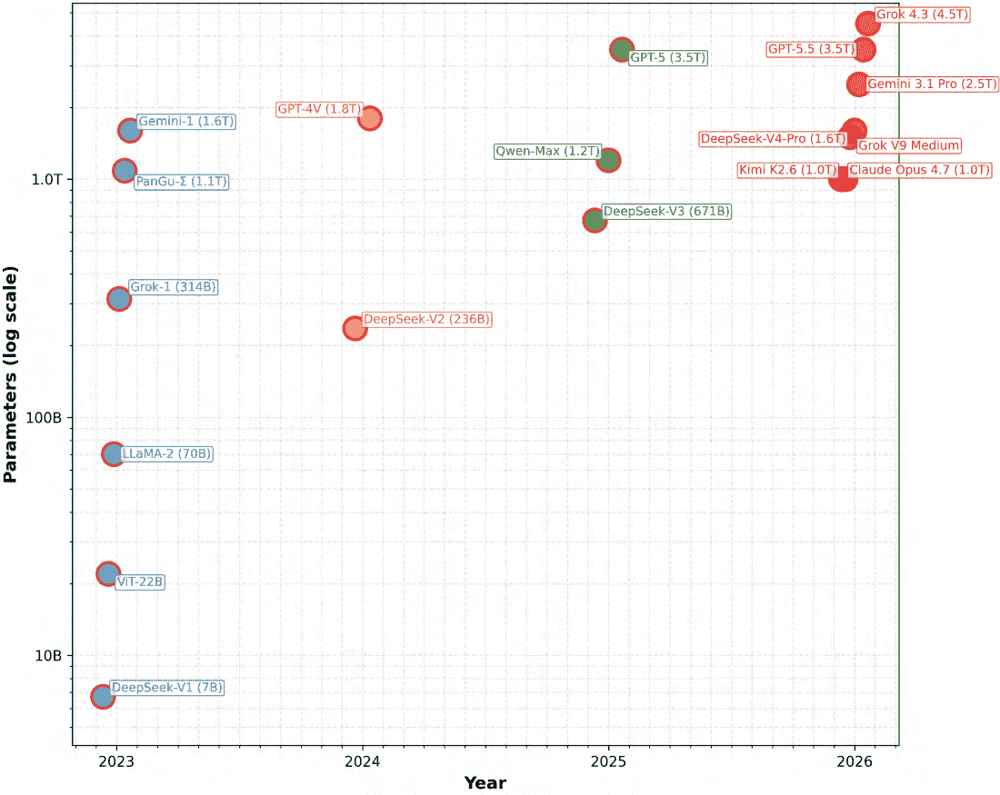

这不仅仅是训练问题——在生产环境中大规模服务这些模型，需要能够处理数千个并发请求的分布式推理架构。

单机 AI 的时代已经结束；现代 AI 系统在设计上天生就是分布式的。根据 PyTorch 的分布式训练文档，分布式训练是将训练工作负载分散到多个工作节点上，这对于大型模型和深度学习中计算密集型任务尤其有益。此外，行业报告指出，训练万亿参数模型需要数千万美元的基础设施投资[4]，这使得分布式计算不仅成为现代 AI 发展的技术必需，更是经济上的必然要求。

| 模型 | 参数量 | 公司 | 年份 |
| --- | --- | --- | --- |
| ViT-22B | 22B | Google | 2023 |
| Grok-1 | 314B | xAI | 2023 |
| Gemini-1 | 1.6T | Google | 2023 |
| LLaMA-2 | 70B | Meta | 2023 |
| PanGu-Σ | 1.085T | Huawei | 2023 |
| DeepSeek-V1 | 6.7B | DeepSeek | 2023 |
| GPT-4V | ~1.8T | OpenAI | 2024 |
| DeepSeek-V2 | 236B | DeepSeek | 2024 |
| Qwen-Max | ~1.2T | Alibaba | 2025 |
| GPT-5 | ~2–5T | OpenAI | 2025 |
| DeepSeek-V3 | 671B | DeepSeek | 2025 |
| Gemini 3.1 Pro | ~2–3T | Google | 2026 |
| Grok 4.3 | ~3–6T | xAI | 2026 |
| Claude Opus 4.7 | ~1T+ | Anthropic | 2026 |
| GPT-5.5 | ~2–5T | OpenAI | 2026 |
| Kimi K2.6 | 1T | Moonshot AI | 2026 |
| DeepSeek-V4-Pro | 1.6T | DeepSeek | 2026 |
| Grok V9 Medium | 1.5T | xAI | 2026 |
| Claude Mythos 5 | ~10T | Anthropic | 2026 |

*表 1.1：大型 AI 模型对比*

### 规模挑战

以 70B 参数模型为例。在全精度（FP32）下，仅模型权重就需要 280GB 内存。目前没有任何主流的数据中心 GPU 能容纳这么大的内存——即使是 H200（141 GB）和 B200（192 GB）也不够（*第 2 章*将讨论 GPU 代际和内存趋势）。仅加载模型就需要多块 GPU，更不用说训练了。

训练这些模型需要数千 GPU 小时。单 GPU 训练运行需要数月时间。数据集也极为庞大——数以万亿计的 token。要高效加载和预处理这些数据，需要*分布式流水线*。

这种不匹配显而易见：模型规模和计算需求呈*指数级*增长，而单 GPU 的内存和计算能力充其量只是*线性*增长。

*图 1.2：增长错配：模型指数级增长 vs. GPU 线性增长*

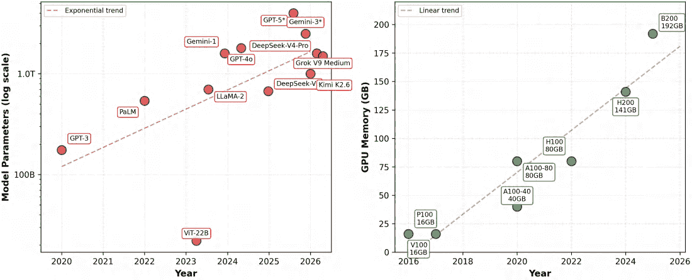


### 估算模型资源需求

在开始训练或部署之前，你需要知道自己需要多少内存和计算资源。如果估算错误，你可能会遇到内存不足的错误，或者浪费钱在过度配置的基础设施上。

内存占用取决于你在存储什么。仅就模型权重而言，计算很简单。FP32 中每个参数占用 4 字节，FP16/BF16 占用 2 字节，Int8 占用 1 字节，Int4 占用 0.5 字节。对于一个 7B 参数的模型，FP32 需要 28GB，BF16（或 FP16）需要 14GB，Int8 需要 7GB，Int4 需要 3.5GB。

以下是常见精度格式的快速参考：

| 格式 | 字节 | 格式细节 | 主要用途 |
|---|---|---|---|
| FP32 | 4 | 32位浮点数（1个符号位，8个指数位，23个尾数位） | 训练、高精度推理 |
| BF16 | 2 | 16位 bfloat（1个符号位，8个指数位，7个尾数位） | 训练（首选）、推理 |
| FP16 | 2 | 16位浮点数（1个符号位，5个指数位，10个尾数位） | 推理 |
| FP8 E4M3 | 1 | 8位浮点数（1个符号位，4个指数位，3个尾数位） | 推理（激活值、权重） |
| FP8 E5M2 | 1 | 8位浮点数（1个符号位，5个指数位，2个尾数位） | 训练（梯度存储） |
| MXFP8 | ~1 | E4M3 + 32值块缩放 | Blackwell训练 |
| NVFP4 | ~0.5 | E2M1 + 16值块缩放 | Blackwell推理 |
| Int8 | 1 | 8位整数 | 量化推理 |
| Int4 | 0.5 | 4位整数 | 量化推理（极限压缩） |

注意 FP8 有两种格式：E4M3（精度更高，用于推理激活值和权重）和 E5M2（动态范围更广，用于存储）。两者每个参数都占用 1 字节，但用途不同。在 NVIDIA Blackwell 上，**MXFP8** 通过更精细的块缩放改进了 Hopper 风格的逐张量 FP8；**NVFP4** 将推理（以及某些训练栈）推进到 8 位以下。两者都使用微缩放——实际内存略高于每个值的标称位数。硬件背景见*第 2 章*，FP8 训练见*第 5 章*。

对于训练，BF16（bfloat16）比 FP16（float16）更受青睐。BF16 与 FP32 具有相同的指数范围（8 位），但尾数位减少（7 位），因此与 FP32 具有相同的动态范围。这使得训练更加稳定——更不容易上溢或下溢。FP16 的指数范围较小（5 位），这可能在训练过程中导致数值问题。现代 GPU（A100、H100）拥有针对 BF16 优化的张量核心（Tensor Core）。对于推理，FP16 和 BF16 都可用，但为了与训练保持一致，仍然首选 BF16。

但模型权重只是开始。在训练期间，你还需要空间来存储梯度、优化器状态和激活值。对于推理，你需要为注意力机制准备 KV 缓存。KV 缓存对 LLM 推理至关重要——它存储序列中先前 token 的键值对，使模型无需为每个新 token 重新计算整个序列的注意力。这大大加快了自回归生成，但它需要大量内存，且随批量大小和序列长度增长。总内存需求可能比仅模型权重高出数倍。

#### 训练内存需求

训练需要的内存远多于推理。你需要存储模型权重、梯度（每个参数一个）、优化器状态以及前向传播产生的激活值。

#### 优化器状态

优化器状态的大小取决于你使用的优化器。以随机梯度下降（SGD）为例：模型权重根据以下公式更新：

其中：
- wt：第 t 次迭代时的模型参数
- wt+1：更新后的参数
- gt：损失关于参数的梯度，在第 t 次迭代时（gt = ∇w L(wt)）
- η：学习率（用于 SGD 和自适应矩估计（Adam））

框出的变量就是我们需要在内存中保留的内容。SGD 只需要学习率 η（一个标量）来更新参数。看这个公式，你在反向传播过程中计算 gt，然后从 wt 中减去 η gt。优化器状态只是 η——内存可忽略不计。你需要存储 wt（模型权重）和 gt（梯度），但不需要额外的优化器张量。

自适应矩估计（Adam）的公式更复杂：

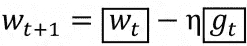

变量定义如下：
- β1：一阶矩（均值）的衰减率
- β2：二阶矩（非中心方差）的衰减率
- mt-1：来自上一步的一阶矩估计
- vt-1：来自上一步的二阶矩估计
- ε：用于数值稳定性的小常数
- t：用于偏差校正的迭代索引

Adam 需要更多内存。公式显示它维护两个逐参数张量：mt-1（一阶矩估计）和 vt-1（二阶矩估计）。mt-1 和 vt-1 都与 wt 形状相同——每个参数一个值。因此 Adam 需要存储 mt-1（1 倍模型大小）和 vt-1（1 倍模型大小），优化器状态总计为 2 倍模型大小。

β1 和 β2 是超参数——标量常量（通常 β1=0.9，β2=0.999）。你只需将它们作为配置存储一次，而不是每个参数都存储。η（学习率）和 ε 也是如此——它们是标量，内存可忽略不计。只有与 wt 形状相同的张量（每个参数一个值）才需要显著内存：wt、gt、mt-1 和 vt-1。

这就是为什么 Adam 的优化器状态需要 2 倍模型大小，而 SGD 的开销几乎为零。AdamW（带解耦权重衰减的 Adam）与 Adam 的内存需求相同——两者都维护 mt-1 和 vt-1，总计 2 倍模型大小。唯一的区别在于权重衰减的应用方式（AdamW 直接将其应用于参数，而 Adam 将其加到梯度上）。

以下是常见优化器优化器状态内存需求的总结：

| 优化器 | 优化器状态 | 内存占用 |
|---|---|---|
| SGD | 学习率 η（标量） | ~0× |
| SGD+Momentum | vt-1（速度/动量） | 1× |
| Nesterov | vt-1（速度/动量） | 1× |
| Adagrad | 累积梯度平方 | 1× |
| RMSProp | vt-1（二阶矩） | 1× |
| Adam | mt-1（一阶矩）+ vt-1（二阶矩） | 2× |
| AdamW | mt-1（一阶矩）+ vt-1（二阶矩） | 2× |
| Adafactor | 行和列统计量（分解） | ~0.5× |
| LAMB | mt-1（一阶矩）+ vt-1（二阶矩） | 2× |
| Lion | mt-1（仅一阶矩） | 1× |
| Nadam | mt-1（一阶矩）+ vt-1（二阶矩） | 2× |
| AMSGrad | mt-1（一阶矩）+ vt-1（二阶矩）+ vmax | 3× |
| SparseAdam | mt-1（一阶矩）+ vt-1（二阶矩，稀疏） | 2× |
| Shampoo | 每个参数的左右预条件矩阵 | \>2×（因情况而异） |
| AdaBelief | mt-1（一阶矩）+ st-1（置信项） | 2× |

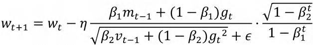

该表仅显示优化器状态。无论使用哪种优化器，你仍然需要存储模型权重（1 倍）和梯度（1 倍）。

#### 激活输出

激活层（如 ReLU、GELU、sigmoid）没有参数——它们只是逐元素应用的函数。但它们的输出（激活输出，通常简称为“激活值”）在训练期间需要存储在内存中。

考虑下面这个简单的三层深度神经网络 `SimpleDNN`：

*图 1.3：SimpleDNN*

数据流为 x → z → h → ŷ，经过 Linear → Sigmoid → Linear 层，其中输入 x 通过第一个线性层产生 z，然后通过 sigmoid 激活产生 h，最后通过第二个线性层产生预测 ŷ。PyTorch 中的代码如下：

```python
class SimpleDNN(nn.Module):
    def __init__(self, input_dim, output_dim, hidden_dim=1, bias=False):
        super(SimpleDNN, self).__init__()
        self.linear1 = nn.Linear(input_dim, hidden_dim, bias=bias) # x -> z
        self.activation = nn.Sigmoid() # z -> h
        self.linear2 = nn.Linear(hidden_dim, output_dim, bias=bias) # h -> y_hat

    def forward(self, x):
        z = self.linear1(x) # z = W_1 * x
        h = self.activation(z) # h = sigmoid(z)
        y_hat = self.linear2(h) # y_hat = W_2 * h
        return y_hat
```

前向传播如下：

为了使用反向传播计算梯度，我们应用链式法则。

对于：

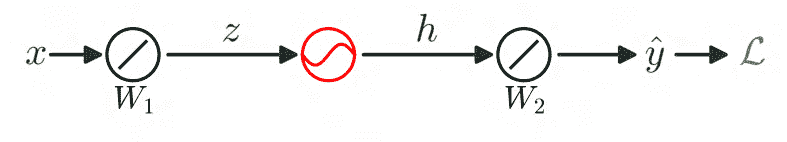
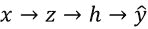
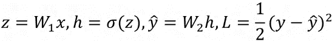
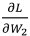
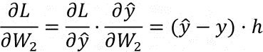


梯度依赖于 h——即 sigmoid 层的激活输出。要计算这个梯度，你需要将 h 存储在内存中。

对于 $\frac{\partial L}{\partial W_1}$，链式路径更长：

展开每一项：$\frac{\partial L}{\partial \hat{y}}$（需要 $\hat{y}$）、$\frac{\partial \hat{y}}{\partial z}$（需要 $h$）、$\frac{\partial z}{\partial h}$（需要 $W_2$）和 $\frac{\partial h}{\partial W_1}$（需要输入 $x$）。

$$
\frac{\partial L}{\partial W_1} = \frac{\partial L}{\partial \hat{y}} \cdot \frac{\partial \hat{y}}{\partial z} \cdot \frac{\partial z}{\partial h} \cdot \frac{\partial h}{\partial W_1}
$$

这个梯度同时需要 h（sigmoid 层的激活输出）和 x（输入数据）。这就是为什么在正向传播过程中，激活输出和输入数据必须保存在内存中，直到反向传播期间计算出它们的梯度。

一个有趣的发现是，我们并不需要 z。观察梯度计算过程，要计算 $\frac{\partial L}{\partial W_1}$，我们需要 $\frac{\partial h}{\partial z}$。对于 sigmoid 函数，其导数为 σ′(z) = σ(z)(1 − σ(z)) = h(1 − h)。由于我们在正向传播时已经存储了 h，因此可以直接利用 h 计算导数，无需原始的 z 值。这是 sigmoid 及其他一些激活函数的性质——它们的导数可以用其输出来表示，因此你无需存储预激活值。

然而，并非所有激活函数都如此。某些激活函数的导数显式地依赖于输入值 z，而不仅仅是输出 h。这意味着你无法仅从 h 计算导数——需要存储原始的 z 值。

为了弄清楚哪些激活函数需要存储预激活值 z，哪些可以仅从激活后的值 h 计算导数，让我们来考察常见激活函数的导数：


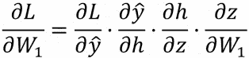
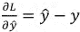
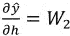
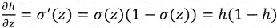
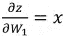
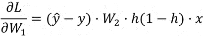
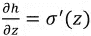
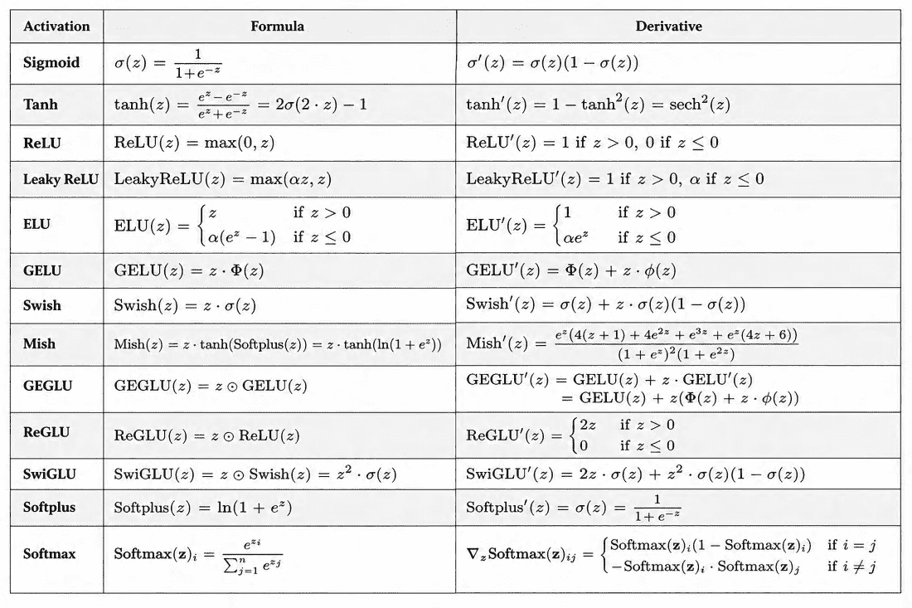

### 激活函数表格约定

上述所有激活函数都是逐元素的（每个输出仅依赖于其对应的输入），唯一例外是 Softmax，它是向量值的（接收向量输入并产生总和为 1 的概率分布）。Softmax 的导数是雅可比矩阵，用 ∇z 表示。Leaky ReLU 和 ELU 中的参数 α 是一个常值超参数（Leaky ReLU 通常取 α = 0.01，ELU 通常取 α = 1.0）。GLU（门控线性单元）系列（GEGLU、ReGLU、SwiGLU）是门控激活函数，使用逐元素乘法 ⊙ 将两个分支组合：一个分支保持不变（z），另一个分支应用激活函数。在实践中，GLU 变体通常为两个分支分别使用独立的线性投影，但此处展示的简化形式对两个分支使用相同的输入 z。

#### 注意

观察这些导数，我们可以根据导数能否仅用输出 h 来表示，对激活函数进行分类：

- **导数仅用输出即可表示**：Sigmoid、Tanh 和 Softplus 属于这一类。正如我们在 sigmoid 中看到的，σ′(z) = h(1 − h) 仅依赖于 h。类似地，tanh′(z) = 1 − h² 和 Softplus′(z) = σ(z) 都可以由输出计算得出。对于这些函数，在正向传播过程中只需存储 h。
- **导数需要输入 z 的**：ReLU、Leaky ReLU、ELU、GELU、Swish、Mish 以及 GLU 系列（GEGLU、ReGLU、SwiGLU）需要存储 z，因为它们的导数显式地包含 z 或依赖于 z 的符号。对于 ReLU，计算导数时需要知道 z > 0 还是 z ≤ 0。对于 GELU、Swish、Mish 和 GLU 变体，导数公式中显式包含 z，因此无法仅从 h 恢复出 z。

让我们详细考察 GELU 和 Swish，以说明它们为什么需要存储 z。对于 GELU（高斯误差线性单元），其精确形式使用了累积分布函数：

$$
\mathrm{GELU}(z) = z \cdot \Phi(z)
$$

其中 Φ 是标准正态分布的累积分布函数。其导数为：

$$
\mathrm{GELU}'(z) = \Phi(z) + z \cdot \phi(z)
$$

其中 ϕ 是标准正态的概率密度函数（PDF）。该导数在 $z \cdot \phi(z)$ 项中显式地包含了 z。

在实践中，为了计算效率，GELU 通常使用 tanh 进行近似。

$$
\mathrm{GELU}(z) \approx \frac{1}{2} z \left(1 + \tanh\left(\sqrt{2/\pi}\,(z + c z^3)\right)\right)
$$

其中 c ≈ 0.044715 为常数。该近似的导数为：

- $\frac{1}{2}\left(1 + \tanh\left(\sqrt{2/\pi}\,(z + c z^3)\right)\right)$
- $\frac{1}{2} z \left(1 - \tanh^2\left(\sqrt{2/\pi}\,(z + c z^3)\right)\right) \cdot \sqrt{2/\pi}\,(1 + 3c z^2)$

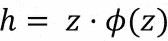
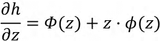
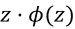
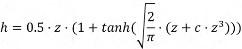
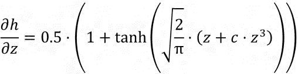
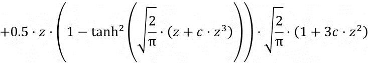

即使使用 tanh 近似，导数仍然在多个项中显式包含 z，包括 z 本身以及 tanh 参数内部的 z² 和 z³。由于 tanh 不容易求逆，且表达式中多处涉及 z，因此无法仅从 h 恢复出 z。所以，无论你使用精确的 GELU 形式还是 tanh 近似，在反向传播期间都需要存储原始的 z 值来计算导数。

类似地，Swish（也称为 SiLU，Sigmoid 线性单元）的定义为：

$$
\mathrm{Swish}(z) = z \cdot \sigma(z)
$$

其导数为：

$$
\mathrm{Swish}'(z) = \sigma(z) + z \cdot \sigma(z)(1 - \sigma(z))
$$

同样，导数显式地包含 z，你无法仅用 h 来表示它。要计算导数，你需要 z 和 σ(z)，这意味着要存储原始的 z 值。

在实践中，像 PyTorch 这样的框架会存储在反向传播期间计算梯度所需的任何中间值。对于导数可以用其输出表示的激活函数（如 sigmoid），框架可能只存储激活后的值。对于导数需要输入的激活函数（如 GELU 或 Swish），框架会存储预激活值。自动求导系统会根据计算图中的运算自动确定需要保存的内容，从而确保梯度能够正确计算，同时在可能的情况下尽量减少内存占用。

在正向传播过程中，你计算并存储所有层的激活输出（简称为“激活值”）。在反向传播过程中，你从最后一层开始逐层计算梯度。每一层都需要其激活输出来计算梯度。一旦你计算了某层的梯度并更新了其参数，就可以释放该层的激活输出——它们不再需要了。然而，在反向传播过程中存在重叠：在计算某一层的梯度时，内存中仍然保留着更早层的激活输出。当激活值（来自正向传播）和梯度（来自反向传播）同时存在时，内存占用达到峰值。

激活值的内存占用随批量大小和序列长度而扩展——更大的批量或更长的序列意味着需要存储更多的激活输出。梯度检查点（gradient checkpointing）等技术通过重新计算激活值而非全部存储，来用计算换内存。

### 训练阶段

在训练过程中，训练循环的不同阶段内存占用各不相同。了解每个组件在何时被需要，有助于你估算峰值内存需求并发现优化机会。

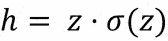
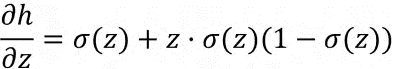
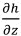

```python
for epoch in range(num_epochs):
    model.train()  # set to training mode
    for x_batch, y_batch in dataloader:  # iterate over batches
        optimizer.zero_grad()  # 1. clear gradients
        y_hat = model(x_batch)  # 2. forward pass
        loss = criterion(y_hat, y_batch)  # 3. compute loss
        loss.backward()  # 4. backward pass
        optimizer.step()  # 5. update parameters
```

让我们分解每一步发生的过程以及内存中存储了什么：

第 2 步（正向传播）：模型从输入 `x_batch` 计算预测值 `y_hat`。在此过程中，它会存储反向传播所需的中间激活值（如前面例子中的 h）。此时，内存中包含：模型权重 $w_t$、激活值，以及来自前一次迭代的优化器状态（如 Adam 的 $m_{t-1}$ 和 $v_{t-1}$）。

第 4 步（反向传播）：`loss.backward()` 计算所有参数的梯度 $g_t = \nabla_w L(w_t)$。这需要正向传播期间存储的激活值。此时内存中包含：$w_t$、激活值（仍然需要）、梯度 $g_t$ 和优化器状态。

第 5 步（优化器更新）：`optimizer.step()` 使用梯度 $g_t$ 和优化器的内部状态将参数从 $w_t$ 更新为 $w_{t+1}$。对于 Adam，这意味着使用 $m_{t-1}$ 和 $v_{t-1}$ 以及 $g_t$ 来计算更新量。此步骤之后，优化器状态被更新（例如，$m_{t-1}$ 变为 $m_t$，$v_{t-1}$ 变为 $v_t$）并存储以供下一次迭代使用。此时激活值不再需要，可以释放。

激活值、梯度和优化器状态并不会同时存在于内存中。在正向传播期间，只有激活值被实际使用——梯度尚不存在，而优化器状态虽然从前一次迭代一直保留，但不会被访问。在反向传播期间，激活值和梯度会发生重叠，因为你需要激活值来计算梯度。在优化器更新步骤中，梯度和优化器状态会发生重叠，因为优化器同时使用两者来更新参数。激活值通常在反向传播完成后被释放，因此它们不会与优化器状态重叠。

峰值内存使用发生在反向传播期间，此时激活值和梯度同时位于内存中。反向传播之后，激活值可以被释放，因此优化器更新步骤只需要梯度和优化器状态。


*图 1.4：训练内存时间线*

如*图 1.4*所示，该时间线展示了使用 Adam 优化器训练 7B 模型时训练循环中的内存使用情况，假设**全程使用 BF16**——权重、梯度和优化器状态（m, v）均以每参数 2 字节存储。这是一个清晰的教学示例。许多生产环境使用**混合精度**的方式有所不同：前向和反向传播使用 BF16（通过 `torch.autocast`），但优化器状态——有时还包括权重主副本——使用 FP32，这会推动优化器内存达到约 56 GB（4 字节 × 2 状态 × 7B 参数），而非 28 GB。

下面说明每个阶段如何对应代码。在第 2 行（`y_hat = model(x_batch)`），前向传播计算并存储激活值。内存使用量为权重（14 GB）加优化器状态（28 GB）加激活值（12 GB），总计 54 GB。此时梯度尚不存在。

在第 4 行（`loss.backward()`），反向传播阶段出现内存峰值。在反向传播过程中，既需要激活值来计算梯度，也需要存储计算出的梯度。内存使用量为权重（14 GB）加优化器状态（28 GB）加激活值（12 GB）加梯度（14 GB），总计 68 GB。这是峰值，因为激活值和梯度在内存中同时存在。

在第 5 行（`optimizer.step()`），反向传播完成后，激活值可以被释放。优化器使用梯度和其内部状态来更新参数。内存使用量为 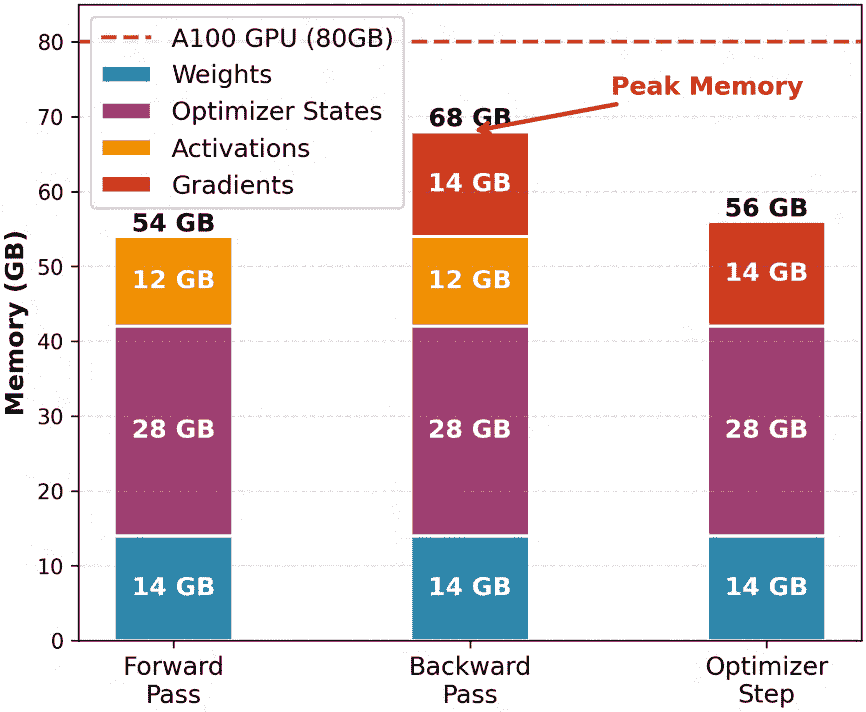 权重（14 GB）加优化器状态（28 GB）加梯度（14 GB），总计 56 GB。不再需要激活值。

68 GB 的峰值内存出现在 `loss.backward()`（第 4 行）期间，此时激活值和梯度同时在内存中。这就是为什么在遇到内存不足错误时，减小批大小、使用**梯度累积**（运行几个较小的微批次，仅在最后一个微批次之后调用 `optimizer.step()`——有效批大小不变，峰值激活内存更低）、或使用梯度检查点会有所帮助：前两种方法在反向传播期间缩减激活内存；检查点则以额外计算换取更少的激活存储。

#### 内存分解：

对于相同的 7B Adam 配置（全程 BF16）：模型权重（14 GB）+ 梯度（14 GB）+ 优化器状态（28 GB）= **56 GB 固定开销**，不含激活值。激活值根据批大小和序列长度额外增加 8–16 GB——时间线中采用 12 GB，因此在反向传播期间达到 **68 GB 峰值**（56 + 12）。因此，每块 GPU 的完整范围是 **64–72 GB**（56 GB + 8–16 GB 激活值），这不是与图中分开的独立估算。若使用 SGD，可以在优化器状态上节省 28 GB，但 Adam 的自适应学习率通常收敛更快，因此在大多数情况下这种权衡是值得的。这就是为什么在此内存占用下，7B 模型使用 Adam 训练至少需要一块 A100（80 GB）；FP32 优化器状态或主权重会进一步提高要求。如果没有分片（FSDP、DeepSpeed）或本书后续介绍的其他技术，较小的 GPU 无法满足需求。

### 推理内存需求

推理内存需求与训练不同，主要包含模型权重和用于注意力计算的键值（KV）缓存。KV 缓存存储序列中先前 token 的预计算键-值对，通过避免对整个序列历史进行冗余的注意力计算，实现高效的自回归生成。虽然这一优化显著加速了推理，但 KV 缓存引入了与批大小、序列长度和模型深度线性扩展的内存开销——*第 6 章*将详细讨论其容量计算。

推理的内存占用受三个主要因素影响：模型大小、批大小和序列长度。对于使用 BF16 精度的 70B 参数模型，模型权重约消耗 140 GB。在批大小为 32、序列长度为 2048 的情况下，KV 缓存额外增加 20–40 GB，导致总内存需求达到 160–180 GB。这超出了单块 A100 GPU（80 GB）的容量，因此推理工作负载需要多 GPU 配置或模型并行策略。

对于具有超长上下文窗口的模型，内存需求变得更为苛刻。例如，`meta-llama/Llama-4-Scout-17B-16E-Instruct` 模型支持 1000 万 token 的上下文窗口。尽管它是一个拥有 16 个专家的 17B 参数混合专家（MoE）模型——每个 token 仅激活部分专家——但在完整上下文长度下，单序列的 KV 缓存就可能超过 1 TB 内存[5]。这种规模的内存需求使单节点推理架构不可行，使得拥有数十块 GPU 的分布式推理系统不仅是有益的，而且是根本必要的。超长上下文模型的计算和内存需求使分布式系统成为唯一可行的部署架构。

#### GPU 需求估算

估算 GPU 需求需要同时考虑模型内存和运营开销。对于训练工作负载，计算从模型的内存占用开始，在此基础上必须添加 10–20% 的安全余量，以容纳通信缓冲区和框架开销。以使用 BF16 精度的 13B 参数模型为例：每块 GPU 的基础内存需求约为 72 GB。加上安全余量后，这一数字增加到 85 GB。由于一块 A100 GPU 提供 80 GB 内存，该配置需要使用模型并行或全分片数据并行（FSDP）策略，至少需要 2 块 GPU。

推理需求遵循类似的计算方法，将模型权重与 KV 缓存内存相结合。BF16 下的 70B 参数模型仅权重就需要 140 GB。在考虑 KV 缓存开销后，总内存需求达到 160–180 GB。这至少需要 2 块 A100 GPU；或者，Int8 量化可以将权重内存降至约 70 GB，在精心管理 KV 缓存的情况下，可能实现单 GPU 部署。

#### 实际部署考量

实际部署会在基础模型需求之外引入额外的内存开销。PyTorch 框架通常消耗 1–2 GB，操作系统需要 5–10 GB。分布式训练架构为每块 GPU 额外分配 2–5 GB 用于通信缓冲区。检查点操作会造成临时内存峰值，必须在容量规划中予以考虑。一种保守的做法是在基础估算上增加 20–30% 的缓冲，以容纳这些开销和运行波动。

内存优化策略在实际部署中起着关键作用。使用 BF16 的混合精度训练（推理时可使用 FP16/BF16）相比 FP32 可将内存消耗降低约 50%，而对模型精度的影响极小。对于推理工作负载，Int8 量化可以进一步将内存需求减半，同时保持可接受的精度损失。通过 `nvidia-smi` 等工具监控实际内存使用情况，可以为理论估算提供实证验证。需要认识到，激活内存随批大小线性扩展；当遇到内存不足（OOM）错误时，减小批大小是最直接的缓解策略。

快速参考表[6]：

| 模型规模 | FP32 权重 | BF16 权重 | 训练（BF16+Adam） | 推理（BF16） |
|---|---|---|---|---|
| 1B | 4 GB | 2 GB | ~8 GB | 2–4 GB |
| 7B | 28 GB | 14 GB | ~60–70 GB | 14–20 GB |
| 13B | 52 GB | 26 GB | ~110–130 GB | 26–35 GB |
| 70B | 280 GB | 140 GB | ~600–700 GB | 140–180 GB |

#### 从经典 ML 到基础模型的演进

从经典机器学习到现代基础模型的演进，代表了计算需求和架构范式的根本性转变。经典机器学习模型设计为在单台机器上运行，传统算法——包括线性回归、逻辑回归、决策树、随机森林、支持向量机（SVM）和梯度提升方法（XGBoost、LightGBM）——通常包含数千到数百万个参数，并在完全适合系统内存的数据集上进行训练。

深度学习时代引入了具有数亿参数的模型，以 ResNet 和 BERT 等架构为代表。虽然这些模型需要 GPU 加速，但在单设备配置上仍然可以管理。当代基础模型时代从根本上改变了这一格局：模型现在拥有数十亿到数万亿的参数（例如 GPT-4、Gemini、LLaMA），分布式系统成为架构上的先决条件而非优化手段。

这种向分布式 AI 的转变实现了突破性的能力，包括能够理解和生成类人文本、代码和多模态内容的模型。这一转变也推动了企业采用，各类组织大规模部署 AI 系统用于生产工作负载。此外，分布式架构通过跨多个计算节点的并行实验实现更快的迭代周期，从而加速了研究进展。


### 现代 AI 模型生命周期

构建 AI 模型并非一蹴而就的过程，而是一个循环：收集数据、训练模型、部署模型、观察其表现，然后回头改进数据或模型。每个阶段都会为下一阶段提供输入。

*图 1.5：现代 AI 模型生命周期*

如*图 1.5*所示，该生命周期始于数据工程：收集、整理、转换、验证、清洗并准备数以 TB 计的数据用于训练。接下来是训练，涉及前向传播、反向传播、梯度下降、超参数调优，甚至微调。训练完成后，模型会通过量化、ONNX 转换、算子融合和 CUDA 内核优化来进行推理优化。部署之前，全面的基准测试会通过精确率与召回率指标、工程性能剖析、瓶颈分析和压力测试来评估模型性能，同时分布式评估可加速大规模数据集上的测试。生产部署需要自动扩缩容、调度、负载均衡、可观测性、API 网关和监控基础设施，以处理每秒数千个请求。生产环境反馈能够确定数据收集优先级和模型故障模式，通过为后续数据工程工作和模型改进提供信息，完成整个循环。

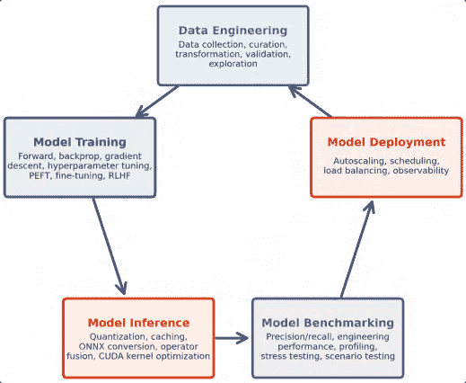

本书重点关注训练、推理、基准测试和部署所需的分布式技术。数据工程只会简单介绍，并非本书重点。分布式数据处理固然重要，但已是一个非常成熟的领域。Spark、Dask 和 Ray 已经存在多年。本书重点关注 AI 特有的分布式挑战：训练大模型、优化推理以及大规模提供服务。

#### 训练：学习阶段

训练是从数据中学习模型参数。其过程遵循固定模式：对模型进行前向传播、计算损失、反向传播以计算梯度，再通过梯度更新来调整参数。这个过程会在多个 epoch（轮次）中迭代进行，直到模型收敛。

训练需要在内存中存储激活值、梯度和优化器状态。计算密集且高度迭代。在分布式训练中，你需要跨设备频繁进行梯度同步，以保持所有模型副本一致。挑战包括梯度同步开销、大模型的内存限制、可能持续数天到数周的长训练时间，以及容错和检查点保存的需求。

在 1 万亿 token 上训练一个 7B 参数的模型，通常需要 8 块 A100 GPU（每块 80GB）和大约 2 周的持续训练。你需要仔细进行梯度同步，以维持所有 GPU 上的训练稳定性。

#### 推理：预测/生成阶段

推理是从训练好的模型生成预测。与训练不同，你只需要一次前向传播——不需要梯度、反向传播或优化器状态。内存需求更低，因为你只需要模型权重和注意力机制的 KV 缓存。每个请求的计算量更低，但你需要高吞吐量来同时服务大量请求。通信需求很少，通常仅在分布式推理时才会用到。

挑战包括延迟（交互式应用需要亚秒级响应）、吞吐量（每秒数千个请求）、通过 KV 缓存管理实现高效内存使用，以及有效的批处理和调度。为聊天场景部署 70B 参数模型，需要 vLLM 或 SGLang 等优化推理引擎、持续批处理以最大化 GPU 利用率，以及针对变长序列的细致 KV 缓存管理。

#### 服务：生产系统

服务是指为模型提供可靠、可扩展的访问入口。这不仅仅是运行推理，而是构建一个包含模型运行器、API 网关、负载均衡器和监控的生产系统。需求包括高可用性、容错性和可观测性。在大规模场景下，你需要面对多模型、多租户的系统。

挑战包括系统可靠性与正常运行时间、多模型路由与负载均衡、通过 GPU 利用率和自动扩缩容实现成本优化，以及用于调试的可观测性。一个生产级 LLM 服务平台可能包含多个模型变体（不同尺寸、微调版本）、A/B 测试基础设施、金丝雀部署流水线，以及分布式追踪与监控。

以下是 *训练 vs 推理 vs 服务* 的对比表：

| 方面 | 训练 | 推理 | 服务 |
|--------|----------|-----------|---------|
| 目标 | 学习参数 | 生成预测 | 提供访问 |
| 内存 | 高（激活值 + 梯度） | 中（权重 + KV 缓存） | 不定 |
| 计算 | 迭代、密集 | 单次前向传播 | 请求驱动 |
| 通信 | 频繁（梯度） | 中等 | API 级别 |
| 延迟 | 数小时到数天 | 毫秒到秒 | 毫秒 |
| 吞吐量 | 每秒样本数 | 每秒 token 数 | 每秒请求数 |

### 决策框架：何时需要分布式系统？

分布式系统会带来复杂性、通信开销和成本。只有在不得已时才使用它们，而不是因为你想用。

#### 决策树：快速参考

如*图 1.6*所示，决策框架总结为下面的决策树。首先确定你的使用场景：训练（或微调）还是推理与服务。

#### 理解决策树

在训练或微调时，首先要检查模型是否能装进内存。以 BF16 计算模型大小（参数 × 2 字节）。如果超过单块 GPU 的容量，你就需要 FSDP 或张量并行等模型并行或参数并行技术。一个 13B 模型仅权重就需要 26GB。再加上 Adam 优化器状态，总共需要 78GB，这已经非常接近 80GB 的 A100 上限了。

如果模型可以装入内存，但训练要拖上数周或数月，数据并行可以加速。在 8 块 GPU 上训练一个 7B 模型处理 1T token 大约需要两周，而在单块 GPU 上则需要数月。

当模型大小和训练时间都可控时，你的微调方法就很重要了。LoRA 和 QLoRA 等参数高效方法会改变局面。70B 模型上的 QLoRA 可以装进 48GB GPU，因为它只训练适配器权重；而同一模型的完整微调则需要多块 GPU。但如果基础模型本身装不下，无论你选择哪种训练方法，你仍然需要模型并行。

当数据加载成为瓶颈时，大型数据集可以从分布式数据加载中受益。多 TB 级别的数据集非常适合使用数据并行。

对于推理或服务，逻辑类似。如果模型超过单块 GPU 内存，请使用模型并行。一个 70B 模型以 BF16 存储需要 140GB 的权重空间。加上 KV 缓存，大约需要 160-180GB，这至少需要 2 块 A100 GPU。如果内存足够，但你需要高吞吐量——每秒数千个请求——可以使用多块 GPU 进行分布式推理。

需要高吞吐量和亚秒级延迟的实时服务通常需要张量并行或多个推理实例。当内存和吞吐量都在单块 GPU 的范围内时，坚持使用单块 GPU，并使用 vLLM 或 SGLang 等优化引擎来最大化效率。

*图 1.6：决策框架：何时需要分布式系统？*

### 动手实践：运行分布式训练

我们先从一个简单的基线开始，建立性能参考点，然后转向分布式训练，亲眼看看加速效果。

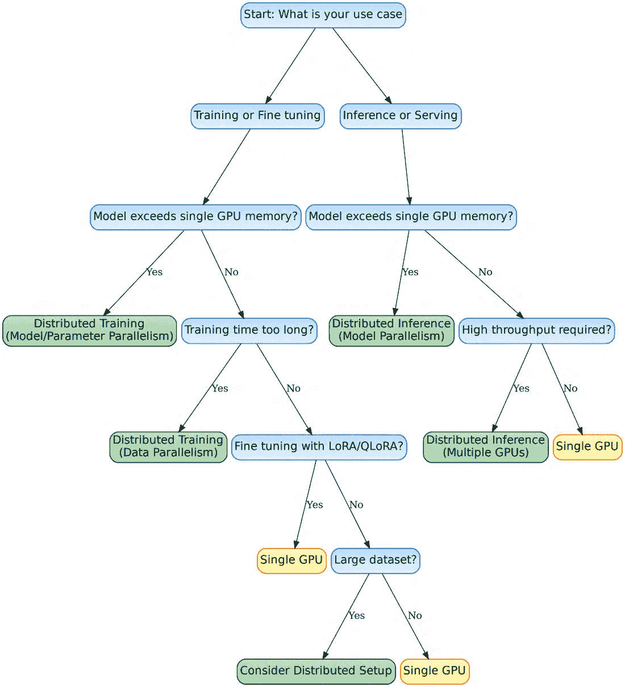


#### 环境设置

本书中，我们将使用 PyTorch 作为主要框架，代码可以从本书的 git 仓库中克隆。

```
git clone https://github.com/PacktPublishing/Distributed-AI-Systems
```

要运行代码，最好你能访问多 GPU 机器，例如 A10、A100 或 H100/H200 甚至 B200。如果你本地无法访问多 GPU，Kaggle 提供免费的多 GPU 环境。登录 `https://www.kaggle.com`，点击 Create，然后选择 Notebook。

*图 1.7：Kaggle 笔记本创建*


创建 Jupyter 笔记本后，进入 Settings → Accelerator 并选择 GPU T4 x2。

*图 1.8：Kaggle GPU 设置*

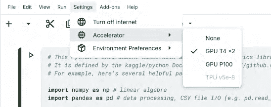

现在你应该有 2 个 T4 GPU 可用。要验证 GPU 设置，请运行 `code/check_cuda.py` 中的代码：

```
1 import torch
2 print(f"CUDA available: {torch.cuda.is_available()}")
3 print(f"Number of GPUs: {torch.cuda.device_count()}")
4 for i in range(torch.cuda.device_count()):
5     props = torch.cuda.get_device_properties(i)
6     vram_gb = props.total_memory / (1024**3)
7     print(f"GPU {i}: {props.name} ({vram_gb:.1f} GB)")
```

代码说明：

- 2：检查系统上 CUDA 是否可用
- 3：获取 GPU 总数
- 5：检索当前 GPU 的属性
- 6：将内存从字节转换为 GB

*图 1.9：GPU 设置 - 2 个 Tesla T4 GPU*

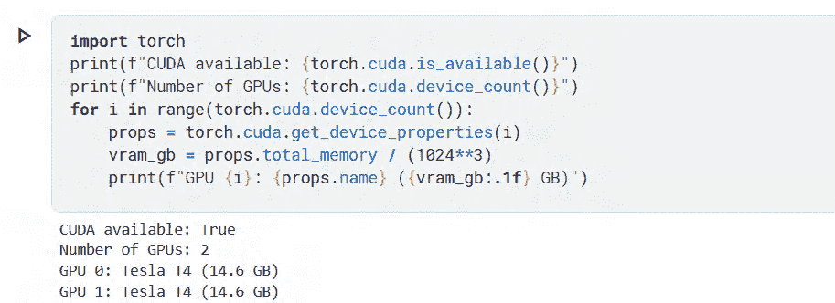

如*图 1.9*所示，运行此命令应显示你可用的 GPU。

#### 单 GPU 基线

我们将使用 ResNet18，这是一个轻量级的 18 层卷积神经网络，专为图像分类设计。它足够小，可以快速训练，同时有效演示分布式训练的概念。对于数据集，我们将使用 FashionMNIST——包含 10 个服装类别的 70,000 张灰度图像（28×28 像素）。它是 MNIST 的直接替代品，难度稍高，非常适合快速实验。

运行基线训练脚本：

```
python code/single_gpu_baseline.py
```

经过 3 个 epoch 后，你应该会看到类似如下的输出：

```
Epoch 1/3, Loss: 0.4164, Accuracy: 84.94%
Epoch 2/3, Loss: 0.2936, Accuracy: 89.17%
Epoch 3/3, Loss: 0.2531, Accuracy: 90.58%
Total training time: 8.78s
```

你的具体结果会因硬件而异，但损失和准确率值应大致相似。这个基线为我们提供了参考点——我们将在分布式版本中使用相同的模型架构进行公平比较。

#### 多 GPU 分布式训练

现在让我们运行分布式版本。该脚本在 FashionMNIST 上使用相同的 ResNet18 模型，但将工作分配给多个 GPU。

```
torchrun --nproc_per_node=2 code/multi_gpu_ddp.py
```

或者使用启动脚本：

```
bash code/launch_torchrun.sh
```

##### ResNet18 与 FashionMNIST

来自 torchvision 的 ResNet18 专为 3 通道 RGB 图像设计，但 FashionMNIST 使用 1 通道灰度图像。为了将 ResNet18 适配到 FashionMNIST，我们修改两个层：(1) 替换第一个卷积层，使其接受 1 个输入通道而非 3 个：`model.conv1 = nn.Conv2d(1, 64, kernel_size=7, stride=2, padding=3, bias=False)`。(2) 替换最后一个全连接层，使其为 FashionMNIST 输出 10 个类别：`model.fc = nn.Linear(model.fc.in_features, 10)`。这些最小的改动使 ResNet18 能够处理 FashionMNIST 的灰度图像，同时保留其余架构的经过验证的设计。

**注意**

使用 2 个 GPU，你会看到相似的损失和准确率值，但训练在 5.91 秒内完成，而不是 8.78 秒——**1.48 倍加速**。

我们测试了从 1 到 8 个 GPU 的扩展，看看性能如何提升：

| GPU 数 | 训练时间 | 加速比 |
|------|---------------|---------|
| 1 | 8.78s | 1.00× |
| 2 | 5.91s | 1.48× |
| 4 | 3.69s | 2.38× |
| 6 | 2.92s | 3.01× |
| 8 | 2.44s | 3.60× |

*图 1.10：FashionMNIST 扩展性能*

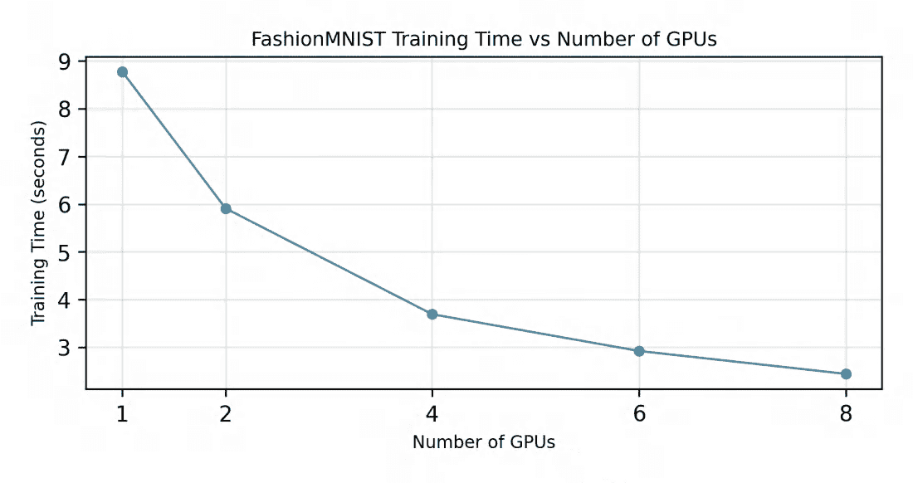

使用 8 个 GPU，训练时间从 8.78 秒降至 2.44 秒，实现了 **3.6 倍加速**。添加更多 GPU 可显著减少训练时间并加速开发周期。随着工作负载变大，加速效果会更加明显，我们将在接下来看到。

#### 扩展训练：CIFAR-10 与 20 个 epoch

为了更真实的工作负载，我们在 CIFAR-10 上使用 20 个 epoch 测试了 ResNet18。CIFAR-10 比 FashionMNIST 更大、更复杂，有 50,000 张训练图像，使用 32×32 像素的 3 通道 RGB 图像。这能更好地展示分布式训练的优势。

运行单 GPU 基线：

```
python code/single_gpu_extended.py --epochs 20
```

然后测试分布式训练：

```
torchrun --nproc_per_node=2 code/multi_gpu_ddp_extended.py --epochs 20
torchrun --nproc_per_node=4 code/multi_gpu_ddp_extended.py --epochs 20
torchrun --nproc_per_node=6 code/multi_gpu_ddp_extended.py --epochs 20
torchrun --nproc_per_node=8 code/multi_gpu_ddp_extended.py --epochs 20
```

结果显示出了更好的扩展性：

| GPU 数 | 训练时间 | 加速比 |
|------|---------------|---------|
| 1 | 73.00s (1.22 min) | 1.00× |
| 2 | 46.47s (0.77 min) | 1.57× |
| 4 | 27.72s (0.46 min) | 2.63× |
| 6 | 21.24s (0.35 min) | 3.44× |
| 8 | 18.20s (0.30 min) | 4.01× |

*图 1.11：CIFAR-10 扩展性能*

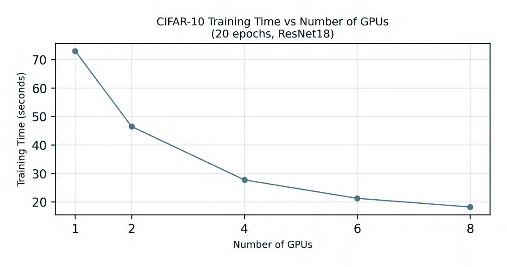

使用 8 个 GPU，训练时间从 73 秒降至 18.2 秒，实现了 **4.01 倍加速**——优于 FashionMNIST 的结果。每个 epoch 更大的计算工作量意味着梯度同步在总时间中占用的比例更小。使用 20 个 epoch，通信开销在更多的训练步骤中被摊销。每个 GPU 在通信步骤之间有足够的计算工作，以最大化并行效率。

这证明了为什么分布式训练对于大规模模型训练至关重要。随着每一步计算量的增加，通信的相对成本降低，从而带来更好的扩展效率。对于拥有数十亿参数的模型，分布式训练的扩展效果更佳，随着计算在训练时间中占据主导地位，加速比接近线性扩展。这里展示的 DDP 方法使用数据并行，其中每个 GPU 持有模型的完整副本并处理不同的数据。这是最简单的分布式训练形式，适用于单个 GPU 能容纳的模型。对于超出单 GPU 内存的更大模型，后续章节将探讨高级并行策略，例如张量并行（将模型层拆分到多个 GPU 上）、流水线并行（将模型阶段拆分到多个 GPU 上），以及结合多种并行技术的混合方法。

#### 分布式推理：吞吐量扩展

训练侧重于减少收敛时间，而推理侧重于吞吐量——每秒能处理多少个请求。分布式推理允许多个 GPU 同时处理不同的请求，大幅提升吞吐量。

我们在 FashionMNIST 上对 ResNet18 推理进行了基准测试，以衡量吞吐量扩展。与训练不同，推理没有梯度同步开销——每个 GPU 只是独立处理分配给它的请求。这使得分布式推理在服务场景中非常高效。

有两种常见的分发推理请求的方法。数据拆分模式（`multi_gpu_inference.py`）使用 `DistributedSampler` 将请求预先分配给 GPU，每个 GPU 处理固定子集的数据。这种方法对于批处理简单且高效。请求拆分模式（`multi_gpu_inference_queue.py`）以轮询方式动态分配请求，每个 GPU 按分配处理请求，模拟真实的队列系统。这种模式更适合请求异步到达的生产服务。

运行基准测试。从单 GPU 基线开始：

```
python code/single_gpu_inference.py --requests 1000
```

然后使用数据拆分模式测试分布式推理：

```
torchrun --nproc_per_node=2 code/multi_gpu_inference.py --requests 1000
torchrun --nproc_per_node=4 code/multi_gpu_inference.py --requests 1000
torchrun --nproc_per_node=8 code/multi_gpu_inference.py --requests 1000
```

以及请求拆分模式：

```
torchrun --nproc_per_node=2 code/multi_gpu_inference_queue.py \
 --requests 1000
```


示例基准测试结果：

| GPU 数 | 模式 | 时间 | 吞吐量 | 加速比 |
| --- | --- | --- | --- | --- |
| 1 | 基线 | 1.85s | 541.00 req/s | 1.00× |
| 2 | 数据拆分 | 0.98s | 1025.45 req/s | 1.89× |
| 2 | 请求拆分 | 1.22s | 819.09 req/s | 1.51× |

使用 2 个 GPU 并采用数据拆分模式，我们实现了 **1.89× 的加速比**，吞吐量几乎翻倍。数据拆分模式能够实现接近线性的扩展，因为每个 GPU 处理独立的请求，协调开销极小。请求拆分模式的吞吐量略低（1.51×），原因是轮询分配存在开销，且所有 GPU 都需要遍历数据集，但它对于生产环境中请求异步到达的动态请求处理更为灵活。

这两种模式都展示了分布式推理的强大能力：吞吐量几乎随 GPU 数量线性扩展，非常适合需要高请求速率的工业生产负载。这里展示的推理模式使用数据并行，适用于可以单卡部署的模型。对于超出单 GPU 内存的大语言模型，后续章节将探讨专家并行、序列并行、张量并行等高级技术，以及 vLLM 和 SGLang 等推理服务框架。

### PyTorch 分布式 AI 基础

现在你已经亲眼看到了分布式训练和推理的实际运行，接下来让我们理解支撑它们工作的基本概念和 API。

#### 分布式 AI 技术栈

分布式 AI 系统由多层构成，从高层框架一直到底层物理硬件。理解这个技术栈有助于你排查问题、优化性能，并对使用哪些工具做出明智的决策。

虽然该技术栈适用于所有分布式框架（PyTorch、JAX、TensorFlow），但本书主要以 PyTorch 为例。相关概念同样适用于其他框架，但 API 和实现细节有所不同。我们将在全书中聚焦于 PyTorch 的分布式 API。

*图 1.12：分布式 AI 技术栈：从框架层到物理层*

最顶层是框架层。这是你编写代码的地方——PyTorch 的 `torch.distributed` 模块、`DDP`、`FSDP` 等等。当你定义模型并调用 `loss.backward()` 时，PyTorch 会处理梯度计算并决定何时

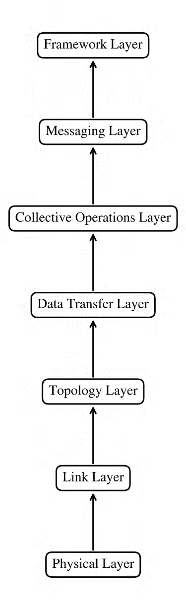

需要进行通信。在这一层，你不必考虑网络数据包或硬件链路。你只需编写训练循环，让 PyTorch 编排分布式操作。

在框架之下，PyTorch 会将你的张量组织成桶（bucket）。DDP 不会单独发送每个梯度张量，而是将多个张量组合在一起。这减少了通信开销。如果你有成千上万个小的梯度张量，逐个发送会很低效。分桶会将它们批量组合，从而减少网络调用次数。这个过程是自动发生的——你无法直接控制，但理解它有助于你在调试通信耗时超预期的问题时找到原因。

集合通信操作层定义了要使用的通信模式。AllReduce 对所有 rank 的梯度求和并将结果分发给所有人。AllGather 收集来自所有 rank 的数据。Broadcast 将数据从某一个 rank 发送到所有其他 rank。这些是 DDP 等更高级 API 所使用的原语。当 DDP 同步梯度时，它底层就是在调用 AllReduce。这一层定义了需要发生什么，而不是如何实现。

数据传输层是实际实现所在。NCCL（NVIDIA 集合通信库）是 GPU 训练中最常见的后端。它以针对 NVIDIA GPU 优化的方式实现 AllReduce 和其他集合操作。GLOO 是基于 CPU 的后端，在你没有 GPU 时很适合用于测试。PyTorch 默认对 GPU 后端使用 NCCL，对 CPU 后端使用 GLOO，这覆盖了大多数使用场景。MPI 是另一种选择，主要用于 CPU 集群。当你使用 `backend="nccl"` 初始化进程组时，你就是在选择由哪个库来负责实际的数据移动。

网络拓扑决定了设备之间的连接方式。在环形拓扑中，GPU 组成一个环——每个 GPU 将数据发送给环中的下一个。这种方式简单但可能产生瓶颈。胖树拓扑提供了设备之间的多条路径，减少了拥塞。网格拓扑和环形网格（Torus）拓扑则在复杂度和带宽之间提供了不同的权衡。拓扑会影响 NCCL 的路由方式，进而影响带宽和延迟。

物理链路负责承载数据。NVLink 以高带宽连接单节点内的 GPU——每个 GPU 约 600 GB/s–1.8 TB/s，具体取决于代际（见*第 2 章*）。当一台机器中有多个 GPU 时，它们通过 NVLink 通信。支持 RDMA（远程直接内存访问）的 InfiniBand 可以在不涉及 CPU 的情况下实现跨节点直接内存访问。这对多节点训练至关重要。PCIe 连接 GPU 与 CPU，以太网速度较慢但更常见。链路层决定了可用的原始带宽。

最底层是物理硬件——GPU 负责并行计算，TPU 负责张量运算（见*第 2 章*），CPU 负责协调。这一层决定了你的原始计算能力和内存上限。上层无论做多少优化，都无法突破这里的硬件限制。

当你在代码中调用 `dist.all_reduce()` 时，请求会沿着整个技术栈层层向下传递。PyTorch 将你的张量组织成桶，调用 AllReduce 集合操作，NCCL 利用它发现的网络拓扑来实现该操作，数据在节点内通过 NVLink 链路传输，在节点间通过 InfiniBand 链路传输，最终结果回到 GPU 内存中。

理解这一流程有助于你调试通信缓慢或分布式作业挂起的问题。是拓扑问题？链路带宽问题？还是集合操作本身的问题？了解技术栈可以帮助你缩小排查范围。

既然我们已经了解了各层如何组合在一起，接下来看看在 PyTorch 中会用到的基本概念。核心构件是进程组、rank 和通信原语。它们构成了所有分布式操作的基础，无论你是使用 DDP 或 FSDP 进行数据并行训练、实现自定义并行策略，还是构建分布式推理系统。

#### 进程组与 Rank

在分布式训练中，多个进程协同工作。每个进程运行在不同的 GPU 或节点上。PyTorch 将这些进程组织成一个进程组。在进程组中，每个进程都有一个唯一的 rank——一个从 0 开始的整数标识符。进程的总数称为世界大小（world size）。

“世界”（world）一词指的是整个分布式作业——参与训练或推理任务的所有进程。世界大小是所有节点和 GPU 上的进程总数。例如，如果你在 2 个节点上训练，每个节点有 4 个 GPU，那么你的世界大小就是 8。

如果你有 4 个 GPU，就会有 4 个进程。进程 0 运行在 GPU 0 上，进程 1 运行在 GPU 1 上，以此类推。rank 告诉每个进程应该使用哪个 GPU 以及处理哪部分数据。

rank 有两种类型：全局 rank 和局部 rank。全局 rank 在整个分布式作业（世界）的所有进程中是唯一的，取值范围为 0 到 world_size - 1。局部 rank 只在单个节点内唯一，每个节点都从 0 开始。例如，在一个每个节点有 4 个 GPU 的 2 节点配置中，节点 0 有局部 rank 0-3（全局 rank 0-3），节点 1 也有局部 rank 0-3（全局 rank 4-7）。局部 rank 通常对应该节点上的 GPU 索引，这就是为什么在分布式代码中经常会看到 `torch.cuda.set_device(local_rank)`。

##### 初始化进程组

在进行任何分布式操作之前，你需要初始化进程组。这会告诉 PyTorch 进程之间应该如何通信。GPU 训练最常见的后端是 NCCL（NVIDIA 集合通信库）。


基本的初始化模式如下所示：

```python
import torch.distributed as dist

def setup(rank, world_size):
    dist.init_process_group(
        backend="nccl", # Use NCCL for GPU communication
        rank=rank, # This process's rank
        world_size=world_size # Total number of processes
    )
    torch.cuda.set_device(rank) # Set which GPU this process uses
```

验证你的分布式环境是否正常工作的最简单测试位于 `code/distributed_basic_test.py` 中。这是一个基础的分布式测试，用于验证进程组初始化和通信。它没有使用 DDP，只是测试多个进程能否相互通信。

使用多块 GPU 测试：

```bash
torchrun --nproc_per_node=2 code/distributed_basic_test.py
```

如果你只有一块 GPU，但仍想测试分布式逻辑，可以在单块 GPU 上模拟多个进程：

```bash
CUDA_VISIBLE_DEVICES=0 torchrun --nproc_per_node=2 code/multi_gpu_simulation.py
```

无论采用哪种方式，你都会看到不同进程打印出 "Rank 0 says hello" 和 "Rank 1 says hello"，从而确认你的分布式环境正常工作。

当你开始使用 `torchrun` 运行分布式训练或推理时，可能会注意到一个关于 `OMP_NUM_THREADS` 的警告。这是因为 PyTorch 想要控制 CPU 线程的使用，以避免使你的系统过载。你可以在 `torchrun` 命令之前设置 `OMP_NUM_THREADS=4`（或任何适合你系统的值）来消除该警告：

```bash
OMP_NUM_THREADS=4 torchrun --nproc_per_node=2 code/distributed_basic_test.py
```

在 `torchrun` 启动之前，在你的 shell 中设置它——在 Python 脚本内部设置不会生效，因为 `torchrun` 会在启动你的进程之前检查环境。

### 集合通信操作

集合通信操作是分布式通信的基石。它们定义了数据如何在进程之间流动。每种操作都有特定的适用场景。理解它们有助于你针对自己的任务选择合适的操作，并排查通信问题。

PyTorch 提供了八种主要的集合通信操作。让我们通过代码示例逐一介绍。

#### AllReduce

*图 1.13：AllReduce 操作：跨所有 Rank 进行归约*

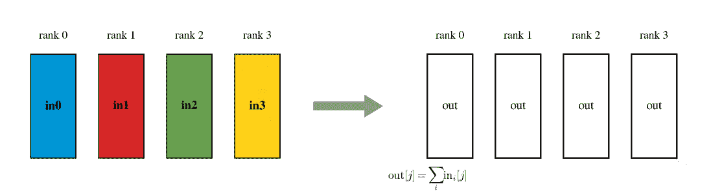

如*图 1.13*所示，AllReduce 是分布式训练中最常用的操作。它跨所有 rank 执行归约（求和、最大值、最小值），并将结果存储在每个 rank 的缓冲区中。这是一种全对全的通信模式，每个 rank 都贡献数据，每个 rank 都接收聚合后的结果。

AllReduce 是数据并行训练的基本构建块。在分布式数据并行（DDP）中，每个 rank 在反向传播过程中基于其本地数据分片计算梯度。为了确保模型一致性，这些本地梯度必须在所有 rank 之间同步。DDP 使用 AllReduce 将所有 rank 的梯度求和，并将平均后的结果分发回每个 rank[7]。执行 AllReduce 后，所有 rank 拥有相同的梯度值，从而使它们能够同步更新模型参数。如果没有 AllReduce，每个 rank 将仅使用其本地梯度更新参数，从而导致模型发散和训练不稳定。

归约操作可以是 SUM（最常用于梯度）、MAX（用于寻找最大值）、MIN（用于寻找最小值）或 PRODUCT（很少使用）。对于梯度同步，使用 SUM，结果通常除以 world_size 来计算平均值。这种平均化确保有效批量大小随 rank 数量扩展——使用 8 块 GPU 训练时，每一步处理的数据量是单 GPU 训练的 8 倍。

AllReduce 比先执行 Reduce 再执行 Broadcast 的等效序列更高效。虽然两者都能达到相同的结果，但 NCCL 将 AllReduce 优化为单一操作，使用环形 AllReduce（ring AllReduce）或树形 AllReduce（tree AllReduce）等算法，从而最大限度地减少通信步骤和带宽使用。例如，环形算法只需要 (world_size - 1) 个通信步骤，而 Reduce+Broadcast 序列需要 2 × (world_size - 1) 个步骤。

```python
# Each rank has different input
tensor = torch.tensor([rank + 1, rank + 2, rank + 3], device=device)
# After all_reduce with SUM, all ranks have the same result
dist.all_reduce(tensor, op=dist.ReduceOp.SUM)
# Result: [sum(1..world_size), sum(2..world_size+1), sum(3..world_size+2)]
```

运行演示：

```bash
OMP_NUM_THREADS=1 torchrun --nproc_per_node=2 code/collective-operation/demo_allreduce.py
```

AllReduce 的通信成本随数据大小和 world size 的扩展而增长，但像 NCCL 的环形 AllReduce 这样的优化实现可以实现接近线性的扩展效率。对于拥有数百万参数的大型模型，AllReduce 可能成为瓶颈，这就是为什么梯度压缩、分桶（bucketing）以及通信与计算重叠等技术对性能至关重要。

#### AllGather

*图 1.14：AllGather 操作：从所有 Rank 收集数据*

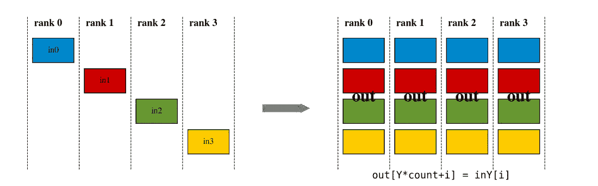

如*图 1.14*所示，AllGather 从所有 rank 收集数据，并将拼接后的结果分发给每个 rank。每个 rank 贡献 N 个值，每个 rank 接收 world_size × N 个值。输出按 rank 索引排序，rank 0 的数据排在最前面，之后是 rank 1 的数据，依此类推。这是一种全对全的通信模式，每个 rank 既向其他所有 rank 发送数据，也接收来自其他所有 rank 的数据。

当你需要每个 rank 都拥有分布在各 rank 上的完整数据视图时，AllGather 至关重要。与 AllReduce 对数据进行聚合（求和、最大值、最小值）不同，AllGather 保留所有单独的贡献并对其进行拼接。这使得 AllGather 非常适合从所有 GPU 收集嵌入、特征表示或中间激活，以用于注意力机制、跨 rank 批归一化或分布式评估指标等全局操作。

在全分片数据并行（FSDP）训练中，AllGather 用于在前向和反向传播之前重建完整的参数分片。每个 rank 持有模型参数的一个分片，AllGather 收集所有分片，以便每个 rank 可以在完整模型上进行计算。计算完成后，使用 ReduceScatter 重新分配分片。这种模式允许训练超出单 GPU 内存限制的模型，同时保持参数一致性。

其他常见用途包括：从所有 rank 收集预测结果以进行集成评估，在 transformer 模型中收集特征图以用于跨 rank 注意力，收集统计数据以用于分布式批归一化，以及在语言模型训练中同步嵌入或 token 表示。AllGather 还用于流水线并行，用于从不同的流水线阶段收集输出。

```python
# Each rank has different input
input_tensor = torch.tensor([rank * 10 + 1, rank * 10 + 2], device=device)
# Prepare output list
output_list = [torch.zeros_like(input_tensor) for _ in range(world_size)]
dist.all_gather(output_list, input_tensor)
# All ranks now have: [rank0_data, rank1_data, ..., rankN_data]
```

运行演示：

```bash
OMP_NUM_THREADS=1 torchrun --nproc_per_node=2 code/collective-operation/demo_allgather.py
```

AllGather 的通信成本随数据大小和 world size 的扩展而增长。每个 rank 发送 N 个值并接收 world_size × N 个值，因此总数据移动量为 world_size² × N。这种二次方扩展使得 AllGather 在较大的 world size 下开销较高，这就是为什么 FSDP 和其他分片策略会选择性地使用 AllGather，并将其与 ReduceScatter 结合以最大程度地减少通信开销。


#### 广播（Broadcast）

如*图1.15*所示，广播将数据从根进程复制到所有其他进程。最初只有根进程需要拥有数据。操作完成后，所有进程都拥有相同的数据。这是一种一对多的通信模式，也是分布式系统中数据分发的最简单形式。

广播对于分布式训练的初始化至关重要。开始训练时，通常由0号进程加载模型权重、优化器状态或检查点数据。这些数据必须分发给所有进程，使每个进程都以相同的模型参数启动。如果没有广播，每个进程都需要独立加载相同的数据，这将浪费I/O带宽和存储访问。广播能够确保所有进程以同步的状态开始训练。

*图1.15：广播操作：将数据从根进程发送到所有进程*

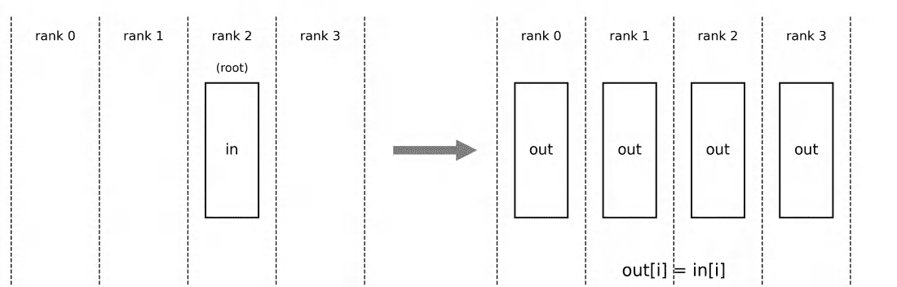

使用广播可以在从磁盘加载模型权重后进行分发、共享超参数（学习率、批大小、训练配置）、同步随机种子以确保结果可复现，以及发送控制信号或标志来协调分布式执行。在自定义并行策略中，广播用于复制模型分片或同步流水线各阶段的状态。

广播也是其他集合操作的基础构件。如“AllReduce”一节所述，AllReduce可以分解为“归约”（将数据收集到根进程）后接“广播”（将结果分发回所有进程）。然而，NCCL将AllReduce优化为单个操作，使其比两步分解更高效。

#### AllReduce 分解

“归约散播（ReduceScatter）”后接“全收集（AllGather）”等价于AllReduce。有些系统使用这种分解进行优化，尤其是在FSDP中，ReduceScatter和AllGather操作可以与计算重叠，从而隐藏通信延迟。

**注意**

```python
root = 0
if rank == root:
    tensor = torch.tensor([10.0, 20.0, 30.0], device=device)
else:
    tensor = torch.zeros(3, device=device)
# After broadcast, all ranks have [10.0, 20.0, 30.0]
dist.broadcast(tensor, src=root)
```

运行演示：

```bash
OMP_NUM_THREADS=1 torchrun --nproc_per_node=2 code/collective-operation/demo_broadcast.py
```

广播的通信开销随数据大小增长，但与进程数量无关——无论全局进程数（world size）是多少，根进程发送的数据量都是相同的。这使得广播能够高效地将大张量（如模型权重）分发到多块GPU上，因为带宽被所有接收进程分摊。

#### 归约（Reduce）

如*图1.16*所示，归约执行与AllReduce相同的归约操作，但只有根进程接收结果。其他进程的缓冲区保持不变。这是一种多对一的通信模式，数据从所有进程流向单个目标。

当只有一个进程需要聚合结果时，归约比AllReduce更高效。由于AllReduce会将结果分发给所有进程，因此需要额外的广播步骤，而归约可以避免这一步骤。当聚合数据仅用于日志记录、检查点保存或决策制定等集中式操作时，这可以节省带宽并降低通信开销。

*图1.16：归约操作：仅将归约结果发送到根进程*

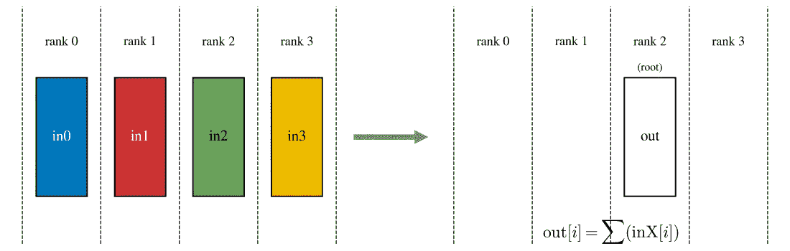

归约的主要用途是收集所有进程的指标和统计信息到0号进程。训练过程中，每个进程在其数据分片上计算本地指标（损失、准确率、梯度范数）。归约会聚合这些指标，使0号进程能够记录全局统计信息、使用聚合值保存检查点，或基于全局状态做出训练决策（早停、学习率调度）。其他常见用途包括：收集所有进程的验证结果、聚合性能分析数据以进行性能分析，以及汇总错误计数或收敛指标以用于分布式监控。

与AllReduce确保所有进程具有同步状态不同，归约保持其他进程的缓冲区不变。这意味着归约结束后，只有根进程拥有聚合结果，其他进程仍然保留各自原始的本地值。如果你需要所有进程都拥有该结果，应改用AllReduce，或在归约之后接一个广播操作。

```python
root = 0
tensor = torch.tensor([rank + 1, rank + 2, rank + 3], device=device)
dist.reduce(tensor, dst=root, op=dist.ReduceOp.SUM)
# Only root has the sum; other ranks unchanged
```

运行演示：

```bash
OMP_NUM_THREADS=1 torchrun --nproc_per_node=2 code/collective-operation/demo_reduce.py
```

归约后接广播等价于AllReduce。然而，NCCL将AllReduce优化为单个操作，使其比显式的两步序列更高效。只有当你确实需要在单个进程上获得聚合结果，且不需要将其分发回其他进程时，才应使用归约。

#### 收集（Gather）

如*图1.17*所示，收集操作将所有进程的数据收集到根进程。每个进程发送N个值，根进程接收按进程索引排序并拼接的 world_size × N 个值。这是一种多对一的通信模式，数据从所有进程流向单个目标。

收集是散布（Scatter）的逆操作，在分布式训练的集中式操作中至关重要。与全收集（AllGather）将收集到的数据分发回所有进程不同，收集只将数据发送到根进程，因此当只有一个进程需要完整数据集时效率更高。它对于I/O操作、日志记录、检查点保存和集中式决策制定尤其有用。

收集的主要用途是将所有进程的结果收集到0号进程进行处理或保存。训练过程中，每个进程在其本地数据分片上计算预测、指标或中间结果。收集操作将这些结果汇总，使0号进程能够聚合它们、保存检查点、记录全局统计信息或执行集中式评估。其他常见用途包括：收集验证预测以进行集成评估，收集特征表示以进行集中分析，从所有进程收集调试信息，以及聚合模型输出以进行最终推理或服务。

*图1.17：收集操作：从所有进程收集数据到根进程*

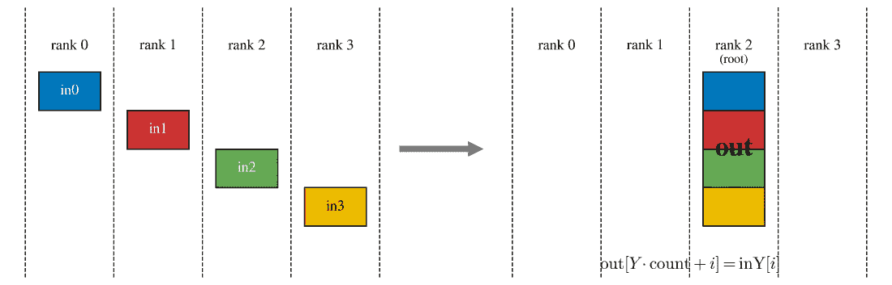

输出顺序是确定性的——0号进程的数据排在前面，接着是1号进程的数据，依此类推。在重建分布式数据结构或当进程顺序对下游处理很重要时，这种顺序至关重要。根进程必须预先分配输出列表，为所有进程的贡献预留空间，而非根进程则传递 `None` 作为输出列表参数。

```python
root = 0
input_tensor = torch.tensor([rank * 10 + 1, rank * 10 + 2], device=device)
if rank == root:
    output_list = [torch.zeros_like(input_tensor) for _ in range(world_size)]
    dist.gather(input_tensor, output_list, dst=root)
    # Root has all data concatenated
else:
    dist.gather(input_tensor, None, dst=root)
```

运行演示：

```bash
OMP_NUM_THREADS=1 torchrun --nproc_per_node=2 code/collective-operation/demo_gather.py
```

收集的通信开销随数据大小和全局进程数（world size）增长。根进程接收 world_size × N 个值，因此带宽需求随进程数量线性增加。对于大型数据集，这可能在0号进程处形成瓶颈，这就是当所有进程都需要收集到的数据时首选AllGather的原因，因为AllGather会将带宽负载分散到所有进程。

#### 散布（Scatter）

*图1.18：散布操作：将数据从根进程分发到所有进程*

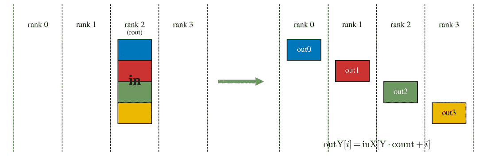

如*图1.18*所示，散布是收集的逆操作。根进程将数据分发给所有进程，每个进程接收到不同的数据块。这是一种一对多的通信模式，其中单个源将不同数据分发给多个目的地。

当数据需要在各进程间分区时，散布对于初始化分布式训练至关重要。与向所有进程发送相同数据的广播不同，散布向每个进程发送不同的数据块，从而实现数据并行，每个进程处理数据的一个唯一子集


数据集。这对于分发无法容纳在单个 rank 上的大型数据集，或者当你想要预先对数据进行分区以实现高效分布式处理时特别有用。

Scatter 的主要用途是分发数据块：将一个 rank 上的不同数据块分发到所有 rank，例如将大型数据集拆分到多个 GPU 上。根 rank 准备一个张量列表，每个 rank 对应一个张量，Scatter 负责分发这些张量，使得 rank 0 收到第一个数据块，rank 1 收到第二个数据块，依此类推。其他常见用途包括：在自定义并行策略中分发模型分片、在数据并行处理中将输入批次拆分到各个 rank、分发因 rank 而异的配置参数，以及使用 rank 特定数据初始化分布式状态。

根 rank 必须准备一个包含 world_size 个张量的 scatter_list，且每个张量形状相同。每个 rank 会收到与其 rank 索引对应的张量。非根 rank 为 scatter_list 参数传入 `None`，因为它们不需要提供输入数据。所有 rank 都必须预先分配具有正确形状的 output_tensor，以接收各自的数据块。

```python
root = 0
if rank == root:
    scatter_list = [torch.tensor([r * 10 + 1, r * 10 + 2], device=device) for r in range(world_size)]
output_tensor = torch.zeros(2, device=device)
if rank == root:
    dist.scatter(output_tensor, scatter_list=scatter_list, src=root)
else:
    dist.scatter(output_tensor, scatter_list=None, src=root)
# Each rank receives its chunk
```

运行演示：

```bash
OMP_NUM_THREADS=1 torchrun --nproc_per_node=2 code/collective-operation/demo_scatter.py
```

Scatter 的通信开销随数据量大小缩放，但从根 rank 的视角来看，它与 world size 无关——无论 rank 数量是多少，根 rank 发送的数据总量相同。然而，在实践中，Scatter 通常不如使用 DistributedSampler 进行数据分区高效，因为 DistributedSampler 无需在分发前将所有数据加载到 rank 0 上。

#### 归约-散播（ReduceScatter）

*图 1.19：ReduceScatter 操作：先归约，再散播*

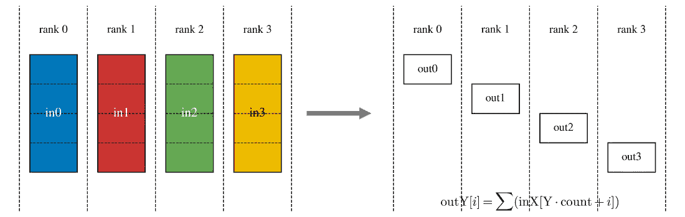

如*图 1.19*所示，ReduceScatter 结合了 Reduce 和 Scatter 两种操作。它先对所有 rank 执行归约，然后将结果按等大小分块散播。每个 rank 根据其 rank 索引收到不同的数据块。这是分片并行策略中的关键操作，能够实现高效的梯度同步和参数更新分发。

ReduceScatter 是全分片数据并行（FSDP）训练的基础。在 FSDP 中，模型参数被分片到各个 rank 上，每个 rank 只持有总参数的一部分。在反向传播过程中，每个 rank 为其本地参数分片计算梯度。然而，由于参数是分片的，所有 rank 的梯度必须先被归约，再重新分发，这样每个 rank 才能用对应的梯度分片更新自己的参数分片。ReduceScatter 能够在单一步骤中高效完成此操作，避免了分别执行 Reduce 和 Scatter 所带来的额外开销。

ReduceScatter 的输入在每个 rank 上被组织为一个张量列表，其中每个张量对应一个分片，该分片将与其他 rank 的相应分片进行归约。归约之后，每个 rank 收到与之 rank 索引对应的归约结果分块。这种模式确保 rank 0 获得归约结果的第一个分块，rank 1 获得第二个分块，依此类推，从而保持分片与参数分布的对齐。

在 FSDP 及其他需要每个 rank 都获得归约结果分片的分片并行策略中使用 ReduceScatter。具体包括 FSDP 中的梯度同步（归约梯度并分发分片）、优化后的参数更新分发、大模型训练中跨微批次的梯度累积，以及需要按分片进行归约的自定义分片策略。

```python
# Each rank has input of size world_size * N
input_list = [torch.tensor([rank * 10 + i, rank * 10 + i + 1], device=device) for i in range(world_size)]
input_tensor = torch.cat(input_list)
# Each rank receives a chunk of the reduced result
output_tensor = torch.zeros(2, device=device)
dist.reduce_scatter(output_tensor, input_list, op=dist.ReduceOp.SUM)
```

运行演示：

```bash
OMP_NUM_THREADS=1 torchrun --nproc_per_node=2 code/collective-operation/demo_reducescatter.py
```

ReduceScatter 的通信开销与 AllReduce 类似，但输出是分发的而非复制的。每个 rank 发送 world_size × N 个值（用于归约）并接收 N 个值（即其分片），因此在只需要分片的情况下，它比 AllReduce 具有更高的内存使用效率。ReduceScatter 之后接 AllGather 与 AllReduce 等价，一些系统利用这种分解来优化性能，尤其是在 FSDP 中，可以将这些操作与计算重叠执行。

#### 全到全（AlltoAll）

*图 1.20：AlltoAll 操作：全到全通信*

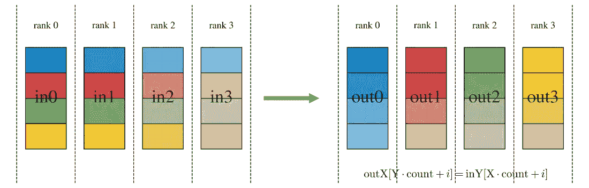

如*图 1.20*所示，AlltoAll 是最通用的操作。每个 rank 向其他所有 rank 发送不同的数据。每个 rank 提供 world_size 个数据块，并收到 world_size 个数据块——分别来自其他每个 rank。这就形成了一个完整的全到全通信模式，其中每个 rank 同时与其他所有 rank 交换数据。

AlltoAll 是最复杂、最通用的集合通信操作，能够实现其他集合通信无法表达的复杂通信模式。与 AllGather（将所有 rank 的数据拼接起来）不同，AlltoAll 允许每个 rank 向每个目标 rank 发送不同的数据，从而形成一种个性化的通信模式。这种灵活性使得 AlltoAll 成为张量并行的关键操作，因为张量并行的不同部分需要按照特定模式在各个 rank 之间进行交换。

AlltoAll 的主要用途是张量并行，其中模型层被拆分到各个 rank 上，不同的张量切片需要在各 rank 间进行交换。例如，在列并行线性层中，每个 rank 持有权重矩阵的不同列切片。在前向传播期间，输入激活值必须分发到各个 rank（每个 rank 一份切片）；而在反向传播期间，输出梯度必须被收集并重新分发。AlltoAll 能够高效处理这些复杂的交换模式。其他常见用途包括：Transformer 模型中的序列并行（交换序列分块）、混合专家模型（Mixture-of-Experts）中的专家并行（将 token 路由到不同专家），以及需要任意数据交换的自定义并行策略。

每个 rank 准备一个包含 world_size 个数据块的 input_list，其中 chunk[i] 会被发送给 rank i。AlltoAll 执行完成后，每个 rank 收到一个 output_list，其中 output_list[i] 包含从 rank i 接收到的数据。这会在所有 rank 之间形成完整的数据置换，从而实现简单集合通信无法达成的复杂通信拓扑。

```python
# Each rank prepares data to send to each other rank
input_list = []
for dst_rank in range(world_size):
    chunk = torch.tensor([rank * 100 + dst_rank * 10 + 1,
                          rank * 100 + dst_rank * 10 + 2], device=device)
    input_list.append(chunk)
# Each rank receives data from all ranks
output_list = [torch.zeros(2, device=device) for _ in range(world_size)]
dist.all_to_all(output_list, input_list)
```

运行演示：

```bash
OMP_NUM_THREADS=1 torchrun --nproc_per_node=2 code/collective-operation/demo_alltoall.py
```

AlltoAll 在所有集合通信中开销最高，因为它要求每个 rank 都向其他每个 rank 发送数据。总数据移动量为 world_size² × chunk_size，因此开销随 world size 呈二次方增长。这使得 AlltoAll 在较大 world size 下代价高昂，因此它只在张量并行和其他先进并行策略中有选择地使用，这些场景中通信模式无法用更简单的集合通信来表达。


#### 选择合适的操作

那么，什么时候该用哪种操作呢？对于梯度同步，AllReduce（参见*图 1.13*）是标准选择。当你包装模型时，DDP 会自动使用它——不需要你自己调用。如果你需要从所有 rank 收集 embedding 或指标，AllGather（参见*图 1.14*）正是你所需要的。它向每个 rank 提供一份来自所有其他 rank 的数据副本。

当你有一个 rank 上的数据需要发送给其他所有 rank 时，Broadcast（参见*图 1.15*）是最简单的选择。可以把它看作一对多的通信。其逆向操作是 Gather（参见*图 1.17*）——当所有 rank 都有数据，而你需要将这些数据收集到一个 rank（通常是 rank 0）上进行日志记录或保存时使用。Scatter（参见*图 1.18*）则相反，它从一个 rank 向其他所有 rank 分发不同的数据块。

对于像 FSDP 这样的分片并行策略，你会看到 ReduceScatter（参见*图 1.19*）和 AlltoAll（参见*图 1.20*）。ReduceScatter 将归约和散射结合起来，当每个 rank 只需要结果的一个分片时，这种方式非常高效。AlltoAll 是最一般的情况，即每个 rank 都向其他每个 rank 发送不同的数据。这体现在张量并行中。

大多数时候，你不会直接调用这些操作。DDP 会在梯度同步期间为你处理 AllReduce（参见*图 1.13*）。FSDP 在底层使用 ReduceScatter（参见*图 1.19*）和 AllGather（参见*图 1.14*）。但理解每个操作的作用，在你调试通信缓慢的原因，或需要实现标准 API 未覆盖的自定义并行策略时，会很有帮助。

### DistributedDataParallel（DDP）

在各种分布式训练策略中，DDP 是最容易理解和使用的一种。它只需要对单 GPU 训练代码做极少的改动，也是分布式训练最常见的起点。本节提供 DDP 的简要概述。*第 3 章*将深入介绍 DDP 的具体实现、优化技巧和最佳实践。

#### AlltoAll 需要 NCCL

AlltoAll 需要 NCCL 后端。GLOO（CPU 后端）不支持它。如果你在使用 `--use_cpu` 时看到错误，请切换到 GPU 模式。之所以存在这一限制，是因为 AlltoAll 复杂的通信模式能从 NCCL 这类针对 GPU 优化的通信库中显著受益。

DDP 包装模型以实现数据并行分布式训练。当你用 DDP 包装模型时，PyTorch 会自动在所有进程间同步梯度。每个进程在本地数据上计算梯度，然后 DDP 在更新模型之前对这些梯度求平均。

DDP 假设每个进程都有完整的模型副本。只有数据被划分——每个进程在不同子集上训练，但每个训练步骤之后所有进程都保持相同的模型参数。当你的模型能放入单个 GPU 时，DDP 效果很好。对于更大的模型，FSDP（全分片数据并行）会将模型分片到多个 GPU 上，同时仍使用数据并行。后续章节将介绍 FSDP 以及其他并行策略，如张量并行和流水线并行。

用 DDP 包装模型：

```python
from torch.nn.parallel import DistributedDataParallel as DDP
model = YourModel().cuda(rank)
model = DDP(model, device_ids=[rank])
```

包装之后，像在单 GPU 训练中那样使用该模型即可。DDP 会在 `loss.backward()` 期间处理同步。

#### DistributedSampler

每个进程应在不同的数据上训练，因此你需要一个 DistributedSampler。它会对数据集进行切分，使每个进程获得独有的子集。如果没有它，所有进程都会看到相同的数据，这就违背了分布式训练的目的。

```python
from torch.utils.data import DataLoader, DistributedSampler
sampler = DistributedSampler(
    dataset,
    num_replicas=world_size,  # Total number of processes
    rank=rank  # This process's rank
)
dataloader = DataLoader(dataset, batch_size=32, sampler=sampler)
```

在每个 epoch 开始时调用 `sampler.set_epoch(epoch)`，以确保跨 epoch 的数据打乱能正确工作。

#### 启动分布式任务

现代方法是使用 `torchrun`，它会自动处理进程的生成：

```bash
torchrun --nproc_per_node=2 code/multi_gpu_ddp.py
```

这会在当前机器上启动 2 个进程。对于多节点训练，还需要指定 `--nnodes`、`--node_rank` 和 `--master_addr`。

该命令使用了几种我们已经介绍过的分布式原语：`init_process_group()` 用于建立通信，`barrier()` 用于同步数据集下载，`DistributedSampler` 用于划分数据，`DDP` 则会在 `loss.backward()` 期间在内部使用 `allreduce()` 同步梯度。

本章逐一讲解了分布式 AI 系统的资源估算、决策框架和实践示例。核心思想很简单：先估算自己的需求，再判断是否真的需要分布式系统。不要想当然地认为自己需要它们——先计算内存和算力需求，检查模型是否装得下，然后再考虑分布式。

既然我们已经理解了何时以及为何使用分布式系统，接下来就需要了解运行它们的硬件。下一章将探讨 GPU 硬件、网络拓扑，以及使分布式 AI 成为可能的基础并行策略。理解这些基础知识，对于就使用哪种分布式方法做出明智决策至关重要。

### 代码摘要

- `torch.distributed`：PyTorch 中用于分布式计算的核心模块（训练和推理）
- `dist.init_process_group()`：使用后端（NCCL、Gloo）初始化用于分布式通信的进程组
- `dist.all_reduce()`：对所有 rank 上的张量执行归约（求和、最大值、最小值等），并将结果存储在所有 rank 上
- `dist.all_gather()`：集合操作，从所有 rank 收集张量并在所有 rank 上拼接起来
- `dist.broadcast()`：将张量从源 rank 广播到所有其他 rank
- `dist.reduce()`：将来自所有 rank 的张量归约到单个目标 rank（通常是 rank 0）
- `dist.gather()`：将来自所有 rank 的张量收集到单个目标 rank
- `dist.scatter()`：将来自源 rank 的张量列表分发到所有其他 rank
- `dist.reduce_scatter()`：对所有 rank 上的张量进行归约，并将结果分发到所有 rank
- `dist.all_to_all()`：从每个 rank 向其他每个 rank 发送不同的数据块

#### 参考资料

波浪号（~）表示近似的参数量。许多大模型是闭源的，因此确切的参数量并未公开。这些近似值基于对模型架构、训练成本和行业估算的推断。

Wu，《大模型参数的谎言》，*夏洛特之夏*（日记），2026年6月7日。`https://wu-99.com/diary/20260607.html#the-llm-parameter-lie`。讨论了 MoE 总参数与激活参数的对比、基于回归的探针的不可靠性、对前沿闭源模型的行业估算（GPT-4 总参数约 1.76T，Claude Opus 4.x 约 5T MoE，GPT-5/Gemini 3.1 处于约 2T–5T 区间），以及首个被公开讨论的约 10T 级模型 Claude Mythos 5（每个 token 激活约 800B–1.2T 参数）。

SemiAnalysis，《GPT-4 架构、基础设施、训练数据集、成本、视觉、MoE》，2023；Epoch AI，《机器学习三个时代的计算趋势》，2023

Epoch AI，《GPU 性价比趋势》，2024；SemiAnalysis，《训练大型语言模型的成本》，2023；OpenAI，《GPT-4 技术报告》，2023

vLLM 中的 Llama 4 - `https://blog.vllm.ai/2025/04/05/llama4.html`

训练估算假设使用 Adam 优化器和适中的批大小。实际值会因架构、序列长度和批大小的不同而变化。

AllReduce 是分布式训练中最常见的集合通信操作。

### 练习

#### 进程组初始化

实现一个函数，以正确的错误处理初始化分布式进程组。

**要求：**

- 函数签名：`setup_distributed(rank, world_size, backend='nccl')`
- 使用 `torch.distributed.init_process_group()` 初始化进程组
- 为当前 rank 设置 CUDA 设备：`torch.cuda.set_device(rank)`
- 为 CUDA 不可用的情况添加错误处理


- 如果成功则返回 `True`，否则返回 `False`
- 打印一条消息，指示使用 rank 和 world_size 初始化成功

**测试你的函数：**

```python
import torch.distributed as dist
import os

# Simulate rank and world_size from environment
rank = int(os.environ.get('RANK', 0))
world_size = int(os.environ.get('WORLD_SIZE', 1))

if setup_distributed(rank, world_size):
    print(f"Rank {rank}/{world_size} initialized successfully")
    dist.destroy_process_group()
```

#### 手动实现 AllReduce

使用 AllReduce 实现一个手动梯度平均函数，模拟 DDP 内部的工作方式。

**要求：**

- 函数签名：`average_gradients(model, world_size)`
- 遍历模型中的所有参数
- 对于每个 `requires_grad=True` 的参数：
  - 使用 `dist.all_reduce()` 并设置 `op=dist.ReduceOp.SUM` 来对所有 rank 的梯度求和
  - 将梯度除以 `world_size` 得到平均值
  - 处理梯度可能为 `None` 的情况（跳过这些参数）

**测试你的函数：**

```python
import torch
import torch.nn as nn
import torch.distributed as dist

# Create a simple model
model = nn.Linear(10, 1).cuda()
loss_fn = nn.MSELoss()

# Forward and backward pass
x = torch.randn(32, 10).cuda()
y = torch.randn(32, 1).cuda()
output = model(x)
loss = loss_fn(output, y)
loss.backward()

# Average gradients across ranks
average_gradients(model, world_size=2)

# Verify gradients are averaged (should be same on all ranks after all_reduce)
print(f"Gradient on rank {rank}: {model.weight.grad}")
```

#### 带验证的 Broadcast

实现一个函数，将张量从 rank 0 广播到所有其他 rank，并验证结果。

**要求：**

- 函数签名：`broadcast_and_verify(tensor, root=0)`
- 如果当前 rank 是 root：创建或使用提供的张量
- 如果当前 rank 不是 root：创建一个相同形状的零张量
- 使用 `dist.broadcast()` 将数据从 root 发送到所有 rank
- 广播后，验证所有 rank 的数据是否相同
- 返回广播后的张量以及一个布尔值，指示验证是否通过

**测试你的函数：**

```python
import torch
import torch.distributed as dist

rank = dist.get_rank()
world_size = dist.get_world_size()

if rank == 0:
    # Root rank creates data
    data = torch.tensor([1.0, 2.0, 3.0, 4.0, 5.0], device='cuda')
else:
    data = None

result, verified = broadcast_and_verify(data, root=0)
print(f"Rank {rank}: {result}, Verified: {verified}")
```

#### DistributedSampler 包装器

为 `DistributedSampler` 创建一个包装器类，自动处理 epoch 设置。

**要求：**

- 类名：`AutoEpochDistributedSampler`
- 继承自 `torch.utils.data.distributed.DistributedSampler`
- 重写 `__iter__()`，在内部 epoch 计数器上自动调用 `set_epoch()`
- 添加 `reset()` 方法以重置 epoch 计数器
- 添加 `get_epoch()` 方法以返回当前 epoch 编号
- 每次调用 `__iter__()` 时，采样器应递增 epoch 计数器

**测试你的函数：**

```python
from torch.utils.data import Dataset, DataLoader
import torch.distributed as dist

# Dummy dataset
class DummyDataset(Dataset):
    def __init__(self, size=100):
        self.data = list(range(size))

    def __len__(self):
        return len(self.data)

    def __getitem__(self, idx):
        return self.data[idx]

dataset = DummyDataset(100)

sampler = AutoEpochDistributedSampler(
    dataset,
    num_replicas=world_size,
    rank=rank
)

dataloader = DataLoader(dataset, batch_size=10, sampler=sampler)

# Iterate through epochs - epoch should auto-increment
for epoch in range(3):
    for batch in dataloader:
        pass
    # Process batch
    print(f"Epoch {sampler.get_epoch()} completed")
```

#### 梯度同步计时

编写一个脚本，测量使用 AllReduce 进行梯度同步所花费的时间。

**要求：**

- 函数签名：`measure_sync_time(model, num_iterations=10)`
- 创建一个大小可配置（参数数量）的模型
- 运行前向和反向传播
- 对所有梯度执行 `dist.all_reduce()` 操作并计时
- 返回平均同步时间（毫秒）
- 使用不同的模型大小（1M、10M、100M 参数）和不同的 world size 进行测试
- 打印结果，展示同步时间如何随模型大小和 world size 变化

**测试你的函数：**

```python
import torch
import torch.nn as nn
import time
import torch.distributed as dist

def create_model(num_params):
    """Create a simple model with approximately num_params parameters"""
    # Simple linear layers to approximate parameter count
    layers = []
    # Rough calculation: for Linear(in, out), params = in * out + out
    # This is simplified - adjust as needed
    return nn.Sequential(
        nn.Linear(1000, num_params // 2000),
        nn.ReLU(),
        nn.Linear(num_params // 2000, 10)
    ).cuda()

model_sizes = [1e6, 10e6, 100e6]  # 1M, 10M, 100M parameters

for size in model_sizes:
    model = create_model(int(size))
    sync_time = measure_sync_time(model, num_iterations=10)
    print(f"Model size: {size/1e6:.1f}M params, "
          f"Avg sync time: {sync_time:.2f} ms, "
          f"World size: {dist.get_world_size()}")
```

#### 预期学习成果

完成这些练习后，你应该能够：

- 计算不同模型大小和精度下的内存需求
- 正确初始化分布式进程组
- 理解 DDP 中梯度同步的工作原理
- 有效使用集合通信操作（AllReduce、Broadcast）
- 使用 DistributedSampler 进行数据划分
- 测量并分析分布式训练中的通信开销

#### 获取本书的 PDF 版本及更多内容

扫描二维码（或访问 `packtpub.com/unlock`）。按名称搜索本书，确认版本，然后按照页面上的步骤操作。

*注意：请保管好您的发票。直接从 Packt 购买的商品不需要发票。*


## 2 GPU 硬件、网络与并行策略

*理解分布式 AI 的硬件拓扑和并行策略*

*创新不仅关乎芯片，更关乎整个技术栈。*

*黄仁勋*

### 计算能力：AI 集群与指标

在*第 1 章*中，我们确立了分布式 AI 为何至关重要——模型规模已超出单 GPU 的容量，模型需求与硬件能力之间的计算差距还在不断扩大。现在我们需要了解支撑分布式训练成为可能的硬件基础。在深入 GPU 细节之前，让我们退一步，理解我们真正构建的是什么：提供巨大计算能力的 AI 集群。

数字在这里很重要——当你训练一个 70B 参数的模型时，你不只是使用几个 GPU。你是在协调成百上千个 GPU，而它们的连接方式决定了你的训练任务是几天还是几周完成。

#### 什么是计算能力？

计算能力（或算力）衡量的是一个系统每秒能执行多少次运算。对于 AI 工作负载，我们关心的是**每秒浮点运算次数（FLOPS）**。这个规模是指数级的：像 H200 这样的单个现代 GPU 在执行 FP16 运算时能达到约 1,000 TFLOPS（teraFLOPS，即每秒 10^12 次运算）。一个由 1000 个这样的 GPU 组成的集群可提供大约 1,000 PFLOPS（petaFLOPS，即每秒 10^15 次运算），或 1


## 第2章：GPU硬件、网络与并行策略

EFLOPS（exaFLOPS，每秒10^(18)次运算）：1000块GPU × 1000 TFLOPS = 10⁶ TFLOPS = 1000 PFLOPS = 1 EFLOPS。

但关键在于：原始FLOPS数字并不能说明全部问题。峰值吞吐量取决于精度——FP64用于传统HPC，FP32作为训练基线，FP16/BF16用于现代AI训练，FP8及更低精度用于推理和量化（参见*第1章*中的精度格式表）。当有人说“这个集群提供500 PFLOPS”时，要问清楚是什么精度：HPC集群可能报的是FP64，而AI集群报的是FP16或BF16。同一硬件在不同的测量格式下会表现出截然不同的数字。

对AI计算需求的增长一直惊人。大型语言模型所需的计算资源在几年内会按数量级增长，具体取决于工作负载和模型扩展；而同期硬件能力仅增长约3倍。这种差距正是分布式训练并非可选项的原因——它是**唯一途径**，能在合理时间内训练现代模型。

如*图2.1*所示，模型内存需求呈指数级增长，而单GPU内存容量增长则更为平缓。这一不断扩大的差距使得分布式训练不仅有益，而且对于在合理时间范围内训练现代大规模模型至关重要[1]。

*图2.1：GPU内存容量与模型内存需求对比*

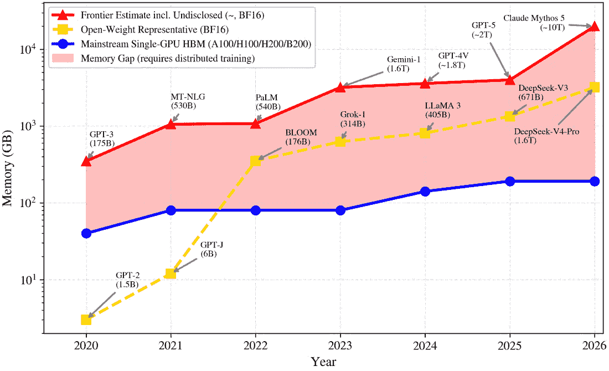

### 为什么需要集群？

单个GPU，即使是高端型号，也不足以应对现代AI工作负载。一个70B参数、FP16权重的模型，仅存储模型就需要约140 GB。再加上梯度、优化器状态和激活值，每个训练步骤就需要超过500 GB。这超出了任何单个GPU的承载能力。

**集群**是由高速网络连接的计算机（节点）组，作为一个整体协同工作。每个节点通常拥有多块GPU、CPU、内存和存储。关键思路是，通过在多个节点之间协调工作，你可以：

- **扩展内存**：将模型参数、梯度、优化器状态分布到各GPU上
- **扩展算力**：通过并行化工作来处理更大批次或加快训练
- **扩展存储**：处理无法放在单台机器上的数据集

*图2.2：AI集群*

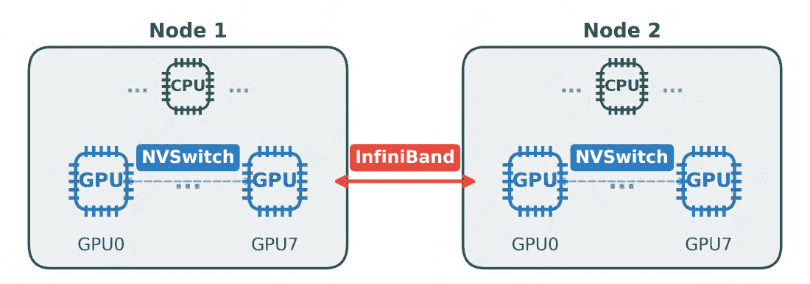

如*图2.2*所示，AI集群由多个节点组成，每个节点包含多块CPU和GPU（现代系统通常每节点8块GPU）。节点内，GPU通过NVSwitch连接，以NVLink速度提供全互联（Ampere–Hopper系统上每GPU 300–900 GB/s，Blackwell B200上最高1.8 TB/s；所有数字均为每GPU双向聚合）。节点间，GPU通过InfiniBand（每条链路200–400 Gb/s）等高速网络通信，从而在整个集群上实现分布式训练和推理。这种架构可以在所有可用资源之间协调工作。

图中所示的集群展示了如何通过将模型参数、梯度、优化器状态分布到各GPU来扩展内存，同时通过跨节点并行化工作负载来扩展算力。每个节点作为独立服务器运行，拥有自己的CPU、内存和存储，但高速网络连接（节点内NVSwitch、节点间InfiniBand）使它们能够作为一个统一系统，共同处理大规模AI工作负载。

集群并不新鲜——在高性能计算（HPC）领域已使用数十年。AI的不同之处在于通信模式。HPC工作负载通常进行大规模、低频次的数据交换。AI训练则进行频繁、较小规模的数据交换（每一步都进行梯度同步），这使得网络带宽和延迟至关重要。我们将在*第8章*讨论如何在SLURM管理的集群上运行分布式训练任务。

### AI集群：为训练和推理而生

**AI集群**是专门为AI工作负载设计的集群。与处理多样化工作负载的通用云数据中心不同，AI集群针对深度学习的独特特征进行了优化：

**对于训练**，AI集群需要：

- **高带宽互连**：梯度同步在每一步训练时发生。如果通信缓慢，GPU就会空转等待梯度。节点内NVLink（Ampere–Hopper上每GPU 300-900 GB/s，Blackwell B200上最高1.8 TB/s）和节点间InfiniBand（每条链路200-400 Gb/s）是标配。
- **大聚合内存**：模型参数、梯度和优化器状态在GPU之间分片。即使采用FSDP等技术（参见*第4章*），一个70B模型可能也需要8-16块GPU才能装进内存。
- **快速存储**：训练数据集很大（ImageNet为150 GB，文本数据集可达数TB）。你需要快速的并行文件系统或节点间对象存储，外加每个节点上的快速本地NVMe（见下文CPU配对）。

**对于推理**，需求则有所不同（参见*第6章*和*第9章*）：

- **更低延迟的网络**：训练关注带宽，推理关注延迟。用户期望毫秒级响应，而不是秒级。
- **高效的内存使用**：注意力机制的KV缓存可能占用大量内存。你需要在缓存大小（用于更长上下文）与内存限制之间取得平衡。
- **负载均衡**：推理工作负载具有突发性。你需要高效地将请求路由到各GPU，并应对流量高峰。

硬件拓扑——GPU在节点内如何连接、节点之间如何互联——直接影响哪些并行策略可行。所有GPU通过NVSwitch（全互联）连接的集群可以有效地使用张量并行。而GPU仅通过PCIe连接的集群，在通信密集型策略上会举步维艰。

### AI集群的关键指标

在评估或优化AI集群时，你需要具体的指标。原始FLOPS数字只是营销——真正重要的是你多高效地利用硬件。以下是真正重要的指标：

**模型FLOPS利用率（MFU）**是衡量训练效率最重要的指标。它衡量你实际使用峰值硬件FLOPS的百分比：

`MFU = (Model FLOPs per iteration / Iteration time) / Peak FLOPS`

MFU告诉你当前是受计算约束，还是受其他因素限制。一个优化良好的集群在大模型上可能达到40-60%的MFU。如果MFU偏低（比如20%），你很可能遇到了内存带宽限制、通信瓶颈或内核启动效率低下的问题。

例如，在H100 GPU上训练一个70B参数Transformer模型，你可能会看到：

- **每轮迭代的理论FLOPs**：约860 TFLOP（取决于批次大小、序列长度）
- **迭代时间**：约2.0秒
- **每秒实际FLOPS**：约860 TFLOP / 2.0秒 ≈ 430 TFLOPS
- **H100峰值FLOPS**：约989 TFLOPS（BF16）
- **MFU**：430/989 ≈ 43%

这使你处于许多团队在大模型上追求的40-60%区间。如果MFU低得多（比如20%），你很可能遇到了内存带宽限制、通信开销，或批次大小不足以让GPU保持忙碌。

你也可以在自己的训练任务上做同样的检查。首先计算每一步接触多少token——在单块GPU上，通常是微批次大小乘以序列长度；如果要看整个集群，再乘以数据并行宽度。对于稠密Transformer，一个可用的FLOP估计值大约是每个token的参数数量的六倍（前向和反向合计）[2]。你的训练日志会给出步长时间；用这些FLOPs除以墙钟秒数，再除以你训练精度下数据手册上的峰值矩阵乘法速率——在H100上就是BF16或FP16，而不是营销幻灯片上的FP8数字。上面的70B示例只是将这些部分代入一行公式而已。

**线性扩展**衡量性能随集群规模扩展的效果。公式为：

`Linear scaling = (Multi-GPU throughput) / (Single-GPU throughput × GPU count)`


完美扩展对应 1.0（100%）。在实践中，优化良好的集群通常能看到 0.7-0.9。如果扩展率低于 0.5，说明存在通信瓶颈。

**GPU 利用率**更简单——它表示 GPU 用于计算与等待的时间百分比。

你可以用以下命令查看：

`nvidia-smi --query-gpu=utilization.gpu --format=csv,noheader`

高利用率（90%+）是好的，但它不能告诉你是否使用了正确的内核，或者通信是否阻塞了计算。MFU 的信息量更大。

**通信效率**衡量你对网络带宽的利用情况：

`Communication efficiency = Actual bandwidth / Theoretical bandwidth`

对于 InfiniBand HDR（200 Gb/s），你也许能达到 180 Gb/s 的实际带宽，即 90% 的效率。如果效率较低，可能存在拓扑问题、数据包丢失或通信模式欠佳。

**吞吐量**（每秒样本数或每秒 token 数）是你关心的训练速度指标。有两种衡量方式：

- **集群吞吐量**（所有 GPU 上每秒处理的 token 总数）：`Throughput_cluster = (Global batch size × Sequence length) / Total training time`
- **单 GPU 吞吐量**（每个 GPU 每秒处理的 token 数）：`Throughput_per_GPU = (Global batch size × Sequence length) / (Total training time × GPU count)`

吞吐量越高越好，但你需要与收敛性进行权衡——更大的批次可能每次迭代训练更快，但需要更多迭代才能收敛。

**资源利用率**分解了时间的去向：

- **GPU 计算时间**：实际的矩阵乘法
- **内存传输时间**：在 CPU 与 GPU 之间或 GPU 之间移动数据
- **通信时间**：梯度同步、AllReduce 操作
- **空闲时间**：等待数据、同步或其他瓶颈

优化良好的集群会将 70-80% 的时间用于计算，10-20% 用于通信，空闲时间极少。

**能效**对大型集群很重要。**每瓦 FLOPS** 用于衡量计算效率：

`FLOPS/Watt = Total FLOPS / Total power consumption`

H100 在 FP16 下大约能提供 1.4 TFLOPS/瓦。越高越好——这意味着相同的电费能获得更多计算量。

**PUE（电源使用效率）**衡量数据中心效率：

`PUE = Total facility power / IT equipment power`

PUE 为 1.0 表示所有电力都用于 IT 设备（在实践中不可能）。真实数据中心通常能达到 1.2-1.5。越低越好——意味着浪费在冷却和开销上的电力更少。

**可靠性指标**在运行长达数周的训练任务时很重要：

- **MTBF（平均故障间隔时间）**：系统故障之间的平均时间。对于 10,000 个 GPU 的集群，你可能每隔几小时就会遇到一次故障。
- **可用性**：系统正常运行的时间百分比。生产集群的目标是 99% 以上。
- **MTTR（平均恢复时间）**：从故障中恢复的平均时间。良好的集群在几分钟内即可恢复，而不是几小时。

**通信延迟**对分布式训练至关重要。AllReduce 延迟应满足：

- **节点内（NVLink）**：对于典型梯度大小应小于 1 ms
- **节点间（InfiniBand）**：节点间通信应小于 5 ms
- **P99 延迟**：第 99 百分位延迟比平均值更重要——一个慢节点可能导致整个训练任务停滞。

在基准测试集群时，你需要在不同规模下测量这些指标：8 个 GPU、64 个 GPU、512 个 GPU、2048 个 GPU。随规模增大而变差的指标（如线性扩展或通信效率）会告诉你瓶颈在哪里。

在打好这个基础之后，让我们来研究使集群正常运行的硬件组件。我们将从 CPU 开始，它编排整个系统；然后转向真正执行计算的 GPU；接着介绍替代加速器、互连技术；最后讨论如何根据集群拓扑选择并行策略。

### 中央处理器（CPU）

虽然 GPU 在分布式训练中承担主要计算任务，但 CPU 扮演着至关重要的支持角色。理解 CPU 架构有助于优化数据加载、管理 GPU 协调以及调试性能瓶颈。

#### CPU 架构基础

CPU 围绕**冯·诺依曼架构**构建：一个包含算术逻辑单元（ALU）、控制单元（CU）和存储单元（寄存器）的中央处理器。与面向吞吐量优化的 GPU 不同，CPU 为延迟而优化——支持复杂控制逻辑的快速单线程执行。

关键区别在于：CPU 将大部分芯片面积用于控制逻辑和缓存，而不是计算单元。现代 CPU 可能有 8-64 个核心，每个核心都具备复杂的乱序执行、分支预测和多级缓存。GPU 则拥有数千个为并行负载优化的简单核心。

在分布式训练中，CPU 负责：

- **数据加载与预处理**：从磁盘读取数据、解码图像、对文本进行分词（tokenize）
- **编排**：启动 GPU 内核、管理进程组、处理通信
- **系统管理**：内存分配、进程调度、网络协议栈

如果 CPU 成为瓶颈，GPU 就会闲置等待数据。这就是数据加载流水线如此重要的原因——你需要足够的 CPU 核心和快速存储，才能让 GPU 持续获得数据。

#### CPU-GPU 交互

*图 2.3：CPU-GPU 交互*

当你运行分布式训练时，会发生以下过程：

- **CPU 启动 GPU 内核**：你的 Python 代码（在 CPU 上运行）调用 PyTorch，生成 CUDA 内核。CPU 通过 PCIe 将这些内核发送到 GPU。
- **CPU 管理内存**：CPU 分配 GPU 内存，将数据从 CPU 内存传输到 GPU 内存，并协调多 GPU 通信。
- **CPU 处理通信**：对于多节点训练，CPU 进程负责网络通信（InfiniBand、以太网），并与 NCCL 协调 GPU 集合通信。

如*图 2.3*所示，CPU 与 GPU 之间的 PCIe 连接常常是瓶颈。PCIe Gen 4 x16 每个方向约 31.5 GB/s（双向约 63 GB/s），而 GPU 之间的 NVLink 在 Ampere–Hopper 架构上每个 GPU 可达 300-900 GB/s（Blackwell B200 上双向聚合最高 1.8 TB/s）。这就是为什么你会希望 GPU 之间直接通过 NVLink 通信，而不是经过 CPU。

#### NUMA 与 CPU 亲和性

现代服务器有多个 CPU 插槽（NUMA 节点）。每个插槽拥有自己的内存控制器和 PCIe 通道。连接到不同插槽的 GPU 具有不同的内存访问模式。

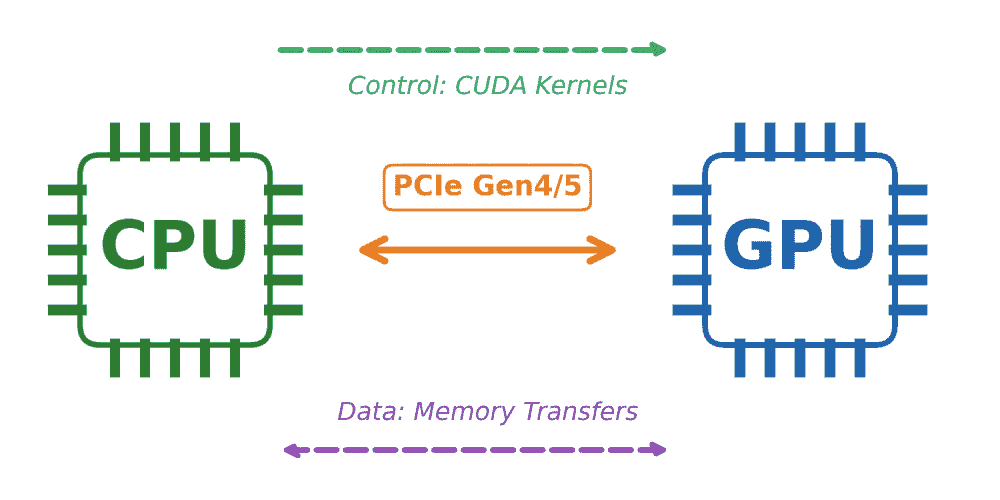

你可以通过以下命令检查 NUMA 拓扑：

`numactl --hardware`

对于分布式训练，尽量让进程与其 GPU 位于同一 NUMA 节点上。这可以降低内存访问延迟。PyTorch 不会自动完成这一点——你可能需要在启动任务时手动设置 CPU 亲和性，或使用 `numactl`。

#### 分布式训练的 CPU 需求

对于典型的 8-GPU 服务器：

- **CPU 核心**：每个 GPU 至少需要 2-4 个 CPU 核心用于数据加载和编排。8-GPU 系统至少应有 16-32 个 CPU 核心。
- **内存**：CPU 内存应为 GPU 内存的 1.5-2 倍，用于数据暂存。对于 8×80GB 的 GPU，你至少需要 1 TB 的 CPU 内存。
- **PCIe 通道**：每个 GPU 需要 PCIe x16。8-GPU 系统需要 128 条 PCIe 通道，这通常意味着双路 CPU（AMD EPYC 或 Intel Xeon）。
- **NVMe 存储**：对于 8-GPU 训练节点，目标是从本地 NVMe（例如 2 到 4 块 PCIe Gen4/Gen5 硬盘，通常为 RAID-0）获得 **约 10–20 GB/s 的聚合顺序读取**，以免数据加载器和检查点 I/O 拖慢 GPU。TB 级数据集通常存放在集群并行文件系统上；但本地 NVMe 对每节点缓存和临时空间仍然很重要。

CPU 不需要是最新一代——它并不负责计算。但它需要足够的核心和 PCIe 带宽来让 GPU 保持忙碌。现在，让我们转向承担主要计算工作的组件：GPU。

### 图形处理器（GPU）

在构建分布式训练系统时，GPU 架构很重要。自 2010 年以来，NVIDIA 一直在迭代 GPU 设计，每一代都会带来影响你设计训练流水线的变化。以下是你需要了解的、可能遇到的 GPU 相关信息。

#### 理解 GPU 内存与计算架构

GPU 是为吞吐量而生，而非延迟。与优化快速单线程执行的 CPU 不同，GPU 集成了数千个简单核心，并优先考虑高带宽内存访问。在训练大型模型时，这种设计会带来回报——但这也意味着你需要以不同的方式思考内存和计算。


## GPU 硬件、网络与并行策略

内存层次结构很重要。寄存器最快但容量极小。共享内存（L1 缓存）速度快但容量有限。L2 缓存位于共享内存和设备 DRAM 之间，而设备 DRAM 是 GPU 的主内存。当你看到“内存不足”错误时，通常是设备 DRAM 已满，而非缓存已满。

*图 2.4：GPU 内存层次结构架构*

如*图 2.4*所示，GPU 内存层次结构由多个层级组成，每个层级具有不同的特性：寄存器提供最高的带宽和最低的延迟，但容量极小；L1/共享内存提供快速访问，但每个流式多处理器（SM）的容量有限；L2 缓存提供更大的共享缓存，带宽中等；而显存（HBM/GDDR）提供最大的容量，但相对于更小的内存层级，延迟更高、带宽更低。这一层次结构反映了内存设计中的基本权衡：更高的带宽和更低的延迟以容量减小为代价，而更大的容量则需要接受更高的延迟和更低的带宽。

有一点常常让人困惑：内存带宽往往比计算更早成为瓶颈。如果你的内核受内存限制，增加计算能力也无济于事。你可以通过性能分析来发现这一点——如果 GPU 利用率很低但内存带宽已用尽，那么你就受到了内存限制。

要了解你的硬件配置，可以查看 GPU 规格：

```
nvidia-smi \
    --query-gpu=name,memory.total,pcie.link.gen.max,pcie.link.width.max \
    --format=csv
```

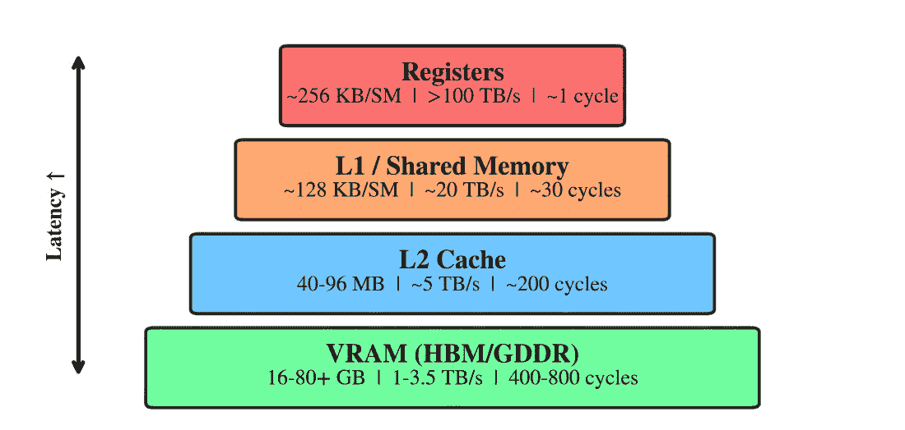

下面是在不同系统上可能看到的结果。一个配备 8 个 GPU 的 H200 系统：

```
$ nvidia-smi --query-gpu=name,memory.total,pcie.link.gen.max,pcie.link.width.max \
    --format=csv
name, memory.total [MiB], pcie.link.gen.max, pcie.link.width.max
NVIDIA H200, 143771 MiB, 5, 16
NVIDIA H200, 143771 MiB, 5, 16
...
```

这是 PCIe 第 5 代，16 通道，每个方向约 64 GB/s。将其与消费级 RTX 4090 比较：

```
NVIDIA GeForce RTX 4090, 24564 MiB, 4, 16
```

PCIe 第 4 代，同样是 16 通道，但每个方向只有约 31.5 GB/s（双向约 63 GB/s）。PCIe 连接是 GPU 与 CPU 通信的通道，但对于多 GPU 通信，你需要更快的方式。

但 PCIe 只是其中一部分。对于多 GPU 通信，你需要 NVLink——一种完全绕开 CPU 的直接 GPU 到 GPU 连接。要查看系统实际具有的连接，运行：

```
nvidia-smi topo -m
```

这会显示拓扑矩阵。输出可能很密集，但你需要关注以下内容：

如果在 GPU 之间看到 `NV18`、`NV12` 或 `NV4`，说明你有 NVLink。这很好——在 Ampere–Hopper 架构上，这些链接可提供每 GPU 300-900 GB/s 的双向聚合带宽（Blackwell B200 上最高 1.8 TB/s），远超 PCIe。在配置良好的系统（如 DGX 或 HGX 机箱）中，你会看到所有 GPU 通过 NVSwitch 以 NVLink 相连，这意味着每个 GPU 都能以全速与其他 GPU 通信。

如果在 GPU 之间看到 `PIX` 或 `PXB`，说明它们仅通过 PCIe 连接。这也能工作，但你会更快遇到带宽限制。你还可能看到 `NODE` 或 `SYS`，这意味着连接跨越了 NUMA 边界——这也是导致速度变慢的一个因素。

下面是一个来自带 NVSwitch 的 H200 系统的真实示例。所有 8 个 GPU 之间都显示 `NV18` 连接：

| | GPU0 | GPU1 | GPU2 | GPU3 | GPU4 | GPU5 | GPU6 | GPU7 |
|---|---|---|---|---|---|---|---|---|
| GPU0 | X | NV18 | NV18 | NV18 | NV18 | NV18 | NV18 | NV18 |
| GPU1 | NV18 | X | NV18 | NV18 | NV18 | NV18 | NV18 | NV18 |

这是理想的配置。每个 GPU 都能以 NVLink 速度与其他所有 GPU 通信。在标准服务器中，你可能看到某些 GPU 仅通过 `PIX` 或 `PXB` 连接，这意味着它们走的是 PCIe。这仍然可以工作，但在通信密集型操作中，你需要更谨慎地选择配对哪些 GPU。

还有一点：注意 CPU 亲和性列。GPU 0-3 可能位于 NUMA 节点 0，而 GPU 4-7 位于 NUMA 节点 1。如果你进行多节点训练，尽量让进程保持在同一个 NUMA 节点上——跨 NUMA 通信会增加延迟。

#### 关键架构里程碑

- **截至帕斯卡架构（2016）：** 费米和帕斯卡架构奠定了 CUDA 以及用于多 GPU 系统的早期 NVLink——如今你不太可能在生产环境的 AI 集群中看到它们。
- **Volta 和 Ampere 架构（2017–2020）：** Volta 架构引入了张量核心；A100（Ampere 架构）增加了 TF32/BF16、NVLink 3.0（每 GPU 600 GB/s）和 NVSwitch。A100 在推理和较老的训练集群中仍然常见，但新的大规模训练构建已经转向更新架构。
- **Hopper 架构（2022）** 是当前分布式训练的主力。H100 带来了 FP8、用于动态精度切换的 Transformer Engine，以及 NVLink 4.0（每 GPU 900 GB/s，双向聚合）。H200 保持相同的计算能力，但增加了 HBM3e 容量（141 GB，而 H100 为 80 GB）——当模型状态和激活值占用大量内存时，这一点很重要。
- **Blackwell 架构（2024）** 是当今构建新集群时 NVIDIA 的高端训练世代。路线图已经列出了诸如 Vera Rubin 等后续产品，因此在做出承诺之前，请向供应商或云服务商确认 SKU 列表和交付周期。B200 将 NVLink 带宽翻倍至每 GPU 1.8 TB/s（双向聚合），采用双芯片封装（每个模块包含两个芯片），并将 HBM 带宽提升至每 GPU 8 TB/s——在大规模训练中，其 transformer 训练吞吐量约为 H100 的 2 倍。在同一世代中，高内存版本的 Blackwell（例如 B300 级 GPU）为超大型模型增加了 HBM 容量；它们通常以更高功耗和更严格的散热要求来换取额外的容量余量。

#### 这些数字对训练意味着什么

在为分布式训练选择 GPU 时，你需要关注三件事：

- **内存容量与带宽**：一个 70B 参数、FP16 权重的模型，仅模型本身就需要约 140 GB。再加上梯度、优化器状态（Adam 使用模型大小的 2 倍）和激活值，每个训练步骤就需要 500+ GB。H100 有 80 GB HBM3，H200 有 141 GB，B200 有 192 GB（更高内存的 Blackwell 变体如 B300 级 GPU 则有 288 GB）。更多内存意味着可以使用更大的批量大小或需要更少的 GPU。HBM 带宽也很重要。A100 为 2 TB/s，H100 为 3 TB/s，B200 为 8 TB/s（均为每 GPU）。然而，跨 GPU 的梯度同步通常主要受互连带宽（NVLink/InfiniBand）的制约。HBM 带宽主要影响本地操作，如归约内核和融合算子——更高的 HBM 带宽意味着更快的本地归约和内存受限操作。
- **计算吞吐量**：这是张量核心的用武之地。H100 在 FP16 下可提供约 1 PFLOP，而 B200 达到 2.25 PFLOP。但原始 FLOPS 并不能说明全部问题——你需要查看实际使用的精度。FP8 训练比 FP16 快 2 倍，但并非所有模型都能在 FP8 下良好训练。Hopper 的 Transformer Engine（Blackwell 延续了这一特性）会在训练过程中自动在 FP8 和 FP16 之间切换；NVIDIA 的 H100 架构白皮书报告称，在启用 FP8 和 Transformer Engine 时，**transformer 工作负载的训练吞吐量相对于 A100 最高可提升 6 倍**[3]——但这对每个模型或技术栈来说并非保证。
- **互连带宽**：NVLink 带宽（每 GPU，双向聚合）决定了 GPU 同步梯度的速度。A100 为 600 GB/s，H100 为 900 GB/s，B200 为 1.8 TB/s（均为每 GPU 双向聚合）。当你进行数据并行时，每一步都要执行 AllReduce 操作。NVLink 越快，通信开销就越低。

#### 图形处理单元（GPU）产品系列

NVIDIA 根据需求以不同的形态提供 GPU：

- **HGX（超大规模 GPU 交换）** 是一种基板模块，由 OEM 集成到服务器中。HGX H100 拥有 8 个通过 NVSwitch 连接的 H100 GPU，总共提供 640 GB HBM、每 GPU 900 GB/s 的 NVLink，以及整个基板约 3.6 TB/s 的 NVSwitch 对分带宽。你可以从 Dell、Supermicro 或 Inspur 等服务器供应商处购买，他们会添加 CPU、存储和网络。
- **DGX（深度 GPU 加速）** 是 NVIDIA 的完整系统。DGX H100 是一台预集成服务器，包含 8 个 H100、AMD EPYC CPU、NVMe 存储和 InfiniBand 网络。它价格更高，但附带优化的软件栈和支持。大多数 AI 公司使用 DGX 系统进行训练——它们经过充分测试、有完善文档，而且开箱即用。
- **SuperPOD** 可扩展到单台服务器之外。DGX SuperPOD 通过 InfiniBand 连接多个 DGX 系统（通常为 32-64 个节点），创建一个拥有数千个 GPU 的集群。GB200 SuperPOD 连接 8 个 GB200 NVL72 单元（每个单元有 72 个 GPU，按 NVIDIA 规格，每个机架的 NVLink 容量约为 130 TB/s），总计 576 个 GPU，并在机架之间提供额外的 NVLink 交换。

GB200 NVL72 很有意思——它是一个液冷机架单元，包含 36 个 GB200 超级芯片（共 72 个 GPU），通过 NVLink 连接。NVIDIA 将其宣传为“单一巨型 GPU”，因为 NVLink 以非常高的带宽将整个机架连接在一起——但这只是营销话术，并非编程模型。你仍然需要以显式并行方式运行 72 个 GPU（TP/PP/DP、集合通信，以及刻意安排的张量放置）；框架会帮你对模型进行分片。不要期望透明


统一内存类似于CPU NUMA。其好处是对于万亿参数训练实现快速的机架内通信，而不是像单一逻辑设备那样无需分布式代码。

### 选择合适的GPU

对于大多数分布式训练，你将面临H100、H200或B200之间的选择。以下是决策树：

- **H100**：仍然是主力。80 GB内存，3 TB/s带宽，900 GB/s NVLink。性能和可用性平衡良好。如果你现在正在构建集群并需要经过验证的硬件，请选择它。
- **H200**：与H100相同的算力，但内存为141 GB。如果你受内存限制——比如更大的模型、更长的序列，或者想要更大的批次大小，请选择它。额外的内存成本更高，但可以减少所需的GPU数量。
- **B200**：用于训练的旗舰Blackwell产品——192 GB HBM，8 TB/s内存带宽，每GPU 1.8 TB/s NVLink。当你需要最大吞吐量并能获得容量时使用它；双芯片设计提供约2倍于H100的算力，但价格更高，且供应情况因季度和地区而异。

需要注意的一点：**可用性**与规格表同样重要。需求激增和产品过渡往往让较旧的GPU仍在生产中，而较新的SKU正在爬坡，因此交货周期、云配额以及哪一代产品最容易购买可能每个季度都在变化。在最终确定设计之前，请向供应商或云提供商确认任何积压订单的传闻——过去周期中，高需求部件的等待时间曾达数月之久，而随着新芯片出货，这种等待会缓解或再次出现。Blackwell之外的产品路线图公告可能重新洗牌你实际能采购到的产品，所以当你准备购买时，请再次确认。

对于推理，考量有所变化。B200的FP4性能（20 PFLOP）使其在高吞吐量推理中很有吸引力，但每次请求的成本比峰值FLOPS更重要。许多推理部署仍在使用A100甚至消费级GPU，因为它们更便宜且足够用。

### 重要的架构特性

**张量核心**是秘密武器。它们是专用单元，执行矩阵乘法的速度比CUDA核心快10-100倍。每个现代训练框架（PyTorch、TensorFlow、JAX）都会通过cuBLAS和cuDNN自动使用它们。你不需要编写特殊代码——只需确保使用FP16/BF16/FP8精度。

**Transformer Engine**（Hopper和Blackwell）在训练期间自动在FP8和FP16之间切换。它监控激活统计信息，在安全时使用FP8，在需要精度时使用FP16——这就是前面引用的高达6倍Transformer训练速度提升的来源[3]。

**MIG（多实例GPU）**在A100和H100上允许你将单个GPU划分为多个虚拟GPU。每个分区获得专用的内存和算力。这对于希望向多个客户出租GPU时间的云提供商很有用，但对于训练大型模型，你会需要完整的GPU。

**NVLink-C2C**在Grace Hopper系统中以900 GB/s带宽（聚合双向）连接CPU和GPU。这使GPU可以直接访问CPU内存，对于不适合GPU内存的模型很有用。Grace CPU拥有512 GB LPDDR5X，因此GH200系统总可寻址内存为608 GB（96 GB GPU + 512 GB CPU）。

在设计分布式系统时，这些架构细节决定了你的并行策略。高NVLink带宽意味着张量并行是可行的。大内存意味着你可以容纳更大的模型或使用更少的GPU。快速的HBM意味着你可以处理更大的批次而不会触及内存带宽限制。

虽然NVIDIA GPU主导着分布式训练领域，但了解替代加速器仍然值得。Google的张量处理单元（TPU）提供了一种专门为神经网络优化的不同架构方法，而神经处理单元（NPU）则代表了另一种特定领域的选项。了解这些替代方案有助于选择硬件或在平台之间移植代码。

### 张量处理单元（TPU）

Google的张量处理单元（TPU）提供了与GPU不同的架构方法。TPU是专用集成电路（ASIC），从头开始为神经网络工作负载而设计。如果你在Google工作或使用Google Cloud，你会遇到TPU。了解它们与GPU的不同之处有助于选择硬件或在平台之间移植代码。

#### TPU为何存在

Google在2013年开始设计TPU，当时他们意识到在CPU上运行神经网络成本过高。他们的预测：如果人们每天使用3分钟的语音搜索，并采用基于神经网络的语音识别，他们将需要将数据中心容量翻倍。CPU无法经济地扩展，而当时的GPU（2013年）也没有针对神经网络进行优化。

TPU v1于2016年出货——从设计到部署仅15个月。对于芯片来说，这很快。第一块硅片没有经过任何掩膜修改就能工作，这很罕见。关键的洞察是：神经网络不需要CPU或GPU的灵活性。它们主要是矩阵乘法，所以你可以制造一块芯片，把一件事情做到极致。

#### TPU架构：脉动阵列

TPU的核心是**矩阵乘法单元（MXU）**，它使用**脉动阵列**架构。与使用数千个带寄存器和缓存的CUDA核心的GPU不同，脉动阵列是一个处理单元（PE）的网格，数据像心跳一样流过阵列——因此称为“脉动”。

工作原理如下：数据不是将中间结果存储在寄存器中以后再取回，而是直接从一个PE流向下一个PE。每个PE将两个值相乘，并将结果传递给邻居。这消除了大部分内存访问，因为数据在流过阵列时被重复使用。对于矩阵乘法，这非常高效——每个输入值只需读取一次，然后多次复用。

TPU v1拥有256×256脉动阵列（65,536个PE），运行频率为700 MHz，INT8运算性能约为92 TOPS。TPU v2及更高版本使用128×128阵列，但每颗芯片有多个MXU。脉动设计意味着TPU擅长密集矩阵乘法，但在其他操作上不如GPU灵活。

#### TPU历代产品

Google的产品线经历了几次跳跃式演进，这些至今仍出现在论文和pod设计中：**v1（2016）**仅用于推理（通过PCIe的INT8）；**v2**增加了BF16训练、HBM和芯片间链路；**v4**增加了用于嵌入的**稀疏核心**、数千芯片的**3D环面**pod，以及**光路交换（OCS）**。早期代际在GCP上已不再提供，但这些里程碑解释了旧文献中的术语。

在Google Cloud上，当前相关的公共TPU系列包括**v5e/v5p**、**Trillium**、**TPU7x/Ironwood**，以及更新的第八代**TPU 8t/8i**产品线，但可用性取决于地区、配额和部署模式。峰值FLOPS、每芯片内存、pod规模和地区可用性每代都在变化，但软件栈保持不变：**通过XLA使用JAX或TensorFlow**，配合下一节提到的`jax.jit`和pod分片。请查看Google Cloud TPU文档 `https://cloud.google.com/tpu/docs` 了解你可以绑定哪些SKU。

#### TPU Pod架构

**TPU Pod**是Google对TPU集群的称呼。与使用InfiniBand交换机的GPU集群不同，TPU Pod使用自定义互连。较新的代际扩展了pod规模和网络结构细节；以下概念来自v2–v4设计，但仍能描述流量在环面上的大致流动方式：

- **2D环面**（早期pod）：芯片呈网格状排列，每个芯片有四个邻居（边缘环绕）。本地带宽良好；距离较远的配对需要更多跳数。


- **3D 环面拓扑**（自 v4 起）：每个芯片有六个邻居（带环绕的 3D 网格）。
- 在相同芯片数量下，直径比 2D 更短——在 pod 规模下尤为重要。
- **光路交换（OCS）**：在 v4 规模上引入——MEMS 光开关在芯片之间路由光信号，转换损耗更低。路由可以重新配置以实现容错。

环面拓扑与 GPU 集群的 Clos/胖树网络不同。环面拓扑更便宜（交换机更少、布线更简单），并且本地通信延迟更低，但在扩展和负载均衡方面灵活性较差。Clos 网络是无阻塞的（任何输入都可以同时以全带宽与任何输出通信），而环面网络可能会出现拥塞。

### TPU 与 GPU：何时选用哪种

#### 以下情况使用 TPU：

- 你在 Google 工作或使用 Google Cloud Platform
- 你的工作负载主要是稠密矩阵乘法（Transformer、CNN）
- 你希望特定模型获得最大性能（Google 为其模型优化了 TPU 软件栈）
- 你正在 Google 规模（数千颗芯片）下进行训练

#### 以下情况使用 GPU：

- 你需要灵活性（不同的模型架构、研究工作）
- 你正在使用 PyTorch（TPU 有官方支持，但 GPU 是一等公民）
- 你需要在本地或多云环境运行
- 你的工作负载包含稀疏运算或不规则模式
- 你需要实用的调试手段——XLA 错误晦涩难懂、性能分析工具不如 NVIDIA Nsight 强大，而且除非你是 Google/GCP 的大客户，否则几乎得不到公共社区支持

#### 性能特点：

TPU 擅长稠密矩阵运算。每颗芯片的峰值 FLOPS 因代际而异（v4 约为 275 TFLOPS BF16；Trillium、Ironwood 和第八代 SKU 更高——参见 GCP 规格）——v4 时代每颗芯片大致相当于 Ampere 级别，而非 H100 级别（稠密 BF16/FP16 约 990 TFLOPS）。当 XLA 和工作负载与软件栈相匹配时，端到端的 Transformer 训练在 pod 规模下仍然具有竞争力。

GPU 更具通用性。它们能更好地处理稀疏运算、自定义内核和混合工作负载。

TPU 软件栈（XLA 编译器）经过高度优化，但灵活性较低。你将模型编译为 XLA，由编译器生成优化代码。对于受支持的操作，这可能比 GPU 更快，但更难调试。

**调试与工具链：** 在 GPU 上，你有成熟的工具（`nvidia-smi`、Nsight、PyTorch profiler）和庞大的社区。在 TPU 上，故障通常表现为**晦涩难懂的 XLA 编译错误**（编译器日志冗长，几乎没有行级上下文），性能分析工具也不够成熟，帮助主要来自 **GCP/Google 渠道**——达不到 Stack Overflow 那种深度。对于正在学习分布式训练的团队来说，这种摩擦与 FLOPS 和每小时价格一样，都是实实在在的成本。

#### 成本与可用性：

TPU 仅在 Google Cloud 上提供，无法直接购买。

GPU 定价因云服务商和可用性而异。H100 很昂贵，但可以从多家供应商处获得。

TPU 在 GCP 上按小时计费。对于大规模训练，如果你的工作负载匹配，TPU 可能具有成本效益。

### TPU 编程模型

TPU 通过 **XLA（加速线性代数）** 运行。你编写 TensorFlow 或 JAX 代码，XLA 会将其降级为 TPU 指令。这与 GPU 的工作流程不同：在 GPU 上，你通常依赖 CUDA 内核和 cuDNN 等库，而不是整个程序的编译步骤。

代价是启动时间。首次运行会编译整个计算图，可能需要几分钟；后续运行会复用已编译的二进制文件，速度快得多。GPU 通常启动更快，但每步的运行时开销可能更大。

对于多芯片训练，TensorFlow 的分布式策略仍然很常见。在 JAX 中，使用 `jax.jit` 配合**分片注解**——在设备网格上使用 `PartitionSpec` 和 `NamedSharding`——来描述张量如何映射到整个 pod；当你需要显式的逐芯片逻辑时，使用 `jax.shard_map`。在环面拓扑上，张量放置仍然很重要：对张量进行分片，使大部分流量保持在邻居之间，其余部分交给 XLA 优化。糟糕的布局在调试时仍会表现为训练步骤缓慢或令人困惑的错误。

### 稀疏核（自 v4 起）

**稀疏核（Sparse Core）** 首次亮相于 TPU v4，并保留在此后面向训练的各代产品中（包括嵌入密集的 **TPU 8t** 工作负载）。嵌入层将离散 ID 映射为稠密向量；这种访问是不规则的，不适合纯粹的脉动阵列矩阵乘法。稀疏核单元通过专用的 HBM 路径获取并处理这些查找操作——这是算法与硬件的协同设计，而 GPU 通常用软件来处理。

如果你训练推荐模型或带有大型嵌入表的模型，请检查你的 GCP SKU 是否包含稀疏核（Sparse Core）。对于纯 Transformer 工作负载，它的影响较小。

除了 GPU 和 TPU 之外，另一类加速器已经出现：神经处理单元（NPU），它代表了更广泛的领域专用 AI 芯片类别。虽然 NPU 在大规模训练中不太常见，但值得了解，因为它们代表了灵活性与效率之间的另一种权衡。

### 神经处理单元（NPU）

**神经处理单元（NPU）** 代表了另一种思路：针对 AI 工作负载优化的领域专用架构（DSA）芯片。NPU 是专用集成电路（ASIC），从零开始为神经网络运算而设计，以通用灵活性换取效率。

#### NPU 的独特之处

NPU 围绕 **AI 核心（AI Cores）** 构建——这些专用单元针对矩阵乘法、卷积和其他神经网络原语进行了优化。早期的 GPU 源于图形处理；如今用于训练的 GPU 也依赖类似的专用模块（Tensor Core、矩阵单元），因此历史上“GPU 与 NPU”的叙事，与其说是根本不同的芯片设计，不如说同样关乎**软件与上市策略**。

这种架构权衡是一个有用的心智模型，而不是一条硬性边界：

- **CPU** —— 通用控制与编排
- **GPU** —— 面向吞吐量的并行处理器，拥有庞大的软件栈
- **NPU** —— 以 AI 为先的设计，以灵活性换取效率

**融合趋势：** 这些界限正在模糊。现代数据中心 GPU 每一代都越来越不像“图形芯片”——NVIDIA 的 **Tensor Core** 是面向训练和推理的领域专用矩阵引擎，AMD 的 **MI300X**（CDNA3）也将芯片的大部分用于矩阵单元和 HBM，看起来非常像 NPU。纯粹的 NPU 在软件上仍然不同（专有软件栈、侧重边缘场景），但当你选择硬件时，你通常是在比较**专业化程度**，而不是三个截然不同的物种。生态系统（CUDA/ROCm、PyTorch、NCCL）仍然比幻灯片上的标签更重要。

你仍然会遇到混合部署的格局。**华为昇腾**（910C 及之后版本）将数据中心 NPU 与机架级 **SuperPoD** 系统相结合，采用定制互连——这在中国和一些出口市场很常见。**AWS Trainium** 是亚马逊在 EC2 上的训练 ASIC，从 **Trainium2** 实例一直到多机架集群。**Google 的 Edge TPU** 是独立的低功耗边缘推理产品线，而不是上一节提到的云端 TPU pod。在软件栈和供应链适合你的工作负载的地区，**寒武纪 MLU** 等区域供应商也很重要。规格和 SKU 变化很快——在确定硬件之前，请查阅供应商文档。

#### NPU 架构：AI 核心与内存

NPU 架构以 **AI 核心（AI Cores）** 为中心——这是用于神经网络运算的专用计算单元。每个 AI 核心通常包括：

- **矩阵乘法单元**：针对 GEMM（通用矩阵乘法）运算优化
- **向量处理单元**：用于逐元素运算、激活、归一化
- **专用单元**：用于池化、卷积、注意力等运算

内存层级结构至关重要。NPU 使用与 GPU 类似的高带宽内存（HBM），但内存子系统通常更简单——缓存层级更少，通向计算单元的路径更直接。这降低了延迟，但需要仔细的内存管理。

如今，面向训练的数据中心 NPU 通常每颗芯片配备 **64–128+ GB HBM**，BF16/FP16 峰值算力达到**数百 TFLOPS**（因供应商而异——远超早期 200–300 TFLOPS 的级别）。其架构仍然以每颗芯片上众多 AI 核心和以矩阵运算为主的执行为中心。

#### 训练型与推理型 NPU

与 GPU 一样，NPU 也分为训练和推理两种变体：

##### 训练型 NPU 需要：

- 高精度支持（FP32、BF16、FP16），以实现稳定的梯度计算
- 大容量内存，用于存储模型参数、梯度和优化器状态
- 高带宽互连，以支持多芯片训练
- 灵活性，以支持各种模型架构

##### 推理型 NPU（如 Edge TPU）则优先考虑：

- 较低精度（INT8、INT4），以提高效率
- 较低功耗，以适应边缘部署
- 较低延迟，以满足实时应用
- 成本效益，以支持大规模部署

同一颗芯片很少能两者兼优。训练需要灵活性和精度；推理需要效率和低成本。


#### NPU 软件栈

NPU 软件栈通常比 GPU 生态系统更具专有性。每个供应商都提供自己的框架和运行时（例如，MindSpore、CANN）。与适用于所有 NVIDIA GPU 的 CUDA 不同，NPU 软件通常是供应商特有的。

这造成了锁定风险：为一家供应商的 NPU 编写的代码无法在其他 NPU 上运行，除非进行大量移植。与 CUDA 在 GPU 领域的主导地位相比，生态系统是碎片化的。

然而，一些框架正在尝试对此进行抽象。PyTorch 对一些 NPU 后端提供了实验性支持，ONNX Runtime 可以面向多个 NPU 供应商。但体验并不像 GPU 开发那样无缝。

#### NPU 与 GPU：何时选择哪个

##### 选择 NPU 的情况：

- 你有 NPU 优化的特定工作负载（某些模型类型或操作）
- 你在构建边缘设备，能效比灵活性更重要
- 你与提供 NPU 优化解决方案的供应商合作
- 你需要针对特定用例的 NVIDIA GPU 替代方案

##### 选择 GPU 的情况：

- 你需要灵活性（研究、不同的模型架构）
- 你想要最大的生态系统（PyTorch、TensorFlow、JAX 都有顶级的 GPU 支持）
- 你需要在多个云或本地运行
- 你在做通用机器学习工作，而不仅仅是特定的 NPU 优化工作负载

**性能比较**：对于 NPU 优化的特定工作负载，NPU 可以匹配或超过 GPU。对于某些模型，训练性能可媲美 A100。但 GPU 拥有更广泛的模型支持和更好的软件生态系统。

**成本**：NPU 价格因供应商和地区而异。GPU 生态系统的成熟度通常使 GPU 成为大多数用例的更好选择，但对于特定工作负载或地区，NPU 可能更具成本效益。

#### NPU 互连和扩展

与 GPU 一样，NPU 需要高带宽互连来进行分布式训练。NPU 供应商使用定制的集合通信服务和互连。NPU 集群可以扩展到数千个芯片，类似于 GPU 集群。

互连拓扑很重要。NPU 系统通常使用分层架构，包括芯片到芯片、节点到节点和集群级互连。理解这种拓扑有助于设计分布式训练策略。

一个挑战：NPU 互连通常是专有的。与作为开放标准的 InfiniBand 不同，NPU 互连是供应商特有的。这可能会使多供应商集群变得困难。

#### NPU 格局

NPU 看起来与 GPU 不同。NVIDIA 仍然主导着全球 GPU 训练；NPU 分布在超大规模云厂商、地区和短产品周期中。特斯拉已逐步关闭 Dojo；Graphcore 被软银收购，不再是独立的比较点。你实际会遇到的是**超大规模云栈**——AWS 上的 **Trainium**、华为云上的 **Ascend SuperPoD**——以及边缘部件，如 **Google 的 Edge TPU**，每个都有各自的集合通信和编译器。

对于分布式训练，在供应商栈与你的框架和地区匹配的情况下，NPU 是可行的，但预计**比 CUDA/NCCL 更多的移植工作**。GPU 仍然是多云和研究灵活性的默认选择；NPU 可以在特定部署中凭借 **成本、本地性或调优工作负载** 获胜。

现在我们已经介绍了计算硬件（CPU、GPU、TPU 和 NPU），我们需要了解这些组件如何进行通信。互连技术——芯片如何相互通信——通常是分布式训练的瓶颈。快速互连可实现高效的梯度同步和数据移动，而慢速互连可能会严重损害性能，无论你的计算硬件有多强大。

### 高速互连：网络骨干

GPU 连接方式有几种，哪种重要取决于你谈论的是节点内通信还是节点间通信。

#### 在单个服务器内：

**PCIe** 是默认选项。每个 GPU 通过 PCIe 连接到 CPU，如果没有 NVLink，GPU 也通过 CPU 相互通信。这可行，但这是最慢的选择——通常为 16-64 GB/s，具体取决于 PCIe 代次。延迟也更高，因为一切都要经过 CPU。

**NVLink** 是 NVIDIA 的直接 GPU 到 GPU 互连。当两个 GPU 之间有 NVLink 时，它们可以直接通信，无需涉及 CPU。带宽更高——在 Ampere–Hopper 上每个 GPU 为 300-900 GB/s（Blackwell B200 上最高 1.8 TB/s），双向聚合。问题是并非所有系统都有它，即使有，也不是所有 GPU 对都连接。

**NVSwitch** 是你在 DGX 或 HGX 等高端系统中看到的。它本质上是一个通过 NVLink 连接所有 GPU 的交换机，提供全连接（all-to-all）能力。每个 GPU 可以同时以全 NVLink 速度与其他每个 GPU 通信。这是你在节点内进行大规模分布式训练时所需要的。

#### 跨多个服务器：

**InfiniBand** 是多节点 GPU 集群的标准。当你在多台服务器上运行分布式训练时，不同节点上的 GPU 需要进行通信，这就是 InfiniBand 的用武之地。它提供高带宽、低延迟的网络——通常每个端口 200-400 Gb/s（25-50 GB/s），具有亚微秒级延迟。现代系统使用 InfiniBand HDR（200 Gb/s）或 NDR（400 Gb/s）。

使 InfiniBand 快速的关键特性是 **RDMA（远程直接内存访问）**。RDMA 允许网络适配器直接读写内存，无需涉及 CPU 或内核。InfiniBand 从一开始就设计为原生支持 RDMA——它内置于协议中。当你使用 InfiniBand 时，默认获得 RDMA。

你会在 `nvidia-smi topo -m` 输出中看到 InfiniBand NIC——这些是将服务器连接到集群网络的网络接口卡。当 NCCL 进行多节点通信时，它使用 **GPUDirect RDMA**，这是 NVIDIA 的实现，将 RDMA 扩展到 GPU 内存。这允许数据直接从一节点的 GPU 内存传输到另一节点的 GPU 内存，完全绕过 CPU 和系统 RAM。这就是它如此之快的原因。

**以太网** 是多节点网络的另一个选项。有两种类型：

标准以太网（TCP/IP）可行，但速度较慢。每个端口为 10-100 Gb/s，延迟更高，因为一切都要经过内核网络栈。对于小型集群或在成本重要时，它可以工作，但随着规模扩大，你会看到性能下降。

**RoCE（融合以太网上的 RDMA）** 是有趣的一种。顾名思义，它是以太网上的 RDMA，而不是 InfiniBand。所以 RDMA 并非 InfiniBand 独有——它是一种可以在不同网络技术上实现的能力。RoCE v2 提供相同的 RDMA 优势（GPU 到 GPU 直接内存访问，绕过 CPU），但运行在标准以太网基础设施上。带宽相当——100-400 Gb/s，具体取决于 NIC——但延迟通常高于 InfiniBand，并且需要正确的交换机配置（DCB/PFC）以避免负载下的数据包丢失。

实际区别：InfiniBand 是专为 HPC 工作负载而构建的，在大规模下往往更可靠。RoCE 适用于已经使用以太网基础设施的情况，但你需要仔细调优（DCB/PFC、无损网络）。

对于大多数本地集群，InfiniBand 仍然是默认选择。如果你已有以太网基础设施，RoCE 是一个可行的替代方案。带宽和延迟仍然主导着大规模梯度同步，因此请基准测试你的环境实际提供的内容。

如果你购买硬件，DGX 系统是预集成的——NVIDIA 为你提供完整的系统，包括 GPU、CPU、网络（包括 InfiniBand）和软件栈。HGX 更加模块化——它是 OEM 用来构建定制服务器的基板设计。两者都可以包括用于节点内通信的 NVSwitch 和用于节点间通信的 InfiniBand。

要实际测量互连带宽，你可以使用 NCCL 测试或编写简单的基准测试。`code/bandwidth_test.py` 脚本提供了一个基本的单 GPU 测试。对于多 GPU 节点内，你可以使用 `nccl-tests`。对于节点间集群，NCCL 测试将显示 InfiniBand 带宽。

理解硬件只是故事的一半。要编写高效的分布式训练代码，你还需要了解芯片如何被编程。编程模型（你如何编写代码）和执行模型（硬件如何运行它）是不同的层，了解两者有助于调试性能或在不同平台之间移植代码。

### 芯片编程系统：SPMD 和 CUDA

了解芯片如何被编程有助于你编写高效的分布式训练代码。编程模型（你如何编写代码）和执行模型（硬件如何运行它）是不同的层，了解两者有助于调试性能或在不同平台之间移植代码。

#### 编程模型与执行模型

**编程模型** 是面向开发者的抽象。它们定义了你如何组织代码、使用哪些概念（线程、块、内核）以及如何表达并行性。你使用编程模型编写代码。

**执行模型** 描述了硬件实际如何运行你的代码。硬件可能执行 SIMD 指令，但你使用线程对其进行编程。编译器弥合了这一差距。

对于分布式训练，你通常工作在编程模型级别（PyTorch、TensorFlow、JAX），但理解执行模型有助于在出错或需要优化时解决问题。

#### SPMD：单程序多数据

**SPMD（单程序多数据）** 是 CUDA 使用的编程模型。其思想是：你编写一个程序（内核），它运行在多个线程上，每个线程处理不同的数据。


这是一个简单的 CUDA 内核，用于将两个向量相加：

```c
__global__ void vectorAdd(float *A, float *B, float *C, int N) {
    int i = blockIdx.x * blockDim.x + threadIdx.x;
    if (i < N) {
        C[i] = A[i] + B[i];
    }
}
```

你可以通过以下方式启动它：

`vectorAdd<<<numBlocks, threadsPerBlock>>>(A, B, C, N);`

每个线程执行相同的代码（`vectorAdd`），但 `threadIdx.x` 为每个线程提供了唯一的 ID，因此它们处理不同的数组元素。这就是 SPMD：单程序、多数据元素。

SPMD 不同于 SIMD（单指令、多数据）。SIMD 是一种执行模型——硬件同时针对多个数据元素执行一条指令。SPMD 是一种编程模型——你编写代码时仿佛每个线程都是独立的，尽管硬件可能以 SIMD 方式执行它们。

#### CUDA 的执行模型：SIMT

NVIDIA GPU 使用 **SIMT（单指令、多线程）** 执行 SPMD 程序。其工作方式如下：

##### 线程层级

- **线程**：最小的执行单元。每个线程拥有自己的寄存器，并且可以独立执行。
- **线程束（Warp）**：由 32 个线程组成的一组线程，它们一起执行。这是硬件调度单元。
- **线程块（Block）**：一组线程（通常为 128-1024 个）可以共享内存并同步。
- **网格（Grid）**：执行同一内核的线程块集合。

##### 线程束执行

当你启动一个内核时，GPU 会将线程分组为线程束。线程束中的所有 32 个线程同时执行同一条指令（SIMD 风格），但每个线程操作不同的数据。如果线程束中的线程走不同的分支（分支发散），线程束会依次执行两条路径，这会损害性能。

##### 细粒度多线程（FGMT）

GPU 使用 FGMT 来隐藏内存延迟。当一个线程束在等待内存时，调度器会切换到另一个准备执行的线程束。这样即使单个线程束停滞，执行单元也能保持忙碌。

这就是 GPU 利用率重要的原因。如果有足够的线程束，GPU 可以通过在它们之间切换来隐藏延迟。如果没有足够的并行度，线程束就会空闲等待内存，利用率随之下降。

#### 为什么选择 SIMT 而不是 SIMD？

SIMT（GPU 使用的模型）比传统 SIMD（CPU 用于矢量化的模型）更灵活：

- **数据对齐**：SIMD 要求数据对齐且连续。SIMT 则不然——每个线程可以独立访问不同的内存位置。这使得不规则的内存访问模式更容易处理。
- **分支发散**：在 SIMD 中，如果某个元素走了不同的分支，你需要执行两条路径并屏蔽结果。SIMT 处理得更好——线程可以发散，尽管这仍然会带来性能开销。
- **编程模型**：SIMT 允许你编写标量代码（一个线程对应一个元素），然后编译为 SIMD 执行。你不需要手动向量化或考虑向量宽度。
- **动态分组**：SIMT 硬件会动态地将线程分组为线程束。编写代码时你不需要知道线程束大小——硬件会处理。

#### CUDA 线程索引

理解线程索引对于编写正确的 CUDA 内核至关重要。每个线程都有以下标识符：

- `threadIdx.x/y/z`：线程在其线程块内的位置（从 0 到 blockDim.x-1）
- `blockIdx.x/y/z`：线程块在网格中的位置
- `blockDim.x/y/z`：每个线程块中的线程数（启动时设置）
- `gridDim.x/y/z`：网格中的线程块数

要计算一维网格中的全局线程 ID：

```c
int i = blockIdx.x * blockDim.x + threadIdx.x;
```

对于二维网格（常用于图像处理）：

```c
int row = blockIdx.y * blockDim.y + threadIdx.y;
int col = blockIdx.x * blockDim.x + threadIdx.x;
```

关键要点在于：你使用这些索引来确定每个线程处理哪些数据。如果你有 N 个元素并启动 M 个线程，线程 i 处理元素 i（并带有边界检查）。

#### CUDA 中的内存层级

CUDA 暴露了与硬件对应的内存层级：

- **寄存器**：最快，每个线程私有。数量有限（通常每个 SM 为 64KB）。
- **共享内存**：快，在线程块内共享。用于通信和缓存。通常每个 SM 为 48KB 或 96KB。
- **全局内存**：慢但容量大。所有线程都可以访问。这是 GPU 的 DRAM（HBM）。
- **常量内存**：只读、可缓存。适合不会变化的值。
- **纹理内存**：可缓存，针对二维访问模式优化。

对于分布式训练，你主要使用全局内存（模型权重、激活值、梯度）。但在编写自定义内核或优化数据加载时，理解共享内存会很有帮助。

#### 框架如何使用 CUDA

当你编写如下 PyTorch 代码时：

```python
output = torch.matmul(input, weight)
```

PyTorch 不会即时生成 CUDA 内核，而是调用来自 cuBLAS（用于矩阵乘法）或 cuDNN（用于卷积）等库的预编译内核。这些库经过了高度优化，并使用了以下技术：

- **内核融合**：将多个操作合并到一个内核中，以减少内存流量
- **基于分块的算法**：将大型矩阵分解为适合共享内存的分块
- **Tensor Core 使用**：在可用时自动使用 Tensor Core

在分布式训练中，你很少直接编写 CUDA 内核。但在以下情况下，理解 CUDA 的工作原理会有所帮助：

- 调试性能问题（为什么我的 GPU 利用率很低？）
- 编写自定义操作（也许你需要一个融合内核）
- 理解框架的局限性（为什么 PyTorch 不能做某件事？）

#### 分布式训练中的 SPMD

SPMD 自然延伸到分布式训练中。每个 GPU 运行相同的程序（你的训练脚本），但处理不同的数据：

- **数据并行**：每个 GPU 获得不同的批次。模型相同，数据不同。
- **模型并行**：每个 GPU 获得不同的模型层。数据相同，模型部分不同。

通信原语（AllReduce、AllGather 等）在 GPU 之间进行协调，但每个 GPU 仍然执行相同的程序结构。

这就是为什么分布式训练框架（DDP，参见*第 3 章*；FSDP，参见*第 4 章*）与单 GPU 训练感觉相似——你仍然在编写 SPMD 代码，只是添加了通信。

### AMD 及其他替代方案

AMD GPU 使用不同的执行模型。AMD 的 CDNA 架构（MI300X）使用 **SIMD 执行单元**，而不是 SIMT。每个计算单元（CU）有 4 个 SIMD 单元，调度器会选择使用哪个 SIMD 单元。

ROCm（AMD 的 CUDA 替代品）提供了类似 CUDA 的编程接口，但硬件执行方式不同。这可能会导致性能差异——为 NVIDIA GPU 优化的代码在 AMD GPU 上可能无法同样高效地运行。

对于分布式训练，如果可能的话，坚持使用 NVIDIA。其生态系统（CUDA、cuDNN、NCCL）成熟且优化良好。AMD 正在追赶，但 NVIDIA 在软件支持方面仍然具有优势。

现在我们了解了单个芯片的工作原理及其编程方式，接下来需要理解在分布式训练中多个芯片如何进行通信。通信模式和原语决定了梯度和数据在 GPU 之间流动的效率。

### 分布式通信：模式与原语

*第 1 章*定义了 Broadcast、AllReduce、AllGather、ReduceScatter 以及其他原语，并配有图表和可运行演示。这些调用描述了不同 rank 之间*必须*发生什么；在生产环境中，**NCCL**（PyTorch 默认的 GPU 后端，`backend="nccl"`）通过上述互联来实现它们。仅使用 CPU 或调试任务可以改用 Gloo。你会在后续章节中再次看到的训练映射：**AllReduce** 用于 DDP 梯度同步（*第 3 章*）；

**ReduceScatter**和**AllGather**用于FSDP式分片（*第4章*）；**AllGather**则用于张量并行中的每一层（见下文）。

900 GB/s的NVLink或400 Gb/s的InfiniBand端口是上限，而不是你的AllReduce吞吐量。集合通信会增加启动延迟，NCCL可能会根据消息大小和拓扑选择环形或树形算法。框架还会隐藏部分开销：DDP将梯度分桶，使得AllReduce可以与反向计算重叠（*第3章*）。这就是为什么互连部分以NCCL基准测试结束——真正限制训练的是有效的集合通信带宽，而不是幻灯片上的峰值数字。

NCCL发现的拓扑与你用`nvidia-smi topo -m`（后面的动手实践）检查的相同：GPU之间的NVLink与PCIe，用于节点间流量的NIC。当通信缓慢或挂起时，在改变并行策略之前，试试这些方法：

- `NCCL_DEBUG=INFO` — 打印NCCL选择了哪些路径和算法（NVLink、PCIe、InfiniBand）。运行一个短作业；长期生产运行请关闭。
- `NCCL_IB_DISABLE=1` — 禁用InfiniBand/RoCE，使流量回退到TCP套接字。有助于隔离有问题的IB配置；在应通过IB训练的集群上使用`NCCL_IB_DISABLE=0`（或不设置）。
- `NCCL_TOPO_FILE=/path/to/topo.xml` — 当拓扑可见性错误时（容器、奇怪的PCIe树、部分GPU集合），覆盖自动发现的拓扑。很少用到；XML格式请参阅NCCL文档。

在多节点集群上，设置`NCCL_SOCKET_IFNAME`（例如`ib0`），以便NCCL使用互连部分提到的高速NIC，而不是管理以太网端口。其他标志将在*第3章*的DDP故障排除中介绍。

本章末尾的动手实践将形成闭环：在`topo -m`之后，用`torchrun`运行`code/allreduce_microbench.py`（与*第1章*中的`distributed_basic_test.py`相同的启动模式），在真实链路上测量AllReduce。将打印出的总线带宽与上面的NVLink和InfiniBand范围进行比较——这个差距告诉你并行策略还能带来多少提升空间。

在明确了链路、集合通信和NCCL行为之后，下一个问题是如何在GPU之间拆分模型和批次：接下来就是各种并行策略。

### 并行：核心策略

有几种方法可以在GPU之间拆分工作。每种方法都有权衡，你通常会组合使用它们。但首先，让我们把术语弄清楚——对于什么算“模型并行”、什么算“数据并行”，存在很多混淆。

关键区别很简单：**你是在分片计算还是状态？**如果单个样本的前向传播需要多个GPU才能完成，那就是模型并行。如果每个GPU独立处理样本，而你只是同步梯度或分片优化器状态，那就是数据并行。

#### 并行分类表

下表提供了用于大模型训练和推理的所有并行化和扩展技术的标准分类。分类基于**被分片的是什么**：计算、模型状态还是数据。

| 并行 | 类别 | 子类别 | 阶段 | 实现 |
| --- | --- | --- | --- | --- |
| 数据并行（DP） | 数据 | 模型复制，数据分片 | 训练 | PyTorch DDP（*第3章*）/ Horovod |
| 全分片数据并行（FSDP） | 状态 | 全状态分片 | 训练 | PyTorch FSDP（*第4章*） |
| ZeRO-1 | 状态 | 优化器状态分片 | 训练 | DeepSpeed（*第5章*） |
| ZeRO-2 | 状态 | 优化器 + 梯度分片 | 训练 | DeepSpeed（*第5章*） |
| ZeRO-3 | 状态 | 参数 + 梯度 + 优化器分片 | 训练 | DeepSpeed（*第5章*） |
| 张量并行（TP） | 计算 | 层内（隐藏/头）切分 | 训练/推理 | Megatron-LM（*第5章*） |
| 序列并行 | 计算 | 序列长度维度切分 | 训练 | Megatron-LM（*第5章*） |
| 上下文并行 | 计算 | 长上下文注意力/KV切分 | 推理 | vLLM（*第6章*）/ SGLang（*第7章*） |
| 流水线并行（PP） | 计算 | 层间/阶段切分 | 训练/推理 | GPipe / DeepSpeed PP（*第5章*） |
| 专家并行（MoE EP） | 计算 | 稀疏条件计算 | 训练/推理 | DeepSpeed-MoE（*第5章*） |
| 算子/操作内并行 | 计算 | 通用操作级分片（SPMD） | 训练/推理 | XLA SPMD / JAX `jit` + 分片 / PyTorch DTensor |

#### 判定并行的三个问题

要对任何并行技术进行分类，请问三个问题：

1. **它是否切分计算？** 前向/反向传播本身是否被分割到多个设备，还是只分割模型状态（参数、梯度、优化器状态）？
2. **单个样本是否必须跨设备？** 处理一个样本是否需要多个设备，还是每个设备可以独立处理样本？
3. **它是否引入了新的设备间协作？** 是否需要新的通信模式，还是使用现有的原语如AllReduce？

**答案告诉你什么：**

- **模型并行**（计算类别）：对问题1和2回答“是”。示例：TP、PP、EP、序列并行、上下文并行。
- **状态分片**（状态类别）：对问题1和2回答“否”，对问题3回答“是”。示例：FSDP（*第4章*）、ZeRO（*第5章*）。这些不是模型并行——它们分片状态，但不切分计算。
- **数据并行**（数据类别）：对问题1和2回答“否”，对问题3回答“是”。示例：DDP（*第3章*）。每个GPU独立处理不同的样本。

#### 数据并行：复制式和分片式

**复制式数据并行（DDP）**（见*第3章*）是最简单的。你在每个GPU上复制整个模型，并将批次拆分到多个GPU上。每个GPU独立处理不同的数据样本，然后使用AllReduce同步梯度。它易于实现，当模型能放进单个GPU时效果很好。缺点是你在每个GPU上都存储完整的模型，因此内存使用量随GPU数量扩展。

**分片式数据并行（FSDP/ZeRO）**不复制模型。相反，你在GPU之间分片参数、梯度和优化器状态。FSDP（见*第4章*）分片这三者。ZeRO（见*第5章*）有多个阶段——阶段1分片优化器状态，阶段2增加梯度，阶段3增加参数。两者都能让你用同样数量的GPU训练大得多的模型。

FSDP和ZeRO**不是模型并行**——它们分片状态，而不是计算。每个GPU仍然独立处理样本。只是你不再在每个GPU上存储完整的模型状态。

#### 模型并行：计算分片

模型并行意味着单个样本的计算被拆分到多个GPU上。有几种方式可以实现：

- **张量并行（TP）**将单个层拆分到多个GPU上。不是复制一个层，而是拆分权重矩阵。例如，如果你有一个4096×4096权重矩阵的线性层，你可以在两个GPU上把它拆成两个4096×2048的矩阵。在前向传播期间，每个GPU计算输出的一部分，然后使用AllGather合并结果。这让你能容纳更大的层，但每一层都要进行通信，成本可能很高。
- **序列并行**沿着序列长度维度拆分计算。在Megatron-LM（见*第5章*）等系统中，这通常与张量并行结合使用。不同的GPU处理同一序列中不同的token位置。对于注意力计算成为瓶颈的超长序列，它非常有用。
- **上下文并行**类似于序列并行，但专门针对长上下文场景。它将注意力计算和KV缓存管理拆分到多个GPU上，使你能够处理无法放进单个GPU的上下文窗口。这对于长提示（见*第6章*）的推理尤为重要。


## GPU 硬件、网络与并行策略

### 流水线并行（PP）

流水线并行（PP）按模型的深度维度进行切分。GPU 0 处理第 0-10 层，GPU 1 处理第 11-20 层，以此类推。你将微批次依次送入各个流水线阶段，以保持所有 GPU 忙碌。挑战在于流水线气泡——当一个阶段提前完成、而下一个阶段尚未就绪时，GPU 就会闲置。合理的调度安排至关重要。

#### 专家并行（EP）

专家并行（EP）适用于 MoE（混合专家，Mixture of Experts）模型。你将不同的专家分布在多张 GPU 上，token 会被路由到对应的专家。如果你有 64 个专家和 8 张 GPU，每张 GPU 大约存放 8 个专家。棘手之处在于负载均衡——某些专家获得的流量比其他专家更多，因此你需要良好的路由策略。这仍然属于模型并行，因为单个样本的前向传播可能需要多张 GPU（不同的 token 由不同的专家处理）。

#### 组合策略

在实践中，你会组合使用这些策略。一个 70B 模型的常见配置可能是：使用 FSDP（*第 4 章*）来提升内存效率，再配合一定的张量并行（*第 5 章*）来处理最大的层，如果 GPU 数量足够，还可以加上流水线并行。对于 MoE 模型，你可以采用专家并行，并在各专家组之间使用数据并行。

#### 组合模式（混合并行）

下表展示了常见的组合模式。这些模式是基础策略的组合，而非新的基础策略本身：

| 组合模式 | 构成的基础策略 | 典型应用场景 | 代表性系统 |
| --- | --- | --- | --- |
| DP + TP | 数据 + 计算 | 大规模密集 LLM 训练 | Megatron-LM（*第 5 章*） |
| DP + PP | 数据 + 计算 | 内存受限的深层模型 | GPipe + DDP（*第 3 章*） |
| DP + TP + PP | 数据 + 计算 | 数千 GPU 规模的训练 | Megatron-DeepSpeed（*第 5 章*） |
| DP + EP | 数据 + 计算 | 稀疏 MoE 模型 | DeepSpeed-MoE（*第 5 章*） |
| FSDP + TP | 状态 + 计算 | 内存高效的大规模 LLM | PyTorch FSDP（*第 4 章*） + Megatron（*第 5 章*） |
| ZeRO-3 + PP | 状态 + 计算 | 超大规模模型 | DeepSpeed（*第 5 章*） |
| TP + 上下文并行 | 计算 + 计算 | 长上下文推理 | vLLM（*第 6 章*） / SGLang（*第 7 章*） |

大多数人不会从零开始实现这些策略——你可以使用 PyTorch 的 DDP（*第 3 章*）/FSDP（*第 4 章*）、DeepSpeed 的 ZeRO（*第 5 章*），或者像 Megatron-LM（*第 5 章*）这样的库来处理张量并行的细节。但理解底层原理有助于在出现问题的时候进行排查。

#### 策略选择：如何选择合适的方法

下面给出一个系统性的思考方式。

#### 训练策略决策树

*图 2.5* 提供了一个系统性的决策树，用于指导你的训练策略选择。

**第 1 步：完整的模型副本能否放入单台设备？**

如果可以，请使用**复制式数据并行（DDP）**（参见*第 3 章*）。它很简单，只要通信不成为瓶颈，就能获得不错的加速效果。这是大多数模型的起点。

如果不行，则转向分片式数据并行。

**第 2 步：使用分片式数据并行（FSDP/ZeRO）**

FSDP（参见*第 4 章*）或 ZeRO-3（参见*第 5 章*）会对参数、梯度和优化器状态进行分片。仅此一步或许就已足够——在添加模型并行之前，请先尝试这种方法。

**第 3 步：单个样本的计算是否会被拆分到多个设备上？**

如果你仍然受内存限制，或者希望获得更高的吞吐量，则可能需要拆分计算。这正是真正的模型并行发挥作用的地方。

**第 4 步：计算如何拆分？**

- **张量/注意力头/隐藏维度**：使用**张量并行**（参见*第 5 章*）。适合单张 GPU 无法容纳的大层。由于每一层都需要通信，因此需要快速互联（NVLink 或高带宽 InfiniBand）。
- **序列长度**：使用**序列并行**（参见*第 5 章*）。对于超长序列，通常与张量并行结合使用。
- **层/阶段**：使用**流水线并行**（参见*第 5 章*）。适合 GPU 数量充足、可以按层切分的深层模型。需要注意流水线气泡。
- **专家/稀疏路由**：使用**专家并行**（参见*第 5 章*）。仅适用于 MoE 模型。需要良好的负载均衡。

**第 5 步：混合组合**

大多数大型模型都会使用组合策略：

- **DP + TP**：节点间使用数据并行，节点内使用张量并行
- **DP + PP**：数据并行与流水线阶段相结合
- **DP + TP + PP**：三者组合，用于超大规模模型
- **DP + EP**：数据并行与专家并行相结合，用于 MoE 模型

**第 6 步：系统级优化**

如果内存仍然不足：

- **激活检查点**：在反向传播期间重新计算激活值（几乎总是与 FSDP 配合使用，参见*第 4 章*）
- **CPU/NVMe 卸载**：将优化器状态或参数从 GPU 上移出（速度较慢，但可以支持更大的模型）

*图 2.5：训练策略决策树*

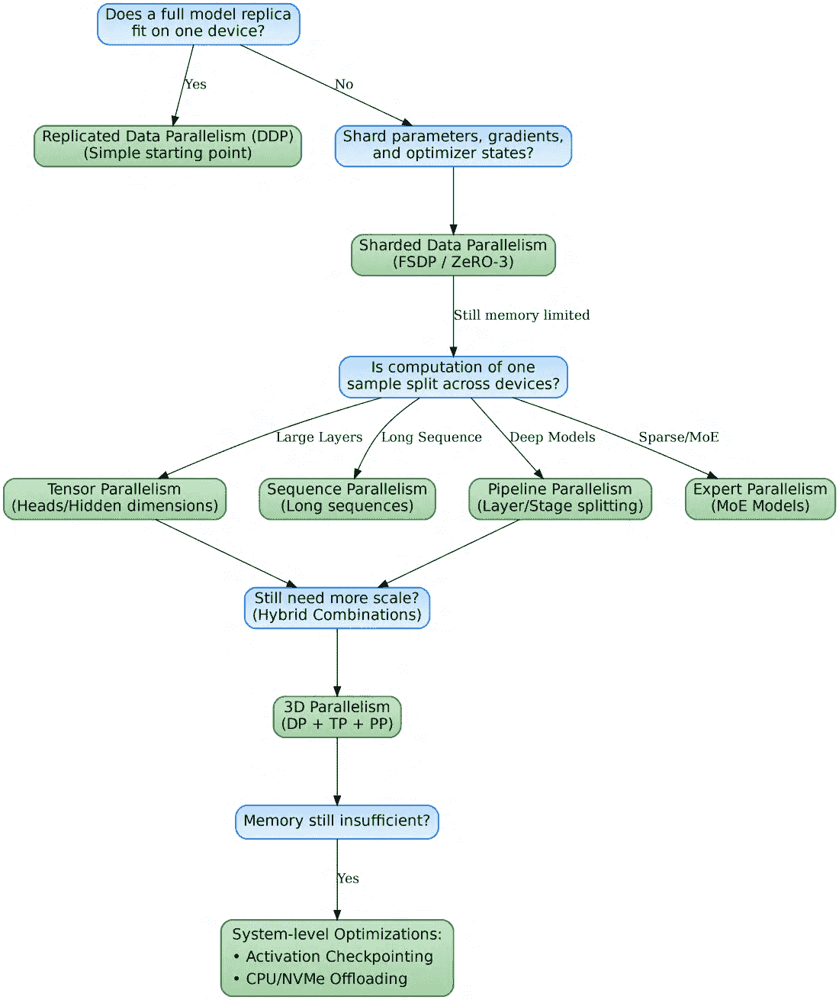

#### 训练的关键考量

**网络拓扑很重要。** 如果你的系统中某些 GPU 对之间通过 NVLink 连接，而其他 GPU 对之间通过 PCIe 连接，请尽量将通信密集的操作（如张量并行）放在 NVLink 连接的 GPU 对上。PyTorch 和大多数框架不会自动完成这一安排，因此你可能需要手动设置进程组或设备放置。

**互联速度决定了哪些方案可行。** 张量并行在每一层都需要通信，因此你需要快速互联（节点内使用 NVLink，节点间使用 InfiniBand）。如果只有 PCIe，请避免使用张量并行——坚持使用 FSDP/ZeRO 或流水线并行。

**内存与吞吐量的权衡。** FSDP/ZeRO 能最大化内存效率，但不一定能提升吞吐量。张量并行可以提升吞吐量（通过拆分大层），但每张 GPU 的内存占用会更高。如果你有足够的 GPU 并能保持流水线满载，流水线并行也可以提升吞吐量。

**从简单开始，仅在需要时增加复杂度。** 大多数模型仅用 DDP 或 FSDP 即可完成训练。每增加一种并行策略，都会带来额外的复杂度和潜在的故障模式。

#### 推理策略决策树

推理与训练有着不同的约束条件（参见*第 6 章*和*第 9 章*）。你不需要存储梯度或优化器状态，但需要处理注意力机制的 KV 缓存，而且在许多场景下，延迟比吞吐量更重要。*图 2.6* 提供了一个系统性的决策树，用于指导你的推理策略选择。

**第 1 步：你要扩展的是单个请求还是多个请求？**

如果你要服务多个请求，请从**请求级并行**开始（参见*第 7 章*）：

- **批处理**：将多个请求分组为批次，以提高 GPU 利用率
- **多个模型副本**：运行模型的多个副本，以服务更多并发请求
- **负载均衡服务**：在多个副本之间分发请求

如果你要扩展单个请求（例如，超大规模模型或长上下文），则应转向模型并行。

**第 2 步：模型计算能否放入单台设备？**

如果可以，请使用优化内核进行**单 GPU 推理**：

- **FlashAttention**：经过优化的注意力内核，可减少内存占用并提升速度
- **量化**：INT8/INT4 量化，可减少内存占用并提高吞吐量
- **内核融合**：合并操作以减少内核启动开销

如果不行，你需要模型并行推理。

**第 3 步：计算如何拆分？**

- **张量/注意力头/隐藏维度**：使用**张量并行**。在 vLLM（参见*第 6 章*）和 TensorRT-LLM 等推理系统中很常见。需要快速互联。
- **长上下文/KV**：使用**上下文并行**（参见*第 6 章*）。对于上下文窗口无法放入单张 GPU 的长上下文推理至关重要。它将注意力计算和 KV 缓存拆分到多张 GPU 上。
- **层/阶段**：使用**流水线并行**。在推理中不如在训练中常见，但对于需要保持低延迟的超大规模模型很有用。
- **专家**：使用**专家并行**。仅适用于 MoE 模型。将 token 路由到不同 GPU 上的专家。

**第 4 步：瓶颈是内存还是 KV 缓存？**

对于推理而言，KV 缓存可能成为主要的内存瓶颈，尤其是在长上下文和大量并发请求的情况下。请使用系统级的服务技术：

- **KV 缓存分页 / PagedAttention**：将 KV 缓存内存虚拟化，使你能够服务的并发请求数量超过 GPU 内存原本能容纳的上限。用于 vLLM（参见*第 6 章*）。
- **KV 缓存分离**：将 KV 缓存存储在独立的设备上或 CPU 内存中，按需获取。对于超长上下文很有用（参见*第 6 章*）。
- **CPU/NVMe 卸载**：将模型参数或 KV 缓存从 GPU 上移出。速度较慢，但可以服务更大的模型或更多的并发请求（参见第 9 章）。


*图 2.6：推理策略决策树*

#### 推理的关键考虑因素

- **延迟与吞吐量。** 推理服务关注 TTFT 和每 token 延迟；模型并行每层都会增加通信开销——仅在必要时使用（*第 6 章*，*第 9 章*）。

- **KV 缓存。** 与训练不同，在长上下文和高并发场景下，内存主要由 KV 缓存占用；PagedAttention 及相关技术至关重要（*第 6 章*）。

- **批处理与副本。** 在求助于张量并行（TP）之前，先对请求进行复制和批处理（*第 6 章*，*第 7 章*，*第 9 章*）。

- **量化。** 使用 INT8/INT4 通常可以在不重新训练的情况下将模型适配到单张 GPU 上（*第 6 章*）。

- **从简单开始。** 在采用 TP/PP 之前，先使用单 GPU 搭配量化和融合内核（*第 6 章*）。

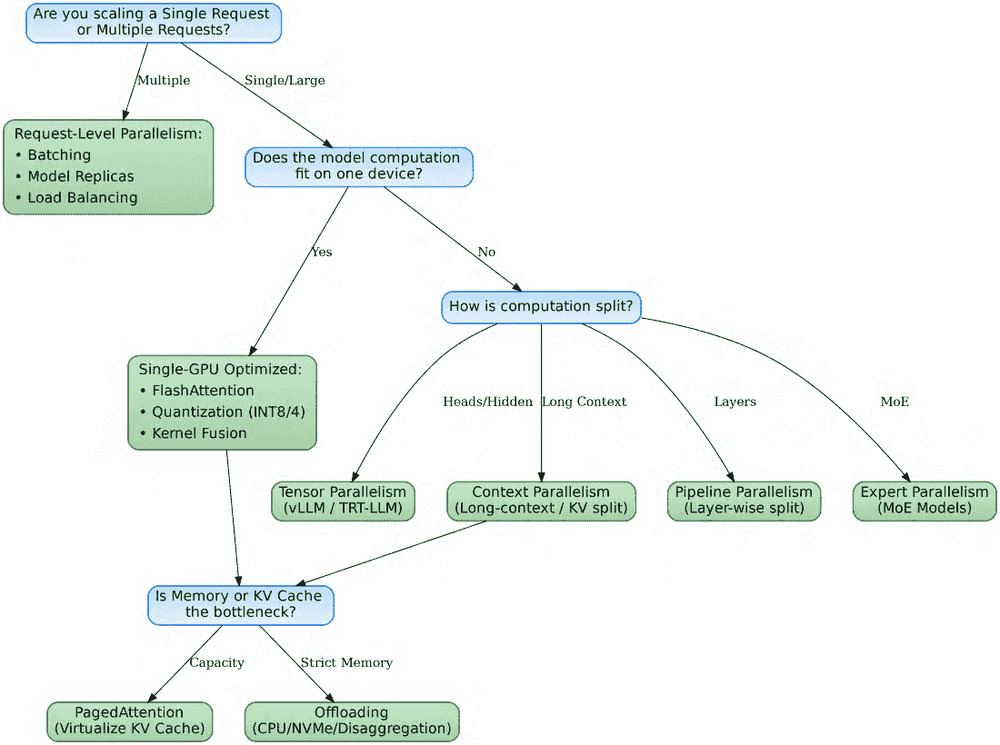

### 实用技巧

- **先分析再优化。** 使用 `nvidia-smi` 监控内存使用情况，并使用 PyTorch 的性能分析器查看时间消耗在哪里。你可能认为通信是瓶颈，但实际上可能是数据加载或其他原因。

- **在 GPU 集合通信中使用 NCCL。** 它经过优化并自动处理 NVLink。其他后端（GLOO、MPI）速度较慢。

- **混合精度很有帮助。** FP16 或 BF16 可将内存和带宽占用减半。大多数模型使用它都能正常训练，而且加速效果显著。

- **注意 NUMA。** 如果你使用多路（multi-socket）系统，尽量将进程保持在同一个 NUMA 节点上。跨 NUMA 通信会增加延迟。

- **先在小规模上测试。** 在扩展到多个节点之前，先在 2-4 张 GPU 上验证你的并行策略。小规模调试要容易得多。

### 动手实践：硬件检查与带宽测试

在设计分布式训练策略之前，了解硬件拓扑和带宽特性至关重要。本动手实践部分将带你检查 GPU 硬件、测量内存带宽以及测试 GPU 间通信的性能。

#### 环境设置

代码示例位于 `code/` 目录中。如果尚未克隆，请先克隆仓库：

```
git clone https://github.com/PacktPublishing/Distributed-AI-Systems
cd Distributed-AI-Systems/chapter2-gpu-hardware-networking-and-parallelism-strategies
```

运行这些示例需要一台至少配备一张 GPU（最好多张）的机器。对于多 GPU 测试，你需要 2 张或更多通过 NVLink 或 PCIe 连接的 GPU。

#### 步骤 1：检查 GPU 硬件

首先验证你的 GPU 环境并收集基本硬件信息。运行 `check_cuda.py` 脚本（预计**远不到一秒**）：

```
python code/check_cuda.py
```

该脚本会显示重要的 GPU 信息：

```python
import torch
print(f"CUDA available: {torch.cuda.is_available()}")
print(f"Number of GPUs: {torch.cuda.device_count()}")
for i in range(torch.cuda.device_count()):
    props = torch.cuda.get_device_properties(i)
    vram_gb = props.total_memory / (1024**3)
    print(f"GPU {i}: {props.name}")
    print(f" Total memory: {vram_gb:.1f} GB")
    print(f" Compute capability: {props.major}.{props.minor}")
    print(f" Multiprocessors: {props.multi_processor_count}")
```

**代码解释：**

- 2：检查系统上 CUDA 是否可用
- 3：获取 GPU 总数
- 5：获取每张 GPU 的属性
- 6：将内存从字节转换为 GB

H100 系统上的示例输出：

```
CUDA available: True
CUDA version: 12.1
Number of GPUs: 8
GPU 0: NVIDIA H100
 Total memory: 80.0 GB
 Compute capability: 9.0
 Multiprocessors: 132
...
```

这确认了你的 GPU 已被检测到，并显示了内存容量、计算能力和流多处理器数量。计算能力（H100 为 9.0）表示支持哪些 CUDA 特性。

#### 步骤 2：检查硬件拓扑

要了解 GPU 之间的连接方式，请使用 `nvidia-smi` 检查拓扑（运行**即时完成**——无需训练任务）：

```
nvidia-smi topo -m
```

这会显示一个连接矩阵，展示 GPU 之间的连接方式。请关注：

- `NV18`, `NV12`, `NV4`：NVLink 连接（好——高带宽）
- `PIX` 或 `PXB`：PCIe 连接（较慢，但仍可用）
- `NODE` 或 `SYS`：跨越 NUMA 边界（增加延迟）

显示 NVLink 连接的示例输出：

```
 GPU0 GPU1 GPU2 GPU3 GPU4 GPU5 GPU6 GPU7
GPU0 X NV18 NV18 NV18 NV18 NV18 NV18 NV18
GPU1 NV18 X NV18 NV18 NV18 NV18 NV18 NV18
```

所有 GPU 都显示 `NV18` 连接，意味着每张 GPU 都能以 NVLink 速度与其他 GPU 通信——非常适合张量并行和其他通信密集型策略。

你还可以检查 PCIe 代次和带宽：

```
nvidia-smi --query-gpu=name,memory.total,pcie.link.gen.max,pcie.link.width.max --format=csv
```

这会显示 PCIe Gen 4/5 和 x16 宽度，它们决定了 CPU-GPU 带宽（每个方向约 31-64 GB/s）。

#### 步骤 3：测量单 GPU 内存带宽

在测试 GPU 间通信之前，先测量单 GPU 内存带宽以建立基线。这会告诉你每张 GPU 的最大内存吞吐量：

```
python code/bandwidth_test.py
```

在现代 GPU 上预计**耗时几秒**（针对 64 MB 张量进行 200 次预热式迭代）。

该脚本通过在 GPU 内存内复制数据来测量带宽。每次 `copy_` 会读取 `a` 并写入 `b`，因此每次迭代我们计算 **2×** 张量大小（读写流量合计）：

```python
import torch
import time
size_mb = 64
iterations = 200
nbytes = size_mb * 1024 * 1024
a = torch.randn(nbytes // 4, device='cuda')
b = torch.empty_like(a)
# Warmup
for _ in range(10):
    b.copy_(a)
torch.cuda.synchronize()
# Benchmark
t0 = time.time()
for _ in range(iterations):
    b.copy_(a)
torch.cuda.synchronize()
t1 = time.time()
bytes_moved = 2 * nbytes * iterations  # read a + write b per iteration
bandwidth_gb_per_s = bytes_moved / (1024**3) / (t1 - t0)
print(f"Effective bandwidth (read+write): {bandwidth_gb_per_s:.2f} GB/s")
```

**代码解释：**

- 6：在 GPU 上创建张量（float32 = 每个元素 4 字节）
- 7：创建相同大小的空张量
- 10：在 GPU 内存内复制数据
- 18：每次复制移动 2× nbytes（从 `a` 读取，写入 `b`）

示例结果（取决于硬件）：

```
GPU Memory Bandwidth Test
Data size: 64 MB
Iterations: 200
Effective bandwidth (read+write): 1980.45 GB/s
```

典型的有效复制带宽（读写合计）：

- **H100**：2-3 TB/s（2000-3000 GB/s）
- **A100**：1.5-2 TB/s（1500-2000 GB/s）
- **H200**：2-3 TB/s（2000-3000 GB/s）

如果你测得的带宽明显偏低，可能存在内存带宽饱和或其他瓶颈。这个基线有助于你判断内存带宽是否限制了训练性能。

#### 步骤 4：基准测试 GPU 间通信

对于分布式训练，GPU 间通信带宽往往比单 GPU 内存带宽更为关键。`allreduce_microbench.py` 脚本用于衡量多 GPU 上的 AllReduce 性能——使用与*第 1 章*中运行 `distributed_basic_test.py` 相同的方式通过 `torchrun` 启动。使用下面的默认配置（100 MB 张量，50 次迭代），在 2-4 张 GPU 上预计**大约几秒到几十秒**——不是几分钟。

```
torchrun --nproc_per_node=2 code/allreduce_microbench.py
```

对于 4 张 GPU：

```
torchrun --nproc_per_node=4 code/allreduce_microbench.py
```

该脚本对 `dist.all_reduce` 进行计时，并报告两个带宽数值。**算法带宽（Algorithm bandwidth）** 是 NCCL 基准测试所使用的：每个 rank 持有 `size_mb`，所有 `n` 个 rank 都参与，因此有效吞吐量为 `n × size / time`。**总线带宽（Bus bandwidth）** 则根据环形 AllReduce 中实际跨互联网络传输的数据量进行调整——在 `n` 个 rank 上，每个 rank 约为其张量大小的 `2×(n−1)/n`，即每次迭代**总计** `2×(n−1)×size`：

```python
import torch.distributed as dist
size = size_mb * 1024 * 1024 // 4
# float32 elements per GPU
tensor = torch.ones(size, device=f'cuda:{local_rank}')
for _ in range(warmup):
    dist.all_reduce(tensor, op=dist.ReduceOp.SUM)
torch.cuda.synchronize()
start = time.time()
for _ in range(iterations):
    dist.all_reduce(tensor, op=dist.ReduceOp.SUM)
torch.cuda.synchronize()
elapsed = time.time() - start
size_bytes = size_mb * 1024 * 1024
n = world_size
alg_bytes = size_bytes * n * iterations
bus_bytes = size_bytes * 2 * (n - 1) * iterations  # ring: 2*(n-1)/n per rank × n ranks
alg_bw_gb_s = alg_bytes / (1024**3) / elapsed
bus_bw_gb_s = bus_bytes / (1024**3) / elapsed  # equals alg_bw * 2*(n-1)/n
```

**代码解释：**

- 3：每张 GPU 上以 float32 元素计数的张量大小


5. AllReduce 对所有 rank 上的张量求和
15. Ring AllReduce 每次迭代在网络中移动约 ~2×(n−1)×size 字节（NCCL 可能改用 tree 算法）

2 个使用 NVLink 的 GPU 的示例输出（数值因硬件和驱动而异）：

```text
AllReduce Benchmark Results
World size: 2 GPUs
Tensor size: 100 MB per GPU
Iterations: 50
Total time: 0.248 seconds
Algorithm bandwidth: 40322.58 MB/s (39.38 GB/s)
Bus bandwidth (ring estimate): 40322.58 MB/s (39.38 GB/s)
```

当 `n = 2` 时，ring 因子 `2×(n−1)/n` 为 1，因此算法带宽和总线带宽一致。对于 4 个 GPU，在 ring 模型下总线带宽是算法带宽的 `1.5×`。

预期 **AllReduce 总线带宽**（与消息大小相关；100 MB 处于合理范围内）：

- **使用 NVLink 连接的 GPU**：通常为数十 GB/s 到低数百 GB/s
- **仅使用 PCIe 连接的 GPU 对**：通常约 10–50 GB/s

这些是有效的集合通信吞吐量数字，而不是数据手册中引用的 **NVLink 峰值链路** 规格（Ampere–Hopper 上每个 GPU 为 300–900 GB/s，Blackwell B200 上最高 1.8 TB/s）。如果你看到的 AllReduce 带宽远低于上述范围，请使用 `nvidia-smi topo -m` 检查拓扑。仅通过 PCIe 连接的 GPU 会显示出明显更低的带宽，这会影响哪些并行策略是可行的。

#### 第 5 步：分析结果

将你测得的带宽与理论值进行比较：

| 指标 | 你的系统 | 预期范围 | 备注 |
| --- | --- | --- | --- |
| 单 GPU HBM | ? GB/s | H100：2-3 TB/s；A100：1.5-2 TB/s | 数值较低表示存在内存瓶颈 |
| GPU 间 AllReduce（NVLink） | ? GB/s | 数十至低数百 GB/s（总线） | 来自步骤 4：与消息大小相关 |
| GPU 间 AllReduce（PCIe） | ? GB/s | 约 10–50 GB/s（总线） | 比 NVLink 慢得多 |

**这些数字意味着什么：**

- **HBM 带宽高但 GPU 间带宽低**：你的系统适合单 GPU 工作负载，但在通信密集的并行方式（张量并行、频繁的 AllReduce）中会遇到困难。优先选择 FSDP/ZeRO 或流水线并行。
- **GPU 间带宽高（NVLink）**：你的系统可以高效地使用张量并行和其他通信密集型策略。所有 GPU 通过 NVSwitch 连接是理想情况。
- **GPU 间带宽低（仅 PCIe）**：避免使用张量并行——通信开销将占主导。坚持使用通信不那么频繁的 FSDP/ZeRO 或流水线并行。

这些测量结果有助于你为硬件选择合适的并行策略。在后面的章节中，我们将了解 DDP、FSDP 等框架如何使用这些通信原语，但理解底层带宽特性有助于调试性能问题。

对于实际工作负载，你会使用 PyTorch 或 DeepSpeed 中的高级 API，但当事情不如预期时，了解底层发生的情况会有所帮助。

有了这一硬件基础，我们就可以开始构建分布式训练系统了。在*第 3 章*中，我们将深入探讨 PyTorch DDP（DistributedDataParallel），这是实现复制式数据并行最常用的方式。DDP 是分布式训练的主力——大多数生产训练流水线都在使用它，理解它的工作原理对于构建可扩展的 AI 系统至关重要。我们将涵盖设置、常见陷阱、调试技术以及如何针对你的工作负载进行优化。

### 代码汇总

- `nvidia-smi`：用于监控 GPU 状态和利用率的命令行工具
- `torch.cuda.device_count()`：获取可用 CUDA 设备数量
- `torch.cuda.get_device_name()`：获取 CUDA 设备名称
- `torch.cuda.is_available()`：检查 CUDA 是否可用
- `torch.distributed.get_world_size()`：获取分布式组中的进程总数
- `torch.distributed.get_rank()`：获取当前进程的 rank
- `torch.distributed.get_backend()`：获取后端名称（例如 'nccl'、'gloo'）
- `nvidia-ml-py`：用于查询 NVIDIA GPU 信息的 Python 库
- `ibstat`：检查 InfiniBand 适配器状态的命令

### 注释与参考文献

GPU 内存容量数据来自 NVIDIA 规格：A100（2020 年，80GB）、H100（2022 年，80GB HBM3）、H200（2023 年，141GB HBM3e）、B200（2024 年，192GB）；每一代新产品通常会增加 HBM 容量和 NVLink 带宽，因此后续旗舰 GPU 也遵循同样的趋势，尽管图中显示的是具有代表性的已部署 SKU。

模型内存需求根据已公布的参数量（参见 @tbl:model-comparison）并使用 BF16 精度（每个参数 2 字节）计算得出：GPT-3 175B（2020 年，约 350GB）、LLaMA-2 70B（2023 年，约 140GB）、DeepSeek-V2 236B（2024 年，约 472GB）、DeepSeek-V3 671B（2025 年，约 1342GB）、DeepSeek-V4-Pro 1.6T（2026 年，约 3200GB）。图中使用这些已公开的里程碑数值；更大的近似数值（表中以 ~ 标记）被省略。所示数值仅代表模型权重的单 GPU 内存需求；实际训练还需要额外内存来存储梯度、优化器状态和激活值，因此更进一步需要分布式训练。

Chowdhery 等人，《PaLM: Scaling Language Modeling with Pathways》，《Journal of Machine Learning Research》24（2023）：1–113，附录 B（每个 token 6N 次矩阵乘法 FLOPs 和模型 FLOPs 利用率）。Kaplan 等人，《Scaling Laws for Neural Language Models》，arXiv:2001.08361，2020。

NVIDIA，《NVIDIA H100 Tensor Core GPU Architecture》，白皮书，2022 年，`https://resources.nvidia.com/en-us-hopper-architecture`（Transformer Engine 与 FP8；在 Transformer 模型上的训练吞吐量比 A100 最高可提升 6 倍）。如需查看大型语言模型训练的独立审计结果，请参阅 NVIDIA，《Breaking MLPerf Training Records with NVIDIA H100 GPUs》，技术博客，2023 年，`https://developer.nvidia.com/blog/breaking-mlperf-training-records-with-nvidia-h100-gpus/`（MLPerf Training 3.0；使用 Transformer Engine 和 FP8 的 GPT-3 175B 与 BERT）。

### 练习

#### GPU 硬件检查器

实现一个全面的 GPU 硬件检查函数，用于收集可用 GPU 的详细信息。

**要求：**

函数签名：`inspect_gpu_hardware()`

为每个 GPU 返回一个包含以下键的字典：

- `name`：GPU 名称
- `memory_total_gb`：总内存（GB）
- `memory_free_gb`：可用内存（GB）
- `compute_capability`：计算能力，以字符串表示（例如 "9.0"）
- `multiprocessor_count`：流式多处理器数量
- `cuda_version`：CUDA 版本

处理 CUDA 不可用的情况（返回空列表）

打印一个格式化汇总表，显示所有 GPU 信息

**测试你的函数：**

```python
import torch

gpu_info = inspect_gpu_hardware()
print(f"Found {len(gpu_info)} GPU(s)")
for i, info in enumerate(gpu_info):
    print(f"\nGPU {i}:")
    print(f" Name: {info['name']}")
    print(f" Memory: {info['memory_total_gb']:.1f} GB total, "
          f"{info['memory_free_gb']:.1f} GB free")
    print(f" Compute Capability: {info['compute_capability']}")
    print(f" Multiprocessors: {info['multiprocessor_count']}")
```

#### 内存需求计算器

实现一个函数，用于计算在不同精度和优化器配置下训练模型的内存需求。

**要求：**

函数签名：`calculate_training_memory(num_params, precision='bf16', optimizer='adam', batch_size=1, seq_length=2048)`

计算以下各项的内存：

- 模型参数（权重）
- 梯度（与参数大小相同）
- 优化器状态：
  - Adam：参数大小的 2 倍（动量 + 方差）
  - SGD：参数大小的 1 倍（仅动量）
- 激活值：近似为 `batch_size × seq_length × hidden_size × num_layers × bytes_per_element`
- 精度选项：'fp32'（4 字节）、'bf16'/'fp16'（2 字节）、'int8'（1 字节）
- 返回一个包含明细的字典：`{'parameters': ..., 'gradients': ..., 'optimizer': ..., 'activations': ..., 'total': ...}`
- 所有值以 GB 为单位

**测试你的函数：**

```python
# 70B parameter model with BF16, Adam optimizer
memory = calculate_training_memory(
    num_params=70e9,
    precision='bf16',
    optimizer='adam',
    batch_size=4,
    seq_length=2048
)
print("Memory Requirements (GB):")
for key, value in memory.items():
    print(f" {key}: {value:.2f} GB")
```

### 拓扑检测与分析

实现一个函数，解析 `nvidia-smi topo -m` 的输出以检测 GPU 互连拓扑。


