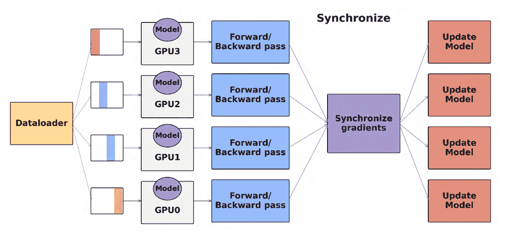
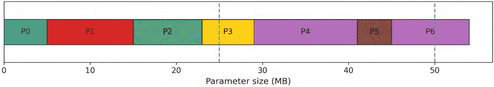
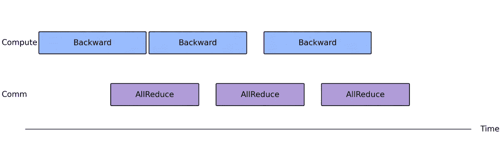
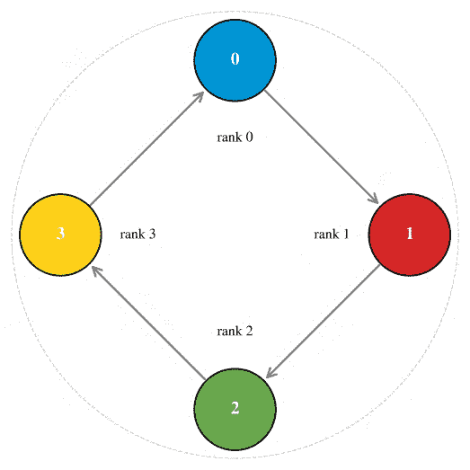
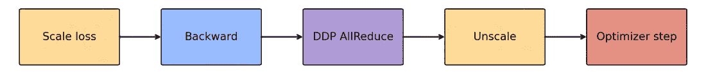
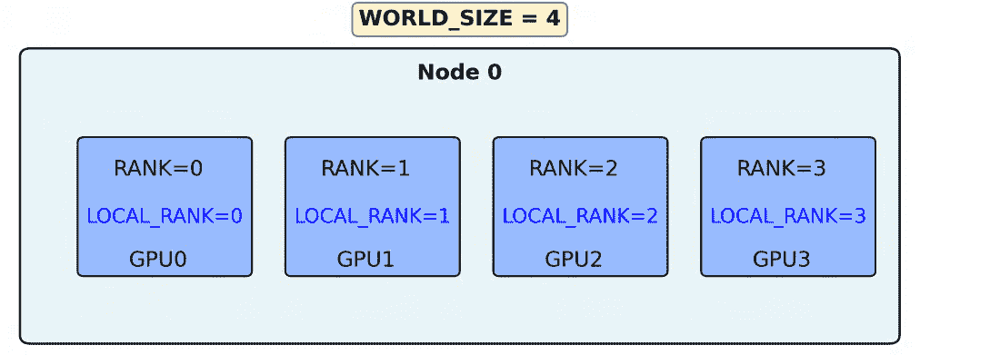
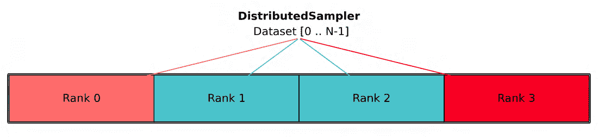
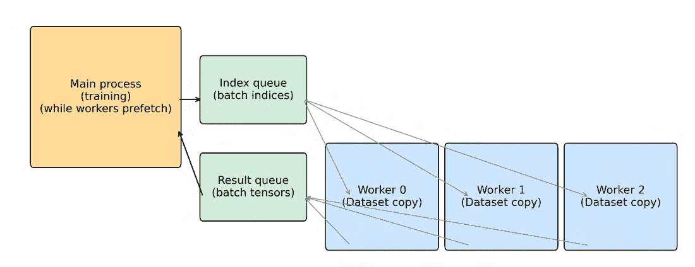
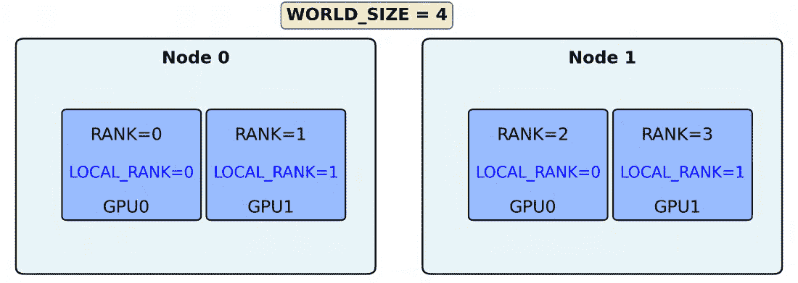
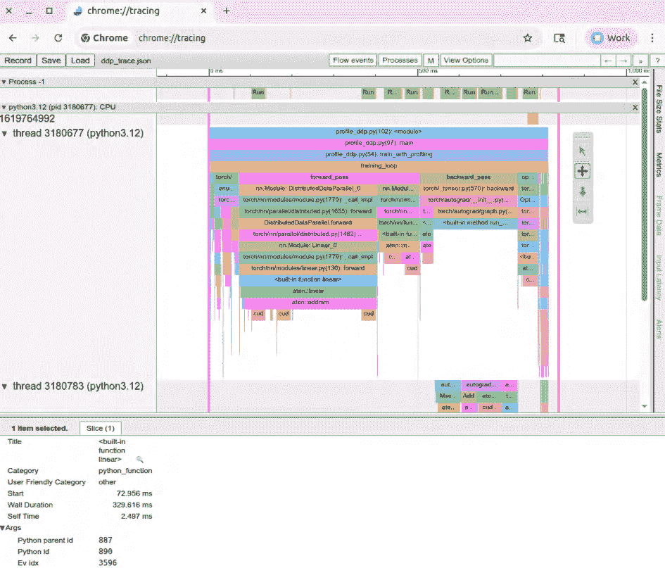

# 3 使用 PyTorch DDP 进行分布式训练

### 使用 DistributedDataParallel 跨多 GPU 扩展训练

*对终极算法的探索，就是对规模的探索。*

*理查德·萨顿*

### DDP 的内部工作原理

在*第 2 章*中，我们探讨了使分布式训练成为可能的硬件基础和并行策略。现在我们转向实际实现：**DistributedDataParallel（DDP）**，这是 PyTorch 进行数据并行分布式训练的标准方法。DDP 是你真正跨多个 GPU 扩展训练的方式——无论是单台机器内的 GPU，还是分布在集群中的 GPU。

其核心思路非常优雅：在每个 GPU 上复制模型，将数据分片到各个 GPU，并在每次反向传播后同步梯度。每个 GPU 处理不同的数据批次，独立计算梯度，然后所有 GPU 将各自的梯度取平均。这样既保证了每个模型副本保持同步，又利用了并行计算的优势。

*图 3.1：DDP 工作流程*

*图 3.1* 展示了完整的 DDP 训练工作流程。数据从数据加载器流向每个 GPU 的数据分片，经过前向和反向传播，然后在更新模型参数之前，所有 GPU 同步梯度。神奇之处发生在反向传播过程中——DDP 使用高效的集合通信原语（如 AllReduce）自动聚合来自所有进程的梯度，并确保每个进程拥有相同的更新后参数。

### 基本流程

按照*图 3.1* 所示的工作流程，以下是 DDP 在单个训练步骤中发生的事情：

1. **前向传播**：每个进程在自己的数据分片上执行前向计算。所有进程上的模型完全相同，但得益于 `DistributedSampler`，每个进程看到的数据不同。如图所示，数据从数据加载器流向每个 GPU 的数据分片，然后经过模型进行前向计算。

2. **反向传播**：每个进程在本地计算梯度。这正是 DDP 发挥作用的地方——DDP 并不会让每个进程独立更新自己的模型，而是收集所有梯度。反向传播在所有 GPU 上并行计算每个参数的梯度。

3. **梯度同步**：DDP 使用 AllReduce（在 GPU 上通过 NCCL）对所有进程的梯度求和，然后除以 `world_size`，使每个 rank 都持有平均梯度——这与使用全局批次在单块 GPU 上得到的更新相同。这是图 3.1 中心展示的关键同步步骤，所有 GPU 的梯度在此聚合。



4. **参数更新**：每个进程使用同步后的梯度执行优化器更新步骤。由于所有进程以相同的参数开始，并应用了相同的梯度，最终会得到完全相同的参数。最后一步使用同步后的梯度更新每个模型副本，从而在所有进程间保持一致性。

这就是**数据并行**：模型被复制，而数据被分片。每块 GPU 处理不同的批次，梯度取平均。与之相对的是**模型并行**（将在后续章节介绍），后者将模型本身拆分到多块 GPU 上。

### 数据并行（DP）与分布式数据并行（DDP）对比

在 DDP 之前，PyTorch 提供了 `DataParallel`（DP），目前仍然可用，但不推荐使用，官方文档建议改用 `DistributedDataParallel`，即使在单机多 GPU 训练中也是如此。DP 采用单进程、多线程的方法，只能在单台机器上运行。它有几个局限：Python 的 GIL 阻碍了真正的并行；所有梯度同步都在 GPU 0 上完成，形成瓶颈；并且无法跨多台机器扩展。

**分布式数据并行（DDP）** 解决了这些局限。

DDP 使用多进程架构而不是多线程。每个 GPU 在自己的进程中运行，这避免了 Python 的 GIL 限制，实现了真正的并行。与 DP 不同，DDP 可以扩展到通过网络连接的多台机器。你不受限于单台机器内的 GPU——你可以在集群中成百上千块 GPU 上进行训练。

通信效率也更高。DDP 使用优化的集合通信原语，如 Ring AllReduce 和树算法。这些原语将工作分发到所有 GPU，而不仅仅是 GPU 0。梯度同步不是由一块 GPU 包办，而是每块 GPU 都参与其中。这消除了困扰 DP 的单 GPU 瓶颈。

DDP 还将梯度同步与计算重叠。当一个梯度桶正在同步时，下一个桶可以开始计算。这隐藏了通信延迟，使整体训练更快。所有 GPU 平等地参与梯度同步，在整个系统中形成均衡的负载。

基于这些原因，DDP 是分布式训练的标准——即使在单机上也要使用它。


### 梯度分桶：为什么它很重要

如果DDP对每个梯度张量单独进行同步，你就会有成千上万次小的AllReduce操作。每次AllReduce都有开销——网络延迟、内核启动开销、同步成本。解决方案是**梯度分桶**：DDP将小的梯度张量分组到桶中，并对整个桶执行AllReduce。

其工作原理如下：DDP分析你模型的参数顺序（即它们在`model.parameters()`中出现的顺序）。它根据大小将连续的参数分组成桶。当反向传播到达某个桶的边界时，DDP会为该桶触发一次AllReduce。默认桶大小为25 MB，但你可以通过`bucket_cap_mb`进行调整。

*图3.2：梯度分桶：按大小分桶的参数*

*图3.2*展示了参数分段和桶边界。分桶减少了通信开销，但存在一个权衡：更大的桶意味着更少的AllReduce调用（更少的开销），但同步更晚（梯度要到桶准备好后才可用）。更小的桶意味着更早的同步，但开销更大。对于大多数模型，默认的25 MB效果很好，但对于非常大或非常小的模型，你可能需要调整它。

### 通信与计算的重叠

真正的性能提升来自**通信与计算的重叠**。当DDP正在为一个桶执行AllReduce时，你的反向传播可以继续为下一个桶计算梯度。这会将通信延迟隐藏在计算之后。

*图3.3：反向计算与AllReduce的重叠*




*图3.3*展示了这种重叠。DDP通过以下方式实现重叠：

- 异步启动AllReduce操作
- 使用CUDA流将通信内核与计算内核重叠
- 按桶的就绪顺序处理（不一定是参数顺序）

要让重叠生效，你需要在桶边界之间有足够的计算量。如果你的模型参数很少或层非常小，可能没有足够的计算可供重叠。在这种情况下，你会看到通信时间占主导地位，重叠的帮助不大。

你可以通过性能分析（profiling）来检查重叠是否生效。如果你看到AllReduce操作与反向计算同时发生，说明重叠正在生效。如果AllReduce在所有梯度计算完成后才顺序发生，说明重叠没有生效（可能你的模型太小，或者有同步点阻塞了它）。

### AllReduce操作

AllReduce是使DDP工作的核心集合操作。如*第1章*所述（参见"集合操作"一节），AllReduce从所有进程获取梯度，对它们求和，并将结果分发回所有进程。在GPU上，DDP使用NCCL（NVIDIA集体通信库）通过**环形AllReduce**和**树形AllReduce**等算法高效实现AllReduce，NCCL会根据你的硬件拓扑自动选择这些算法。

*图3.4：环形AllReduce：四个rank按顺时针方向传输数据*



*图3.4*展示了**环形拓扑**：rank按逻辑环排列，数据沿一个方向（例如顺时针）流动。在环形AllReduce中，每个rank持有完整张量的一个数据块。在第一阶段（reduce-scatter），每个rank将自己的数据块发送给下一个rank，并从上一个rank接收，累加部分和，这样经过N-1步（对于N个rank）后，每个rank拥有一个数据块的完整和。在第二阶段（all-gather），rank之间交换这些归约后的数据块，直到每个rank都拥有完整的归约结果。环形算法是带宽最优的：无论N是多少，它只移动张量大小的2·(N-1)/N倍，并且高效地使用环中的每条链路。当NCCL检测到树形布局具有更低延迟或更适合物理互连（例如NVLink、PCIe或网络）的拓扑时，它可能会选择**树形AllReduce**（或其他变体）。

了解当前正在使用哪种算法有助于调试性能问题。如果梯度同步缓慢，可能的原因包括：(1) NCCL选择了与你的拓扑不匹配的算法（例如，在非物理环的网络结构上使用环形算法）；(2) 网络或互连带宽已饱和；(3) 消息体过小，无法摊薄集合通信的固定成本。你可以通过`NCCL_DEBUG=INFO`或PyTorch性能分析器查看NCCL的选择和计时；将AllReduce时间与理论环形成本（张量大小除以每链路带宽）进行比较，可以判断你是受带宽限制还是受延迟限制。

### 混合精度与梯度缩放

使用**FP16**混合精度时，梯度可能会下溢（变为零），因为FP16的指数范围很窄。解决方案是**梯度缩放**：在反向传播之前将损失乘以一个缩放因子，然后在优化器步骤之前还原梯度。**BF16**与FP32共享指数范围，因此下溢很少发生，通常不需要`GradScaler`——在支持的硬件上，`autocast(dtype=torch.bfloat16)`通常就足够了。

*图3.5：AMP + DDP：缩放、反向、AllReduce、还原、更新*

*图3.5*展示了这一流程。DDP与PyTorch的自动混合精度（AMP）配合使用。下面的流程适用于**带有`GradScaler`的FP16**：

1. 缩放损失：`loss = loss * scale`
2. 反向传播：`loss.backward()`（梯度也被缩放）
3. DDP AllReduce：同步缩放后的梯度
4. 还原：在优化器步骤之前将梯度除以缩放因子
5. 更新缩放因子：根据梯度溢出检测调整缩放因子



关键在于，DDP在梯度**缩放后**才同步它们。每个进程缩放自己的梯度，然后DDP对缩放后的梯度求和。AllReduce之后，所有进程拥有相同的缩放后梯度，这些梯度会在优化器步骤之前被还原。

如果你在DDP中使用FP16 AMP，请使用`GradScaler`：在将模型包装成DDP之前创建它，并在每个进程（不仅仅是rank 0）上调用`scaler.step()`和`scaler.update()`。对于BF16训练，通常不需要scaler。

### 缓冲区同步

DDP不仅同步梯度——它还同步**缓冲区**。缓冲区是不需要梯度的模型参数，比如BatchNorm的运行时均值和方差。在前向传播期间，DDP将缓冲区从rank 0广播到所有其他rank，以确保一致性。这是自动发生的，但有一个性能方面的考量：缓冲区同步会增加通信开销。如果你的模型有很多缓冲区或缓冲区很大，这可能会拖慢训练速度。你可以用`broadcast_buffers=False`禁用它，但前提是你确信缓冲区不需要同步（例如，你没有使用BatchNorm，或者你在手动同步缓冲区）。

对于大多数模型，保持`broadcast_buffers=True`（默认值）是正确的选择。BatchNorm和类似的层需要同步的统计数据，才能在分布式训练中正常工作。

### DDP前向传播实现细节

理解DDP在前向传播期间如何保持模型一致性，有助于调试。在PyTorch中，所有模型都继承自`torch.nn.Module`，它维护两个关键的字典：

- `_parameters`：需要梯度的网络参数
- `_buffers`：持久化的非参数数据（例如，BatchNorm的运行时均值和方差）

DDP通过`_sync_module_states`确保模型一致性，该函数会在所有进程之间同步`_parameters`和`_buffers`。这发生在两个地方：

1. **在DDP初始化期间**：当你创建DDP模型时，它会将初始参数和缓冲区从rank 0同步到所有其他rank。
2. **在每次前向传播之前**：如果`broadcast_buffers=True`（默认值），DDP会在前向传播前同步缓冲区，以确保所有进程拥有相同的缓冲区值。


这种同步确保所有进程以完全相同的模型状态启动，这对于在训练期间保持一致性至关重要。

### DDP 计算–通信重叠的实现

DDP 中的重叠机制是通过自动求导钩子（autograd hooks）、参数分桶（parameter bucketing）和归约器（reducer）组件实现的。其工作原理如下：

**自动求导钩子（Autograd Hooks）**：DDP 在模型参数上注册钩子。这些钩子在反向传播过程中计算梯度时被触发。钩子函数将参数梯度标记为“就绪”以进行归约。

**参数分桶（Parameter Bucketing）**：归约器根据 `bucket_cap_mb` 设置将参数梯度组织到桶中。参数大致按照 `model.parameters()` 的逆序分配到桶中（逆序是因为反向传播期间梯度是按逆序计算的）。这确保同一桶中的梯度几乎同时就绪。

**归约器（Reducer）**：当一个桶中的所有梯度都就绪后，归约器会为该桶启动一个异步 AllReduce 操作。在 AllReduce 进行期间，反向传播会继续为下一个桶计算梯度，从而实现重叠。

**未使用的参数（Unused Parameters）**：如果某个参数在前向传播中未被使用（例如在条件模型中），它的梯度永远不会就绪，导致桶永远等待。设置 `find_unused_parameters=True` 会告诉 DDP 分析计算图以识别未使用的参数，并在不等待其梯度的情况下将其标记为就绪。这会增加开销，但可以防止挂起。

关键要点：DDP 不会在开始通信前等待所有梯度。相反，一旦桶就绪，它就会立即通信这些梯度，使通信与正在进行的计算重叠。

### 设置单节点 DDP

最简单的 DDP 设置是单节点多 GPU：一台机器配备多个 GPU。大多数人都从这里开始，这也是你在开发和较小规模训练中会使用的方式。

#### 使用 torchrun（推荐）

启动 DDP 训练的现代方式是使用 `torchrun`（在较旧的 PyTorch 版本中为 `torch.distributed.run`）。`torchrun` 负责进程创建、环境变量设置和错误处理。在大多数情况下，它是推荐的启动器。

这是一个最小示例。将其保存为脚本，或使用本章目录中提供的 `code/train_ddp_single_mini.py`。

```python
import os
import torch
import torch.distributed as dist
import torch.nn as nn
from torch.nn.parallel import DistributedDataParallel as DDP
from torch.utils.data.distributed import DistributedSampler

def setup():
    """Initialize process group and set device."""
    # torchrun sets these environment variables automatically
    rank = int(os.environ['RANK'])
    local_rank = int(os.environ['LOCAL_RANK'])
    world_size = int(os.environ['WORLD_SIZE'])

    # Set device for this process
    torch.cuda.set_device(local_rank)
    device = torch.device(f'cuda:{local_rank}')

    # Initialize process group
    dist.init_process_group(backend='nccl')

    return rank, local_rank, world_size, device

def cleanup():
    """Clean up process group."""
    dist.destroy_process_group()

def main():
    rank, local_rank, world_size, device = setup()

    # Create model and move to device
    model = nn.Linear(10, 1).to(device)
    model = DDP(model, device_ids=[local_rank])

    # Create dummy data
    data = torch.randn(64, 10).to(device)
    target = torch.randn(64, 1).to(device)

    # Training step
    optimizer = torch.optim.SGD(model.parameters(), lr=0.01)
    loss_fn = nn.MSELoss()

    for epoch in range(10):
        # DistributedSampler would go here for real data
        optimizer.zero_grad()
        output = model(data)
        loss = loss_fn(output, target)
        loss.backward()
        optimizer.step()

        if rank == 0:
            print(f'Epoch {epoch}, Loss: {loss.item():.4f}')

    cleanup()

if __name__ == '__main__':
    main()
```

使用以下命令启动它（在章节目录中运行，或传入脚本路径）：

```bash
torchrun --nproc_per_node=4 code/train_ddp_single_mini.py
```

这会启动 4 个进程，每个 GPU 一个（假设你有 4 个 GPU）。`torchrun` 会自动设置 `RANK`、`LOCAL_RANK`、`WORLD_SIZE`、`MASTER_ADDR` 和 `MASTER_PORT` 环境变量。

示例输出如下所示：

```text
Epoch 0, Loss: 1.3706
Epoch 1, Loss: 1.3595
Epoch 2, Loss: 1.3488
Epoch 3, Loss: 1.3386
Epoch 4, Loss: 1.3287
Epoch 5, Loss: 1.3193
Epoch 6, Loss: 1.3103
Epoch 7, Loss: 1.3016
Epoch 8, Loss: 1.2932
Epoch 9, Loss: 1.2852
```

#### 理解环境变量

使用 `torchrun` 时，这些环境变量会被**自动**设置：

*图 3.6：单节点 4 个 GPU 的 RANK、LOCAL_RANK、WORLD_SIZE*

*图 3.6* 展示了单节点四个 GPU 的 RANK 和 LOCAL_RANK（如上面的 `torchrun --nproc_per_node=4` 示例所示）。变量：

- **RANK**：此进程的全局排名（0 到 WORLD_SIZE-1）
- **LOCAL_RANK**：此节点内的本地排名（0 到每节点 GPU 数 - 1）
- **WORLD_SIZE**：总进程数
- **MASTER_ADDR**：主节点的 IP 地址（对于单节点，这是 localhost）
- **MASTER_PORT**：进程组初始化端口（torchrun 会选择空闲端口）

对于单节点训练，你通常只需要关心 `LOCAL_RANK`（用于设置此进程使用哪个 GPU）和 `RANK`（用于标识主进程以进行日志记录/检查点保存）。

#### 使用 DistributedSampler

数据并行的关键是确保每个进程看到不同的数据。`DistributedSampler` 通过在不同进程间对数据集进行分片来实现这一点。

*图 3.7：DistributedSampler 跨 rank 对数据集分片*





*图 3.7* 说明了完整数据集如何被分割成连续、不重叠的分片：每个 rank 获得一个不同的索引段（例如，对于四个 rank 和 N 个样本，rank 0 获得索引 (0 … ⌈N/4⌉ - 1)，rank 1 获得接下来的四分之一，依此类推），因此任何样本都不会被多个进程看到，并且所有分片的并集覆盖整个数据集。

```python
from torch.utils.data import DataLoader, Dataset
from torch.utils.data.distributed import DistributedSampler

class MyDataset(Dataset):
    def __init__(self, size=1000):
        self.data = torch.randn(size, 10)
        self.labels = torch.randn(size, 1)

    def __len__(self):
        return len(self.data)

    def __getitem__(self, idx):
        return self.data[idx], self.labels[idx]

def get_dataloader(rank, world_size, batch_size=32):
    dataset = MyDataset(size=1000)
    # Create DistributedSampler
    sampler = DistributedSampler(
        dataset,
        num_replicas=world_size,
        rank=rank,
        shuffle=True,  # Shuffle data each epoch
        drop_last=True,  # avoids DDP sync issues
    )
    # Create DataLoader with sampler
    dataloader = DataLoader(
        dataset,
        batch_size=batch_size,
        sampler=sampler,
        num_workers=4,
        pin_memory=True,  # Faster CPU->GPU transfer
    )
    return dataloader, sampler

def train():
    rank, local_rank, world_size, device = setup()
    dataloader, sampler = get_dataloader(rank, world_size)
    model = create_model().to(device)
```


```python
37 | model = DDP(model, device_ids=[local_rank])
38 | for epoch in range(10):
39 |     # CRITICAL: Set epoch for DistributedSampler
40 |     # This ensures different shuffling each epoch
41 |     sampler.set_epoch(epoch)
42 |     for batch_idx, (data, target) in enumerate(dataloader):
43 |         data = data.to(device)
44 |         target = target.to(device)
45 |         # Training step...
46 |         pass
47 | cleanup()
```

A runnable version of this pattern is in `code/train_ddp_sampler.py`. From the chapter directory, run:

可运行版本位于 `code/train_ddp_sampler.py`。在章节目录下运行：

```text
$ export CUDA_VISIBLE_DEVICES=0,1,2,3
$ torchrun --nproc_per_node=4 code/train_ddp_sampler.py
```

Example output:

示例输出：

```text
Epoch 0 avg loss: 1.2798
Epoch 1 avg loss: 1.2930
Epoch 2 avg loss: 1.2105
Epoch 3 avg loss: 1.2596
Epoch 4 avg loss: 1.0808
Epoch 5 avg loss: 1.0864
Epoch 6 avg loss: 1.0570
Epoch 7 avg loss: 1.0612
Epoch 8 avg loss: 1.0212
Epoch 9 avg loss: 0.9214
Done.
```

`DistributedSampler` assigns each process a disjoint subset of the dataset. For example, with 4 processes and 1000 samples, each process receives 250 samples. Shuffling is controlled by the sampler: set `shuffle=True` on the sampler, and leave the DataLoader's `shuffle` at its default (or omit it), since the sampler already determines the order of indices.

`DistributedSampler` 为每个进程分配数据集的一个不相交子集。例如，4 个进程和 1000 个样本时，每个进程获得 250 个样本。打乱顺序由采样器控制：在采样器上设置 `shuffle=True`，并将 DataLoader 的 `shuffle` 保持默认（或省略），因为采样器已经决定了索引的顺序。

At the start of each epoch you must call `sampler.set_epoch(epoch)`. This seeds the sampler's shuffle with the epoch index so that each epoch sees a different ordering. If you omit this call, every epoch will iterate over the data in the same order.

在每个 epoch 开始时，你必须调用 `sampler.set_epoch(epoch)`。这会用 epoch 索引为采样器的打乱操作设置种子，使每个 epoch 看到不同的顺序。如果省略此调用，每个 epoch 都会以相同的顺序遍历数据。

The `drop_last` argument matters for synchronization. When it is `True`, the sampler drops the last incomplete batch so that every rank performs the same number of steps; that avoids one rank running ahead and blocking in collective calls. If you set `drop_last=False` (for instance to use every sample in a small dataset), some ranks may have one extra batch. In that case the training loop should use DDP's `join()` context so that ranks that finish early wait for the others; otherwise the process can deadlock.

`drop_last` 参数对同步很重要。当它为 `True` 时，采样器会丢弃最后一个不完整的批次，以便每个 rank 执行相同数量的步骤；这避免某个 rank 领先并在集合调用中阻塞。如果你设置 `drop_last=False`（例如在小数据集中使用每个样本），某些 rank 可能会多一个批次。在这种情况下，训练循环应使用 DDP 的 `join()` 上下文，让提前完成的 rank 等待其他 rank；否则进程可能会死锁。

### DataLoader internals for distributed training

### 分布式训练中的 DataLoader 内部机制

Understanding how `DataLoader` works internally helps optimize data loading performance. When you create a `DataLoader` with `num_workers > 0`, PyTorch uses multi-process data loading.

理解 `DataLoader` 的内部工作原理有助于优化数据加载性能。当你创建 `num_workers > 0` 的 `DataLoader` 时，PyTorch 会使用多进程数据加载。

#### Single-process vs Multi-process

#### 单进程 vs 多进程

The `DataLoader` chooses between `_SingleProcessDataLoaderIter` (for `num_workers=0`) and `_MultiProcessDataLoaderIter` (for `num_workers > 0`) based on the `num_workers` parameter.

`DataLoader` 根据 `num_workers` 参数在 `_SingleProcessDataLoaderIter`（用于 `num_workers=0`）和 `_MultiProcessDataLoaderIter`（用于 `num_workers > 0`）之间进行选择。

*Figure 3.8: DataLoader with workers, index and result queues*

*图 3.8：带 workers、索引队列和结果队列的 DataLoader*

*Figure 3.8* illustrates the execution flow when `num_workers > 0`. The main process enqueues batch indices into the index queue. Each worker process maintains its own copy of the dataset, dequeues batch indices, loads, and preprocesses the corresponding data, and enqueues the resulting batch tensors into the result queue. The main process then consumes batches from the result queue for training. The annotation "while workers prefetch" highlights that training on the current batch overlaps with workers preparing subsequent batches, enabling pipeline parallelism between data loading and computation. This design decouples data loading from model computation through inter-process queues, reducing input pipeline bottlenecks.

*图 3.8* 展示了 `num_workers > 0` 时的执行流程。主进程将批次索引入队到索引队列。每个 worker 进程维护自己的数据集副本，从索引队列取出批次索引，加载并预处理相应数据，然后将处理后的批次张量入队到结果队列。主进程随后从结果队列中取出批次进行训练。标注“当 workers 预取时”强调当前批次的训练与 workers 准备后续批次重叠，实现了数据加载和计算之间的流水线并行。这种设计通过进程间队列将数据加载与模型计算解耦，减少了输入流水线瓶颈。



#### Multi-process data loading

#### 多进程数据加载

Multi-process data loading works as follows:

多进程数据加载的工作方式如下：

- **Main process**: Creates an index queue and a result queue. It also spawns worker processes.
- **Worker processes**: Each worker process:
  - Reads indices from the index queue
  - Fetches corresponding data from the dataset
  - Applies transforms/preprocessing
  - Puts processed data into the result queue
- **Prefetching**: While the main process is using the current batch for training, workers are already loading the next batch. This overlaps data loading with computation.
- **Pin memory**: If `pin_memory=True`, a separate thread copies data from CPU to GPU memory asynchronously, further overlapping data transfer with computation.
- **DistributedSampler integration**: When using `DistributedSampler`, each process's `DataLoader` only sees the indices assigned to that process. The sampler ensures no data overlap between processes.

- **主进程**：创建索引队列和结果队列，并生成 worker 进程。
- **Worker 进程**：每个 worker 进程：
  - 从索引队列读取索引
  - 从数据集中获取相应数据
  - 应用变换/预处理
  - 将处理后的数据放入结果队列
- **预取（Prefetching）**：当主进程使用当前批次进行训练时，workers 已经在加载下一批次。这使数据加载与计算重叠。
- **固定内存（Pin memory）**：如果 `pin_memory=True`，一个单独的线程会异步地将数据从 CPU 复制到 GPU 内存，进一步使数据传输与计算重叠。
- **DistributedSampler 集成**：当使用 `DistributedSampler` 时，每个进程的 `DataLoader` 只看到分配给该进程的索引。采样器确保进程之间没有数据重叠。

#### Performance tips

#### 性能提示

- Set `num_workers` per rank (each process spawns its own workers, so the node runs `num_workers × world_size` workers in total). A practical start is `min(8, cpu_cores_per_node / gpus_per_node / 2)` on each rank.
- Use `pin_memory=True` for faster CPU-to-GPU transfer.
- Set `prefetch_factor=2` (default) to prefetch batches ahead.
- Use `persistent_workers=True` to keep workers alive between epochs (reduces startup overhead).

- 为每个 rank 设置 `num_workers`（每个进程生成自己的 workers，因此节点总共运行 `num_workers × world_size` 个 workers）。实用的起点是每个 rank 上 `min(8, cpu_cores_per_node / gpus_per_node / 2)`。
- 使用 `pin_memory=True` 以获得更快的 CPU 到 GPU 传输。
- 设置 `prefetch_factor=2`（默认值）以提前预取批次。
- 使用 `persistent_workers=True` 让 workers 在 epoch 之间保持存活（减少启动开销）。

### Device selection best practices

### 设备选择最佳实践

When setting up DDP, you need to assign each process to a GPU. The standard approach:

在设置 DDP 时，你需要将每个进程分配到一个 GPU。标准做法如下：

```python
local_rank = int(os.environ['LOCAL_RANK'])
torch.cuda.set_device(local_rank)
device = torch.device(f'cuda:{local_rank}')
```

This ensures process 0 uses GPU 0, process 1 uses GPU 1, etc. Always use `LOCAL_RANK` for device selection—don't use `RANK` (which is global across all nodes).

这确保进程 0 使用 GPU 0，进程 1 使用 GPU 1，依此类推。在选择设备时始终使用 `LOCAL_RANK`——不要使用 `RANK`（它是跨所有节点的全局值）。

You can also set `CUDA_VISIBLE_DEVICES` before launching to restrict which GPUs are visible:

你也可以在启动前设置 `CUDA_VISIBLE_DEVICES` 来限制哪些 GPU 可见：

```text
CUDA_VISIBLE_DEVICES=0,1,2,3 torchrun --nproc_per_node=4 code/train_ddp_multi_mini.py
```

This makes only GPUs 0-3 visible, and `LOCAL_RANK` will map to these GPUs (LOCAL_RANK 0 → GPU 0, LOCAL_RANK 1 → GPU 1, etc.).

这只会让 GPU 0-3 可见，并且 `LOCAL_RANK` 将映射到这些 GPU（LOCAL_RANK 0 → GPU 0，LOCAL_RANK 1 → GPU 1，依此类推）。

### A complete single node example

### 一个完整的单节点示例

Here's a complete example that trains a small CNN on CIFAR-10 with DDP. It uses **torchrun** (as earlier), so rank and world size come from the environment:

以下是一个完整的示例，使用 DDP 在 CIFAR-10 上训练一个小型 CNN。它使用 **torchrun**（如前所述），因此 rank 和 world size 来自环境：

```python
import torch
import torch.nn as nn
import torch.distributed as dist
import torch.optim as optim
from torch.nn.parallel import DistributedDataParallel as DDP
from torch.utils.data.distributed import DistributedSampler
import torchvision
import torchvision.transforms as transforms
import os

def setup():
    rank = int(os.environ['RANK'])
    local_rank = int(os.environ['LOCAL_RANK'])
    world_size = int(os.environ['WORLD_SIZE'])
    dist.init_process_group(backend='nccl')
    torch.cuda.set_device(local_rank)
    return rank, local_rank, world_size

def cleanup():
    dist.destroy_process_group()

class Net(nn.Module):
    def __init__(self):
        super().__init__()
        self.conv1 = nn.Conv2d(3, 6, 5)
        self.pool = nn.MaxPool2d(2, 2)
        self.conv2 = nn.Conv2d(6, 16, 5)
        self.fc1 = nn.Linear(16 * 5 * 5, 120)
        self.fc2 = nn.Linear(120, 84)
        self.fc3 = nn.Linear(84, 10)

    def forward(self, x):
        x = self.pool(torch.relu(self.conv1(x)))
        x = self.pool(torch.relu(self.conv2(x)))
        x = x.view(-1, 16 * 5 * 5)
        x = torch.relu(self.fc1(x))
        x = torch.relu(self.fc2(x))
        x = self.fc3(x)
        return x

def get_dataloader(rank, world_size, batch_size=128):
    transform = transforms.Compose([
        transforms.ToTensor(),
        transforms.Normalize((0.5, 0.5, 0.5), (0.5, 0.5, 0.5))
    ])
    trainset = torchvision.datasets.CIFAR10(
        root='./data', train=True, download=True, transform=transform
    )
    sampler = DistributedSampler(
        trainset, num_replicas=world_size, rank=rank, shuffle=True
    )
    trainloader = torch.utils.data.DataLoader(
        trainset, batch_size=batch_size, sampler=sampler,
        num_workers=4, pin_memory=True
    )
    return trainloader, sampler

def main():
    rank, local_rank, world_size = setup()
    device = torch.device(f'cuda:{local_rank}')
    model = Net().to(device)
    model = DDP(model, device_ids=[local_rank])
    criterion = nn.CrossEntropyLoss()
    optimizer = optim.SGD(model.parameters(), lr=0.001, momentum=0.9)
    trainloader, sampler = get_dataloader(rank, world_size)
    for epoch in range(10):
        sampler.set_epoch(epoch)
        model.train()
        for batch_idx, (data, target) in enumerate(trainloader):
            data, target = data.to(device), target.to(device)
```


```python
optimizer.zero_grad()
output = model(data)
loss = criterion(output, target)
loss.backward()
optimizer.step()

if rank == 0 and batch_idx % 100 == 0:
    print(f'Epoch {epoch}, Batch {batch_idx}, Loss: {loss.item():.4f}')

if rank == 0:
    print('Training finished')

cleanup()

if __name__ == '__main__':
    main()
```

可运行版本位于 `code/train_ddp_cifar10.py`。在章节目录下运行：

```bash
torchrun --nproc_per_node=4 code/train_ddp_cifar10.py
```

将 `4` 替换为你的 GPU 数量；若要限制使用的设备，可在命令前设置 `CUDA_VISIBLE_DEVICES`。首次运行时，CIFAR-10 会下载到 `./data`（相对于当前工作目录）。只有 rank 0 打印损失和最终消息；其他 rank 静默运行。该示例固定使用 10 个 epoch；生产环境中，应通过配置或命令行让 epoch 数（及其他超参数）可配置。

与最小示例的模式相同：一个入口点，环境变量由 torchrun 设置。

### 设置多节点 DDP

多节点 DDP 在多个机器上为每个 GPU 运行一个进程。你既获得扩展能力（单节点放不下的模型，或使用多 GPU 更快训练），也有清晰的布局：每台机器是一个*节点*，进程总数是*world size*。

#### 多节点架构

*图3.9：2 节点 × 2 GPU（多节点）下的 RANK 和 LOCAL_RANK*



*图3.9* 展示了两个节点、每个节点两块 GPU 的布局：WORLD_SIZE 为 4，RANK 为 0–3。节点 0 运行 RANK 0 和 1 的进程（各自的 LOCAL_RANK 为 0 和 1）；节点 1 运行 RANK 2 和 3（在该节点上 LOCAL_RANK 同样为 0 和 1）。同样的模式可以扩展——例如 4 个节点 × 每节点 8 块 GPU，world size 为 32，每个节点 8 个进程。

通信开销遵循该布局。同一节点内的 GPU 使用 NVLink（数百 GB/s）；不同节点上的 GPU 使用 InfiniBand 或以太网，单链路较慢（数十 GB/s），但仍能提供较高的总带宽。NCCL 利用这一点：先在每个节点内部执行归约，再跨节点归约，最后将结果广播回去——从而降低跨节点流量。

#### 启动多节点训练

多节点训练要求所有进程就“在哪里会合”以及“进程总数”达成一致。也就是说，需要指定：主节点的地址和端口、节点总数，以及每个节点的 rank。一种做法是在每个节点上运行 `torchrun`，并将这些作为标志传入；torchrun 会为你设置 `MASTER_ADDR`、`MASTER_PORT`、`WORLD_SIZE`、`NODE_RANK` 和 `NNODES`（以及每个进程的 `RANK`、`LOCAL_RANK`）。SLURM 等作业调度器（见下文）是另一种常见方式——它们会根据作业布局设置相同的变量。

对于上面的 2 节点 × 2 GPU 布局，在每个节点上运行以下命令。在主节点（节点 0）上：

```bash
torchrun --nnodes=2 --nproc_per_node=2 --node_rank=0 \
    --master_addr=<master_ip> --master_port=29500 code/train_ddp_multi_mini.py
```

在工作节点（节点 1）上：

```bash
torchrun --nnodes=2 --nproc_per_node=2 --node_rank=1 \
    --master_addr=<master_ip> --master_port=29500 code/train_ddp_multi_mini.py
```

将 `<master_ip>` 替换为主节点的实际 IP。可以用以下命令查看：

```bash
hostname -I
```

或者，如果你有多个网络接口：

```bash
ip addr show | grep inet
```

对于更大规模的运行（例如 4 节点 × 8 GPU），使用同样的模式，并在相应节点上设置 `--nnodes=4`、`--nproc_per_node=8` 和 `--node_rank=0,1,2,3`。

#### 使用 SLURM 启动多节点训练

大多数 HPC 集群使用 SLURM 进行作业调度。我们将在*第8章*中详细介绍 SLURM 和多节点启动；下面是一个最小示例，对应前面使用的 2 节点 × 2 GPU 布局：

```bash
#!/bin/bash
#SBATCH --job-name=ddp_train
#SBATCH --nodes=2
#SBATCH --ntasks-per-node=2
#SBATCH --gres=gpu:2
#SBATCH --time=24:00:00
#SBATCH --partition=gpu

# Get node list
export MASTER_ADDR=$(scontrol show hostnames $SLURM_JOB_NODELIST | head -n 1)
export MASTER_PORT=29500
export WORLD_SIZE=$SLURM_NTASKS
export RANK=$SLURM_PROCID
export LOCAL_RANK=$SLURM_LOCALID

# Launch training
srun python code/train_ddp_multi_mini.py
```

或者将 `torchrun` 与 SLURM 结合使用：

```bash
#!/bin/bash
#SBATCH --job-name=ddp_train
#SBATCH --nodes=2
#SBATCH --ntasks-per-node=2
#SBATCH --gres=gpu:2
#SBATCH --time=24:00:00

export MASTER_ADDR=$(scontrol show hostnames $SLURM_JOB_NODELIST | head -n 1)
export MASTER_PORT=29500

srun torchrun --nnodes=$SLURM_NNODES --nproc_per_node=2 \
    --node_rank=$SLURM_NODEID --master_addr=$MASTER_ADDR --master_port=$MASTER_PORT \
    code/train_ddp_multi_mini.py
```

对于更大规模的作业（例如 4 节点 × 8 GPU），在 torchrun 版本中设置 `--nodes=4`、`--ntasks-per-node=8`、`--gres=gpu:8` 和 `--nproc_per_node=8`。

#### 网络配置

对于多节点训练，网络带宽和延迟很重要。InfiniBand 优于以太网，原因如下：

- 带宽更高：单链路 200-400 Gb/s，而以太网为 10-100 Gb/s
- 延迟更低：亚微秒级，而以太网为微秒级
- 支持 RDMA：GPU 到 GPU 的直接内存访问

如果使用 InfiniBand，请确保：

- 所有节点位于同一个 InfiniBand 子网中
- NCCL 能够检测到 InfiniBand 接口（如有需要，设置 `NCCL_IB_DISABLE=0`）
- 防火墙允许主端口通过（或对集群网络禁用防火墙）

你可以按如下方式测试连通性。原始 InfiniBand 带宽测试（`ib_write_bw`）是可选的；nccl-tests https://github.com/NVIDIA/nccl-tests（例如 `all_reduce_perf`）更接近 DDP 的实际使用，因为它会在你的集群网络上运行 NCCL 集合通信：

```bash
# Optional: raw IB bandwidth
ib_write_bw # on node 0
ib_write_bw <node0_ip> # on node 1

# Recommended: NCCL collective benchmark (after building nccl-tests)
# ./build/all_reduce_perf -b 8 -e 128M -f 2 -g <gpus_per_node>
```

#### 多节点的环境变量

多节点训练使用与单节点相同的环境变量——`RANK`、`LOCAL_RANK`、`WORLD_SIZE`、`MASTER_ADDR` 和 `MASTER_PORT`——它们全部由 torchrun 或你的作业启动器设置（参见“理解环境变量”）。在多节点环境中，`MASTER_ADDR` 必须是主节点的真实 IP 地址，而不是 localhost，并且每个节点必须使用相同的 `MASTER_PORT`（在主节点上选择一个空闲端口——连续作业复用 `29500` 时，可能会在 socket 处于 `TIME_WAIT` 状态时遇到“address already in use”错误）。Torchrun 还会设置 `NODE_RANK`（当前节点的索引，从 0 到 num_nodes−1）和 `NNODES`。使用 SLURM 启动时，你通常会将节点索引和节点数从 `$SLURM_NODEID` 和 `$SLURM_NNODES` 传给 torchrun。

在首次运行多节点任务之前，请确认几项集群基本配置，否则可能会导致挂起或莫名其妙的慢作业：

- **软件栈一致**：每个节点上的 CUDA 驱动、NCCL 和 PyTorch 构建版本应保持一致。某个 rank 使用了较旧的驱动——或不同的 PyTorch 构建——通常是 `init_process_group` 挂起和令人费解的 NCCL 错误的常见来源。

- **`MASTER_ADDR` 应是 IP，而不是主机名**：每个节点都必须能在集群网络上访问到相同的地址。如果主机名在不同节点上解析结果不同（或仅在主节点上可解析），即使启动命令看起来正确，也会导致会合失败。

- **选择正确的网络接口**：在具有多个网卡（管理以太网加 InfiniBand）的机器上，NCCL 可能会绑定到错误的接口。将 `NCCL_SOCKET_IFNAME` 设置为集群网络接口（例如 `ib0`；用 `ip addr` 查看）。调试缓慢的跨节点 AllReduce 时，可参见“性能问题”一节中的示例。

#### 一个完整的多节点示例

同一个训练脚本既可以用于单节点，也可以用于多节点；只有启动命令不同。可运行版本位于 `code/train_ddp_multi_mini.py`。其结构如下：

```python
import os
import torch
import torch.distributed as dist
import torch.nn as nn
from torch.nn.parallel import DistributedDataParallel as DDP

def setup():
    """Initialize process group. Works for both single-node and multi-node 
    (torchrun sets env vars)."""
```

```python
def setup():
    rank = int(os.environ['RANK'])
    local_rank = int(os.environ['LOCAL_RANK'])
    world_size = int(os.environ['WORLD_SIZE'])
    torch.cuda.set_device(local_rank)
    dist.init_process_group(backend='nccl')
    return rank, local_rank, world_size

def main():
    rank, local_rank, world_size = setup()
    if rank == 0:
        print(f'Initialized process group: world_size={world_size}')
        print(f'Master: {os.environ.get("MASTER_ADDR")}:{os.environ.get("MASTER_PORT")}')
    # Create model
    model = nn.Linear(10, 1).to(local_rank)
    model = DDP(model, device_ids=[local_rank])
    # Training loop...
    # (same as single-node example)
    dist.destroy_process_group()

if __name__ == '__main__':
    main()
```

多节点启动（2×2 布局）。在每个节点上设置环境变量，然后运行 torchrun（节点 0 使用 `NODE_RANK=0`，节点 1 使用 `NODE_RANK=1`）：

```bash
export MASTER_ADDR=<master_ip> # IP of node 0
export MASTER_PORT=29500
export NODE_RANK=0 # 0 on master, 1 on worker node
torchrun --nnodes=2 --nproc_per_node=2 --node_rank=$NODE_RANK \
    --master_addr=$MASTER_ADDR --master_port=$MASTER_PORT code/train_ddp_multi_mini.py
```

### 调试与故障排查

DDP 训练可能以多种方式失败。大多数失败可分为几类：挂起、结果错误、内存不足错误或性能问题。下面让我们逐一介绍每类问题的常见原因和解决方法。

#### 挂起：最常见的问题

DDP 挂起通常是由不匹配的集合操作引起的。每个进程必须以相同顺序调用相同的集合操作。如果某个进程调用 `all_reduce`，而另一个进程在等待其他内容，那么一切都会挂起。

**症状**：训练开始后在某个特定点挂起，通常是在 `init_process_group` 期间或第一次反向传播期间。

**常见原因**：

- **WORLD_SIZE 不匹配**：如果各进程的 `WORLD_SIZE` 值不同，初始化会挂起

```python
# WRONG: Different processes see different world_size
world_size = torch.cuda.device_count() # Might differ per node
# RIGHT: Use environment variable set by launcher
world_size = int(os.environ['WORLD_SIZE'])
```

- **条件集合操作**：如果某些进程跳过了集合调用，其他进程会一直等待而挂起

```python
# WRONG: Only rank 0 calls all_reduce
if rank == 0:
    dist.all_reduce(tensor)
# RIGHT: All processes call all_reduce
dist.all_reduce(tensor)
```

- **防火墙阻止端口**：如果 `MASTER_PORT` 被阻止，进程无法通信

```bash
# Test if port is accessible
telnet <master_ip> <master_port>
# Or use a different port
export MASTER_PORT=29501
```

- **进程组 / NCCL 超时**：PyTorch 的进程组看门狗超时是在 Python 中设置的，而不是通过 `NCCL_TIMEOUT` 环境变量（PyTorch 不读取该名称）。默认值为 30 分钟。对于较慢的集群或大型任务，请为 `init_process_group` 传入更大的 `timeout`：

```python
from datetime import timedelta

dist.init_process_group(
    backend='nccl',
    timeout=timedelta(minutes=60), # default is 30 minutes
)
```

对于 NCCL 后端，只有在启用阻塞等待时，该超时才会对集合操作生效。请在 `init_process_group` 之前设置这些环境变量（PyTorch 2.2+ 的名称；旧版本使用不带 `TORCH_` 前缀的 `NCCL_ASYNC_ERROR_HANDLING` 和 `NCCL_BLOCKING_WAIT`）：

```bash
export TORCH_NCCL_ASYNC_ERROR_HANDLING=1
export TORCH_NCCL_BLOCKING_WAIT=1
```

对于挂起调试，可添加针对性的 NCCL 日志（详细但可读）：

```bash
export NCCL_DEBUG=INFO
export NCCL_DEBUG_SUBSYS=INIT,COLL
```

**调试挂起**：

添加日志以查看每个进程卡在何处：

```python
import logging
logging.basicConfig(level=logging.INFO)

def setup():
    rank = int(os.environ['RANK'])
    local_rank = int(os.environ['LOCAL_RANK'])
    logging.info(f'Rank {rank}: Starting setup')
    torch.cuda.set_device(local_rank)
    logging.info(f'Rank {rank}: Set device')
    dist.init_process_group(backend='nccl')
    logging.info(f'Rank {rank}: Initialized process group')
    return rank
```

先使用单进程运行以测试基本正确性：

```bash
# Test single-process first
CUDA_VISIBLE_DEVICES=0 python code/train_ddp_multi_mini.py # Should work without DDP
# Then test with torchrun
torchrun --nproc_per_node=1 code/train_ddp_multi_mini.py # Single process with DDP
# Then scale up
torchrun --nproc_per_node=2 code/train_ddp_multi_mini.py
```

#### 结果错误或梯度不一致

有两个问题经常被混淆。**损失不下降或发散**通常表示存在真正的 bug（数据分片、全局批大小缩放后的学习率、缺少 `set_epoch()` 等）。使用相同命令在不同运行中得到**不同的损失值**通常是正常的——除非启用缓慢的确定性模式，否则 CUDA 和 NCCL 并非完全确定性。

**症状**：

- 损失不下降或发散 → 视为 bug（请参阅下面的**当损失停滞或发散时**）
- 相同种子下不同运行得到不同的曲线 → 通常是预期情况；仅在回归测试中才追求比特级可重现性

**当损失停滞或发散时**，请检查以下各项：

- **缺少 DistributedSampler.set_epoch()**：没有它，所有 epoch 都会以相同顺序看到数据

```python
# WRONG: Same data order every epoch
for epoch in range(10):
    for data, target in dataloader:
        # Training...

# RIGHT: Shuffle data each epoch
for epoch in range(10):
    sampler.set_epoch(epoch) # CRITICAL
    for data, target in dataloader:
        # Training...
```

- **各 rank 的随机种子不同**：如果每个进程以不同方式为 RNG 设置种子，各 rank 会产生不一致，训练看起来可能出错。请在每个 rank 上使用相同的种子设置：

```python
# Set seeds on all processes
def set_seed(seed):
    torch.manual_seed(seed)
    torch.cuda.manual_seed_all(seed)
    np.random.seed(seed)
    random.seed(seed)

# Call this after setup(), before creating model
set_seed(42)
```

- **数据泄漏**：如果 `DistributedSampler` 使用不正确，各进程可能会看到重叠的数据

```python
# WRONG: Using shuffle=True in DataLoader with DistributedSampler
dataloader = DataLoader(dataset, shuffle=True, sampler=sampler) # Conflict!
# RIGHT: Shuffle in sampler, not DataLoader
sampler = DistributedSampler(dataset, shuffle=True)
dataloader = DataLoader(dataset, sampler=sampler) # No shuffle=True here
```

当不同运行结果不同但损失看起来正常时，这通常是 CUDA/NCCL 的非确定性，而不是 DDP bug。为了增强回归测试的可重现性（会降低训练速度）：

```python
torch.backends.cudnn.deterministic = True
torch.backends.cudnn.benchmark = False
torch.use_deterministic_algorithms(True)
```

**验证正确性**：

使用相同的全局批大小和学习率比较单 GPU 与多 GPU 的**损失趋势**。它们不必逐步匹配；如果存在较大的系统性差距（例如使用 4 个 GPU 时损失差 4 倍），则表明存在设置错误，例如每个 GPU 的批大小错误，或梯度被求和而非取平均。

#### CUDA 显存不足

扩展到多个 GPU 时，OOM 错误很常见。问题在于 DDP 会复制模型到每个 GPU 上，因此内存使用量会随 GPU 数量线性增长。

**症状**：训练期间出现 `RuntimeError: CUDA out of memory`。

**常见原因**：

- **批大小过大**：即使使用 DDP，每个 GPU 的批大小也很重要

```python
# If global batch size is 128 and you have 4 GPUs
# Per-GPU batch size should be 32, not 128
global_batch_size = 128
per_gpu_batch_size = global_batch_size // world_size
```


**梯度累积**：如果进行梯度累积，请确保对梯度进行清零。

```python
# WRONG: Gradients accumulate across accumulation steps
for i, (data, target) in enumerate(dataloader):
    loss = model(data, target)
    loss.backward()  # Gradients accumulate!
    if (i + 1) % accumulation_steps == 0:
        optimizer.step()

# RIGHT: Zero gradients at the start of accumulation
optimizer.zero_grad()
for i, (data, target) in enumerate(dataloader):
    loss = model(data, target)
    loss = loss / accumulation_steps  # Scale loss
    loss.backward()
    if (i + 1) % accumulation_steps == 0:
        optimizer.step()
        optimizer.zero_grad()
```

**大激活值**：某些模型（例如长序列的 transformer）的激活值会占用大量内存。

**解决方案**：

- **减小批次大小**：降低每块 GPU 上的批次大小。
- **梯度检查点**：通过重新计算激活值，用计算换取内存。

```python
from torch.utils.checkpoint import checkpoint

# Replace
output = model(x)

# With
output = checkpoint(model, x)
```

- **混合精度**：使用 FP16/BF16 将内存占用减半。

```python
from torch.cuda.amp import autocast, GradScaler

scaler = GradScaler()

for data, target in dataloader:
    optimizer.zero_grad()
    with autocast():
        output = model(data)
        loss = criterion(output, target)
    scaler.scale(loss).backward()
    scaler.step(optimizer)
    scaler.update()
```

- **仅在工作间隙清理缓存**：`torch.cuda.empty_cache()` 会将已保留但未使用的内存返还给驱动程序；它**不会**降低活跃训练步骤期间的峰值内存。在训练循环内调用它会强制同步并拖慢训练——应在独立作业或进程之间使用，而不是每次迭代都调用。

#### 性能问题

如果训练可以运行但速度缓慢，瓶颈通常是通信、数据加载或低效的内核。

**症状**：GPU 利用率低，或训练速度慢于预期。

**常见原因**：

- **数据加载瓶颈**：如果 CPU 无法跟上 GPU 的速度，GPU 就会闲置。

```python
# Increase num_workers
dataloader = DataLoader(dataset, num_workers=8, pin_memory=True)

# Or use prefetching
from torch.utils.data import DataLoader
dataloader = DataLoader(dataset, num_workers=8, prefetch_factor=2)
```

- **批次大小过小**：如果批次大小太小，GPU 无法被充分利用。

```python
# Increase batch size (if memory allows)
batch_size = 128
# Instead of 32
```

- **通信开销**：如果模型较小或通信较慢，AllReduce 将占主导地位。

```python
# Profile to see where time is spent
with torch.profiler.profile(
    activities=[torch.profiler.ProfilerActivity.CPU, torch.profiler.ProfilerActivity.CUDA],
    record_shapes=True,
) as prof:
    # Training step
    pass
print(prof.key_averages().table(sort_by="cuda_time_total"))
```

- **NCCL 拓扑低效**：NCCL 可能会选择次优算法或错误的网络接口（参见“设置多节点 DDP”下的多节点检查清单）。

```bash
# Set NCCL debug to see what algorithm is used
export NCCL_DEBUG=INFO
# Force specific algorithm (advanced, usually not needed)
export NCCL_IB_DISABLE=0
export NCCL_SOCKET_IFNAME=ib0 # cluster fabric NIC, not management Ethernet
```

**调试性能**：使用 PyTorch profiler 来识别瓶颈：

```python
from torch.profiler import profile, record_function, ProfilerActivity

with profile(
    activities=[ProfilerActivity.CPU, ProfilerActivity.CUDA],
    record_shapes=True,
    profile_memory=True,
) as prof:
    with record_function("training_step"):
        # Your training step
        output = model(data)
        loss = criterion(output, target)
        loss.backward()
        optimizer.step()

# Print results
print(prof.key_averages().table(sort_by="cuda_time_total", row_limit=20))
```

**检查 GPU 利用率**：

```bash
# Monitor GPU utilization
watch -n 1 nvidia-smi
# Or use dstat
dstat -cdngy
```

#### 网络调试

对于多节点训练，网络问题很常见。请使用 NCCL 调试：

```bash
# Enable NCCL debug logging
export NCCL_DEBUG=INFO
export NCCL_DEBUG_SUBSYS=INIT,COLL

# Test NCCL connectivity
python -c "import torch; torch.distributed.init_process_group('nccl'); print('OK')"
```

**检查 InfiniBand 连接**：

```bash
# List InfiniBand devices
ibdev2netdev

# Optional: raw IB bandwidth
ib_write_bw # On one node
ib_write_bw <other_node_ip> # On another node

# Recommended for DDP: NCCL collective tests (nccl-tests)
```

有关何时优先使用 nccl-tests（https://github.com/NVIDIA/nccl-tests）而不是原始 `ib_write_bw`，请参阅上面的“网络配置”部分。

### 分析 DDP 性能

在优化 DDP 之前，您需要了解时间花在了哪里。PyTorch 的 profiler 能够提供关于 DDP 计算-通信重叠、梯度同步开销和数据加载瓶颈的详细洞察。

#### 使用 torch.profiler.profile 进行 DDP 分析

`torch.profiler.profile` 上下文管理器会捕获 CPU 和 CUDA 操作的详细计时信息。对于 DDP，您需要分析以下内容：

- 前向传播时间
- 反向传播时间（梯度计算）
- AllReduce 通信时间
- 计算与通信的重叠
- 数据加载时间

下面是一个对 DDP 训练进行性能分析的完整示例：

```python
import torch
import torch.nn as nn
from torch.nn.parallel import DistributedDataParallel as DDP
from torch.profiler import profile, record_function, ProfilerActivity
import torch.distributed as dist

def train_with_profiling(model, dataloader, optimizer, criterion,
                         num_iterations=10):
    """Train with profiling to analyze DDP performance."""
    rank = dist.get_rank()

    # Create profiler
    with profile(
        activities=[ProfilerActivity.CPU, ProfilerActivity.CUDA],
        record_shapes=True,
        profile_memory=True,
        with_stack=True,  # Enable stack traces for deeper analysis
    ) as prof:
        with record_function("training_loop"):
            for i, (data, target) in enumerate(dataloader):
                if i >= num_iterations:
                    break

                data = data.cuda(rank, non_blocking=True)
                target = target.cuda(rank, non_blocking=True)

                # Forward pass
                with record_function("forward_pass"):
                    output = model(data)
                    loss = criterion(output, target)

                # Backward pass (where DDP communication happens)
                with record_function("backward_pass"):
                    loss.backward()

                # Optimizer step
                with record_function("optimizer_step"):
                    optimizer.step()
                    optimizer.zero_grad()

        # Print profiling results (only on rank 0 to avoid duplicate output)
        if rank == 0:
            # Print key averages sorted by CUDA time
            print("=" * 20)
            print("DDP Performance Profile - Key Averages")
            print("=" * 20)
            print(prof.key_averages().table(
                sort_by="cuda_time_total",
                row_limit=30
            ))

            # Print events sorted by self CUDA time (excludes child operations)
            print("\n" + "=" * 80)
            print("Top Operations by Self CUDA Time")
            print("=" * 20)
            print(prof.key_averages().table(
                sort_by="cuda_time_total",
                row_limit=20
            ))

            # Export to Chrome trace format for visualization
            prof.export_chrome_trace("ddp_trace.json")
            print("\nChrome trace exported to ddp_trace.json")
            print("Open chrome://tracing or https://ui.perfetto.dev/ to visualize")

    return prof
```

可运行的脚本位于 `code/profile_ddp.py`。在章节目录下运行（使用 2 块或更多 GPU，如果有多块 GPU，也可以省略 `CUDA_VISIBLE_DEVICES`）：

```bash
CUDA_VISIBLE_DEVICES=0,1 torchrun --nproc_per_node=2 code/profile_ddp.py
```

第 0 个 rank 会打印关键的 profile 表，并将 `ddp_trace.json` 写入当前工作目录。

PyTorch 的 `export_chrome_trace()` 会生成一个 Chrome trace JSON 文件——即 CPU 和 CUDA 事件的时间线。图 3.10 展示了一次典型的 DDP 运行。这些查看器足以发现 AllReduce 重叠和数据加载空隙；若要针对多 GPU 和多节点运行进行内核级 NCCL 分析或跨 rank 可视化，请改用 NVIDIA Nsight Systems（`nsys`）（参见第 10 章）。

要检查时间线：

1. 在 Chrome 中打开 `chrome://tracing`，或在任意浏览器中打开 ui.perfetto.dev（https://ui.perfetto.dev/）。
2. 加载导出的 `.json` 文件（在 Perfetto 中，将文件拖到页面上即可）。

Chrome 和 Perfetto 会按**流**来组织 CUDA 事件。DDP 在默认流上执行反向计算，并在单独的通信流上启动 NCCL AllReduce（参见本章前面的重叠机制）。这些条形在时间上重叠，但位于不同的流上。


行表示重叠；同一流上的事件按顺序发生，无论水平对齐如何。

- **AllReduce 操作：** `nccl:all_reduce` 或跨 rank 的类似梯度同步操作。
- **重叠指标：** 反向计算内核（例如 `ConvolutionBackward0`、`LinearBackward`）与 AllReduce 在不同流上并发运行。
- **通信开销：** AllReduce 时间占总步骤时间的比例——低于 20% 为良好，20–40% 可接受，超过 40% 则表明存在瓶颈。这些区间取决于模型规模和集群拓扑（NVLink 上的小模型可能接近 5%；以太网上的大模型可能接近 50%，这仍在预期之内）。
- **桶边界：** 反向传播期间有多个 AllReduce 操作——每个梯度桶一个。

*图 3.10：DDP 运行的 Chrome Tracing 视图*



#### 分析计算–通信重叠

DDP 性能的关键指标是通信是否与计算重叠。在追踪中，寻找通信流上的 AllReduce 与计算流上的反向内核并发运行——而不仅仅是同一行上相邻的框。

这是一个专门剖析反向传播以分析重叠的示例：

```python
def analyze_ddp_overlap(model, loss):
    """Analyze computation-communication overlap in DDP backward pass."""
    rank = dist.get_rank()
    with profile(
        activities=[ProfilerActivity.CUDA],
        record_shapes=True,
        with_stack=True,
    ) as prof:
        with record_function("backward_with_ddp"):
            loss.backward()
    if rank == 0:
        # Look for AllReduce operations
        events = prof.key_averages()
        # Filter for NCCL AllReduce operations
        allreduce_ops = [e for e in events if 'nccl' in e.key.lower() and 'allreduce' in e.key.lower()]
        backward_ops = [e for e in events if 'backward' in e.key.lower() or 'gradient' in e.key.lower()]
        print("=" * 20)
        print("DDP Overlap Analysis")
        print("=" * 20)
        print(f"AllReduce operations found: {len(allreduce_ops)}")
        print(f"Backward operations found: {len(backward_ops)}")
        # Check if AllReduce overlaps with backward compute
        total_allreduce_time = sum(e.cuda_time_total for e in allreduce_ops)
        total_backward_time = sum(e.cuda_time_total for e in backward_ops)
        print(f"\nTotal AllReduce time: {total_allreduce_time / 1000:.2f} ms")
        print(f"Total backward compute time: {total_backward_time / 1000:.2f} ms")
        # If backward time >> AllReduce time, overlap is working
        if total_backward_time > total_allreduce_time * 1.5:
            print("✓ Good overlap: Computation time exceeds communication time")
            print("  This indicates AllReduce is happening concurrently with gradient computation")
        else:
            print("⚠ Limited overlap: Communication time is significant")
            print("  Consider: larger bucket size, faster interconnects, or larger models")
        # Export trace for detailed visualization
        prof.export_chrome_trace("ddp_overlap_trace.json")
```

一个仅执行此重叠分析的可运行脚本位于 `code/profile_ddp_overlap.py`。在章节目录下运行：

`torchrun --nproc_per_node=2 code/profile_ddp_overlap.py`

Rank 0 会打印 AllReduce 与反向时间，并写入 `ddp_overlap_trace.json`。使用该脚本的最小模型（单个线性层）时，反向计算可以忽略不计，因此你通常会看到 “Total backward compute time: 0.00 ms” 和 “Limited overlap”——这是预期行为；对于更大的模型，反向时间占主导地位，重叠变得可见。

示例输出：

```text
DDP Overlap Analysis
=====================
AllReduce operations found: 1
Backward operations found: 1
Total AllReduce time: 1.06 ms
Total backward compute time: 0.00 ms
⚠ Limited overlap: Communication time is significant
  Consider: larger bucket size, faster interconnects, or larger models
...
```

#### 剖析多节点 DDP

对于多节点训练，你需要将节点间通信与节点内通信分开剖析：

```python
def profile_multi_node_ddp(model, dataloader, optimizer, criterion):
    """Profile DDP with focus on inter-node vs intra-node communication."""
    rank = dist.get_rank()
    local_rank = rank % torch.cuda.device_count()
    with profile(
        activities=[ProfilerActivity.CPU, ProfilerActivity.CUDA],
        record_shapes=True,
    ) as prof:
        # Training step
        for data, target in dataloader:
            data = data.cuda(local_rank)
            target = target.cuda(local_rank)
            output = model(data)
            loss = criterion(output, target)
            loss.backward()
            optimizer.step()
            optimizer.zero_grad()
            break
            # Profile just one iteration
    if rank == 0:
        events = prof.key_averages()
        # Analyze NCCL operations
        nccl_ops = [e for e in events if 'nccl' in e.key.lower()]
        print("=" * 20)
        print("Multi-Node DDP Communication Analysis")
        print("=" * 20)
        for op in nccl_ops[:10]:  # Top 10 NCCL operations
            print(f"{op.key}: {op.cuda_time_total / 1000:.2f} ms")
        # Export for detailed analysis
        prof.export_chrome_trace(f"ddp_multinode_rank{rank}.json")
```

一个可运行脚本位于 `code/profile_ddp_multinode.py`。在章节目录下运行：

`torchrun --nproc_per_node=2 code/profile_ddp_multinode.py`

Rank 0 会打印前 10 个 NCCL 操作，并写入 `ddp_multinode_rank0.json`。

示例输出：

```text
Multi-Node DDP Communication Analysis
====================================
nccl:all_reduce: 0.18 ms
ncclKernel_AllReduce_Sum_f32_RING_LL: 0.18 ms
```

#### 示例：在 CIFAR-10 上剖析 ResNet50

为了练习剖析更大的模型，请使用 `code/profile_ddp_resnet50.py` 中的脚本。它在剖析器下使用 DDP 在 CIFAR-10 上运行 ResNet50 5 次迭代。Rank 0 打印主要操作（按 CUDA 时间排序）的表格，并在当前工作目录中导出 `resnet50_ddp_trace.json`。CIFAR-10 会在首次运行时下载到 `./data`。在章节目录下运行：

`torchrun --nproc_per_node=2 code/profile_ddp_resnet50.py`

在 chrome://tracing 或 Perfetto UI https://ui.perfetto.dev/ 中打开 `resnet50_ddp_trace.json`，并使用之前相同的检查清单：查找 AllReduce 操作，它们是否与反向计算重叠，以及通信时间与总步骤时间的比较。使用 ResNet50 时，与之前脚本中的最小线性模型相比，你应该会看到更多的反向计算和更清晰的重叠情况。

### 优化 DDP 性能

完成剖析并确定瓶颈后，按以下顺序进行优化：当内存或有效批大小受限时，使用混合精度和梯度累积；数据加载器调优和重叠卫生（`no_sync()`，避免反向中的阻塞同步）；最后是 `bucket_cap_mb`，当剖析显示反向传播受通信限制时。

#### 混合精度训练

混合精度（FP16 或 BF16）可减少内存使用并提高吞吐量。PyTorch 的自动混合精度（AMP）提供了一种直接的使用方式：

```python
from torch.cuda.amp import autocast, GradScaler

scaler = GradScaler()

for epoch in range(10):
    for data, target in dataloader:
        optimizer.zero_grad()
        # Forward pass in mixed precision
        with autocast():
            output = model(data)
            loss = criterion(output, target)
        # Backward pass with scaling
        scaler.scale(loss).backward()
        # Optimizer step with unscaling
        scaler.step(optimizer)
        scaler.update()
```

`GradScaler` 在反向之前缩放损失，以便较小的梯度不会下溢；它还会检测溢出（inf 或 NaN），当检测到溢出时跳过优化器步骤，并随时间调整缩放因子。FP16 使用 5 位指数和 10 位尾数，可能会下溢


轻松地。BF16使用8位指数（与FP32相同）和7位尾数，因此稳定性更好，精度损失更小。在训练中，通常更倾向于使用BF16；在推理中，通常使用FP16，而且速度可能更快。当硬件支持时，可以这样使用BF16：

```python
# Use BF16 (if supported)
with autocast(dtype=torch.bfloat16):
    output = model(data)
```

使用DDP时，应在将模型包装进DDP之前创建scaler，并且必须在每个进程上调用`scaler.step()`和`scaler.update()`。当检测到溢出时，scaler会跳过优化器步骤。

#### 梯度累积

梯度累积可以在不增加内存占用的情况下模拟更大的批大小：参数每隔几步才更新一次，而梯度在这些步骤中累积。模式如下：

```python
accumulation_steps = 4
optimizer.zero_grad()
for i, (data, target) in enumerate(dataloader):
    output = model(data)
    loss = criterion(output, target) / accumulation_steps
    # AllReduce only on the last micro-batch in each window
    if (i + 1) % accumulation_steps != 0:
        with model.no_sync():
            loss.backward()
    else:
        loss.backward()
        optimizer.step()
        optimizer.zero_grad()
# If the epoch ends mid-window, step the remaining gradients once
if (i + 1) % accumulation_steps != 0:
    optimizer.step()
    optimizer.zero_grad()
```

这适用于以下情况：所需的批大小超出内存容量、为了训练稳定性需要更大的有效批大小，或者数据集大小无法被每一步的批大小整除。使用DDP时，`backward()`默认会触发AllReduce，因此需要用`model.no_sync()`包裹中间微批次，并且只在每个累积窗口的最后一次反向传播中执行AllReduce——否则，每个优化器步骤要付出`accumulation_steps`次集合通信的代价，而不是一次。

#### 通信重叠优化

DDP的设计目的是将通信（AllReduce）与反向计算重叠，从而让梯度同步不会为每一步时间增加全部开销。能够实现多少重叠取决于训练循环和数据管线的设置方式。以下三个方面值得注意。

1. **避免在反向传播中进行阻塞操作**：不要在反向传播过程中调用`synchronize()`或任何阻塞操作：

   ```python
   # WRONG: Blocks and prevents overlap
   loss.backward()
   torch.cuda.synchronize()  # Blocks!
   optimizer.step()

   # RIGHT: Let DDP handle synchronization
   loss.backward()
   optimizer.step()  # DDP synchronizes automatically
   ```

2. **使用异步数据加载**：保持数据加载管线忙碌：

   ```python
   dataloader = DataLoader(
       dataset,
       batch_size=batch_size,
       num_workers=8,  # Parallel data loading
       pin_memory=True,  # Faster CPU->GPU transfer
       prefetch_factor=2,  # Prefetch batches
   )
   ```

3. **通过性能分析验证重叠**：使用分析器查看AllReduce是否与计算重叠：

   ```python
   with torch.profiler.profile(
       activities=[ProfilerActivity.CUDA],
       record_shapes=True,
   ) as prof:
       loss.backward()
       # Check if AllReduce overlaps with backward compute
   print(prof.key_averages().table())
   ```

#### 调整桶大小

DDP将梯度分组到桶（bucket）中以便进行AllReduce。默认桶大小为25 MB，但你可以调整它：

```python
model = DDP(
    model,
    device_ids=[local_rank],
    bucket_cap_mb=50  # Increase from default 25 MB
)
```

较大的桶意味着更少的AllReduce调用和更低的通信开销，但梯度会在反向传播中较晚同步。较小的桶可以更早地同步梯度，并在慢速互连上改善重叠，但代价是更多的AllReduce调用。较大的桶通常适用于大模型、NVLink等快速互连，或者当性能分析显示通信占主导时。较小的桶更适合小模型、慢速或跨节点链接，或者当通信缓冲区的内存有限时。

可以通过对几个选项（例如10、25、50和100 MB）进行性能分析，为每个选项运行一小段训练，并比较吞吐量来找到合适的值。对于大多数设置来说，默认的25 MB是一个合理的起点。

```python
bucket_sizes = [10, 25, 50, 100]  # MB
for bucket_size in bucket_sizes:
    model = DDP(model, device_ids=[local_rank], bucket_cap_mb=bucket_size)
    # Run training for a few iterations
    # Measure throughput
    # Record results
```

#### 查找未使用的参数

默认情况下，DDP假设所有参数都会收到梯度。如果某些参数没有收到（例如在条件模型中），DDP将一直等待永远不会到达的梯度而挂起。

启用`find_unused_parameters=True`：

```python
model = DDP(
    model,
    device_ids=[local_rank],
    find_unused_parameters=True  # Slower but handles unused params
)
```

设置`find_unused_parameters=True`会增加开销，因为DDP必须遍历计算图来确定哪些参数会收到梯度；最好仅在模型确实有未使用的参数时才启用它。在可能的情况下，通过调整模型结构使每个参数都能收到梯度，可以避免这种开销；对于条件模型，这可能需要进行一些重构。

#### 静态图优化

当计算图在迭代之间保持不变时，启用`static_graph=True`可以让DDP优化通信：

```python
model = DDP(
    model,
    device_ids=[local_rank],
    static_graph=True  # Graph structure is static
)
```

使用`static_graph=True`时，DDP会假设已使用和未使用的参数集合是固定的，并且每次迭代的图结构都相同；随后它可以相应地优化通信模式。这自然适用于没有条件逻辑的模型，或任何已验证图结构为静态的模型。经过几次训练迭代后，可以通过DDP的内部日志检查给定模型是否可以使用静态图：

```python
# After training for a few iterations
ddp_logging_data = model._get_ddp_logging_data()
can_set_static_graph = ddp_logging_data.get("can_set_static_graph", False)
if can_set_static_graph:
    print("Can enable static_graph=True")
```

### 检查点与恢复分布式任务

优化DDP训练后，你会希望定期保存进度。长时间的训练任务需要检查点，而在使用DDP时，你需要正确保存和恢复模型状态、优化器状态以及随机数生成器状态。下面的模式使用仅rank-0执行的`torch.save`，这适用于复制的DDP权重；在更大规模下，将所有完整状态汇集到一个rank会成为写入瓶颈。对于并行分片保存，PyTorch提供了`torch.distributed.checkpoint`（DCP）——每个rank写入自己的分片——将在*第4章*中介绍。

#### 保存检查点

只有rank 0应该写入检查点以避免竞争条件：

```python
def save_checkpoint(model, optimizer, epoch, loss, filepath):
    rank = dist.get_rank()
    if rank == 0:
        checkpoint = {
            'epoch': epoch,
            'model_state_dict': model.module.state_dict(),  # Note: .module
            'optimizer_state_dict': optimizer.state_dict(),
            'loss': loss,
        }
        # Save scaler state if using AMP
        if scaler is not None:
            checkpoint['scaler_state_dict'] = scaler.state_dict()
        torch.save(checkpoint, filepath)
        print(f'Checkpoint saved: {filepath}')
    # All processes wait for rank 0 to finish
    dist.barrier()
```

保存DDP模型状态时，必须通过`model.module.state_dict()`从底层模块获取状态字典，而不是直接从DDP包装器本身（`model.state_dict()`）获取，因为DDP包装器将其真实模型暴露为`.module`属性。

#### 加载检查点

每个进程都会加载同一个检查点文件，以便所有副本从相同的状态恢复：

```python
def load_checkpoint(model, optimizer, filepath, scaler=None):
    rank = dist.get_rank()
    # All processes load from the same file
    checkpoint = torch.load(filepath, map_location=f'cuda:{rank}')
    # Load model state
    model.module.load_state_dict(checkpoint['model_state_dict'])
    # Load optimizer state
    optimizer.load_state_dict(checkpoint['optimizer_state_dict'])
    # Load scaler state if using AMP
    if scaler is not None and 'scaler_state_dict' in checkpoint:
        scaler.load_state_dict(checkpoint['scaler_state_dict'])
    start_epoch = checkpoint['epoch'] + 1
    best_loss = checkpoint['loss']
```


```python
    if rank == 0:
        print(f'Checkpoint loaded: {filepath}')
        print(f'Resuming from epoch {start_epoch}')
    return start_epoch, best_loss
```

### 保存 RNG 状态以实现可复现性

完全可复现的恢复需要保存并恢复随机数生成器状态（PyTorch、CUDA，以及可选的 Python 和 NumPy）。以下代码将 RNG 状态存储在检查点中：

```python
def save_checkpoint_with_rng(model, optimizer, epoch, filepath):
    rank = dist.get_rank()
    if rank == 0:
        checkpoint = {
            'epoch': epoch,
            'model_state_dict': model.module.state_dict(),
            'optimizer_state_dict': optimizer.state_dict(),
            'rng_state': torch.get_rng_state(),
            'cuda_rng_state': torch.cuda.get_rng_state_all(),
        }
        # Also save Python and NumPy RNG if used
        import random
        import numpy as np
        checkpoint['python_rng_state'] = random.getstate()
        checkpoint['numpy_rng_state'] = np.random.get_state()
        torch.save(checkpoint, filepath)

def load_checkpoint_with_rng(model, optimizer, filepath):
    rank = dist.get_rank()
    checkpoint = torch.load(filepath, map_location=f'cuda:{rank}')
    model.module.load_state_dict(checkpoint['model_state_dict'])
    optimizer.load_state_dict(checkpoint['optimizer_state_dict'])
    # Restore RNG states
    torch.set_rng_state(checkpoint['rng_state'])
    torch.cuda.set_rng_state_all(checkpoint['cuda_rng_state'])
    import random
    import numpy as np
    random.setstate(checkpoint['python_rng_state'])
    np.random.set_state(checkpoint['numpy_rng_state'])
    return checkpoint['epoch']
```

### 原子检查点

如果进程在写入时崩溃，部分写入的文件可能会损坏检查点。原子写入——先写入临时文件，再将其重命名为最终路径——可确保磁盘上的检查点要么完整、要么不存在：

```python
import os
import tempfile

def save_checkpoint_atomic(model, optimizer, epoch, filepath):
    rank = dist.get_rank()
    if rank == 0:
        # Write to temporary file first
        temp_file = filepath + '.tmp'
        checkpoint = {
            'epoch': epoch,
            'model_state_dict': model.module.state_dict(),
            'optimizer_state_dict': optimizer.state_dict(),
        }
        torch.save(checkpoint, temp_file)
        # Atomic rename
        os.rename(temp_file, filepath)
        print(f'Checkpoint saved: {filepath}')
    dist.barrier()
```

### 检查点最佳实践

检查点应按固定时间表写入（例如每 N 个 epoch 或每 N 次迭代），并且应保留多个检查点，而不是覆盖单个文件。只有 rank 0 应写入存储以避免竞争条件；写入完成后，`dist.barrier()` 确保所有进程在训练继续之前都能看到检查点。

定期验证保存的检查点能否正确加载，可避免在恢复训练或从故障中恢复时出现意外。

相同的检查点模式（仅 rank 0 写入、屏障、原子保存、启动时加载）也用于容错和弹性训练，在这些场景中工作进程可能会在失败后重启；参见*弹性数据并行*。

现在我们已经介绍了 DDP 设置、调试、性能分析、优化和检查点的要点，接下来让我们探索 DDP 为特殊用例提供的一些高级特性。

### 高级 DDP 特性

DDP 拥有几个面向特殊用例的高级特性：梯度钩子（gradient hooks）、通信钩子（communication hooks），以及用于不均衡输入的 join()。当您需要自定义梯度同步或处理边缘情况时，这些特性让您可以对 DDP 的行为进行细粒度控制。

#### 梯度钩子

可以在参数上注册钩子，以便在反向传播过程中检查或修改梯度。钩子接收梯度张量，并且必须返回一个梯度（可以是原梯度，也可以是修改后的梯度）。由于模型被包裹在 DDP 中，因此需要通过 `model.module.*` 访问参数：

```python
def gradient_hook(grad):
    # Inspect or modify gradient
    print(f'Gradient norm: {grad.norm().item()}')
    return grad  # Must return gradient

# Register hook on a parameter
model.module.fc.weight.register_hook(gradient_hook)
```

使用以下命令运行一个简单示例：

```bash
torchrun --nproc_per_node=2 code/ddp_gradient_hook.py
```

会产生类似如下的输出：

```text
[rank 0] gradient norm: 5.7640
Gradient hook ran during backward.
```

此类钩子通常用于梯度裁剪、在训练期间记录或监控梯度范数，或在优化器更新权重之前对每个参数应用其他修改。

#### 通信钩子

通信钩子用自定义逻辑取代 DDP 默认的梯度同步。每个 bucket 会调用一次钩子；钩子接收该 bucket 的缓冲区，执行所需的任何规约或变换操作，并且必须返回一个 future，该 future 以（可能被修改过的）张量完成，以便 DDP 可以继续运行。注册一个执行普通 AllReduce 的钩子如下所示：

```python
def allreduce_hook(state, bucket):
    """Custom hook that does AllReduce on gradient bucket."""
    tensor = bucket.buffer()
    # Custom AllReduce (e.g., with compression)
    dist.all_reduce(tensor, async_op=False)
    # Return future (DDP expects this)
    fut = torch.futures.Future()
    fut.set_result(tensor)
    return fut

# Register hook
model.register_comm_hook(state=None, hook=allreduce_hook)
```

可运行的示例位于 `code/ddp_comm_hook.py`。在章节目录下运行：

```bash
torchrun --nproc_per_node=2 code/ddp_comm_hook.py
```

当每个 bucket 被规约时，输出会从钩子内部打印出来；例如：

```text
[rank 0] comm hook: AllReduce on bucket (numel=2048)
[rank 0] comm hook: AllReduce on bucket (numel=1024)
[rank 0] comm hook: AllReduce on bucket (numel=64)
```

典型应用包括梯度压缩（例如量化或稀疏化）、自定义规约操作和梯度过滤。通信钩子属于高级功能：不正确的实现可能会破坏 DDP 或导致训练出错，因此最好仅在对同步语义有充分理解时才使用它们。

#### 使用 join() 处理不均衡输入

当不同进程拥有不同数量的数据（不均衡输入）时，某些 rank 会比其他 rank 更早完成迭代；此时 DDP 会挂起，因为剩余的进程仍在等待集合通信。`join()` 上下文管理器可以避免这种情况，它让提前完成的进程参与虚拟 AllReduce 操作，从而与仍在训练的 rank 保持同步。训练循环需要用 `model.join()` 包裹：

```python
from torch.nn.parallel import DistributedDataParallel as DDP

model = DDP(model, device_ids=[local_rank])

# Wrap training loop with join()
with model.join():
    for data, target in dataloader:
        # Training step
        output = model(data)
        loss = criterion(output, target)
        loss.backward()
        optimizer.step()
```

可运行的示例位于 `code/ddp_join_demo.py`：rank 0 有两个批次，rank 1 有三个批次，因此如果没有 `join()`，当 rank 0 提前完成时运行就会挂起。在章节目录下：

```bash
torchrun --nproc_per_node=2 code/ddp_join_demo.py
```

示例输出：

```text
Running with join(): rank 0 has 2 batches, rank 1 has 3 batches.
[rank 0] step 1 done.
[rank 0] step 2 done.
join() demo finished (no hang).
```

rank 0 完成自己的两步之后，会在两个进程退出之前，为 rank 1 的第三步参与虚拟 AllReduce。

当数据集大小不能被 batch size × `world_size` 整除、不同进程的数据集大小不同，或使用动态批处理时，`join()` 都是合适的。

#### 最佳实践与常见模式

以下实践可让 DDP 训练保持可靠和高效：验证顺序、启动方式选择、可复现性、数据加载、性能分析和检查点。

**始终先验证单进程。** 在扩展到多个 GPU 之前，应先验证单 GPU 训练：

```bash
# Test without DDP first
CUDA_VISIBLE_DEVICES=0 python code/train_ddp_multi_mini.py
# Then test with DDP (single process)
torchrun --nproc_per_node=1 code/train_ddp_multi_mini.py
# Then scale up
torchrun --nproc_per_node=4 code/train_ddp_multi_mini.py
```

**使用 torchrun 进行启动。** `torchrun` 是推荐的启动器：它负责进程的创建和清理，设置所需的环境变量（例如 `RANK`、`LOCAL_RANK`、`WORLD_SIZE`），比手动生成进程产生更清晰的错误信息，并且支持弹性


在需要重启时进行训练。只有当启动器无法满足特定的部署或调度需求时，才需要手动生成进程。

**设置随机种子以确保可复现性。** 应在所有进程上设置随机种子：

```python
def set_seed(seed):
    torch.manual_seed(seed)
    torch.cuda.manual_seed_all(seed)
    np.random.seed(seed)
    random.seed(seed)
    torch.backends.cudnn.deterministic = True
set_seed(42)  # After setup(), before creating model
```

**先剖析再优化。** 猜测哪里慢并不可靠；性能剖析才能找出瓶颈：

```python
with torch.profiler.profile(
    activities=[ProfilerActivity.CPU, ProfilerActivity.CUDA],
    record_shapes=True,
) as prof:
    # Training step
    pass
print(prof.key_averages().table(sort_by="cuda_time_total"))
```

**监控 GPU 利用率。** 可以通过 `watch -n 1 nvidia-smi` 或 `dstat` 等工具实时查看 GPU 利用率：

```sh
# Real-time monitoring
watch -n 1 nvidia-smi
# Or use dstat
dstat -cdngy
```

利用率低通常意味着数据加载或通信存在瓶颈。

**使用混合精度。** 对大多数训练而言，混合精度（FP16/BF16）能减少内存占用，并且通常只需极少的代码改动就能让吞吐量翻倍；除非有特定理由不启用，否则值得开启。

**保留检查点。** 长时间的训练任务经常失败；应定期保存检查点，并测试加载是否正常。

**尽早测试多节点。** 多节点训练与单节点训练有不同的故障模式（网络问题、硬件差异）；如果计划使用多节点，应尽早测试。

### 弹性数据并行

**弹性数据并行**在数据并行训练的基础上增加了容错能力和可选的弹性。在标准 DDP 中，单个节点或进程故障会导致整个任务失败。在共享或可抢占集群上进行长时间或多日训练时，往往无法承受这种情况：你希望训练能够从故障中恢复，并且在某些环境中，随着节点加入或离开，可以扩大或缩小工作进程数量。弹性数据并行通过在 DDP 已有的梯度同步逻辑周围添加一层*进程与容错*层来解决这个问题。

在 PyTorch 中，这一进程层内置于 `torchrun`。它会启动并监控工作进程、检测崩溃，并重新运行称为 **rendezvous（会合）** 的协调步骤，以便形成新的工作进程组——节点数量可以相同，也可以不同。梯度同步仍由每个工作进程内部的 DDP 完成；弹性层不实现 AllReduce 或任何训练逻辑，它只管理进程生命周期和恢复。因此在实际使用中，弹性数据并行就是 DDP（梯度同步）加上 `torchrun` 在启用弹性时所提供的容错进程管理。

你使用的启动工具与之前相同：`torchrun`。如果不带任何弹性或 rendezvous 选项，它的行为与静态启动器相同，你的任务就是普通的 DDP。当你添加 `--max-restarts`、`--rdzv-id`、`--rdzv-backend`、`--rdzv-endpoint`——以及可选的节点范围，如 `--nnodes=MIN:MAX`——时就启用了容错或弹性。如果某个 rank 崩溃，启动器会停止所有工作进程，再次运行 rendezvous，重新生成工作进程组，并再次调用你的训练脚本。如果你的脚本会加载和保存检查点，训练就可以从最后保存的状态恢复；DDP 本身并不知道发生了重启。有两种模式可用：**容错**（节点数固定；工作进程最多重启 `--max-restarts` 次，全局规模不变）和**弹性**（`--nnodes=MIN:MAX`，因此节点可以离开或加入，全局规模可在不同轮次之间变化）。完整的 API、启动选项和实现细节，请参阅官方 **Torch Distributed Elastic**（TDE）文档。[1]

#### 弹性训练的工作原理

工作进程通过 **rendezvous** 形成。节点连接到一个 rendezvous 端点（例如运行 `c10d` 后端的主机和端口），并等待所需数量的参与者达到要求——对于弹性任务，可以是 MIN 和 MAX 之间的任意数量。随后 rendezvous 完成，每个进程收到全局 `RANK` 和 `WORLD_SIZE`。这些值在重启或成员变更后可能发生变化，因此训练脚本不能对它们做硬编码假设；当全局规模变化时，有效的全局批次大小也会变化（每个 rank 的批次大小 × 全局规模），这会改变梯度噪声和基于步数的学习率调度——调整规模后立即出现的损失尖峰通常是这种动态变化所致，而不是 DDP 的 bug。

每个节点运行一个**弹性代理（elastic agent）**，它负责启动和监控本地工作进程、参与 rendezvous，并在节点故障或离开时重启工作进程组：代理会停止所有工作进程、运行新的 rendezvous，然后重启。代理之间通过** rendezvous 后端**进行协调。**c10d** 后端使用 TCP store，不需要额外服务；你只需传入 `--rdzv-backend=c10d` 和 `--rdzv-endpoint=host:port`（端口默认为 29400）。**etcd** 和 **etcd-v2** 后端使用 etcd 服务器（必须启用 v2 API）；建议优先使用 etcd-v2，因为 etcd 后端是旧版，未来可能被移除。

#### 启动弹性训练

在每个节点上运行相同的 `torchrun` 命令（或让作业调度器来执行）。在**单节点**上，使用 localhost 上的 rendezvous 端点即可直接运行容错训练：

```bash
torchrun --nnodes=1 --nproc_per_node=2 --max_restarts=2 \
    --rdzv_id=elastic_one_node --rdzv_backend=c10d \
    --rdzv_endpoint=127.0.0.1:29400 \
    code/train_elastic_checkpoint.py
```

每个 GPU 启动一个进程；如果某个进程失败，启动器最多重启整个进程组 `--max-restarts` 次。脚本 `train_elastic_checkpoint.py` 会加载和保存检查点，因此重启后训练可以从最后一个 epoch 继续。

**多节点弹性**（2–4 个节点，每个节点 2 个 GPU，最多 3 次重启）：在每个节点上运行相同的命令，将端点替换为主节点的主机名或 IP：

```bash
torchrun --nnodes=2:4 --nproc_per_node=2 --max_restarts=3 \
    --rdzv_id=my_job --rdzv_backend=c10d \
    --rdzv_endpoint=MASTER_HOST:29400 \
    code/train_elastic_checkpoint.py
```

`--rdzv_id` 在所有节点上必须相同；`--rdzv_endpoint` 是运行 c10d store 的主机和端口（即主节点）。对于节点数固定的**容错**模式（无弹性），请使用 `--nnodes=2` 而不是 `--nnodes=2:4`。

只有训练脚本保存检查点时，重启过程中的进度才能保留：启动时加载最新检查点（如果存在），进行训练，并定期保存（例如每个 epoch）。只有 rank 0 应该写入；请使用临时文件然后重命名，以实现原子写入（参见本章前面的检查点部分）。上述命令中使用的脚本 `code/train_elastic_checkpoint.py` 就遵循这种模式。当工作进程失败时，为了获得更清晰的错误摘要（包括 traceback），可以给入口函数加上来自 `torch.distributed.elastic.multiprocessing.errors` 的 `@record` 装饰器。[2]

#### 何时使用弹性训练

弹性或容错训练适用于以下场景：长时间运行（数天或数周）且无法承受单个节点故障导致全部进度丢失的任务；节点故障或被抢占频繁的不可靠或共享集群；或在运行期间需要扩大或缩小节点数量的场景（仅弹性模式）。对于短任务或稳定、专用的集群，使用普通 `torchrun` 的标准 DDP 更简单，通常也足够了。

#### 完整示例：带 transformer 的 DDP

脚本 `code/train_transformer_ddp.py` 将 DDP 设置、带 `set_epoch()` 的 `DistributedSampler`、混合精度（autocast 和 GradScaler）以及 rank 0 上的按 epoch 保存检查点整合在一起，使用一个小型 GPT 风格 transformer（嵌入、位置编码、transformer 块、下一个 token 预测）。它使用一个**模拟数据集**（随机 token ID），因此你无需下载真实数据即可运行；当你换成真实数据集时，同样的接线方式依然适用。要尝试真实数据，你可以接入一个已分词的语料库（例如 NanoGPT[3] 的数据管线、C4 或 OpenWebText 等公开数据集的一小部分，或任何返回整数 token 序列的 `Dataset`）。

在章节目录下，可以使用以下命令启动脚本：

```bash
$ torchrun --nproc_per_node=8 code/train_transformer_ddp.py
```

在脚本中，可以将模拟数据集或模型替换为真实数据或更大的架构。DDP、AMP 和检查点逻辑保持不变。这种模式——一个入口点、用 `torchrun` 启动、以及一个加载和保存检查点的训练循环——正是能够扩展到许多 GPU 并从故障中恢复的关键，它可以直接迁移到生产工作负载中。

### 总结

DDP 是 PyTorch 分布式训练的基础。在本章中，我们介绍了 DDP 的内部工作原理、如何为单节点和多节点训练进行设置、如何调试常见问题、如何分析和优化性能，以及如何处理检查点、异步训练和弹性扩展等高级场景。


理解 DDP 的工作原理——梯度同步、分桶、重叠——有助于你编写高效的训练代码，并在出现问题时进行调试。我们探讨的关键概念包括：

- **梯度同步**：DDP 使用 AllReduce 在所有进程间聚合梯度，确保模型一致性
- **计算-通信重叠**：DDP 将梯度同步与计算重叠，以隐藏通信延迟
- **进程管理**：使用 `torchrun` 启动和管理 DDP 进程
- **数据分片**：使用 `DistributedSampler` 确保每个进程看到不同的数据
- **性能优化**：性能分析、混合精度、梯度累积、重叠卫生和桶调优
- **容错能力**：针对长时间运行任务的检查点与弹性训练

DDP 成熟、优化良好，适用于大多数分布式训练场景。然而，对于无法在单个 GPU 上容纳的超大模型，你需要超越 DDP，使用 FSDP（全分片数据并行）等技术，我们将在下一章介绍。FSDP 通过将模型参数分片到多个 GPU 上扩展了 DDP，使得训练任何单个 GPU 内存都无法容纳的模型成为可能。

### 代码摘要

- `torch.distributed.init_process_group()`：初始化分布式通信的进程组
- `DistributedDataParallel`：PyTorch 用于数据并行分布式训练的封装
- `DistributedSampler`：在多个进程间划分数据集的采样器
- `torch.distributed.all_reduce()`：在所有 rank 之间对张量求和的集合操作
- `torch.distributed.barrier()`：同步组内的所有进程
- `torch.distributed.get_rank()`：获取当前进程的 rank
- `torch.distributed.get_world_size()`：获取进程总数
- `torchrun`：PyTorch 分布式训练启动器
- `torch.nn.parallel.DistributedDataParallel`：DDP 封装类
- `torch.distributed.destroy_process_group()`：清理进程组

#### 参考

- `https://docs.pytorch.org/docs/stable/distributed.elastic.html`
- PyTorch Elastic 错误文档：`https://pytorch.org/docs/stable/elastic/errors.html`
- `https://github.com/karpathy/nanoGPT`

### 练习

#### 实现手动梯度同步

使用 `torch.distributed` 原语手动实现梯度同步，以理解 DDP 内部的工作方式。

**要求：**

函数签名：

```python
def sync_gradients(model: nn.Module, world_size: int) -> None:
    """使用 AllReduce 在所有的 rank 间同步梯度。"""
    pass
```

- 遍历所有 `requires_grad=True` 的模型参数
- 使用 `dist.all_reduce()` 配合 `ReduceOp.SUM` 求和梯度
- 除以 `world_size` 计算平均值
- 处理梯度为 `None` 的参数（跳过它们）

**测试你的实现：**

```python
import torch
import torch.nn as nn
import torch.distributed as dist

# 简单模型
model = nn.Linear(100, 10).cuda()
# 前向和反向
x = torch.randn(32, 100).cuda()
y = torch.randn(32, 10).cuda()
loss = nn.MSELoss()(model(x), y)
loss.backward()
# 手动同步梯度
sync_gradients(model, world_size=dist.get_world_size())
# 验证：所有 rank 上的梯度应完全相同
print(f"Rank {dist.get_rank()}: weight grad sum = {model.weight.grad.sum().item():.4f}")
```

#### 比较 DP 与 DDP 性能

编写一个基准测试脚本，比较 DataParallel（DP）和 DistributedDataParallel（DDP）的性能。

**要求：**

- 创建一个 ResNet-50 模型用于基准测试
- 为 DP 和 DDP 实现训练循环
- 测量：
  - 吞吐量（样本数/秒）
  - 每个设备的 GPU 内存使用量
  - GPU 利用率百分比
- 使用 2、4 和 8 个 GPU（如果可用）运行
- 绘制扩展效率：`efficiency = (N_gpu * throughput_N) / (1 * throughput_1)`

**测试你的实现：**

```python
import torch
import torch.nn as nn
from torchvision.models import resnet50
import time

def benchmark_dp(model, batch_size, num_iterations):
    """对 DataParallel 进行基准测试。"""
    model = nn.DataParallel(model)
    # ... 训练循环
    return throughput

def benchmark_ddp(model, batch_size, num_iterations, rank, world_size):
    """对 DistributedDataParallel 进行基准测试。"""
    model = DDP(model, device_ids=[rank])
    # ... 训练循环
    return throughput

# 比较结果
dp_throughput = benchmark_dp(resnet50().cuda(), batch_size=64, num_iterations=100)
ddp_throughput = benchmark_ddp(resnet50().cuda(), batch_size=64, num_iterations=100, rank, world_size)
print(f"DP throughput: {dp_throughput:.1f} samples/sec")
print(f"DDP throughput: {ddp_throughput:.1f} samples/sec")
print(f"DDP speedup: {ddp_throughput/dp_throughput:.2f}x")
```

#### 实现梯度分桶

实现 DDP 梯度分桶的简化版本，以理解通信优化。

**要求：**

类签名：

```python
class GradientBucketer:
    def __init__(self, model: nn.Module, bucket_size_mb: float = 25.0):
        """使用模型和桶大小初始化分桶器。"""
        pass

    def create_buckets(self) -> list[list[nn.Parameter]]:
        """根据大小将参数分组到桶中。"""
        pass

    def sync_bucket(self, bucket: list[nn.Parameter]) -> None:
        """同步单个桶的梯度。"""
        pass

    def sync_all(self) -> None:
        """按逆序同步所有桶。"""
        pass
```

- 将参数分组到约 `bucket_size_mb` 兆字节的桶中
- 将每个桶内的梯度扁平化，以实现高效的 AllReduce
- 按逆序同步桶（先最后一层，与 DDP 一致）
- 测量并报告每个桶的通信时间

**测试你的实现：**

```python
from torchvision.models import resnet50

model = resnet50().cuda()
bucketer = GradientBucketer(model, bucket_size_mb=25.0)

# 展示桶结构
buckets = bucketer.create_buckets()
for i, bucket in enumerate(buckets):
    size_mb = sum(p.numel() * 4 / 1e6 for p in bucket)
    print(f"Bucket {i}: {len(bucket)} params, {size_mb:.1f} MB")

# 前向/反向
x = torch.randn(32, 3, 224, 224).cuda()
loss = model(x).sum()
loss.backward()

# 同步并计时
import time
start = time.time()
bucketer.sync_all()
print(f"Total sync time: {(time.time() - start) * 1000:.1f} ms")
```

#### 实现容错 DDP 训练

创建一个带检查点和自动故障恢复的训练脚本。

**要求：**

- 定期保存检查点（每 N 步）
- 检查点应包含：
  - 模型状态字典
  - 优化器状态字典
  - 学习率调度器状态
  - 当前 epoch 和 step
  - 随机状态（torch、numpy、python）
- 实现从最新检查点自动恢复
- 处理 rank 0 保存并使用 barrier 同步
- 通过终止并重启训练来测试恢复

**测试你的实现：**

```python
import torch
import torch.distributed as dist
from torch.nn.parallel import DistributedDataParallel as DDP

class FaultTolerantTrainer:
    def __init__(self, model, optimizer, checkpoint_dir, save_every=100):
        self.model = model
        self.optimizer = optimizer
        self.checkpoint_dir = checkpoint_dir
        self.save_every = save_every
        self.step = 0
        self.epoch = 0

    def save_checkpoint(self):
        """保存检查点（仅 rank 0）。"""
        pass

    def load_checkpoint(self) -> bool:
        """如果存在则加载最新检查点。若加载成功返回 True。"""
        pass

    def train_step(self, batch):
        """单步训练，含周期性检查点保存。"""
        pass

# 使用示例
trainer = FaultTolerantTrainer(model, optimizer, "./checkpoints")
if trainer.load_checkpoint():
    print(f"Resumed from step {trainer.step}")
for epoch in range(trainer.epoch, num_epochs):
    for batch in dataloader:
        trainer.train_step(batch)
```

#### 使用 NCCL 分析通信模式

编写一个脚本，分析 DDP 训练期间的 NCCL 通信模式。


#### 要求

- 使用 `torch.cuda.Event` 测量通信时间
- 对不同的集合通信操作进行性能剖析：
  - AllReduce（梯度同步）
  - Broadcast（参数同步）
  - AllGather（如使用）
- 测量带宽利用率：`bandwidth = data_size / time`
- 与理论峰值带宽进行比较
- 生成一份展示通信瓶颈的报告

#### 测试你的实现

```python
import torch
import torch.distributed as dist

def profile_allreduce(tensor_size_mb: float, num_iterations: int = 10):
    """Profile AllReduce performance."""
    tensor = torch.randn(int(tensor_size_mb * 1e6 / 4)).cuda()
    # Warmup
    for _ in range(3):
        dist.all_reduce(tensor)
    torch.cuda.synchronize()
    # Profile
    start = torch.cuda.Event(enable_timing=True)
    end = torch.cuda.Event(enable_timing=True)
    start.record()
    for _ in range(num_iterations):
        dist.all_reduce(tensor)
    end.record()
    torch.cuda.synchronize()
    time_ms = start.elapsed_time(end) / num_iterations
    bandwidth_gbps = (tensor_size_mb * 2 / 1000) / (time_ms / 1000)  # Ring AllReduce: 2x data
    return time_ms, bandwidth_gbps

# Test different sizes
for size_mb in [1, 10, 100, 500]:
    time_ms, bw = profile_allreduce(size_mb)
    print(f"Size: {size_mb:4d} MB, Time: {time_ms:6.2f} ms, Bandwidth: {bw:.1f} GB/s")
```

#### 预期学习成果

完成这些练习后，你应该能够：

- 从底层理解梯度同步的工作原理
- 比较和对比 DP 与 DDP 的性能特征
- 实现梯度分桶以优化通信
- 构建容错的分布式训练系统
- 对 NCCL 通信模式进行性能剖析和分析
- 识别并解决 DDP 训练中的通信瓶颈

#### 获取本书 PDF 版本及更多内容

扫描二维码（或访问 `packtpub.com/unlock`）。按书名搜索本书，确认版本，然后按照页面上的步骤操作。

*注意：请随手备好你的发票。直接从 Packt 购买则无需发票。*


