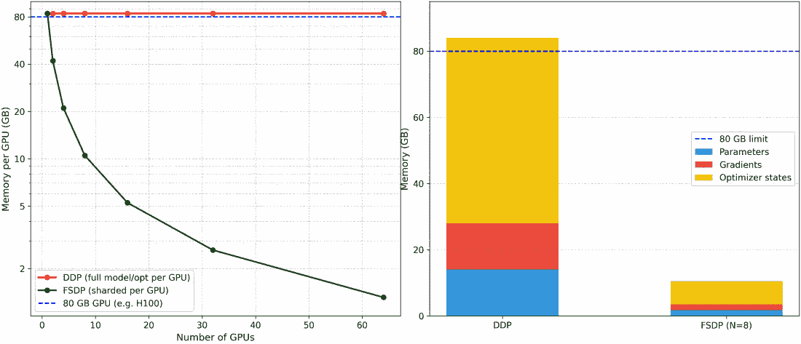
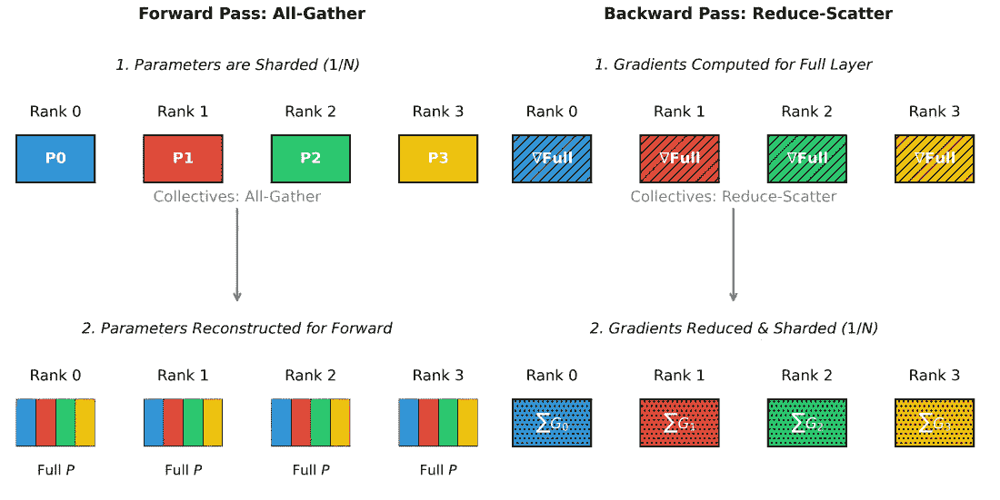
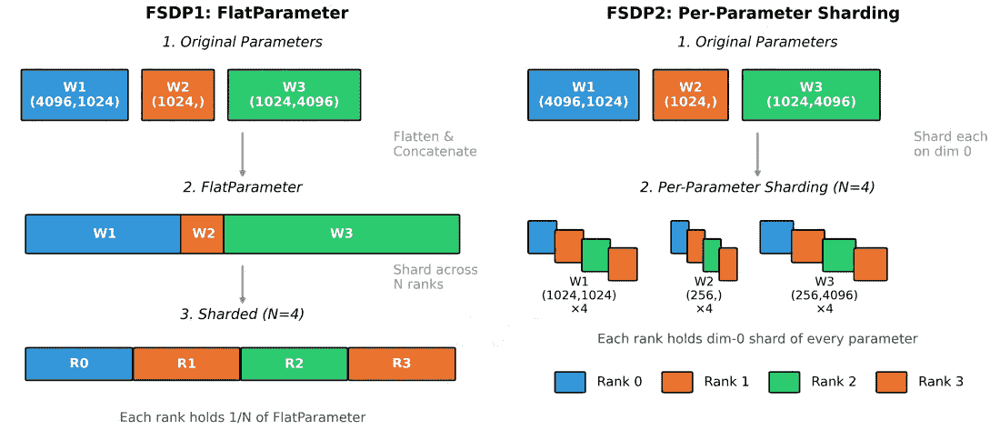
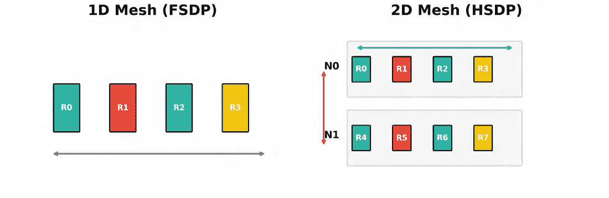
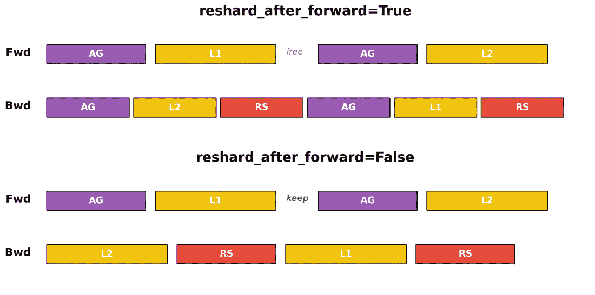
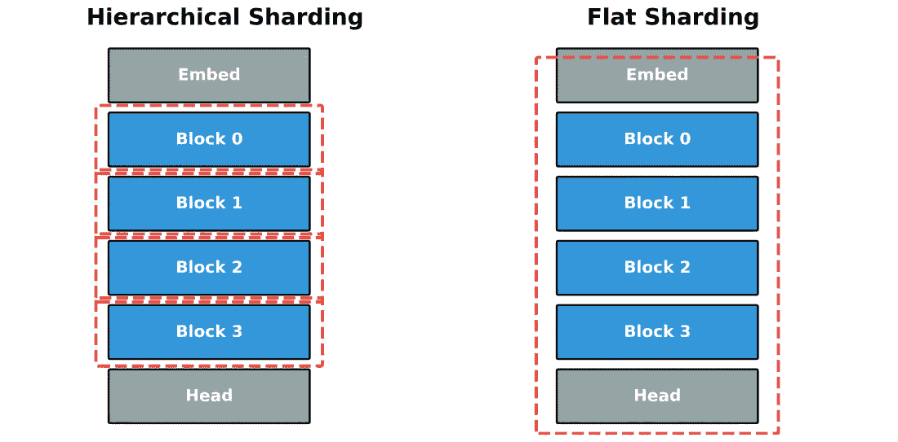
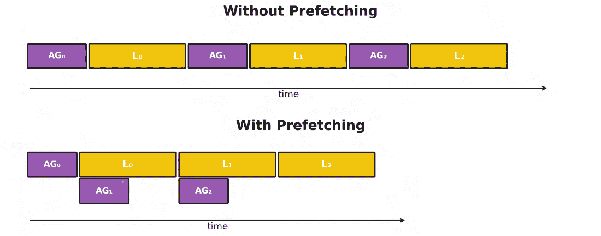

## 4 使用完全分片数据并行（FSDP）进行扩展

*通过参数分片训练超出单块 GPU 内存容量的模型*

> *数据中心是新的计算单元。*
>
> *NVIDIA CEO 黄仁勋*

### 从 DDP 到 FSDP

**完全分片数据并行（FSDP）**是一种训练策略，它将模型参数、梯度和优化器状态在多个设备之间进行分片，使每个设备只持有完整模型的一小部分。在*第 3 章*中，我们使用了 DDP，它会在每块 GPU 上复制整个模型——当模型能够放入单块 GPU 内存时，这种方法很有效。当模型（加上梯度和优化器状态）超过该内存时，DDP 就不再可行。FSDP 通过将模型及其训练状态分布到各 GPU 上来解决这一问题，因此你可以训练超过任意单个设备内存容量的模型。

PyTorch 为 GPU 训练提供了两个主要的 FSDP API，另外还有一个用于 TPU 的独立实现：

- **FSDP1**（`FullyShardedDataParallel`）：使用扁平参数方法的原始包装器类。
- **FSDP2**（`fully_shard()`）：较新的逐参数分片设计，通过 `fully_shard()` 访问。更简单、更灵活，也是 PyTorch 正在发展的方向。
- **通过 SPMD 的 FSDP**（`SpmdFullyShardedDataParallel`）：用于 XLA/TPU 设备，使用 GSPMD 进行自动并行化。

在本章中，当我们讨论适用于两种 API 的通用技术——参数分片、all-gather、reduce-scatter——时，会使用不带数字的 **FSDP**。当需要区分时，我们会明确写出 **FSDP1** 或 **FSDP2**。

本章重点介绍用于 GPU 训练的 FSDP2——对于 CUDA 设备上的新项目，这是推荐的方法。FSDP1 仍然有效，并继续在生产代码库中使用；例如，Wan2.2 将 PyTorch FSDP 与 DeepSpeed Ulysses 结合用于多 GPU 推理。[1] 下面我们先简要总结 FSDP1，然后重点介绍 FSDP2。对于 TPU 训练，请参阅*通过 SPMD 的 FSDP（用于 TPU/XLA）*。

### 为什么 FSDP 能够训练超出内存容量的模型

基本思路很简单：不是在每块 GPU 上都保留完整模型，而是将模型拆分。每块 GPU 只持有参数的一个分片。在前向传播中，你 **all-gather** 所需的参数。在反向传播中，你在本地分片上计算梯度，然后通过 **reduce-scatter** 在 GPU 间进行聚合。

但让我们深入探讨一下为什么这一点很重要。使用 DDP 训练大型模型时，每块 GPU 需要存储：

- **模型参数**：即权重本身。对于一个 7B 参数的 BF16 模型，就是 7B × 2 字节 = 14 GB。
- **梯度**：与参数大小相同。BF16 下还需要 14 GB。
- **优化器状态**：对于 Adam，动量和方差在 FP32 下是参数大小的 2 倍。即 7B × 4 字节 × 2 = 56 GB。
- **激活值**：取决于批大小和序列长度，但对于大型模型来说很容易达到数十 GB。

因此，对于一个使用 Adam 的 7B 模型，仅参数、梯度和优化器状态每块 GPU 就需要 14 + 14 + 56 = 84 GB——这已经超过 80 GB H100 的容量，而且还没有算上激活值。混合精度 Adam 还会保留一份 FP32 的权重主副本（对于 7B 模型约多出 28 GB），所以 DDP 实际的内存占用更接近 112 GB。使用 FSDP 时，这些组件会被分片到各 GPU 上：每台设备持有每个组件的 1/N（N = GPU 数量）。使用 8 块 GPU 时，上述三项每块 GPU 为 84 / 8 = 10.5 GB，从而为激活值留出空间。在实践中，这正是同一个 7B 模型在 8 块 GPU 上可以用 FSDP 放下、而在单块 80 GB GPU 上用 DDP 却放不下的区别。

*图 4.1：7B 模型下每块 GPU 的内存：DDP 与 FSDP 对比*

*图 4.1* 展示了这一对比：使用 DDP 时，每块 GPU 保存完整的 84 GB（参数、梯度和优化器状态），超出了 80 GB 设备的容量；使用 FSDP 时，每块 GPU 的内存占用降至 84/N，在 8 块 GPU 时每块 GPU 只有 10.5 GB，为激活值留下了空间。

### FSDP 的工作原理

FSDP 背后的核心思想来自微软研究院 2019 年发表的 ZeRO（零冗余优化器）论文。[2] ZeRO 发现，在数据并行训练中，每块 GPU 都持有模型、梯度和优化器状态的完整副本，其中大部分是冗余的。通过将这些内容在 GPU 间进行分区，并只在需要时进行聚合，你可以在不改变底层数据并行算法的情况下训练更大规模的模型。我们将在*第 5 章*详细介绍 ZeRO；这里重点讨论 PyTorch 对这些思想的原生实现。

PyTorch 的 FSDP 使用两种集合通信操作来实现这一思想。在前向传播中，当某一层需要其参数时，FSDP 会从所有 GPU 上 **all-gather** 这些参数——临时重建完整的参数张量（参见*第 1 章*）。该层计算完成后，被聚合的参数随即被释放。在反向传播中，梯度会在完整的（临时聚合的）参数上本地计算，然后在 GPU 间进行 **reduce-scatter**，使每块 GPU 最终得到聚合梯度中属于自己的分片（参见*第 1 章*）。



*图 4.2：FSDP：前向中的 All-Gather，反向中的 Reduce-Scatter*

*图 4.2* 展示了这两个步骤。在左图（前向）中，每个 rank 持有一个参数分片（1/N）；经过 All-Gather 后，每个 rank 都临时拥有完整参数。在右图（反向）中，每个 rank 拥有完整梯度；经过 Reduce-Scatter 后，每个 rank 只保留归约后梯度的分片（1/N）。

关键的洞察在于，你不需要同时持有所有参数。神经网络是按层顺序处理的——先经过第 1 层，再经过第 2 层，依此类推。FSDP 利用这一点：为当前层 all-gather 参数，使用完毕后在进入下一层之前将其释放。这就是为什么激活检查点与 FSDP 配合得很好：它能减少激活内存，为临时 all-gather 出的参数腾出空间。

**注意：激活值不会被分片**

FSDP 只对参数、梯度和优化器状态进行分片——不分片激活值。在前向和反向过程中，每块 GPU 仍然会为其负责的那部分 batch 存储激活值，因此激活内存仍然是每块 GPU 各自的成本。诸如激活检查点之类的技术（在反向传播中重新计算激活值，而不是存储它们）通常与 FSDP 一起使用，以便为临时 all-gather 出的参数释放空间。

### FSDP1 与 FSDP2：演进

PyTorch 最初的 FSDP（2021 年发布，通常称为 FSDP1）采用了**扁平参数**设计，该设计借自 FairScale 的实现。它将包装模块中的所有参数展平为一个连续的 `FlatParameter` 张量，然后在 GPU 间对该张量进行分片。这种方法有效，但存在局限：同一组中的所有参数必须共享相同的 dtype，冻结参数需要单独分组，而且展平操作使编译器更难优化通信模式。




**FSDP2**（于2024年通过 PyTorch RFC #114299[3] 引入）采用了不同的方法：使用带有 `Shard(0)` 的 DTensor 进行**逐参数分片**。它不是将参数展平，而是将每个参数张量单独在维度 0 上进行分片。形状为 (4096, 1024) 的线性层权重在 4 个 GPU 上会变成四个形状为 (1024, 1024) 的分片——每个 rank 持有四分之一的行。没有展平，也没有 `FlatParameter` 类。当维度 0 不能被世界大小整除时，FSDP2 会对张量进行填充；非常小的参数可能会被复制而不是分片。

*图 4.3：FSDP1 与 FSDP2 的参数布局*

*图 4.3* 展示了这种差异。FSDP1（左）将参数 W1、W2、W3 拼接成一个单一的扁平张量，然后在各 rank 之间分片。FSDP2（右）则独立地在维度 0 上对每个参数进行分片——每个 rank 持有每个参数的一个切片。



逐参数设计更简单（约 3k 行代码，而 FSDP1 约 14k 行），也更灵活。你可以混合使用不同的数据类型（某些参数用 fp8，其他用 bf16），在同一个分组中保留冻结参数和可训练参数，无需收集即可保存分片检查点，并让编译器看到单个参数以实现更好的优化。集合通信是相同的——All-Gather 和 Reduce-Scatter——但参数布局从根本上不同。

### 原始 FSDP（FSDP1）

**原始 FSDP**（通常称为 FSDP1）是 `torch.distributed.fsdp` 中的包装类 `FullyShardedDataParallel`。它将每个被包装模块的参数展平为单个 `FlatParameter` 对象（该类的一个实例），并在各 rank 之间进行分片；同样的 all-gather 和 reduce-scatter 思想也适用。用法与 DDP 类似：你包装模型（或通过 `wrap()` 包装子模块），然后像往常一样训练。

```python
from torch.distributed.fsdp import FullyShardedDataParallel as FSDP
from torch.distributed.fsdp import ShardingStrategy

model = FSDP(
    model,
    sharding_strategy=ShardingStrategy.FULL_SHARD,  # ZeRO-3 style
    device_id=torch.cuda.current_device(),
)
```

你可以使用 `FSDP.set_state_dict_type()` 以及 `StateDictConfig` / `OptimStateDictConfig` 进行检查点保存；混合精度通过 `MixedPrecision` 配置。

尽管 FSDP2 是新项目的推荐 API，但 FSDP1 仍然具有技术上的相关性，而不仅仅是简单的遗留惯性。以 **Wan2.2** 为例，这是一个仍然使用 FSDP1 的开源视频生成模型。[1]

- 首先，Wan2.2 依赖 DeepSpeed Ulysses 进行序列并行，以处理高分辨率视频帧。Ulysses 使用特定的 all-to-all 模式来分布注意力头，这些模式已经针对 FSDP1 的接口进行了加固。虽然 FSDP2 的 `DeviceMesh` 是为多维并行设计的，但 FSDP + Ulysses 混合设置通常会发现在 `distributed_c10d` 组调用中，FSDP1 的钩子更稳定、更可预测。
- 其次，Mixture-of-Experts 架构（总计 27B / 14B 激活参数）需要对非均匀分片进行精确控制。FSDP1 通过 `ModuleWrapPolicy` 提供的手动包装策略，使开发人员在跨时间步动态交换或卸载专家时能够进行细粒度控制——对于这种用例，通常比 FSDP2 的 `fully_shard` 注解更容易调试。
- 第三，该模型使用 UMT5-XXL 进行文本编码，这是一个巨大的冻结参数块。Hugging Face 生态系统中许多优化的 T5 包装器都是为 FSDP1 的 `ShardedGradScaler` 和自动包装策略而构建的。将整个流水线（编码器 + DiT + VAE）迁移到 FSDP2 需要重写 T5 集成，以避免混合版本导致的分布式错误。

当你遇到或扩展此类项目时，理解 FSDP1 的包装类风格和扁平参数行为就变得至关重要。

### FSDP2：逐参数分片 API

对于新项目，FSDP2 提供了更简洁的设计。FSDP2 不是将模块包装在一个类中，而是使用 `fully_shard()` 作为就地修改模块的函数——更具功能性和组合性。这与原始 FSDP 有很大不同，原始 FSDP 使用的是类似于 DDP 的包装类。

以下是该 API 的样子。一个完整的可运行示例位于 `code/train_fsdp2.py`：

`torchrun --nproc_per_node=2 code/train_fsdp2.py`

核心模式：

```python
from torch.distributed.fsdp import fully_shard, MixedPrecisionPolicy
from torch.distributed.device_mesh import init_device_mesh

# Initialize device mesh
mesh = init_device_mesh("cuda", (world_size,))

# Apply FSDP to your model
fully_shard(
    model,
    mesh=mesh,
    mp_policy=MixedPrecisionPolicy(param_dtype=torch.bfloat16),
)
```

与原始 FSDP 的关键区别在于，`fully_shard()` 会就地修改模型。它不会返回包装后的模型——你的模型直接变成 FSDP 模型。这使得它更容易与其他变换组合，并且与 `torch.compile` 配合得更好。

关于具有分层分片（每个 block 分别包装）的最小 transformer 示例，请参阅 `code/fsdp2_basic.py`：

`torchrun --nproc_per_node=2 code/fsdp2_basic.py`

### 设备网格：基础

`DeviceMesh` 是 PyTorch 中的一个新抽象，表示设备的逻辑排列。对于 FSDP，你通常使用一维网格（所有 GPU 在单一维度上）：

```python
from torch.distributed.device_mesh import init_device_mesh

# 1D mesh for standard FSDP (4 GPUs)
mesh = init_device_mesh("cuda", (4,))
```

这会创建一个所有 GPU 沿单一维度排列的网格。对于 4 个 GPU，就是 `[0, 1, 2, 3]`。

对于非常大的集群，跨所有 GPU 的完全分片可能会产生过多的跨节点通信。混合分片数据并行（HSDP）通过仅在每个节点内分片参数并在节点间复制来解决这个问题——用一些内存换取减少的节点间流量。我们将在 *混合分片* 中详细介绍 HSDP；现在，先看看如何设置二维网格：

```python
# 2D mesh for hybrid sharding
# 2 nodes × 4 GPUs per node = 8 GPUs total
mesh = init_device_mesh("cuda", (2, 4))
```

这会将 GPU 排列在二维网格中，适用于需要在节点内分片但在节点间复制的超大规模训练。

*图 4.4：设备网格：1D（FSDP）与 2D（HSDP）*

*图 4.4* 展示了这两种网格配置。在一维网格（左图）中，标记为 R0–R3 的四个 GPU 形成单个分片组——每个 GPU 持有每个参数的不同分片。在二维网格（右图）中，N0 和 N1 代表两个物理节点（例如，通过 InfiniBand 连接的两台服务器）。在每个节点内，GPU 沿维度 1（绿色箭头）分片，因此 N0 中的 R0–R3 各自持有不同的参数分片。跨节点时，位于相同位置的 GPU 沿维度 0（红色箭头）共享相同的分片——N0 中的 R0 和 N1 中的 R4 持有相同的数据。这种混合方法将大量的 all-gather 流量保持在快速的节点内互联（NVLink）中，而只通过较慢的节点间网络交换梯度。



### 关键参数

`fully_shard()` 函数接受多个控制分片行为的参数。`mesh` 参数指定用于分片的 `DeviceMesh`——标准 FSDP 通常使用一维网格，混合分片（HSDP）使用二维网格。

最重要的参数是 `reshard_after_forward`，它控制内存与通信之间的权衡。当设置为 `True`（默认值）时，参数会在每一层前向传播后立即重新分片，从而释放内存，但在反向传播时需要额外的 all-gather。这对应于 ZeRO-3 的行为。将其设置为 `False` 会在前向传播后保留参数在内存中，这会使用更多内存，但消除了反向传播中的 all-gather——类似于 ZeRO-2。你还可以传递一个整数来重新分片到中间大小；例如，`reshard_after_forward=2` 仅跨 2 个 GPU 而不是所有 GPU 分片，模拟 ZeRO++ 的混合参数零（hpZ）。

对于大多数内存受限的场景，默认值 `True` 是正确的选择。如果你有内存余量且通信是瓶颈，可以尝试 `False`。

*图 4.5：reshard_after_forward：True 与 False*




*图 4.5* 比较了这两种模式。每一行展示了一个两层模型的前向（Fwd）和后向（Bwd）传递。彩色块分别表示：AG（All-Gather，紫色）用于收集分片参数，L1/L2（Compute，黄色）用于层计算，RS（Reduce-Scatter，红色）用于分发梯度。当 `reshard_after_forward=True`（上方）时，参数在每层前向传递后即被释放（标记为“free”），并在后向传递中需要再次进行全收集（all-gather）——这样可保持较低内存占用，但会使全收集通信量翻倍。当 `False`（下方）时，参数在前向传递后仍保留在内存中（标记为“keep”），因此后向传递完全跳过全收集——峰值内存更高，但通信量更少。

混合精度通过 `mp_policy` 配置。你可以指定 `param_dtype` 用于参数存储（例如 `torch.bfloat16`），指定 `reduce_dtype` 用于梯度归约（通常为 `torch.float32` 以保证数值稳定性），还可以选择指定 `output_dtype` 用于层输出：

```python
mp_policy = MixedPrecisionPolicy(
    param_dtype=torch.bfloat16,
    reduce_dtype=torch.float32,
)
```

由于 FSDP2 按参数进行分片，而不是展平为单个缓冲区，因此你可以自由混用不同的数据类型——某些层使用 fp8，另一些层使用 bf16。原始的 FSDP 要求同一组中的所有参数共享相同的数据类型。

最后，当 GPU 内存耗尽时，`offload_policy` 可启用 CPU 卸载：

```python
from torch.distributed.fsdp import CPUOffloadPolicy

fully_shard(
    model,
    mesh=mesh,
    offload_policy=CPUOffloadPolicy(pin_memory=True),
)
```

卸载会带来性能开销，因此应将其视为穷尽其他内存优化手段后的最后手段。性能下降幅度因 PCIe 代数、CPU 内存带宽和优化器状态大小而异——对于 CPU 卸载，经验上的粗略范围是 20%–50%。

### 分层分片

除了这些每次调用时的参数外，FSDP2 还允许你控制在模型层次结构中放置分片边界的位置。你可以在不同层级应用 `fully_shard()`——例如，包装各个 transformer 块的同时保持 embedding 层不分片：

```python
# Shard each transformer layer individually
for layer in model.transformer.layers:
    fully_shard(layer, mesh=mesh)

# Don't shard the embedding layer (it's small)
# fully_shard(model.embedding, mesh=mesh) # Skip this
```

这让你可以细粒度地控制哪些部分会被分片。较小的层（如 embedding 层）可能不会从分片中受益，反而会增加通信开销，因此你可以让它们保持不分片。

*图 4.6* 对比了这两种方法。两个面板都展示了一个 transformer 模型，包含 embedding 层（Embed）、四个 transformer 块（Block 0–3）和一个输出头（Head）。红色虚线框表示 FSDP 单元边界。使用分层分片（左）时，通过在循环中调用 `fully_shard(block)` 将每个 transformer 块包装为独立的 FSDP 单元，而 embedding 和输出头保持不分片。这意味着 all-gather 和 reduce-scatter 在块边界处发生，从而支持预取（当前块计算时即可收集下一个块的参数）和细粒度的内存管理（同一时刻只需要一个块的完整参数驻留内存）。使用扁平分片（右）时，单个 `fully_shard(model)` 调用将整个模型包装为一个 FSDP 单元。这更简单，但需要一次性收集所有参数，导致更高的峰值内存。

*图 4.6：分层分片与扁平分片*

### 完整可运行示例：使用 FSDP 进行 T5 摘要生成

`code/FSDP/` 目录下有一个完整可运行的示例，它使用 FSDP1 和 FSDP2 训练 **T5（FLAN-T5）**[4] 进行文本摘要，包含检查点、混合精度和示例训练日志。

该示例提供三个入口点，以便你在同一任务和模型上比较单 GPU 训练、FSDP1 和 FSDP2：

- **FSDP1**：`T5_training_FSDP1.py` 使用 `FullyShardedDataParallel`、`ShardingStrategy.FULL_SHARD`、混合精度以及 FSDP1 风格的状态字典处理来包装 FLAN-T5。当你处理仍依赖原始 FSDP API 的代码库时，请使用此脚本。
- **FSDP2**：`T5_training_FSDP2.py` 使用 `fully_shard()` 和分布式检查点（DCP）API；这是新项目的推荐脚本。
- **单 GPU 基线**：`T5_training_Single.py` 在单个 GPU 上训练相同模型（不使用 FSDP），可用于检查正确性以及比较内存和吞吐量。

所有脚本都位于 `code/FSDP/` 中。在运行训练脚本之前，请在 `code/FSDP/` 目录下运行以下命令下载 WikiHow 数据集：

```bash
bash download_dataset.sh
```



从而将 CSV 文件下载到 `data/` 中。该目录下的 README 介绍了模型选择（flan-t5-small 到 flan-t5-xxl）、显存要求和命令行选项。

#### 运行示例

单 GPU 基线：

```bash
python code/FSDP/T5_training_Single.py
```

FSDP1（2 个 GPU）：

```bash
torchrun --nnodes 1 --nproc_per_node 2 code/FSDP/T5_training_FSDP1.py
```

FSDP2（2 个 GPU）：

```bash
torchrun --nnodes 1 --nproc_per_node 2 code/FSDP/T5_training_FSDP2.py
```

较大的模型（例如 `--model-name google/flan-t5-xl` 或 `google/flan-t5-xxl`）可能需要较小的批量大小。

#### 对比

以下数据来自在 H200 GPU 上的示例运行。单 GPU 训练将完整模型保留在一台设备上；当模型能够放入内存时，它在每个 GPU 上可以获得最高的迭代吞吐量（it/s），但在使用 2 个 GPU 时，由于批量数据被分发，每个 epoch 完成的墙钟时间更短（例如 XL：49 秒 vs 91 秒）。单 GPU 训练无法扩展到超出单个 GPU 内存的模型，例如 FLAN-T5-XXL。FSDP1 和 FSDP2 将参数、梯度和优化器状态分片到多个 GPU 上，因此每个 GPU 的内存占用下降，可以训练更大的模型。

对于较小的 FLAN-T5-XL（3B）模型，单 GPU 训练可以放入单块 H200；使用 2 个 GPU 时，FSDP1 将每个 GPU 的内存占用大致减半，并且每个 epoch 的墙钟时间更短（49 秒 vs 91 秒）。这种加速主要来自将批量数据分散到两个 GPU 上——每个 GPU 的迭代速率（it/s）几乎不变——而不是因为 FSDP 让每一步更快。表 4.1 给出了具体数字。

| 模式 | GPU 数 | 内存/GPU | 峰值内存/GPU | 吞吐量 | 时间/epoch |
| --- | --- | --- | --- | --- | --- |
| 单 GPU | 1 | ~43 GB | ~58 GB | ~4.36 it/s | ~91 s |
| FSDP1 | 2 | ~22 GB | ~33 GB | ~4.09 it/s | ~49 s |

*表 4.1：FLAN-T5-XL（3B）：单 GPU vs FSDP1（2 个 GPU）。示例运行于 H200 GPU*

对于 FLAN-T5-XXL（11B 参数），即使在 H200（140 GB）上，单 GPU 训练也会内存不足（OOM）。表 4.2 比较了在 2 个 GPU 上的 FSDP1 和 FSDP2。

| 模式 | GPU 数 | 内存/GPU | 峰值内存/GPU | 吞吐量 | 时间/epoch |
| --- | --- | --- | --- | --- | --- |
| 单 GPU | 1 | OOM | OOM | — | — |
| FSDP1 | 2 | ~84 GB | ~105 GB | ~1.96 it/s | ~101 s |
| FSDP2 | 2 | ~84 GB | ~105 GB | ~1.86 it/s | ~106 s |

*表 4.2：FLAN-T5-XXL（11B）上单 GPU、FSDP1 和 FSDP2 的对比。示例运行于 H200 GPU*

该表显示，在此设置下 FSDP1 和 FSDP2 的内存和吞吐量几乎相同。这里选择 FSDP2 并非因为原始速度，而是因为它具有更简单的 API、与 `torch.compile` 更紧密的集成，以及通过 DCP 实现的分片检查点，这些在任务和代码库不断增长时更为重要。

#### 代码分析

以下代码片段展示了 T5 示例如何实现加载、分层分片和混合精度。

*FSDP1：策略与包装器。* 在 FSDP1 中，**策略**是传入包装器的配置对象：**混合精度策略**指定参数和梯度的数据类型（例如 bfloat16），以节省内存并加速计算；**包装策略**是一个可调用对象，它告诉 FSDP 应将哪些子模块包装为独立的 FSDP 单元（此处为每个 `T5Block`），这样分片是分层的，all-gather/reduce-scatter 发生在块边界处。脚本从 `get_policies` 获取这两者，然后用 `FSDP` 包装器类包装已加载的模型。下面的代码片段来自 `T5_training_FSDP1.py` 和 `policies/wrapping.py`。

```python
# get_policies (T5_training_FSDP1.py): mixed precision + wrap policy
def get_policies(cfg, rank):
    mixed_precision_policy = None
    if cfg.mixed_precision:
        # e.g. policies.bfSixteen for bfloat16
        mixed_precision_policy = policies.bfSixteen
    wrapping_policy = policies.get_t5_wrapper()  # targets T5Block
    return mixed_precision_policy, wrapping_policy

# Wrap policy (policies/wrapping.py): wrap each T5Block as an FSDP unit
def get_t5_wrapper():
    from torch.distributed.fsdp.wrap import transformer_auto_wrap_policy
```


```python
return functools.partial(
    transformer_auto_wrap_policy,
    transformer_layer_cls={T5Block},
)

# Apply FSDP (T5_training_FSDP1.py): model already from setup_model()
mixed_precision_policy, t5_auto_wrap_policy = get_policies(train_config, rank)
model = FSDP(model,
    auto_wrap_policy=t5_auto_wrap_policy,
    mixed_precision=mixed_precision_policy,
    sharding_strategy=fsdp_config.sharding_strategy,
    device_id=torch.cuda.current_device(),
    limit_all_gathers=fsdp_config.limit_all_gathers)
```

*FSDP2：混合精度策略。* FSDP2 使用 `MixedPrecisionPolicy`（不是 FSDP1 的 `MixedPrecision` 对象）。脚本调用 `get_policies(train_config, rank)` 从配置构建策略；随后通过 `fsdp_kwargs["mp_policy"]` 将该策略传入每次 `fully_shard(...)` 调用。下面的代码片段来自 `T5_training_FSDP2.py`。

```python
from torch.distributed.fsdp import fully_shard, MixedPrecisionPolicy

def get_policies(cfg, rank):
    """Establish mixed precision policy for FSDP2 (no wrap policy; sharding is explicit)."""
    mp_policy = None
    if cfg.mixed_precision:
        bfloat_available = bfloat_support()
        if bfloat_available and not cfg.use_fp16:
            mp_policy = MixedPrecisionPolicy(
                param_dtype=torch.bfloat16,
                reduce_dtype=torch.bfloat16,
            )
            if rank == 0:
                print("bFloat16 enabled for mixed precision - using MixedPrecisionPolicy")
        elif cfg.use_fp16:
            mp_policy = MixedPrecisionPolicy(
                param_dtype=torch.float16,
                reduce_dtype=torch.float16,
            )
    return mp_policy

# In fsdp_main: get policy once, then pass into every fully_shard call
mp_policy = get_policies(train_config, rank)
fsdp_kwargs = {}
if mp_policy is not None:
    fsdp_kwargs["mp_policy"] = mp_policy

# ... later: fully_shard(block, **fsdp_kwargs) and fully_shard(model, **fsdp_kwargs)
```

*FSDP2：加载模型，然后对每个块和根进行分片。* 模型通过 `from_pretrained` 加载并移到设备上。没有自动包装策略：脚本显式遍历 `model.encoder.block` 和 `model.decoder.block`（每个元素都是 `T5Block`），并调用 `fully_shard(block, **fsdp_kwargs)`，使每个块成为独立的分片单元，然后调用 `fully_shard(model, **fsdp_kwargs)` 包裹根。顺序很重要——子模块先于根分片。

请注意，此示例省略了 `mesh` 参数。在单进程组（常见情况）下运行时，`fully_shard()` 会从全局大小推断默认 mesh。对于多维并行（例如 HSDP），您需要像前面章节展示的那样显式传递 `mesh`。下面的代码片段来自 `T5_training_FSDP2.py`。

```python
from torch.distributed.fsdp import fully_shard

model = T5ForConditionalGeneration.from_pretrained(model_name)
model = model.to(device)

# fsdp_kwargs already holds mp_policy from get_policies()
# Shard encoder blocks (each T5Block becomes one FSDP unit)
if hasattr(model, 'encoder') and hasattr(model.encoder, 'block'):
    for block in model.encoder.block:
        fully_shard(block, **fsdp_kwargs)

# Shard decoder blocks
if hasattr(model, 'decoder') and hasattr(model.decoder, 'block'):
    for block in model.decoder.block:
        fully_shard(block, **fsdp_kwargs)

# Shard the entire model (root); children must already be sharded
fully_shard(model, **fsdp_kwargs)
```

对于即使在加载时也无法放入内存的模型，请参阅 *初始化最佳实践*（meta device、`to_empty` 和 `reset_parameters`）。

### 使用 FSDP2 检查点

模型完成分片并开始训练后，您需要保存检查点。长时间运行可能会失败——硬件错误、抢占、bug——丢失数天的进度令人痛苦。使用 FSDP2，检查点比以前更简单：由于分片状态字典与训练表示一致，每个 rank 只需直接保存自己的分片。无需收集到 rank 0，也无需在加载时重新分片。保存和加载在本地完成，速度更快，内存占用更少。

有两种方法：使用分布式检查点（DCP）API，或手动处理分片状态字典。

#### 使用 DCP API（推荐）

DCP API 是保存和加载 FSDP2 检查点的推荐方式。它处理了分片状态字典的所有复杂性。完整可运行的示例位于 `code/fsdp2_checkpoint_dcp.py`：

```bash
torchrun --nproc_per_node=2 code/fsdp2_checkpoint_dcp.py
```

关键函数是 `save_checkpoint_dcp` 和 `load_checkpoint_dcp`：

```python
from torch.distributed.checkpoint.state_dict import (
    get_model_state_dict, get_optimizer_state_dict,
    set_model_state_dict, set_optimizer_state_dict, StateDictOptions,
)
import torch.distributed.checkpoint as dcp

def save_checkpoint_dcp(model, optimizer, epoch, checkpoint_dir):
    """Save checkpoint using DCP API."""
    model_state_dict = get_model_state_dict(
        model=model,
        options=StateDictOptions(full_state_dict=False, cpu_offload=True),
    )
    optim_state_dict = get_optimizer_state_dict(
        model=model, optimizers=optimizer,
        options=StateDictOptions(full_state_dict=False, cpu_offload=True),
    )
    checkpoint_path = os.path.join(checkpoint_dir, f"epoch_{epoch}")
    dcp.save({"model": model_state_dict, "optimizer": optim_state_dict, "epoch": epoch},
             checkpoint_id=checkpoint_path)

def load_checkpoint_dcp(model, optimizer, checkpoint_dir, epoch):
    """Load checkpoint using DCP API."""
    checkpoint_path = os.path.join(checkpoint_dir, f"epoch_{epoch}")
    opt = get_optimizer_state_dict(model, optimizers=optimizer,
                                   options=StateDictOptions(full_state_dict=False))
    state_dict = {"model": get_model_state_dict(model,
                                                options=StateDictOptions(full_state_dict=False)),
                  "optimizer": opt,
                  "epoch": 0}
    dcp.load(state_dict, checkpoint_id=checkpoint_path)
    set_model_state_dict(model, state_dict["model"],
                         options=StateDictOptions(full_state_dict=False))
    set_optimizer_state_dict(model, optimizers=optimizer,
                             optim_state_dict=state_dict["optimizer"],
                             options=StateDictOptions(full_state_dict=False))
    return state_dict["epoch"]
```

保存路径很简单：每个 rank 使用 `dcp.save` 写入自己的分片。加载则不那么直观——`dcp.load` **不会**返回新的状态字典。相反，您需要在此 rank 上对已经初始化并分片的模型和优化器调用 `get_model_state_dict` 和 `get_optimizer_state_dict` 来构建一个**模板**。将该字典传给 `dcp.load`；DCP 会从检查点分片中**就地**填充每个条目。模板告诉 DCP 应当期望哪些键、形状和分片布局；跳过它——即在模型于每个 rank 上构建和分片之前就进行加载——是形状不匹配或未初始化参数错误的常见来源。最后的 `set_model_state_dict` 和 `set_optimizer_state_dict` 调用完成了 PyTorch 文档中记载的加载路径；它们对优化器状态尤其必要，即使模型参数已经通过模板引用就地更新。无需收集到 rank 0，也无需广播——每个 rank 只读取自己的分片。

#### 手动分片检查点

如果您需要更多控制，可以手动处理分片状态字典。方法如下：

```python
def save_checkpoint_manual(model, optimizer, epoch, checkpoint_dir):
    """Manually save sharded checkpoint."""
    rank = torch.distributed.get_rank()
    # Get sharded state dict
    model_sd = model.state_dict()  # Already sharded
```


## 使用完全分片数据并行（FSDP）进行扩展

```python
# Get optimizer state dict (also sharded)
optim_sd = optimizer.state_dict()

checkpoint_path = os.path.join(checkpoint_dir, f"epoch_{epoch}")
os.makedirs(checkpoint_path, exist_ok=True)

# Each rank saves its shard
model_path = os.path.join(checkpoint_path, f"model_rank_{rank}.pt")
optim_path = os.path.join(checkpoint_path, f"optim_rank_{rank}.pt")
torch.save(model_sd, model_path)
torch.save(optim_sd, optim_path)

# Save metadata on rank 0
if rank == 0:
    metadata = {"epoch": epoch, "world_size": torch.distributed.get_world_size()}
    torch.save(metadata, os.path.join(checkpoint_path, "metadata.pt"))
print(f"Checkpoint saved to {checkpoint_path}")

def load_checkpoint_manual(model, optimizer, checkpoint_dir, epoch):
    """Manually load sharded checkpoint."""
    rank = torch.distributed.get_rank()
    checkpoint_path = os.path.join(checkpoint_dir, f"epoch_{epoch}")

    # Each rank loads its shard
    model_path = os.path.join(checkpoint_path, f"model_rank_{rank}.pt")
    optim_path = os.path.join(checkpoint_path, f"optim_rank_{rank}.pt")
    model_sd = torch.load(model_path, map_location="cpu")
    optim_sd = torch.load(optim_path, map_location="cpu")
    model.load_state_dict(model_sd)
    optimizer.load_state_dict(optim_sd)

    if rank == 0:
        metadata = torch.load(os.path.join(checkpoint_path, "metadata.pt"))
        print(f"Checkpoint loaded from {checkpoint_path}, epoch {metadata['epoch']}")
    return epoch
```

手动方法能带来更多控制权，但需要谨慎处理分片后的状态字典。对于大多数使用场景，推荐使用 DCP API。

### 用于评估的完整状态字典

有时你需要一个完整（未分片）的状态字典，例如为了保存最终模型用于推理或与他人共享。你可以将所有分片收集到 rank 0：

```python
def save_full_checkpoint(model, optimizer, epoch, checkpoint_path):
    """Save full (unsharded) checkpoint on rank 0."""
    rank = torch.distributed.get_rank()

    # Get full state dict (gathers all shards to rank 0)
    model_state_dict = get_model_state_dict(
        model=model,
        options=StateDictOptions(
            full_state_dict=True,  # Gather all shards
            cpu_offload=True,
        ),
    )

    optim_state_dict = get_optimizer_state_dict(
        model=model,
        optimizers=optimizer,
        options=StateDictOptions(
            full_state_dict=True,
            cpu_offload=True,
        ),
    )

    # Only rank 0 saves
    if rank == 0:
        checkpoint = {
            "model": model_state_dict,
            "optimizer": optim_state_dict,
            "epoch": epoch,
        }
        torch.save(checkpoint, checkpoint_path)
        print(f"Full checkpoint saved to {checkpoint_path}")

    torch.distributed.barrier()
```

这会将所有分片收集到 rank 0，虽然占用更多内存，但你会得到一个可以在任意数量 GPU 上加载的单一检查点文件。

### 预取：优化通信

解决检查点问题之后，下一个关注点就是性能。FSDP 会增加通信开销——每次前向传播都需要一次 all-gather 来重建参数，每次反向传播都需要一次 reduce-scatter 来处理梯度。像 NVLink 这样的高速互连可以降低这种开销，但无法彻底消除。

隐藏这种延迟的一种方法是预取：在当前层仍在计算时，就开始获取下一层的参数。关键的洞见在于，现代 GPU 可以在不同的硬件单元上并发执行计算和通信（计算使用 CUDA 流，传输使用 NVLink/PCIe）。如果计算的时间长于通信，all-gather 会在需要之前就已完成，你就不需要付出任何延迟代价。

*图 4.7：预取时间线：无预取与有预取*



*图 4.7* 展示了其中的差异。未启用预取时（上图），每一层都必须等待其 all-gather（AG）完成才能开始计算——这些操作是串行的。启用预取后（下图），当 L₀ 层正在计算时，L₁ 层的 all-gather 会在另一个流上并行进行。等到 L₀ 计算完成，L₁ 的参数已经就绪。由于通信被隐藏在计算背后，总时间得以缩短。

#### 前向预取

在处理当前层的同时，前向预取会为后续各层预先执行 all-gather：

```python
def set_modules_to_forward_prefetch(model, num_to_forward_prefetch):
    """Set forward prefetching for transformer layers."""
    for i, layer in enumerate(model.layers):
        if i >= len(model.layers) - num_to_forward_prefetch:
            break

        layers_to_prefetch = [
            model.layers[i + j] for j in range(1, num_to_forward_prefetch + 1)
        ]
        layer.set_modules_to_forward_prefetch(layers_to_prefetch)
```

这会告诉每一层为接下来的 `num_to_forward_prefetch` 层预取参数。当第 `i` 层在计算时，它已经在为第 `i+1`、`i+2` 层等执行 all-gather 了。

#### 后向预取

后向预取与此类似，但针对的是反向传播。它会为梯度计算预取所需参数：

```python
def set_modules_to_backward_prefetch(model, num_to_backward_prefetch):
    """Set backward prefetching for transformer layers."""
    for i, layer in enumerate(model.layers):
        if i < num_to_backward_prefetch:
            continue

        layers_to_prefetch = [
            model.layers[i - j] for j in range(1, num_to_backward_prefetch + 1)
        ]
        layer.set_modules_to_backward_prefetch(layers_to_prefetch)
```

这样会在为当前层计算梯度的同时，预取前面各层的参数。

#### 何时使用预取

当你的模型有很多层（10 层以上）且每一层都有足够的计算量来隐藏通信延迟时，预取的效果最好。如果层很小，或者互连已经很快（NVLink、高带宽 InfiniBand），收益就会变小——额外的调度逻辑甚至可能带来新的开销。

实用建议：先不使用预取。对训练循环进行性能分析，如果通信成为瓶颈，再尝试加入预取，设置 `num_to_forward_prefetch=2` 和 `num_to_backward_prefetch=2`，然后根据分析器给出的结果再做调整。

### 激活检查点与卸载

激活检查点几乎总是与 FSDP 搭配使用。与其在前向传播时存储所有激活值，不如在反向传播时重新计算它们。这可以将激活内存减少 50-80%，在内存已经受限的情况下尤为关键。

#### 为什么激活检查点对 FSDP 很重要

使用 FSDP 时，你已经在分片参数、梯度和优化器状态了。但激活值仍可能成为内存瓶颈，尤其是在 batch size 较大或序列较长的情况下。激活检查点用计算换内存：在反向传播时重新计算激活值，而不是存储它们。

激活内存随模型架构和 batch size 的规模而变化。对于一个 transformer，粗略估算公式为：

激活内存 ≈ L × B × S × H × 每元素字节数 × k

其中 L 是层数，B 是 batch size，S 是序列长度，H 是隐藏维度，k 是一个系数（通常为 10–20），用于计入注意力和 MLP 块中的中间张量。这不是一个精确的公式——实际内存取决于实现细节，例如注意力分数是否被具体化、MLP 的扩展比例以及框架开销。但它能给出正确的数量级。以一个 7B 模型（L=32, H=4096）为例，序列长度为 2048、batch size 为 8、使用 fp16：

32 × 8 × 2048 × 4096 × 2 × 12 ≈ 52 GB

使用激活检查点时，你只存储每个被检查点化的块的输入，而不是所有中间张量，从而将内存减少 50–80%。代价是在反向传播时重新计算激活值（前向传播大约慢 30%，但反向传播差别不大，因为你本来就要计算梯度）。

#### 使用激活检查点

最简单的方法是对整个模型启用检查点：

```python
from torch.utils.checkpoint import checkpoint

# After applying FSDP
fully_shard(model, mesh=mesh)

# Wrap forward pass with checkpointing
def forward_with_checkpoint(x):
    return checkpoint(model, x)
```

但你也可以更有针对性。对于 transformer，通常是对单个层启用检查点：

```python
class TransformerBlockWithCheckpoint(nn.Module):
    def __init__(self, args: ModelArgs, use_checkpoint=False):
```


```python
super().__init__()
self.use_checkpoint = use_checkpoint
self.attention_norm = nn.LayerNorm(args.dim)
self.attention = Attention(args)
self.ffn_norm = nn.LayerNorm(args.dim)
self.feed_forward = FeedForward(
    args.dim, hidden_dim=4 * args.dim, dropout_p=args.dropout_p
)

def forward(self, x):
    if self.use_checkpoint:
        # Checkpoint the entire block
        return checkpoint(self._forward_impl, x)
    else:
        return self._forward_impl(x)

def _forward_impl(self, x):
    h = x + self.attention(self.attention_norm(x))
    out = h + self.feed_forward(self.ffn_norm(h))
    return out
```

然后为某些层启用检查点：

```python
# Checkpoint every other layer to balance memory and speed
for i, layer in enumerate(model.layers):
    layer.use_checkpoint = (i % 2 == 0)
```

### CPU 卸载

CPU 卸载将参数、梯度和优化器状态移动到 CPU 内存中，以训练速度变慢为代价释放 GPU 内存。FSDP2 API 支持这一功能：

```python
from torch.distributed.fsdp import CPUOffloadPolicy

fully_shard(
    model,
    mesh=mesh,
    offload_policy=CPUOffloadPolicy(pin_memory=True),
)
```

分片参数会在每次 all-gather 之前被复制到 GPU；梯度计算和优化器步骤在 CPU 上运行。这会带来显著开销，但对于非常大的模型可能是必要的。实际减速取决于 PCIe 代次（3.0 对 4.0 对 5.0）、CPU 内存带宽、NUMA 拓扑以及优化器状态大小——根据经验，20-50% 是常见的，但具体情况会有所不同。如果 CPU 内存也耗尽，NVMe 卸载是 DeepSpeed ZeRO-Infinity 的一项功能（*第 5 章*），并非 FSDP2 原生提供的功能。

#### 何时使用卸载

CPU 卸载应该放在优化序列的后期。如果你已经启用了全分片和激活检查点，并尽可能减小了批量大小和序列长度，但仍然遇到内存不足（OOM），那么卸载就有意义。对于大多数模型，全分片加上激活检查点就足够了，无需涉及卸载。

### 性能优化

一旦 FSDP 正常工作，你就会希望优化性能。主要瓶颈是通信（all-gather/reduce-scatter）和激活内存。让我们看看如何进行分析和优化。

#### FSDP 训练性能分析

使用 PyTorch 的分析器来了解时间花费在哪里。完整的可运行示例位于 `code/fsdp2_profile.py`：

```bash
torchrun --nproc_per_node=2 code/fsdp2_profile.py
```

关键模式是用 `profile()` 包裹训练循环，并使用 `record_function()` 标记不同阶段：

```python
from torch.profiler import profile, record_function, ProfilerActivity

rank = dist.get_rank()

with profile(
    activities=[ProfilerActivity.CPU, ProfilerActivity.CUDA],
    record_shapes=True,
    profile_memory=True,
) as prof:
    for i in range(num_iterations):
        with record_function("forward"):
            output = model(data)
            loss = criterion(output, target)
        with record_function("backward"):
            loss.backward()
        with record_function("optimizer"):
            optimizer.step()
            optimizer.zero_grad()
    if rank == 0:
        print(prof.key_averages().table(sort_by="cuda_time_total", row_limit=30))
        prof.export_chrome_trace(f"fsdp_trace_rank{rank}.json")
```

只有 rank 0 会打印并导出跟踪结果。由于 FSDP 在所有 rank 上同步执行相同的操作，时间模式几乎相同——通常只需要检查单个 rank 的跟踪记录即可。如果怀疑存在负载不均衡或掉队者（stragglers），可以移除 `if rank == 0` 守卫，从所有 rank 导出跟踪记录并进行比较。

跟踪文件 `fsdp_trace_rank0.json` 采用 Chrome 跟踪格式。有关如何打开和解释这些跟踪记录，请参阅*第 3 章*。简而言之：在 Chrome 中打开 `chrome://tracing`，点击 “Load”，然后选择 `.json` 文件。在时间线中，查找 all-gather 和 reduce-scatter 操作——理想情况下它们应与计算重叠。如果发现它们阻塞了，预取（prefetching）可能会有所帮助。还要检查峰值内存使用情况（`profile_memory=True` 可启用此功能），以判断激活是否超出了预期。

#### 优化通信

如果分析器显示通信是瓶颈，你有几种选择。预取（前面介绍过）可以将通信与计算重叠。如果有内存余量，设置 `reshard_after_forward=False` 可以避免反向传播中的 all-gather——参数在正向传播后保持不分片，因此反向传播时无需再次获取它们：

```python
fully_shard(model, mesh=mesh, reshard_after_forward=False)
```

这是用内存换速度。只有在分析后确认有余量时才使用。

硬件也很重要。节点内的 NVLink 和节点间的 InfiniBand 会带来很大差异。请检查 NCCL 是否确实在使用它们：

```bash
export NCCL_IB_DISABLE=0 && NCCL_DEBUG=INFO
```

调试输出将显示 NCCL 检测到了哪些互连。

#### 优化激活内存

如果激活内存是瓶颈，最简单的修复方法是减小批量大小或序列长度——输入更小意味着需要存储的激活更少。但如果你需要较大的有效批量大小来保证收敛，梯度累积可以在不增加内存开销的情况下实现这一目标：

```python
accumulation_steps = 4
optimizer.zero_grad()
for i, (data, target) in enumerate(dataloader):
    loss = criterion(model(data), target) / accumulation_steps
    loss.backward()
    if (i + 1) % accumulation_steps == 0:
        optimizer.step()
        optimizer.zero_grad()
```

这提供了 `batch_size * accumulation_steps` 的有效批量大小，但内存占用仅为单个 `batch_size`。你还可以尝试选择性检查点——只对部分层而不是所有层启用检查点，并通过实验找到内存与重计算开销之间的合适平衡点。

#### 内存分析

为了了解内存的去向，可以在代码中穿插一些打印语句：

```python
def print_memory_usage(step_name):
    allocated = torch.cuda.memory_allocated() / 1e9
    reserved = torch.cuda.memory_reserved() / 1e9
    print(f"{step_name}: allocated={allocated:.2f}GB, reserved={reserved:.2f}GB")

print_memory_usage("Before model")
print_memory_usage("After FSDP")
print_memory_usage("After forward")
print_memory_usage("After backward")
```

这会告诉你每个阶段使用了多少内存。如果 “After forward” 远高于 “After FSDP”，激活就是罪魁祸首。如果 “After backward” 仍然很高，问题可能出在梯度或优化器状态。若需更详细的分类信息，`nvidia-smi` 可以显示 GPU 总内存使用量，PyTorch 的 `torch.cuda.memory_summary()` 则提供完整的分配报告。

### 多节点 FSDP 训练

多节点 FSDP 的工作方式与多节点 DDP 相同——需要初始化进程组和正确的网络配置。主要区别在于检查点：使用 FSDP2，分片状态字典（sharded state dict）非常直接——每个 rank 写入自己的分片，无需 all-gather 即可重新加载。

#### 设置多节点 FSDP

设置与多节点 DDP 类似。在每个节点上，你需要：

- 设置进程组初始化的环境变量
- 使用 `torchrun` 启动训练
- 确保节点之间的网络连通性

在主节点（节点 0）上：

```bash
torchrun --nnodes=2 --nproc_per_node=8 --node_rank=0 \
--master_addr=<master_ip> --master_port=29500 code/train_fsdp2.py
```

在工作节点（节点 1）上：

```bash
torchrun --nnodes=2 --nproc_per_node=8 --node_rank=1 \
--master_addr=<master_ip> --master_port=29500 code/train_fsdp2.py
```

将 `<master_ip>` 替换为主节点的实际 IP 地址。你可以通过以下命令找到它：

```bash
hostname -I
```

#### 多节点网络配置

对于多节点 FSDP，网络带宽和延迟至关重要。FSDP 比 DDP 进行更多通信（all-gather 和 reduce-scatter），因此快速互连更加重要。

**更倾向于使用 InfiniBand** 而非以太网，因为：

- 更高带宽：每条链路 200-400 Gb/s，而以太网为 10-100 Gb/s
- 更低延迟：亚微秒级 vs 微秒级
- RDMA 支持：GPU 到 GPU 的直接内存访问

确保 NCCL 正在使用 InfiniBand：

```bash
export NCCL_IB_DISABLE=0 && NCCL_DEBUG=INFO
```

检查 NCCL 日志以确认它正在使用 InfiniBand。你应该会看到类似这样的消息：

```text
NCCL INFO NET/IB: Using [device] for node [rank]
```


### 多节点上的检查点

使用FSDP2，即使在多节点上，检查点也很简单。每个rank保存自己的分片，因此你需要一个可从所有节点访问的共享存储。

#### 选项1：共享文件系统（NFS、Lustre等）

如果所有节点挂载同一文件系统，每个rank可以直接写入：

```python
checkpoint_dir = "/shared/checkpoints"
# Mounted on all nodes
save_checkpoint_dcp(model, optimizer, epoch, checkpoint_dir)
```

#### 选项2：并行写入本地存储

每个节点先写本地，之后再同步：

```python
# Each node writes to local storage
local_checkpoint_dir = f"/local/checkpoints/node_{node_rank}"
save_checkpoint_dcp(model, optimizer, epoch, local_checkpoint_dir)
```

然后在训练后同步到共享存储（或使用分布式文件系统）。

#### 选项3：对象存储（S3等）

使用像 `s3fs` 这样的库直接写入S3：

```python
import s3fs
fs = s3fs.S3FileSystem()
checkpoint_path = f"s3://bucket/checkpoints/epoch_{epoch}"
# Save using DCP with S3 backend
```

分片方法很有帮助，因为每个rank只写入自己的分片（文件更小，带宽更少）。

### SLURM集成

大多数HPC集群使用SLURM进行作业调度。下面是一个多节点FSDP的最小示例：

```bash
#!/bin/bash
#SBATCH --job-name=fsdp_train
#SBATCH --nodes=4
#SBATCH --ntasks-per-node=8
#SBATCH --gres=gpu:8
#SBATCH --time=24:00:00
#SBATCH --partition=gpu
# Get node list
export MASTER_ADDR=$(scontrol show hostnames $SLURM_JOB_NODELIST | head -n 1)
export MASTER_PORT=29500
srun torchrun --nnodes=$SLURM_NNODES --nproc_per_node=8 --node_rank=$SLURM_NODEID \
--master_addr=$MASTER_ADDR --master_port=$MASTER_PORT train_fsdp2.py
```

或者直接结合SLURM使用 `torchrun`：

```bash
#!/bin/bash
#SBATCH --job-name=fsdp_train
#SBATCH --nodes=4
#SBATCH --ntasks-per-node=8
#SBATCH --gres=gpu:8
export MASTER_ADDR=$(scontrol show hostnames $SLURM_JOB_NODELIST | head -n 1)
export MASTER_PORT=29500
srun torchrun --nnodes=$SLURM_NNODES --nproc_per_node=8 --node_rank=$SLURM_NODEID \
--master_addr=$MASTER_ADDR --master_port=$MASTER_PORT train_fsdp2.py
```

我们将在*第8章*中详细介绍SLURM。

### 扩展注意事项

随着扩展到更多节点，通信开销会增长。确保你的模型足够大，使计算仍然占主导地位——否则你就是在为大多数时间都在等待网络的GPU付费。

检查点也会变得更棘手。节点很多时，你最终会有许多分片文件。能很好处理小文件的分布式文件系统或对象存储（如Lustre或S3）对此有帮助。而且硬件越多，故障也会越多——请频繁保存检查点，如果集群支持，还可以考虑弹性训练。

网络拓扑也很重要。位于同一网络段并使用InfiniBand的节点，其性能会优于通过较慢链路分散在不同机架上的节点。

### 调试FSDP问题

FSDP增加了复杂性，而当问题出现时，错误信息并不总是有用。以下是如何处理常见问题的方法。

#### 内存不足（OOM）

首次设置FSDP时，OOM错误很常见。一个快速的合理性检查是确认参数是否真的被分片。在FSDP2下，它们是DTensor——`param.shape` 是全局形状，所以使用本地张量来查看你的分片：

```python
for name, param in model.named_parameters():
    local = param.to_local() if hasattr(param, "to_local") else param
    print(f"{name}: local_shape={local.shape}, device={param.device}")
```

如果参数看起来正确但仍然OOM，那么激活值很可能是罪魁祸首。使用前面介绍的内存分析方法来确认，然后减小批大小、序列长度，或启用激活检查点。同时注意内存泄漏——由于忘记分离或删除张量，导致张量在迭代间累积。

#### 挂起或死锁

当进程失去同步时，FSDP会挂起。最常见的原因是只有部分rank会执行的条件逻辑：

```python
# BAD: only rank 0 runs this collective-triggering code
if rank == 0:
    model.some_operation()

# GOOD: all ranks execute the same code
model.some_operation()
```

其他原因：数据不平衡（一个rank比其他rank更早用完批次）、某些rank上检查点加载失败，或NCCL问题。对于NCCL问题，用 `export NCCL_DEBUG=INFO` 启用调试日志，并在输出中查找错误。

#### 训练缓慢

如果训练比预期慢，先做性能分析——猜测会浪费时间。检查通信是否与计算重叠；如果没有，尝试预取。对于多节点，确认是否正在使用InfiniBand（`NCCL_DEBUG=INFO` 会显示）。激活检查点会增加约30%的开销，所以请确保内存节省是值得的。如果你的硬件支持，确认混合精度确实已启用。

#### 结果不正确

结果不正确通常来自几个方面。首先，检查所有rank是否使用相同的随机种子：

```python
torch.manual_seed(42)
torch.cuda.manual_seed_all(42)
```

其次，验证 `DistributedSampler` 是否正确设置，并且你每个epoch都调用了 `sampler.set_epoch(epoch)`——忘记这一步意味着所有epoch都会看到相同的洗牌顺序。第三，通过跨rank打印梯度范数来检查梯度是否同步。如果所有方法都失败，可以在单个GPU上运行相同模型以建立基线，然后扩展并比较。

#### 调试工具

有几个工具可以帮助进行FSDP调试。对于NCCL问题，`export NCCL_DEBUG=INFO`（或 `NCCL_DEBUG_SUBSYS=ALL` 以获得更多细节）显示通信层正在发生的事情。PyTorch分析器（之前介绍过）揭示通信模式和瓶颈。对于内存问题，`torch.cuda.memory_summary()` 给出详细分解。对于分布式特定的问题，`torch.distributed.set_debug_level(torch.distributed.DebugLevel.DETAIL)` 启用分布式运行时的详细日志输出。

### 比较FSDP2与ZeRO和DDP

选择DDP、ZeRO（DeepSpeed）还是FSDP2，取决于你的模型大小和生态系统偏好。

**DDP** 是最简单的选项。每个GPU都保存模型、梯度和优化器状态的完整副本。通信只是梯度同步（AllReduce），已经过良好优化。当你的模型能装入单个GPU时使用DDP——在现代GPU上配合混合精度，这涵盖大多数最大约7B参数的模型。

**ZeRO**（来自DeepSpeed）进行分阶段分片：ZeRO-1分片优化器状态，ZeRO-2增加梯度，ZeRO-3分片所有内容，包括参数。它经过生产测试，并与DeepSpeed的其他功能（如ZeRO-Offload（CPU）和ZeRO-Infinity（NVMe））集成。代价是增加DeepSpeed作为依赖并学习其API。

**FSDP2** 是PyTorch原生的，像ZeRO-3一样进行完全分片。按参数设计更简单（约3k行 vs FSDP1的约14k行），与 `torch.compile` 集成良好，并且不需要外部依赖。它比ZeRO更新，所以经过实战验证的示例较少，但它是PyTorch发展的方向。

#### 内存与性能

具体来说：一个7B参数的模型使用Adam优化器，在DDP下每个GPU需要约84 GB（参数+梯度+优化器状态，全部复制）。在8个GPU上使用FSDP2或ZeRO-3，则降至每个GPU约10.5 GB——所有内容都按8路分片。

性能方面，当模型能放入时，DDP最快（通信较少）。对于无法放入的模型，FSDP2和ZeRO-3表现相似——两者都执行all-gather和reduce-scatter，差异归结为实现细节和网络拓扑，而不是根本设计。根据生态适配性而非性能来选择。

#### 何时使用什么

如果你的模型适合单个GPU，使用DDP——它更简单也更快。如果不适合，先尝试优化（混合精度、激活检查点、梯度累积）。仍然OOM？切换到FSDP2；由于API相似，迁移很直接。如果你需要DeepSpeed特定功能，如ZeRO-Offload或ZeRO-Infinity，或者你已经在DeepSpeed生态系统中，则使用ZeRO。

### 实用技巧

从真实世界的FSDP使用中可以提炼出一些经验。

使用FSDP2保存检查点时，分片状态字典与训练表示匹配——每个rank只保存自己的分片。DCP API（前面介绍过）能高效处理这一点。除非你特别需要用于推理的完整检查点，否则避免将所有分片收集到rank 0；收集过程很慢，并可能在大模型上导致OOM。

共享参数需要一些小心。如果同一个张量出现在模型中的多个位置（例如，绑定的嵌入），这些使用必须位于同一个FSDP组中。FSDP的参数交换不会跨组保留共享性，所以请构建模型，使共享参数保持在同一个模块层次结构中，或者完全避免共享。

内存分析常常会揭示意外情况。瓶颈并不总是在你预期的地方。使用 `torch.profiler` 或 `nvidia-smi` 进行调查。常见的罪魁祸首包括激活值（通过检查点解决）、跨迭代累积的临时张量（分离或显式删除它们），以及在内存受限系统上使用 `pin_memory=True` 的DataLoader。


最后，请记住，`reshard_after_forward` 默认值为 `True`，这会在前向传播后重新分片以节省内存，但在反向传播中需要额外的全收集操作。如果你的内存有富余，而通信是瓶颈，可以尝试将其设置为 `False`，以在两次传播之间保持参数不分片。

### 初始化最佳实践

对于非常大的模型，先在元设备上创建，应用 FSDP，然后移动到实际设备并初始化：

```python
with torch.device("meta"):
    model = Transformer(args)
    fully_shard(model, mesh=mesh)
    model.to_empty(device=device)
    model.reset_parameters()
```

这样可以避免在单个设备上实体化整个模型。确保所有 rank 使用相同的随机种子，以便参数初始化一致。

### 数据加载与梯度裁剪

使用 `DistributedSampler`，并在每个 epoch 调用 `sampler.set_epoch(epoch)`——忘记这一点意味着所有 epoch 看到相同的打乱顺序。梯度裁剪可与 FSDP 配合使用；像往常一样调用 `torch.nn.utils.clip_grad_norm_` 即可，FSDP 会自动处理去分片/重新分片。

### 混合精度

对于参数而言，BF16 通常优于 FP16（更大的动态范围，更少的溢出风险）。为了数值稳定性，将梯度归约保持在 FP32（`reduce_dtype=torch.float32`）。先让 FSDP 在无混合精度的情况下运行，然后再添加混合精度。

### 渐进式优化

从简单开始：使用带混合精度的 FSDP2。如果遇到 OOM，添加激活检查点。仍然 OOM？减小批大小或序列长度。CPU 卸载是最后的手段——它确实有效，但会显著降低速度。不要过早优化；先让它跑起来。

### 高级主题

#### 混合分片（HSDP）

在极大规模下，你可能希望在一个节点内分片，但在节点间复制——这减少了节点间通信，而节点间通信通常比节点内通信慢（NVLink 对比 InfiniBand）。使用二维 mesh：

```python
mesh = init_device_mesh("cuda", (4, 8))  # 4 nodes × 8 GPUs per node
fully_shard(model, mesh=mesh)  # 2D mesh: replicate dim 0, shard dim 1 (HSDP)
```

这样会在每个节点内的 8 个 GPU 之间分片参数，但会在 4 个节点之间复制参数。权衡之处：更多内存占用（4 倍复制）但更少的跨节点流量。

#### 编译器集成

FSDP2 与 `torch.compile` 配合良好——先应用 FSDP，再进行编译：

```python
fully_shard(model, mesh=mesh)
model = torch.compile(model)
```

按参数（per-parameter）的设计在这里有所帮助。编译器可以看到单个参数，而不是一个扁平化的缓冲区，因此它可以更有效地优化全收集和 reduce-scatter 模式。

#### 其他集成

FSDP2 自然地与梯度累积和学习率调度配合——无需特殊处理。对于混合精度，使用 `MixedPrecisionPolicy` 而不是标准的 AMP 上下文管理器。自定义通信钩子可用于细粒度控制，但大多数用户不需要它们。

#### 通过 SPMD 的 FSDP 用于 TPU/XLA

本章重点介绍了使用 CUDA 设备的 GPU 训练的 FSDP2。不过，PyTorch 也为 TPU/XLA 设备提供了通过 SPMD 的 FSDP，它使用基于 GSPMD（广义单程序多数据）的不同方法进行自动并行化。

**与 GPU FSDP2 的主要区别：**

- **使用 SPMD 模式**：XLA 编译器根据分片注释自动划分计算，而不是显式的 all-gather/reduce-scatter 操作
- **基于 mesh 的分片**：使用 PyTorch/XLA 的 `Mesh` 抽象，带有命名维度（例如 `('fsdp', 'model')`）
- **编译器驱动**：XLA 编译器处理通信优化，类似于 JAX 的 `pmap` 的工作方式

完整的示例位于 `code/fsdp_spmd_tpu.py`。请注意，这需要 TPU 硬件——它不会在 GPU 上运行：

```bash
# On a TPU VM:
python code/fsdp_spmd_tpu.py
```

核心模式：

```python
import torch_xla.runtime as xr
import torch_xla.distributed.spmd as xs
from torch_xla.experimental.spmd_fully_sharded_data_parallel import (
    SpmdFullyShardedDataParallel as FSDPv2
)

xr.use_spmd()  # Enable SPMD mode
# Create mesh with 'fsdp' axis
num_devices = xr.global_runtime_device_count()
mesh = xs.Mesh(np.array(range(num_devices)), (num_devices, 1), ('fsdp', 'model'))
# Shard inputs and wrap model
x = xs.mark_sharding(x, mesh, ('fsdp', None))
model = FSDPv2(model, mesh)
```

在 TPU 设备上训练或希望获得编译器优化的通信模式时，可通过 SPMD 使用 FSDP。XLA 编译器会自动处理通信优化，类似于 JAX 的 `pmap`。对于 GPU 训练，请使用本章介绍的 `fully_shard()` API——它能让你显式控制通信模式，且不需要 XLA。

更多细节，请参阅 PyTorch/XLA SPMD 文档。[5]

### 总结

FSDP2 是 PyTorch 针对无法在单个 GPU 上容纳的模型训练给出的答案。通过在多个 GPU 之间分片参数、梯度和优化器状态，它可以让你训练比单个 GPU 所能容纳的大 8 倍、16 倍甚至更大的模型。

值得退一步来理解 FSDP 改变了什么——以及它没有改变什么。FSDP 将内存上限从单 GPU 的限制转变为集群范围的限制。一个需要 160 GB 内存（参数 + 梯度 + 优化器状态）的模型可以运行在 8 块各 24 GB 的 GPU 上，因为每块 GPU 只保存总数的 1/8。这是一个根本性的转变：你不再受限于能买到的最大的 GPU，而是受限于你能连接多少块 GPU。

然而，FSDP 的核心仍然是**数据并行**。每个 GPU 处理不同的数据批次，模型计算本身并不会跨设备拆分——每个 GPU 执行相同的操作，只是作用于不同的分片，在需要时会进行全收集。这把 FSDP 与模型并行（张量并行、流水线并行）区分开来，后者中不同的 GPU 同时计算模型的不同部分。FSDP 扩展的是内存，而不是每个样本的计算量。要扩展计算，你仍然依赖在更多 GPU 上使用更大的批大小，就像 DDP 一样。

在选择并行策略时，这种架构上的区别很重要。仅 FSDP 就能带你走得很远——在大型集群上训练多达数千亿参数的模型。但对于最大的模型（万亿+ 参数）或当你需要降低每个样本的延迟时，你会将 FSDP 与张量或流水线并行相结合。我们将在后续章节中介绍这些组合。

实用建议很简单：如果 DDP 可用，就用 DDP——它更快也更简单。当你的模型超出单个 GPU 时，先尝试优化（混合精度、激活检查点、梯度累积）。如果仍然 OOM，则切换到 FSDP2。从完整分片和用于检查点的 DCP API 开始，进行性能分析以找出瓶颈，并在扩展到更多节点之前先在 2-4 块 GPU 上测试。不要盲目优化——让性能分析器指引你。

本章中的代码示例完整且可运行。在你的硬件上试试它们，看看分片的实际效果：每个 rank 只持有模型的一部分，all-gather/reduce-scatter 操作会自动发生。

FSDP2 能很好地处理大多数大模型训练场景。但如果连完整分片都不够呢？如果你需要 CPU 或 NVMe 卸载来进一步突破内存限制，或需要针对跨多节点训练的优化通信模式呢？这正是 DeepSpeed 的 ZeRO 发挥作用的地方。在下一章中，我们将探讨 ZeRO-Offload、ZeRO-Infinity 和 ZeRO++——这些特性超出了 FSDP2 目前提供的范围——以及何时选择 DeepSpeed 而非 PyTorch 原生解决方案。

### 代码摘要

- `torch.distributed.fsdp.fully_shard(module, mesh=..., mp_policy=...)`：使用按参数分片（DTensor）就地分片模块
- `torch.distributed.fsdp.MixedPrecisionPolicy`：FSDP2 的混合精度配置
- `torch.distributed.device_mesh.init_device_mesh("cuda", (world_size,))`：创建用于分片的设备 mesh
- `torch.distributed.checkpoint`：用于保存/加载分片状态字典的分布式检查点（DCP）API
- `torch.distributed.fsdp.FullyShardedDataParallel(module, ...)`：使用 FlatParameter 进行分片的包装器类
- `torch.distributed.fsdp.wrap()`：使用 FSDP1 包装子模块
- `torch.distributed.fsdp.MixedPrecision`：FSDP1 的混合精度配置
- `torch.distributed.fsdp.set_state_dict_type()`：为检查点配置状态字典类型
- `torch.distributed.fsdp.StateDictConfig` / `OptimStateDictConfig`：状态字典配置

### 相关链接

**PyTorch FSDP 文档**

- PyTorch FSDP 文档：`https://pytorch.org/docs/stable/fsdp.html`
- PyTorch FSDP 教程：`https://docs.pytorch.org/tutorials/intermediate/FSDP_tutorial.html`
- Per-Parameter-Sharding FSDP RFC：`https://github.com/pytorch/pytorch/issues/114299`
- TorchTitan FSDP 指南：`https://github.com/pytorch/torchtitan/blob/main/docs/fsdp.md`
- PyTorch XLA SPMD：`https://docs.pytorch.org/xla/master/spmd.html`


#### 教程与指南

- UvA 深度学习 - 数据并行 FSDP (JAX)：`https://uvadlc-notebooks.readthedocs.io/en/latest/tutorial_notebooks/scaling/JAX/data_parallel_fsdp.html`
- Hugging Face - FSDP 与 DeepSpeed：`https://huggingface.co/docs/accelerate/concept_guides/fsdp_and_deepspeed`
- Hugging Face - FSDP1 对比 FSDP2：`https://huggingface.co/docs/accelerate/en/concept_guides/fsdp1_vs_fsdp2`
- 并行计算简介：`https://ggrigorev.me/posts/introduction-to-parallelism/`

#### 研究

- PyTorch FSDP：扩展全分片数据并行的经验（2023）：`https://arxiv.org/abs/2304.11277`
- 分布式训练优化（2024）：`https://arxiv.org/abs/2411.00284`

### 项目

- Wan2.2（FSDP + DeepSpeed Ulysses，用于多 GPU 推理）：`https://github.com/Wan-Video/Wan2.2`

### 备注与参考

- `https://github.com/Wan-Video/Wan2.2`
- Rajbhandari 等人，“ZeRO：面向训练万亿参数模型的内存优化”，SC 2020。`https://arxiv.org/abs/1910.02054`
- `https://github.com/pytorch/pytorch/issues/114299`

**T5**（Text-to-Text Transfer Transformer，文本到文本迁移转换器）是 Google 推出的编码器-解码器模型，它把 NLP 任务统一表示为文本到文本的形式。**FLAN-T5** 是 T5 模型经过指令微调得到的系列模型（例如 flan-t5-small、flan-t5-xl、flan-t5-xxl），用于摘要生成和问答等任务。

- `https://docs.pytorch.org/xla/master/spmd.html`

### 练习

#### 实现手动参数分片

实现 FSDP 参数分片的简化版本，以理解它如何支持训练比 GPU 内存更大的模型。

**要求：**

**函数签名：**

```python
def shard_parameters(model: nn.Module, world_size: int, rank: int) -> dict:
    """Shard model parameters across ranks, keeping only local shard."""
    pass

def gather_parameters(sharded_params: dict, world_size: int) -> dict:
    """Gather all parameter shards to reconstruct full parameters."""
    pass
```

- 将所有参数展平为单个张量
- 将展平后的张量平均分成 `world_size` 片
- 每个 rank 只保留自己的分片（占总参数的 1/world_size）
- 实现 gather 以重建完整参数，用于前向传播

**测试你的实现：**

```python
import torch
import torch.nn as nn
import torch.distributed as dist

model = nn.Sequential(
    nn.Linear(1000, 1000),
    nn.ReLU(),
    nn.Linear(1000, 100)
)

# Shard parameters
sharded = shard_parameters(model, world_size=4, rank=dist.get_rank())
print(f"Rank {dist.get_rank()}: sharded size = {sharded['shard'].numel()} elements")

# Gather for forward pass
full_params = gather_parameters(sharded, world_size=4)
print(f"Full params size: {sum(p.numel() for p in full_params.values())} elements")
```

#### 比较 FSDP 分片策略

编写一个基准测试，比较不同的 FSDP 分片策略及其内存/性能权衡。

**要求：**

- 测试三种分片策略：
  - `FULL_SHARD`：对参数、梯度和优化器状态进行分片
  - `SHARD_GRAD_OP`：仅对梯度和优化器状态进行分片
  - `NO_SHARD`：不分片（类似 DDP）
- 对每种策略进行测量：
  - GPU 峰值内存使用量
  - 训练吞吐量（样本/秒）
  - 通信量
- 使用一个在 `NO_SHARD` 下无法放入单个 GPU 内存的模型
- 生成对比表和图表

**测试你的实现：**

```python
from torch.distributed.fsdp import FullyShardedDataParallel as FSDP
from torch.distributed.fsdp import ShardingStrategy

strategies = [
    ShardingStrategy.FULL_SHARD,
    ShardingStrategy.SHARD_GRAD_OP,
    ShardingStrategy.NO_SHARD,
]

results = {}
for strategy in strategies:
    model = create_large_model()  # e.g., 7B parameter model
    fsdp_model = FSDP(model, sharding_strategy=strategy)
    memory, throughput = benchmark_training(fsdp_model, num_steps=100)

    results[strategy.name] = {"memory_gb": memory, "throughput": throughput}

# Print comparison table
print("Strategy | Memory (GB) | Throughput (samples/s)")
for name, metrics in results.items():
    print(f"{name:15} | {metrics['memory_gb']:10.1f} | {metrics['throughput']:10.1f}")
```

#### 实现自定义 FSDP 包装策略

创建一个自定义自动包装策略，将 transformer 层逐个包装，以实现最佳内存效率。

**要求：**

**类签名：**

```python
def transformer_auto_wrap_policy(
    module: nn.Module,
    recurse: bool,
    nonwrapped_numel: int,
    min_num_params: int = 1e6
) -> bool:
    """Custom wrap policy for transformer models."""
    pass
```

- 将每个 transformer 块（注意力 + FFN）包装为单个 FSDP 单元
- 不要包装嵌入层（它们应位于根 FSDP 中）
- 不要包装最终输出投影层
- 允许配置最小参数阈值

**测试你的实现：**

```python
from torch.distributed.fsdp import FullyShardedDataParallel as FSDP
from torch.distributed.fsdp.wrap import _module_wrap_policy
from transformers import AutoModelForCausalLM

model = AutoModelForCausalLM.from_pretrained("meta-llama/Llama-3.2-1B")
fsdp_model = FSDP(
    model,
    auto_wrap_policy=functools.partial(
        transformer_auto_wrap_policy,
        min_num_params=1e6
    )
)

# Verify wrapping
def count_fsdp_units(module, depth=0):
    count = 1 if isinstance(module, FSDP) else 0
    for child in module.children():
        count += count_fsdp_units(child, depth + 1)
    return count

print(f"Number of FSDP units: {count_fsdp_units(fsdp_model)}")
```

#### 使用 FSDP 实现混合精度

配置并评测采用不同混合精度策略的 FSDP。

**要求：**

- 测试三种精度配置：
  - 完整 FP32（基线）
  - BF16 计算 + FP32 参数
  - BF16 计算 + BF16 参数和梯度
- 测量：
  - 与 FP32 相比的内存节省
  - 训练损失收敛
  - 吞吐量提升
- 处理 FP16 的梯度缩放（如果适用）

**测试你的实现：**

```python
from torch.distributed.fsdp import MixedPrecision
import torch

# Define precision policies
fp32_policy = MixedPrecision()

bf16_compute_policy = MixedPrecision(
    param_dtype=torch.float32,
    reduce_dtype=torch.float32,
    buffer_dtype=torch.float32,
)

bf16_full_policy = MixedPrecision(
    param_dtype=torch.bfloat16,
    reduce_dtype=torch.bfloat16,
    buffer_dtype=torch.bfloat16,
)

policies = {
    "FP32": fp32_policy,
    "BF16 Compute": bf16_compute_policy,
    "BF16 Full": bf16_full_policy,
}

for name, policy in policies.items():
    model = FSDP(create_model(), mixed_precision=policy)
    memory, loss, throughput = train_and_measure(model, num_steps=100)
    print(f"{name}: Memory={memory:.1f}GB, Loss={loss:.4f}, Throughput={throughput:.1f}")
```

#### 实现 FSDP 检查点

为 FSDP 模型创建一个健壮的检查点系统，支持重新分片。

**要求：**

- 保存检查点，使其能够以不同的 world size 加载
- 同时支持完整 state dict 和分片 state dict 格式
- 实现检查点验证（确认保存的 == 加载的）
- 处理优化器状态的保存/加载
- 支持从检查点恢复训练

**测试你的实现：**

```python
from torch.distributed.fsdp import FullyShardedDataParallel as FSDP
from torch.distributed.fsdp import StateDictType, FullStateDictConfig

class FSDPCheckpointer:
    def __init__(self, model: FSDP, optimizer, checkpoint_dir: str):
        self.model = model
        self.optimizer = optimizer
```


```python
self.checkpoint_dir = checkpoint_dir

def save(self, step: int, full_state: bool = True):
    """Save checkpoint."""
    pass

def load(self, step: int) -> dict:
    """Load checkpoint and return metadata."""
    pass

def validate(self, step: int) -> bool:
    """Validate checkpoint integrity."""
    pass

# Test saving and loading
checkpointer = FSDPCheckpointer(fsdp_model, optimizer, "./checkpoints")

# Train for a few steps
train_steps(fsdp_model, optimizer, num_steps=10)

# Save checkpoint
checkpointer.save(step=10)

# Validate
assert checkpointer.validate(step=10), "Checkpoint validation failed!"

# Load and resume
metadata = checkpointer.load(step=10)
print(f"Resumed from step {metadata['step']}")
```

#### 预期学习成果

完成这些练习后，你应该能够：

- 理解FSDP如何在GPU之间分片参数
- 比较并选择适合你工作负载的分片策略
- 为Transformer模型实现自定义包装策略
- 配置FSDP混合精度训练
- 构建用于分布式训练的健壮检查点系统
- 在保持训练吞吐量的同时优化内存使用
