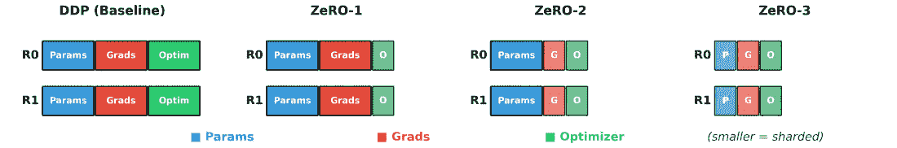
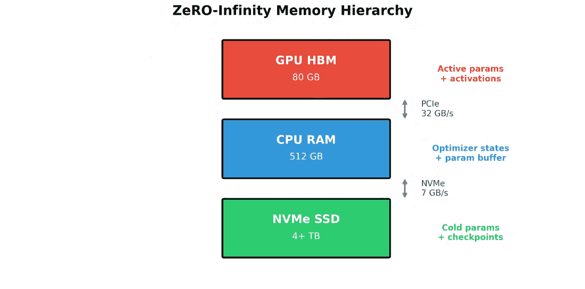
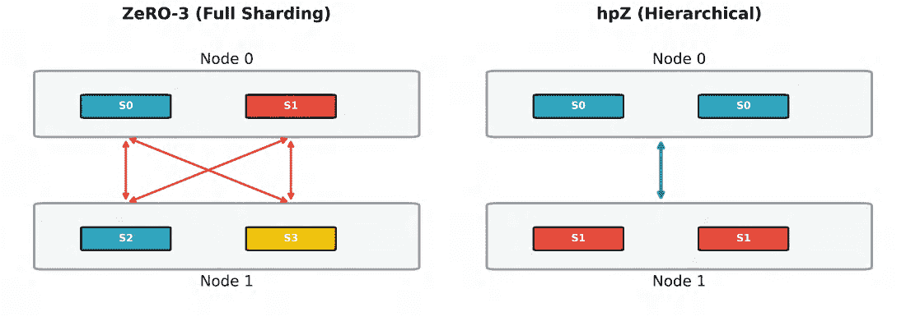
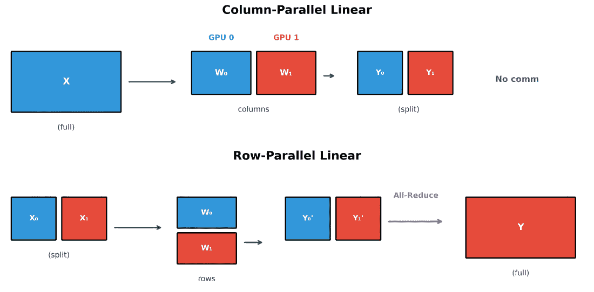
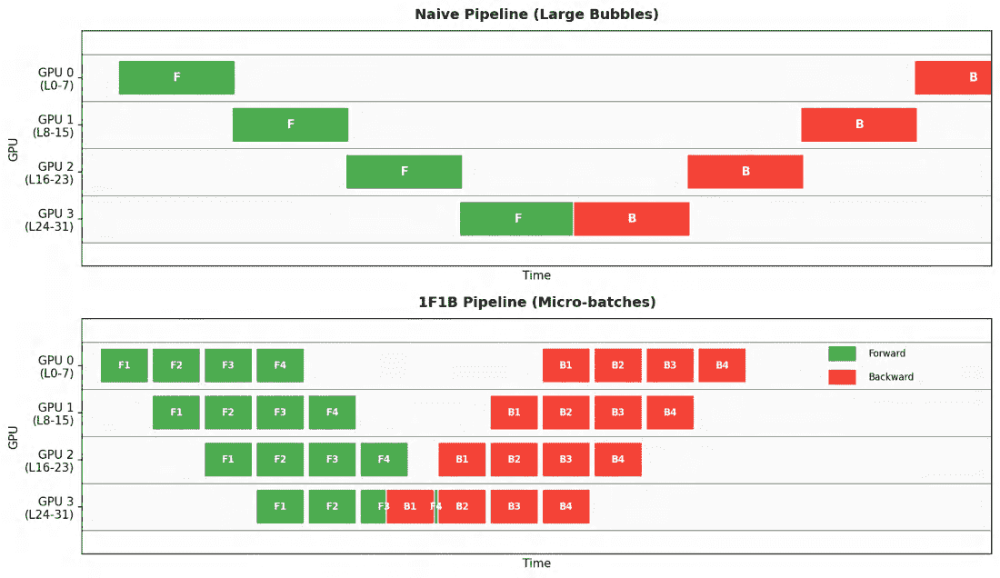
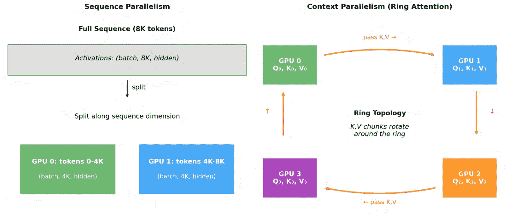
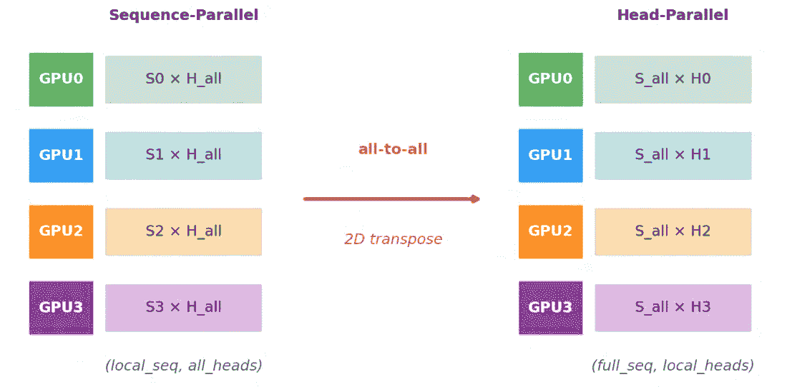
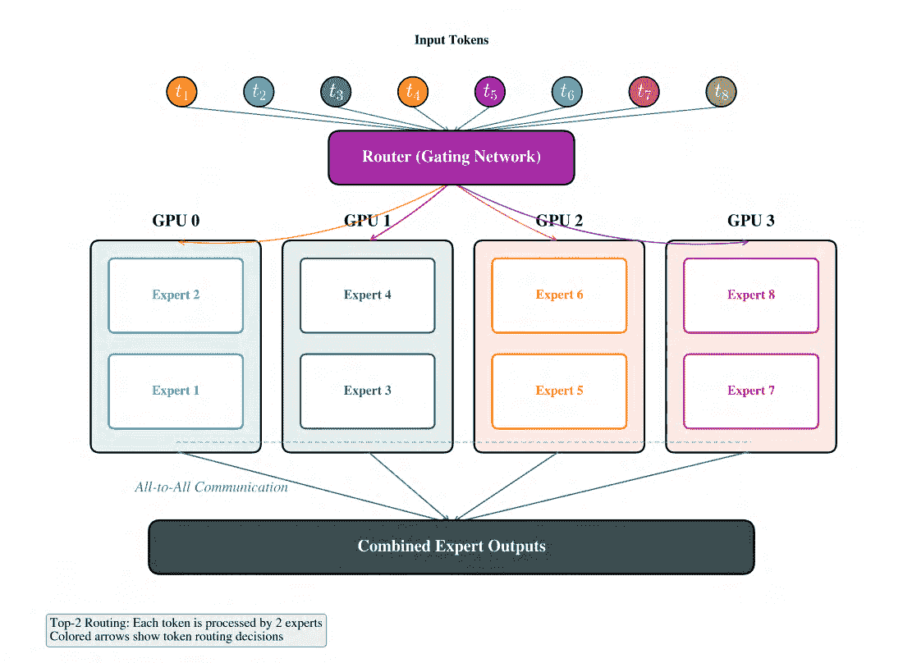
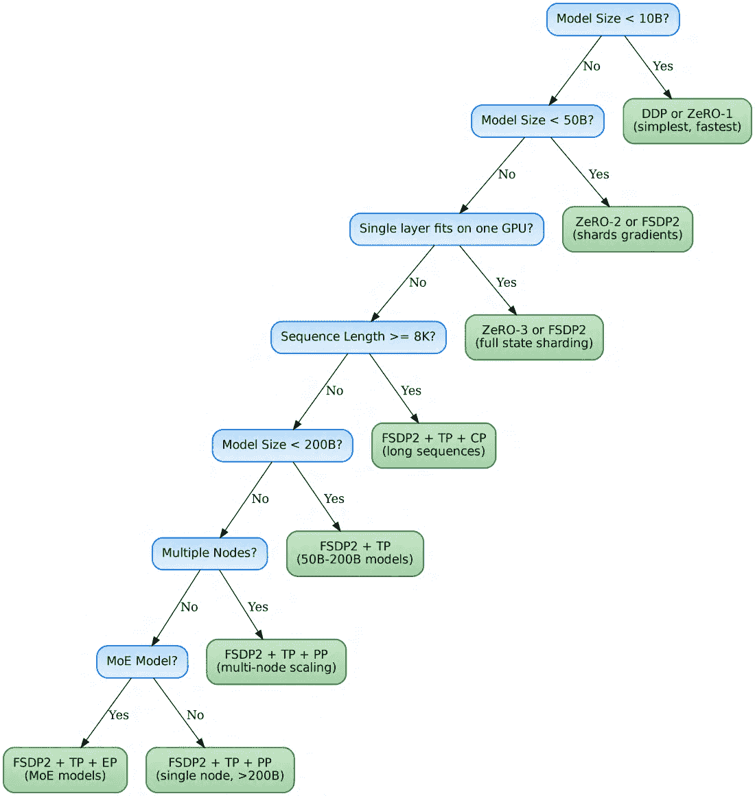

## 5 超越状态分片：DeepSpeed与Megatron

*为超大规模模型扩展内存容量并分片计算*

*未来已来，只是分布不均。*

*威廉·吉布森，作家*

### 超越状态分片

在上一章中，我们探讨了FSDP——PyTorch在GPU之间分片参数、梯度和优化器状态的方法。FSDP2的全分片在功能上等同于DeepSpeed的ZeRO Stage 3[1]：两者都通过确保每个GPU仅持有训练状态的1/N来消除内存冗余。

状态分片解决了内存问题，但并未改变计算发生的*方式*。每个GPU仍然在相同的模型架构上执行相同的操作——只是使用不同的数据批次。对于最大的模型（100B+参数），这成为瓶颈：单个层可能太大而无法在单GPU上高效执行，或者模型可能太深，即使使用检查点也无法在内存中容纳激活值。

这就是**Megatron**的用武之地[2]。Megatron的张量并行将大型矩阵运算拆分到多个GPU上，而其流水线并行则沿深度维度对模型进行分片。这些技术分片的是*计算本身*，而不仅仅是训练状态。它们是训练前沿模型的关键，并且至今仍是NVIDIA、Meta等机构大规模训练基础设施的骨干。

我们将首先介绍DeepSpeed ZeRO——了解完整的ZeRO家族（阶段1-3、卸载、ZeRO++）是值得的，因为许多代码库仍在使用它。但本章的真正重点是Megatron风格的并行：张量并行、流水线并行，以及它们如何与状态分片结合实现多维并行。



*图5.1：ZeRO阶段对比：DDP与ZeRO-1/2/3*

*图5.1*展示了DDP和每个ZeRO阶段在两个rank（R0–R1）上的内存布局。每行代表一个GPU，三个彩色块显示该GPU存储的内容：P（参数，蓝色）、G（梯度，红色）和O（优化器状态，绿色）。在DDP中，所有块都是全宽的，因为每个GPU都持有所有内容的完整副本——这就是我们想要消除的内存冗余。ZeRO-1保持参数和梯度复制，但分片优化器状态（注意较小的O块）。ZeRO-2额外分片梯度，因此G和O块都缩小。ZeRO-3分片所有三个组件——在2个GPU下，每个块都变为原始大小的一半。从左到右的视觉进展显示了每个阶段每个GPU内存的减少，代价是需要增加通信以便在需要时重建完整张量。

### ZeRO阶段1：优化器状态分区

回顾上一章的内存分解：对于使用Adam的模型，优化器状态主导内存使用——每个参数需要以两个FP32副本存储动量和方差，每个参数共8字节。一个7B参数的模型仅优化器状态就需要56GB。混合精度训练还保留一份FP32的权重主副本（每个参数另加4字节），因此完整优化器侧的内存占用接近12字节——我们在本章后面的70B示例中使用该核算。在DDP中，每个GPU都持有这些状态的完整副本，这是巨大的浪费。

ZeRO-1的见解很直接：既然每个GPU最终只更新其分配到的参数部分，为什么要存储完整的优化器状态？在2个GPU下，每个只存储一半的优化器状态。前向和后向传播正常进行，梯度同步后，每个GPU仅使用其本地优化器状态来更新对应的参数分片。56GB的优化器状态分布在2个GPU上，每个GPU的负担减少到28GB。

与设置极简的PyTorch原生DDP不同，DeepSpeed使用配置字典（或JSON文件）来控制所有训练设置——优化器、精度、ZeRO阶段等。我们的示例启用FP16以保持可移植性；在Hopper及更新的GPU上，BF16通常是更好的默认选择（动态范围更宽，无需损失缩放）。将配置传递给`deepspeed.initialize()`，它会返回一个包装后的模型引擎，自动处理分布式训练：

```python
import deepspeed

ds_config = {
    "train_batch_size": 32,
    "optimizer": {"type": "Adam", "params": {"lr": 1e-4}},
    "fp16": {"enabled": True},
    "zero_optimization": {"stage": 1}  # Enable ZeRO-1
}

model_engine, optimizer, _, _ = deepspeed.initialize(
    model=model,
    model_parameters=model.parameters(),
    config=ds_config
)

# Training loop uses model_engine instead of model
for batch in dataloader:
    loss = model_engine(batch)
    model_engine.backward(loss)
    model_engine.step()
```

与DDP的关键区别：DeepSpeed根据你的配置构建优化器，而不是使用你可能事先创建的`torch.optim.Adam(...)`——那个外部优化器会被忽略。`model_engine`包装你的模型，并提供`backward()`和`step()`方法。

ZeRO-1适用于模型本身能装入GPU内存、但加上优化器状态后会超限的场景。它只需要对训练循环做最小的改动，并且最容易调试，因此是从DDP迁移到ZeRO时的自然第一步。

要体验DeepSpeed API，请运行这个最小示例：

```bash
pip install deepspeed
# Single GPU (for API familiarization)
deepspeed --num_gpus=1 code/zero_minimal.py --zero_stage 1
# Multiple GPUs (to see actual sharding benefits)
deepspeed --num_gpus=2 code/zero_minimal.py --zero_stage 1
```

你应该会看到类似如下的输出：

```
ZeRO Stage 1 Demo
Model: 5,248,000 parameters
...
Step 1/10, Loss: 1.0342, Peak Memory: 1.06 GB
...
ZeRO Stage 1 training complete!
Final peak memory: 1.10 GB
```

在单GPU下，分片的效果有限（只有一个分区）。在2个GPU下，每个GPU只存储一半的优化器状态，你会观察到每个GPU的内存使用更低。

### ZeRO阶段2：优化器状态和梯度分区

ZeRO-1分片优化器状态，但梯度仍完全复制。对于一个7B模型，每个GPU上仍有14GB的梯度（FP16）。ZeRO-2更进一步：也对梯度进行分片。

关键见解是：梯度与优化器状态一样，仅对每个GPU负责更新的参数是必需的。在反向传播中，ZeRO-2不使用`all_reduce`（它给每个GPU完整的平均梯度），而是使用`reduce_scatter`——每个GPU只接收其分配到的平均梯度切片。其余部分立即丢弃，在计算进行时释放内存。

在2个GPU下，每个GPU现在持有：完整参数 + 一半梯度 + 一半优化器状态。对于我们的7B模型，每个GPU的梯度内存从14GB降至7GB。

配置中增加了bucket size参数，用于控制梯度在通信前的分批方式：

```python
ds_config = {
    "train_batch_size": 32,
    "optimizer": {"type": "Adam", "params": {"lr": 1e-4}},
    "fp16": {"enabled": True},
    "zero_optimization": {
        "stage": 2,
        "allgather_bucket_size": 5e8,
```


```
"reduce_bucket_size": 5e8
}
}
```

较大的桶（bucket）通过分摊每次集合通信操作的开销来提高通信效率，但会占用更多内存。默认的 5 亿个元素在大多数情况下效果良好。

为了比较 ZeRO-1 和 ZeRO-2：

```bash
deepspeed --num_gpus=2 code/zero_minimal.py --zero_stage 1
deepspeed --num_gpus=2 code/zero_minimal.py --zero_stage 2
```

当梯度内存成为瓶颈，但你仍然希望参数在各 GPU 上复制以实现快速前向传播时，ZeRO-2 是一个不错的选择。

### ZeRO stage 3：完全分片（类似 FSDP）

ZeRO-2 仍然会在每块 GPU 上复制参数。对于一个 7B 模型，这意味着所有 rank 上重复存储了 14GB（FP16）的参数。ZeRO-3 通过同样切分参数来消除这最后一种冗余——现在每个组件（参数、梯度、优化器状态）都被分布到各设备上。

这在功能上等同于 PyTorch FSDP。每块 GPU 只保存全部内容的 1/N。以 2 块 GPU 训练 7B 模型为例：7GB 参数 + 7GB 梯度 + 28GB 优化器状态 = 每块 GPU 42GB；相比之下，使用 DDP 则需要 14GB + 14GB + 56GB = 84GB。

代价是通信开销。由于参数现在被切分，每一层在前向计算之前都需要一次 `all_gather` 来重建完整的权重，然后使用完毕后立即释放收集到的参数。反向传播同样如此，另外还需要一次 `reduce_scatter` 来聚合梯度。这意味着每次迭代的通信量是模型大小的 3 倍（1 次前向 all-gather、1 次反向 all-gather、1 次梯度 reduce-scatter）。

DeepSpeed 通过让通信与计算重叠来缓解这种开销——当一个层在计算时，下一层的参数正在后台收集。`overlap_comm` 和 `stage3_prefetch_bucket_size` 参数控制这一行为：

```json
ds_config = {
    "train_batch_size": 32,
    "optimizer": {"type": "Adam", "params": {"lr": 1e-4}},
    "fp16": {"enabled": True},
    "zero_optimization": {
        "stage": 3,
        "overlap_comm": True,
        "contiguous_gradients": True,
        "stage3_prefetch_bucket_size": 5e8,
        "stage3_max_live_parameters": 1e9
    }
}
```

要查看从 ZeRO-1 到 ZeRO-3 的完整演进过程：

```bash
deepspeed --num_gpus=2 code/zero_minimal.py --zero_stage 1
deepspeed --num_gpus=2 code/zero_minimal.py --zero_stage 2
deepspeed --num_gpus=2 code/zero_minimal.py --zero_stage 3
```

当即使复制的参数也无法放入 GPU 内存时，或者当你希望获得最大内存效率且能容忍一定通信开销时，ZeRO-3 是合适的选择。在具有 NVLink 的单节点上，与 ZeRO-2 相比的性能差距通常不大（10-20%）；而在跨多个节点时，all-gather 成本会增加，差距也会扩大。

### ZeRO-Offload：CPU 内存扩展

即使使用 ZeRO-3，你仍然可能耗尽 GPU 内存——尤其是在像 RTX 4090 这样只有 24GB 显存的消费级硬件上。ZeRO-Offload 通过将优化器状态（以及可选参数）移动到 CPU 内存来解决这个问题，CPU 内存通常容量更大且成本更低。

其思路很简单：将前向和反向传播保留在速度快的 GPU 上，但把占用内存的优化器状态卸载到 CPU 内存。梯度计算完成后，通过 PCIe 传输到 CPU，优化器步骤在 CPU 上执行，更新后的参数再发送回 GPU。DeepSpeed 会让这些传输与计算重叠——当 GPU 处理下一个批次的前向传播时，CPU 同时运行上一个批次的优化器步骤。

瓶颈是 PCIe 带宽（PCIe 4.0 约 32 GB/s，而 GPU HBM 约 2 TB/s）。与仅使用 GPU 训练相比，吞吐量预计会降低 20-40%。这不是性能优化，而是一种可行性解决方案，让你能够训练原本无法容纳的模型。

```json
ds_config = {
    "train_batch_size": 32,
    "optimizer": {"type": "Adam", "params": {"lr": 1e-4}},
    "fp16": {"enabled": True},
    "zero_optimization": {
        "stage": 2,
        "offload_optimizer": {
            "device": "cpu",
            "pin_memory": True
        }
    }
}
```

`pin_memory: True` 设置使用锁定（页锁定）内存来加速 CPU-GPU 传输。要尝试 CPU 卸载：

```bash
deepspeed --num_gpus=1 code/zero_offload_example.py --offload_device cpu
```

你应该会看到类似下面的输出：

```text
Model: 354.3M parameters (0.71 GB in FP16)
Offload device: cpu
...
Step 0, Loss: 11.0607, GPU Memory: 3.41 GB
Step 10, Loss: 11.0829, GPU Memory: 3.52 GB
...
Training complete with CPU offloading!
Peak GPU memory: 3.52 GB
```

注意，尽管模型很大，GPU 内存却保持在较低水平（3.5GB）——因为优化器状态位于 CPU 上。ZeRO-Offload 非常适合在显存有限但系统内存充足的消费级 GPU 上进行训练。

### ZeRO-Infinity：面向大规模模型的 NVMe 卸载

ZeRO-Offload 将优化器状态移动到 CPU，但 CPU 内存同样有限——工作站通常为 256-512GB。对于真正庞大的模型（数千亿参数），即使 CPU 内存也不够用。ZeRO-Infinity 进一步将 NVMe SSD 作为额外的内存层级，将卸载推进了一步。

*图 5.2：ZeRO-Infinity 内存层级*



*图 5.2* 展示了三层内存层级：GPU HBM（最快、最小）、CPU 内存（中等）和 NVMe（最慢、最大）。Infinity 引擎管理跨层级的数据移动，在需要之前从 NVMe → CPU → GPU 预取参数，并让传输与计算重叠。

现代 NVMe SSD 提供 5-7 GB/s 的顺序读取速度（PCIe Gen4），虽然低于 CPU 内存带宽，但能以低成本提供 TB 级容量。一个典型的配置可能将当前活跃层参数和激活值保留在 GPU 上，将优化器状态和参数缓冲区放在 CPU 上，并将冷参数放在 NVMe 上。

配置中增加了 NVMe 特有的设置：

```json
ds_config = {
    "train_batch_size": 32,
    "optimizer": {"type": "Adam", "params": {"lr": 1e-4}},
    "fp16": {"enabled": True},
    "zero_optimization": {
        "stage": 3,
        "offload_optimizer": {"device": "cpu", "pin_memory": True},
        "offload_param": {
            "device": "nvme",
            "nvme_path": "/local_nvme",
            "buffer_count": 5,
            "buffer_size": 1e8
        }
    },
    "aio": {
        "block_size": 1048576,
        "queue_depth": 16,
        "thread_count": 2
    }
}
```

`aio` 部分为 NVMe 配置异步 I/O——`queue_depth` 和 `thread_count` 控制并行度，以便将读写与计算重叠。

要检查你是否拥有 NVMe SSD 并找出其挂载位置：

```bash
# List NVMe devices and partitions with mount points
lsblk -o NAME,SIZE,MOUNTPOINT | grep nvme
# Example output:
# nvme0n1 1.9T
# └─nvme0n1p7 1.8T /home
```

`nvme_path` 必须是**挂载文件系统上的一个目录**，而不是原始设备路径（如 `/dev/nvme0n1p7`）。NVMe 卸载还需要 `libaio` 库来支持异步 I/O：

```bash
# Install libaio (required for NVMe offloading)
sudo apt install libaio-dev # Ubuntu/Debian
# or: sudo yum install libaio-devel # CentOS/RHEL
# Increase open file limit (NVMe offloading opens many file handles)
ulimit -n 65535
# Use a directory path, NOT /dev/nvme*
deepspeed --num_gpus=1 code/zero_offload_example.py \
    --offload_device nvme --nvme_path /home/$USER/nvme_offload
```

将 `/home/$USER/nvme_offload` 替换为你的 NVMe 文件系统上的一个目录。该示例默认训练一个 354M 参数的模型——调整 `--hidden_size` 和 `--num_layers` 可以尝试更大的模型。确保你选择的路径有足够的可用空间（优化器状态和参数缓冲区大约需要模型大小的 2-4 倍）。

NVMe 卸载比 CPU 卸载更慢（预计吞吐量降低 30-50%），而 CPU 卸载本身又比纯 GPU 训练慢。ZeRO-Infinity 的价值不在于性能，而在于可行性。它让你能够训练那些原本根本无法容纳的模型。


### ZeRO++：通信优化的 ZeRO

ZeRO-3 消除了内存冗余，但也引入了显著的通信开销 [3]。

ZeRO++ 通过三项互补的技术来解决这个问题（这些名称沿用论文中的记号："q" 表示量化（quantized），"hp" 表示层次划分（hierarchical partitioning），"Z" 表示 ZeRO）。第一项是**量化权重（qwZ）**，它通过以 INT8 而非 FP16 传输参数、收到后再反量化来减少 all-gather 通信量——通信量降至原来的 1/2。

INT8 仅适用于 all-gather 过程中传输的参数；用于优化器步骤的主权重保持全精度，因此舍入误差不会在迭代之间传递。

第二项技术是**层次划分（hpZ）**，它利用了这样一个事实：节点内通信（NVLink，约 600 GB/s）远快于节点间通信（InfiniBand，约 400 GB/s）。

hpZ 并非在所有 GPU 之间均匀分片，而是在每个节点内复制参数，仅在节点之间分片。这意味着节点内的 all-gather 使用高速 NVLink，而节点间流量被缩减为每个节点一份代表数据。

*图 5.3：hpZ 层次划分：ZeRO-3 与 hpZ*

*图 5.3* 对比了在 2 个节点、每节点 2 张 GPU（共 4 张 GPU）的配置下 ZeRO-3 和 hpZ 的差异。

在 ZeRO-3（左）中，每张 GPU 持有一个唯一分片（S0–S3），因此重建完整参数需要所有 4 张 GPU 进行 all-gather。红色箭头表示每张 GPU 都必须跨节点边界与其他所有 GPU 通信——节点 0 中的 S0 和 S1 各自需要从节点 1 获取 S2 和 S3，反之亦然。这种跨节点流量使用较慢的 InfiniBand 互联。

在 hpZ（右）中，节点 0 内的两张 GPU 持有相同分片（S0），节点 1 内的两张 GPU 持有分片 S1。单个绿色箭头表示简化后的通信模式：只需在节点之间交换一次，即可共享 S0 和 S1。在每个节点内部，GPU 已经拥有相同的数据，因此复制部分不需要节点内通信。



这大大减少了缓慢的节点间通信量。

第三种技术是**量化梯度（qgZ）**，它在 reduce-scatter 过程中对梯度应用同样的 INT8 量化。

该配置可以有选择地启用这些优化：

```
ds_config = {
    "train_batch_size": 32,
    "optimizer": {"type": "Adam", "params": {"lr": 1e-4}},
    "fp16": {"enabled": True},
    "zero_optimization": {
        "stage": 3,
        "zero_quantized_weights": True, # qwZ
        "zero_hpz_partition_size": 2, # hpZ (GPUs per node)
        "zero_quantized_gradients": True
        # qgZ
    }
}
```

`zero_hpz_partition_size` 应与集群中每个节点的 GPU 数量匹配。如需单独试验各项优化：

```
deepspeed --num_gpus=2 code/zero_pp_example.py --enable_qwz
deepspeed --num_gpus=2 code/zero_pp_example.py --enable_hpz
```

如需同时启用全部三项优化：

```
deepspeed --num_gpus=2 code/zero_pp_example.py --enable_qwz --enable_hpz --enable_qgz
```

你应该会看到类似下面的输出：

```
Model: 124.0M parameters
World size: 2
ZeRO++ features:
 qwZ (Quantized Weights): True
 hpZ (Hierarchical Partitioning): True
 qgZ (Quantized Gradients): True
...
Using quantizer for weights: CUDAQuantizer
...
Step 0, Loss: 10.9776
...
ZeRO++ training complete!
Peak GPU memory: 4.00 GB
```

看到 `CUDAQuantizer` 消息即表示 INT8 量化已生效。请注意，ZeRO++ 要求使用 FP16 精度——量化功能会反量化为 FP16，因此使用 BF16 会导致数据类型不匹配。

ZeRO++ 最适用于节点间通信成为瓶颈的大规模多节点训练。对于单节点训练或小型集群，由于节点内通信已经很快，收益相对有限。

### Megatron：计算并行作为第二个轴

到目前为止，我们重点关注的是**状态分片**——即如何在 GPU 之间分布参数、梯度和优化器状态以降低内存占用。FSDP2 和 DeepSpeed ZeRO 这类技术从根本上解决的是一个*内存冗余*问题：消除复制的模型状态，使更大的模型能够放入 GPU 总内存预算之内。

然而，仅靠状态分片还不足以支撑最大的模型。随着模型规模不断增长，第二个正交的限制浮现出来：**即使内存已完全分片，计算本身也变得太大，无法在单张 GPU 上高效执行**。Megatron 就是从这时登场的。

Megatron-LM 于 2019 年由 NVIDIA 应用深度学习研究团队提出，并在论文《Megatron-LM：使用模型并行训练数十亿参数的语言模型》中介绍。[4] 当时，1.5B 参数的 GPT-2 已算得上大模型，研究界才刚刚开始探索如何扩展到单张 GPU 无法处理的规模。NVIDIA 团队意识到，单纯增加更多 GPU 做数据并行并不能解决根本问题：有些层实在太大，无法在单台设备上计算。他们的解决方案是将单个矩阵运算拆分到多张 GPU 上——他们称之为*张量并行*。Megatron 原始论文展示了 8.3B 参数模型的训练，这在当时是前所未有的。自那时起，Megatron 的技术已成为训练 GPT-3（175B）、Llama（最高 405B）以及当今几乎所有前沿模型的基础设施。

#### 状态分片与计算分片

要理解 Megatron 带来了什么，退一步想想 FSDP 和 ZeRO 实际上做了什么会很有帮助。这些技术解决的是*存储*问题：它们把模型的参数、梯度和优化器状态分布到多张 GPU 上，使任何单一设备都不必持有全部内容。当需要计算某一层时，你从其他 GPU 上 all-gather 该层的参数，执行前向和反向传播，然后丢弃收集来的参数。这里的关键假设是：一旦拿到参数，计算本身就能轻松地放在一张 GPU 上完成。

对于参数量达到数百亿的模型，这个假设依然非常成立。一个 7B 模型的最大层可能有形状为 4096×16384 的权重矩阵——约 2.7 亿个参数，FP16 下大约 500MB。这完全处于现代 GPU 单次矩阵乘法可以轻松处理的范围内。

但当模型增长到数千亿参数时会发生什么？考虑一个假设的 175B 模型，其隐藏维度为 12,288，MLP 中间维度为 49,152。MLP 中的单个权重矩阵可能是 12,288×49,152——超过 6 亿个参数，仅这一个矩阵就需要 1.2GB。激活值也会同比例增长。到某个临界点，即使状态分片完美，单层的计算也会变得过大：矩阵乘法本身超出单张 GPU 能高效执行的范围，或者中间激活值超出 GPU 内存。

这正是状态分片达到极限之处。你可以把存储分得任意细，但如果计算本身放不下，再巧妙的内存管理也无济于事。Megatron 正是通过迈出下一个合乎逻辑的步骤来应对这种失效模式：它不仅分片模型*存放于何处*，还分片模型*如何计算*。

#### 张量并行：对层进行分片

Megatron 的核心贡献是**张量并行（Tensor Parallelism，TP）**——一种将单个矩阵运算拆分到多张 GPU 上的技术。其核心洞察非常优雅：矩阵乘法在特定维度上天然可并行，我们可以利用这一点来同时分散计算量和内存占用。

考虑一个简单的线性层 Y = XW，其中 X 是输入，W 是权重矩阵。如果 W 的形状是 d × 4d（MLP 第一个投影层的典型情况），我们可以按列将其分成两半：W = [W0 | W1]。此时 GPU 0 持有 W0，GPU 1 持有 W1。在两块 GPU 上给定相同输入 X，各自计算自己的部分：Y0 = XW0，Y1 = XW1。完整输出就是 Y = [Y0 | Y1]——不需要通信，只需逻辑拼接。这被称为**列并行线性层**。

但下一层呢？它期望的是完整输入，而不是拆分后的输入。这时就要用到**行并行线性层**了。如果第二层的权重矩阵按行拆分为 W' = [W'0; W'1]（垂直堆叠），那么每张 GPU 都可以使用其本地的


输入的一部分：GPU 0 计算 Y'0 = Y0 W'0，GPU 1 计算 Y'1 = Y1 W'1。最终输出为 Y' = Y'0 + Y'1——这是一种全归约（all-reduce）操作，将部分结果相加。

*图 5.4* 展示了这种两步模式。按列并行的线性层（顶部）将权重矩阵按列拆分，因此每个 GPU 计算输出的一块切片，无需通信。按行并行的线性层（底部）按行拆分，并通过全归约合并部分结果。将这两种操作配对使用——先按列并行，再按行并行——整个 MLP 块只需要一次全归约。这就是 Megatron 高效的关键：通信被最小化为每层只有一个同步点，而不是每个操作都要同步。

*图 5.4：张量并行：按列并行和按行并行的线性层*

同样的原理也适用于自注意力。Q、K、V 投影矩阵在 GPU 之间按列拆分，因此每个 GPU 计算一部分注意力头的注意力。由于注意力头之间相互独立，注意力计算本身不需要通信。只有输出投影使用按行并行的线性层，需要一次全归约来合并结果。

这里有一个重要的细微差别：与状态分片相比，张量并行从根本上改变了通信模式。使用 idx_59809bee FSDP 或 ZeRO 时，通信发生在层*之间*——在计算某一层之前先进行全收集（all-gather），然后再继续。使用张量并行时，通信发生在层*内部*——每个 MLP idx_08cc4608 和注意力块都需要一次全归约。这意味着张量并行对互连带宽要敏感得多。在实践中，你希望 TP 组位于同一节点内，通过快速的 NVLink（~600 GB/s）连接，而不是跨节点使用较慢的 InfiniBand（~400 GB/s）。



现代实现会使用像 Megatron 中的 `--tp-comm-overlap` 这样的技术，将这种通信与计算重叠。当某一层的全归约仍在进行时，下一层的计算就可以开始，从而隐藏大部分延迟。

启用张量并行时，**序列并行**成为 idx_12028d0ba 一个自然的延伸。序列并行不是在所有 TP rank 之间复制激活值，而是沿着序列维度拆分激活值。这会使激活内存缩小到原来的 1/TP 并行度——对于激活内存可能占主导的长上下文训练至关重要。

典型的配置如下：

```
--tensor-model-parallel-size 2 # 2-way tensor parallelism
--sequence-parallel # Enable sequence parallelism (recommended with TP)
--tp-comm-overlap # Overlap TP communication with computation
```

要在更底层查看张量并行的实际效果，你可以运行代码示例中的纯 PyTorch 实现：

```
# Tensor parallelism demo with 2 GPUs
torchrun --nproc_per_node=2 code/tensor_parallel_mlp.py
```

该示例从头实现了按列并行和按行并行的线性层，精确展示了权重矩阵如何拆分以及全归约如何合并部分结果。运行它有助于建立对 Megatron 底层机制的直觉。示例日志位于 `code/tensor_parallel_mlp.log`。

### 流水线并行：对深度进行分片

张量并行 idx_4b5e956a 将各个层拆分到多个 GPU 上，但我们还可以利用另一个维度：模型的深度。一个 32 层的 Transformer 不需要在每个 GPU 上都存放全部 32 层——我们可以将第 0–15 层分配给一个 GPU，第 16–31 层分配给另一个 GPU。这就是 idx_2dfe6d0a **流水线并行（PP）**。

这个想法很直观：数据像水流经管道一样流过模型。GPU 0 处理前半部分层，然后将中间激活值传给 GPU 1，GPU 1 处理后半部分。但这里有个问题——如果我们一次只处理一个批次，GPU 1 会在 GPU 0 工作时空闲，反之亦然。这种“流水线气泡”最多会浪费 50% 的计算量。

解决方案是将批次拆分成更小的**微批次**，并以流水线方式处理。当 GPU 1 处理第 1 个微批次、计算第 16–31 层时，GPU 0 可以开始 idx_306c10c4 处理第 2 个微批次、计算第 0–15 层。只要在途的微批次足够多，就能让所有 GPU 在大部分时间内保持忙碌。这种方法被称为 idx_f7b2952b **1F1B（一次前向一次后向）**：每个 GPU 在前向和后向之间交替进行，保持所有流水线阶段都活跃的稳定状态。

*图 5.5：流水线并行：朴素调度与 1F1B 调度*

*图 5.5* 对比了朴素方法与 1F1B 调度。在朴素流水线（顶部）中，单个批次依次流过全部 4 个 GPU——GPU 0 执行前向（F），传给 GPU 1，依此类推，直到 GPU 3 完成前向，然后后向（B）再反向传播。空白区域表示空闲时间（气泡）。在 1F1B 调度（底部）中，我们将批次拆分为 4 个微批次（F1–F4，B1–B4）。每个 GPU 以交错方式处理多个微批次，从而大幅减少空闲时间。

Megatron 支持多种流水线调度。上面展示的 1F1B 调度最为常见。最初的 **GPipe** 调度[6] 先运行 idx_f81f388f 所有前向过程，再运行所有后向过程——更简单，但气泡更大。**交错流水线**[5]（也称为 idx_891941b3 虚拟流水线并行）更进一步，为每个 GPU 分配多个不连续的层块，以更多通信为代价减小气泡大小。

虚拟流水线 idx_e84ccc22 并行值得一提。我们不是将第 0–15 层分配给 GPU 0、第 16–31 层分配给 GPU 1，而是可以将第 0–7 层和第 16–23 层分配给 GPU 0，将第 8–15 层和第 24–31 层分配给 GPU 1。每个 idx_b4b0a403 GPU 现在运行两个“虚拟阶段”。这种交错会减少流水线气泡，因为微批次可以更快地在各阶段之间循环。代价是阶段之间需要额外的点对点通信。



典型的配置如下：

```
--pipeline-model-parallel-size 4 # 4 pipeline stages
--num-layers-per-virtual-pipeline-stage 2 # VPP: 2 layers per virtual stage
```

流水线并行在特定的 idx_e265366a 场景中表现出色：**多节点训练**。在节点内部，GPU 通过快速 NVLink（~600 GB/s）连接；跨节点时，你只能使用 InfiniBand（~400 GB/s）或更差的连接。张量并行需要在每个层内进行频繁的全归约操作——在 NVLink 上没问题，但在 InfiniBand 上会很痛苦。流水线并行只需要在阶段之间进行点对点的激活值通信，因此对较慢的互连要宽容得多。

实用指南是：在节点内使用张量并行（NVLink 能保证通信速度），在节点间使用流水线并行（通信模式更宽容）。这种组合——节点内用 TP，节点间用 PP——是训练 100B+ 规模模型的标准方法。

要查看流水线并行的实际效果，可以使用一个简化的实现：

```
# Pipeline parallelism demo with 2 stages
torchrun --nproc_per_node=2 code/pipeline_parallel_simple.py
```

该示例演示了模型划分、微批次调度以及跨流水线阶段的前向/后向协调。

### 序列并行与上下文并行：长上下文

到目前为止，我们讨论的并行策略都着眼于解决模型规模问题——对参数、梯度、优化器状态和计算进行分片。但还有一个越来越重要的维度：**序列长度**。现代 idx_5a3151ef 模型训练时的上下文窗口可达 8K、32K 甚至 128K 个 token。在这些长度下，激活内存——即前向过程中为后向过程存储的中间值——可能超过模型本身所需的内存。

考虑一个隐藏维度为 4096 的 Transformer idx_a2f18bbd 处理 32K token 序列。每一层都会存储形状为 (batch, 32K, 4096) 的激活值，而在 32 层的情况下，每 GPU 的激活内存很容易达到数十 GB。这就是 idx_e5bf6c99 **序列并行**和**上下文并行**发挥作用 idx_c4352d5c 的地方。


#### 序列并行

**序列并行**[7]是两者中较为简单的一种。当启用张量并行时，LayerNorm 和 Dropout 等操作不参与 TP 通信——它们在本地对完整的隐藏维度进行操作。序列并行通过沿序列维度切分激活值，将分片扩展到这些操作。如果你设置 TP=4，序列并行意味着每个 GPU 只为这些操作存储序列激活值的 1/4。它通常与张量并行一起启用，开销极小。

#### 上下文并行（CP）

**上下文并行（CP）**[8]采取了一种更激进的方法。序列并行仅对 LayerNorm 和 Dropout 的激活值进行分片，而上下文并行则沿序列维度对*所有内容*进行分区——包括输入、所有中间激活值以及注意力计算本身。在 8K 序列上设置 CP=2 时，每个 GPU 在整个前向和反向传播过程中只处理 4K 个 token。

挑战在于注意力计算。在标准自注意力中，每个 token 的 query 必须关注序列中的所有 key 和 value。如果 GPU 0 持有 token 0–3999，而 GPU 1 持有 token 4000–7999，那么 GPU 0 上的 query 如何关注 GPU 1 上的 key 呢？上下文并行通过一种称为**环形注意力**的技术解决了这个问题。其思想非常优雅：不是将所有 KV 对收集到每个 GPU（那样会丧失内存节省的优势），而是让 KV 块在环中传递。GPU 0 用其本地的 KV 为它的 query 计算注意力，然后将自己的 KV 发送给 GPU 1，并接收 GPU 1 的 KV。接着 GPU 0 针对新的 KV 块计算注意力，并累加结果。绕环完整旋转一圈后，每个 query 都见过所有的键值对，但没有任何 GPU 持有过完整序列。

通信模式经过精心优化。现代实现将 KV 传输与注意力计算重叠——在针对当前 KV 块计算注意力的同时，下一个块已在传输中。结合分组查询注意力（GQA）——它在多个 query 头之间共享 KV 头——通信量得以显著减少。

其收益相当可观。没有 CP 时，在很长的序列上训练通常需要激活检查点（在反向传播期间重新计算激活值），这会增加约 30% 的开销。有了 CP，你可以通过将激活内存分布到更多 GPU 上，彻底消除这种重计算。代价是通信开销，但对于长序列而言，计算与通信的比率仍然非常有利。

*图 5.6：序列并行与上下文并行（环形注意力）*

*图 5.6* 展示了这两种技术。序列并行（左）沿序列维度切分激活值——每个 GPU 仅为 LayerNorm 和 Dropout 操作存储其序列部分。上下文并行（右）使用环形注意力：每个 GPU 持有局部的 Q、K、V 块，K、V 对在环中轮转，因此每个 query 都能关注到所有 key，而无需任何 GPU 持有完整序列。

长上下文训练的典型配置：

```bash
--tensor-model-parallel-size 2
--context-parallel-size 4 # Split 32K sequence across 4 GPUs = 8K per GPU
--sequence-parallel # Also enable sequence parallelism
```

经验法则是：当序列长度超过 8K token 且激活内存成为瓶颈时，使用上下文并行。对于较短的序列，张量并行和序列并行通常就足够了。

随附的 `code/sp_demo.py` 演示了这些概念。`memory` 模式计算不同序列长度的激活内存——你会看到 32K 序列配合 32 层时可能超过 40GB，这解释了为什么需要并行。`sequence_parallel` 模式展示了每个 GPU 如何只持有序列的一部分，并在本地应用 LayerNorm 而无需通信。`ring_attention` 模式演示了核心的环形注意力模式：每个 GPU 从本地 Q、K、V 块开始，然后 K 和 V 绕环轮转。完整旋转一圈后，每个 query 都关注到了所有 key，但没有任何 GPU 持有过完整序列。



```bash
# Show activation memory scaling (single GPU)
python code/sp_demo.py --mode memory
# Sequence parallelism: split activations along sequence dim (2 GPUs)
torchrun --nproc_per_node=2 code/sp_demo.py --mode sequence_parallel
# Context parallelism via ring attention (2 GPUs)
torchrun --nproc_per_node=2 code/sp_demo.py --mode ring_attention
```

这些运行的示例日志位于 `code/sequence_parallel.log` 和 `code/ring_attention.log` 中。

### DeepSpeed-Ulysses：环形注意力的替代方案

环形注意力并不是在长序列上并行化注意力的唯一方式。DeepSpeed 引入了 **DeepSpeed-Ulysses**[9]，这是一种以通信模式换取简洁性的不同方法。

Ulysses 背后的核心洞察直截了当：与其让 KV 块绕环轮转，不如在注意力计算之前收集完整序列，然后再分发回去？在环形注意力中，每个 GPU 针对不同的 KV 块计算部分注意力分数并累加——这需要仔细跟踪跨块的 softmax 归一化。Ulysses 完全绕开了这一复杂性。

其工作原理如下。在注意力计算之前，每个 GPU 持有一个形状为 `(batch, local_seq, num_heads, head_dim)` 的序列块。Ulysses 执行一次 **all-to-all** 通信来重新组织数据：不再是每个 GPU 持有序列一部分的所有头，而是每个 GPU 现在持有部分头的所有序列位置。经过这次转置后，形状变为 `(batch, full_seq, local_heads, head_dim)`。现在每个 GPU 可以对其子集的头计算标准自注意力——没有部分分数，没有累加，只是常规的注意力。注意力计算之后，另一次 all-to-all 会逆转这一变换，回到原始的分区方式。

*图 5.7：DeepSpeed-Ulysses：通过 all-to-all 进行二维转置*

*图 5.7* 展示了这种二维转置。在左侧（序列并行），每个 GPU 持有一个局部序列块 Si 以及所有头 Hall——张量形状为 `(local_seq, all_heads)`。all-to-all 集体转置数据：在右侧（头并行），每个 GPU 持有完整序列 Sall，但只持有其局部的头 Hi——形状变为 `(full_seq, local_heads)`。现在每个 GPU 可以独立地对其子集的头计算标准自注意力。注意力计算之后，另一次 all-to-all 会逆转这一变换。

这里的权衡在于通信量与通信模式。环形注意力将 KV 块在 P 个 GPU 组成的环上发送 P 次，每次传输与计算重叠。Ulysses 执行两次 all-to-all 集合通信（注意力前后各一次），这会同时涉及所有 GPU。对于较小的并行度（P ≤ 8），Ulysses 通常更占优势，因为 all-to-all 在 NVLink 等现代互连上经过了高度优化。对于更大的 P 或互连带宽受限时，环形注意力的重叠通信可能更高效。



在实践中，DeepSpeed-Ulysses 在那些希望获得序列并行、又不想处理环形注意力部分 softmax 复杂性的场景中表现出色。它能与 ZeRO 及其他 DeepSpeed 优化无缝集成。

随附的 `code/ulysses_demo.py` 从头实现了 Ulysses 的核心算法。它演示了两次 all-to-all 操作：`all_to_all_seq_to_head` 将 `(batch, local_seq, num_heads, head_dim)` 转置为 `(batch, full_seq, local_heads, head_dim)`，而 `all_to_all_head_to_seq` 则逆转这一变换。在这两次操作之间，每个 GPU 在其子集头上运行标准自注意力——无需部分 softmax 累加。

```bash
torchrun --nproc_per_node=2 code/ulysses_demo.py
```

示例运行记录位于 `code/ulysses_demo.log`。何时应该选择 Ulysses 而不是环形注意力？如果你已经在使用 DeepSpeed 生态，并且想要一种中等并行度下直接了当的序列并行方案，Ulysses 是更轻松的路径。如果你要扩展到非常长的序列（100K+ token）且并行度很高，环形注意力的通信重叠可能会带来更高的效率。

### 专家并行：扩展 MoE 模型

混合专家（MoE）模型提供了一个独特的扩展机会：与其让每一层变得更宽，不如添加多个“专家”子网络，并将每个 token 只路由到其中一部分。像 Mixtral 8x7B 这样的模型在每个 MoE 层有 8 个专家，但每个 token 只激活其中 2 个。这意味着模型拥有比大得多的网络更强的能力，同时保持了可管理的每 token 计算量。但我们如何在 GPU 之间分配这些专家呢？

这正是**专家并行（EP）**的用武之地。其思想非常自然：如果我们有 8 个专家和 8 个 GPU，就在每个 GPU 上放置一个专家。当一个 token 需要由专家 3 处理时，它会被路由到 GPU 3，处理完成后结果被送回。通信模式是 all-to-all：来自所有 GPU 的 token 可能需要前往任何专家，而结果会流回它们的来源。

*图 5.8* 展示了这种分布模式。


*图 5.8：专家并行将专家分布到多块 GPU 上*

挑战在于负载均衡。如果路由器将 80% 的词元发送给专家 0，而只有 2% 发送给专家 7，那么 GPU 0 会过载，而 GPU 7 则闲置。MoE 训练通常包含一个辅助损失，鼓励路由器更均匀地分发词元。Megatron 支持多种负载均衡策略：辅助损失（对不均衡的路由施加惩罚）、Sinkhorn（通过迭代归一化强制均衡），以及通过架构约束实现均衡的无辅助损失方法。

专家并行可以自然地与其他并行维度结合。典型的大规模 MoE 训练可能会对专家使用 EP=8，对流水线阶段使用 PP=4，并跨节点使用 DP 进行数据并行。非专家层（注意力、LayerNorm）可以独立使用张量并行。这种灵活性对于 DeepSeek-V3 或 Qwen-MoE 这类拥有数百个专家的模型至关重要。



Mixtral 8x7B 训练的一个配置可能如下所示：

```
--num-experts 8
--expert-model-parallel-size 8 # One expert per GPU
--moe-router-topk 2 # Each token activates 2 experts
--moe-router-load-balancing-type aux_loss
--moe-grouped-gemm # Batch expert computations
--pipeline-model-parallel-size 4
```

`--moe-grouped-gemm` 这个标志值得一提：当一块 GPU 托管多个专家（EP < num_experts）时，它会将跨专家的计算合并为一次分组矩阵乘法，从而显著提高 GPU 利用率。对于极大的专家数量，像 DeepEP[10] 这样的专用通信库可以通过低延迟 GPU 内核和高效的跨节点传输来优化 all-to-all 的词元分派。

随附的 `code/expert_parallel_demo.py` 是一个从头实现的示例，演示了专家并行的核心机制，且不依赖 Megatron。它展示了路由器如何将词元分配给专家，all-to-all 通信如何将词元分派到目标 GPU，每块 GPU 如何使用其本地专家处理词元，以及另一次 all-to-all 如何返回结果。该演示会打印词元分布统计信息，以便你查看路由决策如何影响负载均衡。

`torchrun --nproc_per_node=2 code/expert_parallel_demo.py`

示例运行记录见 `code/expert_parallel_demo.log`。

### 为什么 FSDP2 无法取代 Megatron

一个常见的误解是 FSDP2（或 ZeRO）和 Megatron 是可互换的——你可以根据偏好二选一。这误解了每个系统实际上在做什么。

FSDP2 和 ZeRO 对*状态*进行分片：参数、梯度和优化器状态分布在多块 GPU 上，在需要计算时再进行收集。其关键假设是每一层的前向和反向传播都能放在单块 GPU 上。当 GPU 0 需要计算第 5 层时，它从所有 GPU 收集第 5 层的参数，在本地执行计算，然后释放内存。计算本身并不被分布——只有存储被分布。

Megatron 对*计算*进行分片：单个层的矩阵乘法被拆分到多块 GPU 上，每块 GPU 计算结果的一部分。通信发生在层*内部*，而不是在层周围。这与在计算前收集参数有着根本区别。

为什么这种区别很重要？考虑一个模型，其中单个注意力层有一个 16K × 16K 的权重矩阵。即使你用 FSDP2 将参数分片到 8 块 GPU 上，到了计算时，仍然需要一块 GPU 收集完整矩阵并执行乘法。如果该矩阵无法容纳在一块 GPU 的内存中，或者在一块 GPU 上计算太慢，FSDP2 也无济于事——它只分片存储，不分片计算。

这正是 Megatron 发挥作用的地方。借助张量并行，16K × 16K 矩阵被拆分到 8 块 GPU 上，每块持有 16K × 2K 的分片。计算并行进行，只有结果需要通信。没有哪块 GPU 需要持有或计算完整矩阵。

实际意义在于：FSDP2 和 Megatron 是互补的，而不是竞争的。你可以在节点内使用 Megatron 的张量并行将大层拆分到多块 GPU 上，同时跨节点使用 FSDP2 风格的分片以提高内存效率。选择不是“用哪个”，而是“如何组合它们”。

### 混合并行：结合状态分片与计算分片

既然 FSDP2/ZeRO 和 Megatron 解决的是不同的问题，自然而然的问题就是：我们可以同时使用两者吗？答案是肯定的，而这正是大规模训练系统所做的。

考虑在 8 个节点的 64 块 GPU 上训练一个 70B 参数的模型。在每个节点内（8 块 GPU 通过 NVLink 连接），你使用 Megatron 的张量并行（TP=8）来拆分大矩阵乘法。在跨节点（通过较慢的 InfiniBand 连接）时，你使用 ZeRO-3 或 FSDP2 来分片优化器状态和梯度——这降低了内存压力，且不需要张量并行所要求的高带宽通信。如果模型很深，你还可以添加流水线并行，将层分布到节点组中。

这种分层方法发挥了每种技术的优势。张量并行需要高带宽（因此节点内用 NVLink），但它使单块 GPU 无法容纳的计算成为可能。状态分片能容忍更高的延迟（因此跨节点），但能显著减少每块 GPU 的内存。流水线并行以相对适中的通信开销增加了另一个扩展维度。

状态分片层选择 FSDP2 还是 ZeRO-3，取决于你的生态系统。FSDP2 与 PyTorch 的编译器栈（torch.compile）紧密集成，是 PyTorch 原生的解决方案。ZeRO-3 通过 DeepSpeed 提供了额外功能，如针对内存受限场景的 CPU 和 NVMe 卸载，并拥有成熟的优化生态。两者都能与 Megatron 风格的计算分片干净地结合——它们作用于相互正交的维度。如果你已经在使用带张量并行或流水线并行的 Megatron Core，通常将 Megatron 的分布式优化器或 Megatron-FSDP 接入进来，比把 DeepSpeed ZeRO-3 硬塞到同一个任务中更简单，后者要求进程组保持严格隔离。

不希望手动组装 Megatron 和 DeepSpeed 的团队，也可以评估集成式框架，如 **Colossal-AI**[11]，它集成了混合并行（DP + TP + PP）、ZeRO 风格分片，以及 **Gemini**[12] 异构内存管理（GPU、CPU 和 NVMe）。

### Megatron Core：生产就绪的库

在本章中，我们一直在概念层面讨论 Megatron 的并行策略。但实际中如何真正使用它们呢？答案是 **Megatron Core**，这是一个从原始 Megatron-LM 研究代码库中提取并针对生产环境优化的库。

Megatron Core 提供了针对 GPU 优化的构建模块：内置张量并行的注意力层、理解流水线边界的 MLP 块、处理词表并行的嵌入层。你无需自己实现列并行和行并行模式——只需使用库中的 `ColumnParallelLinear` 和 `RowParallelLinear`，通信会自动处理。

除了基础构建模块之外，Megatron Core 还包含大规模训练所需的基础设施：以计算换内存的激活重计算、高效保存和加载分片模型状态的分布式检查点，以及针对 NVIDIA 最新 GPU（Hopper、Ada、Blackwell）优化的 FP8 精度支持。分布式优化器在数据并行 rank 之间分片优化器状态，与我们讨论的计算分片形成互补。

Megatron Core 需要 Python 包 pybind11 以及系统库 cuDNN 和 NCCL。请先安装它们，然后执行：

```
pip install --no-build-isolation megatron-core[mlm,dev] pybind11

# Or use NVIDIA's container with cuDNN and NCCL pre-installed
docker run --gpus all -it nvcr.io/nvidia/pytorch:25.04-py3
```

本章代码目录中的 `code/megatron_gpt_pretrain.sh` 脚本演示了一个生产配置：跨 GPU 的张量并行、用于内存效率的分布式优化器、用于加速的 Flash Attention，以及我们在本章中讨论过的各种标志。

### Megatron-FSDP：优化的状态分片

我们已经确认，状态分片（FSDP/ZeRO）和计算分片（Megatron）是互补的。但当你将它们组合时，实现细节至关重要。PyTorch 的 FSDP2 是一个通用解决方案；它不了解 Megatron 的张量并行或其中涉及的具体通信模式。这正是 **Megatron-FSDP** 发挥作用的地方。


## Megatron-FSDP

Megatron-FSDP 是 NVIDIA 对完全分片数据并行的实现，旨在与 Megatron 的其他并行维度无缝协作。在 NVIDIA 公布的基准测试中，与 PyTorch FSDP2 相比，它实现了约 15-25% 的吞吐量提升和约 23% 的内存节省。这些收益来源于只有当 FSDP 实现理解周围上下文时才能实现的优化——更好的参数分桶、更智能的缓冲区管理，以及更激进的通信与计算重叠。

一个值得注意的技术细节：Megatron-FSDP 使用 NCCL 的 userbuffer 特性来减少通信期间的 GPU 流式多处理器（SM）消耗。在大规模训练中，用于通信的 SM 无法用于计算。这一优化让更多 SM 能够空闲出来执行实际的矩阵乘法。

在训练脚本中启用 Megatron-FSDP 的方法如下：

```
--use-megatron-fsdp
--data-parallel-sharding-strategy optim_grads_params # Equivalent to ZeRO-3
--overlap-grad-reduce
--overlap-param-gather
```

你应该在什么时候选择 Megatron-FSDP 而不是 PyTorch FSDP2？如果你已经在使用 Megatron 的张量并行、上下文并行或专家并行，Megatron-FSDP 可以自然集成并提供更好的性能。如果你需要使用 Transformer Engine 进行 FP8 训练，Megatron-FSDP 有原生支持。另一方面，如果你想要一个纯 PyTorch 技术栈，支持 torch.compile 且没有外部依赖，PyTorch FSDP2 是更简洁的选择。

#### 分布式优化器：内存高效的优化

即使张量并行和流水线并行处理了计算，优化器状态仍然是显著的内存负担。例如，Adam 为每个参数存储两个额外的张量（动量和方差）——即每个参数在参数和梯度本身之外额外占用 8 字节。对于一个 70B 模型，仅优化器状态就可能消耗超过 500GB。

Megatron 的**分布式优化器**通过在数据并行 rank 之间分片优化器状态来解决这个问题，概念上类似于 ZeRO 阶段 1。每个 GPU 只存储一部分参数的优化器状态。在优化器步骤中，梯度被 reduce-scatter（每个 GPU 获得其分片的归约梯度），本地优化器更新其分片，然后通过 all-gather 收集更新后的参数。

内存节省随数据并行规模增长。对于 8 路数据并行，使用 bf16 参数和 fp32 梯度时，每个 GPU 的内存从每个参数 18 字节下降到约 7.5 字节——减少了 2.4 倍。具体公式取决于你的精度配置：

| 配置 | 非分布式 | 分布式（d 个 GPU） |
| --- | --- | --- |
| fp16 参数，fp16 梯度 | 20 字节/参数 | 4 + 16/d 字节/参数 |
| bf16 参数，fp32 梯度 | 18 字节/参数 | 6 + 12/d 字节/参数 |
| fp32 参数，fp32 梯度 | 16 字节/参数 | 8 + 8/d 字节/参数 |

该实现包含了一些超越基本分片的优化。梯度在计算时被复制到连续缓冲区中，从而实现高效的 reduce-scatter 操作。通信可以与反向计算（`--overlap-grad-reduce`）以及下一次前向传播（`--overlap-param-gather`）重叠，从而隐藏大部分延迟。

```
--use-distributed-optimizer
--overlap-grad-reduce
--overlap-param-gather
```

#### FP8 训练：下一代精度

从 FP32 到 FP16/BF16 的演进带来了显著的加速和内存节省。NVIDIA 最新的 GPU（Hopper、Ada、Blackwell）通过原生 FP8 支持更进一步——8 位浮点数与 FP16 相比，内存减半，吞吐量翻倍。

FP8 训练并非简单地更改一个 dtype 标志。8 位浮点数的动态范围比 16 位窄得多，因此必须仔细缩放数值以避免溢出和下溢。Megatron 通过 Transformer Engine 处理这一问题，它跟踪张量的最大绝对值（amax）并动态调整缩放因子。`--fp8-amax-history-len` 参数控制计算缩放时需要考虑多少个最近的 amax 值。

```
--fp8-format hybrid
--fp8-amax-history-len 1024
--fp8-amax-compute-algo max
--fp8-param-gather # Gather parameters in FP8 to save communication
```

`hybrid` 格式在前向传播中使用 E4M3（4 位指数，3 位尾数），在反向传播中使用 E5M2（5 位指数，2 位尾数）——这是在范围和精度之间的一种平衡，在实践中效果很好。`--fp8-param-gather` 标志与分布式优化器一起使用时特别有用：参数以 FP8 格式收集，将 all-gather 通信量减少一半。

FP8 需要硬件支持：NVIDIA H100、RTX 4090 或更新的 GPU，以及 Transformer Engine 1.1 或更高版本。如果你拥有相应硬件，加速效果非常显著——对于大型矩阵乘法，通常比 BF16 快 1.5-2 倍。

#### 何时需要 Megatron？

在讨论了这么多张量并行、流水线并行、上下文并行和专家并行之后，一个自然的问题是：你实际上什么时候需要这些？答案取决于你的模型和硬件。

如果单个 Transformer 层可以轻松放入一块 GPU 并且计算速度足够快，你就不需要 Megatron。状态分片（FSDP2 或 ZeRO）可以处理内存，数据并行可以处理扩展。在当代 GPU 上，大多数 10B 参数以下的模型都属于这一类。

当你遇到以下任一瓶颈时，Megatron 就变得必要了。首先，层大小：如果你的隐藏维度达到 16K 或更大，单个注意力层的权重矩阵可能无法放入一块 GPU，或者计算可能太慢。张量并行可以解决这个问题。第二，序列长度：如果你使用 8K+ token 上下文进行训练，激活内存会爆炸式增长，上下文并行或序列并行变得必不可少。第三，MoE 模型：专家并行是分布数百个专家的自然方式。第四，规模：当你使用数百块 GPU 时，Megatron 优化通信模式带来的效率提升会显著放大。

如果以上这些都不适用——你的层可以容纳、序列长度适中、不使用 MoE，并且只在少量 GPU 上训练——那么单独使用状态分片更简单且足够。

#### 真实世界训练配置

具体的配置有助于巩固理解。下面的示例基于实际的 Megatron 训练脚本。`pretrain_gpt.py` 脚本是 Megatron-LM 仓库的一部分：

```
git clone https://github.com/NVIDIA/Megatron-LM.git && cd Megatron-LM
```

仓库包含 `docs/` 中的文档以及 `examples/` 中按模型组织的示例脚本（例如 `examples/llama/`、`examples/gpt3/`、`examples/mixtral/`）。

##### LLaMA-3 8B 长上下文（8 × 80GB GPU）：

此配置在单个 8-GPU 节点（A100-80GB、H100、H200 等）上训练 LLaMA-3 8B 模型，上下文长度为 8K。

```
CUDA_DEVICE_MAX_CONNECTIONS=1 torchrun --nproc_per_node=8 pretrain_gpt.py \
 --use-mcore-models \
 --num-layers 32 \
 --hidden-size 4096 \
 --ffn-hidden-size 14336 \
 --num-attention-heads 32 \
 --group-query-attention \
 --num-query-groups 8 \
 --seq-length 8192 \
 --tensor-model-parallel-size 1 \
 --context-parallel-size 2 \
 --sequence-parallel \
 --fp8-format hybrid \
 --fp8-param-gather \
 --use-distributed-optimizer \
 --overlap-grad-reduce \
 --overlap-param-gather \
 --micro-batch-size 1 \
 --global-batch-size 128 \
 --max-position-embeddings 8192 \
 --mock-data \
 --bf16
```

模型架构标志定义了 LLaMA-3 8B 的结构。`--group-query-attention` 与 `--num-query-groups 8` 共同启用分组查询注意力（Grouped-Query Attention），其中 32 个查询头共享 8 个 KV 头，显著减少 KV 缓存内存。在并行方面，我们跳过了张量并行（`--tensor-model-parallel-size 1`），因为每一层都能放入一块 GPU，但使用了上下文并行（`--context-parallel-size 2`）将 8K 序列拆分到 2 块 GPU 上。总共 8 块 GPU，有效数据并行大小为 8 / (1 × 1 × 2) = 4——这三个因子分别是张量并行、流水线并行（此处均为 1）和上下文并行。这样，`--global-batch-size 128` 对应每个数据并行副本 128 / 4 = 32 个样本，或每个梯度累积周期 32 / `--micro-batch-size 1` = 32 个微批次。FP8 标志（`--fp8-format`、`--fp8-param-gather`）在 Hopper 及更新的 GPU 上提供加速；在 A100 上请移除它们。对于 40GB GPU，请通过降低 `--num-layers`、`--hidden-size` 和 `--ffn-hidden-size` 来缩小模型规模。

##### GPT-3 175B 规模（128 GPU）：


## 超越状态分片：DeepSpeed 与 Megatron

该配置可在 16 个节点（共 128 个 GPU）上扩展到 175B 参数，需要同时使用张量并行和流水线并行。

```bash
CUDA_DEVICE_MAX_CONNECTIONS=1 torchrun --nproc_per_node=8 --nnodes=16 \
    pretrain_gpt.py \
    --use-mcore-models \
    --num-layers 96 \
    --hidden-size 12288 \
    --num-attention-heads 96 \
    --seq-length 2048 \
    --tensor-model-parallel-size 8 \
    --pipeline-model-parallel-size 16 \
    --micro-batch-size 1 \
    --global-batch-size 1536 \
    --use-distributed-optimizer \
    --mock-data \
    --bf16
```

在这样的规模下，隐藏维度为 12288 的单个层可以从节点内全部 8 个 GPU 上的张量并行中受益（`--tensor-model-parallel-size 8`）。96 层分布在 16 个流水线阶段（`--pipeline-model-parallel-size 16`），每个阶段处理 6 层。有效数据并行度为 128 / (8 × 16) = 1，这意味着所有 GPU 都专用于模型并行。大的 `--global-batch-size 1536` 是通过在许多微批次上进行梯度累积实现的。

##### Mixtral 8x7B MoE（64 个 GPU）：

该配置训练一个混合专家（MoE）模型，其中 8 个专家分布在多个 GPU 上。

```bash
CUDA_DEVICE_MAX_CONNECTIONS=1 torchrun --nproc_per_node=8 --nnodes=8 \
    pretrain_gpt.py \
    --use-mcore-models \
    --num-layers 32 \
    --hidden-size 4096 \
    --num-experts 8 \
    --expert-model-parallel-size 8 \
    --tensor-model-parallel-size 1 \
    --pipeline-model-parallel-size 4 \
    --moe-router-topk 2 \
    --moe-grouped-gemm \
    --moe-permute-fusion \
    --sequence-parallel \
    --use-distributed-optimizer \
    --overlap-grad-reduce \
    --overlap-param-gather \
    --micro-batch-size 1 \
    --global-batch-size 256 \
    --mock-data \
    --bf16
```

MoE 专属标志定义了稀疏架构：`--num-experts 8` 在每个 MoE 层中创建 8 个专家网络，`--expert-model-parallel-size 8` 将它们逐一分配给专家并行组内的每个 GPU。`--moe-router-topk 2` 表示每个 token 被路由到 2 个专家。优化标志 `--moe-grouped-gemm` 和 `--moe-permute-fusion` 分别对专家计算进行批处理、融合 token 重排操作以提高效率。流水线并行（`--pipeline-model-parallel-size 4`）将层分布到 4 个阶段。张量并行设为 1，因为专家并行已经分布式地处理了计算。

### 使用 Megatron 的完整训练示例

为了把一切都串起来，我们来看看如何实际运行一个 Megatron 训练任务。本章中的 `code/train_megatron_mcore.py` 脚本展示了关键部分：初始化分布式状态、使用 `TransformerConfig` 创建模型、用 Megatron 的 `DistributedDataParallel` 包装它，并运行带有正确梯度同步的训练循环。

在单个节点上使用 4 个 GPU 运行：

```bash
CUDA_DEVICE_MAX_CONNECTIONS=1 torchrun --nproc_per_node=4 \
    code/train_megatron_mcore.py
```

对于多节点训练，请指定集群拓扑。在节点 0 上：

```bash
CUDA_DEVICE_MAX_CONNECTIONS=1 torchrun --nproc_per_node=4 --nnodes=2 \
    --node_rank=0 \
    --master_addr=node0 --master_port=29500 \
    code/train_megatron_mcore.py
```

在节点 1 上，使用相同命令并设置 `--node_rank=1`。该脚本使用 Megatron Core 的 `GPTModel`，它内置了张量并行——你无需手动实现列并行和行并行模式。Megatron 的 DDP 包装器通过优化的通信重叠来处理梯度同步，分布式优化器会自动对优化器状态进行分片。

对于既需要计算分片又需要激进的状态分片的模型，可以通过添加以下标志将 Megatron 的张量并行与 Megatron-FSDP 结合使用：

```bash
--use-megatron-fsdp \
--data-parallel-sharding-strategy optim_grads_params \
--tensor-model-parallel-size 4 \
--overlap-grad-reduce \
--overlap-param-gather
```

这种组合让你两全其美：张量并行将大型矩阵乘法拆分到多个 GPU 上，而 FSDP 则沿数据并行维度对参数、梯度和优化器状态进行分片。重叠标志确保尽可能让通信与计算并发进行。

在生产环境中，还有几个额外的优化值得启用。`--tp-comm-overlap` 将张量并行的全归约（all-reduce）与计算重叠。`--sequence-parallel` 通过沿序列维度对 LayerNorm 和 Dropout 进行分片来减少激活内存。`--calculate-per-token-loss` 针对变长序列优化梯度缩放。

除了这些标志之外，Megatron 还提供了多项高级特性。虚拟流水线并行（交错调度）通过让每个 GPU 处理多个不连续的阶段来减少流水线气泡。分布式检查点保存和加载分片模型状态的速度比朴素的 PyTorch 检查点快达 50 倍，并支持重新分片（resharding）——你可以保存 64 个 GPU 运行的检查点，然后在 128 个 GPU 上加载。CUDA 图（CUDA graphs）捕获整个训练迭代并以极低的 CPU 开销重放。激活重计算允许你在反向传播期间有选择地重计算激活，从而在需要时用计算换取内存。

### 混合并行的实际应用

我们现在已经介绍了各种并行技术：ZeRO 的状态分片、Megatron 的张量和流水线并行、用于长序列的序列和上下文并行，以及用于 MoE 模型的专家并行。但真实的训练系统很少只使用其中一种。一个 70B 模型可能会同时使用节点内的张量并行、跨节点的流水线并行以及用于优化器状态分片的 FSDP。这些部分是如何组合在一起的？

### 双轴视角

关键的洞见是，状态分片和计算分片作用于正交的轴。状态分片（FSDP、ZeRO）解决内存冗余问题：与其让每个 GPU 存储所有参数和优化器状态，不如让每个 GPU 只存储一部分。计算分片（张量并行、流水线并行）解决计算负载问题：与其让一个 GPU 计算整个层，不如让多个 GPU 分担工作。

这两个轴是相互独立的。你可以只有状态分片而没有计算分片（使用 ZeRO-3 的 7B 模型），也可以只有计算分片而没有状态分片（TP=8 且完全复制参数的 70B 模型），或者两者兼有（同时使用 TP、PP 和 FSDP 的 405B 模型）。具体选择取决于你遇到的是哪种瓶颈。

### 构建混合配置

让我们逐步了解如何配置一个在 8 个节点、共 64 个 GPU 上训练的 70B 模型。每个节点有 8 个通过 NVLink 连接的 GPU；节点之间通过 InfiniBand 连接。

首先从张量并行开始。模型的隐藏维度为 8192，每个注意力层都有大型权重矩阵。我们设置 TP=4，将每个层的计算拆分到节点内的 4 个 GPU 上。这需要高带宽通信（NVLink），因此我们将 TP 组保持在单个节点内。

接下来考虑流水线并行。该模型有 80 层，即使使用 TP=4，存储所有层的激活也很有挑战。我们设置 PP=2，将模型分成两个流水线阶段，每个阶段 40 层。流水线通信（在阶段之间发送激活）不像 TP 通信那样频繁，因此它可以容忍较慢的节点间 InfiniBand。

最后是数据并行。在 TP=4 和 PP=2 的情况下，每个“模型副本”使用 8 个 GPU。我们总共有 64 个 GPU，因此 DP=8：八个副本并行处理不同的微批次。我们启用 FSDP 在这 8 个副本之间分片优化器状态，从而减少每个 GPU 的内存。

计算方式：总 GPU 数 = TP × PP × DP = 4 × 2 × 8 = 64。从单个 GPU 的视角来看，它存储 1/8 的优化器状态（FSDP），计算每个层的 1/4（TP），并处理模型深度的一半（PP）。

### 为什么这能奏效

这种分层方法之所以奏效，是因为每种技术都针对不同的约束。FSDP 消除了冗余的优化器状态存储——这对 Adam 的动量和方差张量至关重要。张量并行使得在单个 GPU 上无法容纳或速度太慢的矩阵乘法得以实现。流水线并行通过限制同时激活的层数来约束激活内存。每种技术都有成本（通信开销、流水线气泡），但只要用在正确的瓶颈上，收益就会大于成本。

### 选择你的配置

决策过程是逐步推进的。从简单开始，仅在需要时增加复杂度。


## 第5章：借助DeepSpeed与Megatron超越状态分片

如果你的模型层能够在一张GPU上容纳且高效计算，请单独使用状态分片（FSDP或ZeRO-3）。这是最简单的配置，适用于现代GPU上大多数10–15B参数以下的模型。

如果层在单张GPU上过大或计算过慢，请添加张量并行。将TP保持在节点内以利用NVLink。根据层大小，TP=2、4或8是常见选择。

如果模型非常深，或者你需要跨多个节点扩展，请添加流水线并行。PP会引入气泡，因此应在必要时使用，而非默认使用。

如果序列长度是瓶颈（8K+ token），请启用序列并行或上下文并行。这些方法会根据并行度成比例地减少激活内存。

如果你正在训练MoE模型，专家并行可以自然地分配专家。由于专家本身已经是独立的计算，EP通常会取代专家层的TP。

### 实际运维情况

混合并行增加了运维复杂性。张量并行组必须放置在具有快速互连的GPU上——将TP组跨节点放置会严重损害性能。

流水线并行需要调整微批次数量以最小化气泡开销。检查点变得更加复杂：来自TP=4、PP=2配置的检查点无法在不重新分片的情况下直接加载到TP=8、PP=1的设置中。

调试也变得更加困难。一个bug可能只在特定的并行配置下才显现，使得复现变得困难。因此，请从满足需求的最简单配置开始，并逐步增加并行维度。

### 性能优化最佳实践

一旦你有了可用的混合配置，有几种优化可以显著提升吞吐量。

最有效的是通信重叠。默认情况下，通信和计算是顺序进行的——GPU先计算，然后通信，再计算。启用重叠后，通信在后台进行，同时下一个计算继续执行。Megatron提供了几个重叠标志：

```
--overlap-grad-reduce # Overlap gradient all-reduce with backward
--overlap-param-gather # Overlap parameter gather with forward
--tp-comm-overlap # Overlap tensor parallel all-reduce
```

在内存优化方面，序列并行通过沿序列维度对LayerNorm和Dropout进行分片来减少激活内存。分布式优化器将优化器状态分片到各个数据并行秩上。激活重计算以计算换内存，在反向传播期间重新计算激活值，而不是存储它们。

```
--sequence-parallel
--use-distributed-optimizer
--recompute-activations # When memory-constrained
```

基于通信特性，这里有一些拓扑指南：张量并行和专家并行是通信密集型的——将它们保持在NVLink域（同一节点）内。流水线并行可以容忍更高的延迟——它可以跨节点。面向长序列的上下文并行在节点内效果最佳，但如有必要也可以跨节点扩展。

### 配置模式

生产训练配置中出现了一些常见模式。对于10B参数以下的密集模型，张量并行通常是不必要的——层可以容纳在单张GPU上，因此状态分片（FSDP或ZeRO）负责内存管理，而数据并行负责扩展。对于更大的密集模型（70B+），张量并行对于大型矩阵乘法变得至关重要，通常在节点内使用TP=4或TP=8。当你需要的GPU数量超过TP组可容纳的范围时，流水线并行增加了另一个扩展维度。

MoE模型遵循不同的模式。专家并行自然地分配专家，通常完全取代专家层的张量并行。Mixtral风格的8x7B模型可能使用EP=8（每张GPU一个专家），不使用张量并行，再加流水线并行来处理深度。

当序列长度成为内存使用的主要驱动因素时，上下文并行就会出现。对于8K+ token的序列，CP=2或CP=4可以将激活内存减半或减至四分之一，而无需完整模型并行带来的复杂性。

### 选择正确的策略

有这么多的并行技术可用，你如何决定使用哪一种？答案取决于你的具体约束：模型大小、层大小、序列长度、可用硬件，以及你训练的是密集模型还是MoE模型。

### 决策框架

*图5.9：并行策略决策树*

*图5.9*提供了可视化指南。决策过程从最简单的问题开始：你的模型能否使用标准数据并行容纳在单张GPU上？如果可以，使用DDP——它最简单且最高效。如果不行，下一个问题是单个层能否容纳在单张GPU上。如果层可以容纳但整个模型不行，状态分片（FSDP2或ZeRO-3）就是你的答案。如果单个层过大，你需要计算分片（张量并行）。在此基础上，流水线并行、上下文并行和专家并行等额外维度可以解决特定的瓶颈。



### 理解权衡

每种技术在内存节省和通信开销之间做出不同的权衡。DDP复制一切——通信效率最高，但没有内存节省。ZeRO-1只对优化器状态进行分片，以最小的开销将内存大约减半。ZeRO-2增加了梯度分片，ZeRO-3则对所有内容进行分片，实现了内存随GPU数量近线性扩展，但需要在每层计算之前执行全收集操作。

张量并行对计算而非仅仅存储进行分片。它按照TP度数成比例地减少每GPU的内存和计算量，但需要在每一层内进行高带宽通信（全归约）。这就是为什么TP在NVLink提供带宽的节点内效果最佳。

流水线并行按深度而非宽度进行分片。它引入了流水线气泡（空闲时间），但可以容忍更高延迟的通信，因此适合跨节点扩展。

### 具体内存示例

为了具体说明，考虑一个使用Adam优化器的70B参数模型。在FP16下，参数占用140GB，梯度又占用140GB，而Adam的优化器状态（FP32主权重、动量、方差）占用840GB——总计超过1TB。

在8张GPU上使用DDP时，每张GPU存储全部1TB+的内容。使用ZeRO-1时，优化器状态被分片：每张GPU存储140GB参数+140GB梯度+105GB优化器=385GB。使用ZeRO-3时，所有内容都被分片：每张GPU大约存储140GB（每个组件的1/8）。内存随GPU数量线性扩展——增加更多GPU，每张GPU使用的内存就更少。

问题在于通信。ZeRO-3必须在每层之前全收集参数，并在之后对梯度进行归约散播。对于层相对于通信延迟较小的模型，这种开销可能很大。对于每层计算量很大的大型模型，开销会被摊销，ZeRO-3效果很好。

### 总结

本章涵盖了两类互补的方法，用于扩展超出单张GPU容量的模型训练。

**状态分片**（ZeRO、FSDP2）通过跨GPU分布参数、梯度和优化器状态来消除内存冗余。ZeRO的渐进阶段——从仅优化器分片（阶段1）到完全参数分片（阶段3）——让你用通信开销换取内存节省。ZeRO-Offload和ZeRO-Infinity等扩展在GPU内存耗尽时将内存推送到CPU和NVMe，不过会带来吞吐量损失。ZeRO++通过量化和层次化分区优化多节点通信。

**计算分片**（Megatron）解决了一个不同的问题：当单个层对单张GPU来说过大或过慢时。张量并行将层内的矩阵乘法拆分到多张GPU上。流水线并行将模型深度分布到各个流水线阶段。上下文并行和序列并行通过分片激活值来处理长序列。专家并行自然地分配MoE专家。

关键的洞察在于这些方法是正交的。状态分片减少内存冗余；计算分片减少每GPU的计算负载。现代大规模训练将两者结合：节点内使用张量并行（NVLink提供带宽），节点间使用流水线并行（延迟可容忍），并使用状态分片来提高优化器内存效率。

决策框架是渐进式的。从可行的最简单方法开始——对于30B参数以下的模型，通常只需状态分片。当层成为瓶颈时，添加张量并行。对于非常深的模型或多节点扩展，添加流水线并行。对于长序列，添加上下文并行。对于MoE模型，添加专家并行。每个维度都会增加复杂性，因此只在需要时添加。

到目前为止，我们专注于分布式训练。但训练只是故事的一半。一旦你训练好了模型，你需要高效地为其提供服务。本书的下一部分将转向分布式推理：如何大规模运行大型模型、处理高吞吐量工作负载，并在生产环境中服务模型。

### 代码摘要

- `deepspeed.initialize()`: 使用ZeRO配置初始化DeepSpeed引擎
- `deepspeed.DeepSpeedEngine`: 用于模型训练的DeepSpeed引擎包装器
- `megatron.core.parallel_state`: Megatron并行状态管理
- `megatron.core.tensor_parallel`: Megatron张量并行工具
- `megatron.core.pipeline_parallel`: Megatron流水线并行工具
- `deepspeed.zero.Init()`: DeepSpeed ZeRO初始化上下文管理器
- `deepspeed.zero.OffloadOptimizerConfig`: ZeRO-Offload的配置
- `deepspeed.zero.OffloadParamConfig`: ZeRO-Infinity参数卸载的配置


- `megatron.model.parallel.layers.ColumnParallelLinear`：用于张量并行的列并行线性层
- `megatron.model.parallel.layers.RowParallelLinear`：用于张量并行的行并行线性层

### 有用的链接

#### DeepSpeed 与 ZeRO

- ZeRO：面向训练万亿参数模型的内存优化（2020）：`https://arxiv.org/abs/1910.02054`
- ZeRO-Offload：让十亿规模模型训练普及化（2021）：`https://arxiv.org/abs/2101.06840`
- ZeRO-Infinity：突破 GPU 内存墙，实现超大规模深度学习（2021）：`https://arxiv.org/abs/2104.07857`
- ZeRO++：用于巨型模型训练的高效集体通信（2023）：`https://arxiv.org/abs/2306.10209`
- DeepSpeed 文档：`https://www.deepspeed.ai/`
- DeepSpeed GitHub：`https://github.com/microsoft/DeepSpeed`

#### Megatron-LM

- Megatron-LM：使用模型并行训练数十亿参数语言模型（2019）：`https://arxiv.org/abs/1909.08053`
- 使用 Megatron-LM 在 GPU 集群上进行高效的大规模语言模型训练（2021）：`https://arxiv.org/abs/2104.04473`
- 减少大型 Transformer 模型中的激活重计算（2023）：`https://arxiv.org/abs/2205.05198`
- Megatron-LM GitHub：`https://github.com/NVIDIA/Megatron-LM`
- Megatron Core 文档：`https://docs.nvidia.com/megatron-core/`

#### 集成框架

- Colossal-AI：`https://colossalai.org/`
- NVIDIA NeMo：`https://docs.nvidia.com/nemo-framework/`

#### 研究

- Arctic 长序列训练：面向数百万 token 序列的可扩展训练（2025）：`https://arxiv.org/abs/2507.19845`
- SuperOffload：在超级芯片上进行大规模 LLM 训练（2025）：`https://arxiv.org/abs/2502.19811`
- ZenFlow：无阻塞卸载引擎（2025）：`https://arxiv.org/abs/2502.07846`
- DeepCompile：面向分布式训练的编译器优化（2025）：`https://arxiv.org/abs/2505.11432`
- 大规模训练的通用检查点（2024）：`https://arxiv.org/abs/2503.15758`
- 基于分块 Transformer 的环形注意力，实现近无限上下文（2024）：`https://arxiv.org/abs/2310.01889`
- DeepSpeed Ulysses：支持极端长序列 Transformer 模型训练的系统优化（2023）：`https://arxiv.org/abs/2309.14509`

### 参考文献

1. Rajbhandari 等人，《ZeRO：面向训练万亿参数模型的内存优化》（2020）。`https://arxiv.org/abs/1910.02054`
2. Shoeybi 等人，《Megatron-LM：使用模型并行训练数十亿参数语言模型》（2019）。`https://arxiv.org/abs/1909.08053`
3. Wang 等人，《ZeRO++：用于巨型模型训练的高效集体通信》（2023）。`https://arxiv.org/abs/2306.10209`。每次前向传播都需要一次全收集（all-gather）以重建参数；每次反向传播也需要同样操作，外加一次针对梯度的归约散播（reduce-scatter）。对于多节点集群上的大型模型，这种通信可能主导训练时间。
4. Shoeybi 等人，《Megatron-LM：使用模型并行训练数十亿参数语言模型》，arXiv:1909.08053，2019。`https://arxiv.org/abs/1909.08053`
5. Narayanan 等人，《使用 Megatron-LM 在 GPU 集群上进行高效的大规模语言模型训练》，SC 2021。`https://arxiv.org/abs/2104.04473`
6. Huang 等人，《GPipe：使用流水线并行高效训练巨型神经网络》，NeurIPS 2019。`https://arxiv.org/abs/1811.06965`
7. Korthikanti 等人，《减少大型 Transformer 模型中的激活重计算》，MLSys 2023。`https://arxiv.org/abs/2205.05198`
8. Liu 等人，《基于分块 Transformer 的环形注意力，实现近无限上下文》，ICLR 2024。`https://arxiv.org/abs/2310.01889`
9. Jacobs 等人，《DeepSpeed Ulysses：支持极端长序列 Transformer 模型训练的系统优化》，arXiv 2023。`https://arxiv.org/abs/2309.14509`
10. DeepEP 是 DeepSeek 开源的专家并行通信库。`https://github.com/deepseek-ai/DeepEP`
11. Colossal-AI：`https://colossalai.org/`
12. Colossal-AI 的 Gemini 异构内存管理器（不是 Google 的 Gemini）：`https://colossalai.org/docs/advanced_tutorials/meet_gemini/`
13. NVIDIA Megatron Core，“Megatron-FSDP”。`https://docs.nvidia.com/megatron-core/developer-guide/latest/user-guide/features/megatron_fsdp.html`

### 练习

#### 比较 ZeRO 各阶段

实现一个基准测试，在同一模型上比较 DeepSpeed ZeRO 阶段 1、2 和 3。

**要求：**

- 训练一个 7B 参数模型（如果 GPU 受限，也可以更小）
- 测试 ZeRO 阶段 1（优化器状态切分）
- 测试 ZeRO 阶段 2（+ 梯度切分）
- 测试 ZeRO 阶段 3（+ 参数切分）
- 对每个阶段测量：
  - 每个设备的峰值 GPU 内存
  - 训练吞吐量（token/秒）
  - 通信开销
- 生成对比表和内存分解

**测试你的实现：**

```python
import deepspeed
import torch

def benchmark_zero_stage(model, stage: int, num_steps: int = 100):
    """Benchmark a specific ZeRO stage."""
    ds_config = {
        "train_batch_size": 32,
        "zero_optimization": {
            "stage": stage,
            "offload_optimizer": {"device": "none"},
            "offload_param": {"device": "none"},
        },
        "bf16": {"enabled": True},
    }
    model_engine, optimizer, _, _ = deepspeed.initialize(
        model=model,
        config=ds_config,
    )
    # Benchmark training
    memory, throughput = run_training(model_engine, num_steps)
    return memory, throughput

# Compare stages
results = {}
for stage in [1, 2, 3]:
    model = create_model()  # Fresh model for each stage
    memory, throughput = benchmark_zero_stage(model, stage)
    results[f"ZeRO-{stage}"] = {"memory_gb": memory, "throughput": throughput}

print("Stage | Memory (GB) | Throughput (tok/s)")
for name, metrics in results.items():
    print(f"{name} | {metrics['memory_gb']:.1f} | {metrics['throughput']:.1f}")
```

#### 实现 CPU 卸载

配置并测试 DeepSpeed ZeRO-Offload，以训练大于 GPU 内存的模型。

**要求：**

- 配置 ZeRO 阶段 3 并启用 CPU 卸载
- 测试优化器状态卸载
- 测试参数卸载
- 测量：
  - 可训练的最大模型规模
  - 与仅用 GPU 相比的训练吞吐量
  - CPU 内存使用量
  - PCIe 带宽利用率

**测试你的实现：**

```python
import deepspeed

# ZeRO-3 with full CPU offload
offload_config = {
    "train_batch_size": 8,
    "zero_optimization": {
        "stage": 3,
        "offload_optimizer": {
            "device": "cpu",
            "pin_memory": True,
        },
        "offload_param": {
            "device": "cpu",
            "pin_memory": True,
        },
        "overlap_comm": True,
        "contiguous_gradients": True,
    },
    "bf16": {"enabled": True},
}

# Test with increasingly large models
model_sizes = ["1B", "3B", "7B", "13B"]
for size in model_sizes:
    try:
        model = create_model(size)
        engine, _, _, _ = deepspeed.initialize(model=model, config=offload_config)
        # Measure memory and throughput
        gpu_mem = torch.cuda.max_memory_allocated() / 1e9
        cpu_mem = get_cpu_memory_usage()
        throughput = benchmark_throughput(engine, num_steps=10)
        print(f"{size}: GPU={gpu_mem:.1f}GB, CPU={cpu_mem:.1f}GB, {throughput:.1f} tok/s")
    except RuntimeError as e:
        print(f"{size}: OOM - {e}")
        break
```

#### 实现张量并行

实现一个简化的张量并行线性层，以理解 Megatron 风格的并行。

**要求：**

类签名：

```python
class ColumnParallelLinear(nn.Module):
    """Linear layer with column-wise parallelism."""
    def __init__(self, in_features: int, out_features: int, world_size: int, rank: int):
        pass

    def forward(self, x: torch.Tensor) -> torch.Tensor:
        pass


class RowParallelLinear(nn.Module):
    """Linear layer with row-wise parallelism."""
    def __init__(self, in_features: int, out_features: int, world_size: int, rank: int):
        pass

    def forward(self, x: torch.Tensor) -> torch.Tensor:
        pass
```

- 列并行：按 rank 切分输出特征
- 行并行：按 rank 切分输入特征
- 为行并行输出实现 AllReduce
- 对照标准线性层验证正确性


**测试你的实现：**

```python
import torch
import torch.distributed as dist

# Create parallel layers
world_size = dist.get_world_size()
rank = dist.get_rank()
col_linear = ColumnParallelLinear(1024, 4096, world_size, rank).cuda()
row_linear = RowParallelLinear(4096, 1024, world_size, rank).cuda()

# Test forward pass
x = torch.randn(32, 1024).cuda()
y = col_linear(x) # Shape: (32, 4096 // world_size)
z = row_linear(y) # Shape: (32, 1024) after AllReduce
print(f"Rank {rank}: input={x.shape}, after col={y.shape}, after row={z.shape}")

# Verify correctness (gather outputs and compare with standard linear)
```

#### 实现流水线并行

创建一个带有微批处理的简单流水线并行训练循环。

**要求：**

- 将模型拆分为 N 个流水线阶段
- 实现 1F1B（一次前向，一次后向）调度
- 处理微批累积
- 测量流水线气泡开销
- 与数据并行基线进行比较

**测试你的实现：**

```python
class PipelineStage(nn.Module):
    """A single pipeline stage."""
    def __init__(self, layers: nn.ModuleList, stage_id: int):
        super().__init__()
        self.layers = layers
        self.stage_id = stage_id

    def forward(self, x):
        for layer in self.layers:
            x = layer(x)
        return x

class PipelineParallel:
    def __init__(self, model: nn.Module, num_stages: int, num_microbatches: int):
        self.stages = self.split_model(model, num_stages)
        self.num_microbatches = num_microbatches

    def split_model(self, model, num_stages) -> list:
        """Split model into pipeline stages."""
        pass

    def forward_backward(self, batch):
        """Execute 1F1B schedule."""
        pass

# Test pipeline parallel
model = create_transformer(num_layers=24)
pp = PipelineParallel(model, num_stages=4, num_microbatches=8)
batch = torch.randn(64, 512, 1024).cuda()
loss = pp.forward_backward(batch)
print(f"Pipeline loss: {loss.item():.4f}")
```

#### 配置混合并行

设置结合数据、张量和流水线并行的训练配置。

**要求：**

- 配置 3D 并行（DP × TP × PP）
- 示例：8 块 GPU，DP=2，TP=2，PP=2
- 验证正确的进程组设置
- 测量与单维并行相比的扩展效率
- 记录每个维度的通信模式

**测试你的实现：**

```python
import torch.distributed as dist

def setup_3d_parallelism(world_size: int, dp: int, tp: int, pp: int):
    """Set up process groups for 3D parallelism."""
    assert dp * tp * pp == world_size, "DP × TP × PP must equal world_size"
    rank = dist.get_rank()

    # Calculate position in 3D grid
    dp_rank = rank // (tp * pp)
    tp_rank = (rank // pp) % tp
    pp_rank = rank % pp

    # Create process groups
    # Data parallel group: same TP and PP position
    # Tensor parallel group: same DP and PP position
    # Pipeline parallel group: same DP and TP position
    return dp_rank, tp_rank, pp_rank, dp_group, tp_group, pp_group

# Test with 8 GPUs: DP=2, TP=2, PP=2
dp_rank, tp_rank, pp_rank, dp_group, tp_group, pp_group = setup_3d_parallelism(
    world_size=8, dp=2, tp=2, pp=2
)
print(f"Rank {dist.get_rank()}: DP={dp_rank}, TP={tp_rank}, PP={pp_rank}")
print(f"DP group size: {dist.get_world_size(dp_group)}")
print(f"TP group size: {dist.get_world_size(tp_group)}")
print(f"PP group size: {dist.get_world_size(pp_group)}")
```

#### 预期学习成果

完成这些练习后，你应该能够：

- 比较并为你的工作负载选择适当的 ZeRO 阶段
- 配置 CPU 卸载，以便在有限的 GPU 内存上训练大型模型
- 理解张量并行并实现并行线性层
- 实现具有高效调度的流水线并行
- 配置混合 3D 并行以实现最大扩展
- 分析不同并行策略中的通信模式

#### 获取本书 PDF 版本及更多内容

扫描二维码（或访问 `packtpub.com/unlock`）。按名称搜索本书，确认版本，然后按照页面上的步骤操作。

*注意：请备好发票。直接从 Packt 购买的不需要发票。*


