## 第 6 章：分布式推理与 vLLM

**以高吞吐量和低延迟大规模服务大型语言模型**

*推理是新的 Web 应用。*  
*Clayton Coleman，谷歌杰出工程师*

### 从训练到推理

前几章涵盖了如何在多块 GPU 上训练大型模型——使用 ZeRO 和 FSDP 进行状态分片，使用 Megatron 的张量和流水线并行进行计算分片。但训练只是等式的一半。一旦你有了训练好的模型，你需要将其提供给用户，而服务带来了一系列完全不同的挑战。

训练优化的是吞吐量：每秒处理尽可能多的 token，并在长时间训练运行中摊还成本。推理同时优化延迟和吞吐量：用户期望毫秒级响应，而系统必须处理数千并发请求。训练处理固定的批次大小；推理必须处理在不可预测时间到达的可变长度请求。训练可以检查点并重启；推理必须始终可用。

内存特性也有根本不同。训练期间，内存主要由优化器状态（动量、方差）和激活检查点占用。推理期间没有优化器状态——内存主要由模型权重和 **KV 缓存**占用，KV 缓存存储了来自先前 token 的键值对，以避免自回归生成期间的重复计算。对于长序列，KV 缓存的大小可能超过模型权重。

本章介绍 vLLM，这个推理引擎使 PagedAttention 和连续批处理成为生产环境 LLM 服务的标准。我们将探讨 PagedAttention 如何彻底改变 KV 缓存管理，连续批处理如何在请求到达和完成时保持 GPU 忙碌，以及分布式推理模式如何让你服务超出单个 GPU 内存的模型。

### vLLM 简介

2023 年，当加州大学伯克利分校的研究人员着手构建更好的 LLM 服务系统时，他们面临一个基本问题：为什么现有系统浪费这么多 GPU 内存？答案让他们创造了 **vLLM**（虚拟大型语言模型），一个彻底改变我们对 KV 缓存管理思考方式的推理引擎。

关键的洞察是，传统服务系统将 KV 缓存视为一个整体块——为每个请求分配连续内存并寄希望于万无一失。这种从训练框架中借鉴的方法在推理中表现不佳，因为推理中请求到达不可预测，长度差异巨大，并且在不同时间完成。vLLM 的突破在于将操作系统概念——特别是虚拟内存和分页——应用于 KV 缓存管理。结果就是 PagedAttention，我们将在本章后面详细探讨。

如今，vLLM 已成为 LLM 服务的事实标准，为从初创公司到超大规模云厂商的生产部署提供支持。其高吞吐量、内存效率和易用性的结合使其成为理解分布式推理的绝佳起点。

### 先决条件

vLLM 在 Linux 上运行，需要 Python 3.10 或更高版本。你需要一块支持 CUDA 的 NVIDIA GPU——虽然 vLLM 也支持 AMD GPU 和其他加速器，但 NVIDIA 仍然是最常见的部署目标。确保安装了兼容的 CUDA 版本；vLLM 的 pip 包通常捆绑了必要的 CUDA 运行时，但拥有匹配的驱动程序至关重要。

### 安装

vLLM 可以通过多种方法安装。**Docker 是试用 vLLM 的最快方式**，无需在本地安装依赖。

### Docker 设置

Docker 提供了一种无需在本地安装依赖即可快速上手 vLLM 的方式。预构建镜像可在 vLLM Docker Hub 页面 `https://hub.docker.com/r/vllm/vllm-openai` 获取。


vLLM 支持多种模型架构。对于文本生成，你可以使用基础模型（如 `facebook/opt-125m`）配合 `/v1/completions` 端点，或使用指令微调的对话模型（如 `Qwen/Qwen2.5-0.5B-Instruct`）配合 `/v1/chat/completions` 端点。vLLM 还支持嵌入模型和多模态模型——请查阅官方文档以获取完整的支持架构列表。[1]

vLLM 服务器提供与 OpenAI 兼容的 API，包含用于补全、对话补全、嵌入等任务的端点。有关端点的完整列表及详细描述和用法示例，请参阅附录中的 **OpenAI 兼容 API 端点** 一节。

#### 拉取最新镜像

拉取最新的 Docker 镜像。该镜像需要约 8GB 磁盘空间。

```bash
docker pull vllm/vllm-openai:latest
```

#### 运行 Docker 容器

该 Docker 镜像运行一个与 OpenAI 兼容的服务器。要服务一个基础模型（如 `facebook/opt-125m`），请运行：

```bash
docker run --runtime nvidia --gpus all \
  -v $HOME/.cache/huggingface:/root/.cache/huggingface --env "HF_TOKEN=$HF_TOKEN" \
  -p 8000:8000 --ipc=host vllm/vllm-openai:latest \
  facebook/opt-125m
```

以下是一些适合学习用途的小型模型：

| HF 中的模型名称 | 模型类型 | 参数量 |
| --- | --- | --- |
| `facebook/opt-125m` | 基础 | 125M |
| `Qwen/Qwen2.5-0.5B-Instruct` | 对话/指令 | 0.5B |
| `meta-llama/Llama-3.2-1B-Instruct` | 对话/指令 | 1B |
| `meta-llama/Llama-3.2-1B` | 基础 | 1B |
| `microsoft/Phi-tiny-MoE-instruct` | MoE/指令 | ~500M（激活） |
| `sentence-transformers/all-MiniLM-L6-v2` | 嵌入 | 22M |

要使用这些模型中的任何一个，请替换 Docker 命令中的模型名称：

```bash
... vllm/vllm-openai:latest <MODEL_NAME>
```

例如：

```bash
... vllm/vllm-openai:latest meta-llama/Llama-3.2-1B-Instruct
```

`--runtime nvidia --gpus all` 标志启用 GPU 访问。要使用特定 GPU，可将 `--gpus all` 替换为 `--gpus '"device=0"'`（单 GPU）或 `--gpus '"device=0,1"'`（多 GPU）。你也可以设置 `--env "CUDA_VISIBLE_DEVICES=0,1"` 来限制可见 GPU。

`-v $HOME/.cache/huggingface:/root/.cache/huggingface` 卷挂载将你本地的 Hugging Face 缓存与容器共享，避免重复下载模型。容器路径 `/root/.cache/huggingface` 假定容器以 root 用户运行。如果你的容器使用其他用户，请调整该路径，或设置 `HF_HOME` 环境变量来自定义缓存位置。

`--ipc=host` 标志允许容器访问主机的共享内存，PyTorch 在张量并行推理期间利用该共享内存进行高效的数据共享。

模型名称作为位置参数在镜像标签之后指定。你可以在模型名称之后追加额外的 vLLM 引擎参数。

#### 验证设置

容器运行后，你可以通过一系列 API 调用验证其是否正常工作。vLLM 服务器提供与 OpenAI 兼容的 REST API，这意味着你可以使用熟悉的端点和请求格式。首先检查服务器是否健康且响应正常：

```bash
curl http://localhost:8000/health
```

你还可以列出可用模型，以确认服务器正在提供哪个模型：

```bash
curl http://localhost:8000/v1/models
```

要测试实际的推理，请尝试一个简单的文本补全请求。`/v1/completions` 端点接受提示词并生成后续文本：

```bash
curl http://localhost:8000/v1/completions \
  -H "Content-Type: application/json" \
  -d '{"model": "facebook/opt-125m", "prompt": "The result of 1+1 is", "max_tokens": 3}'
```

对于对话式模型（专为对话交互设计的指令微调模型），请改用 `/v1/chat/completions` 端点。该端点期望一系列带有角色（system、user、assistant）的消息，而不是原始提示词：

```bash
curl http://localhost:8000/v1/chat/completions \
  -H "Content-Type: application/json" \
  -d '{
    "model": "Qwen/Qwen2.5-0.5B-Instruct",
    "messages": [
      {"role": "user", "content": "Hello, how are you?"}
    ]
  }'
```

如果你需要确定性输出（相同输入每次产生相同结果），请设置 `"temperature": 0` 以启用贪心采样，它总是选择概率最高的词元：

```bash
curl http://localhost:8000/v1/chat/completions \
  -H "Content-Type: application/json" \
  -d '{
    "model": "Qwen/Qwen2.5-0.5B-Instruct",
    "messages": [
      {"role": "user", "content": "Hello, how are you?"}
    ],
    "temperature": 0
  }'
```

> **注意：** 设置 `temperature=0` 会启用贪心采样，但由于调度和批处理优化，vLLM 默认不保证完全可复现。要实现完全确定性的结果，你可能需要设置 `VLLM_ENABLE_V1_MULTIPROCESSING=0` 或启用批处理不变性（参见 vLLM 的可复现性文档）。

vLLM 还通过 `/v1/embeddings` 端点支持嵌入模型，该端点将文本转换为密集向量表示，适用于语义搜索和检索应用：

```bash
curl http://localhost:8000/v1/embeddings \
  -H "Content-Type: application/json" \
  -d '{
    "model": "sentence-transformers/all-MiniLM-L6-v2",
    "input": "This is a test sentence"
  }'
```

### 从包管理器安装并运行（uv、conda、pip）

如果你不想使用 Docker，可以直接将 vLLM 安装到 Python 环境中。有多个包管理器可供选择，每个都有各自的优势。

#### 方法 1：使用 uv（推荐）

`uv` 包管理器是 pip 的现代、快速替代品，能更高效地处理依赖解析。如果你尚未安装，可以通过一条命令获取：

```bash
curl -LsSf https://astral.sh/uv/install.sh | sh
```

安装完成后，创建一个新的 Python 环境并安装 vLLM：

```bash
uv venv --python 3.12 --seed
source .venv/bin/activate
uv pip install vllm --torch-backend=auto
```

`--torch-backend=auto` 标志特别有用，因为它会自动检测你的 CUDA 驱动版本并选择合适的 PyTorch 索引。如果你需要特定的 CUDA 版本，可以显式指定（例如，CUDA 12.6 使用 `--torch-backend=cu126`）。对于无需创建永久环境的快速一次性命令，`uv run` 提供了便捷的替代方案：

```bash
uv run --with vllm vllm --help
```

#### 方法 2：使用 conda

如果你已经在使用 conda 进行环境管理，可以为 vLLM 创建一个专用环境：

```bash
conda create -n vllm-env python=3.12 -y
conda activate vllm-env
pip install --upgrade uv
uv pip install vllm --torch-backend=auto
```

请注意，即使在 conda 环境中，我们仍然推荐使用 `uv` 进行实际包安装，因为它能更可靠地处理 vLLM 的复杂依赖。

#### 方法 3：直接使用 pip

对于传统的 Python 设置，你可以使用 pip 搭配标准虚拟环境：

```bash
python3.12 -m venv vllm-env
source vllm-env/bin/activate
pip install vllm
```

> **注意：** 直接使用 pip 时，请确保为你的 CUDA 版本安装了正确的 PyTorch 版本。版本不匹配可能导致难以理解的运行时错误。

#### 验证安装

无论你选择哪种安装方法，都可以通过检查版本和测试命令行界面来验证 vLLM 是否已正确安装：

```bash
python -c "import vllm; print(vllm.__version__)"
vllm --help
```

### 从本地源码编译、安装并运行

对于想要修改 vLLM 源代码或需要最新未发布功能的开发者，从源码构建是合适的途径。克隆仓库并以可编辑模式安装：

```bash
git clone https://github.com/vllm-project/vllm.git
cd vllm
pip install -e .
```

对于包含测试和代码检查工具的完整开发环境，请使用 `dev` 附加组件：

```bash
pip install -e ".[dev]"
```

> **注意：** 从源码构建需要所有构建依赖项（包括 CUDA 工具包和 C++ 编译器），并且比包管理器安装耗时显著更长。这种方法主要面向贡献者和高级用户。

### 离线推理

安装 vLLM 后，你可以通过一个简单的离线推理示例来测试它。以下脚本（`code/offline_inference.py`）演示了基本用法：使用模型名称创建 `LLM` 实例，配置采样参数，然后使用你的提示词调用 `generate()`：

```python
from vllm import LLM, SamplingParams

# Initialize the model
llm = LLM(model="facebook/opt-125m")

# Define prompts and sampling parameters
prompts = ["Hello, my name is", "The capital of France is"]
sampling_params = SamplingParams(temperature=0.8, top_p=0.95)

# Generate outputs
outputs = llm.generate(prompts, sampling_params)

# Print results
for output in outputs:
```


```python
print(f"Prompt: {output.prompt!r}")
print(f"Generated: {output.outputs[0].text!r}")
```

使用以下命令运行脚本：

```bash
python code/offline_inference.py
```

### 在线推理

启动一个兼容OpenAI的API服务器：

```bash
# Start the server with a chat model
vllm serve Qwen/Qwen2.5-0.5B-Instruct --port 8000
```

在另一个终端中，测试服务器：

```bash
# List available models
curl http://localhost:8000/v1/models

# Test chat completion (for instruction-tuned models)
curl http://localhost:8000/v1/chat/completions \
 -H "Content-Type: application/json" \
 -d '{
 "model": "Qwen/Qwen2.5-0.5B-Instruct",
 "messages": [
 {"role": "user", "content": "Hello, how are you?"}
 ]
 }'

# Test completion (for base models)
curl http://localhost:8000/v1/completions \
 -H "Content-Type: application/json" \
 -d '{
 "model": "facebook/opt-125m",
 "prompt": "The result of 1+1 is",
 "max_tokens": 3
 }'
```

### KV缓存

在上一节中，我们看到了vLLM如何为运行推理提供高层接口。但是什么让LLM推理与其他深度学习工作负载有着本质区别？答案在于文本生成的自回归特性，以及一项名为**KV缓存**的关键优化。

当语言模型生成文本时，它不会一次性生成整个输出。相反，它一次生成一个token，每个新token都依赖于之前所有token。这种顺序依赖带来了独特的计算挑战：如果不对其进行精心优化，模型每生成一个token都需要重新处理整个序列历史。KV缓存正是这一问题的解决方案——它存储中间计算结果，以便复用而不是重新计算。

对于任何从事大规模LLM推理工作的人来说，理解KV缓存都是至关重要的。它解释了为什么在生成过程中，内存而非计算常常成为瓶颈；也解释了为什么像PagedAttention（我们稍后将会介绍）这样的技术能够大幅提升吞吐量；同时，它也是理解张量并行等分布式推理策略如何影响内存需求的基础。

让我们首先审视一下使KV缓存既必要又可行的架构。

#### 仅解码器Transformer架构

*图6.1：仅解码器Transformer*

在深入探讨KV缓存之前，让我们先清晰地了解我们所使用的架构。现代大型语言模型——GPT、LLaMA、Qwen及其变体——都采用了一种共同的设计：仅解码器Transformer。该架构已被证明在自回归语言建模方面非常有效，其目标是在给定所有先前token的情况下预测下一个token。

仅解码器Transformer由一组相同的层堆叠而成，对于7B模型通常有32层，对于更大的模型则有80多层。每一层包含两个主要组件：一个带有因果掩码的自注意力子层

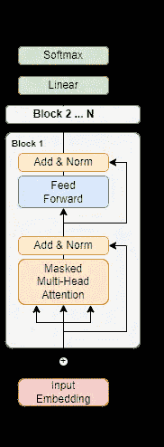

以及一个前馈网络（FFN）。残差连接和层归一化将所有部分联系在一起，确保训练和推理的稳定性。

自注意力机制是奇迹发生的地方——也是KV缓存变得至关重要的地方。注意力使用三个学习到的线性投影来变换输入：**查询（Q）**、**键（K）**和**值（V）**。对于位置i处的每个token，模型计算：

Qi = xi × WQ, Ki = xi × WK, Vi = xi × WV

其中xi是token嵌入（或上一层的隐藏状态），WQ、WK、WV是学习到的权重矩阵。直观理解是：查询表示“我在寻找什么？”，键表示“我包含什么？”，值表示“我提供什么信息？”注意力机制随后计算：

Q × K^T项计算所有token对之间的相似度分数——每个先前的token与当前token的相关性有多高？softmax将这些分数归一化为概率分布，并用其结果对值向量进行加权。缩放因子防止点积变得过大，否则会将softmax推入梯度消失的区域。

对于自回归生成，我们在softmax之前应用因果掩码，将未来位置的注意力分数设置为-∞。这确保了在预测token i时，模型只能关注token 0, 1, …, i-1——它无法“偷看”生成过程中尚不存在的未来token。

*图6.1*展示了一个典型的仅解码器架构。每一层包含两个子层：一个带掩码的多头自注意力机制和一个基于位置的前馈网络（FFN）。掩码注意力确保位置i只能关注位置≤i的token，从而强制实现自回归属性。FFN通常将隐藏维度扩展4倍（或在像LLaMA这样的现代架构中使用SwiGLU，约扩展2.7倍），应用非线性变换，然后再投影回去。残差连接和层归一化使训练更稳定。请注意，此图遵循原始Transformer的“Add & Norm”顺序；而像GPT和LLaMA这样的现代LLM则使用“Pre-Norm”（在注意力/FFN之前归一化）以获得更好的训练稳定性。

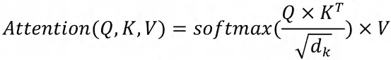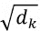

#### 符号

- B：批大小
- L1：被关注序列（查询）的长度；
- l1：该序列中某个位置的索引
- L2：被关注的序列（键/值）的长度；
- l2：该序列中某个位置的索引
- D：模型隐藏大小（隐藏状态/token的维度）
- H：注意力头数量
- Dqk：查询/键向量的维度
- Dv：值向量的维度，且D = Dv × H
- L：当L1 = L2时使用的记号

#### 文本生成过程：预填充与解码

*图6.2：输入形状*

*图6.2*展示了输入张量的结构。在处理生成请求时，我们通常会将多个提示批量处理以提高吞吐量。输入的形状为B × L2 × D，其中B是批大小，L2是提示长度（token数量），D是隐藏维度（例如LLaMA-7B为4096）。每个token表示为一个D维嵌入向量，整个提示变成一个矩阵，流经Transformer的各个层。

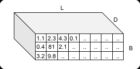

文本生成发生在两个截然不同的阶段，每个阶段具有根本不同的计算特性。理解这些阶段对于优化推理性能至关重要。

#### 预填充阶段

第一阶段称为**预填充**（prefill），也称为“提示处理”（prompt processing）或“上下文编码”（context encoding）阶段，它会并行处理整个提示序列。这是模型在生成任何输出之前“阅读”并“理解”输入的地方。在预填充期间，所有L2个提示token会同时通过每一层Transformer层进行处理。

*图6.3*详细展示了预填充阶段。输入X0（形状为B × L2 × D的嵌入提示token）通过所有Transformer层。在每一层，自注意力机制允许每个token关注提示中的所有其他token，从而构建上下文表示。模型为每个位置生成logits——形状为B × L2 × V的张量，其中V是词汇表大小（例如LLaMA为32,000）。然而，我们只关注最后一个位置的logits（B × 1 × V），因为它们给出了第一个生成token Y0在词汇表上的概率分布。

至关重要的是，在预填充期间，我们还会计算并存储每一层所有提示token的键和值投影。对于一个有N层的模型，我们会缓存2N个张量（每层一个K和一个V），每个张量的形状为B × L2 × Dqk（对于值则为Dv）。这个**KV缓存**将在后续解码步骤中被复用，避免对这些投影进行冗余计算。预填充阶段是计算密集型的：我们并行处理L2个token，每层执行O(L2^2)次注意力操作（每个token关注所有L2个token）。

预填充阶段具有较高的算术强度——计算操作与内存访问的比率非常有利，因为我们正在对大量token进行稠密矩阵乘法。对于一批较长的提示，GPU的张量核心会忙于处理大型矩阵运算，从而实现高利用率。这类似于训练期间的前向传播，在训练中我们也会并行处理序列。


*图 6.3：预填充阶段*

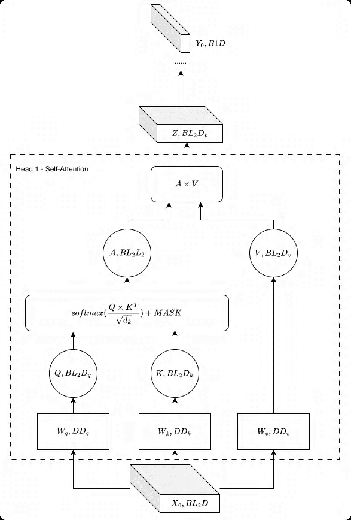

#### 解码阶段及其低效问题

预填充完成后，模型进入**解码**阶段。在这里，词元在自回归循环中逐个生成：生成词元 Y0，将其作为输入反馈回去，生成 Y1，依此类推，直到遇到序列结束符或达到最大长度。

考虑在提示词之后生成第一个新词元。查询投影的输入是 X1 = Y0（新生成的词元），但为了让注意力正确工作，键（Key）和值（Value）投影需要完整上下文——原始提示词 X0 与新词元 X1 拼接，产生的形状为 B × (L_p + 1) × D。

*图 6.4：无 KV 缓存解码*

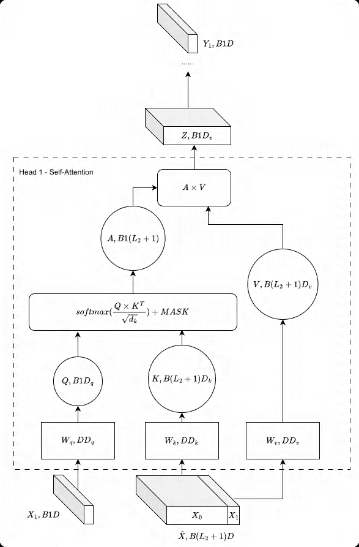

*图 6.4* 展示了这种朴素方法。查询需要关注目前整个上下文。例如，如果我们的提示词 X0 是 "Time flies"，Y0 是 "like"，我们使用 "like" 来查询上下文 "Time flies like"，并预测下一个词元，可能是 "an"。然后我们用 "an" 来查询 "Time flies like an"，得到 "arrow"。这个过程持续下去：每个新生成的词元都必须关注所有之前的词元（包括原始提示词和所有之前生成的词元），以保持上下文并生成连贯的文本。然而，在每一步中，我们都需要为整个序列历史重新计算键和值向量，尽管这些计算大部分在之前的步骤中已经完成。

从上图中，我们很容易看到低效的原因：我们需要构造 X̂ = [X0, X1]，并将其与 WK 和 WV 相乘，即使 X0 部分在预填充阶段已经与这些权重矩阵相乘过。这种重复在每一步生成时都会发生，需要跨整个 Transformer 堆栈为所有之前的词元重新计算键和值向量。

如果不使用缓存，这种朴素方法每一步的时间复杂度为 O(L_total^2)，其中 L_total 是总序列长度 L_p + L_t，包括提示词和生成的词元。对于长序列来说，这在计算上将是不可行的。

#### KV 缓存方案

KV 缓存通过存储所有已处理词元的预先计算好的键和值向量来解决这种低效问题。无需拼接和重新计算，我们只需将 X1 作为 K 和 V 计算的输入，同时缓存之前的结果。以键向量为例，我们只计算形状为 B × 1 × D_qk 的 K_new，时间复杂度大幅降低。

*图 6.5：KV 缓存随每个解码步骤增长*

*图 6.5* 展示了 KV 缓存如何随每个生成的词元增长。使用 KV 缓存后，解码阶段变得更加高效。

输入形状为 B × 1 × D，输出形状也是 B × 1 × D。关键洞察在于，只有新词元需要执行注意力计算，而所有之前的词元都复用其缓存的 K 和 V 向量。

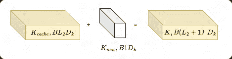

##### 时间复杂度分析：

使用 KV 缓存后，计算复杂度会发生巨大变化：

- **预填充阶段**：并行处理所有 L_p 个提示词元。自注意力计算的复杂度为 O(L_p^2 · D)。这是一次性开销。
- **解码阶段（每个词元）**：
  - **无 KV 缓存**：每一步 O(L_total^2 · D)，其中 L_total = L_p + L_t 随每个生成的词元增长。对于 T 个生成的词元，总复杂度为 O(T · L_total^2 · D)，当 L_t >> L_p 时变为 O(T^3 · D)。
  - **有 KV 缓存**：只为新词元计算 K 和 V（形状 B × 1 × D_qk），然后使用缓存的键/值执行注意力。注意力的每步复杂度为 O(L_total · D)，其中 L_total 是当前序列长度。对于 T 个生成的词元，总复杂度为 O(T · L_total · D) ≈ O(T^2 · D)（当 L_t >> L_p 时）。

关键改进是将解码阶段对序列长度的二次依赖降低为线性依赖，从而使长序列生成变得可行。然而，这是以内存为代价的：KV 缓存需要 O(L_total · D) 的内存来存储所有缓存的键和值向量。

*图 6.6：使用 KV 缓存解码*

*图 6.6* 展示了启用 KV 缓存后的解码阶段。解码阶段的计算模式与预填充阶段根本不同。由于每次只处理一个词元，矩阵乘法本质上是矩阵-向量运算。算术强度很低——我们受内存限制，大部分时间花在从 GPU 内存加载模型权重上，而不是计算上。这就是为什么将多个解码请求一起批处理（即后续会介绍的连续批处理）对效率至关重要。

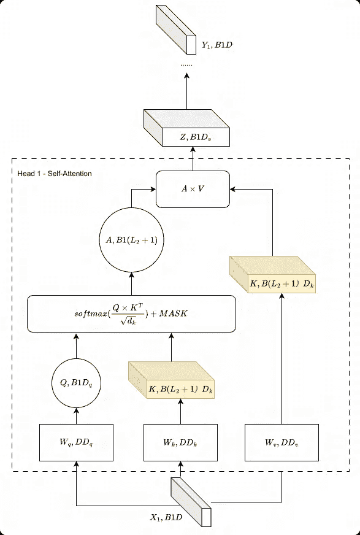

#### 推理阶段总结

下表总结了预填充和解码阶段中的张量形状和操作：

| 阶段 | 形状 | 备注 |
|---|---|---|
| **预填充阶段** |  |  |
| 输入 X_prompt | B × L_p × D | 提示词序列；并行处理所有词元；与训练一致 |
| 缓存 K、V | B × L_p × D_qk/v | 供复用 |
| **解码阶段** |  |  |
| 输入 x_t | B × 1 × D | 单个新词元 |
| Q_t = x_t W^Q | B × 1 × D_qk | 新词元的查询 |
| K_cached | B × (L_p + t) × D_qk | 所有之前的键 |
| V_cached | B × (L_p + t) × D_v | 所有之前的值 |
| 注意力分数 | B × 1 × (L_p + t) | 新词元关注所有之前的词元 |
| 注意力 A_t | B × 1 × (L_p + t) | 上三角 |
| 输出 Z_t | B × 1 × D_v | 拼接头 |
| 拼接头 | B × 1 × (H · D_v) | 最终输出 |
| 最终输出 | B × 1 × D | 单个生成的词元 |

### PagedAttention：解决 KV 缓存碎片化

虽然 KV 缓存显著提高了计算效率，但它也给生产服务系统带来了一个关键挑战：**内存碎片化**。当服务多个并发请求时，每个请求都有不同的序列长度且长度动态增长，传统的内存分配策略会导致大量浪费并限制吞吐量。

vLLM 的突破性创新是 **PagedAttention**，一种受操作系统虚拟内存分页启发的内存管理算法。PagedAttention 主要通过分配固定大小的块来缓存，以解决大规模 LLM 服务中的 KV 缓存碎片化问题。这种基于块的设计有一个关键结果：注意力计算不再遍历填充后的序列范围，而是只遍历每个请求实际存在的块，从而消除了与填充相关的注意力 FLOPs。

#### KV 缓存碎片化问题

在生产环境中，服务系统必须同时处理多个并发请求。每个请求维护自己的 KV 缓存，该缓存在自回归解码过程中随词元生成而动态增长。不同的提示词和生成长度会导致不同的缓存大小，这带来了根本性的分配挑战。

传统系统为每个请求分配连续的内存块。当序列完成或长度不同时，这种方法会导致无法有效复用的空间浪费。

*图 6.7：KV 缓存内存碎片化*

*图 6.7* 说明了这个问题。请求 1 在生成 8 个词元后已完成，而请求 2（4 个词元）和请求 3（10 个词元）仍处于活动状态。为请求 1 分配的内存现在处于空闲状态——但为什么不能复用呢？问题在于，请求 2 和请求 3 各自需要将其 KV 缓存存储在*连续*内存中，以便高效地进行注意力计算。请求 1 释放的 8 词元块对于一个需要 12 个词元的新请求来说可能太小，而对于只需要 3 个词元的请求来说又可能太大。即使大小匹配，释放的块也可能不与现有请求的缓存相邻，因此无法扩展该请求的序列。

与此同时，请求 2 和请求 3 各自为它们可能永远不会生成的词元预留了空间。已结束请求释放的块往往会被闲置；活动请求持有的内存可能永远无法填满。在高并发服务中，综合浪费可达 GPU 内存的 60-80%——这是 PagedAttention 论文中报告的区间。[2]

除了内存浪费之外，传统批处理还引入了一个不那么明显但同样关键的低效问题：由填充导致的注意力计算浪费。在批处理解码中，不同请求通常具有不同的有效上下文长度。设批大小为 B，请求 i 的缓存上下文长度为 (L_p^(i) + t^(i))。为了将这些请求一起批处理，

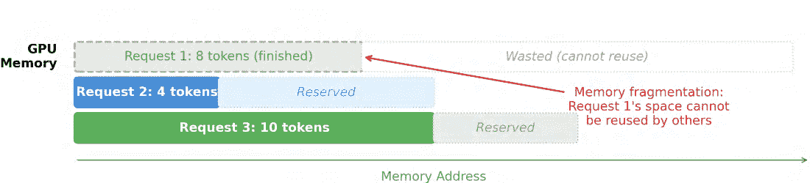


## 第 6 章：分布式推理与 vLLM

传统注意力实现必须将所有序列填充到相同的最大长度：

(L_2 + t)max = max_i (L_2^{(i)} + t^{(i)})

因此，注意力中使用的缓存键和值具有形状 ，解码步骤的注意力分数计算如下：

尽管掩码可以防止填充位置影响输出，但涉及填充标记的点积仍会被完整计算。因此，很大一部分注意力 FLOPs 花费在不携带语义信息的标记上，尤其是当批次内的上下文长度差异很大时。

#### PagedAttention 的工作原理

为了解决碎片化问题，PagedAttention 必须使用固定大小的块。当序列长度不同且在不同时间结束时，连续内存分配不可避免会导致碎片化。唯一可行的方法是将 KV 缓存划分为固定大小的块，这些块可以独立分配和释放。

PagedAttention 将 KV 缓存划分为固定大小的块，通常每个块包含 16 个标记（记为 B_size），类似于操作系统虚拟内存中的内存页。每个块包含一段连续标记的键和值向量。对于请求 i，缓存的 KV 表示为 N_i = ⌈ (L_2^{(i)} + t^{(i)}) / B_size ⌉ 个块，每个块存储形状为 Block ∈ ℝ^(B_size) × Dqk/v 的键和值。

每个请求维护一个块表，将逻辑序列位置映射到物理块地址，类似于操作系统虚拟内存中的页表。这使得序列在逻辑上是连续的，但在物理上存储在分散于 GPU 内存中的离散块中。块随着序列的增长或完成而分配和释放。当请求完成时，其块立即返回到共享块池。释放的块可以立即被新请求重用，从而消除碎片化，并实现接近100%的内存利用率。

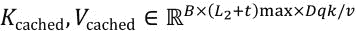
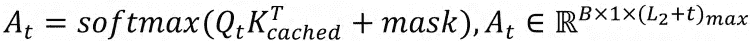

*图 6.8：基于块的 PagedAttention 内存*

*图 6.8* 展示了这种基于块的方法。顶部的块池包含所有可用块。请求 1 已完成，其块（块 0、块 1）已返回到池中，显示为空闲（黄色）。请求 2 使用块 2，请求 3 使用块 3 和块 4。与连续分配不同，当请求 1 完成时，其块立即可用于任何新请求——无论大小如何。一个新请求需要 3 个块，可以获取块 0、块 1 和块 5，而不需要它们相邻。

#### 消除填充 FLOPs

一旦块存在，注意力计算的迭代语义就发生了根本性的变化。这是基于块的设计的关键后果，而非额外的优化。在基于块的存储下，注意力计算不再假设 KV 缓存是从位置 1 到 (L_2 + t)max 的连续序列。相反，注意力遍历块表，不存在的标记自然没有对应的块。

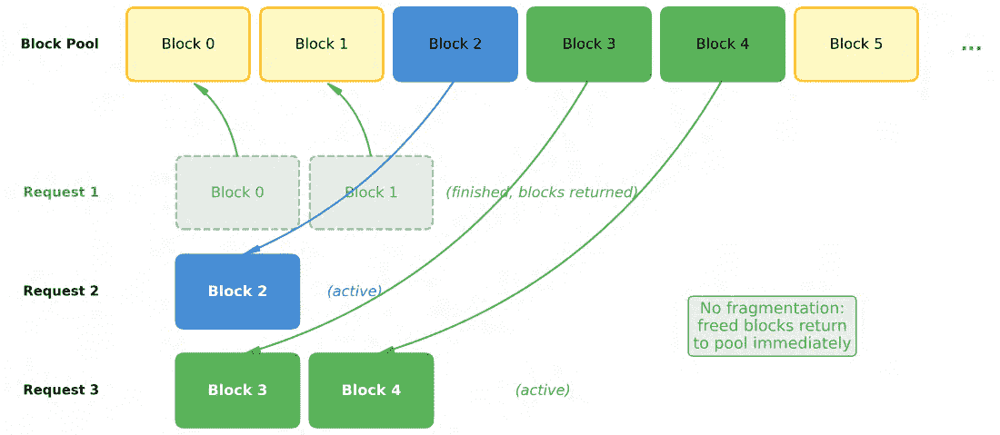

*图 6.9：填充与 PagedAttention 的对比*

*图 6.9* 对比了这两种方法。在传统批处理（左侧）中，三个长度分别为 4、7 和 3 个标记的请求都必须填充到最大长度 7。注意力内核计算所有 21 个位置（7 × 3），但其中只有 14 个包含实际标记——7 个位置（33%）被浪费在填充上。使用 PagedAttention（右侧）时，每个请求的注意力计算仅访问其实际标记。不存在填充，因此所有 FLOPs 都用于有意义的计算。

在解码过程中，请求 i 的注意力计算仅遍历其块表中列出的块，其中 B_i 表示请求 i 拥有的块集合。关键在于，该计算仅依赖于 (L_2^{(i)} + t^{(i)})，而不是 (L_2 + t)max。对于给定请求，不存在的标记永远不会被注意力内核访问，因为块表中不存在相应的块。

使用 PagedAttention 时，填充标记并非在计算后被掩码——它们从一开始就不参与计算。注意力内核不会为填充位置启动点积计算。因此，每个请求的注意力 FLOPs 数量与其真实上下文长度成正比，而不是与批次中的最大上下文长度成正比。这一特性彻底消除了与填充相关的 FLOPs，也是大规模 LLM 服务系统中高效连续批处理的关键推动因素。

vLLM 的性能提升源于这两种效应的共同作用。减少碎片化允许同时服务更多并发请求，而零填充 FLOPs 则提高了解码注意力的有效计算利用率。这是同一基于块的设计决策的两个方面。

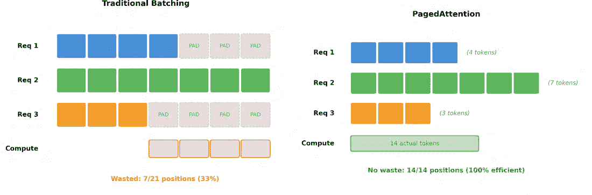
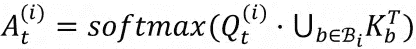

与专注于地址映射和访问正确性的操作系统页管理不同，PagedAttention 针对高效的注意力计算进行了优化。自定义 CUDA 内核从非连续的块中读取 KV 缓存，同时保持合并的内存访问模式，确保高 GPU 利用率。这种感知注意力的设计意味着系统理解注意力操作如何访问内存，并据此进行优化。

收益是巨大的。由于消除了变长序列带来的碎片化浪费，内存效率大幅提升，可实现接近100%的内存利用率。与传统方法相比，生产部署可以在相同 GPU 内存下服务 2-4 倍的并发请求。更重要的是，填充开销被完全消除，意味着零 FLOPs 浪费在填充上。这极大地提高了实际服务场景中的吞吐量。

灵活的批处理成为可能，因为不同序列长度的请求可以在不填充的情况下高效地批量处理。系统支持动态批处理，批次组成可以每步变化，从而高效服务高度可变的工作负载。长上下文支持也得到增强，系统无需预先分配最大内存即可高效处理变长上下文。通过按需分配块，可以服务超过 10 万 token 的超长序列。该设计天然支持高并发，专为请求频繁到达和完成的高更替率工作负载而构建。

#### 与分布式推理的联系

PagedAttention 解决了单个 GPU 内的内存效率问题，但如果即使高效管理的单个 GPU 也不够用怎么办？这时分布式推理就变得至关重要。当模型超出单个 GPU 的内存容量，当吞吐量需求超过单个 GPU 所能提供的水平，或者模型对于单个节点来说太大时，我们需要将工作负载分散到多个设备上。

PagedAttention 提供内存效率，分布式并行提供可扩展性，这两者的结合使 vLLM 能够在生产中服务最大的模型。PagedAttention 确保我们不会在碎片化上浪费内存，而张量并行、数据并行和流水线并行则让我们能够突破单个 GPU 的限制进行扩展。

#### 动机：“内存不足”问题

随着语言模型越来越大，一个根本性的约束浮现出来：它们根本无法容纳在单个 GPU 上。DeepSeek R1 拥有 6710 亿个参数。LLaMA 3.1 405B，顾名思义，拥有 4050 亿个参数。即使使用 H100 的 80GB HBM，以 FP16（每个参数 2 字节）存储 405B 参数也需要 810GB——是单个 GPU 提供容量的十倍。

一种方法是**量化**：将精度从 FP16 降低到 FP8 甚至 INT4。这有所帮助，但也有局限。FP8 将内存需求减半，因此我们的 405B 模型现在“仅需”405GB


——仍然相当于五块 H100 的内存。INT4 能让我们降至约 200GB，但会引入可能并非所有应用都能接受的精度权衡。而且我们还没有把 KV 缓存考虑进去，在长上下文推理中，KV 缓存甚至可能超过模型权重本身。

更具可扩展性的解决方案是**将模型分布到多个 GPU 上**。我们不是压缩模型以使其适配单个设备，而是将其分布到多个设备上，每个设备持有部分权重并参与计算。这就是分布式推理的范畴，vLLM 提供了三种基本策略：张量并行、数据并行和流水线并行。

### vLLM 架构概览

vLLM 的架构围绕**调度器-执行器-工作器**模式展开，如*图 6.10* 所示。这种分层设计清晰地分离了关注点：请求管理、分布式协调和实际计算。

*图 6.10：vLLM 调度器-执行器-工作器架构*

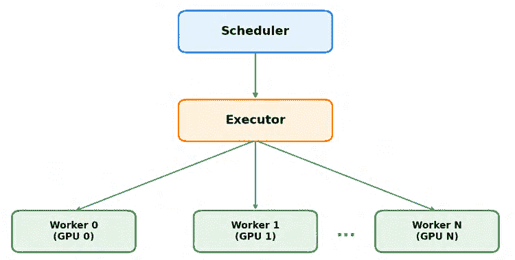

**调度器（Scheduler）**位于层级结构的顶端。它接收传入的请求，根据可用内存和调度策略将其分组为批次，并决定每次迭代处理哪些请求。调度器实现了**连续批处理（continuous batching）**——一种 Orca 风格的模式，在同一批次中接纳新请求和移除已完成请求，而不是等待每个序列全部完成。这种动态调度最大化 GPU 利用率。

**执行器（Executor）**充当调度器与实际计算资源之间的协调层。它管理工作器池，并将高层调度决策转换为分布式命令。vLLM 根据部署场景支持多种执行器后端：适用于小模型的简单单 GPU 执行器、用于单节点多 GPU 推理的多进程执行器，以及用于跨节点分布式推理的基于 Ray 的执行器。执行器向所有工作器广播命令并收集其结果。

**工作器（Workers）**是计算单元，每个工作器关联一个 GPU（或其他加速器）。工作器持有模型权重的一个分片，管理其本地 KV 缓存，并执行实际的前向传播。在张量并行配置中，工作器通过 NCCL 协调执行 all-reduce 等集合操作。每个工作器运行相同的模型代码，但根据并行策略处理不同的数据或模型分片。

这种架构使 vLLM 能够从单个 GPU 扩展到跨多个节点的数百个 GPU，同时保持相同的编程模型。

### vLLM 中的并行策略概览

*图 6.11：vLLM 中的并行策略*

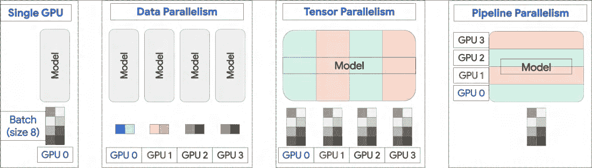

vLLM 提供了三种基本的并行策略，用于在多个 GPU 之间分布计算和内存。**张量并行（TP）**将各个层分片到节点内的多个 GPU 上，每个 GPU 处理每一层的一部分，并通过集合通信同步结果。**数据并行（DP）**创建模型的多个完整副本，每个副本独立处理不同的请求以提高吞吐量。**流水线并行（PP）**将模型的层拆分到多个 GPU 或节点上，数据像流水线一样按顺序流过各个阶段。

此外，vLLM 还提供**专家并行（EP）**，作为混合专家（MoE）模型的一种特殊修饰标志。EP 不是一种独立策略——它修改 MoE 层的分布方式，并且必须与 TP 或 DP 结合使用。`--enable-expert-parallel` 标志会改变 MoE 模型的通信模式和专家分布。

接下来的章节将详细探讨每种策略，然后讨论如何将它们组合以获得最佳性能。

### 张量并行（TP）

**张量并行（TP）**在单个节点内将模型权重水平分片到多个 GPU 上，使所有 GPU 能够并发计算。与流水线并行（我们将在后面介绍）中 GPU 按顺序处理不同层的方式不同，张量并行让每个 GPU 同时处理同一层——每个 GPU 负责计算的一个不同切片。这遵循 **SPMD（单程序多数据）**范式：所有 GPU 运行相同的代码，但处理不同的数据部分。

#### 线性代数基础

要理解张量并行，我们需要了解矩阵乘法如何在设备之间拆分。有两种基本模式：列并行和行并行。

**列并行**沿列方向拆分权重矩阵。考虑矩阵乘法 Y = X × A。如果将 A 分成两个列块 [A1 | A2]，那么输出自然划分为 Y = [X × A1 | X × A2]。每个 GPU 独立计算结果的一部分。要重新组装完整输出，我们使用 **all-gather** 操作，将来自所有 GPU 的部分拼接起来。

**行并行**采用不同的方法。我们沿行方向拆分输入 X 和权重矩阵 A：X = [X1; X2]，A = [A1; A2]。输出变为 Y = X1 × A1 + X2 × A2——每个 GPU 计算一个部分和，然后我们使用 **all-reduce** 对所有 GPU 的这些部分结果求和。

关键洞察在于，这两种模式可以巧妙地串联起来以最小化通信。在典型的 transformer MLP（前馈网络）中，我们有一个“上投影（up projection）”，后面跟着激活函数和一个“下投影（down projection）”。如果对“上投影”应用列并行，输出自然会在 GPU 之间分片。然后我们可以应用激活函数（逐元素操作，因此无需通信），并将分片结果直接输入到行并行的“下投影”中。所需的唯一通信是最后的一次 all-reduce——中间不需要 all-gather。

这种模式也适用于注意力机制。Q、K、V 投影可以采用列并行（每个 GPU 处理一部分注意力头），输出投影可以采用行并行。同样，每个注意力层只需要一次 all-reduce。

#### 张量并行的优势

张量并行最明显的优势是**减少内存**：每个 GPU 只存储权重的一小部分。一个无法在单个 GPU 上容纳的 140B 参数模型，可以拆分到两个 GPU 上，每个 GPU 持有约 70B 参数。但其好处不仅仅是容纳更大的模型。

来看看 KV 缓存容量会发生什么变化。假设在 141 GB 的 H200 上加载权重后，一个 140B 模型只剩下约 20 GB 可用空间。采用 TP=2 时，每个 GPU 持有半数权重，可为 KV 缓存释放约 70 GB——这通常是添加张量并行的真正原因，即使模型在技术上可以勉强塞进更少的 GPU。

张量并行还通过有效倍增内存带宽来降低延迟。在推理期间，尤其是在解码阶段，我们常常受内存限制——等待权重从 HBM 加载，而不是等待计算。使用 TP=2 时，我们同时从两块 GPU 的 HBM 加载，有效带宽翻倍。

代价是通信开销。每一层都需要一次 all-reduce 操作，传输的数据大小为 `batch_size × sequence_length × hidden_size`。在配备 NVLink（GPU 间提供 600+ GB/s 带宽）的系统中，这种开销是可控的。在仅使用 PCIe 的系统（32 GB/s）上，对于 prefill 密集型工作负载，通信可能主导运行时间——有时会消耗总时间的 60% 或更多。

另外还有一个需要牢记的约束：注意力头的数量必须能被张量并行大小整除。同样的规则也适用于分组查询（grouped-query）和多查询（multi-query）模型中的 KV 头——如果数量不能整除，vLLM 可能会在内部复制 KV 头。如果你的模型有 32 个头，而你想使用 TP=6，就需要填充（padding）或选择不同的 TP 大小。大多数现代模型特意将头数设计为 2 的幂次，以便支持灵活的 TP 配置。

#### 何时使用张量并行

当你的模型无法在单个 GPU 上容纳，且你有良好的互连（NVLink）可用时，张量并行是正确的选择。它对于延迟敏感的工作负载尤其有效，因为你希望所有 GPU 都为每个请求做出贡献。在仅使用 PCIe 的系统中，对于 prefill 密集型工作负载要谨慎——在确定 TP 配置之前，先对你的具体工作负载进行性能剖析，以了解通信与计算之比。

### 数据并行（DP）：扩展吞吐量

张量并行将单个模型拆分到多个 GPU 上，以处理更大的模型或降低延迟。但如果你的模型已经可以放在一个 GPU（或一个较小的 TP 组）上，而你的瓶颈只是需要服务更多并发请求呢？这时就要用到**数据并行（DP）**了。

这个概念很直接：我们不是将一个模型拆分到多个 GPU 上，而是创建模型的多个完整副本，每个副本在自己的 GPU（或 TP 组）上独立运行。每个副本处理不同的请求，而负载均衡器分发传入的


副本之间的流量。推理期间副本之间没有任何通信——它们完全独立，就像运行多个独立的 vLLM 服务器一样。

这种独立性既是 DP 最大的优势，也是其局限所在。因为副本之间不通信，所以通信开销为零——吞吐量随副本数量线性扩展。增加四个副本，吞吐量提升四倍。但这也意味着每个副本都需要足够的内存来存放完整的模型副本，因此当模型本身过大时，DP 也无能为力。

### 将数据并行与其他策略结合

在实践中，DP 通常与 TP 结合使用。假设在拥有 8 块 GPU 的系统上部署一个 70B 模型。该模型需要 TP=2 才能放下，于是我们有 4 个潜在的 TP 组。我们可以运行 DP=4 创建四个副本，每个副本使用两块 GPU 进行张量并行。GPU 总数为 `DP_size × TP_size = 4 × 2 = 8`。

`vllm serve $MODEL --data-parallel-size 4 --tensor-parallel-size 2`

对于 MoE 模型，DP 与专家并行之间的交互更加微妙。注意力层可以以纯数据并行模式运行（每个副本拥有完整的注意力权重），而专家层则使用专家并行将专家分布到整个 DP 组中。这需要同步：即使在某个步骤中某个 DP rank 没有请求，它也必须参与用于专家路由的 all-to-all 通信。vLLM 会自动处理这一点，但值得理解的是，MoE + DP 并不像稠密模型 DP 那样“独立”。

### 部署模式

vLLM 支持两种数据并行部署模式：

#### 内部负载均衡（自包含）

一个带有内部负载均衡的 API 端点：

```
# Single node: DP=4, TP=2 (8 GPUs total)
vllm serve $MODEL --data-parallel-size 4 --tensor-parallel-size 2
```

**多节点示例**：

```
# Node 0 (head node with API server)
vllm serve $MODEL --data-parallel-size 4 --data-parallel-size-local 2 \
 --data-parallel-address 10.99.48.128 --data-parallel-rpc-port 13345

# Node 1 (worker node)
vllm serve $MODEL --headless --data-parallel-size 4 --data-parallel-size-local 2 \
 --data-parallel-start-rank 2 \
 --data-parallel-address 10.99.48.128 --data-parallel-rpc-port 13345
```

此模式提供单一的 HTTP 端点，基于队列长度自动进行负载均衡，使部署更简单。局限性在于，在较大的 DP 规模下，API 服务器可能成为瓶颈——如有需要，可使用 `--api-server-count` 扩展 API 服务器数量。

#### 外部负载均衡

每个 DP rank 都被部署为独立的 vLLM 实例，并拥有自己的端点：

```
# Rank 0
CUDA_VISIBLE_DEVICES=0 vllm serve $MODEL --data-parallel-size 2 --data-parallel-rank 0 --port 8000

# Rank 1
CUDA_VISIBLE_DEVICES=1 vllm serve $MODEL --data-parallel-size 2 --data-parallel-rank 1 --port 8001
```

外部负载均衡器（例如 nginx、HAProxy）根据实时遥测数据（队列长度、KV 缓存使用情况）、请求特征（前缀缓存机会）和健康状态，将请求路由到不同的 rank。此模式为大规模 DP 部署提供更好的可扩展性、更智能的感知 KV 缓存的负载均衡，以及每个 rank 的独立扩展。

### 优势与权衡

数据并行的吸引力在于其简单高效。吞吐量线性扩展——副本数量翻倍，吞吐量翻倍。每个副本维护自己的 KV 缓存，因此总缓存容量也线性扩展。如果某个副本发生故障，其他副本继续提供服务，天然具备容错能力。而且由于副本在推理期间不通信，因此没有通信开销侵占你的算力预算。

权衡同样清晰。内存效率会受到影响，因为每个副本都存储模型权重的完整副本。对于一个 70B 模型，四个 DP 副本意味着整个系统需要存储相当于 280B 参数的权重——而使用张量并行只需 70B。负载均衡变得重要：简单的轮询方式忽略了不同副本可能具有不同的 KV 缓存利用率这一事实，导致性能欠佳。而对于 MoE 模型，DP 的“独立性”不成立，因为专家路由需要跨副本通信。

决策框架很简单：先使用 TP/PP 让模型能装下，再添加 DP 来扩展吞吐量。如果你的模型可以放到单块 GPU 上，且需要更高吞吐量，DP 是最简单的方案。如果你主要关心延迟，TP（通过并行计算降低单请求延迟）可能优于 DP（DP 对单请求延迟完全没有影响）。

### 流水线并行（PP）

当模型规模超出单个节点所能承载的范围——例如 DeepSeek R1 的 671B 参数或 LLaMA 405B——我们需要将层分布到多台机器上。这时就要用到**流水线并行（PP）**。

张量并行横向切分每一层（所有 GPU 同时处理同一层），而流水线并行则沿层方向纵向切分模型。GPU 0 可能持有第 0-19 层，GPU 1 持有第 20-39 层，依此类推。数据顺序流过流水线：GPU 0 处理完自己的层后将输出发送给 GPU 1，GPU 1 处理完后再发送给 GPU 2，以此类推。

通信模式与 TP 有本质不同。张量并行中，每一层都需要跨所有 GPU 进行一次 all-reduce——频率很高，但数据停留在节点内部，NVLink 提供高速互联。流水线并行中，通信仅发生在流水线阶段的边界——频率低得多，但数据通常会跨越节点边界，而网络带宽有限。这使得 PP 非常适合多节点部署，因为此时节点间带宽是瓶颈。

#### 流水线气泡问题

流水线并行的顺序特性带来了效率挑战。当 GPU 0 处理一个批次时，GPU 1 和 GPU 2 闲置等待输入。当 GPU 2 处理时，GPU 0 和 GPU 1 闲置等待下一批次。在朴素的实现中，每块 GPU 只有一部分时间处于活跃状态——这是对昂贵硬件的巨大浪费。

*图 6.12：流水线气泡*

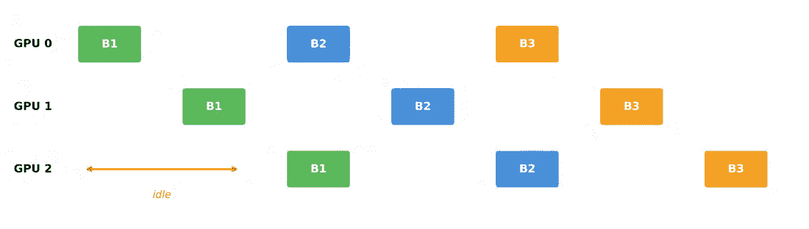

图 6.12 说明了这个问题。时间从左到右流动，每一行代表流水线中的一块 GPU。彩色块显示每块 GPU 何时在积极处理批次——GPU 0（第一阶段）先处理，然后将数据传给 GPU 1，GPU 1 处理后再传给 GPU 2。彩色块之间的白色间隙就是“流水线气泡”：GPU 因等待前一阶段的数据或等待下一批次到达而处于闲置状态的时段。在 3 阶段流水线处理单个批次时，每块 GPU 有 2/3 的时间处于空闲状态。对于像 H100 这样每小时成本数千美元的昂贵硬件，这种空闲时间直接转化为金钱浪费。

vLLM 通过**请求组**（也称为虚拟引擎）来解决这一问题。系统不是一次处理一个批次，而是维护多个独立的请求流。当 GPU 2 处理组 1 时，GPU 1 可以处理组 2，GPU 0 可以处理组 3。流水线保持满载，所有 GPU 持续忙碌。

代价是 KV 缓存必须在请求组之间分割。在 4 个流水线阶段下，每个组大约获得总 KV 缓存容量的 1/4。这限制了每个组的最大批大小，从而可能降低内存受限的解码操作的效率，而这类操作通常受益于更大的批次。

#### 分块预填充实现更平滑的流水线

流水线气泡的另一个来源是预填充（prefill）与解码（decode）之间的不匹配。预填充并行处理大量 token，属于计算密集型；解码一次只处理一个 token，属于内存受限型。一次较长的预填充可能比一个解码步骤慢 10 倍，导致较快的解码操作等待较慢的预填充，从而产生气泡。

**分块预填充**通过将长预填充拆分为更小的块，并与解码操作交错执行来解决这个问题。系统不是一次性处理 4096 个 token 的提示词，而是每轮迭代处理 512 个 token，将预填充成本分散到多个步骤中。这使流水线更加平滑，并防止任何单个长预填充阻塞其他请求。

分块预填充在 vLLM v1 中默认启用，但块大小可能需要针对你的工作负载进行调整。太大则会产生气泡；太小则会因额外迭代而增加开销。请分析你具体的预填充与解码的比例，以找到最佳平衡点。

### 专家并行（EP）：MoE 模型的修饰标志

Mixtral、DeepSeek 和 Phi-MoE 等混合专家（MoE）模型带来了独特的并行挑战。与每个 token 都会用到所有参数的稠密模型不同，MoE 模型将每个 token 仅路由到一部分“专家”——通常是总数 8、16 甚至 256 个专家中的 2 个。这种稀疏激活模式意味着模型的参数量远超

这种模型的计算成本与密集模型相当，但这些参数分布在众多专家上，并非所有专家同时激活。

**专家并行（Expert Parallelism, EP）** 是vLLM用于将这些专家分布到各GPU上的机制。与TP、DP和PP这些独立策略不同，EP是一个修饰标志（`--enable-expert-parallel`），当与TP或DP结合时，它会改变MoE层的行为方式。你不能单独使用EP——它需要 `TP_SIZE × DP_SIZE > 1` 才能生效。

要理解EP为何重要，我们首先需要了解MoE模型的工作原理。让我们以Phi-tiny-MoE-instruct作为具体示例。

#### 理解MoE架构

在标准Transformer中，注意力后的前馈网络（FFN）是一个简单的两层MLP。在MoE模型中，这个FFN被替换为多个专家网络——每个专家本身就是一个完整的MLP——外加一个路由机制，决定哪些专家处理每个token。

*图6.13：MoE架构*

*图6.13*对比了这两种架构。左侧显示了一个标准的密集Transformer层：注意力后接单个FFN。右侧显示了一个MoE层：注意力后接一个路由器和多个FFN专家（此示例中为4个）。路由器检查每个token，并决定哪些专家应该处理它——通常根据学习到的路由权重选择top-k个专家（例如top-2）。每个被选中的专家独立处理该token，然后将它们的输出合并。这种稀疏激活意味着，即使模型拥有4倍的FFN参数，每个token也只激活其中一小部分，从而在增加模型容量的同时，将计算成本保持在接近密集模型的水平。

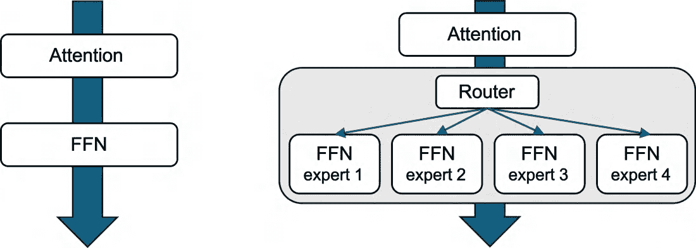

#### 解码器层结构

在Phi-tiny中，每个解码器层遵循标准Transformer架构，包含注意力和MoE组件：

```python
class PhiMoEDecoderLayer(nn.Module):
    def __init__(self, config: PhiMoEConfig, layer_idx: int):
        super().__init__()
        self.self_attn = PHIMOE_ATTENTION_CLASSES[config._attn_implementation](config, layer_idx)
        self.block_sparse_moe = PhiMoESparseMoeBlock(config)
        self.input_layernorm = nn.LayerNorm(config.hidden_size, eps=config.rms_norm_eps)
        self.post_attention_layernorm = nn.LayerNorm(config.hidden_size, eps=config.rms_norm_eps)

    def forward(self, hidden_states, attention_mask=None, position_ids=None, 
                past_key_value=None, output_attentions=False, 
                output_router_logits=False, use_cache=False, **kwargs):
        residual = hidden_states
        hidden_states = self.input_layernorm(hidden_states)
        hidden_states, self_attn_weights, present_key_value = self.self_attn(
            hidden_states=hidden_states, attention_mask=attention_mask,
            position_ids=position_ids, past_key_value=past_key_value,
            output_attentions=output_attentions, use_cache=use_cache)
        hidden_states = residual + hidden_states
        residual = hidden_states
        hidden_states = self.post_attention_layernorm(hidden_states)
        hidden_states, router_logits = self.block_sparse_moe(hidden_states)
        hidden_states = residual + hidden_states
        return (hidden_states, self_attn_weights if output_attentions else None,
                present_key_value if use_cache else None, router_logits if output_router_logits else None)
```

MoE层（`block_sparse_moe`）在注意力后的层归一化之后被调用，用一个路由机制替代标准的FFN，该机制从多个专家中选择并合并输出。

#### 专家结构

Phi-tiny中的每个专家都是一个完整的MLP，包含三个线性投影：

```python
class PhiMoEBlockSparseTop2MLP(nn.Module):
    def __init__(self, config: PhiMoEConfig):
        super().__init__()
        self.ffn_dim = config.intermediate_size
        self.hidden_dim = config.hidden_size
        self.w1 = nn.Linear(self.hidden_dim, self.ffn_dim, bias=False)
        self.w2 = nn.Linear(self.ffn_dim, self.hidden_dim, bias=False)
        self.w3 = nn.Linear(self.hidden_dim, self.ffn_dim, bias=False)
        self.act_fn = ACT2FN[config.hidden_act]

    def forward(self, hidden_states):
        current_hidden_states = self.act_fn(self.w1(hidden_states)) * self.w3(hidden_states)
        current_hidden_states = self.w2(current_hidden_states)
        return current_hidden_states
```

专家使用门控激活模式：`w1` 投影到中间维度并被激活，`w3` 提供门控信号，`w2` 投影回隐藏维度。这种结构类似于标准Transformer中的FFN，但拥有多个专门的专家。

#### 路由机制

`PhiMoESparseMoeBlock` 实现了选择哪些专家处理每个token的路由逻辑：

```python
class PhiMoESparseMoeBlock(nn.Module):
    def __init__(self, config):
        super().__init__()
        self.hidden_dim = config.hidden_size
        self.num_experts = config.num_local_experts
        self.top_k = config.num_experts_per_tok
        self.gate = nn.Linear(self.hidden_dim, self.num_experts, bias=False)
        self.router_jitter_noise = config.router_jitter_noise
        self.experts = nn.ModuleList([
            PhiMoEBlockSparseTop2MLP(config) for _ in range(self.num_experts)
        ])

    def forward(self, hidden_states):
        batch_size, sequence_length, hidden_dim = hidden_states.shape
        hidden_states = hidden_states.view(-1, hidden_dim)
        router_logits = self.gate(hidden_states)
        routing_weights, selected_experts = sparsemixer(
            router_logits, top_k=2, jitter_eps=self.router_jitter_noise, 
            training=self.training)
        final_hidden_states = torch.zeros(
            (batch_size * sequence_length, hidden_dim), 
            dtype=hidden_states.dtype, device=hidden_states.device)
        expert_mask = torch.nn.functional.one_hot(
            selected_experts, num_classes=self.num_experts).permute(2, 1, 0)
        for expert_idx in range(self.num_experts):
            expert_layer = self.experts[expert_idx]
            idx, top_x = torch.where(expert_mask[expert_idx])
            if top_x.shape[0] == 0:
                continue
            current_state = hidden_states[None, top_x.tolist()].reshape(-1, hidden_dim)
            current_hidden_states = expert_layer(current_state) * \
                routing_weights[top_x.tolist(), idx.tolist(), None]
            final_hidden_states.index_add_(0, top_x, 
                current_hidden_states.to(hidden_states.dtype))
        return final_hidden_states.reshape(batch_size, sequence_length, hidden_dim), router_logits
```

路由过程包含四个步骤。首先，门控层为每个token在所有专家上计算路由logits——本质上是在询问“哪些专家应该处理这个token？”其次，基于这些logits选择top-k个专家（通常k=2），并计算路由权重，以确定每个专家输出应贡献多少。第三，每个被选中的专家处理其被分配到的token。最后，将专家输出按路由分数加权聚合，为每个token生成最终输出。

#### 专家并行如何改变行为

在没有EP标志的情况下，vLLM通过张量并行将每个专家的权重分片到各GPU上——每个GPU拥有每个专家的一部分。启用EP后，分布方式发生改变：每个GPU持有完整的专家，但只持有其中一部分。公式很直接：`EP_SIZE = TP_SIZE × DP_SIZE`，每个GPU持有 `Total_Experts / EP_SIZE` 个完整专家。

以DeepSeek-R1的256个路由专家为例。在 `TP=8, DP=1` 且启用EP的情况下，8个GPU中的每一个都持有32个完整专家。在 `TP=1, DP=8` 且启用EP的情况下，分布相同——每个GPU持有32个专家——但通信模式发生变化。TP+EP使用all-reduce（与不含EP的TP相同），而DP+EP使用all-to-all通信，将token路由到持有其被选中专家的GPU。

TP+EP和DP+EP之间的选择还会影响KV缓存布局。在标准多头或分组查询注意力下，张量并行按头分片KV缓存——每个TP rank仅存储自己的切片。DP+EP则按请求划分缓存。MLA和MQA模型有所不同：张量并行可以在每个rank上复制压缩的潜在缓存，这就是为什么DP+EP通常更适合像DeepSeek这样内存密集型的MoE部署。

什么时候应该使用EP？当专家激活密度足够高（>3%）时，该标志能带来好处，因为all-to-all通信开销会被分布专家所带来的内存带宽收益所抵消。对于超稀疏模型（激活率<1%），EP实际上可能损害性能。EP标志还需要额外的依赖项（DeepEP、pplx-kernels、DeepGEMM），并且可能并非对所有模型/量化/硬件组合都稳定——请查阅vLLM文档，以了解针对你具体设置的说明。

### 组合并行策略

现实世界的部署很少单独使用一种并行策略。一个405B模型可能在每个节点内使用TP=8（利用NVLink的600+ GB/s带宽），并在节点间使用PP=4（网络带宽降至100-400 Gb/s）。MoE模型可能会将DP=4用于吞吐量扩展，并启用EP以实现高效的专家分布。理解这些策略如何相互作用——以及哪些组合有意义——对于最优部署至关重要。

#### TP + PP：标准多节点配置

张量并行和流水线并行沿正交的轴运行：TP水平地拆分每一层，而PP沿层垂直地拆分模型。这种正交性使它们天然互补。标准模式是在节点内使用TP，在节点间使用PP，使每种策略与其最匹配的互连方式相对应。

这种组合还减少了节点间通信。在每个节点内使用TP=4时，流水线阶段之间传输的数据仅为 `batch_size × sequence_length × hidden_dim`。


`hidden_size / 4`——每个 GPU 仅发送自己的分片，而不是完整张量。对于 `hidden_size=8192` 的模型，这意味着每个 token 传输 2048 个元素，而不是 8192 个。

`--tensor-parallel-size 4 --pipeline-parallel-size 8`

#### 专家并行组合

对于 MoE 模型，选择 TP+EP 还是 DP+EP 取决于你是在优化延迟还是吞吐量。

TP+EP 通过全归约通信将专家分布到 TP 秩上。每个 GPU 都参与每个请求，这适合低到中等并发下对延迟敏感的工作负载。对于 MLA/MQA 模型，上述 KV 缓存方面的权衡通常使 DP+EP 成为更优选择。

DP+EP 采用不同的方法：它启用了 “DP Attention”，其中 KV 缓存在 GPU 间分区而不是复制。每个 GPU 只为其分配的请求保留缓存，并通过全对全通信将专家分布到 DP 秩上。这对于 MLA/MQA 模型至关重要，并且适合高并发、以吞吐量为重点的工作负载。

```bash
# TP+EP: latency-sensitive, low concurrency
--tensor-parallel-size 8 --enable-expert-parallel

# DP+EP: throughput-focused, high concurrency
--data-parallel-size 8 --enable-expert-parallel
```

一个重要细节：对于 MoE 模型，单独使用 `--data-parallel-size`（不带 `--enable-expert-parallel`）会使用带分片专家的传统 DP，而非 DP Attention。EP 标志是启用分区 KV 缓存行为的必要条件。

#### TP + DP：双向扩展

当模型既需要分片（为了适配）又需要复制（为了吞吐量）时，可以组合 TP 和 DP。每个 DP 秩包含一个完整的 TP 组，因此总 GPU 数量为 `DP_size × TP_size`。例如，`--tensor-parallel-size 4 --data-parallel-size 2` 使用 8 个 GPU：两个副本，每个副本在 4 个 GPU 上分片。

对于 MoE 模型，可以在此组合中添加 EP。专家并行大小变为 `EP_SIZE = TP_SIZE × DP_SIZE`，专家分布在组合组中的所有 GPU 上。使用 `--tensor-parallel-size 4 --data-parallel-size 2 --enable-expert-parallel` 时，专家分布在所有 8 个 GPU 上。

#### EP 激活约束

一个值得理解的微妙之处：EP 标志仅在 `TP_SIZE × DP_SIZE > 1` 时生效。如果你在 TP=1 和 DP=1 时指定 `--enable-expert-parallel`，该标志会被静默忽略。

此外，通信模式取决于 DP 大小：当 DP=1（仅 TP 配置）时，即使启用了 EP，vLLM 也使用全归约；当 DP>1 时，它会切换到全对全通信以启用分区 KV 缓存行为。

### 动手实践示例

本节提供常见部署场景的实用示例。每个示例都包含关键配置选项，并说明何时可能使用该特定设置。

#### 使用张量并行的基本 vLLM 设置

最简单的分布式设置使用张量并行将模型分布到单个节点内的多个 GPU 上。当你的模型无法放入单个 GPU 但可以放入单个节点的 GPU 内存时，这是首选配置。

```bash
# Serve a model with tensor parallelism on 4 GPUs
python -m vllm.entrypoints.api_server \
    --model meta-llama/Llama-2-70b-hf \
    --tensor-parallel-size 4 \
    --port 8000
```

使用 `--tensor-parallel-size 4` 时，vLLM 会将模型权重分片到 4 个 GPU 上。每个 GPU 持有约 175 亿个参数（70B / 4），以及其应负责的 KV 缓存份额。GPU 在每一层通过全归约操作通信，因此当 GPU 之间具有 NVLink 等快速互连时，此配置效果最佳。

#### 使用 TP 和 PP 的多节点部署

对于超过单节点容量的超大规模模型，可将节点内的张量并行与跨节点的流水线并行结合起来。此示例演示了如何在多个节点上提供 DeepSeek R1（671B 参数）服务。

```bash
# Serve DeepSeek R1 with combined parallelism
python -m vllm.entrypoints.api_server \
    --model deepseek-ai/DeepSeek-R1 \
    --tensor-parallel-size 4 \
    --pipeline-parallel-size 8 \
    --enable-chunked-prefill \
    --max-num-batched-tokens 2048 \
    --port 8000
```

此配置总共使用 32 个 GPU（4 TP × 8 PP）。每个流水线阶段持有大约 840 亿个参数（671B / 8），并在此阶段内的 4 个 GPU 上分片。分块预填充（`--enable-chunked-prefill`）会将长提示与解码工作交错处理；`--max-num-batched-tokens 2048` 限制了每一步处理的提示词 token 数量——如果不设置此参数，一个长提示可能会阻塞流水线，而其他请求只能等待。

#### 自定义分块预填充配置

对于离线批量推理或需要对引擎配置进行精细控制的场景，可以直接使用 Python API。此示例演示如何以编程方式配置分块预填充。

```python
# vLLM configuration for optimal chunked prefill
from vllm import LLM, SamplingParams

llm = LLM(
    model="meta-llama/Llama-2-70b-hf",
    tensor_parallel_size=4,
    pipeline_parallel_size=2,
    enable_chunked_prefill=True,
    max_num_seqs=256,  # Adjust based on your KV cache
    max_num_batched_tokens=1024,  # Max tokens per scheduler step; tune for your prefill/decode mix
)

# Generate text
sampling_params = SamplingParams(temperature=0.8, top_p=0.95)
outputs = llm.generate(["Hello, how are you?"], sampling_params)
```

`max_num_seqs` 参数限制并发序列的数量，这直接影响 KV 缓存的内存使用。在 256 个序列和 4K 上下文长度下，每层需要 256 × 4K ×（`key_size + value_size`）的内存。设置 `max_num_batched_tokens=1024` 会限制调度器一次预填充的提示词 token 数量，从而将长提示与其他请求的解码步骤交错进行。

#### 使用 Nsight Systems 进行性能分析

在确定并行配置之前，请先对你的工作负载进行性能分析，以了解时间花在哪里。Nsight Systems 可以捕获 GPU 活动、CUDA 内核和 NCCL 通信，从而揭示你的瓶颈是计算受限还是通信受限。

```bash
# Profile vLLM to understand communication overhead
nsys profile \
    --trace=cuda,nvtx \
    --output=profile.qdrep \
    python -m vllm.entrypoints.api_server \
    --model meta-llama/Llama-2-70b-hf \
    --tensor-parallel-size 4

# Analyze results
nsys-ui profile.qdrep
```

在 Nsight Systems UI 中，查看 NCCL 操作（all-reduce、all-gather），将其持续时间与计算内核进行比较。如果通信占主导地位，可考虑减小 TP 大小或改用 PP。如果计算占主导地位，你可以通过增大 TP 来降低延迟。分析结果还会显示流水线气泡——GPU 空闲的间隙——这为调整分块预填充或请求组大小提供了机会。

### 最佳实践

在部署之前，请使用 Nsight Systems 对你的工作负载进行性能分析，以了解通信与计算的比例。根据你的预填充与解码比例调整 `max_num_batched_tokens`：较大的值对于预填充密集型工作负载更高效，而较小的值可以降低解码密集型工作负载的延迟。考虑你的硬件：NVLink 使 TP 更具吸引力，而仅使用 PCIe 的系统即使在单个节点内也可能受益于 PP。计算可用 KV 缓存空间以确定最佳 TP 大小——有时更多的并行意味着更多的缓存容量，从而带来更高的吞吐量。请记住：适合一种部署的方案可能不适合另一种部署。不断尝试、测量和迭代。

### 总结

本章涵盖了使用 vLLM 进行分布式推理的基础知识，从实现高效服务的显存管理创新，到可扩展到多 GPU 之外的并行策略。

我们从 PagedAttention 开始，这是 vLLM 对 LLM 服务的突破性贡献。通过将 KV 缓存视为虚拟内存——分配可以分散的固定大小块


