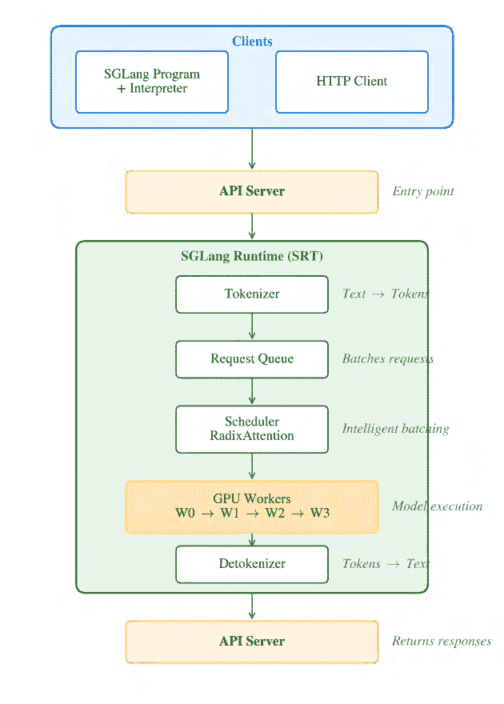
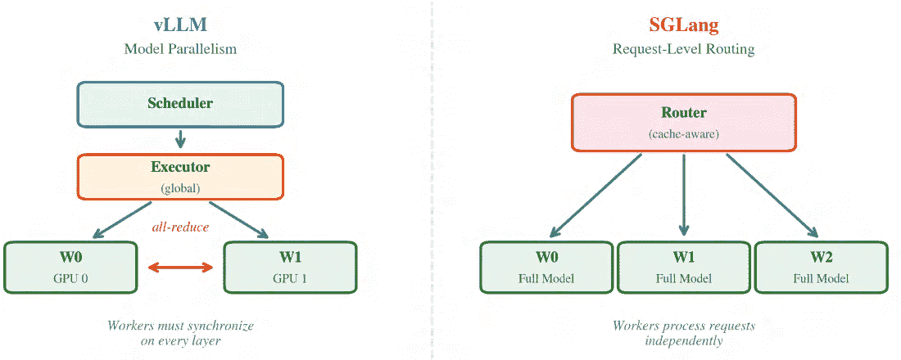
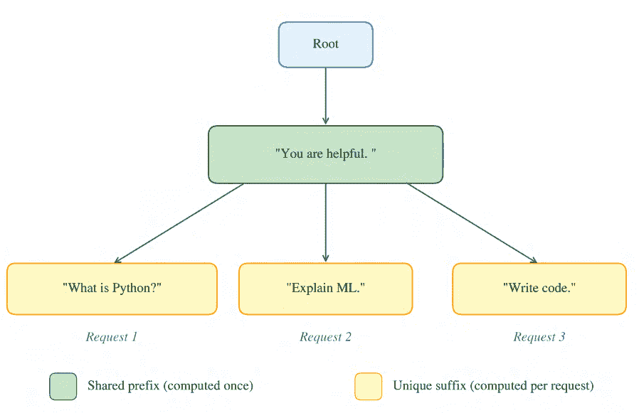
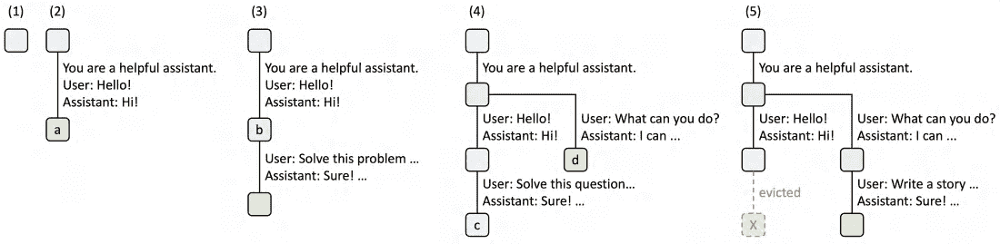
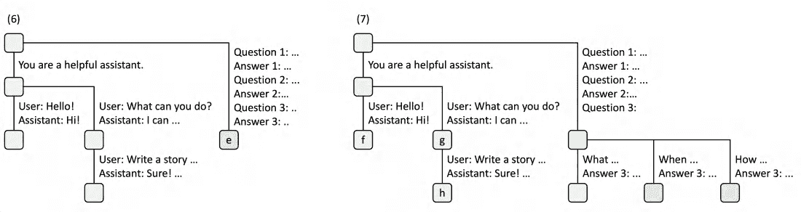
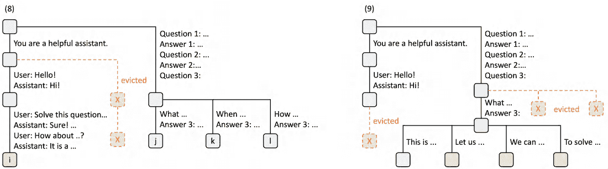
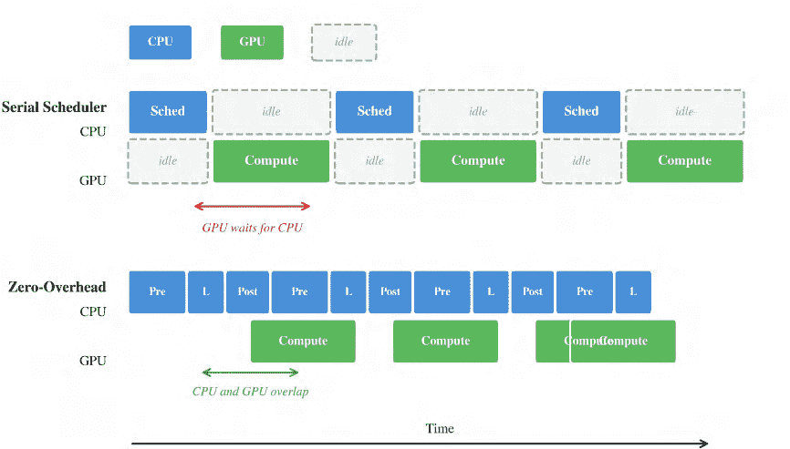
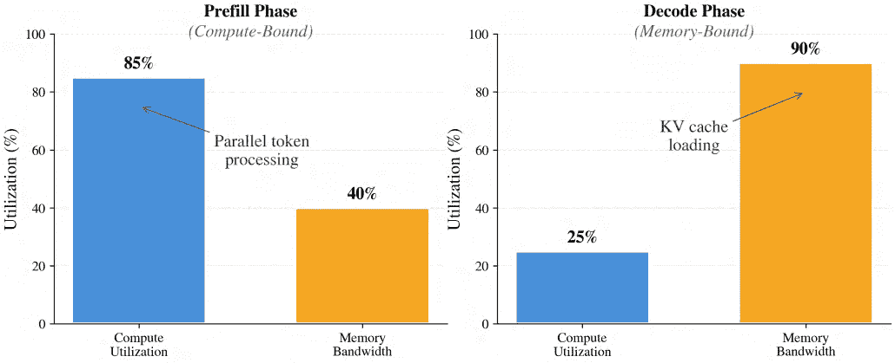
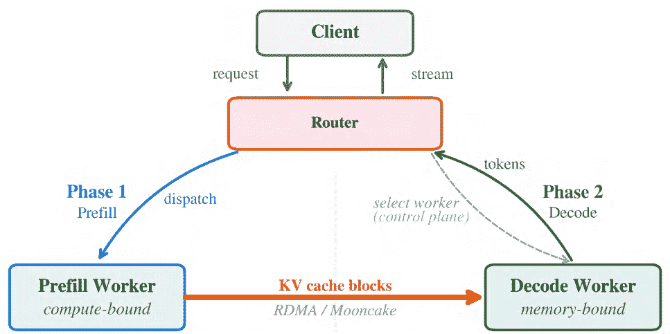
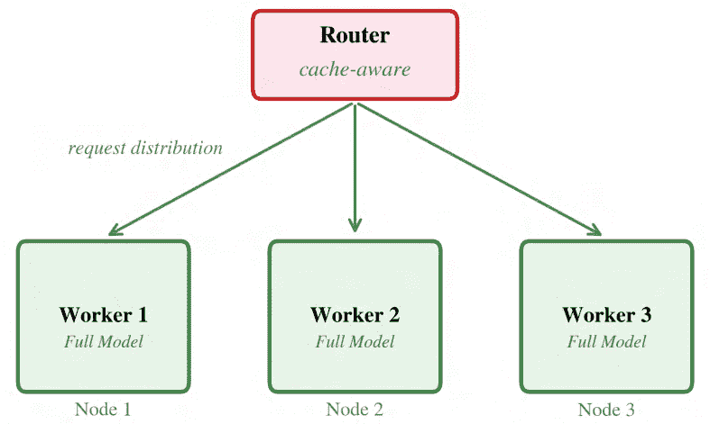

## 7 使用 SGLang 进行跨请求优化

### RadixAttention、结构化生成和请求级路由，实现低延迟推理

*预测未来最好的方式就是创造未来。*

*艾伦·凯，计算机科学家*

### 一种不同的分布式推理哲学

在前一章中，我们探讨了 vLLM 的分布式推理方法：模型并行。当模型对于单个 GPU 来说过大时，vLLM 使用张量并行（TP）或流水线并行（PP）将模型权重拆分到多个 GPU 上。工作节点必须同步——TP 需要全归约操作，PP 需要流水线阶段——并且系统通过尽可能多地批处理请求来优化吞吐量。

SGLang 采用了不同的方法。它与 vLLM 一样支持 TP、PP 和专家并行（EP），但将*跨请求优化*提升为头等关注事项。vLLM 主要关注请求内执行效率（单个请求被处理的效率），而 SGLang 还额外优化了请求间执行效率（请求之间如何交互和共享资源）。

实现这一目标的核心创新是 **RadixAttention**[1] 和**零开销调度器**。RadixAttention 将 KV 缓存组织为基数树，使得具有共同前缀的请求可以共享缓存的計算。调度器将 CPU 工作与 GPU 计算重叠，消除空闲时间。这些优化在内核和调度器层面发挥作用，构成了 SGLang 性能的基础。

在此执行引擎之上，SGLang 引入了**请求级路由**作为扩展原语。SGLang 不仅可以通过模型并行（拆分权重）进行扩展，还可以通过请求路由（将请求分发到独立的工作节点）进行扩展。路由器根据缓存局部性、会话亲和性和负载均衡来引导流量。这对于模型适合单个 GPU 或小型 TP 组的工作负载尤其有效。

这种组合对于特定工作负载非常强大。对于具有共享系统提示的多轮对话，RadixAttention 的前缀缓存与会话亲和性相结合，可以将后续请求的延迟降低 2-3 倍。但这种收益是有条件的——它需要前缀复用、对话式工作负载以及非批处理主导的场景。对于批处理吞吐量工作负载或需要大规模模型并行的超大型模型，vLLM 的方法可能更合适。

**SGLang**（结构化生成语言）诞生于加州大学伯克利分校的 LMSYS 团队——也就是 Chatbot Arena 排行榜背后的同一个团队。当 vLLM 专注于通过 PagedAttention 实现内存效率时，SGLang 的创造者提出了一个不同的问题：我们如何跨请求进行优化，使它们能够共享计算并相互受益？答案是 RadixAttention 用于跨请求 KV 缓存共享，XGrammar 用于受限的结构化输出，以及一个最大化 GPU 利用率的零开销调度器。请求级路由后来作为生产级扩展层出现，对这些核心创新形成补充。

### 前提条件

SGLang 可在 Linux 上运行，需要 Python 3.10 或更高版本。你需要一块支持 CUDA 的 NVIDIA GPU 来进行 GPU 加速推理。虽然 SGLang 也支持其他加速器，但 NVIDIA 仍然是最常见的部署目标。

### 安装

SGLang 可以通过多种方法安装。Docker 是在不本地安装依赖的情况下尝试 SGLang 的最快方式。

### Docker 设置

预构建的 Docker 镜像可在 SGLang Docker Hub 页面 https://hub.docker.com/r/lmsysorg/sglang 获取。这些镜像捆绑了所有依赖，便于快速上手。

SGLang 支持多种多样的模型类型，每种模型针对不同的用例进行了优化。像 `meta-llama/Llama-3.2-1B` 这样的基础模型是预训练语言模型，使用 `/v1/`

`completions` 端点用于文本补全。诸如 `Qwen/Qwen2.5-0.5B-Instruct` 之类的对话模型针对对话进行了微调，并使用 `/v1/chat/completions`。

`Qwen/Qwen3-Embedding-0.6B` 等嵌入模型通过 `/v1/embeddings` 生成向量表示。针对更专门的任务，SGLang 支持用于非自回归生成的扩散语言模型、可同时接受文本和图像/视频的多模态模型、用于搜索结果排序的重排序模型，以及用于强化学习应用的奖励模型。SGLang 还可加速用于图像和视频生成任务的扩散模型。

SGLang 服务器提供与 OpenAI 兼容的 API，可直接替代已使用 OpenAI API 格式的应用程序。有关端点的完整列表及详细描述和使用示例，请参阅附录中的 **OpenAI 兼容 API 端点**部分。

#### 拉取最新镜像

拉取最新的 Docker 镜像。运行时镜像大约需要 16GB 磁盘空间。

```bash
docker pull lmsysorg/sglang:latest-runtime
```

`latest-runtime` 标签提供了一个依赖极简、可用于生产环境的镜像。另外还有一个 `latest` 标签，包含开发工具和构建依赖，但体积约为 35GB，明显更大。对于大多数使用场景，运行时镜像已经足够。

#### 运行 Docker 容器

该 Docker 镜像运行一个兼容 OpenAI 的服务器。为避免硬编码模型名称，可将其设为环境变量：

```bash
export SGLANG_MODEL="Qwen/Qwen2.5-0.5B-Instruct"
```

然后运行容器：

```bash
docker run --runtime nvidia --gpus all \
 -v $HOME/.cache/huggingface:/root/.cache/huggingface \
 --env "HF_TOKEN=$HF_TOKEN" \
 --env "SGLANG_MODEL=$SGLANG_MODEL" \
 -p 30000:30000 --ipc=host --shm-size 32g \
 lmsysorg/sglang:latest-runtime \
 python3 -m sglang.launch_server \
 --model-path $SGLANG_MODEL \
 --host 0.0.0.0 \
 --port 30000
```

SGLang 支持 Llama、Mistral、Qwen、Gemma、Phi 及其他 HuggingFace 架构；诸如 `facebook/opt-125m` 之类的传统因果语言模型也可以运行，不过聊天端点需要经过指令微调的检查点。部分模型需要 `--trust-remote-code`。完整列表请参阅 SGLang 文档 `https://docs.sglang.io`。

以下是一些适合学习使用的小型模型：

| 模型名称 | 类型 | 参数规模 |
|---|---|---|
| `Qwen/Qwen2.5-0.5B-Instruct` | 对话/指令 | 0.5B |
| `meta-llama/Llama-3.2-1B-Instruct` | 对话/指令 | 1B |
| `meta-llama/Llama-3.2-1B` | 基础 | 1B |
| `microsoft/Phi-tiny-MoE-instruct` | MoE/指令 | 总计 3.8B，约 1.1B 激活 |
| `Qwen/Qwen3-Embedding-0.6B` | 嵌入 | 0.6B |
| `Qwen/Qwen2-VL-2B-Instruct` | VLM/多模态 | 2B |
| `BAAI/bge-reranker-v2-m3` | 重排序 | 0.6B |
| `jason9693/Qwen2.5-1.5B-apeach` | 奖励/分类 | 1.5B |

要使用其中任一模型，请将 Docker 命令中的模型名称替换为相应模型。例如，要提供 `meta-llama/Llama-3.2-1B-Instruct` 模型，请将 `--model-path $SGLANG_MODEL` 改为 `--model-path meta-llama/Llama-3.2-1B-Instruct`。

Docker 的这些参数值得解释一下。`--runtime nvidia --gpus all` 参数启用 GPU 访问；如需使用单个 GPU，可将 `--gpus all` 替换为 `--gpus '"device=0"'`；如需指定多个 GPU，可替换为 `--gpus '"device=0,1"'`。卷挂载参数 `-v $HOME/.cache/huggingface:/root/.cache/huggingface` 将你本地的 Hugging Face 缓存与容器共享，避免重复下载模型。`--ipc=host` 参数让容器可以访问主机的共享内存，PyTorch 在张量并行推理期间会利用该内存进行高效的数据共享。最后，`--shm-size 32g` 用于设置共享内存大小，这对 SGLang 的 KV 缓存管理和 RadixAttention 功能非常重要。

#### 验证设置

容器运行后，请验证其是否正常工作。首先，检查服务器是否响应：

```bash
curl -w "HTTP Status: %{http_code}\n" http://localhost:30000/health
```

列出可用模型：

```bash
curl http://localhost:30000/v1/models
```

测试基础模型的补全功能：

```bash
curl http://localhost:30000/v1/completions \
 -H "Content-Type: application/json" \
 -d '{
 "model": "'"$SGLANG_MODEL"'",
 "prompt": "The result of 1+1 is",
 "max_tokens": 3
 }'
```

测试对话模型：

```bash
curl http://localhost:30000/v1/chat/completions \
 -H "Content-Type: application/json" \
 -d '{
 "model": "'"$SGLANG_MODEL"'",
 "messages": [
 {"role": "user", "content": "Hello, how are you?"}
 ]
 }'
```

如需确定性输出（每次结果相同），请添加 `"temperature": 0`：

```bash
curl http://localhost:30000/v1/chat/completions \
 -H "Content-Type: application/json" \
 -d '{
 "model": "'"$SGLANG_MODEL"'",
 "messages": [
 {"role": "user", "content": "Hello, how are you?"}
 ],
 "temperature": 0
 }'
```

有关其他安装方式（pip、uv 或源码安装），请参阅 SGLang 安装指南 `https://docs.sglang.io/get_started/install.html`。该文档还涵盖了模型特定要求和高级配置选项。

### SGLang 架构概览

SGLang 的架构遵循前后端设计模式。前端（API 服务器）负责处理客户端请求，而后端（SGLang Runtime，简称 SRT）负责执行推理。这种分离使得系统能够独立优化每一层。

*图 7.1：SGLang 架构*



*图 7.1* 展示了请求在 SGLang 中的流转过程。客户端（使用原生解释器的 SGLang 程序或标准 HTTP 客户端）将请求发送到作为入口的 API 服务器。随后，SGLang Runtime（SRT）通过一系列组件管道处理这些请求。**分词器（Tokenizer）** 将传入文本转换为模型可以处理的数值 token。**请求队列（Request Queue）** 对这些分词后的请求进行缓冲、管理并发，并为批处理做准备。**调度器（Scheduler）** 是 SGLang 的智能核心所在——它智能地批处理请求，优先处理那些可以通过 RadixAttention 重用 KV 缓存而受益的任务，并实现零开销调度，使 CPU 工作与 GPU 计算重叠。**GPU 工作节点（GPU Workers）** 执行实际的模型推理，可按张量并行（多个工作节点协作处理单个请求）或数据并行（多个独立工作节点）方式组织。最后，**去分词器（Detokenizer）** 将生成的 token 转换回人类可读的文本，响应再通过 API 服务器返回给客户端。

对于分布式部署，SGLang 在 API 服务器之上增加了一个**路由器（Router）**层（也称为模型网关）。路由器将请求分发到多个 SRT 实例，并保持会话亲和性，使来自同一对话的请求被发送到同一工作节点（以保持 KV 缓存局部性）。它包含一个用于工作节点管理、负载监控和健康检查的控制平面，以及一个实现各种负载均衡策略的数据平面。

与 vLLM 的架构差异在于优化重点。vLLM 采用调度器-执行器-工作节点模式，针对请求内效率进行优化——PagedAttention 用于内存管理，模型并行用于支持大型模型。SGLang 的架构则额外通过 RadixAttention 和缓存感知调度优化请求间效率。两个系统都支持 TP/PP/EP 模型并行；SGLang 增加了请求级路由，作为在模型可容纳于单个工作节点的工作负载下的补充扩展原语。

*图 7.2：vLLM 与 SGLang 架构对比*



*图 7.2* 对比了这两种架构方式。左侧是 vLLM 的模型并行，要求工作节点在每一层通过 all-reduce 进行同步——这是拆分大型模型所必需的，但会增加通信开销。右侧是 SGLang 基于路由器的架构，将请求分发到各自持有完整模型的独立工作节点上。工作节点之间无需同步即可处理请求，负载由路由器负责。


平衡与缓存感知路由。这种独立性使得无需通信开销即可进行水平扩展，但要求每个工作节点持有完整模型（或一个较小的 TP 组）。

### SGLang 核心理论

SGLang 的性能优势主要源于其执行引擎的创新。核心技术包括：用于跨请求重用 KV 缓存的 **RadixAttention**、用于消除 CPU/GPU 空闲时间的 **零开销调度器**、用于结构化输出解码的 **XGrammar**，以及用于减少内核启动开销的 **算子融合**。这些内核级和调度器级的优化构成了基础，无论部署拓扑如何，都能有效工作。

vLLM 专注于单个请求内的内存效率（PagedAttention），而 SGLang 则强调跨多个请求的优化。这使得 SGLang 在处理许多请求共享共同模式的工作负载时特别有效——例如系统提示词、少样本示例或多轮对话。

#### RadixAttention：前缀缓存重用

RadixAttention 或许是 SGLang 最具特色的创新。vLLM 的 PagedAttention 优化的是单个请求 KV 缓存内的内存管理，而 RadixAttention 则通过共享公共前缀的 KV 缓存在多个请求之间进行优化。

vLLM 的前缀缓存（在近期的版本中默认开启）通过对共享 token 块进行哈希来实现类似的复用；而 RadixAttention 则维护一棵显式的基数树，并将前缀查找直接集成到批处理调度中。当许多请求共享较长且完全相同的前缀——系统提示词、少样本模板或多轮对话的前几轮时，其优势就会显现出来。

考虑一个典型的 AI 助手部署场景。每个请求都以相同的系统提示词开始：“你是一个乐于助人的助手。你提供准确、有用的回答……”这个系统提示词可能有 500 个 token。在传统系统中，如果 100 个用户同时发送请求，系统会为这 500 个 token 的前缀计算 100 次 KV 缓存——这会造成巨大的计算和内存浪费。

RadixAttention 通过将 KV 缓存组织成一棵基数树（也称为前缀树）来解决这个问题。在这种数据结构中，公共前缀只存储一次，并在所有使用它们的请求之间共享。当新请求到达时，系统会在树中找到最长匹配的前缀，复用该前缀已有的 KV 缓存，并且只计算新 token 的 KV 缓存。当请求完成时，共享前缀会保留在树中以供将来复用，而独有的后缀则被逐出。

*图 7.3：RadixAttention 前缀共享*

*图 7.3* 展示了 RadixAttention 如何在请求之间共享 KV 缓存。假设有三个请求到达，它们共享同一个系统提示词：“你是有帮助的。什么是 Python？”、“你是有帮助的。解释一下 ML。”和“你是有帮助的。写代码。”基数树将共享前缀“你是有帮助的。”存储一次（绿色节点），而每个请求独有的后缀则分别存储（黄色节点）。

“你是有帮助的。”的 KV 缓存只计算一次，并被所有三个请求共享。每个独有的后缀则分别计算。随着越来越多的请求共享同一个前缀，节省的开销会不断累积。

性能收益非常显著，但取决于工作负载特征。对于具有较长共享前缀的工作负载（系统提示词、少样本示例、多轮对话），RadixAttention 可以将预填充（prefill）计算量减少多达 90%。对于没有前缀共享的工作负载（独特提示词、单轮交互），收益则微乎其微。

内存效率得到提升，因为共享前缀只存储一次，而不是每个请求各存一份。命中缓存的请求延迟降低 2-3 倍。吞吐量也会增加，因为每个请求占用内存的减少使得批处理规模可以更大。

SGLang 的调度器能够感知基数缓存，并利用它来优化批处理的形成。在选择下一个要运行的批处理时，调度器会根据请求的最长匹配前缀长度对请求进行排序，并优先处理共享前缀较长的请求。这可以最大化缓存命中率和 GPU 利用率。



该缓存还与会话亲和性集成。当来自同一会话的请求被路由到同一个工作节点时，该工作节点上的基数树会累积对话历史。对话中的后续消息可以受益于之前轮次的缓存 KV，从而显著降低多轮交互的延迟。但随着对话不断增长、内存逐渐填满，会发生什么？

*图 7.4：RadixAttention 树的演进与 LRU 逐出-1。来源：Zheng 等人，2023*

*图 7.4*、*图 7.5* 和 *图 7.6* 追踪了基数树从诞生到成熟的生命周期。在图 (1) 中，树是空的——还没有请求到达。图 (2) 显示了第一个聊天会话：“你是一个乐于助人的助手。用户：你好！助手：嗨！”变成了一个单一节点。当后续消息在图 (3) 中扩展这个对话时，有趣的事情发生了：树会自我重构。原始内容分裂成一个共享前缀节点和一条用于后续内容“用户：解决这个问题……”的新分支。

随着更多用户到达，树的真正威力得以展现。图 (4) 显示了多个聊天会话——每个都以“你是一个乐于助人的助手。”开头——从同一个共享前缀节点分支出来。一个用户问“你好！”，另一个问“你能做什么？”，第三个提出不同的问题。系统提示词只存储一次，并被所有人共享。

*图 7.5：RadixAttention 树的演进与 LRU 逐出-2。来源：Zheng 等人，2023*

但内存是有限的。图 (5)、(8) 和 (9) 展示了压力之下会发生什么。当新请求需要空间时，SGLang 的 LRU（最近最少使用）策略就会启动。在图 (5) 中，节点 (c)——一个较旧且不活跃的对话——被逐出（用橙色虚线框和“X”标记），以便为“写一个故事……”腾出空间。




*图 7.6：RadixAttention 树的演进与 LRU 逐出-3。来源：Zheng 等人，2023*

随着图 (8) 和 (9) 中的压力不断增大，整条对话分支消失，但频繁访问的系统提示词和活跃会话得以幸存。树会自我剪枝，保留重要的内容，丢弃不重要的内容。

在底层，SGLang 通过两级内存池实现 RadixAttention（截至 SGLang v0.5）。第一级将每个请求映射到其 token 的 KV 缓存索引。第二级存储实际的 KV 缓存数据，组织为 `[num_layers, max_tokens, num_heads, head_dim]`。基数树位于这些内存池之上，跟踪哪些前缀已被缓存，并支持高效的查找和共享。

#### 使用 XGrammar 进行结构化输出解码

许多应用需要 LLM 以特定格式生成输出——API 响应使用 JSON，数据库查询使用 SQL，或针对特定领域任务的自定义模式。约束解码的朴素方法是根据语法规则检查每个生成的 token，并屏蔽无效 token。但对于拥有 128K 个 token 的词表（如 Llama-3）的模型来说，在每一步都检查每个 token 在计算上是不可行的。

SGLang 默认通过 **XGrammar** 路由结构化输出，同时提供 Outlines 和 llguidance 作为替代的语法后端。XGrammar 将合法 token 集预编译成用于上下文无关规则的有限状态机——例如，在生成布尔值时，只有“true”和“false”这两个 token 保持合法。这种预编译覆盖了典型 JSON 或模式约束中的大多数 token。对于上下文敏感规则（如平衡括号），它使用基于树的栈管理的下推自动机，以避免昂贵的栈快照。

结果是保证有效且开销极小的结构化输出。下面是在运行中的服务器上调用 OpenAI 兼容接口的示例：

```
curl http://localhost:30000/v1/chat/completions \
 -H "Content-Type: application/json" \
 -d '{
```




## 使用 SGLang 进行跨请求优化

```text
 "model": "Qwen/Qwen2.5-0.5B-Instruct",
 "messages": [{"role": "user", "content": "Extract: John is 30 years old, lives in NYC"}],
 "response_format": {
   "type": "json_schema",
   "json_schema": {
     "name": "person",
     "schema": {
       "type": "object",
       "properties": {
         "name": {"type": "string"},
         "age": {"type": "number"},
         "city": {"type": "string"}
       },
       "required": ["name", "age"]
     }
   }
 }
}'
```

对于离线批处理作业，请在 Python `Engine` 上通过 `sampling_params` 传入相同的 schema：

```python
import json
from sglang import Engine

llm = Engine(model_path="Qwen/Qwen2.5-0.5B-Instruct")

schema = {
    "type": "object",
    "properties": {"name": {"type": "string"}, "age": {"type": "number"}},
    "required": ["name", "age"],
}

outputs = llm.generate(
    ["Extract: John is 30 years old, lives in NYC"],
    {"max_new_tokens": 100, "json_schema": json.dumps(schema)},
)

print(outputs[0]["text"])
```

XGrammar 广泛支持上下文无关文法——JSON、SQL、领域特定语言以及您的应用所需的其他结构化格式。

#### 算子融合

现代 GPU 的计算速度很快，但每次内核启动都会带来开销。层归一化、线性投影和激活作为独立的内核意味着多次启动和额外的内存流量。SGLang 为常见的 transformer 模式提供了融合的 CUDA 内核——层归一化加线性加激活、注意力输出投影，以及 MoE 路由与专家 GEMM 的融合——因此中间结果会保留在寄存器中，而不是在全局内存中往返。对于 MoE 模型，专门的内核将专家路由与计算相结合，以减少 all-to-all 开销。

#### 零开销调度器

传统推理系统串行执行调度和计算：CPU 调度下一批，然后 GPU 计算，然后 CPU 处理结果并再次调度。当 CPU 工作时 GPU 处于空闲状态，调度开销可能消耗总时间的 50% 或更多。

SGLang 的零开销调度器通过将 CPU 调度与 GPU 计算重叠来消除这种空闲时间。关键在于，当 GPU 处理第 N 批时，CPU 可以准备第 N+1 批并处理第 N-1 批的结果。GPU 永远不会等待 CPU。

图 7.7 展示了这一差异。在串行调度器（顶部）中，CPU 和 GPU 交替工作：调度期间 GPU 空闲，计算期间 CPU 空闲。在零开销调度器（底部）中，CPU 工作（预调度、启动、后处理）与 GPU 计算重叠。当 GPU 处理一批时，CPU 准备下一批并处理上一批的结果。GPU 从不等待。

*图 7.7：串行调度器与零开销调度器对比*



调度器将 CPU 工作分为两个逻辑部分。"调度 CPU" 负责预调度（收集请求、在基数树中匹配前缀、分配内存）和后调度（检查完成条件、移除已完成请求、更新缓存）。"启动 CPU" 负责内核启动和结果处理。由于它们处理不同的批次，因此可以重叠。

为了使这种重叠生效，SGLang 使用了一种 token 占位符机制。当调度器将一批任务分发给 GPU 时，它不会等待结果。相反，它会分配占位符 token 并继续调度下一批。后台线程监控 GPU 完成情况，并在结果就绪时用实际 token 替换占位符。

性能提升非常显著：与串行调度相比，吞吐量最高可提升 2 倍，同时由于 GPU 始终处于忙碌状态，端到端延迟更低。

#### 基于路由器的分布式架构

除了核心执行引擎之外，SGLang 引入了请求级路由，作为补充传统模型并行的一种扩展原语。这并不是要取代 TP/PP——SGLang 与 vLLM 一样支持这些。相反，路由为模型适合单个 worker 的工作负载提供了额外的扩展维度。

关键区别：使用 TP/PP 时，消除 *层内* 同步是不可能的——TP 仍然需要 all-reduce，PP 仍然需要流水线交接。基于路由器的扩展消除的是 *请求间* 的同步。每个 worker 独立处理请求，worker 之间没有协调开销。路由器根据负载、缓存局部性和会话亲和性来引导流量。

准确地说：基于路由器的架构消除了跨请求同步（处理不同请求的 worker 之间无需协调），但不会消除层内集合操作（TP 仍然需要 all-reduce，PP 仍然需要流水线交接，EP 仍然需要 all-to-all）。如果在每个 worker 内使用 TP=8，那么这 8 个 GPU 在每一层仍然需要同步——路由器不会改变这一点。路由器消除的是 worker 之间相互协调的需求。

当模型适合单个 GPU 或小型 TP 组（2-8 个 GPU）时，这一点最有价值。对于需要跨多个 GPU 进行大规模 TP/PP 的非常大的模型，路由器增加的价值很小——无论如何你都会受到模型并行的限制。但对于服务高 QPS 的较小模型，路由可以在没有传统数据并行通信开销的情况下实现水平扩展。

#### SGLang 模型网关架构

SGLang 模型网关（以前称为 SGLang Router）是实现请求级路由的组件。它位于多个 SRT 实例之前，基于精细的策略引导流量，同时提供企业级可靠性功能。

网关架构分为两个主要层次：控制平面和数据平面。控制平面管理 worker 的生命周期——发现 worker、跟踪其负载、监控健康状况、处理注册/移除。数据平面处理跨多种协议（HTTP、gRPC）的实际请求路由，并内置重试、熔断和速率限制等可靠性功能。

控制平面包含多个协同工作的组件。Worker Manager 负责发现 worker 的能力并跟踪实时负载统计。Health Checker 持续探测 worker 以验证可用性，并在 worker 失败时更新熔断器状态。Load Monitor 向路由策略提供有关待处理请求、活动会话和资源利用率的实时统计。对于 Kubernetes 部署，Service Discovery 会自动使 worker 注册表与 pod 生命周期保持一致。

数据平面实现了多种路由器类型。HTTP Router 处理标准的 OpenAI 兼容端点（`/v1/chat/completions`、`/v1/completions`、`/v1/embeddings` 等），支持流式和非流式模式。Prefill/Decode Router 协调分离式工作负载，合并 prefill 和 decode 阶段的元数据。gRPC Router 为性能关键的部署提供更高的吞吐量，并内置原生 tokenization 和推理解析器支持。

为了可靠性，网关实现了带抖动的指数退避重试、worker 级熔断器（当 worker 不健康时自动故障转移），以及带队列的令牌桶速率限制。可观测性通过 Prometheus 指标（延迟、吞吐量、缓存命中率）、OpenTelemetry 追踪和结构化日志实现。

#### 基于路由器的架构何时表现出色

基于路由器的扩展在特定场景下表现出色，其优势与工作负载特征相吻合。高 QPS 交互式工作负载——聊天机器人平台、企业多租户部署、处理 100K+ 并发会话的系统——最能受益于路由器缓存感知策略，该策略最大化 RadixAttention 的前缀共享。

多轮对话是另一个理想场景。会话亲和性将对话的所有轮次保持在同一个 worker 上，其中来自先前消息的 KV 缓存已经是热的。当用户发送“那 Python 呢？”作为后续问题时，worker 不需要重新计算系统提示或之前的交互——这一切都已缓存。结合 RadixAttention 跨用户的前缀共享，这可以将后续问题的延迟降低 2-3 倍。


请求。但这个好处是有条件的：它需要实际发生前缀复用的对话式工作负载。一次性提示词不会获得这些收益。

**PD 分离**让你可以独立扩展预填充工作节点（计算密集型）和解码工作节点（内存密集型）。SGLang 的路由器协调这两个工作节点池，并在它们之间传输 KV 缓存。当某个工作节点发生故障时，路由器会绕过它继续路由——无需重新切分模型权重或重启分布式组。

话虽如此，基于路由器的架构并非在所有场景下都更优。对于批处理推理，路由器跳转会增加延迟，却无法带来缓存局部性收益——此时直接使用模型并行会更好。对于需要跨多 GPU 进行大量 TP/PP 的超大模型（70B+），路由器几乎不会增加价值，因为你无论如何都受限于模型并行。而对于只关心吞吐量、不在乎延迟的工作负载，vLLM 的连续批处理也许能在没有路由开销的情况下实现更高效率。

#### 预填充/解码分离

SGLang 最强大的分布式模式之一是**预填充/解码（PD）分离**。同样的拆分也出现在现代服务栈中——DistServe 和 Mooncake 很早就记录了这种设计，vLLM 和 NVIDIA Dynamo 也提供了类似模式——但其动机是普遍适用的。回顾第 6 章的内容，预填充会并行处理整个提示词（计算密集型），而解码则一次生成一个 token（内存密集型）。这两个阶段对资源的需求有本质不同。

*图 7.8：预填充与解码的资源利用率*

*图 7.8* 说明了为什么分离是有意义的。预填充并行处理多个 token，计算利用率高（85%），但内存带宽使用率中等（40%）。解码每次只生成一个 token，因此计算利用率低（25%），但由于反复加载 KV 缓存，内存带宽使用率很高（90%）。这两种截然不同的资源特征意味着，在同一硬件上混合运行这两个阶段会导致利用率不理想——在任何时刻，要么计算资源未充分利用，要么内存带宽未充分利用。



在统一系统中，预填充和解码会争夺相同的资源。长时间的预填充可能会阻塞解码工作节点，导致等待 token 的用户出现延迟尖峰。在数据并行配置中，一个工作节点可能正在做预填充，而另一个在处理解码，导致延迟不一致。

PD 分离通过将工作负载完全分开来解决这一问题。专门的预填充工作节点负责初始提示处理，针对计算吞吐量进行优化；专门的解码工作节点负责 token 生成，针对低延迟进行优化。路由器将新请求引导至预填充工作节点，然后将 KV 缓存传输给解码工作节点用于生成。

这与 vLLM 的流水线并行（PP）有本质区别：后者将模型层拆分到各个阶段。PP 要求各阶段之间严格同步——每个阶段都必须等待前一个阶段完成。PD 分离区分的是工作负载类型，而不是模型层，因此可以在没有同步开销的情况下独立扩展。

#### PD 分离架构

PD 分离中的数据流同时涉及控制平面和数据平面，由路由器编排两者。

*图 7.9：PD 分离架构*

*图 7.9* 显示了完整流程。单个路由器同时处理入口和出口流量。在阶段 1，请求到达后，路由器将它们分发给一个预填充工作节点（计算密集型）。路由器还会选择由哪个解码工作节点来处理生成——这就是控制平面（虚线箭头）。在阶段 2，预填充工作节点通过 RDMA 或 Mooncake 将 KV 缓存块直接传输给选定的解码工作节点——这是数据平面，即一种绕过路由器的工作节点到工作节点传输。随后，解码工作节点（内存密集型）生成 token，并通过路由器将它们流式返回给客户端。注意，原始提示词永远不会发给解码工作节点；它们只从预填充工作节点接收 KV 缓存块。



其好处非常显著。你可以独立扩展预填充和解码工作节点：当提示处理成为瓶颈时，增加预填充工作节点；当生成延迟成为关键时，增加解码工作节点。不同的工作负载可以使用不同的硬件：预填充用高计算性能 GPU，解码用内存优化 GPU。故障隔离能力也会增强，因为预填充工作节点的故障不会影响正在进行的解码操作。

#### 传输引擎

PD 分离中的一个关键挑战是将 KV 缓存从预填充工作节点传输到解码工作节点。对于长上下文，该缓存可能包含数 GB 的数据，因此高效传输对维持低延迟至关重要。

SGLang 支持多种针对不同网络结构优化的传输引擎。**Mooncake** 使用 RDMA（远程直接内存访问）进行无需 CPU 参与的直接内存到内存传输，在 InfiniBand 网络上可实现最低延迟。**NIXL** 提供基于 UCX 的接口，可跨不同的网络结构（InfiniBand、以太网）工作，以牺牲部分性能为代价提供灵活性。**ASCEND** 专门用于华为昇腾 NPU 部署。

#### PD 分离设置

设置 PD 分离需要启动预填充工作节点、解码工作节点，以及一个配置好来协调它们工作的路由器。下面是一个使用 Mooncake 传输引擎的完整示例。

首先，安装传输引擎：

`uv pip install mooncake-transfer-engine`

启动一个预填充工作节点。`--disaggregation-mode prefill` 标志将该工作节点配置为仅执行预填充操作，`--disaggregation-ib-device` 指定用于 RDMA 传输的 InfiniBand 设备：

```bash
python -m sglang.launch_server \
    --model-path Qwen/Qwen2.5-0.5B-Instruct \
    --disaggregation-mode prefill \
    --port 30000 \
    --disaggregation-ib-device mlx5_roce0
```

在另一块 GPU 上启动一个解码工作节点：

```bash
python -m sglang.launch_server \
    --model-path Qwen/Qwen2.5-0.5B-Instruct \
    --disaggregation-mode decode \
    --port 30001 \
    --base-gpu-id 1 \
    --disaggregation-ib-device mlx5_roce0
```

最后，启动启用了 PD 分离的路由器：

```bash
python -m sglang_router.launch_router \
    --pd-disaggregation \
    --prefill http://127.0.0.1:30000 \
    --decode http://127.0.0.1:30001 \
    --host 0.0.0.0 \
    --port 30000
```

对于 NIXL 后端（可跨不同网络结构工作），请将 `--disaggregation-ib-device mlx5_roce0` 替换为 `--disaggregation-transfer-backend nixl`。

### 分布式推理架构与并行策略

SGLang 的核心创新（RadixAttention、零开销调度器）作用于执行引擎层面。在扩展方面，SGLang 既支持传统并行策略（TP/PP/EP），也支持基于路由器的请求分发。理解每种方法在何时使用，以及它们如何组合，对于构建可扩展的推理系统至关重要。

SGLang 支持四个并行维度，可按需组合。**张量并行（TP）**将模型权重拆分到节点内的多块 GPU 上，并使用全归约（AllReduce）进行同步。**流水线并行（PP）**将模型层拆分到多块 GPU 或多个节点上，并在各阶段之间使用点对点通信。**数据并行（DP）**在多个工作节点上复制模型，每个工作节点独立处理不同的请求。**专家并行（EP）**将 MoE 专家分布到多个设备上，并使用全对全（All-to-All）通信进行 token 路由。

这些维度可以相乘：若 TP=8、PP=2、DP=4、EP=2，则需要 8 × 2 × 4 × 2 = 128 块 GPU。但关键在于，SGLang 基于路由器的架构为传统 DP 提供了一种替代方案——无需像训练时那样通过同步数据并行复制模型，你可以在路由器后面运行相互独立、且无同步开销的工作节点。


#### 张量并行：权重分片

当模型对于 idx_f29b937c 单个 GPU 来说过大时，张量并行（TP）会将模型权重拆分到多个 GPU 上。SGLang 的 idx_72f0ffc8 TP 实现采用了与 vLLM 相同的 Megatron 风格算法——列并行和行并行线性层，配合全归约（all-reduce）通信——但针对 SGLang 的调度器和 RadixAttention 进行了定制。

核心思想很简单：每层权重会在 TP rank 之间进行划分，每个 GPU 存储 1/TP 的权重，每层之后通过全归约操作合并部分结果。

对于注意力层，QKV 投影按列在 rank 间拆分。对于 MLP 层，上投影使用列并行，下投影使用行并行。

通信开销相当可观：每个注意力层和 MLP 层之后都会执行全归约操作。这使得 TP 对网络拓扑高度敏感——当 TP 组内所有 GPU 通过单节点内的 NVLink 互连时，效果最佳。跨节点 TP 也可行，但需要 InfiniBand 等高带宽互连。

以下是在单节点 8 GPU 上配置 TP 的方法：

```
python -m sglang.launch_server \
    --model-path Qwen/Qwen2.5-0.5B-Instruct \
    --tp 8
```

#### 流水线并行：层分片

流水线并行（PP）将 idx_17124f06 模型的深度拆分到多个 GPU 或节点。与 TP 横向拆分每一层不同，PP idx_42de663b 会将连续的层分配给不同的阶段。阶段 0 可能处理第 0-7 层，阶段 1 处理第 8-15 层，依此类推。

通信模式比 TP 更简单：相邻阶段之间进行点对点传输，而不是所有 rank 之间的全归约。这使得 PP 更适合带宽受限的跨节点部署。

PP 的挑战在于流水线气泡——当流水线未填满时，处理开始和结束阶段会出现空闲时间。在启动阶段，后面的阶段要等待前面的阶段产生输出。在排空阶段，前面的阶段先于后面的阶段结束。各种技术（微批处理、虚拟流水线并行）有助于最小化这些气泡，但无法完全消除。

PP 通常与 TP 结合使用：在节点内使用 TP（NVLink 提供高带宽），在节点间使用 PP（可以接受较低带宽的互连）：

```
python -m sglang.launch_server \
    --model-path Qwen/Qwen2.5-0.5B-Instruct \
    --tp 8 \
    --pp 4 \
    --dist-init-addr 172.16.4.52:20000 \
    --nnodes 2 \
    --node-rank 0
```

#### 数据并行：请求级复制

数据并行（DP）将 idx_6ab46758 模型复制到多个 worker，每个 worker 处理不同的请求。与 idx_4b380aca TP 和 PP 不同，推理期间 worker 之间没有通信——每个 worker 独立运行。

这正是 SGLang 基于路由器的架构的亮点。传统 DP（如训练中所用）需要梯度同步，但在推理中，worker 是完全独立的。SGLang 的路由器提供智能请求分发，且没有任何同步开销。

DP 与 TP 之间的权衡很明确：

| 方面 | 数据并行 | 张量并行 |
| --- | --- | --- |
| 内存 | 每个 worker 完整模型 | 每个 worker 1/TP 模型 |
| 通信 | 无（推理时） | 每层全归约 |
| 延迟 | 较低（无同步） | 较高（同步开销） |
| 吞吐量 | 小批量时更高 | 大批量时更高 |
| 可扩展性 | 受限于模型大小 | 可扩展到非常大的模型 |

对于能在单个 GPU 上容纳的模型，基于路由器的分布式 DP 几乎总是优于 TP。你可以获得更低的延迟（无需同步）、更好的容错性（worker 彼此独立），以及 TP 无法提供的会话亲和性等特性。

以下是 idx_e4397adc 最简单的 idx_84f7170a 带路由器的 DP 配置：

```
# Worker 1
python -m sglang.launch_server \
    --model-path Qwen/Qwen2.5-0.5B-Instruct \
    --port 30000

# Worker 2
python -m sglang.launch_server \
    --model-path Qwen/Qwen2.5-0.5B-Instruct \
    --port 30001

# Router
python -m sglang_router.launch_router \
    --worker-urls http://worker1:30000 http://worker2:30001 \
    --policy cache_aware
```

#### 混合并行：组合策略

现实部署通常 idx_2f579a30 会组合多种并行策略。最常见的模式是在 idx_1ee045e0 节点内使用 TP（利用 NVLink），再结合跨节点的 PP 或基于路由器的 DP。

对于需要多个节点的大模型，TP+PP 是典型方案。在 4 个节点上使用 32 个 GPU 时，可以使用 TP=8（每个节点内）和 PP=4（跨节点）。每个流水线阶段包含一个 8-GPU TP 组，阶段之间通过点对点传输通信。

对于模型能够放入较小 GPU 组的高吞吐部署，TP+DP（通过路由器）通常更优。在 16 个 GPU 的情况下，你可以运行 4 个独立 worker，每个使用 TP=4。路由器在 worker 间分发请求，且无同步开销。

对于 MoE 模型，专家并行（EP）增加了另一个维度。大型 MoE 部署可能使用节点内 TP=4、节点对之间 PP=2，以及 EP=16 来分布专家。通信模式变得复杂——TP 使用全归约，PP 使用点对点，EP 使用全对全（all-to-all）——但并行维度彼此正交，可以独立配置。

#### 通信模式

每种并行策略都有其特有的通信模式。理解这些模式有助于你选择合适的策略并优化性能。

**张量并行**在每层之后使用 idx_0943197a 全归约。每个 GPU 将自己的部分结果发送给所有其他 GPU，然后共同计算总和。每层的通信量为 O(hidden_size × batch_size)，并且发生频率很高——在每个注意力层和 MLP 层之后都会进行。这使得 TP 对互连带宽高度敏感。

**流水线并行**使用 idx_a60cbc49 相邻阶段之间的点对点通信。只有相邻阶段通信，且只发送激活（而非梯度，因为这是推理）。通信量与 TP 类似，但频率更低——每个微批次一次，而不是每层一次。

**专家并行**使用 idx_e0cf4d2d 全对全通信进行 token 路由。每个 GPU 发送去往远程专家的 token，并接收去往本地专家的 token。由于路由依赖于数据——不同 token 会去往不同专家——因此通信模式比 TP 或 PP 更复杂。

**基于路由器的 DP** 在推理期间没有 idx_12a19439 通信。每个 worker 独立运行，路由器负责请求分发。这就是为什么基于路由器的架构在合适的工作负载下能实现更低延迟。

为了优化通信，SGLang 支持通信与计算重叠（通过 `--tp-comm-overlap` 启用）、拓扑感知放置（将 TP 组保持在 NVLink 域内），以及多种通信后端（通用场景使用 NCCL，MoE 使用 DeepEP，RDMA 使用 Mooncake）。

### 多节点 SGLang 部署

SGLang 支持两种 idx_9ca7283c 根本不同的多节点部署方式。对于单个节点无法容纳的大模型，可以在节点间使用张量并行（TP）和/或流水线并行（PP）——这与 vLLM 类似。对于较小的模型，则使用基于路由器的架构，在每个节点上复制 worker——这是 SGLang 的独特方法。

选择取决于你的模型大小和工作负载特征。基于路由器的部署避免了通信开销，并支持会话亲和性等功能，但要求每个节点都能容纳完整模型。TP/PP 部署可以服务单个节点无法容纳的模型，但会增加同步开销。

#### 使用张量并行的多节点部署

对于需要 idx_65e7c4b4 TP 跨节点的模型，你需要配置分布式初始化。`--dist-init-addr` 参数指定 NCCL 初始化的主节点地址。每个节点需要唯一的 `--node-rank`（主节点为 0；worker 节点为 1、2……），`--nnodes` 指定节点总数。

以下是在 2 个节点上以 TP=16（每节点 8 GPU）部署模型的示例：

```
# Node 0 (master node)
python3 -m sglang.launch_server \
    --model-path Qwen/Qwen2.5-0.5B-Instruct \
    --tp 16 \
    --dist-init-addr 172.16.4.52:20000 \
    --nnodes 2 \
    --node-rank 0

# Node 1 (worker node)
python3 -m sglang.launch_server \
    --model-path Qwen/Qwen2.5-0.5B-Instruct \
    --tp 16 \
    --dist-init-addr 172.16.4.52:20000 \
    --nnodes 2 \
    --node-rank 1
```

将 `172.16.4.52:20000` 替换为你的主节点 IP 地址和一个可用端口。为了进行 NCCL 初始化，两个节点都必须能够访问该地址。


#### 基于路由器的多节点部署

对于适合部署在单个节点（或较小TP组）上的模型，基于路由器的部署通常是更好的选择。每个节点运行一个持有完整模型的独立工作节点，由路由器将请求分发到各个节点。

*图 7.10：基于路由器的多节点部署*

*图 7.10* 展示了基于路由器的架构。缓存感知路由器将请求分发到各个工作节点，每个节点都持有完整的模型。工作节点独立处理请求，无需工作节点间同步——这是相较于模型并行的关键优势，因为模型并行需要工作节点在每一层都进行协调。

该部署方式十分直接。在每个节点上启动一个工作节点：

```bash
# 节点 1
python -m sglang.launch_server \
    --model-path Qwen/Qwen2.5-0.5B-Instruct \
    --port 30000

# 节点 2
python -m sglang.launch_server \
    --model-path Qwen/Qwen2.5-0.5B-Instruct \
    --port 30000

# 节点 3
python -m sglang.launch_server \
    --model-path Qwen/Qwen2.5-0.5B-Instruct \
    --port 30000
```



然后配置路由器，将请求分发到各个工作节点：

```bash
python -m sglang_router.launch_router \
    --worker-urls \
    http://node1:30000 \
    http://node2:30000 \
    http://node3:30000 \
    --policy cache_aware \
    --port 8080
```

`cache_aware` 策略基于前缀匹配来路由请求，从而最大化 RadixAttention 的缓存命中率。对于基于会话的工作负载，具有相同 `session_id` 的请求会被路由到同一个工作节点，从而在对话轮次之间保持 KV 缓存局部性。

#### 路由策略与负载均衡

路由器的策略决定了请求如何在各个工作节点之间进行分发。SGLang 提供了多种针对不同场景优化的策略。

**缓存感知策略（cache-aware policy）** 是大多数工作负载下的推荐选择。它会为每个工作节点维护一棵近似的基数树，用于跟踪哪些前缀可能已被缓存。当请求到达时，路由器会找到前缀匹配度最佳的工作节点。如果匹配度超过阈值，请求将被转发到该工作节点（缓存命中）。否则，回退到负载均衡策略。该策略在最大化 RadixAttention 优势的同时，也防止单个工作节点过载。

```bash
python -m sglang_router.launch_router \
    --worker-urls http://node1:30000 http://node2:30000 \
    --policy cache_aware \
    --cache-threshold 0.5 \
    --balance-abs-threshold 10 \
    --balance-rel-threshold 1.5
```

**轮询策略（round-robin policy）** 将请求均匀地分发到各个工作节点，而不考虑缓存状态。这种方式简单且可预测，适用于请求之间不共享前缀，或希望负载均匀分布的场景。

**最短队列策略（shortest-queue policy）** 将请求路由到待处理请求最少的工作节点。这能适应不同长度的请求——正在处理长请求的工作节点自然会收到更少的新请求。

**二选一随机策略（power-of-two-choices policy）** 随机抽取两个工作节点，然后选择负载较轻的那个。相较于检查所有工作节点，该方法能以更低的开销实现良好的负载分布，是负载均衡领域的一项经典技术。

#### 会话亲和性与缓存局部性

对于对话类工作负载，会话亲和性是 SGLang 最强大的特性之一。其核心思想很简单：来自同一对话的请求应被路由到同一工作节点，因为该节点上已有来自前几轮对话的 KV 缓存。

当带有 `session_id` 的请求到达时，路由器会检查该会话是否已存在映射。如果存在，且映射的工作节点健康，请求就会被转发到该节点。如果不存在，路由器会根据其策略选择一个工作节点并创建新的映射。

延迟方面的收益非常显著。对话中的第一条消息需要完整预填充——即为整个提示词计算 KV 缓存。而后续消息则可以复用之前轮次的缓存 KV，从而跳过大部分预填充计算。在实践中，这意味着对话中后续请求的延迟可降低 2-3 倍。

这是 vLLM 的模型并行难以轻易提供的。在 TP/PP 部署中，没有天然的“工作节点”可供路由——模型分布在所有 GPU 上。会话状态需要显式管理，并可能在请求之间进行转移。而 SGLang 的基于路由器的架构使得会话亲和性成为设计的自然结果。

#### 容错

基于路由器的架构提供了天然的容错能力。路由器通过周期性地探测每个工作节点的 `/health` 端点来持续监控其健康状况。当某个工作节点发生故障或变得无响应时，路由器会自动将其从活跃池中移除，并将流量重新分配给健康的节点。

熔断器可防止级联故障。如果某个工作节点反复出现故障（通常是连续 5 次失败），路由器会“断开”熔断器，并在超时时间内停止向该节点发送请求。超时结束后，它会发送一个探测请求——如果成功，该工作节点重新加入池中；如果失败，熔断器保持断开状态。

会话迁移处理的是持有活跃会话的工作节点发生故障的情况。路由器会将受影响的会话重新映射到健康节点。其代价是新节点上需要重新计算 KV 缓存，因此迁移后的第一个请求会承受完整的预填充延迟。但后续请求即可受益于新节点上已热的缓存。

这种容错能力架构天然具备。相比之下，TP/PP 部署要求所有 rank 均可用——单个 GPU 故障就可能导致整个服务组宕机。

#### MoE 模型的专家配置

我们在第 5 章和第 6 章中已经介绍了 MoE 架构和专家并行的基础知识——包括 token 如何被路由到专家、专家如何分布到各 GPU，以及由此产生的全对全通信模式。这里我们重点讨论 SGLang 针对 MoE 推理的特定优化。

MoE 推理的挑战在于全对全通信可能成为运行时的主导，尤其是在大批次场景下。SGLang 通过专用后端和通信重叠技术来解决这一问题。

对于全对全通信，SGLang 提供了多种后端。DeepEP 针对跨节点 MoE 部署进行了优化，是多节点场景下的推荐选择。Mooncake 在 DeepEP 的基础上扩展了 RDMA 支持，可在 InfiniBand 网络上获得更低的延迟。对于希望使用全归约（all-reduce）而非全对全（all-to-all）的混合 EP+TP 配置，“none”后端提供了这一选项。

对于实际的专家计算（每个专家内部的矩阵乘法），SGLang 提供 DeepGEMM（专为 MoE 模式优化）、Triton（灵活且可移植）以及 CUTLASS（NVIDIA 的高性能 GEMM 库）。“auto”设置会根据你的硬件选择最佳选项。

一个基本的 MoE 部署如下所示：

```bash
python -m sglang.launch_server \
    --model-path microsoft/Phi-tiny-MoE-instruct \
    --ep 8 \
    --moe-a2a-backend deepep \
    --moe-runner-backend deep_gemm
```

对于 Qwen3-235B 这类更大的模型，你需要将 EP 与其他并行维度结合起来：

```bash
python -m sglang.launch_server \
    --model-path Qwen/Qwen3-235B-A22B \
    --tp 4 --ep 16 --pp 2 \
    --moe-a2a-backend deepep \
    --moe-runner-backend deep_gemm \
    --enable-dp-attention
```

`--enable-dp-attention` 标志对于 KV 头数量较少的模型（如使用 MLA 的模型）尤其重要。它可以避免 KV 缓存在 TP rank 之间重复存储，否则会浪费内存。

SGLang 最具特色的 MoE 优化是通信重叠。两批次重叠（TBO）将批次拆分为微批次并进行流水线处理：当一个微批次执行全对全通信时，另一个微批次运行注意力计算。这可以通过将通信延迟隐藏在计算之后，使吞吐量接近翻倍。单批次重叠（SBO）通过使用多个 CUDA 流，在单个批次内实现类似的收益。可通过 `--enable-two-batch-overlap` 或 `--enable-single-batch-overlap` 启用这些功能。

为获得最佳效果，应尽可能将 EP 组保持在 NVLink 域内——全对全通信对带宽需求很高，而 NVLink 的 600+ GB/s 带宽远超跨节点互连。

#### 推测解码

推测解码是一种能显著加速推理的优化技术。其核心思想是使用一个更小、更快的“草稿（draft）”模型来预测多个 token，然后由一个更大的“目标（target）”模型并行验证这些 token。

传统解码每次只生成一个 token，每个步骤都需要对模型进行完整的前向传播。这受限于内存带宽——GPU 大部分时间都花在加载模型权重上，而不是计算上。推测解码通过将多个验证步骤批次化在一起来改变这种状况。

其工作原理如下：草稿模型（通常比目标模型小 2-4 倍）快速生成 N 个草稿 token。然后目标模型在一次前向传播中验证这 N 个 token。如果所有草稿 token 与目标模型本来会生成的内容一致，你就以一次前向传播的代价获得了 N 个 token——从而实现 N 倍加速。如果有 token 不匹配，则从第一个不匹配位置开始使用目标模型的输出，并移除被拒绝 token 的 KV 缓存。

在实践中，接受率取决于草稿模型对目标模型的近似程度。对于匹配良好的模型对（同系列、同训练数据），接受率通常在 70-90% 之间，可带来 2-4 倍的加速。

SGLang 支持使用可配置的草稿模型进行推测解码：

```bash
python -m sglang.launch_server \
    --model-path Qwen/Qwen2.5-7B-Instruct \
    --speculative-draft-model-path Qwen/Qwen2.5-0.5B-Instruct \
    --speculative-num-draft-tokens 4
```


草稿模型和目标模型应共享相同的分词器（tokenizer）和词汇表。使用同一系列的模型（例如以 Qwen2.5-0.5B 作为 Qwen2.5-7B 的草稿模型）通常能获得最佳效果。

推测解码（Speculative Decoding）与 RadixAttention 配合得很好。RadixAttention 通过为共享前缀复用缓存的 KV 来减少预填充时间，从而改善首令牌时间（TTFT）。随后，推测解码通过在每次前向传播中生成多个令牌来加速解码阶段。两者结合可以显著降低对话工作负载的端到端延迟：RadixAttention 负责前缀，推测解码负责生成。

#### 数据并行注意力

数据并行注意力（Data Parallel Attention，简称 DP Attention）是 SGLang 为 KV 头数量较少的模型（例如使用多头潜在注意力（Multi-Head Latent Attention，MLA）的模型）所做的优化。它解决的问题很微妙，但很重要。

在传统的张量并行中，QKV 投影会被拆分到多个 GPU 上。但当 KV 头数量小于 TP 大小时，KV 头就必须在 GPU 之间复制。对于一个只有 1 个 KV 头且 TP=8 的模型，8 个 GPU 中的每一个都会存储一份完整的 KV 缓存副本——造成 8 倍的内存浪费。

DP Attention 采用了不同的方法。它不是用 TP 来拆分注意力计算，而是使用数据并行：每个 GPU 独立处理不同的请求，不会重复存储 KV 缓存。在 MLP 层之前，通过 all-gather 将所有 GPU 的注意力输出合并起来。随后 MLP 以张量并行的方式运行（因为 MLP 不存在 KV 缓存问题），输出再被切分回每个 GPU。

对于 KV 头数量较少的模型，这样可以将解码吞吐量提高最多 1.9 倍，因为内存不再浪费在重复的 KV 缓存上。启用方式如下：

```bash
python -m sglang.launch_server \
  --model-path microsoft/Phi-3.5-MoE-instruct \
  --enable-dp-attention \
  --dp-size 8 \
  --tp-size 8
```

DP Attention 在内存效率至关重要的大批量场景中受益最大。在低延迟、小批量场景中，all-gather 的开销可能会超过其带来的好处。

#### 生产部署模式

正确的部署模式主要取决于模型大小。对于参数少于 10B 且能放进单个 GPU 的模型，基于路由器的数据并行几乎总是最佳选择——每个节点运行一个完整的模型，路由器通过感知缓存的路由和会话亲和性来分发请求。这种配置通常能在对话工作负载下实现 50-100 ms 的 TTFT、1000+ QPS 和 60-80% 的缓存命中率。

对于参数在 10B 到 100B 之间、需要 2-8 个 GPU 的模型，应在每个节点内部使用张量并行，并在节点之间使用基于路由器的分发。每个节点运行一个 TP 组，路由器将每个 TP 组视为一个独立 worker。对于超过 100B 参数的模型，你需要跨节点使用 TP+PP，这与 vLLM 的做法类似——模型太大，无法通过基于路由器的复制来实现。

MoE 模型将专家并行与张量并行相结合。如果模型的 KV 头数量较少，请启用 DP Attention，并使用 TBO/SBO 来重叠通信。当 prefill 和 decode 的特性差异很大时（长提示词搭配短生成，或反之），PD 分离（PD disaggregation）让您可以独立扩展每个阶段。

一些实用的优化适用于各种部署模式。在通信方面，请将张量并行保持在 NVLink 域内，并根据您的网络适当配置 NCCL（`NCCL_IB_DISABLE=0`、`NCCL_IB_GID_INDEX=3`、`NCCL_SOCKET_IFNAME=ib0`）。在内存效率方面，对于长上下文工作负载，请启用分块预填充（`--enable-chunked-prefill` 配合 `--max-num-batched-tokens`）——这会将长提示词拆分成较小的块，与解码操作交错执行，从而避免内存峰值和流水线气泡（参见第 6 章*分块预填充实现更平滑的流水线*一节）。使用 FP8 或 INT4/AWQ 进行量化可减少内存占用并提高吞吐量。对于延迟敏感的工作负载，请使用感知缓存的路由和推测解码；对于吞吐量敏感的工作负载，请扩展数据并行并启用所有重叠选项（`--tp-comm-overlap`、`--enable-two-batch-overlap`）。

### 实战示例

在掌握上述架构概念和优化策略之后，让我们一起看看常见场景的完整部署配置。

#### 基础多节点部署

最简单的 SGLang 部署是在多个节点上运行 worker，并通过路由器进行负载均衡。这种模式实现了*基于路由器的分布式架构*一节中描述的基于路由器的数据并行架构，其中每个 worker 都持有一个完整的模型并独立处理请求。

```bash
# Start workers on each node
for i in {1..4}; do
  ssh node$i "python -m sglang.launch_server \
    --model Qwen/Qwen2.5-0.5B-Instruct \
    --port 30000"
done

# Start router
python -m sglang_router.launch_router \
  --worker-urls http://node1:30000 http://node2:30000 http://node3:30000 http://node4:30000 \
  --policy cache_aware \
  --port 8080
```

`--policy cache_aware` 标志使路由器能够基于前缀缓存的局部性进行智能请求分发。当请求到达时，路由器会检查其前缀，并将其路由到最可能拥有相关 KV 缓存条目的 worker——这就是 RadixAttention 的跨请求优化扩展到分布式部署的方式。如果没有这个标志，路由器将回退到轮询分发，这仍然可以提供负载均衡，但会失去缓存局部性的优势。

对于生产部署，你可能需要在路由器层面添加健康检查（`--health-check-interval`）、连接超时，以及可能的 TLS 终止。路由器会在 `/metrics` 暴露 Prometheus 指标，用于监控请求延迟、缓存命中率和每个 worker 的负载分布。

#### 使用 Mooncake 进行 PD 分离

对于 prefill 和 decode 特性差异明显的工作负载——例如长提示词搭配短生成，或上下文很大但响应简短的 RAG 应用——PD 分离会将这两个阶段分配到专门的 worker 上。这种架构详见“Prefill/Decode 分离（Prefill/Decode Disaggregation）”一节，它允许独立扩展计算密集型的 prefill 资源和内存密集型的 decode 资源。

```bash
# Install transfer engine
uv pip install mooncake-transfer-engine

# Prefill worker (compute-optimized)
python -m sglang.launch_server \
  --model-path Qwen/Qwen2.5-0.5B-Instruct \
  --disaggregation-mode prefill \
  --port 30000 \
  --disaggregation-ib-device mlx5_roce0

# Decode worker (memory-optimized)
python -m sglang.launch_server \
  --model-path Qwen/Qwen2.5-0.5B-Instruct \
  --disaggregation-mode decode \
  --port 30001 \
  --base-gpu-id 1 \
  --disaggregation-ib-device mlx5_roce0

# Router with PD-aware scheduling
python -m sglang_router.launch_router \
  --pd-disaggregation \
  --prefill http://127.0.0.1:30000 \
  --decode http://127.0.0.1:30001 \
  --port 8080
```

`--disaggregation-ib-device mlx5_roce0` 标志指定了用于在 prefill 和 decode worker 之间传输 KV 缓存的 RDMA 设备。这对性能至关重要——如果没有 RDMA，KV 缓存块必须穿越网络协议栈，从而增加显著的延迟。Mooncake 传输引擎负责处理零拷贝数据移动，详见“传输引擎”一节。

在生产环境中，你通常会运行多个 prefill 和 decode worker，其比例由你的工作负载的 prefill 与 decode 计算比决定。对于长上下文工作负载（以 prefill 为主），你可能会使用 2:1 或 3:1 的 prefill 与 decode 比例；对于聊天机器人工作负载（以 decode 为主），1:2 的比例可能更合适。

#### 测试会话亲和性

会话亲和性（Session Affinity）会将同一对话的连续请求路由到同一个 worker，从而最大化 KV 缓存复用。本示例演示如何使用会话 ID 并衡量由此带来的加速效果——该机制详见“会话亲和性与缓存局部性”一节。

```python
import requests

router_url = "http://router:8080/v1/chat/completions"
session_id = "test-session-123"
model = "Qwen/Qwen2.5-0.5B-Instruct"

# First request creates session and computes KV cache
response1 = requests.post(router_url, json={
    "model": model,
    "messages": [{"role": "user", "content": "Hello!"}],
})
```


```python
"session_id": session_id
})
print(f"First request: {response1.elapsed.total_seconds()}s")
# Second request reuses KV cache from first request
response2 = requests.post(router_url, json={
    "model": model,
    "messages": [{"role": "user", "content": "What did I say?"}],
    "session_id": session_id
})
print(f"Second request: {response2.elapsed.total_seconds()}s")
print(f"Speedup: {response1.elapsed / response2.elapsed:.2f}x")
```

你观察到的加速效果取决于请求之间的前缀重叠程度。如果第二个请求的前缀与第一个请求的完整上下文（系统提示词 + 对话历史）匹配，RadixAttention 可以完全跳过共享部分的预填充（prefill）。在具有长系统提示词的多轮对话中，这可以将 TTFT（首令牌延迟）降低 50-90%。路由器的会话亲和性确保这些请求都落在同一个持有 KV 缓存的工作节点上。

对于没有自然会话边界的应用（例如批处理），你仍然可以通过对请求排序，将具有公共前缀的请求分组，并使用缓存感知的路由策略，从而受益于前缀共享。

#### 采用 EP+TP 的 MoE 模型

MoE（混合专家）模型需要专家并行（expert parallelism）将专家分布到各 GPU 上，并结合张量并行（tensor parallelism）处理稠密层。此配置在“MoE 模型的专家并行”一节中有详细说明，展示了 SGLang 对混合并行策略的支持。

```bash
python -m sglang.launch_server \
    --model-path microsoft/Phi-tiny-MoE-instruct \
    --tp 8 --ep 16 \
    --moe-a2a-backend deepep \
    --moe-runner-backend deep_gemm \
    --enable-dp-attention \
    --enable-two-batch-overlap
```

各标志参数说明如下：`--tp 8` 使用张量并行将稠密层分片到 8 个 GPU 上；`--ep 16` 将专家分布到 16 个 GPU 上（本例中每个专家组有 2 个 GPU）。`--moe-a2a-backend deepep` 标志选择 DeepEP 后端，用于专家路由过程中的全对全（all-to-all）通信——该后端针对 MoE 的稀疏激活模式进行了优化。`--moe-runner-backend deep_gemm` 标志使用融合的 GEMM 内核进行专家计算。此外还启用了两项优化：`--enable-dp-attention` 激活数据并行注意力（Data Parallel Attention，详见“数据并行注意力”一节），这对 KV 头较少的模型（如使用 MLA 或 GQA 的模型）非常有益。`--enable-two-batch-overlap` 标志启用两批重叠（TBO），通过将全对全通信的延迟与相邻批次的计算进行重叠来隐藏延迟。

### 总结

在本章中，我们探讨了 SGLang 在 LLM 推理上的独特方法。关键洞察在于，SGLang 并不排斥模型并行——它像 vLLM 一样支持 TP、PP 和 EP。SGLang 的与众不同之处在于，它将跨请求优化提升为一等关注点。vLLM 主要关注请求内效率（我们能多快处理单个请求？），而 SGLang 还会进一步追问：多个请求如何共享工作并相互受益？

对这一问题的回答催生了 SGLang 的核心技术创新。RadixAttention 将 KV 缓存组织为基数树（radix tree），使具有公共前缀的请求能够共享缓存的计算结果。当许多用户发送带有相同系统提示词的请求时，该提示词的 KV 缓存只需计算一次并被复用——对于长共享前缀的工作负载，这可能节省高达 90% 的预填充计算。对于没有前缀共享的工作负载，这种收益会减小，这就是为什么在选择系统时需要了解你的工作负载特征。

零开销调度器（zero-overhead scheduler）解决了另一个瓶颈：传统的串行模式下，GPU 在 CPU 调度下一批次时处于空闲状态。通过将 CPU 调度与 GPU 计算重叠——在 GPU 处理批次 N 的同时准备批次 N+1——SGLang 让 GPU 保持持续忙碌。这是一项内核级优化，无论你如何部署系统都有效。

XGrammar 解决的是结构化输出生成问题，这是需要 JSON、SQL 或其他格式化输出的应用的常见需求。它不是在运行时逐个验证 token（对于 128K token 的词表来说成本高得令人望而却步），而是将有效 token 集合预编译为有限状态机。其结果是：以极低的开销获得保证有效的结构化输出。

在这一执行引擎的基础上，SGLang 引入了基于路由器的架构作为扩展原语。路由器将请求分发到独立的工作节点，每个工作节点持有完整的模型（或小型 TP 组）。这消除了请求间的同步——工作节点之间不相互协调，只与路由器协调。结合会话亲和性（将会话轮次路由到同一工作节点）和缓存感知的负载均衡，这种架构在高 QPS 的交互式工作负载下表现出色，此时许多并发会话共享常见模式。

PD 分离（PD disaggregation）进一步将预填充（计算密集型）和解码（内存密集型）分离到专门的工作节点。路由器将新请求分发给预填充工作节点，后者通过 RDMA 将 KV 缓存块直接传输给解码工作节点。每种工作节点类型都可以独立扩展，并针对其特定资源特征进行调优。

什么情况下应该选择 SGLang 而不是 vLLM？这个决定并不在于哪个系统“更好”，而在于哪种优化重点与你的工作负载相匹配。SGLang 在跨请求优化重要时表现出色：具有共享系统提示词的聊天机器人平台、会话亲和性可保留 KV 缓存的多轮对话、基于路由器扩展可避免模型并行开销的高 QPS 部署，以及需要结构化输出的应用。vLLM 则在以下场景更胜一筹：服务需要跨多 GPU 进行大量 TP/PP 的非常大的模型、批处理吞吐量比延迟更重要，或者你的流量以没有前缀复用的单轮提示为主。

值得注意的是，vLLM 也支持前缀缓存和会话固定（session pinning）——两种系统在能力上并非互斥。它们代表了不同的设计取舍，对“优化什么”这一问题给出了不同的答案。许多生产环境会同时使用两者：vLLM 用于批处理和大模型服务，SGLang 用于 RadixAttention 和会话亲和性带来延迟优势的交互式 API。一个路由层根据工作负载特征将流量导向合适的后端。

现在我们已经涵盖分布式 AI 的两个方面：训练系统（DDP、FSDP、DeepSpeed、Megatron）在模型开发阶段优化吞吐量和内存效率，推理系统（vLLM、SGLang）在服务已训练模型时优化延迟和吞吐量。下一章将提供一份实用指南，介绍如何使用 Slurm 在 HPC 集群上运行这些工作负载——Slurm 是驱动大多数研究集群和云 GPU 提供商的作业调度器。

### 代码摘要

- `sglang.Engine`: 高级离线推理 API
- `sglang.srt.server.LaunchEngine`: 启动 SGLang 推理引擎
- `sglang.srt.hf_transformers_utils`: HuggingFace transformers 集成
- `sglang.srt.engine`: 用于请求处理的 SGLang 引擎
- `sglang.srt.server`: 用于分布式服务的 SGLang 服务端
- `sglang.srt.model_config`: SGLang 的模型配置
- `sglang.srt.tokenizer`: SGLang 的分词器工具
- `sglang.srt.router`: 用于分布式 SGLang 的请求路由器
- `sglang.srt.sampling_params`: SGLang 生成时的采样参数
- `sglang.srt.server_runner`: SGLang 部署的服务运行器

### 实用链接

**SGLang 与 RadixAttention**

- SGLang：结构化语言模型程序的高效执行（2023）：`https://arxiv.org/abs/2312.07104`
- SGLang v0.4：更快、更长、可扩展的 LLM 服务（2025）：`https://arxiv.org/abs/2506.21901`
- SGLang 文档：`https://docs.sglang.io/`
- SGLang GitHub：`https://github.com/sgl-project/sglang`

**分布式推理**

- SGLang 模型网关（路由器）：`https://docs.sglang.io/advanced_features/router.html`
- PD 分离：`https://docs.sglang.io/advanced_features/pd_disaggregation.html`
- 专家并行：`https://docs.sglang.io/advanced_features/expert_parallelism.html`
- 多节点部署：`https://docs.sglang.io/references/multi_node_deployment/multi_node.html`

**结构化输出与受限解码**

- XGrammar：面向大语言模型的灵活高效结构化生成引擎（2024）：`https://arxiv.org/abs/2411.15100`
- SGLang 中的受限解码：`https://github.com/zhaochenyang20/Awesome-ML-SYS-Tutorial/tree/main/sglang/constraint-decoding`
- 理解受限解码：`https://www.aidancooper.co.uk/constrained-decoding/`

**教程与指南**

- SGLang 代码走读：`https://github.com/zhaochenyang20/Awesome-ML-SYS-Tutorial/blob/main/sglang/code-walk-through/readme.md`


#### 参考

- SGLang 调度器演进：`https://github.com/zhaochenyang20/Awesome-ML-SYS-Tutorial/blob/main/sglang/scheduler-evolution/SGLang%20Scheduler%20Evolution.md`
- 为什么 SGLang 是 LLM 工作流的变革者（Hugging Face，2025）：`https://huggingface.co/blog/paresh2806/sglang-efficient-llm-workflows`
- 偏向使用 vLLM 与 SGLang 的使用场景（2025）：`https://kanerika.com/blogs/sglang-vs-vllm/`
- SGLang：结构化语言模型程序的高效执行。`https://arxiv.org/abs/2312.07104`

### 练习

#### 实现 RadixAttention 缓存

实现一个简化的 RadixAttention 缓存，以理解 SGLang 的前缀缓存机制。

**要求：**

类签名：

```python
class RadixCache:
    def __init__(self, max_size: int):
        """Initialize radix tree cache."""
        pass

    def insert(self, token_ids: list[int], kv_cache: torch.Tensor) -> int:
        """Insert KV cache for token sequence. Return cache ID."""
        pass

    def lookup(self, token_ids: list[int]) -> tuple[int, torch.Tensor | None]:
        """Find longest matching prefix. Return (match_length, kv_cache)."""
        pass

    def evict(self, num_entries: int):
        """Evict least recently used entries."""
        pass
```

- 使用 trie（前缀树）结构
- 在每个节点存储 KV 缓存
- 实现 LRU 逐出策略
- 跟踪缓存命中率

**测试你的实现：**

```python
import torch

cache = RadixCache(max_size=1000)

# Insert some sequences
seq1 = [1, 2, 3, 4, 5]
seq2 = [1, 2, 3, 6, 7]
seq3 = [1, 2, 8, 9]
kv1 = torch.randn(5, 32, 128)  # 5 tokens, 32 heads, 128 dim
kv2 = torch.randn(5, 32, 128)
kv3 = torch.randn(4, 32, 128)
cache.insert(seq1, kv1)
cache.insert(seq2, kv2)
cache.insert(seq3, kv3)

# Test lookup
test_seq = [1, 2, 3, 4, 10, 11]
match_len, kv = cache.lookup(test_seq)
print(f"Query: {test_seq}")
print(f"Match length: {match_len}")  # Should be 4 (prefix [1,2,3,4])
print(f"KV cache shape: {kv.shape if kv is not None else None}")
```

#### 前缀缓存基准测试

针对具有共享前缀的工作负载，比较 SGLang 与 vLLM 的前缀缓存性能。

**要求：**

- 创建具有不同前缀共享程度的测试工作负载：
  - 无共享（随机提示）
  - 中等共享（相同系统提示）
  - 高共享（少样本示例）
- 测量：
  - 首 token 时间（TTFT）
  - 缓存命中率
  - 内存使用情况
  - 整体吞吐量
- 生成对比图

**测试你的实现：**

```python
import sglang as sgl
from vllm import LLM

def create_shared_prefix_workload(num_requests: int, prefix_len: int, unique_len: int):
    """Create workload with shared prefix."""
    shared_prefix = "You are a helpful assistant. " * (prefix_len // 30)
    prompts = [
        shared_prefix + f"Question {i}: What is {i}?"
        for i in range(num_requests)
    ]
    return prompts

def benchmark_sglang(prompts: list[str]) -> dict:
    """Benchmark SGLang with prefix caching."""
    # Initialize SGLang runtime
    runtime = sgl.Runtime(model_path="Qwen/Qwen2.5-0.5B-Instruct")
    import time
    start = time.time()
    # Process requests
    for prompt in prompts:
        response = runtime.generate(prompt, max_new_tokens=50)
    elapsed = time.time() - start
    return {
        "total_time": elapsed,
        "cache_hit_rate": runtime.get_cache_stats()["hit_rate"],
    }

# Compare with different prefix sharing levels
for prefix_len in [0, 100, 500, 1000]:
    prompts = create_shared_prefix_workload(100, prefix_len, unique_len=50)
    sglang_results = benchmark_sglang(prompts)
    print(f"Prefix={prefix_len}: SGLang time={sglang_results['total_time']:.2f}s, "
          f"hit_rate={sglang_results['cache_hit_rate']:.2%}")
```

#### 实现受限解码

创建一个强制执行 JSON Schema 输出的受限解码实现。

**要求：**

- 支持 JSON Schema 约束
- 实现基于语法的 token 过滤
- 处理嵌套结构（对象、数组）
- 测量与无约束解码相比的开销

**测试你的实现：**

```python
import sglang as sgl
from pydantic import BaseModel

class Person(BaseModel):
    name: str
    age: int
    occupation: str

@sgl.function
def extract_person(s, text: str):
    s += "Extract person information from: " + text + "\n"
    s += "Output JSON:\n"
    s += sgl.gen("json_output", max_tokens=200, regex=Person.model_json_schema())

# Test constrained decoding
runtime = sgl.Runtime(model_path="Qwen/Qwen2.5-0.5B-Instruct")
text = "John Smith is a 35-year-old software engineer."
state = extract_person.run(text=text)
print(f"Output: {state['json_output']}")

# Validate output
try:
    person = Person.model_validate_json(state['json_output'])
    print(f"Parsed: name={person.name}, age={person.age}, occupation={person.occupation}")
except Exception as e:
    print(f"Validation failed: {e}")
```

#### 实现带状态的多轮对话

使用 SGLang 的状态管理构建多轮对话系统。

**要求：**

- 高效维护对话历史
- 跨轮次复用 KV 缓存
- 支持分支对话（探索多种响应）
- 测量与朴素方法相比的内存效率

**测试你的实现：**

```python
import sglang as sgl

@sgl.function
def multi_turn_chat(s, system_prompt: str):
    s += sgl.system(system_prompt)
    # First turn
    s += sgl.user("What is machine learning?")
    s += sgl.assistant(sgl.gen("response1", max_tokens=200))
    # Second turn (reuses KV cache from first turn)
    s += sgl.user("Can you give me a simple example?")
    s += sgl.assistant(sgl.gen("response2", max_tokens=200))
    # Third turn
    s += sgl.user("How is it different from traditional programming?")
    s += sgl.assistant(sgl.gen("response3", max_tokens=200))

# Run multi-turn conversation
runtime = sgl.Runtime(model_path="Qwen/Qwen2.5-0.5B-Instruct")
state = multi_turn_chat.run(
    system_prompt="You are a helpful AI assistant that explains concepts clearly."
)
print("Turn 1:", state["response1"][:100], "...")
print("Turn 2:", state["response2"][:100], "...")
print("Turn 3:", state["response3"][:100], "...")

# Check cache efficiency
print(f"Cache stats: {runtime.get_cache_stats()}")
```

#### 使用 fork 实现并行生成

使用 SGLang 的 fork 机制并行生成多个响应。

**要求：**

- 分叉对话状态以探索多条路径
- 使用不同参数生成多样化响应
- 实现 best-of-N 选择
- 测量与顺序生成相比的加速比

**测试你的实现：**

```python
import sglang as sgl

@sgl.function
def parallel_generation(s, prompt: str, num_samples: int = 4):
    s += sgl.user(prompt)
    # Fork to generate multiple responses
    forks = s.fork(num_samples)
    for i, fork in enumerate(forks):
        fork += sgl.assistant(
            sgl.gen(f"response_{i}", max_tokens=200, temperature=0.8)
        )
    # Join forks
    s += sgl.join(forks)

@sgl.function
def best_of_n(s, prompt: str, n: int = 4):
    """Generate N responses and select the best one."""
    s += sgl.user(prompt)
    # Generate N candidates
    forks = s.fork(n)
    responses = []
    for i, fork in enumerate(forks):
        fork += sgl.assistant(sgl.gen(f"candidate_{i}", max_tokens=200))
        responses.append(fork[f"candidate_{i}"])
    # Score and select best (simplified: longest response)
    best_idx = max(range(n), key=lambda i: len(responses[i]))
    s += sgl.select("best", responses[best_idx])

# Test parallel generation
runtime = sgl.Runtime(model_path="Qwen/Qwen2.5-0.5B-Instruct")
import time

# Sequential baseline
start = time.time()
for i in range(4):
    state = runtime.generate("Explain quantum computing", max_new_tokens=200)
sequential_time = time.time() - start

# Parallel with fork
start = time.time()
state = parallel_generation.run(prompt="Explain quantum computing", num_samples=4)
parallel_time = time.time() - start
```


```python
print(f"Sequential: {sequential_time:.2f}s")
print(f"Parallel: {parallel_time:.2f}s")
print(f"Speedup: {sequential_time / parallel_time:.2f}x")
```

#### 预期学习成果

完成这些练习后，你应该能够：

- 理解 RadixAttention 和前缀缓存机制
- 基准测试并比较前缀缓存性能
- 使用 JSON schema 实现受约束的解码
- 构建高效的多轮对话系统
- 使用 SGLang 的 fork 机制进行并行生成
- 优化具有共享前缀的推理工作负载

#### 获取本书的 PDF 版本及更多内容

扫描二维码（或访问 `packtpub.com/unlock`）。按名称搜索本书，确认版本，然后按照页面上的步骤操作。

*注意：请保留您的发票。直接从 Packt 购买的订单无需发票。*


