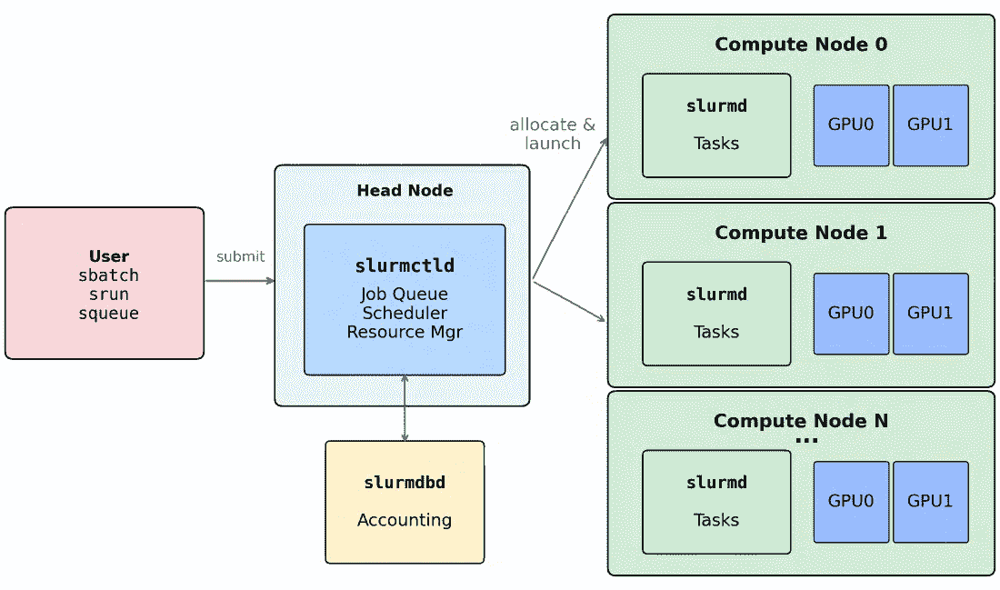
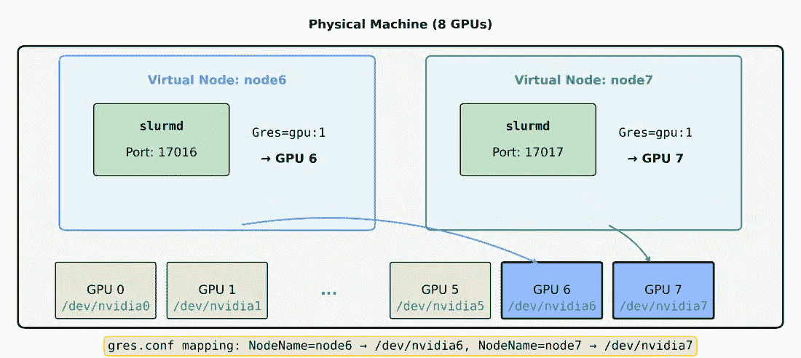
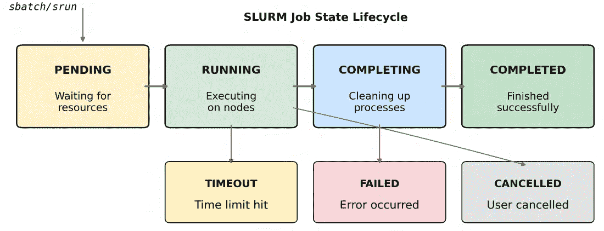
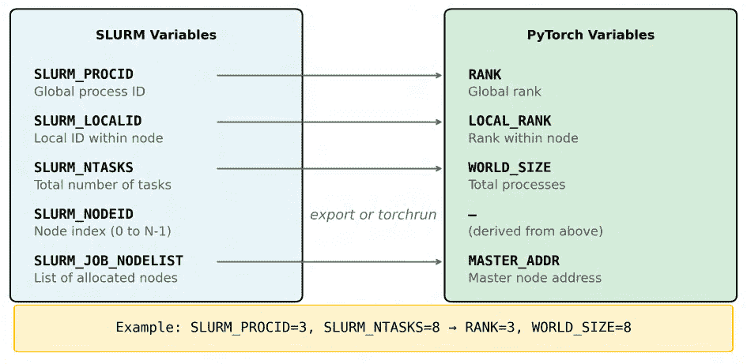
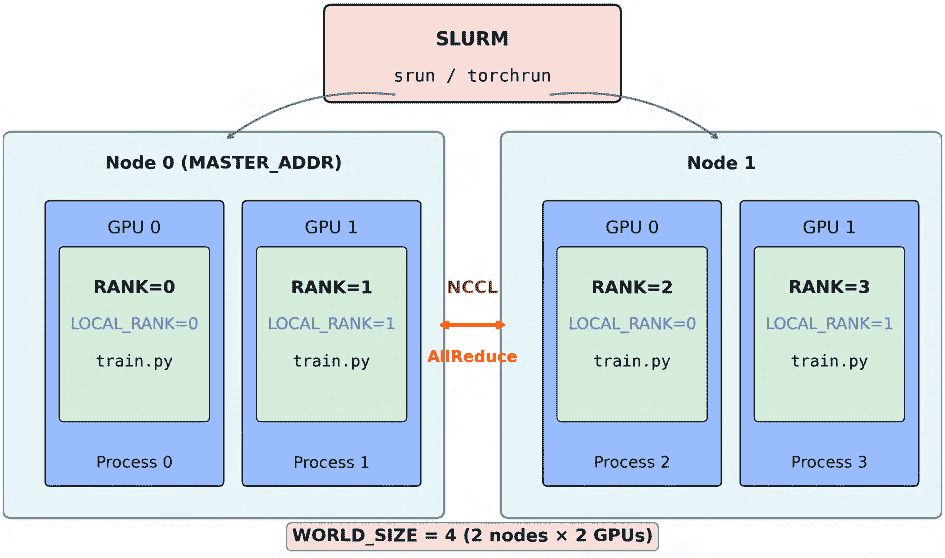

## 8 使用 SLURM 运行分布式训练

**管理 GPU 资源并协调多节点作业**

*在一间满是顶级软件设计师的房间里，如果有两个人同意同一件事，那就是多数。*

*比尔·柯蒂斯*

### HPC 与 AI 训练集群简介

前面的章节涵盖了分布式训练的理论与实现——用于梯度同步的 DDP、用于内存效率的 FSDP、用于 ZeRO 优化的 DeepSpeed，以及用于模型并行的 Megatron。但理解这些框架只是挑战的一半。另一半是在真实硬件上实际运行它们：跨节点分配 GPU、协调进程、管理作业队列，以及处理大规模运行中不可避免的故障。

现代 AI 训练发生在集群上——由相互连接的机器组成的集合，这些机器汇集其计算资源。典型的 GPU 集群由计算节点（每个节点包含多个 GPU、CPU 和内存）、连接节点的高速互连（InfiniBand 或高带宽以太网）、所有节点均可访问的共享存储，以及管理作业提交和调度的头节点组成。集群可能有数十到数千个节点，代表着价值数百万美元的硬件，必须在许多用户和项目之间有效共享。

这种共享属性带来了一个根本性挑战：如何公平分配资源、确保作业互不干扰，并最大化昂贵硬件的利用率？在计算早期，用户会在共享机器上预约时间段。现代集群使用作业调度器——这种软件接受作业请求，根据优先级和资源可用性将其排队，在资源可用时进行分配，监控运行中的作业，并在作业完成或失败后进行清理。

HPC 生态系统中存在多种作业调度器。PBS（便携式批处理系统）及其衍生版本（Torque、PBS Pro）在传统 HPC 中占主导地位。[1] LSF（负载共享设施）在企业环境中很流行。[2] HTCondor 擅长高吞吐量计算工作负载，即许多独立作业需要在可用机器上分布执行。[3] Kubernetes 已成为云原生工作负载的标准。[4] 但对于运行 AI 训练工作负载的 GPU 集群，SLURM 已成为主流选择，被大多数学术机构、国家实验室使用，并且越来越多的云服务提供商也提供支持 HPC 的实例。

### 为什么 AI 训练选择 SLURM？

SLURM（简单 Linux 资源管理实用程序）于 2002 年在劳伦斯利弗莫尔国家实验室启动，现已发展成为支持拥有数百万核心集群的复杂资源管理器。[5] 有几个因素使其特别适合 AI 训练工作负载。

首先，SLURM 通过其通用资源（GRES）系统对 GPU 提供一流支持。您可以请求特定 GPU 类型（`--gres=gpu:a100:4`），SLURM 会确保独占分配——在您的作业运行期间，其他作业无法访问您的 GPU。这对训练至关重要，因为共享访问导致的 GPU 内存碎片化会引发内存不足错误。

其次，SLURM 与 PyTorch 的分布式训练无缝集成。当 SLURM 跨多个节点启动您的作业时，它会自动设置映射到分布式训练概念的环境变量：`SLURM_PROCID` 作为全局秩（rank），`SLURM_LOCALID` 作为节点内的本地秩，`SLURM_NTASKS` 作为世界大小（world size），`SLURM_JOB_NODELIST` 提供建立通信所需的节点列表。PyTorch 的 `torchrun` 启动器会读取这些变量并自动初始化进程组。

第三，SLURM 提供了对于长期运行的训练作业至关重要的强大作业管理功能：用于超参数扫描的作业数组、用于多阶段流水线的作业依赖关系、抢占、用于处理时间限制的检查点支持，以及用于跟踪资源使用的详细记账功能。当训练运行需要数天或数周时，这些功能变得必不可少。

第四，SLURM 可以高效扩展。无论是在 4 节点实验室集群还是 10,000 节点超级计算机上运行，相同的命令和脚本都适用。这种可移植性意味着技能可以在不同机构和云服务提供商之间迁移。

一旦理解了映射关系，SLURM 与 PyTorch 分布式训练的集成就非常顺畅。您的训练代码无需知道它是在拥有 2 个 GPU 的笔记本电脑上运行，还是在拥有 256 个 GPU 的集群上运行——抽象层处理了所有细节。作业脚本指定资源需求（`--nodes=4 --gres=gpu:8`），SLURM 分配这些资源并设置环境，您的训练脚本使用 SLURM 提供的环境变量初始化分布式通信。

### SLURM 架构：简要概述

在深入使用之前，了解 SLURM 的高级架构会有所帮助。SLURM 由多个守护进程组成，它们协同管理集群：

- **slurmctld**（控制器守护进程）：运行在头节点上的中央大脑。它管理作业队列、做出调度决策、分配资源并监控作业状态。在生产集群中，slurmctld 通常以高可用性配置运行，并带有备用控制器。
- **slurmd**（计算守护进程）：运行在每个计算节点上。它接收来自 slurmctld 的作业分配，启动并监控任务，向控制器报告节点状态，并使用 Linux cgroups 强制实施资源限制。
- **slurmdbd**（数据库守护进程）：可选，但在生产环境中很常见。它将记账数据（作业历史、资源使用、用户/项目分配）存储在 MySQL 或 MariaDB 数据库中，从而支持公平共享调度和使用报告。

当您使用 `sbatch` 提交作业时，请求会发送到 slurmctld，它会将其排队，并最终根据调度策略（优先级、公平共享、回填）分配资源。一旦资源可用，slurmctld 就会通知相关的 slurmd 守护进程，这些守护进程会生成您作业的进程，并设置您的训练脚本所读取的环境变量。

SLURM 的调度算法、分区配置、QOS（服务质量）策略和插件架构是集群管理员针对其特定工作负载进行调整的丰富主题。本章重点介绍**面向用户的方面**——如何提交作业、请求资源以及与分布式训练框架集成——而不是集群管理。有关 SLURM 内部机制和管理的详细内容，请参阅官方文档[5]和 SchedMD 培训材料。


*图8.1：SLURM架构：slurmctld、slurmd和slurmdbd守护进程*

*图8.1*展示了整体架构。用户通过`sbatch`（提交批处理作业）、`srun`（运行交互式命令）和`squeue`（查询作业状态）等命令与主节点交互。提交新作业或启动交互式分配时，请求会经过slurmctld；一旦你获得一个分配，其中的`srun`会直接与所分配节点上的本地slurmd守护进程通信。控制器维护作业队列、跟踪节点状态并做出调度决策——当资源可用时，它会通知相应的slurmd守护进程启动作业进程。每个slurmd管理其本地节点：生成任务、通过cgroups强制实施资源限制、监控进程健康状态，并向控制器报告状态。可选的slurmdbd守护进程将计费数据（作业历史、资源消耗、用户分配）持久化到数据库，从而实现公平份额调度策略，在用户和项目之间长期平衡资源使用。

### 为多GPU训练设置SLURM

大多数用户无需自行安装SLURM——集群管理员会负责这件事。但理解其配置有助于在作业行为不符合预期时排查问题，而且在将分布式训练脚本提交到生产集群之前，搭建本地测试环境对开发和调试脚本非常有价值。



#### 模拟多节点集群

为了开发和测试，你可以在单台物理机器上通过运行多个SLURM计算守护进程（slurmd）来模拟多节点集群，每个守护进程映射到不同的GPU。这样即使没有真实集群，也能测试多节点分布式训练代码。

关键之处在于，SLURM的架构将“节点”的概念与物理机器分离开来。每个slurmd守护进程代表一个节点，通过在不同端口上运行多个守护进程，你可以创建SLURM视为独立机器的虚拟节点。`slurm.conf`中的配置定义这些虚拟节点：

```
# Enable multiple slurmd support
# Use $HOSTNAME or $(hostname) to get the actual hostname
NodeName=node6 NodeHostname=$HOSTNAME Port=17016 \
 CPUs=112 RealMemory=240000 Gres=gpu:1 State=UNKNOWN
NodeName=node7 NodeHostname=$HOSTNAME Port=17017 \
 CPUs=112 RealMemory=240000 Gres=gpu:1 State=UNKNOWN
```

每个虚拟节点监听不同端口（17016、17017），但共享同一主机名。`Gres=gpu:1`声明告诉SLURM每个节点有一块可用GPU。相应的`gres.conf`文件将这些虚拟GPU映射到物理设备。以下路径（`/dev/nvidiaN`）是NVIDIA所特有的；其他硬件厂商使用不同的设备文件——请参阅 SLURM GRES 文档 `https://slurm.schedmd.com/gres.html` 了解适用于你的硬件的信息。在这个示例中，我们使用一台8块GPU的机器，并将最后两块GPU（索引6和7）专用于我们的虚拟集群：

```
NodeName=node6 Name=gpu File=/dev/nvidia6
NodeName=node7 Name=gpu File=/dev/nvidia7
```

这种映射确保当作业在node6上请求`--gres=gpu:1`时，SLURM会设置`CUDA_VISIBLE_DEVICES`，只向该作业暴露`/dev/nvidia6`。你可以调整GPU索引以使用机器上任何可用的GPU——例如，如果想改用前两块GPU，可使用`/dev/nvidia0`和`/dev/nvidia1`。在真实集群上，每个物理节点都会有各自的`gres.conf`条目，映射到其本地GPU。

*图8.2：单台物理机器上的虚拟多节点集群*

*图8.2*展示了虚拟节点设置。两个slurmd守护进程（node6和node7）在同一台物理机器上运行，但监听不同端口。每个虚拟节点通过`gres.conf`映射到特定GPU，让你可以在本地测试多节点分布式训练代码。

#### 快速设置与验证

提供的设置脚本将配置过程自动化——创建SLURM配置目录、为虚拟节点编写`slurm.conf`和`gres.conf`、初始化状态目录，并为每个虚拟节点启动`slurmctld`和一个`slurmd`：

```
cd code
bash slurm_setup.sh
```

守护进程运行起来后，验证集群是否正常工作。首先，将SLURM添加到PATH环境变量中（将`$SLURM_PREFIX`替换为你的安装前缀，通常是`/opt/slurm`或`$HOME/slurm`）：

```
export PATH=$SLURM_PREFIX/bin:$PATH
```

`sinfo`命令显示集群的分区和节点状态：

```
sinfo
# Example output:
# PARTITION AVAIL TIMELIMIT NODES STATE NODELIST
# gpu* up infinite 2 idle node[6-7]
```



示例输出显示了一个名为“gpu”的分区（星号表示其为默认分区），其中有2个空闲节点。如需更详细的节点信息，请使用`scontrol show nodes`。若要验证作业确实能运行，请提交一个简单测试：

```
srun -N 1 hostname
srun -N 2 hostname
```

第一条命令在一个节点上运行`hostname`；第二条命令同时在两个节点上运行它。如果两条命令都成功完成并打印出预期的节点名，则说明你的SLURM设置已为分布式训练实验做好准备。

### 提交分布式训练作业

配置并验证完SLURM后，下一步就是提交实际的训练作业。SLURM提供两种主要的提交方式：`srun`用于交互式执行，`sbatch`用于批处理提交。理解何时使用每种方式，以及如何组织作业脚本，对于高效使用集群至关重要。

#### 使用srun进行交互式执行

对于快速测试和调试，`srun`会在所分配的资源上立即执行命令。你只需指定所需资源，SLURM要么立即运行你的命令（如果资源可用），要么等待资源空闲。`code/train.py`脚本是一个自包含示例：它会自动检测SLURM环境变量、初始化分布式训练，并在合成数据（`SimpleDataset`）上运行一个简单的3层神经网络（`SimpleModel`），非常适合用来验证你的集群设置：

```
# Two nodes, 1 GPU each
srun -N 2 --gres=gpu:1 --cpus-per-task=4 python code/train.py
```

这些标志精确告诉SLURM你的作业需要什么资源：`-N 2`请求两个节点，`--gres=gpu:1`请求每个节点一块GPU，`--cpus-per-task=4`为数据加载和预处理分配四个CPU核心——这个数量适中，适合快速冒烟测试。本章后面的生产级批处理脚本会请求更多核心（例如28个），以满足DataLoader工作进程和预处理所需的额外资源。SLURM会找到满足这些要求的节点，设置好环境，并在所有已分配的资源上同时运行你的命令。

交互式执行对开发很方便，但会占用终端并要求你保持连接。对于可能需要数小时或数天的生产级训练任务，批处理提交是标准做法。

#### 使用sbatch提交批处理作业

批处理作业在shell脚本中定义，并通过特殊的`#SBATCH`指令来指定资源需求。你将脚本提交到SLURM队列，它会在资源可用时运行——即使你已经注销登录。下面是一个典型的分布式训练批处理脚本（可运行版本位于`code/train_ddp.sh`）：

```bash
#!/bin/bash
#SBATCH --job-name=ddp-training
#SBATCH --nodes=2
#SBATCH --gres=gpu:1
#SBATCH --ntasks-per-node=1
#SBATCH --cpus-per-task=28
#SBATCH --mem=200G
#SBATCH --time=24:00:00
#SBATCH --output=train_%j.out
#SBATCH --error=train_%j.err

# Get node list and master address
export MASTER_ADDR=$(scontrol show hostnames "$SLURM_JOB_NODELIST" | head -n 1)
export MASTER_PORT=$((29500 + RANDOM % 1000))
export WORLD_SIZE=$SLURM_NTASKS
export RANK=$SLURM_PROCID
export LOCAL_RANK=$SLURM_LOCALID

echo "Master: $MASTER_ADDR:$MASTER_PORT"
echo "World size: $WORLD_SIZE, Rank: $RANK, Local rank: $LOCAL_RANK"

# Run training
srun python code/train_ddp.py
```

顶部的`#SBATCH`指令定义了作业的资源范围：2个节点、每节点1块GPU、每个任务28个CPU核心、200GB内存，以及24小时的时间限制。输出文件名中的`%j`会展开为作业ID，因此每次运行都会获得唯一的日志文件。这些指令对shell而言是注释，但会在执行前由`sbatch`解析。


中间部分负责建立分布式训练环境。关键点是 `MASTER_ADDR`——rank 0 所在的主机名，所有其他 rank 都会连接到该地址以建立进程组。`scontrol show hostnames` 命令将 SLURM 的压缩节点列表格式（例如 `node[6-7]`）转换为单个主机名，而 `head -n 1` 提取其中第一个作为主节点。对应的 Python 训练脚本位于 `code/train_ddp.py`。

使用 `sbatch` 提交作业，SLURM 会立即返回一个作业 ID：

```bash
sbatch code/train_ddp.sh
```

随后你可以通过队列监控作业进度：

```bash
squeue # List all jobs
squeue -u $USER # List your jobs
scontrol show job <job_id> # Detailed job info
```

*图 8.3：SLURM 作业状态生命周期*

*图 8.3* 展示了作业状态转换。作业在等待资源时处于 PENDING，分配资源后进入 RUNNING，清理期间进入 COMPLETING，最终成功时进入 COMPLETED。作业也可能转换为 FAILED（出错时）、CANCELLED（用户干预）或 TIMEOUT（超出时间限制）。使用 `squeue` 查看当前状态，使用 `sacct` 查看历史作业信息。

### 理解 SLURM 环境变量

当 SLURM 启动你的作业时，它会自动填充环境变量，你的训练脚本可以读取这些变量来配置分布式通信。理解这些变量对于编写可跨不同集群配置移植的代码至关重要。



在作业级别，SLURM 提供描述整体分配的变量。`SLURM_JOB_ID` 提供用于命名日志文件和检查点的唯一标识符。`SLURM_JOB_NAME` 包含你通过 `--job-name` 指定的名称（如果没有指定，则默认为脚本名）。`SLURM_JOB_NODELIST` 以压缩格式列出分配的节点——例如 `node[6-7]` 或 `gpu-node-[001-004]`——而 `SLURM_JOB_NUM_NODES` 给出节点数量。`SLURM_SUBMIT_DIR` 记录你提交作业时所在的目录，可用于定位相对于提交位置的配置文件或数据。

对于分布式训练，进程级变量最为关键。SLURM 启动的每个任务都会收到 `SLURM_PROCID`，这是一个全局唯一的 rank，取值范围为 0 到 NTASKS-1，用于标识该作业中的所有进程。`SLURM_LOCALID` 给出当前节点内的本地 rank（0 到每节点任务数减 1），通常用于 GPU 绑定——`SLURM_LOCALID=0` 的进程使用该节点上的 GPU 0，依此类推。`SLURM_NODEID` 标识该进程运行在哪个节点上（0 到 NUM_NODES-1），`SLURM_NTASKS` 提供总任务数，相当于分布式训练术语中的 world size。`SLURM_TASKS_PER_NODE` 表示每个节点上运行多少任务，不过在异构分配中，不同节点上的数量可能不同。

与资源相关的变量可以帮助你调整性能。`SLURM_CPUS_PER_TASK` 告诉你每个任务可用的 CPU 核心数，可用于设置 DataLoader 中的 `num_workers`。`SLURM_GPUS_ON_NODE` 报告当前节点上的 GPU 数量，`SLURM_MEM_PER_NODE` 给出以 MB 为单位的内存分配。当你通过 `--gres=gpu:N` 请求 GPU 时，SLURM 的 GRES 插件会设置 `CUDA_VISIBLE_DEVICES`，使每个任务只能看到分配给它的 GPU——通常在该任务内重新映射为 `cuda:0`、`cuda:1`……。你通常使用 `LOCAL_RANK` 进行绑定，而不是根据全局 rank 猜测；当多个作业共享一个节点时，这样可以避免冲突。

在建立网络通信时，`SLURM_LAUNCH_NODE_IPADDR` 提供启动节点的 IP 地址，`SLURM_STEP_NODELIST` 在分配内使用 `srun` 时列出参与当前作业步骤的节点。

从 SLURM 到 PyTorch 分布式训练的映射很直接：`SLURM_PROCID` 变成 `RANK`，`SLURM_LOCALID` 变成 `LOCAL_RANK`，`SLURM_NTASKS` 变成 `WORLD_SIZE`。`MASTER_ADDR`——rank 0 监听连接的地址——通常通过从 `SLURM_JOB_NODELIST` 中提取第一个节点的主机名得到。一个典型的设置脚本会导出这些转换：

```bash
export MASTER_ADDR=$(scontrol show hostnames "$SLURM_JOB_NODELIST" | head -n 1)
export MASTER_PORT=$((29500 + RANDOM % 1000))
export WORLD_SIZE=$SLURM_NTASKS
export RANK=$SLURM_PROCID
export LOCAL_RANK=$SLURM_LOCALID
```

设置好这些变量后，`torchrun` 或 `torch.distributed.init_process_group(init_method='env://')` 会读取它们并自动配置进程组。在共享集群上，像 29500 这样的固定端口可能与另一个作业冲突，并导致难以排查的 NCCL 错误；像上面那样随机化 `MASTER_PORT` 可以避免大多数冲突。这种抽象非常强大：你的训练代码不需要知道它是在 SLURM 下运行、由 `torchrun` 在单机上启动，还是由云提供商编排。同一个脚本在任何地方都能运行，因为它依赖的是标准环境变量，而不是 SLURM 特有的 API。

*图 8.4* 直观地展示了这一映射。你的训练脚本既可以直接读取 SLURM 变量，也可以使用导出的 PyTorch 标准变量（`RANK`、`LOCAL_RANK`、`WORLD_SIZE`、`MASTER_ADDR`）。在与 SLURM 配合使用时，`torchrun` 启动器会自动完成这种转换。请注意，SLURM 还为特殊用途提供了许多额外的环境变量——如需完整参考，请查阅 `srun` 的手册页或官方 SLURM 文档。[5]

*图 8.4：SLURM 到 PyTorch 环境变量映射*

### 使用 SLURM 启动分布式训练框架

了解了 SLURM 的基础知识后，我们转向一个实际问题：如何在 SLURM 集群上启动不同的分布式训练框架？每个框架都有自己的启动器和初始化模式，但它们都依赖于我们上面讨论的相同 SLURM 环境变量。

*图 8.5：使用 SLURM 进行多节点分布式训练*




*图 8.5* 展示了常见模式：SLURM 分配节点和 GPU，在集群中启动进程，并设置各框架读取环境变量以建立分布式通信。不同之处在于各框架如何包装这一过程。

下表总结了 SLURM 集成的主要区别：

| 框架 | 启动器 | 分布式初始化 | SLURM 环境变量处理 |
|-----------|----------|------------------|-------------------|
| DDP | `torchrun` 或 `srun` | 手动 | 导出为 `RANK`、`WORLD_SIZE` 等 |
| FSDP | `torchrun` | 手动 | 与 DDP 相同 |
| DeepSpeed | `python` | 自动 | 直接读取 SLURM 变量 |
| Megatron-LM | `torchrun` | 自动 | 直接读取 SLURM 变量 |

“手动”初始化意味着你需要在训练脚本中显式调用 `dist.init_process_group()`，并在 SLURM 批处理脚本中处理环境变量设置。“自动”意味着框架在内部处理分布式初始化——DeepSpeed 通过 `deepspeed.init_distributed()`，Megatron-LM 通过自己的启动器基础设施——读取 SLURM 环境变量，而无需显式设置代码。

有关各框架概念和内部机制的详细说明，请参阅前面的章节：DDP 见*第 3 章*，FSDP 见*第 4 章*，DeepSpeed 见*第 5 章*。这里我们专门聚焦 SLURM 启动模式，并提供完整的可运行示例。

#### 使用 SLURM 运行 DDP

如*第 3 章*所述，PyTorch DDP 在每个 GPU 上复制完整的模型，在进程之间分发数据，并在反向传播过程中通过 AllReduce 同步梯度。由于每个 GPU 都持有模型的完整副本，因此当模型能轻松放入单个 GPU 内存时，DDP 的效果最佳。这里我们重点讨论 SLURM 特有的启动模式。

训练脚本的结构很直接（完整版本见 `code/train_ddp.py`）：

```python
import os
import torch
import torch.distributed as dist
```


## 使用SLURM运行分布式训练

```python
import torch.nn as nn
from torch.nn.parallel import DistributedDataParallel as DDP

def main():
    dist.init_process_group(backend='nccl')
    rank = dist.get_rank()
    local_rank = int(os.environ["LOCAL_RANK"])
    device = torch.device(f'cuda:{local_rank}')
    model = nn.Linear(10, 1).to(device)
    model = DDP(model, device_ids=[local_rank])

    for epoch in range(10):
        # ... training code ...
        if rank == 0:
            print(f"Epoch {epoch} completed")

    dist.destroy_process_group()

if __name__ == '__main__':
    main()
```

SLURM批处理脚本设置环境并通过`torchrun`启动（完整版本见`code/train_ddp.sh`）：

```bash
#!/bin/bash
#SBATCH --nodes=2
#SBATCH --gres=gpu:1
#SBATCH --ntasks-per-node=1

export MASTER_ADDR=$(scontrol show hostnames "$SLURM_JOB_NODELIST" | head -n 1)
export MASTER_PORT=$((29500 + RANDOM % 1000))

srun torchrun \
    --nproc_per_node=1 \
    --nnodes=$SLURM_JOB_NUM_NODES \
    --node_rank=$SLURM_NODEID \
    --master_addr=$MASTER_ADDR \
    --master_port=$MASTER_PORT \
    code/train_ddp.py
```

或者，您可以使用SLURM内置的MPI支持，而无需`torchrun`：

```bash
#!/bin/bash
#SBATCH --nodes=2
#SBATCH --gres=gpu:1
#SBATCH --ntasks-per-node=1

export MASTER_ADDR=$(scontrol show hostnames "$SLURM_JOB_NODELIST" | head -n 1)
export MASTER_PORT=$((29500 + RANDOM % 1000))
export WORLD_SIZE=$SLURM_NTASKS
export RANK=$SLURM_PROCID
export LOCAL_RANK=$SLURM_LOCALID

srun python code/train_ddp.py
```

这种方法要求你的Python代码使用`init_method='env://'`，它会从环境变量中读取`RANK`、`WORLD_SIZE`、`MASTER_ADDR`和`MASTER_PORT`。

#### 使用SLURM的FSDP

如*第4章*所述，FSDP在GPU间分片模型参数、梯度和优化器状态，显著降低了大型模型对每个GPU内存的需求。SLURM启动模式与DDP相同——以相同的方式使用`torchrun`。区别在于Python代码中，你将模型包装在`FullyShardedDataParallel`中而不是`DistributedDataParallel`。下面的示例使用了FSDP1的`CPUOffload`辅助工具；在PyTorch 2.4+及FSDP2中，请换成`fully_shard()`和`CPUOffloadPolicy`。如*第4章*所述，只有Python包装器发生变化，SLURM脚本不变。

训练脚本结构（完整版本见`code/train_fsdp.py`）：

```python
import torch
import torch.distributed as dist
from torch.distributed.fsdp import FullyShardedDataParallel as FSDP
from torch.distributed.fsdp import CPUOffload
from torch.distributed.fsdp.wrap import size_based_auto_wrap_policy

def main():
    dist.init_process_group(backend='nccl')
    rank = dist.get_rank()
    model = MyLargeModel()

    model = FSDP(
        model,
        auto_wrap_policy=size_based_auto_wrap_policy,
        cpu_offload=CPUOffload(offload_params=True),
    )
    # Training loop...
if __name__ == '__main__':
    main()
```

SLURM批处理脚本（完整版本见`code/train_fsdp.sh`）：

```bash
#!/bin/bash
#SBATCH --job-name=fsdp-training
#SBATCH --nodes=2
#SBATCH --gres=gpu:1
#SBATCH --ntasks-per-node=1
#SBATCH --cpus-per-task=28
#SBATCH --mem=200G

export MASTER_ADDR=$(scontrol show hostnames "$SLURM_JOB_NODELIST" | head -n 1)
export MASTER_PORT=$((29500 + RANDOM % 1000))

srun torchrun \
    --nproc_per_node=1 \
    --nnodes=$SLURM_JOB_NUM_NODES \
    --node_rank=$SLURM_NODEID \
    --master_addr=$MASTER_ADDR \
    --master_port=$MASTER_PORT \
    code/train_fsdp.py
```

#### 使用SLURM的DeepSpeed

如*第5章*所述，DeepSpeed的ZeRO优化器提供了三个阶段的内存优化：ZeRO-1对优化器状态进行分区，ZeRO-2增加了梯度分区，ZeRO-3则进一步对模型参数本身进行分区。ZeRO-3在概念上与FSDP相似——两者都在GPU间分片参数——但DeepSpeed提供了额外的功能，如CPU和NVMe卸载，可以进一步扩展内存边界。此处的示例使用了带CPU卸载的ZeRO-3，但如果你不需要完整参数分片，只需将配置文件中的`"stage": 3`改为`1`或`2`，即可轻松切换至ZeRO-1或ZeRO-2。

与DDP和FSDP不同，你需要显式调用`dist.init_process_group()`并使用`torchrun`作为启动器，而DeepSpeed则采用不同的方法。它通过`deepspeed.init_distributed()`内部处理分布式初始化，直接读取SLURM环境变量，无需单独的启动器。这种设计简化了用户体验——你只需设置好相应的环境变量并运行`python train.py`，DeepSpeed会自动确定分布式拓扑。

训练脚本的结构体现了这种简洁性（完整版本见`code/deepspeed/train.py`）：

```python
import torch
import deepspeed
from transformers import AutoModelForCausalLM, AutoTokenizer

def main():
    deepspeed.init_distributed()
    model = AutoModelForCausalLM.from_pretrained("gpt2")
    tokenizer = AutoTokenizer.from_pretrained("gpt2")
    model_engine, optimizer, _, _ = deepspeed.initialize(
        model=model,
        model_parameters=model.parameters(),
        config="ds_zero3_offload.json"
    )
    for epoch in range(10):
        # ... training code ...
        model_engine.backward(loss)
        model_engine.step()
if __name__ == "__main__":
    main()
```

请注意，该脚本并未导入`torch.distributed`，也未调用`init_process_group()`——DeepSpeed在内部处理所有这些。`deepspeed.initialize()`调用会返回一个`model_engine`，它使用ZeRO优化包装你的模型，并且你使用`model_engine.backward()`和`model_engine.step()`，而非标准的PyTorch优化器方法。

配置文件控制ZeRO的行为（`code/deepspeed/ds_zero3_offload.json`）：

```json
{
  "train_batch_size": 2,
  "gradient_accumulation_steps": 1,
  "train_micro_batch_size_per_gpu": 1,
  "fp16": { "enabled": true },
  "zero_optimization": {
    "stage": 3,
    "offload_param": { "device": "cpu", "pin_memory": true },
    "offload_optimizer": { "device": "cpu", "pin_memory": true }
  },
  "optimizer": {
    "type": "AdamW",
    "params": { "lr": 5e-5, "weight_decay": 0.01 }
  }
}
```

`stage: 3`设置启用了完整的参数分片，`offload_param`和`offload_optimizer`部分则在模型超出GPU总内存时配置CPU卸载。`pin_memory: true`选项使用锁页（页锁定）CPU内存，以加快CPU-GPU传输。请将此JSON视为生产规模的模板——先使用ZeRO阶段1或2验证NCCL和SLURM的连接，一旦作业运行正常，再启用阶段3和CPU卸载。

SLURM批处理脚本比DDP需要更多的设置，因为我们需要手动导出DeepSpeed所期望的环境变量（`code/deepspeed/run.slurm`）：

```bash
#!/bin/bash
#SBATCH --job-name=deepspeed-zero3
#SBATCH --nodes=2
#SBATCH --gres=gpu:1
#SBATCH --ntasks-per-node=1
#SBATCH --cpus-per-task=8
#SBATCH --mem=200G

# Replace with your conda path and environment name
source ~/miniconda3/etc/profile.d/conda.sh
conda activate research

export MASTER_ADDR=$(scontrol show hostnames "$SLURM_JOB_NODELIST" | head -n 1)
```


```bash
export MASTER_PORT=$((29500 + RANDOM % 1000))
export WORLD_SIZE=$SLURM_NTASKS
export NCCL_DEBUG=WARN
export NCCL_SOCKET_IFNAME=^docker,lo
export GLOO_SOCKET_IFNAME=eth0
srun --chdir="$SLURM_SUBMIT_DIR" --label \
    bash -c "
    source ~/miniconda3/etc/profile.d/conda.sh
    conda activate research
    export CUDA_VISIBLE_DEVICES=\$SLURM_LOCALID
    export LOCAL_RANK=\$SLURM_LOCALID
    export RANK=\$SLURM_PROCID
    cd \"$SLURM_SUBMIT_DIR\"
    python train.py --deepspeed --deepspeed_config ds_zero3_offload.json
    "
```

该脚本在作业级别设置 `MASTER_ADDR`、`MASTER_PORT` 和 `WORLD_SIZE`——主节点主机名应通过 `scontrol` 获取，而不是使用 `127.0.0.1`，否则每个节点会形成各自的单节点进程组，梯度永远不会跨节点同步。在本书前面的虚拟双节点环境中（两个 `slurmd` 守护进程共享同一台物理主机），这种故障可能不会被察觉。随后 `srun` 在每个节点上启动一个 bash 子 shell；在其中，我们从 SLURM 的任务环境中导出每个进程的变量（`CUDA_VISIBLE_DEVICES`、`LOCAL_RANK`、`RANK`）。`--label` 标志会为输出的每一行添加任务 ID 前缀，这在调试多节点问题时很有帮助。

在 SLURM 集群上运行 DeepSpeed 时，有几个实际注意事项。DeepSpeed 需要 `LOCAL_RANK` 环境变量，你必须从 `SLURM_LOCALID` 显式导出它——这与 `torchrun` 不同，后者会自动设置该变量。如果你使用虚拟节点进行测试（如前所述），请记得将节点名适当地映射到 GPU 索引——例如，`node6` 应使用 GPU 6。在某些集群上，IPv6 可能导致连接问题；设置 `NCCL_SOCKET_IFNAME` 和 `GLOO_SOCKET_IFNAME` 以排除有问题的接口（如 `^docker,lo`）通常可以解决该问题。最后，记得将脚本中的 conda 路径和环境名称替换为你自己的配置。

#### 在 SLURM 上使用 Megatron-LM

如*第 5 章*所述，Megatron-LM 提供了 NVIDIA 的生产级框架，将张量并行、流水线并行、序列/上下文并行和数据并行组合在一起——所有并行方式都可以在单次训练运行中自由组合。这种多维并行对于训练最大的语言模型至关重要，因为单一的并行策略无法满足要求。

在深入了解 SLURM 脚本之前，有一个重要的安装注意事项（*第 5 章*中也提到过）。与 PyTorch 内置的 DDP 和 FSDP 不同，Megatron-LM 需要从源码安装才能获得完整的训练基础设施。PyPI 软件包 `megatron-core` 只包含 `megatron.core`（模型构建模块），而 `pretrain_gpt.py` 等训练脚本需要 `megatron.training`，该模块只有从 GitHub 仓库安装才能获得：

```bash
conda activate research # Replace with your environment name
git clone https://github.com/NVIDIA/Megatron-LM.git
cd Megatron-LM
pip install --no-build-isolation '.[mlm,dev]'
```

你还需要将训练脚本（`pretrain_gpt.py`、`gpt_builders.py`、`model_provider.py`）复制到你的工作目录，因为这些脚本不会作为软件包的一部分被安装。

前置条件就绪后，让我们看一下 SLURM 批处理脚本（`code/megatron/run.slurm`）：

```bash
#!/bin/bash
#SBATCH --job-name=megatron-gpt
#SBATCH --nodes=2
#SBATCH --gres=gpu:1
#SBATCH --ntasks-per-node=1
#SBATCH --cpus-per-task=8
#SBATCH --mem=200G
#SBATCH --time=4:00:00
#SBATCH --output=logs/train_%j_%N.out
#SBATCH --error=logs/train_%j_%N.err

# Replace with your conda path and environment name
source ~/miniconda3/etc/profile.d/conda.sh
conda activate research

SCRIPT_DIR="${SLURM_SUBMIT_DIR:-$(dirname "$(readlink -f "$0")")}"
cd "$SCRIPT_DIR"
mkdir -p logs
PRETRAIN_SCRIPT="${SCRIPT_DIR}/pretrain_gpt.py"

export MASTER_ADDR=$(scontrol show hostnames "$SLURM_JOB_NODELIST" | head -n 1)
export MASTER_PORT=${MASTER_PORT:-6000}
export WORLD_SIZE=$SLURM_NTASKS
export NCCL_DEBUG=WARN
export NCCL_SOCKET_IFNAME=^docker,lo
export NCCL_IB_DISABLE=0
export CUDA_DEVICE_MAX_CONNECTIONS=1
export OMP_NUM_THREADS=$SLURM_CPUS_PER_TASK

# Model and training configuration
NUM_LAYERS=32; HIDDEN_SIZE=4096; NUM_ATTENTION_HEADS=32
TP_SIZE=1; CP_SIZE=1; PP_SIZE=1
MICRO_BATCH_SIZE=1; GLOBAL_BATCH_SIZE=128

srun --chdir="$SCRIPT_DIR" --label \
    bash -c "
    source ~/miniconda3/etc/profile.d/conda.sh
    conda activate research
    export CUDA_VISIBLE_DEVICES=\$SLURM_LOCALID
    export LOCAL_RANK=\$SLURM_LOCALID
    export RANK=\$SLURM_PROCID
    torchrun --nproc_per_node=1 --nnodes=\$SLURM_JOB_NUM_NODES \
        --node_rank=\$SLURM_NODEID --master_addr=\"$MASTER_ADDR\" \
        --master_port=\"$MASTER_PORT\" \"$PRETRAIN_SCRIPT\" \
        --use-mcore-models --num-layers $NUM_LAYERS \
        --hidden-size $HIDDEN_SIZE --num-attention-heads $NUM_ATTENTION_HEADS \
        --tensor-model-parallel-size $TP_SIZE --pipeline-model-parallel-size $PP_SIZE \
        --micro-batch-size $MICRO_BATCH_SIZE --global-batch-size $GLOBAL_BATCH_SIZE \
        --bf16 --mock-data --tokenizer-type NullTokenizer --vocab-size 128256
    "
```

脚本结构与 DeepSpeed 的模式相同：先设置作业级环境变量，然后使用 `srun` 启动一个 bash 子 shell，在其中设置每个进程的变量并调用 `torchrun`。模型配置变量（`NUM_LAYERS`、`HIDDEN_SIZE` 等）定义了一个 8B 参数的 GPT 模型，而并行度变量（`TP_SIZE`、`PP_SIZE`、`CP_SIZE`）控制模型的分布式方式——请根据你的硬件和模型规模调整这些值。该示例使用模拟数据（`--mock-data`）进行演示；对于真实训练，你需要提供实际的数据路径和合适的 tokenizer。请记得在提交前将脚本中的 conda 路径和环境名称替换为你自己的配置：

```bash
cd code/megatron
sbatch run.slurm
```

使用 Megatron-LM 训练时，你会注意到检查点文件可能相当大。对于一个 8B 参数的模型，你可能会看到这样的检查点目录：

```text
code/megatron/checkpoints/gpt_8b/iter_0000010/
27G __0_0.distcp
27G __0_1.distcp
27G __1_0.distcp
27G __1_1.distcp
24K common.pt
4.0K metadata.json
```

为什么这么大？计算很简单：bf16 格式的模型参数占用 8.03B × 2 字节 = 16.06 GB，而 fp32 格式的 Adam 优化器状态需要 8.03B × 8 字节 = 64.24 GB（动量和方差各 4 字节）。理论上这已经约 80 GB，而实际大小约 108 GB 还包含了分布式优化器分片、文件格式元数据以及为高效并行 I/O 所做的对齐填充等额外开销。每个 rank 保存自己的分片（`__0_0.distcp`、`__0_1.distcp` 等），以便在集群中实现并行的保存/加载操作。

为了管理检查点存储，可以考虑使用 `--save-interval` 来控制检查点的保存频率，实现检查点轮转以只保留最近的检查点，并使用能够处理 I/O 负载的分布式文件系统。

另一个实际注意事项是检查点格式转换。Megatron-LM 以分布式格式（`.distcp` 文件）保存检查点，而这种格式需要 Megatron-LM 才能加载。如果你想将训练好的模型与其他框架（如 vLLM 或 SGLang）一起用于推理，或者直接用原生 PyTorch 加载，你需要转换检查点。提供的转换脚本（`code/megatron/convert_megatron_checkpoint.py`）可以处理这个问题：

```bash
python code/megatron/convert_megatron_checkpoint.py \
    --checkpoint-dir code/megatron/checkpoints/gpt_8b/iter_0000010 \
    --output-dir exported_checkpoint \
    --format pytorch \
    --num-layers 32 --hidden-size 4096 --num-attention-heads 32
```


```bash
--vocab-size 128256 --max-position-embeddings 2048 \
--use-mcore-models --bf16
```

导出的检查点是完全独立的——加载它不需要 Megatron-LM：

```python
import torch

checkpoint = torch.load('exported_checkpoint/model.pt', map_location='cpu')
print(checkpoint['model_config'])
state_dict = checkpoint['model_state_dict']
```

转换后的检查点仅包含模型权重（不含优化器状态），因此体积显著更小，并且兼容任何基于 PyTorch 的推理框架。如需进行生产环境下的 HuggingFace 格式转换，并正确处理层名映射和张量形状调整，建议使用 Megatron-Bridge https://github.com/NVIDIA-NeMo/Megatron-Bridge。

### 训练用 SLURM 高级特性

除了基本的作业提交功能外，SLURM 还提供了若干高级特性，这些特性对于严肃的训练工作流来说极为宝贵。本节将介绍其中对 AI 实践者最有用的部分。

#### 用于超参数调优的作业阵列

当你需要使用不同的超参数运行同一个训练脚本时——这是超参数搜索中的常见场景——逐个提交作业很快就会变得繁琐。SLURM 的作业阵列允许你提交单个脚本，该脚本会生成多个独立作业，每个作业拥有一个唯一的任务 ID，你可以用它来选择不同的配置。

`#SBATCH --array=0-9` 指令告诉 SLURM 创建 10 个作业（索引 0 到 9）。每个作业在其 `SLURM_ARRAY_TASK_ID` 环境变量中收到自己的索引，你可以用它来计算超参数。可运行版本位于 `code/train_array.sh`：

```bash
#!/bin/bash
#SBATCH --array=0-9
#SBATCH --nodes=1
#SBATCH --gres=gpu:1

# Each array task gets different hyperparameters
LRS=(0.001 0.0001 0.00001 0.000001)
LR=${LRS[$((SLURM_ARRAY_TASK_ID % 4))]}
BATCH_SIZE=$((32 * (SLURM_ARRAY_TASK_ID / 4 + 1)))

python code/train.py --lr $LR --batch_size $BATCH_SIZE
```

此示例创建了一个涵盖 4 个学习率和 3 个批大小的网格搜索（虽然 12 种组合中只有 10 种会运行）。使用 `sbatch code/train_array.sh` 提交，SLURM 会调度全部 10 个作业——如果资源可用，它们可能会并行运行；否则会排队等待。

#### 使用 salloc 进行交互式作业

虽然 `sbatch` 非常适合生产训练运行，但调试分布式代码通常需要交互式访问。`salloc` 命令会分配资源并为你提供一个 shell，你可以在其中直接运行命令：

```bash
# Allocate 2 nodes, 1 GPU each, for 1 hour
salloc -N 2 --gres=gpu:1 --time=1:00:00

# Once allocated, run commands interactively
srun hostname
srun nvidia-smi
srun python code/train.py

# Release when done
exit
```

这种工作流对于调试来说极其珍贵——你可以运行训练脚本，看到它失败，修复代码，然后立即重试，而无需再次排队等待。只需记住，你的分配有时间限制，空闲时间同样会计入你的配额。

#### 作业依赖

真实的训练流水线通常包含多个阶段：数据预处理、训练、评估和检查点转换。与其手动监控每个作业并提交下一个作业，你可以使用依赖关系将作业串联起来：

```bash
# Submit first job and capture its ID
JOB1=$(sbatch --parsable train_stage1.sh)

# Submit second job that starts only after first succeeds
sbatch --dependency=afterok:$JOB1 train_stage2.sh
```

`--dependency=afterok:$JOB1` 标志告诉 SLURM 在第一个作业成功完成之前暂不启动第二个作业。其他依赖类型包括 `afterany`（无论退出状态如何都会运行）、`afternotok`（仅当第一个作业失败时才运行）和 `singleton`（同时只运行一个具有该名称的作业）。

#### 检查点与作业恢复

长时间的训练运行难免会遇到中断——时间限制、节点故障、被更高优先级作业抢占。健壮的检查点机制至关重要，SLURM 提供了一种优雅处理时间限制的机制。

`--signal=SIGUSR1@90` 指令告诉 SLURM 在时间限制到期前 90 秒向你的作业发送 `SIGUSR1` 信号。你的脚本可以捕获此信号并触发检查点保存。这与 `SIGTERM` 不同，`SIGTERM` 是 SLURM 在立即取消或抢占时发送的（`scancel`、节点排空）——在生产检查点代码中应同时处理两者。完整示例见 `code/train_distributed.sh`：

```bash
#!/bin/bash
#SBATCH --nodes=2
#SBATCH --gres=gpu:1
#SBATCH --time=24:00:00
#SBATCH --signal=SIGUSR1@90 # Send signal 90 seconds before time limit

# Handle checkpoint signal
trap 'echo "Checkpointing..."; python code/checkpoint.py' SIGUSR1

python code/train.py --resume --checkpoint_dir=/path/to/checkpoints
```

当信号到达时，trap 处理器会运行你的检查点脚本，让训练进程在 SLURM 终止作业前有时间保存状态。结合训练脚本中的 `--resume` 标志，你可以跨多次作业提交无缝地继续训练。

#### 监控与调试

当训练作业跨多个节点运行数小时或数天时，有效的监控变得至关重要。你需要知道你的作业是否真正在运行、资源被如何利用，以及在出现问题时去哪里查看。

#### 作业监控

最基本的监控从 `squeue` 开始，它显示队列中作业的状态。使用 `watch` 包装它，可以为你提供实时仪表盘：

```bash
# Watch job queue, refreshing every second
watch -n 1 squeue -u $USER

# Get detailed information about a specific job
scontrol show job <job_id>

# Watch a specific job's state changes
watch -n 1 scontrol show job <job_id>
```

`scontrol show job` 的输出包含有用的详细信息，如分配的节点、开始时间、时间限制和当前状态。对于正在运行的作业，你可以检查所有已分配节点上的 GPU 利用率：

```bash
# Check GPU usage across all nodes in your allocation
srun -N 2 nvidia-smi

# For a running batch job, attach to its step instead of SSH
srun --jobid=<job_id> nvidia-smi
```

要实时监控作业输出，请在输出文件上使用 `tail -f`。默认情况下，SLURM 将输出写入提交目录中的 `slurm-<job_id>.out`：

```bash
tail -f slurm-<job_id>.out
```

对于长时间运行的作业，`sacct` 命令提供历史信息，包括资源使用情况：

```bash
# Show completed jobs with resource usage
sacct -j <job_id> --format=JobID,JobName,Elapsed,MaxRSS,MaxVMSize,State

# Show all your recent jobs
sacct -u $USER --starttime=2024-01-01
```

#### 日志记录与输出

SLURM 会捕获作业的标准输出和标准错误，并将其写入文件。你可以使用特殊的格式代码自定义文件名：

```bash
#SBATCH --output=train_%j.out # %j = job ID
#SBATCH --error=train_%j.err # Separate file for stderr
#SBATCH --output=train_%j_%N.out # %N = node name (useful for multi-node)
```

分布式训练的一个挑战是：默认情况下，所有 rank 都会写入同一个输出文件，导致输出交错在一起，难以阅读。有几种策略可以解决这个问题。

最简单的方法是配合 `srun` 使用 `--label` 标志，它会为每行添加任务 ID 前缀：

```bash
srun --label python train.py
```

如需更细粒度的控制，可以在你的 Python 代码中实现按 rank 的日志记录：

```python
import logging
import torch.distributed as dist

def setup_logging():
    rank = dist.get_rank() if dist.is_initialized() else 0
    # Each rank logs to its own file
    logging.basicConfig(
        filename=f'train_rank_{rank}.log',
        level=logging.INFO,
        format=f'[Rank {rank}] %(asctime)s - %(levelname)s - %(message)s'
    )
    # Optionally, only rank 0 logs to console
    if rank == 0:
        console = logging.StreamHandler()
        console.setLevel(logging.INFO)
        logging.getLogger().addHandler(console)
```

这可以让你为每个 rank 提供单独的日志文件，从而更容易调试与特定 rank 相关的问题。


### 分析分布式训练

当训练速度比预期慢时，性能分析有助于查明时间花在了哪里。

PyTorch 内置的分析器可与 SLURM 作业无缝集成——只需注意多个进程同时运行即可。

基本方法是用分析器上下文管理器包裹几个训练步骤：

```python
from torch.profiler import profile, record_function, ProfilerActivity

with profile(
    activities=[ProfilerActivity.CPU, ProfilerActivity.CUDA],
    record_shapes=True,
    profile_memory=True,
    with_stack=True,
) as prof:
    # Profile a few training steps
    for step in range(5):
        with record_function("forward"):
            output = model(input)
        with record_function("backward"):
            loss.backward()
        with record_function("optimizer"):
            optimizer.step()

    # Save trace (only on rank 0 to avoid file conflicts)
    if dist.get_rank() == 0:
        prof.export_chrome_trace("trace.json")
    print(prof.key_averages().table(sort_by="cuda_time_total", row_limit=10))
```

`record_function` 上下文管理器会向跟踪中添加命名区域，使识别训练瓶颈阶段变得更加容易。`with_stack=True` 选项可捕获 Python 调用堆栈，有助于将性能问题追溯到具体的代码行。

导出的跟踪文件可在 Chrome 的 `chrome://tracing` 或 TensorBoard 中查看。对于分布式训练，请特别注意跟踪中的通信操作。如果你看到 `ncclAllReduce` 或类似的集合操作在分析结果中占据主导地位，那么很可能存在通信瓶颈。常见的解决方法包括增大批处理大小以提高计算与通信的比率，使用梯度累积来降低同步频率，或者在框架支持的情况下启用通信-计算重叠。

当分析器无法提供足够的通信问题信息时，NCCL 有自身的调试输出。将以下环境变量添加到你的 SLURM 脚本中：

```bash
export NCCL_DEBUG=INFO # Detailed NCCL logging
export NCCL_DEBUG_SUBSYS=ALL # All subsystems
export TORCH_DISTRIBUTED_DEBUG=DETAIL # PyTorch distributed debugging
```

这些变量会生成详细输出，精确显示 NCCL 正在做什么——连接建立、环形拓扑、带宽测量以及任何错误。在调试挂起或意外减速时，这种详细程度非常宝贵，但输出量较大，不适合生产环境运行。在调查具体问题时，请有选择地启用这些标志。

### 最佳实践

在完成上述示例后，有几个值得明确指出的模式浮现出来。

#### 资源分配

一个常见错误是依赖集群的默认资源分配。不同集群有不同的默认值，在你的实验室集群上可行的配置，在共享 HPC 系统上可能会静默失败。务必在批处理脚本中明确指定资源：`--nodes`、`--gres`、`--cpus-per-task`、`--mem` 和 `--time`。这能使你的脚本可移植且自带文档说明。

当你需要保证对节点的独占访问时（在大型训练中很常见，可避免其他作业的干扰），请使用 `--exclusive` 标志。这能确保没有其他作业共享你分配的节点，即使你没有使用它们的全部资源。

内存分配需要特别关注。GPU 内存不足错误很明显，但 CPU 内存耗尽可能导致静默失败或莫名崩溃。使用 `--mem`（按节点）或 `--mem-per-cpu` 请求足够的内存，并记住数据加载工作进程也会消耗 CPU 内存。

#### 检查点策略

对于长时间的训练运行，检查点策略决定了故障发生时是丢失数天的工作还是无缝恢复。请按固定的步数间隔保存检查点，而不仅仅是在 epoch 边界保存——如果你的 epoch 很长，仅按 epoch 保存意味着失败时会丢失大量进度。

使用 FSDP 时，请利用 `torch.distributed.checkpoint` 实现高效的分布式保存，无需将整个模型收集到单个进程。对于 DeepSpeed 和 Megatron-LM，请使用其内置的检查点机制，它们能正确处理分片状态。

最重要的是，在开始长时间训练之前，务必测试你的恢复逻辑。提交一个短作业，让其保存检查点，然后取消，并验证恢复后训练动态是否相同。在丢失一周训练后才发现检查点加载有 bug，是非常痛苦的。

#### 处理故障

大规模运行时，故障不可避免。节点崩溃、网络连接断开、作业被抢占。设计训练流程时应考虑到这一点。

实现健康检查以检测挂起的进程——这是一种常见故障模式：一个进程崩溃，但其他进程在集合操作处无限期等待。PyTorch 的 `init_process_group` 接受 `timeout` 参数；将其设置为合理值（例如 30 分钟），使得挂起的作业最终会失败，而不是无限期消耗资源。

确保你的数据加载对临时性文件系统问题具有鲁棒性。负载较重的共享文件系统偶尔会返回错误；使用带指数退避的重试逻辑包装数据加载，可防止这些临时问题导致作业失败。

最后，考虑为可抢占队列实现自动作业重新提交。许多集群提供较低优先级的队列，等待时间较短，但存在被抢占的可能。一个检测抢占并重新提交作业的包装脚本（使用 `--dependency=singleton` 防止重复）可以显著提高你在繁忙集群上的有效吞吐量。

### 常见问题排查

即使设置得很小心，也可能会出错。本节介绍你最常见的问题以及如何诊断它们。

#### 节点不可用

有时你的作业在队列中处于 `PD`（待定）状态的时间比预期更长。第一步是检查你请求的节点是否实际可用：

```bash
sinfo -N -l
```

这会显示每个节点的状态。常见状态包括 `idle`（可用）、`alloc`（使用中）、`down`（不可用）和 `drain`（被管理员禁用）。如果节点处于 down 或 drain 状态，你需要等待它们恢复，或调整作业以使用其他节点。

如果你运行的是本地测试集群（如虚拟节点设置部分所述），重启后可能需要手动恢复节点：

```bash
scontrol update NodeName=node[6-7] State=RESUME
```

#### GPU 分配问题

当作业因 GPU 相关错误而失败时，首先验证 SLURM 是否正确识别 GPU：

```bash
scontrol show nodes | grep Gres
```

这会显示为每个节点配置的通用资源（包括 GPU）。如果 GPU 没有显示，请检查 SLURM 配置目录中的 `gres.conf` 文件。你也可以直接测试 GPU 分配：

```bash
srun -N 1 --gres=gpu:1 nvidia-smi -L
```

如果此命令失败，问题很可能出在 SLURM 的 GPU 配置中，而不是你的训练脚本。

#### 通信错误

分布式训练失败通常表现为 NCCL 错误或集合操作超时。首先验证节点之间的基本网络连通性：

```bash
srun -N 2 bash -c 'echo "$(hostname): $(ping -c 1 node6 | grep time=)"'
```

如果节点之间无法互通，请检查防火墙规则和网络配置。对于 NCCL 特有的问题，启用 `NCCL_DEBUG=INFO` 详细日志以查看通信失败的具体位置。常见原因包括网络接口选择不正确（可使用 `NCCL_SOCKET_IFNAME` 修复）、InfiniBand 配置问题（可尝试 `NCCL_IB_DISABLE=1` 回退到以太网）以及端口冲突（如果默认端口被占用，可更改 `MASTER_PORT`）。

#### 作业挂起

最令人沮丧的问题也许是作业启动后无限期挂起。这通常发生在某个进程崩溃或卡住，而其他进程在集合操作处等待时。

首先，通过检查作业的输出文件并使用 `squeue -j <job_id>` 查看作业状态，确认所有进程是否都在运行。如果作业显示为运行中但不产生输出，请尝试 SSH 到分配的节点，并使用 `ps aux | grep python` 检查进程状态。

挂起的常见原因包括世界大小不匹配（某个进程认为启动的进程数多于实际进程数）、数据加载问题（某个进程无法访问一个文件……


其他问题也可能发生，而自定义代码中同步不正确导致的死锁也会出现。设置 `TORCH_DISTRIBUTED_DEBUG=DETAIL` 并在 `init_process_group` 中使用合理的超时有助于诊断这些问题——至少任务会以错误消息失败，而不是永远挂起。

### 命令汇总

| 命令/变量 | 描述 |
| --- | --- |
| `sbatch` | SLURM 命令，用于提交批量作业 |
| `srun` | SLURM 命令，用于运行交互式作业 |
| `squeue` | SLURM 命令，用于查看作业队列 |
| `scancel` | SLURM 命令，用于取消作业 |
| `sinfo` | SLURM 命令，用于查看集群信息 |
| `sacct` | SLURM 命令，用于查看作业记账信息 |
| `scontrol` | SLURM 命令，用于集群控制和配置 |
| `torchrun` | 与 SLURM 兼容的 PyTorch 启动器 |
| `SLURM_PROCID` | SLURM 环境变量，表示进程 ID |
| `SLURM_NTASKS` | SLURM 环境变量，表示任务数量 |

### 有用链接

#### SLURM 文档与工具

- SLURM 工作负载管理器文档： https://slurm.schedmd.com/
- SLURM GitHub 仓库： `https://github.com/SchedMD/slurm`
- 单节点 SLURM 集群 Docker： `https://github.com/minyang-chen/single-node-slurm-cluster-docker`
- DeepOps（GPU 集群部署）： `https://github.com/NVIDIA/deepops`

#### PyTorch 分布式训练

- PyTorch 分布式概览： `https://pytorch.org/tutorials/beginner/dist_overview.html`
- PyTorch FSDP 教程： `https://pytorch.org/tutorials/intermediate/FSDP_tutorial.html`
- PyTorch 分布式检查点： `https://pytorch.org/docs/stable/distributed.checkpoint.html`

#### DeepSpeed 与 Megatron-LM

- DeepSpeed 文档： `https://www.deepspeed.ai/`
- DeepSpeed GitHub： `https://github.com/microsoft/DeepSpeed`
- Megatron-LM GitHub： https://github.com/NVIDIA/Megatron-LM
- Megatron-Bridge（检查点转换）： https://github.com/NVIDIA-NeMo/Megatron-Bridge

#### 教程与指南

- 使用 SLURM 优化语言模型训练（Medium，2024）： `https://medium.com/@viktorciroski/optimizing-language-model-training-a-practical-guide-to-slurm-a6621d3c1bf2`
- 在 GCP 上部署带 SLURM 的自动扩展 HPC 集群： `https://codelabs.developers.google.com/codelabs/hpc-slurm-on-gcp`

#### 研究

- ZenFlow：通过异步更新实现无停滞卸载训练（2025）： `https://arxiv.org/abs/2505.12242`
- Domino：通过通用张量切片与重叠消除 LLM 训练中的通信（2024）： `https://arxiv.org/abs/2409.15241`

### 参考文献

1. PBS Professional 现在由 Altair 维护。商业版请参阅 `https://www.altair.com/pbs-professional/`，开源 OpenPBS 请参阅 `https://github.com/openpbs/openpbs`。
2. IBM Spectrum LSF 广泛应用于金融服务和生命科学领域。请参阅 `https://www.ibm.com/products/hpc-workload-management`。
3. HTCondor 由威斯康星大学麦迪逊分校的高吞吐量计算中心开发。官方网站请参阅 `https://htcondor.org/`，UT Austin 的示例部署请参阅 `https://www.cs.utexas.edu/facilities/documentation/condor`。
4. Kubernetes 可以通过 Volcano（`https://volcano.sh/`）等项目或带有 GPU 调度插件的 Kubernetes Job API 扩展以支持 HPC 工作负载。
5. SLURM 由 SchedMD 维护。官方文档和下载可在 `https://slurm.schedmd.com/` 获取。

### 练习

#### 编写一个基本的 SLURM 作业脚本

创建一个用于分布式 PyTorch 训练的 SLURM 作业脚本，并合理分配资源。

**要求：**

- 请求 2 个节点，每个节点 4 块 GPU
- 设置合适的时间限制和内存
- 为分布式训练配置环境变量
- 处理 NCCL 初始化
- 添加日志记录和错误处理

**测试你的实现：**

```bash
#!/bin/bash
#SBATCH --job-name=ddp-training
#SBATCH --nodes=2
#SBATCH --ntasks-per-node=4
#SBATCH --gres=gpu:4
#SBATCH --cpus-per-task=8
#SBATCH --mem=128G
#SBATCH --time=04:00:00
#SBATCH --output=logs/%j.out
#SBATCH --error=logs/%j.err
# Your implementation here:
# 1. Load modules (CUDA, Python, etc.)
# 2. Set MASTER_ADDR and MASTER_PORT
# 3. Set NCCL environment variables
# 4. Launch distributed training with srun
# Verify your script:
# sbatch train.slurm
# squeue -u $USER
# cat logs/<job_id>.out
```

#### 使用 SLURM 实现自动检查点

创建一个能优雅处理 SLURM 抢占和时间限制的训练脚本。

**要求：**

- 检测 SLURM 检查点信号：`#SBATCH --signal=SIGUSR1@90` 发送的 `SIGUSR1`（时间限制前的宽限期），以及 `scancel` 或抢占发送的 `SIGTERM`
- 在作业结束前保存检查点
- 实现自动重新提交作业
- 从最新检查点恢复
- 跨重启跟踪总训练时间

**测试你的实现：**

```python
import signal
import os
import torch
import torch.distributed as dist

class SLURMCheckpointer:
    def __init__(self, checkpoint_dir: str, model, optimizer):
        self.checkpoint_dir = checkpoint_dir
        self.model = model
        self.optimizer = optimizer
        self.step = 0
        self.should_stop = False
        # Register signal handlers
        signal.signal(signal.SIGTERM, self._handle_signal)
        signal.signal(signal.SIGUSR1, self._handle_signal)

    def _handle_signal(self, signum, frame):
        """Handle SLURM checkpoint or cancel signals."""
        print(f"Received signal {signum}, saving checkpoint...")
        self.should_stop = True

    def save(self):
        """Save checkpoint (rank 0 only)."""
        pass

    def load(self) -> bool:
        """Load latest checkpoint. Return True if loaded."""
        pass

    def should_checkpoint(self) -> bool:
        """Check if we should save and exit."""
        return self.should_stop

# Usage in training loop
checkpointer = SLURMCheckpointer("./checkpoints", model, optimizer)
checkpointer.load()  # Resume if checkpoint exists
for step in range(checkpointer.step, max_steps):
    # Training step
    loss = train_step(model, batch)
    if checkpointer.should_checkpoint():
        checkpointer.save()
        # Resubmit job
        if int(os.environ.get("SLURM_PROCID", 0)) == 0:
            os.system("sbatch train.slurm")
        break
```

#### 配置多节点 NCCL 通信

编写一个诊断脚本，验证 SLURM 节点间的 NCCL 通信。

**要求：**

- 验证所有节点可以通信
- 测量节点间带宽
- 测试不同的 NCCL 算法（Ring、Tree）
- 识别通信瓶颈
- 生成诊断报告

**测试你的实现：**

```python
import torch
import torch.distributed as dist
import os
import time

def diagnose_nccl():
    """Diagnose NCCL communication in SLURM environment."""
    # Initialize distributed
    dist.init_process_group(backend="nccl")
    rank = dist.get_rank()
    world_size = dist.get_world_size()
    local_rank = int(os.environ.get("LOCAL_RANK", 0))
    torch.cuda.set_device(local_rank)

    # Get node information
    node_name = os.environ.get("SLURMD_NODENAME", "unknown")
    print(f"Rank {rank}/{world_size} on {node_name}, GPU {local_rank}")

    # Test AllReduce bandwidth
    sizes_mb = [1, 10, 100, 500]
    results = []

    for size_mb in sizes_mb:
        tensor = torch.randn(int(size_mb * 1e6 / 4)).cuda()
        # Warmup
        for _ in range(3):
            dist.all_reduce(tensor)
            torch.cuda.synchronize()

        # Benchmark
        start = time.time()
        for _ in range(10):
            dist.all_reduce(tensor)
            torch.cuda.synchronize()
        elapsed = time.time() - start
        bandwidth = (size_mb * 2 * 10) / elapsed  # Ring AllReduce ≈ 2× data moved; NCCL may pick Tree or other algorithms
        results.append((size_mb, bandwidth))

        if rank == 0:
            print(f"Size: {size_mb:4d} MB, Bandwidth: {bandwidth:.1f} GB/s")

    # Test point-to-point (rank 0 to all others)
    if rank == 0:
        print("\nPoint-to-point latency:")
```


```python
for target in range(1, world_size):
    tensor = torch.zeros(1).cuda()
    start = time.time()
    for _ in range(100):
        dist.send(tensor, dst=target)
        dist.recv(tensor, src=target)
    elapsed = time.time() - start
    latency_us = (elapsed / 200) * 1e6
    print(f" Rank 0 <-> Rank {target}: {latency_us:.1f} us")
else:
    tensor = torch.zeros(1).cuda()
    for _ in range(100):
        dist.recv(tensor, src=0)
        dist.send(tensor, dst=0)
    dist.destroy_process_group()

if __name__ == "__main__":
    diagnose_nccl()
```

#### 实现用于超参数搜索的作业数组

创建一个用于并行超参数搜索的 SLURM 作业数组。

**要求：**

- 定义超参数网格
- 将数组任务 ID 映射到超参数
- 运行独立的训练作业
- 收集并比较结果
- 找到最佳超参数

**测试你的实现：**

```bash
#!/bin/bash
#SBATCH --job-name=hp-search
#SBATCH --array=0-11
#SBATCH --nodes=1
#SBATCH --gres=gpu:1
#SBATCH --time=01:00:00
#SBATCH --output=logs/hp_%A_%a.out

# Hyperparameter grid
LEARNING_RATES=(1e-4 3e-4 1e-3 3e-3)
BATCH_SIZES=(16 32 64)

# Calculate indices
NUM_LR=${#LEARNING_RATES[@]}
LR_IDX=$((SLURM_ARRAY_TASK_ID % NUM_LR))
BS_IDX=$((SLURM_ARRAY_TASK_ID / NUM_LR))
LR=${LEARNING_RATES[$LR_IDX]}
BS=${BATCH_SIZES[$BS_IDX]}

echo "Task $SLURM_ARRAY_TASK_ID: LR=$LR, BS=$BS"
python train.py --lr $LR --batch-size $BS --output-dir results/hp_$SLURM_ARRAY_TASK_ID
```

```python
# collect_results.py
import os
import json
import glob

def collect_hp_results(results_dir: str):
    """Collect and compare hyperparameter search results."""
    results = []
    for result_file in glob.glob(f"{results_dir}/hp_*/metrics.json"):
        with open(result_file) as f:
            metrics = json.load(f)
        results.append(metrics)
    # Sort by validation loss
    results.sort(key=lambda x: x["val_loss"])
    print("Top 5 configurations:")
    for i, r in enumerate(results[:5]):
        print(f"{i+1}. LR={r['lr']}, BS={r['batch_size']}, "
              f"Val Loss={r['val_loss']:.4f}")
    return results[0]  # Best config

best = collect_hp_results("results")
print(f"\nBest: LR={best['lr']}, BS={best['batch_size']}")
```

#### 监控和分析 SLURM 作业

创建用于在 SLURM 上跟踪分布式训练作业的监控工具。

**要求：**

- 监控各节点的 GPU 利用率
- 跟踪训练进度（损失、吞吐量）
- 检测掉队节点和通信问题
- 生成实时仪表盘
- 对异常发出告警

**测试你的实现：**

```python
import subprocess
import time
import json
from datetime import datetime

class SLURMJobMonitor:
    def __init__(self, job_id: int):
        self.job_id = job_id
        self.metrics_history = []

    def get_node_list(self) -> list[str]:
        """Get list of nodes for this job."""
        result = subprocess.run(
            ["squeue", "-j", str(self.job_id), "-o", "%N", "-h"],
            capture_output=True, text=True
        )
        return self._expand_nodelist(result.stdout.strip())

    def get_gpu_utilization(self, node: str) -> dict:
        """Get GPU utilization on a node via srun (works without SSH access)."""
        result = subprocess.run(
            ["srun", "-w", node, "nvidia-smi",
             "--query-gpu=utilization.gpu,memory.used,memory.total",
             "--format=csv,noheader,nounits"],
            capture_output=True, text=True
        )
        # Parse output
        lines = result.stdout.strip().split("\n")
        gpus = []
        for line in lines:
            util, mem_used, mem_total = map(float, line.split(", "))
            gpus.append({
                "utilization": util,
                "memory_used_gb": mem_used / 1024,
                "memory_total_gb": mem_total / 1024,
            })
        return gpus

    def collect_metrics(self) -> dict:
        """Collect metrics from all nodes."""
        nodes = self.get_node_list()
        metrics = {
            "timestamp": datetime.now().isoformat(),
            "nodes": {}
        }
        for node in nodes:
            metrics["nodes"][node] = self.get_gpu_utilization(node)
        self.metrics_history.append(metrics)
        return metrics

    def detect_anomalies(self) -> list[str]:
        """Detect potential issues."""
        anomalies = []
        if not self.metrics_history:
            return anomalies
        latest = self.metrics_history[-1]
        for node, gpus in latest["nodes"].items():
            for i, gpu in enumerate(gpus):
                if gpu["utilization"] < 50:
                    anomalies.append(f"{node} GPU {i}: Low utilization "
                                     f"({gpu['utilization']:.0f}%)")
                if gpu["memory_used_gb"] / gpu["memory_total_gb"] > 0.95:
                    anomalies.append(f"{node} GPU {i}: High memory usage")
        return anomalies

# Usage
monitor = SLURMJobMonitor(job_id=12345)
while True:
    metrics = monitor.collect_metrics()
    anomalies = monitor.detect_anomalies()
    print(f"\n[{metrics['timestamp']}]")
    for node, gpus in metrics["nodes"].items():
        avg_util = sum(g["utilization"] for g in gpus) / len(gpus)
        print(f" {node}: {avg_util:.0f}% GPU util")
    if anomalies:
        print(" Anomalies:", anomalies)
    time.sleep(30)
```

#### 预期学习成果

完成这些练习后，你应该能够：

- 为分布式训练编写有效的 SLURM 作业脚本
- 处理作业抢占并实现自动检查点保存
- 诊断并优化 NCCL 通信
- 使用 SLURM 作业数组运行超参数搜索
- 监控和分析分布式训练作业
- 排查 SLURM 环境中的常见问题
