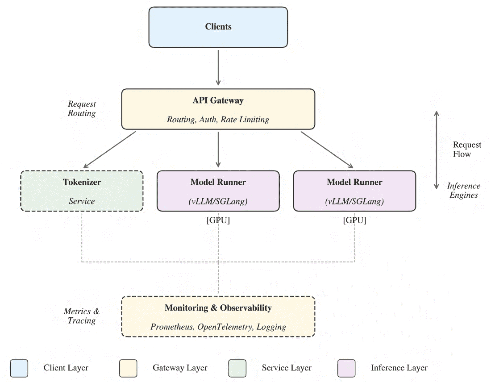
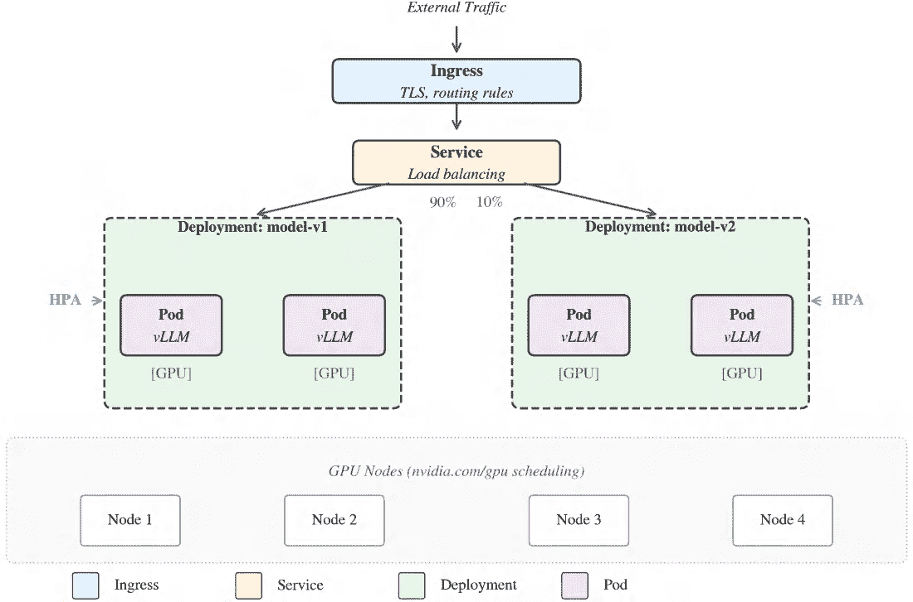
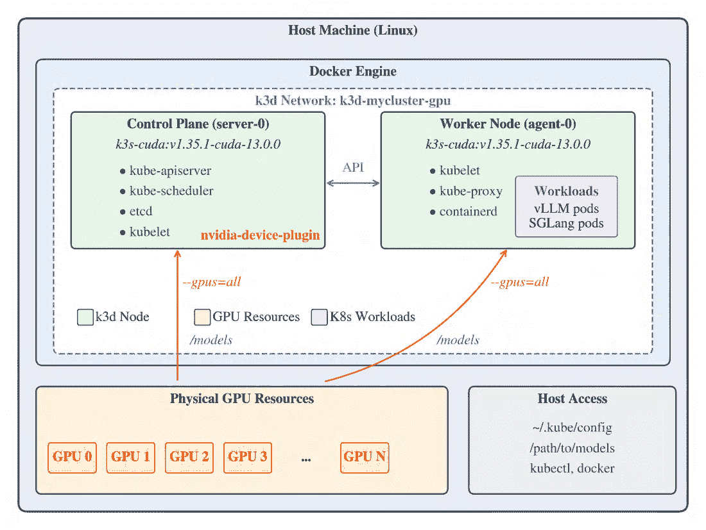
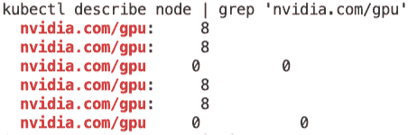
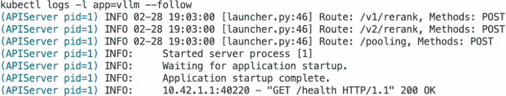
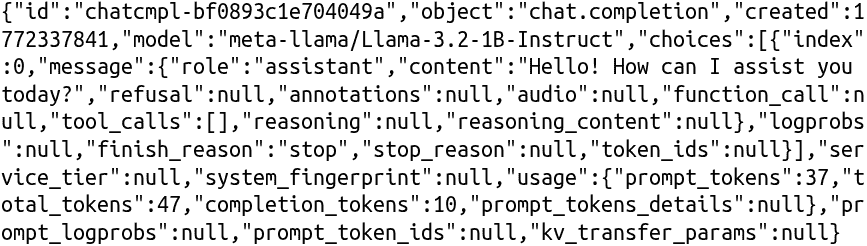
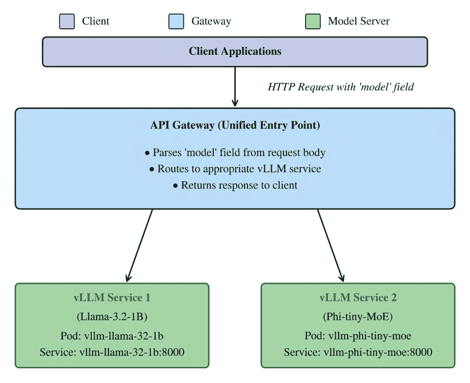
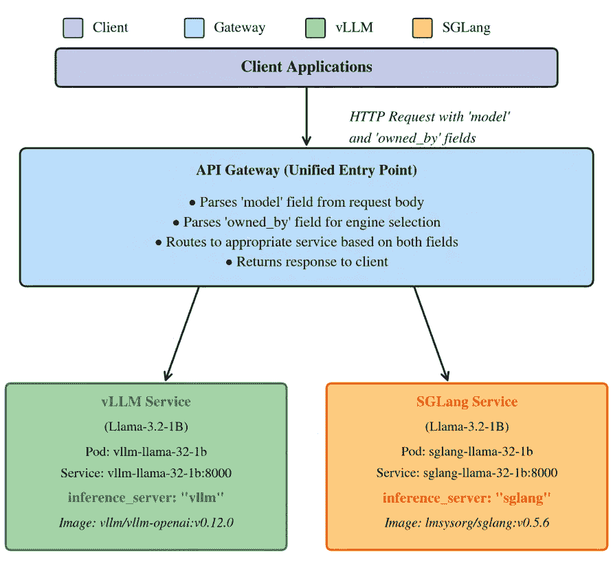
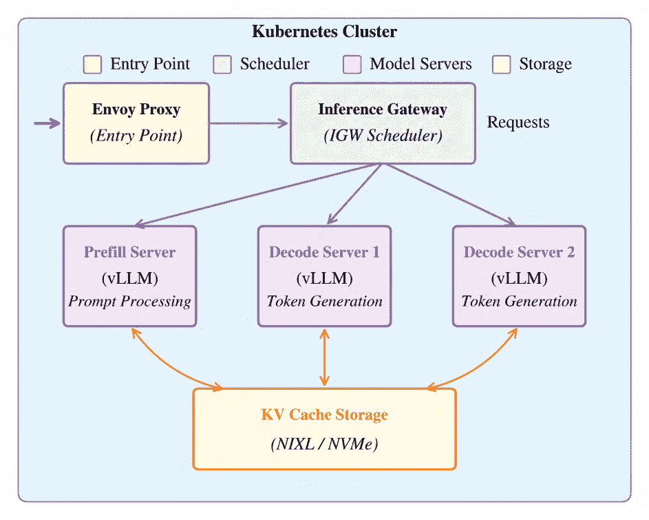
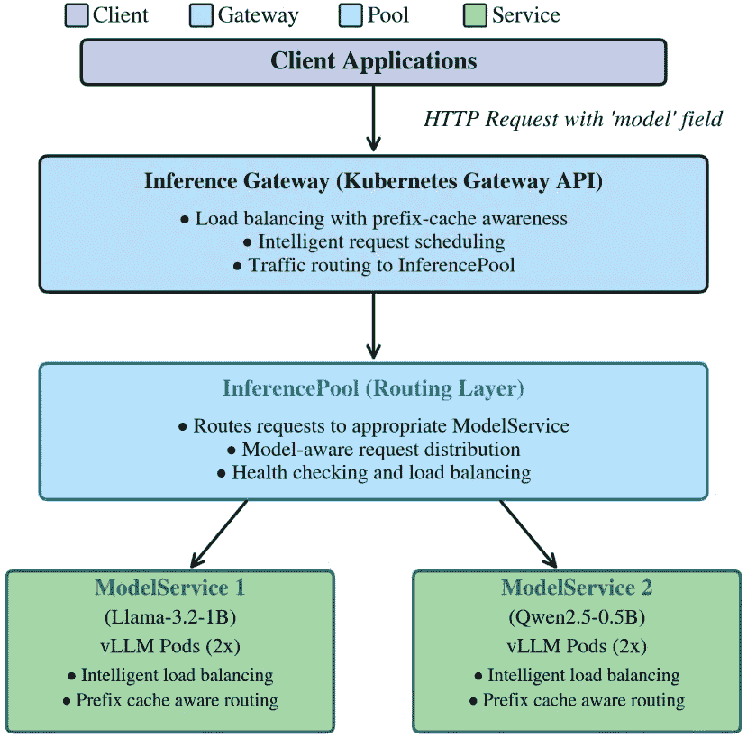

## 9 生产级 LLM 服务技术栈

**构建端到端生产系统，实现可靠的 LLM 服务**

*一切都会失败，而且一直如此。*

*沃纳·沃格尔斯，亚马逊首席技术官*

### 生产级 LLM 服务系统剖析

在前面的章节中，我们探讨了如何使用 DDP、FSDP、DeepSpeed 和 Megatron-LM 等分布式技术大规模训练大模型。我们还研究了 vLLM 和 SGLang 等推理引擎，它们优化了单节点和多节点推理。现在，是时候将这些组件整合成一个完整的生产系统了。

AI 模型服务涵盖了广泛的工作负载。传统的机器学习模型——梯度提升树、线性模型和小型神经网络——通常使用 TensorFlow Serving 或 Triton Inference Server 等框架在 CPU 上提供服务。用于图像分类或目标检测的计算机视觉模型也可以使用 ONNX Runtime 等优化运行时在 CPU 上高效运行，ONNX Runtime 多年来一直为生产级 CV 工作负载提供支持；只有在模型较大或吞吐量要求较高时才需要 GPU。由于输入大小是固定的，这些工作负载的延迟相对可预测。

用于图像生成的扩散模型（Stable Diffusion、DALL-E）因其迭代去噪过程而带来独特的挑战，需要精心设计批处理策略，并且通常能受益于无分类器引导缓存等技术。

然而，LLM 服务有其独特的特性，使其与这些其他工作负载区分开来。文本生成的自回归特性意味着输出长度是不可预测的——一个简单的“是”或“否”问题可能生成 2 个 token，而一段代码


## 生产级LLM服务技术栈

生成请求可能产生2,000个token。这种可变性使得批处理和资源分配与固定输出模型有着根本性的不同。KV缓存随序列长度线性增长，带来了传统ML服务中不存在的内存压力。而聊天应用的流式特性意味着用户期望看到token实时生成，而不仅仅是一个最终响应。

本章专门讨论LLM服务，建立在我们于第6章和第7章中介绍的推理引擎基础之上。我们讨论的架构模式——路由、负载均衡、可观测性——广泛适用于AI服务，但具体的实现和权衡取舍是针对大语言模型的独特需求而量身定制的。

生产级LLM服务系统不仅仅是运行在GPU上的模型。它是一个复杂的分布式系统，由多个组件协同工作，以提供可靠、可扩展且经济高效的推理服务。在深入探讨具体的部署策略之前，理解这一架构至关重要。

典型的生产服务技术栈包括以下组件：

- **API网关。** 网关位于客户端和后端服务之间，负责处理请求路由、身份验证、速率限制和负载均衡。它是单一入口点，屏蔽了多个模型运行器和路由决策的复杂性。

- **模型运行器。** 这是系统的核心：一个有状态、基于GPU的推理引擎，负责管理模型加载、KV缓存和连续批处理。在生产环境中，你通常会使用vLLM或SGLang（在第6章和第7章中介绍）作为模型运行器，但无论你选择哪个引擎，架构原则都适用。

- **监控与可观测性。** 生产系统需要对其内部情况有可见性。可观测性通常不是一个独立服务，而是通过插桩库集成到每个组件中。这包括指标采集（通常导出到Prometheus）、分布式追踪（OpenTelemetry）和结构化日志。没有可观测性，调试生产问题几乎是不可能的。

- **分词器服务（可选）。** 一个无状态、轻量级的服务，负责文本的分词和逆分词。像vLLM这样的现代推理引擎在内部处理分词，因此独立的分词器服务不太常见。它可以用于在推理前统计token数量（用于计费或速率限制）、验证输入长度，或在使用自定义推理后端时发挥作用。

*图9.1：生产级LLM服务架构*

*图9.1*展示了这些组件如何协同工作。客户端向API网关发送请求，网关根据请求的模型和当前负载将其路由到相应的模型运行器。所有组件都向可观测性技术栈报告指标和追踪数据。

`code/basic/`目录中提供了简化实现。示例使用Qwen2.5-1.5B-Instruct作为默认模型，它可以在大多数8GB以上显存的GPU上流畅运行。如果需要更小的资源占用，你可以通过修改代码中的模型名称，替换为Qwen2.5-0.5B-Instruct或TinyLlama-1.1B-Chat。

要试用这些示例，首先请安装依赖。我们在conda环境中测试了以下版本：



```bash
conda create -n usao python=3.12
conda activate usao
pip install fastapi==0.133.1 uvicorn==0.35.0 httpx==0.28.1 \
  pydantic==2.12.5 transformers==4.57.3 vllm==0.15.1
```

你的环境可能需要不同版本——请根据你的CUDA和PyTorch配置进行相应调整。

如果在下载模型时遇到`401 Client Error`或`403 Forbidden`错误，你需要设置Hugging Face令牌：

```bash
export HF_TOKEN=your_huggingface_token
```

你可以从[huggingface.co/settings/tokens](https://huggingface.co/settings/tokens)获取令牌。有些模型需要你首先在其模型页面接受许可协议，才能获得访问权限。

在一个终端中启动模型运行器（这将下载并加载模型）：

```bash
cd code/basic
uvicorn model_runner:app --host 0.0.0.0 --port 8002
```

模型运行器（`code/basic/model_runner.py`）是一个封装了vLLM来进行推理的FastAPI服务。它在启动时加载模型，并暴露一个`/generate`端点。首次运行时，模型加载需要一两分钟，因为需要下载权重并编译CUDA图。

在另一个终端中，启动API网关：

```bash
uvicorn api_gateway:app --host 0.0.0.0 --port 8000
```

API网关（`code/basic/api_gateway.py`）是对外的入口点。在这个简化示例中，它提供速率限制，并将请求路由到模型运行器。生产级网关还会添加身份验证、跨副本负载均衡和请求排队功能。

然后你可以向网关发送请求：

```bash
curl -X POST http://localhost:8000/generate \
  -H "Content-Type: application/json" \
  -d '{"prompt": "What is machine learning?", "max_tokens": 100}'
```

`code/basic/`目录还包含一个独立的分词器服务（`tokenizer_service.py`），演示了如何构建独立的分词层。虽然vLLM在内部处理分词，但独立的分词器服务对于扩散模型（需要CLIP分词）、用于计费的token计数或自定义后端非常有用。该服务在启动时加载两个分词器：Qwen2.5-1.5B分词器用于LLM，而`openai/clip-vit-large-patch14`分词器用于Stable Diffusion等扩散模型。要试用它，请启动该服务：

```bash
uvicorn tokenizer_service:app --host 0.0.0.0 --port 8001
```

分词器仅在CPU上加载词汇文件——无需GPU——因此该服务可以在任何机器上运行。服务运行后，你可以为LLM对文本进行分词：

```bash
curl -X POST http://localhost:8001/tokenize \
  -H "Content-Type: application/json" \
  -d '{"model": "qwen2.5-1.5b", "text": "Hello world"}'
```

对于Stable Diffusion等扩散模型，文本提示需要先进行CLIP分词，然后文本编码器才能处理。同一个服务使用不同的模型名称即可处理这一需求：

```bash
curl -X POST http://localhost:8001/tokenize \
  -H "Content-Type: application/json" \
  -d '{"model": "stable-diffusion", "text": "a photo of a cat"}'
```

如果你只需要token数量——例如，用于计费或强制执行输入长度限制——`/count`端点只返回数字，而不包含完整的token列表：

```bash
curl -X POST http://localhost:8001/count \
  -H "Content-Type: application/json" \
  -d '{"model": "qwen2.5-1.5b", "text": "How many tokens is this?"}'
```

这个基础示例不包含监控层——我们将在*在Kubernetes上部署LLM服务*一节中介绍可观测性模式。

### 请求路由与流量管理

在生产系统中，你通常需要同时服务多个模型、智能地路由请求，并在实例之间平衡负载。除了基本路由之外，你还需要安全发布新模型版本和运行实验的策略。本节涵盖完整的流量管理图景：路由、负载均衡、金丝雀部署和A/B测试。

#### 路由策略

在多模型部署中，有三种常见的请求路由方法：

- **基于特征的路由**检查请求内容以确定哪个模型最合适。例如，与代码相关的提示可能会路由到Code Llama，而一般聊天则路由到对话模型。当不同模型具有各自独特的优势时，这种方法效果很好，但需要仔细的关键词匹配或分类逻辑。

- **A/B流量拆分**使用一致性哈希将用户分配到不同的模型变体。关键的洞见是使用用户ID（或会话ID）作为哈希输入，确保同一用户始终获得同一个模型。这种一致性对于有意义的A/B比较至关重要——如果用户在模型之间随机切换，你就无法将性能差异归因于模型本身。

- **动态模型选择**考虑运行时因素，如当前负载、延迟预算和成本约束。对成本敏感的请求可能会路由到更小、更便宜的模型，而对延迟敏感的请求则路由到最快的可用选项。这种方法需要实时跟踪模型性能指标。

所有三种策略的实现都可在`code/basic/routing.py`中找到。`FeatureBasedRouter`、`ABRouter`和`DynamicRouter`类演示了这些模式。

#### 负载均衡

一旦你确定了哪个模型处理请求，你还需要选择该模型的哪个实例来接收它。三种标准方法如下：

- **轮询**按顺序循环遍历实例，将请求均匀地分配到各个实例。它简单明了，在实例容量相似且请求成本相近时效果很好。

- **最少连接**将请求路由到活动请求数最少的实例。这自然而然地处理了请求时长的差异——慢请求不会导致一个实例落后，而其他实例却闲置。

- **加权均衡**为实例分配不同的容量权重，当你拥有异构硬件时（例如，一些实例使用A100，另一些使用H100）非常有用。

所有三种均衡器以及与之集成的健康检查器，均在`code/basic/load_balancer.py`和`code/basic/health_check.py`中实现。


### 金丝雀部署与A/B测试

除了路由到现有模型，你还需要制定安全引入新模型版本的策略。金丝雀部署允许你逐步推出新模型，同时监控潜在问题。A/B测试则能在生产环境中对比模型性能。这两项技术对于安全、数据驱动的模型更新都至关重要。

#### 金丝雀部署

金丝雀部署的思路很简单：不是一次性将所有流量切换到新模型，而是先将一小部分流量（比如10%）发送到新的“金丝雀”模型，其余流量继续流向稳定版本。你同时监控两个版本，比较错误率和时延。如果金丝雀表现良好，就逐步增加其流量占比。如果表现不佳，立即回滚，对用户影响最小。需要跟踪的关键指标是错误率和时延——一个合理的升级策略可能允许金丝雀的错误率比稳定版本高出最多10%，时延高出最多20%，如果金丝雀的错误率超过稳定版本的两倍，则触发回滚。

#### 流量转移

这是将用户从稳定版本逐步迁移到金丝雀版本的机制。典型的推进流程可能是：10% → 25% → 50% → 75% → 100%。每一步，你都要等待足够的请求累积（达到统计显著性），再决定是继续推进还是回滚。

#### A/B测试

A/B测试与金丝雀部署的目标不同：金丝雀关注的是安全发布，而A/B测试关注的是通过对比不同方案来做出数据驱动的决策。A/B测试可以比较两个不同的模型、两个不同的提示词模板，或两种不同的推理配置。关键要求是分配一致性——同一个用户必须始终看到同一个变体，这通过对用户ID进行一致性哈希来实现。

示例实现位于 `code/basic/canary.py`。下面的导入假设你的工作目录是 `code/basic/`：

```python
from canary import CanaryDeployment, TrafficShifter, ABTestFramework, ABTestConfig

# 示例 1：新模型版本的金丝雀部署
canary = CanaryDeployment(
    stable_model="llama-2-7b-v1",
    canary_model="llama-2-7b-v2",
    traffic_percent=0.1
    # 从10%流量到金丝雀版本开始
)

# 路由一个请求
model = canary.route({"prompt": "Hello"}) # 返回稳定版或金丝雀版模型

# 获取响应后，记录指标
canary.record_metrics(model, latency=0.15, error=False)

# 检查金丝雀应该被升级还是回滚
if canary.should_promote():
    print("金丝雀表现良好，增加流量")
elif canary.should_rollback():
    print("金丝雀表现不佳，执行回滚")

# 示例 2：逐步流量转移
shifter = TrafficShifter("model-v1", "model-v2")
shifter.increase_traffic() # 0% -> 10%
shifter.increase_traffic() # 10% -> 25%
# ... 根据指标继续调整

# 示例 3：两个模型的A/B测试
ab = ABTestFramework()
ab.register_test(ABTestConfig(
    test_name="model_comparison",
    variants={"llama-7b": 0.5, "mistral-7b": 0.5},
    metrics=["latency", "quality_score"]
))

# 为用户分配变体（跨请求保持一致）
variant = ab.assign_variant("model_comparison", user_id="user123")

# 服务完成后记录指标
ab.record_metric("model_comparison", variant, "latency", 0.12)

# 获取聚合结果
results = ab.get_results("model_comparison")
```

这些模式与API网关集成——在生产环境中，你需要将路由逻辑接入请求处理管道。

### 运维：可观测性、可靠性和成本

除了流量管理，生产系统还需要运维能力：监控系统健康状态、优雅处理故障以及优化成本。这些横切关注点适用于服务栈中的每个组件。

#### 可观测性

在分布式LLM服务系统中，单个请求可能会经过API网关、分词器服务和模型运行器——如果没有适当的可观测性，排查问题几乎是不可能的。生产级LLM服务需要三种可观测性：

**分布式追踪** 使用OpenTelemetry跟踪请求在多个服务间的流转。每个服务创建“跨度”来记录时间和元数据，通过HTTP头传播的追踪ID将各个跨度关联在一起。当请求变慢时，你可以确切看到是哪个服务造成了时延。

**指标收集** 使用Prometheus跟踪聚合统计：请求数、时延直方图、错误率和资源利用率。与追踪（通常采样）不同，指标捕获每个请求，因此对于告警和SLO监控至关重要。LLM服务的关键指标包括按模型统计的每秒请求数、时延分位数（p50、p95、p99）、活跃请求数以及GPU利用率。

**结构化日志** 以机器可解析的格式（通常是JSON）捕获单个请求的详细信息。与传统日志不同，结构化日志可以被查询和聚合——例如，找出特定用户所有耗时超过5秒的请求。

三种可观测性的示例实现可在 `code/basic/observability.py` 中找到。

#### 可靠性与容错

**冷启动缓解。** LLM推理存在显著的冷启动时延——加载模型并预热GPU可能需要30-60秒。两种策略有所帮助：启动时预热（加载后立即向模型发送哑请求）和保活请求（定时发送哑请求以防止模型在空闲期间变冷）。

**自动扩缩容。** 基于请求数的自动扩缩容根据流量调整副本数量。关键参数包括目标RPS、扩容阈值（通常是目标的120%）、缩容阈值（通常是目标的50%）以及冷却时间。对于LLM服务，缩容时要保守——启动新的GPU实例需要几分钟时间，所以宁可容量略有过剩，也不要陷入容量不足的困境。

**背压。** 当流量超过容量时，有界请求队列提供背压——当队列满时，新请求立即被拒绝并返回503错误，而不是等待较长时间后超时。这给客户端一个明确的信号，可以在稍后重试或路由到其他后端。

#### 成本优化

GPU实例价格昂贵，因此成本优化很重要。**竞价实例**（或可抢占虚拟机）比按需实例便宜60-90%，但可能被提前终止——一种典型策略是使用50%的竞价实例提供基础容量，当竞价实例被抢占时由按需实例吸收流量。**模型选择** 将成本敏感的请求路由到更小、更便宜的模型；7B模型的每token成本可能是13B模型的一半，而且对许多用例来说，质量差异并不足以证明成本差异的合理性。

预热、自动扩缩容、请求排队和成本优化路由的示例实现可在 `code/basic/fault_tolerance.py` 中找到。

### 在kubernetes上部署LLM服务

我们目前涵盖的概念——路由、负载均衡、金丝雀部署、可观测性和容错——都是平台无关的模式。你可以在裸金属服务器上、使用Docker Compose或在任何云平台上实现它们。然而，Kubernetes（K8s）已成为生产级LLM服务的主导平台。

Kubernetes（Kubernetes官网：`https://kubernetes.io/`）是一个开源的容器编排系统，最初由Google开发，现在由云原生计算基金会（CNCF）维护。Kubernetes的核心是在机器集群上管理容器化工作负载，处理调度、扩缩容、网络和存储。你在YAML清单中描述期望状态——服务需要多少个副本、每个副本需要多少CPU和内存、如何暴露到网络——然后Kubernetes持续工作使实际状态与期望状态保持一致。这种声明式模型，加上自愈能力（自动重启失败的容器、在节点宕机时重新调度工作负载），使Kubernetes非常适合需要高可用性的生产系统。


具体到 LLM 服务场景，Kubernetes 为我们讨论过的许多模式提供了原生原语：

| 概念 | Kubernetes 原语 | 实际应用 |
|---|---|---|
| 负载均衡 | Services、Ingress | 通过网关进行模型感知路由 |
| 自动缩放 | HPA（水平 Pod 自动缩放器：`https://kubernetes.io/docs/tasks/run-application/horizontal-pod-autoscale/`）、KEDA（Kubernetes 事件驱动自动缩放：`https://keda.sh/`） | 基于每秒请求数或队列深度进行缩放 |
| 健康检查 | Liveness/Readiness 探针 | `/health`、`/ready` 端点 |
| 金丝雀部署 | Ingress 流量拆分 | 模型版本之间的加权路由 |
| 可观测性 | Prometheus、OpenTelemetry | 延迟、吞吐量、GPU 指标 |
| 容错 | Pod 重启（PodDisruptionBudget：`https://kubernetes.io/docs/tasks/run-application/configure-pdb/`） | 请求排空后的优雅关闭 |
| GPU 调度 | Device plugin、requests/limits | Pod 规范中的 `nvidia.com/gpu: 1` |

*表 9.1：Kubernetes 原语*

*图 9.2：用于 LLM 服务的 Kubernetes 原语*



*图 9.2* 展示了这些原语在典型环境中如何协同工作。外部流量通过 Ingress 进入，Ingress 将流量路由到 Service，Service 在多个 Deployment 之间进行负载均衡。每个 Deployment 管理多个运行 vLLM 的 Pod，并由水平 Pod 自动缩放器（HPA）根据需求缩放副本数量。两个 Deployment（model-v1 和 model-v2）通过加权流量拆分（90%/10%）实现金丝雀部署。在底部，GPU 节点使用 NVIDIA device plugin 来调度工作负载。

Kubernetes 并不要求你从零实现这些模式，而是允许你声明期望状态，并由它来处理实现细节。这种声明式方法——加上丰富的操作器（operator）和工具生态——正是 vLLM Production Stack 和 llm-d 等生产级 LLM 服务栈构建在 Kubernetes 之上的原因。

我们将分两步探索基于 Kubernetes 的 LLM 服务。首先，我们将使用 k3d（在 docker 中运行 k3s（Rancher Labs 的极简 Kubernetes 发行版）：`https://k3d.io/`）搭建本地开发环境。k3d 是一个完全运行在 Docker 中的轻量级 Kubernetes 发行版。这为我们提供了一个安全的试验场，可以在部署到生产环境之前试验各种配置。然后，我们将部署 llm-d（在 Kubernetes 上进行生产级 LLM 服务：`https://llm-d.ai/`），这是一个生产就绪的服务栈，将我们讨论过的所有模式——**路由、自动缩放、可观测性和容错**——实现为 Kubernetes 原生资源。

#### 使用 k3d 进行本地开发

k3d 将 k3s（轻量级 Kubernetes：`https://k3s.io/`）——一个轻量级 Kubernetes 发行版——包装在 Docker 容器中，让你在几分钟内就能获得一个功能完整的 Kubernetes 集群。它非常轻量（无需虚拟机）、支持 GPU 直通，并且生成的清单（manifest）可以在生产集群上不加修改地运行。这使得它非常适合在部署到生产环境之前开发和测试 LLM 服务配置。

完整的 k3d 搭建脚本位于 `code/k3d/`。搭建过程包括三个主要步骤：安装前置依赖、构建自定义的 GPU 版 k3s 镜像、创建集群。

```bash
cd code/k3d
# Step 1: Install prerequisites (NVIDIA Container Toolkit, k3d)
./install-prerequisites.sh

# Step 2: Build custom k3s-cuda image
./build.sh

# Step 3: Create cluster with GPU support
./create-cluster.sh
```

`install-prerequisites.sh` 脚本会检查 NVIDIA 驱动、安装 NVIDIA 容器工具包并安装 k3d。`build.sh` 脚本会创建一个带 CUDA 和 NVIDIA 运行时支持的自定义 k3s 镜像——这是必要的，因为默认的 k3s 镜像不包含 GPU 支持。

自定义镜像将 k3s 与 CUDA 和 NVIDIA 容器工具包结合在一起。关键文件为 `code/k3d/Dockerfile` 和 `code/k3d/device-plugin-daemonset.yaml`。Dockerfile 使用多阶段构建，将 k3s 二进制文件复制到 NVIDIA CUDA 基础镜像中，然后安装容器工具包并配置 containerd 以使用 NVIDIA 运行时。device plugin 清单会在集群启动时自动部署，使 GPU 以 `nvidia.com/gpu` 资源的形式对 Kubernetes 可见。

`build.sh` 脚本会自动检测你本地的 CUDA 版本并获取最新的 k3s 发行版，因此在大多数情况下你可以直接运行它而无需传入参数。如果你需要特定版本，可以通过环境变量覆盖：

```bash
# Use specific versions (check hub.docker.com/r/rancher/k3s and hub.docker.com/r/nvidia/cuda)
K3S_TAG=v1.32.0-k3s1 CUDA_TAG=13.0.0-base-ubuntu24.04 ./build.sh
```

CUDA 版本必须与你的 NVIDIA 驱动兼容。运行 `nvidia-smi` 查看你的驱动支持的最高 CUDA 版本——你可以使用不超过该数值的任何版本。

*图 9.3* 展示了生成的 k3d GPU 集群的架构。宿主机运行 Docker Engine，其中包含一个带有两个节点的 k3d 网络：一个运行 Kubernetes 控制平面服务的控制平面节点（server-0），以及一个运行 vLLM Pod 等应用工作负载的工作节点（agent-0）。两个节点都使用自定义的 k3s-cuda 镜像，并通过 `--gpus=all` 实现 GPU 直通。NVIDIA device plugin 以 DaemonSet 形式运行，将物理 GPU 以 `nvidia.com/gpu` 资源的形式暴露给 Kubernetes。

*图 9.3：k3d GPU 集群架构*



运行完这三个搭建脚本后，验证集群是否正常工作：

```bash
kubectl get nodes

# NAME STATUS ROLES AGE VERSION
# k3d-mycluster-gpu-server-0 Ready control-plane 41s v1.35.1+k3s1
# k3d-mycluster-gpu-agent-0 Ready <none> 37s v1.35.1+k3s1
```

然后验证 GPU 是否可被集群访问：

```bash
kubectl describe nodes | grep nvidia.com/gpu
```

*图 9.4：kubectl describe nodes*



*图 9.4* 展示了一个 8 卡 A100 节点的示例输出（完整输出见 `code/k3d/kubectl_describe_node.txt`）。在输出中，`Capacity` 表示检测到的 GPU 总数，`Allocatable` 显示可用于 Pod 调度的数量，而 `Allocated` 则以请求/限制的形式显示当前使用情况（零表示目前还没有 Pod 使用 GPU）。由于 k3d 会将宿主机上的所有 GPU 传递给每个容器，因此每个节点报告的 GPU 数量相同——这是本地开发的预期行为。

关于集群自定义选项（如挂载模型目录或选择特定 GPU），请参阅 `code/k3d/README.md`。

#### 在 k3d 上部署 vLLM

GPU 集群运行起来后，我们现在可以部署 vLLM 来提供 LLM 推理服务。`code/k3d/vllm/` 目录包含多个模型的即用型 Kubernetes 清单，因此你无需从头编写 YAML。

Hugging Face 上的许多流行模型都是“受限”的，也就是说你需要接受其许可条款并进行身份验证后才能下载。Llama 系列模型就属于这一类。如果你要部署受限模型，请先使用我们先前设置的 `HF_TOKEN` 环境变量创建一个 Kubernetes Secret：

```bash
kubectl create secret generic hf-token-secret --from-literal=token="$HF_TOKEN"
```

现在你可以部署模型了。在生产环境中，模型选择既取决于你可用的 GPU 内存，也取决于延迟、吞吐量和输出质量等业务需求。在本演示中，我们使用较小的模型。Phi-tiny-MoE 是一个轻量级选项，非常适合在较小的 GPU 上进行测试，而 Llama-3.2-1B 质量更好，但大约需要 8GB GPU 内存：

```bash
cd code/k3d/vllm
kubectl apply -f llama-3.2-1b.yaml
# or ./deploy-phi-tiny-moe.sh for smaller GPUs
```

这些部署清单处理了你原本需要手动配置的细节：GPU 资源请求（让 Kubernetes 将 Pod 调度到有可用 GPU 的节点上）、为模型加载设置合适超时的健康探针、用于缓存已下载权重的卷挂载，以及用于网络访问的 Kubernetes 服务。使用以下命令监控部署进度：

```bash
kubectl get pods -l app=vllm -w

# NAME READY STATUS RESTARTS AGE
# vllm-llama-32-1b-pod-xxx 0/1 ContainerCreating 0 2m40s
```

Pod 最初会显示 `ContainerCreating`，因为 Kubernetes 正在拉取 vLLM 容器镜像。这个过程可能需要几分钟，具体取决于你的网络速度。当状态变为 `Running` 后，你可以查看日志：

```bash
kubectl logs -l app=vllm --follow
```

*图 9.5：vLLM Pod 日志*



*图 9.5* 展示了模型启动时的典型日志输出。如果模型需要从 Hugging Face 下载，日志会显示下载进度，随后是模型被加载到 GPU 内存的过程。模型加载通常需要 2-5 分钟，具体取决于模型大小以及权重是否已在本地缓存。当日志显示“Application startup complete.”时，服务器就准备好接受请求了。

要测试 API，请将服务端口转发到本地机器并发送请求：

```bash
kubectl port-forward svc/vllm-llama-32-1b-service 8000:8000 &
curl http://localhost:8000/v1/chat/completions \
```


```bash
-H "Content-Type: application/json" \
-d '{
  "model": "meta-llama/Llama-3.2-1B-Instruct",
  "messages": [{"role": "user", "content": "Hello!"}],
  "max_tokens": 50
}'
```

*图 9.6：来自 Kubernetes 部署的 vLLM 响应*

*图 9.6* 展示了运行在 Kubernetes 中的 vLLM 服务器返回的成功响应。该 JSON 响应遵循 OpenAI 聊天补全格式，包含模型名称、生成的内容以及 token 使用统计信息。

查看部署清单（`code/k3d/vllm/llama-3.2-1b.yaml` 和 `code/k3d/vllm/phi-tiny-moe.yaml`），你会发现几个值得理解的配置模式。

`--gpu-memory-utilization 0.2` 标志告诉 vLLM 仅保留 20% 的 GPU 内存——远低于默认的约 0.85。这种保守设置适用于共享 GPU 或多模型集群；如果你希望单个模型获得最大吞吐量，请改用 0.8–0.9。

健康探针值得特别关注。Kubernetes 使用存活探针和就绪探针来判断 Pod 是否健康，但 LLM 模型加载到 GPU 内存需要相当长的时间——对于较大的模型，通常需要几分钟。清单将 `initialDelaySeconds` 设置为 120-180 秒，给模型留出加载时间；如果没有该延迟，Kubernetes 会无限循环地重启 Pod。请允许连续多次失败（`failureThreshold` 为 3 或更高），这样垃圾回收期间某次缓慢的探针不会被认为是崩溃。

`/models` 处的卷挂载会在 Pod 重启后保留已下载的模型权重。这一点很重要，因为从 Hugging Face 下载 7B 参数模型需要大量的时间和带宽。一旦缓存，后续 Pod 重启时会直接从磁盘加载模型。

`/dev/shm` 处的共享内存很容易被忽视。Docker 的默认段只有 64MB，然而张量并行的 vLLM worker 会通过它路由 NCCL 和 IPC 缓冲区——空间太小会导致集合通信挂起，且几乎没有诊断输出。清单会挂载一个更大的卷（使用 `medium: Memory` 的 `emptyDir`，或容器上等效的 `--shm-size`），其大小与你的张量并行度相匹配。



对于无法在单个 GPU 上容纳的更大模型，你可以通过将 `--tensor-parallel-size` 设置为 GPU 数量并相应更新资源限制来对模型进行分片。`code/k3d/README.md` 文件提供了多 GPU 配置和排查常见问题的详细指南。

#### 清理

实验完成后，清理集群以释放资源：

```bash
k3d cluster delete mycluster-gpu
docker rmi k3s-cuda:<your-tag> # optional, removes the custom image
```

### 多模型与多引擎服务

在单个 vLLM 部署成功运行后，我们现在可以探索更复杂的服务模式。生产环境中的部署很少只服务一个模型——你可能会针对不同任务使用不同的模型（小型模型处理简单查询，大型模型处理复杂推理），或者你可能希望对不同的模型或推理引擎进行 A/B 测试。

`code/k3d/` 目录提供了两个自动化这些部署模式的管理脚本：

- `manage-cluster-multi-models.sh`: 使用单一引擎（vLLM）部署多个模型（Llama-3.2-1B + Phi-tiny-MoE）
- `manage-cluster-multi-engines.sh`: 在多个引擎（vLLM + SGLang）上部署同一模型（Llama-3.2-1B）

#### 多模型路由

关键的洞察在于，API 网关可以根据 OpenAI 兼容请求体中的 `model` 字段来路由请求。当客户端发送指定 `"model": "meta-llama/Llama-3.2-1B-Instruct"` 的请求时，网关会查找哪个 Kubernetes 服务托管该模型，并相应地转发请求。这样就创建了一个统一的端点，客户端无需知道哪个后端服务器处理哪个模型。

*图 9.7* 展示了这种架构。客户端应用向 API 网关发送请求，网关解析 `model` 字段并将请求转发到相应的 vLLM 服务。每个模型运行在自己的 Pod 中，并配有专用的 Kubernetes 服务。

*图 9.7：多模型路由架构*

让我们部署这种架构。管理脚本处理了所有复杂性——创建命名空间、部署两个模型以及设置网关：

```bash
cd code/k3d
./manage-cluster-multi-models.sh start
```

我们可以通过以下命令检查部署状态：

```bash
./manage-cluster-multi-models.sh status
```

状态命令会显示正在运行的内容。你应该会看到两个 vLLM Pod（每个模型一个）及其对应的服务：

```
==========================================
k3d Cluster Status: mycluster-gpu
==========================================
```

📊 集群列表：



| 名称 | 服务器 | 代理 | 负载均衡器 |
|------|---------|--------|--------------|
| mycluster-gpu | 1/1 | 1/1 | true |

`Switched to context "k3d-mycluster-gpu".`

📊 Kubernetes 节点：

| 名称 | 状态 | 角色 | 存在时间 | 版本 |
|------|--------|-------|-----|---------|
| k3d-mycluster-gpu-agent-0 | Ready | &lt;none&gt; | 5h32m | v1.35.1+k3s1 |
| k3d-mycluster-gpu-server-0 | Ready | control-plane | 5h32m | v1.35.1+k3s1 |

📊 命名空间：

| 名称 | 状态 | 存在时间 |
|------|--------|-----|
| multi-models | Active | 20m |

📊 multi-models 命名空间中的 Pod：

| 名称 | 就绪 | 状态 | 重启次数 | 存在时间 |
|------|-------|--------|----------|-----|
| vllm-llama-32-1b-pod-76895c5cfb-vkz7w | 1/1 | Running | 0 | 20m |
| vllm-phi-tiny-moe-pod-55b8c8c959-nvxjh | 1/1 | Running | 0 | 2m33s |

📊 multi-models 命名空间中的服务：

| 名称 | 类型 | 集群 IP | 外部 IP | 端口 | 存在时间 |
|------|------|------------|-------------|---------|-----|
| vllm-llama-32-1b-service | ClusterIP | 10.43.178.154 | &lt;none&gt; | 8000/TCP | 20m |
| vllm-phi-tiny-moe-service | ClusterIP | 10.43.55.228 | &lt;none&gt; | 8000/TCP | 20m |

该脚本会创建一个 `multi-models` 命名空间，部署两个 vLLM 模型（Llama-3.2-1B 和 Phi-tiny-MoE），并配置 API 网关。

路由配置（`gateway/routing-config.yaml`）将模型名称映射到 Kubernetes 服务：

```yaml
routing:
- model: "meta-llama/Llama-3.2-1B-Instruct"
  service_name: "vllm-llama-32-1b-service.multi-models.svc.cluster.local"
- model: "microsoft/Phi-tiny-MoE-instruct"
  service_name: "vllm-phi-tiny-moe-service.multi-models.svc.cluster.local"
```

当网关收到带有 `"model": "meta-llama/Llama-3.2-1B-Instruct"` 的请求时，它会在该表中查找服务名——这里是 `vllm-llama-32-1b-service.multi-models.svc.cluster.local`，即 `<service>.<namespace>.svc.cluster.local`——并将请求转发出去，不会向客户端暴露后端布局。

现在让我们测试一下。首先，设置端口转发，以便从你的本地机器访问网关：

```bash
kubectl port-forward svc/vllm-api-gateway 8080:8000 &
```

然后发送请求并获取 Llama 的响应：

```bash
$ curl http://localhost:8080/v1/chat/completions \
  -H "Content-Type: application/json" \
  -d '{"model": "meta-llama/Llama-3.2-1B-Instruct", 
       "messages": [{"role": "user", "content": "Hello!"}]}'
```

```json
{"id":"chatcmpl-8d9100935563642c","object":"chat.completion","created":...,
"model":"meta-llama/Llama-3.2-1B-Instruct","choices":[{"index":0,"message":{
"role":"assistant","content":"Hello! How can I assist you today?"...
"prompt_logprobs":null,"prompt_token_ids":null,"kv_transfer_params":null}
```

现在向 Phi 模型发送请求——同一个端点，不同的 `model` 字段：

```bash
$ curl http://localhost:8080/v1/chat/completions \
  -H "Content-Type: application/json" \
  -d '{"model": "microsoft/Phi-tiny-MoE-instruct", 
       "messages": [{"role": "user", "content": "Hello!"}]}'
```

```json
{"id":"chatcmpl-a59b963764eb8f41","object":"chat.completion","created":...,
"model":"microsoft/Phi-tiny-MoE-instruct","choices":[{"index":0,"message":{
"role":"assistant","content":" Hello! How can I assist you today?"...
"prompt_logprobs":null,"prompt_token_ids":null,"kv_transfer_params":null}
```

请注意，两个请求都发送到 `localhost:8080`，但网关会根据 `model` 字段将它们路由到不同的后端。这就是多模型路由的强大之处：客户端只与一个端点交互，而由基础设施来处理模型放置。

在进入多引擎路由之前，清理此部署以释放 GPU 资源：

```bash
./manage-cluster-multi-models.sh stop
```

该命令会停止端口转发进程，并删除 `multi-models` 命名空间中的所有资源。

#### 多引擎路由

更进一步，我们可以在不同的推理引擎（vLLM 和 SGLang）上部署同一模型，并根据 `inference_server` 字段进行路由。这对于对引擎进行基准测试或在它们之间逐步迁移非常有用。


如*图9.8*所示，网关解析`model`和`inference_server`字段以确定路由。使用多引擎管理脚本：

```bash
cd code/k3d
./manage-cluster-multi-engines.sh start
```

这将创建一个`multi-engines`命名空间，并在 vLLM 和 SGLang 上部署 Llama-3.2-1B。

我们可以通过运行以下命令来检查部署状态：

```bash
$ ./manage-cluster-multi-engines.sh status
==========================================
k3d Cluster Status: mycluster-gpu
==========================================
```

📊 集群列表：

| 名称 | 服务器 | 代理 | 负载均衡器 |
|------|---------|--------|--------------|
| mycluster-gpu | 1/1 | 1/1 | true |

已切换到上下文 "k3d-mycluster-gpu"。

📊 Kubernetes 节点：

| 名称 | 状态 | 角色 | 运行时间 | 版本 |
|------|--------|-------|-----|---------|
| k3d-mycluster-gpu-agent-0 | 就绪 | `<none>` | 6h16m | v1.35.1+k3s1 |
| k3d-mycluster-gpu-server-0 | 就绪 | 控制平面 | 6h16m | v1.35.1+k3s1 |

📊 命名空间：

| 名称 | 状态 | 运行时间 |
|------|--------|-----|
| multi-engines | 活动 | 21m |
| multi-models | 活动 | 64m |

📊 命名空间 multi-engines 中的 Pod：

| 名称 | 就绪 | 状态 | 重启次数 | 运行时间 |
|------|-------|--------|----------|-----|
| sglang-llama-32-1b-pod-7dc599696d-67f9r | 1/1 | 运行中 | 0 | 21m |
| vllm-llama-32-1b-pod-76895c5cfb-m9bbw | 1/1 | 运行中 | 0 | 21m |

📊 命名空间 multi-engines 中的服务：

| 名称 | 类型 | 集群 IP | 外部 IP | 端口 | 运行时间 |
|------|------|------------|-------------|---------|-----|
| sglang-llama-32-1b-service | ClusterIP | 10.43.249.196 | `<none>` | 8000/TCP | 21m |
| vllm-llama-32-1b-service | ClusterIP | 10.43.89.85 | `<none>` | 8000/TCP | 21m |

*图9.8：多引擎路由架构*



路由配置（`code/k3d/gateway/routing-config.yaml`）包含特定于引擎的路由，允许客户端选择其偏好的推理引擎：

```yaml
routing:
  - model: "meta-llama/Llama-3.2-1B-Instruct"
    inference_server: "vllm"
    service_name: "vllm-llama-32-1b-service.multi-engines.svc.cluster.local"
  - model: "meta-llama/Llama-3.2-1B-Instruct"
    inference_server: "sglang"
    service_name: "sglang-llama-32-1b-service.multi-engines.svc.cluster.local"
  - model: "meta-llama/Llama-3.2-1B-Instruct"
    inference_server: null
    # Default to vLLM
    service_name: "vllm-llama-32-1b-service.multi-engines.svc.cluster.local"
```

第三个条目中的 `inference_server: null` 用作回退——未指定引擎的请求默认使用 vLLM。

设置端口转发并测试两个引擎：

```bash
kubectl port-forward svc/vllm-api-gateway 8080:8000 &
```

首先，发送一个未指定引擎的请求（默认路由到 vLLM）：

```bash
$ curl http://localhost:8080/v1/chat/completions \
  -H "Content-Type: application/json" \
  -d '{"model": "meta-llama/Llama-3.2-1B-Instruct",
       "messages": [{"role": "user", "content": "Hello!"}]}'
{"id":"chatcmpl-9583dfa06c9b9669","object":"chat.completion","created":...,
"model":"meta-llama/Llama-3.2-1B-Instruct","choices":[{"index":0,"message":{
"role":"assistant","content":"Hello! How can I assist you today?"...
"prompt_logprobs":null,"prompt_token_ids":null,"kv_transfer_params":null}
```

现在，通过添加`inference_server`字段显式路由到 SGLang：

```bash
$ curl http://localhost:8080/v1/chat/completions \
  -H "Content-Type: application/json" \
  -d '{"model": "meta-llama/Llama-3.2-1B-Instruct",
       "inference_server": "sglang",
       "messages": [{"role": "user", "content": "Hello!"}]}'
{"id":"e02f545aca204f...3b20","object":"chat.completion","created":...,
"model":"meta-llama/Llama-3.2-1B-Instruct","choices":[{"index":0,"message":{
"role":"assistant","content":"Hello! How can I assist you today?"...
"usage":{"prompt_tokens":37,"total_tokens":47,"completion_tokens":10...}
```

网关还会聚合 `/v1/models` 端点，返回所有后端中所有可用模型的合并列表。对于生产部署，你需要添加身份验证（API 密钥或 OAuth 令牌）、速率限制（每客户端请求配额）和可观测性（请求日志、延迟指标、错误跟踪）。`code/k3d/gateway/api-gateway.py` 包含了针对这些问题的示例中间件。

### 使用 llm-d 的 Kubernetes 部署

在上一节中，我们构建了一个本地 k3d 集群来试验 vLLM 部署。虽然这种方法提供了灵活性，并能让你深入了解底层组件，但大规模生产部署通常受益于能够处理分布式推理运维复杂性的标准化解决方案。

目前存在多个 Kubernetes 原生的 LLM 服务框架。**KServe** [1] 提供企业级模型服务，支持流量治理（金丝雀发布、A/B 测试）和多模型托管，但需要 Istio 或 Knative 作为依赖。**KubeAI** [2] 提供轻量级 Operator，支持从零伸缩和前缀感知负载均衡，无需外部依赖——非常适合较简单的部署。**vLLM production-stack** [3] 是官方 vLLM 部署解决方案，集成了 LMCache，支持跨实例的 KV 缓存共享。本章重点介绍 **llm-d** [4]，因为它提供了一个“开箱即用”的部署框架，将经过充分测试的组件（vLLM、Envoy、NIXL）整合为一个内聚系统，提供配置极少且可生产就绪的 Helm charts，并支持分离式预填充/解码以及通过 InfiniBand RDMA 进行高速数据传输等高级功能。这些框架的选择取决于你的具体需求：KServe 适用于企业级流量治理，KubeAI 适用于轻量级零依赖部署，vLLM production-stack 适用于需要 KV 缓存共享的官方 vLLM 支持，而 llm-d 适用于需要分离式推理或高速互连的部署。表 9.2 提供了手动 k3d 方式与 llm-d 之间的详细对比。

#### 什么是 llm-d？

可以把 llm-d 看作一个“开箱即用”的部署框架，它将一流的开源组件整合为一个内聚系统。其核心是，llm-d 使用 vLLM [5] 作为模型服务器——这与我们在 k3d 部分手动部署的引擎相同。但 llm-d 在此之上增加了多个智能层：推理网关（IGW）[6] 充当智能请求调度器，Envoy 代理 [7] 负责负载均衡和路由，NIXL [8] 则支持通过 InfiniBand RDMA 或 TPU ICI 等高速互连进行高速数据传输。Kubernetes 编排所有这些组件，确保它们能够优雅地伸缩和恢复。

#### 主要特性

**智能推理调度。** llm-d 最有价值的能力之一是智能请求路由。传统负载均衡器以轮询或基于连接数等简单指标来分发请求。但 LLM 推理具有独特特征：一个包含 10,000 个 token 的提示与一个包含 100 个 token 的提示行为截然不同。llm-d 的 IGW 理解这一点。它可以预测请求延迟并据此进行路由，确保长请求不会阻塞短请求。它还实现了前缀缓存感知路由——如果某个 vLLM 实例已经拥有特定系统提示的 KV 缓存，后续具有相同前缀的请求会被路由到该实例，从而显著缩短首 token 时间。对于企业部署，SLA 感知调度可确保高价值客户优先获得计算资源，同时负载感知均衡会根据每个实例的当前容量来分配工作，而不仅仅是统计连接数。

**预填充/解码分离。** llm-d 最具创新性的特性可能是其对分离式推理的支持。在传统的 LLM 服务中，单个 GPU 同时处理预填充阶段（处理输入提示）和解码阶段（逐 token 生成输出）。这两个阶段的计算特征截然不同：预填充是计算密集型且可并行的，而解码则是内存带宽密集型且顺序执行的。通过将它们分离到不同的服务器池，llm-d 可以独立优化每个阶段。预填充服务器可以使用更大的批次大小和更高的 GPU 利用率，而解码服务器则可以针对低延迟进行调整。挑战在于如何在两者之间传输 KV 缓存——这正是 NIXL 的闪光点，它利用 RDMA 在毫秒级移动数 GB 的缓存数据。一个 sidecar 容器协调这些传输，确保解码服务器在需要时准确收到 KV 缓存。

**分离式前缀缓存。** 基于 vLLM 的 KVConnector 抽象，llm-d 实现了精细的缓存层级。独立缓存（有时称为 N/S，即南北向）将 KV 缓存卸载到本地内存和 NVMe 存储，使单个实例能够比其 GPU 内存通常允许的并发请求数服务更多请求。共享缓存（E/W，即东西向）支持实例之间的 KV 缓存传输，因此如果某个服务器已经计算了常见系统提示的缓存，其他服务器可以直接获取而无需重新计算。对于要求最高的部署，全局索引提供整个集群范围内已缓存前缀的视图，以额外的协调开销为代价实现最优路由决策。

**变体自动伸缩。** 传统的 Kubernetes 自动伸缩（HPA）基于 CPU 或内存利用率进行伸缩，但 LLM 工作负载需要更智能的伸缩方式。llm-d 的变体自动伸缩器会测量每个模型服务器实例的实际容量——在给定当前内存压力下每秒能生成多少 token。然后分析最近的流量模式：请求大小的组合、服务质量要求和到达速率。基于此分析，它计算出预填充服务器、解码服务器以及为延迟容忍型批量请求预留的实例的最优组合。这实现了真正的 SLO 级效率，在延迟恶化之前而非之后进行扩容。

**硬件支持：** llm-d 的优势之一是其广泛的硬件兼容性。该项目直接在 NVIDIA GPU（A100、L4 及更新型号）、AMD GPU（MI250 及更新型号）、Google TPU（v5e 及更新型号）以及 Intel 数据中心 GPU Max 系列（Ponte Vecchio）上测试和验证部署。这种多供应商支持正变得越来越重要，因为各组织希望避免锁定并优化不同云提供商的成本。


### 部署架构

在介绍了llm-d的关键特性——智能调度、预填充/解码分离、分布式缓存和变体自动扩缩容——之后，让我们看看这些组件如何组合在一起形成生产部署。

*图9.9*展示了完整的架构。为了理解其工作原理，让我们跟踪一个请求在系统中的流转过程。

每个生产级API都需要一个“前门”——一个处理互联网流量各种现实问题的组件：TLS加密、身份验证、限流以及优雅地处理不守规矩的客户端。在llm-d中，这一角色由Envoy Proxy[7]承担，它是一种在云原生部署中广泛使用的高性能边缘代理。你的基础设施中可能已经有Envoy（它为Istio[9]服务网格和许多API网关提供支持）；llm-d只是将其作为所有推理请求的入口点。

*图9.9：Kubernetes上的llm-d部署架构*



请求从Envoy流向推理网关（IGW）[6]——它是llm-d的“大脑”。Envoy处理通用的HTTP问题，而IGW理解LLM推理。它检查每个请求的特征：提示词有多长？请求的是哪个模型？任何后端是否已经缓存了相关前缀？基于这些分析，IGW将请求路由到最优的模型服务器。这与传统负载均衡器（基于轮询或连接数分发请求）有根本区别——IGW根据每个请求的实际计算成本做出路由决策。

在IGW后面是执行推理的模型服务器。在标准模式下，每个服务器处理完整的推理流水线。但llm-d也支持分离模式，即服务器专门化：预填充服务器处理输入提示（计算密集型、可并行化），而解码服务器生成输出token（内存带宽受限、对延迟敏感）。当预填充服务器完成处理一个提示时，NIXL[8]边车使用RDMA[10]将KV缓存传输到指定的解码服务器，即使对于较大的缓存，也常常在毫秒内完成。这种分离允许每种服务器类型独立优化——预填充服务器可以积极批处理以提高吞吐量，而解码服务器则针对最小延迟进行调优。

对于服务许多共享前缀请求的部署（常见的系统提示、少样本示例），llm-d可以选择性地将KV缓存存储在共享NVMe[11]存储上。这实现了集群级前缀缓存：当一个服务器为流行前缀计算缓存时，其他服务器可以直接获取，而不是重新计算，从而大幅减少整个集群中的冗余工作。

### 开始使用llm-d

部署llm-d需要一个生产级Kubernetes集群，版本为1.29或更高。与我们本地的k3d实验不同，llm-d是为拥有高性能硬件的环境设计的：你需要能够运行大型模型的加速器（对于70B+参数模型，需考虑A100或更新型号），并且理想情况下节点内使用NVLink等快速互连，节点间使用InfiniBand或RoCE RDMA。对于Google Cloud部署，TPU ICI和DCN提供类似的高带宽连接。

安装过程利用Helm，即Kubernetes的包管理器。添加llm-d仓库后，一条`helm install`命令即可部署整个栈——vLLM模型服务器、推理网关、Envoy代理以及所有支撑基础设施。Helm的优雅之处在于，复杂的配置变成了简单的键值对：启用推理网关、指定要服务的模型、设置多GPU推理的张量并行度。

配置通过`values.yaml`文件完成，该文件读起来几乎像一份规格说明文档。你声明你需要什么——两个具有缓存感知路由的IGW副本，vLLM在四块GPU上以90%内存利用率服务Llama 3.1 70B，独立的预填充和解码服务器池及其各自的副本数和GPU分配——而Helm将其转换为实现这一切所需的数十种Kubernetes资源。自动扩缩容部分尤其优雅：它不是基于CPU利用率（对GPU工作负载而言意义不大）进行扩缩容，而是指定目标每秒查询数，其余由llm-d的变体自动扩缩器处理。

附带的代码目录（`code/llmd/`）包含完整的、经过测试的部署配置。`llm-d-multi-engine/`子目录演示了使用vLLM和SGLang后端部署同一模型（Qwen2.5-0.5B-Instruct），展示了llm-d的引擎无关路由。`llm-d-multi-model/`子目录展示了使用不同Llama变体的多模型部署。每个目录都包含部署脚本、Helm values文件和故障排除指南——你需要在自身环境中复现这些设置所需的一切。

### 成熟路径

llm-d项目使用“成熟路径”一词来描述经过充分测试和基准测试的部署模式。这些路径不是让用户通过试错来找出最佳配置，而是代表了常见场景下久经考验的配方。

#### 智能推理调度

智能推理调度是大多数部署的起点。通过将vLLM放在推理网关后面，你可以立即获得比轮询更智能的负载均衡。IGW根据提示词长度预测请求延迟并进行相应路由，防止长请求阻塞短请求。它还跟踪哪些vLLM实例缓存了哪些前缀，将重复请求路由到能够更快处理它们的实例。对于刚刚开始生产LLM之旅的团队来说，这条路径在简单性和性能提升之间提供了最佳平衡。

#### 预填充/解码分离

当服务具有长提示的大型模型时，预填充/解码分离变得很有价值。考虑一个70B参数模型处理10,000个token的文档：预填充阶段（计算所有输入token上的注意力）是计算密集型且可并行化的，而解码阶段（逐个生成输出token）是内存带宽受限且串行的。通过将它们分离到不同的服务器池中，每个池都可以独立优化。预填充服务器可以积极批处理以提高吞吐量；解码服务器可以针对最小延迟进行调优。结果是缩短了首token时间（TTFT），并且每输出token时间（TPOT）更可预测。缺点在于KV缓存必须在服务器之间传输，这需要快速互连——这条路径在InfiniBand或NVLink下表现出色，但在较慢的网络上可能不值得增加这种复杂性。

#### 宽专家并行

宽专家并行针对混合专家（MoE）模型，如Mixtral或DeepSeek。这些模型每个token只激活一部分参数，这使得它们在推理时高效但部署起来具有挑战性。专家并行将不同的专家分布到不同的GPU上，而数据并行同时处理多个请求。llm-d协调这一复杂过程，将token路由到正确的专家，同时最大化加速器利用率。对于大规模部署MoE模型的组织来说，这条路径可以显著降低延迟并提高吞吐量。

### 监控与可观测性

生产级LLM服务需要深入了解系统行为。llm-d与标准Kubernetes监控栈集成——Prometheus用于指标收集，Grafana用于可视化。除了CPU和内存等通用指标外，llm-d还提供LLM特定的遥测数据：请求延迟分布、每秒token吞吐量、整个集群的GPU利用率，以及关键的KV缓存命中率。最后一个指标尤其说明问题：高命中率表明前缀感知路由正在有效工作，而低命中率则表明你可能需要缓存预热策略或调整路由策略。

### 选择你的路径

对于刚接触生产级LLM服务的团队来说，智能推理调度路径提供了最平缓的学习曲线，并能立即带来好处。你可以通过最少的配置更改从基本的vLLM设置部署它，并通过更智能的路由获得有意义的延迟和吞吐量改进。

随着你的部署逐渐成熟，遇到特定的瓶颈，其他路径就会变得相关。如果用户抱怨长文档的首token时间缓慢，预填充/解码分离可以提供帮助——但前提是你有足够的网络带宽来高效传输KV缓存。如果你正在部署MoE模型并看到次优的GPU利用率，专家并行可能是答案。

关键是要监控你的指标，并让它们指导你的演进。观察KV缓存命中率以评估路由有效性。分别跟踪TTFT和TPOT以了解延迟来源。监控GPU利用率以识别未充分利用的容量。并根据实际流量模式而不是理论估计来调整自动扩缩容参数——将最小副本数设置为足够高以处理基线负载而不会冷启动，最大副本数以适应峰值，并根据每个实例的观察容量设置目标QPS。

### 多模型服务

正如我们使用k3d部署多个模型一样，llm-d也支持使用生产级基础设施进行多模型服务。`code/llmd/llm-d-multi-model/`目录包含在vLLM上服务Llama-3.2-1B和Qwen2.5-0.5B的部署配置。

*图9.10*展示了llm-d的多模型架构。每个模型都有自己的ModelService，InferencePool会自动发现它们，并根据`model`字段路由请求——无需手动服务映射。这是与我们的k3d设置的关键区别：不是手动配置路由规则，而是llm-d自动发现ModelService实例并构建路由表。


*图 9.10：llm-d 多模型服务架构*

`llm-d-multi-model/` 目录提供了一个管理脚本，用于处理所有复杂性。使用以下命令部署两个模型：

```bash
cd code/llmd/llm-d-multi-model
./manage-cluster-multi-models.sh start
```

该脚本将 vLLM 固定为 v0.14.1，以匹配 llm-d v0.5.0——通常比独立的 `code/basic/` 栈（上述安装命令中的 0.15.1）落后一两个版本，因为 llm-d 是针对自己的镜像矩阵进行测试的。它还需要自定义的 k3s-cuda 镜像（默认的 k3s 缺少 NVIDIA 容器工具包支持）。请为你的 CUDA 版本构建一个——先运行 `nvidia-smi`，然后执行 `cd code/k3d && ./build.sh`。vLLM 和 llm-d 迭代很快；请根据需要更新部署文件中的镜像标签（参见 README）。使用 `./manage-cluster-multi-models.sh status` 检查集群状态。



该脚本会创建集群、安装 NVIDIA 设备插件、设置 llm-d，并部署两个模型。检查部署状态：

```text
$ kubectl get pods
NAME                 READY   STATUS    AGE
vllm-llama-32-1b     1/1     Running   5m
vllm-qwen2-5-0-5b    1/1     Running   3m
```

每个模型都通过 Helm values 文件（`llama-3.2-1b-values.yaml`、`qwen2.5-0.5b-values.yaml`）进行配置，该文件指定了模型工件的位置、GPU 要求和副本数量。关键的配置是 `modelArtifacts` 部分，它告诉 llm-d 从哪里获取模型：

```yaml
modelArtifacts:
  uri: "hf://meta-llama/Llama-3.2-1B-Instruct"
  name: "meta-llama/Llama-3.2-1B-Instruct"
```

通过端口转发到每个服务来测试部署：

```bash
kubectl port-forward svc/vllm-llama-32-1b 8001:8000 &
kubectl port-forward svc/vllm-qwen2-5-0-5b 8002:8000 &

# 请求 Llama 模型
$ curl http://localhost:8001/v1/chat/completions \
  -H "Content-Type: application/json" \
  -d '{"model": "meta-llama/Llama-3.2-1B-Instruct", "messages": [{"role": "user", "content": "Hello!"}]}'
{"id":"chatcmpl-...","object":"chat.completion","created":...,"model":"meta-llama/Llama-3.2-1B-Instruct","choices":[{"index":0,"message":{"role":"assistant","content":"Hello! How can I help you today?"}...

# 请求 Qwen 模型
$ curl http://localhost:8002/v1/chat/completions \
  -H "Content-Type: application/json" \
  -d '{"model": "Qwen/Qwen2.5-0.5B-Instruct", "messages": [{"role": "user", "content": "Hello!"}]}'
{"id":"chatcmpl-...","object":"chat.completion","created":...,"model":"Qwen/Qwen2.5-0.5B-Instruct","choices":[{"index":0,"message":{"role":"assistant","content":"Hello! How can I assist you?"}...
```

上面的示例使用最简单的设置——直接访问服务，不经过 Inference Gateway。这需要为每个模型单独进行端口转发，类似于访问原始 vLLM Pod。对于生产部署，llm-d 提供了 Inference Gateway，它根据请求体中的 `model` 字段将请求路由到正确的模型。让我们来添加它：

```bash
./manage-cluster-multi-models.sh start --with-gateway
```

这会部署 Gateway API CRD 和基于 Envoy 的网关，该网关根据请求体中的 `model` 字段路由请求。现在你可以通过单个端点访问两个模型：

```bash
$ kubectl port-forward svc/llm-gateway 8000:8000 &
Forwarding from 127.0.0.1:8000 -> 8000

# 请求 Llama 模型
$ curl http://localhost:8000/v1/chat/completions \
  -H "Content-Type: application/json" \
  -d '{"model": "meta-llama/Llama-3.2-1B-Instruct", "messages": [{"role": "user", "content": "Hello!"}]}'
{"id":"chatcmpl-...","model":"meta-llama/Llama-3.2-1B-Instruct","choices":[{"message":{"role":"assistant","content":"Hello! How can I assist you today?"}...

# 请求 Qwen 模型（同一端口，不同模型）
$ curl http://localhost:8000/v1/chat/completions \
  -H "Content-Type: application/json" \
  -d '{"model": "Qwen/Qwen2.5-0.5B-Instruct", "messages": [{"role": "user", "content": "Hello!"}]}'
{"id":"chatcmpl-...","model":"Qwen/Qwen2.5-0.5B-Instruct","choices":[{"message":{"role":"assistant","content":"Hello! How can I assist you today?"}...
```

网关从请求体中提取模型名称，并将其路由到相应的 vLLM 服务。完整的示例日志（展示部署和测试过程）可以在 `code/llmd/llm-d-multi-model/example.log` 中找到。

与我们手动搭建 k3d 时构建自定义 API 网关不同，llm-d 的 Inference Gateway 使用 Kubernetes Gateway API 的 Inference Extension 自动处理路由。它还增加了智能功能：跟踪跨实例的前缀缓存状态，并将重复请求路由到能够更快处理这些请求的服务器。

### 比较 k3d 和 llm-d 两种方法

表 9.2 总结了我们手动 k3d 设置与 llm-d 生产栈之间的关键差异。最显著的差异在于路由和负载均衡：我们的 k3d 设置使用自定义 API 网关，采用基本的轮询分发；而 llm-d 的 Inference Gateway 是 Kubernetes 原生的，并且感知前缀缓存——它会将请求路由到已经拥有相关 KV 缓存条目的 Pod，从而减少重复计算。对于多模型部署，k3d 需要在网关配置中手动映射服务，而 llm-d 会自动发现 ModelService 实例并构建路由表。监控方面也类似：k3d 需要手动设置 Prometheus/Grafana，而 llm-d 开箱即用地提供了预配置的仪表盘。

| 功能 | k3d（手动） | llm-d（生产） |
|---|---|---|
| 设置 | 手动 YAML 文件 | Helm charts（自动化） |
| 路由 | 自定义 API 网关 | Inference Gateway（K8s 原生） |
| 负载均衡 | 基本轮询 | 智能（感知前缀缓存） |
| 监控 | 手动设置 | 内置 Prometheus/Grafana |
| 伸缩 | 手动管理 Pod | 支持 HPA，自动伸缩 |
| 多模型 | 手动服务映射 | 自动发现 |
| 生产特性 | 有限 | 完整生产栈 |

*表 9.2：k3d 与 llm-d 部署方法对比*

llm-d 遵循“vLLM 优先”的设计理念。Inference Gateway 的智能特性——感知前缀缓存的路由、基于 NIXL 的 KV 缓存传输以及推理调度器——都与 vLLM 的内部机制紧密集成。SGLang 支持正在积极开发中（见 GitHub issue #403[12]，但截至撰写本文时，llm-d 的原生路由尚不支持引擎选择。对于对多引擎部署感兴趣的读者，`code/llmd/llm-d-multi-engine/` 目录提供了一种使用自定义 API 网关层的变通方案——详情请参阅 README。

**注意**

我们前面探索的 k3d 方法对于学习和本地开发很有价值——因为你亲手构建了每个组件，所以你能确切理解每个组件的用途。但对于处理真实流量的生产部署，llm-d 经过实战检验的配置和智能路由提供了更坚实的基础。过渡很简单：概念完全相同，只是实现细节有所不同。

### 总结

在生产环境中服务 LLM，远不止加载权重和接受请求这么简单。我们探索了推理内部机制——分词、注意力、KV 缓存——以理解为什么像 vLLM 和 SGLang 这样的框架能为我们处理批处理和内存管理的复杂编排。

我们用 k3d 从零构建了一个多模型栈，深入了解了服务、路由和 API 网关。随后我们将其与 llm-d 进行了对比，在 llm-d 中，同样的概念——InferencePool、模型感知路由、健康检查——被打包成生产就绪的 Helm charts，并支持自动模型发现。

生产系统对正确性的要求更高：需要可观测性用于调试、金丝雀部署用于安全发布，以及通过自动伸缩实现成本优化。从笔记本电脑到数百万请求的旅程是漫长的，但模式保持一致：了解你的工作负载，度量一切，并尽可能自动化。

有了服务基础设施，一个自然的问题出现了：它的性能如何？下一章将直接解决这个问题——使用 genai-bench 和 PyTorch profiler 等工具对吞吐量、延迟和扩展效率进行基准测试。

### 代码总结

- `fastapi.responses.StreamingResponse`：通过 SSE 将生成的 token 流式传输给客户端
- `fastapi.FastAPI`：推理网关和模型运行器的 HTTP 层
- `uvicorn`：ASGI 服务器，用于启动网关、模型运行器和分词器服务
- `httpx.AsyncClient`：从 API 网关到模型运行器的异步转发
- `pydantic.BaseModel`：推理 API 的经过验证的请求和响应模式
- `transformers.AutoTokenizer`：用于计费、验证和自定义后端的独立分词
- `prometheus_client`：TTFT、延迟百分位数和吞吐量指标
- `opentelemetry.trace`：跨服务组件的分布式追踪跨度
- `kubectl`：在 Kubernetes 上部署、检查和调试 vLLM 和 SGLang 工作负载


### 实用链接

#### LLM 服务框架

- vLLM GitHub：`https://github.com/vllm-project/vllm`
- vLLM Production Stack：`https://github.com/vllm-project/production-stack`
- SGLang GitHub：`https://github.com/sgl-project/sglang`

#### Kubernetes 与 llm-d

- llm-d GitHub：`https://github.com/llm-d/llm-d`
- llm-d 文档：`https://www.llm-d.ai/`
- 推理网关：`https://github.com/kserve/inference-gateway`
- k3d（Docker 中的 k3s）：`https://k3d.io/`
- 适用于 Kubernetes 的 NVIDIA 设备插件：`https://github.com/NVIDIA/k8s-device-plugin`

#### 可观测性与监控

- OpenTelemetry：`https://opentelemetry.io/`
- Prometheus：`https://prometheus.io/`
- Grafana：`https://grafana.com/`

#### API 网关与路由

- Envoy 代理：`https://www.envoyproxy.io/`
- FastAPI：`https://fastapi.tiangolo.com/`
- Kubernetes 网关 API：`https://gateway-api.sigs.k8s.io/`

#### 教程与指南

- vLLM Kubernetes 部署：`https://docs.vllm.ai/en/stable/deployment/k8s/`
- NVIDIA 容器工具包：`https://docs.nvidia.com/datacenter/cloud-native/container-toolkit/`

#### 参考资料

- KServe：`https://kserve.github.io/website/`
- KubeAI：`https://www.kubeai.org/`
- vLLM production-stack：`https://docs.vllm.ai/en/stable/deployment/integrations/production-stack.html`
- llm-d 项目：`https://github.com/llm-d/llm-d`
- vLLM 推理引擎：`https://github.com/vllm-project/vllm`
- 推理网关（IGW）：`https://github.com/kubernetes-sigs/gateway-api-inference-extension`
- Envoy 代理：`https://www.envoyproxy.io/`
- NIXL（NVIDIA 推理传输库）：`https://github.com/ai-dynamo/nixl`
- Istio 服务网格：`https://istio.io/`

远程直接内存访问（RDMA）允许计算机之间直接进行内存访问，而无需 CPU 或操作系统的参与。

非易失性内存标准（NVMe）是一种为 SSD 设计的高速存储接口协议。

`https://github.com/llm-d/llm-d/issues/403`

### 练习

#### 构建带模型路由的 API 网关

实现一个 API 网关，根据请求体中的 `model` 字段将请求路由到不同的模型后端。

**要求：**

函数签名：

```python
class ModelRouter:
    def __init__(self, model_endpoints: dict[str, str]):
        """Initialize with mapping of model names to backend URLs."""
        pass

    async def route_request(self, request: dict) -> dict:
        """Route request to appropriate backend based on model field."""
        pass
```

- 从传入请求中解析 `model` 字段。
- 将请求转发到正确的后端 URL。
- 处理请求的模型不可用的情况（返回 404）。
- 为后端添加基本健康检查。
- 同时支持 `/v1/chat/completions` 和 `/v1/completions` 端点。

**测试你的实现：**

```python
import asyncio
import httpx

# Initialize router with model endpoints
router = ModelRouter({
    "llama-3.2-1b": "http://localhost:8001",
    "qwen-0.5b": "http://localhost:8002",
})

# Test routing
request = {
    "model": "llama-3.2-1b",
    "messages": [{"role": "user", "content": "Hello!"}],
    "max_tokens": 50
}
response = asyncio.run(router.route_request(request))
print(f"Response from {request['model']}: {response}")

# Test unknown model
unknown_request = {"model": "unknown-model", "messages": []}
try:
    asyncio.run(router.route_request(unknown_request))
except Exception as e:
    print(f"Expected error: {e}")
```

#### 实现速率限制中间件

创建一个速率限制中间件，对每个客户端强制执行请求配额。

**要求：**

类签名：

```python
class RateLimiter:
    def __init__(self, requests_per_minute: int, burst_size: int = 5):
        """Initialize rate limiter with limits."""
        pass

    async def check_rate_limit(self, client_id: str) -> bool:
        """Return True if request is allowed, False if rate limited."""
        pass

    def get_remaining_requests(self, client_id: str) -> int:
        """Return number of remaining requests for client."""
        pass
```

- 使用令牌桶算法进行速率限制。
- 按客户端（通过 API 密钥或 IP 识别）跟踪请求。
- 支持突发容量以应对流量峰值。
- 返回相应的头部（`X-RateLimit-Remaining`、`X-RateLimit-Reset`）。
- 清理过期的客户端条目，防止内存泄漏。

**测试你的实现：**

```python
import asyncio
import time

limiter = RateLimiter(requests_per_minute=10, burst_size=5)

async def test_rate_limiting():
    client_id = "test-client-123"
    # Should allow burst of requests
    for i in range(5):
        allowed = await limiter.check_rate_limit(client_id)
        remaining = limiter.get_remaining_requests(client_id)
        print(f"Request {i+1}: allowed={allowed}, remaining={remaining}")

    # Should start rate limiting
    for i in range(10):
        allowed = await limiter.check_rate_limit(client_id)
        if not allowed:
            print(f"Rate limited after {i+5} requests")
            break

asyncio.run(test_rate_limiting())
```

#### 实现支持自动回滚的金丝雀部署

创建一个金丝雀部署系统，逐步切换流量并在出错时自动回滚。

**要求：**

类签名：

```python
class CanaryDeployment:
    def __init__(self, stable_endpoint: str, canary_endpoint: str):
        """Initialize with stable and canary endpoints."""
        pass

    def set_canary_percentage(self, percentage: float):
        """Set percentage of traffic to route to canary (0-100)."""
        pass

    @property
    def canary_percentage(self) -> float:
        """Current canary traffic percentage (0-100)."""
        pass

    async def route_request(self, request: dict) -> dict:
        """Route request to stable or canary based on percentage."""
        pass

    def record_result(self, is_canary: bool, success: bool, latency_ms: float):
        """Record request result for monitoring."""
        pass

    def should_rollback(self, error_threshold: float = 0.05) -> bool:
        """Return True if canary error rate exceeds threshold."""
        pass
```

- 根据配置的百分比路由流量。
- 跟踪稳定版和金丝雀版的成功/失败率。
- 计算金丝雀版与稳定版之间的错误率差异。
- 当金丝雀版错误率超过阈值时触发回滚。
- 支持逐步增加流量（10% -> 25% -> 50% -> 100%）。

**测试你的实现：**

```python
import asyncio
import random

canary = CanaryDeployment(
    stable_endpoint="http://localhost:8001",
    canary_endpoint="http://localhost:8002"
)

# Start with 10% canary traffic
canary.set_canary_percentage(10)

# Simulate requests
for i in range(100):
    request = {"model": "test", "messages": []}
    # Simulate response (canary has higher error rate)
    is_canary = random.random() < 0.1
    success = random.random() > (0.1 if is_canary else 0.02)
    latency = random.uniform(50, 200)
    canary.record_result(is_canary, success, latency)

    if canary.should_rollback(error_threshold=0.05):
        print(f"Rollback triggered after {i+1} requests!")
        canary.set_canary_percentage(0)
        break

print(f"Final canary percentage: {canary.canary_percentage}%")
```

#### 使用 OpenTelemetry 添加分布式追踪

使用 OpenTelemetry 对多服务 LLM 服务系统进行埋点，实现端到端的请求追踪。

**要求：**

为请求处理的每个阶段创建 span：

- `gateway.receive`：网关收到请求
- `gateway.route`：路由决策


- `tokenizer.encode`：词元化
- `model.inference`：模型推理
- `tokenizer.decode`：去词元化
- `gateway.respond`：响应已发送

为跨度添加属性：

- `model.name`：模型的名称
- `request.tokens`：输入词元数量
- `response.tokens`：输出词元数量
- `latency.ttft_ms`：首词元耗时
- `latency.total_ms`：总延迟

- 跨服务边界传播追踪上下文
- 将追踪导出到控制台或 Jaeger

**测试你的实现：**

```python
from opentelemetry import trace
from opentelemetry.sdk.trace import TracerProvider
from opentelemetry.sdk.trace.export import ConsoleSpanExporter, SimpleSpanProcessor

# Setup tracing
provider = TracerProvider()
provider.add_span_processor(SimpleSpanProcessor(ConsoleSpanExporter()))
trace.set_tracer_provider(provider)
tracer = trace.get_tracer("llm-serving")

async def process_request(request: dict):
    with tracer.start_as_current_span("gateway.receive") as span:
        span.set_attribute("model.name", request.get("model", "unknown"))
    with tracer.start_as_current_span("tokenizer.encode"):
        tokens = tokenize(request["messages"])
        span.set_attribute("request.tokens", len(tokens))
    with tracer.start_as_current_span("model.inference"):
        output = await model.generate(tokens)
    with tracer.start_as_current_span("tokenizer.decode"):
        response = detokenize(output)
        span.set_attribute("response.tokens", len(output))
    return response

# Test with sample request
request = {
    "model": "llama-3.2-1b",
    "messages": [{"role": "user", "content": "What is machine learning?"}]
}
response = asyncio.run(process_request(request))
```

#### 在 k3d 上部署多模型服务

在支持 GPU 的本地 k3d 集群上部署一个多模型 LLM 服务系统。

#### 要求

- 创建启用 GPU 透传的 k3d 集群：

    ```bash
    k3d cluster create llm-serving \
        --gpus=all \
        --volume /path/to/models:/models \
        --port "8080:80@loadbalancer"
    ```

- 部署两个提供不同模型的 vLLM 实例：

    - 模型 1：`Qwen/Qwen2.5-0.5B-Instruct`，端口 8001
    - 模型 2：`meta-llama/Llama-3.2-1B-Instruct`，端口 8002

- 创建一个按模型名称进行路由的 API 网关部署

- 验证部署：

    ```bash
    # List available models
    curl http://localhost:8080/v1/models

    # Test Model 1
    curl http://localhost:8080/v1/chat/completions \
        -H "Content-Type: application/json" \
        -d '{"model": "Qwen/Qwen2.5-0.5B-Instruct", "messages": [{"role": "user", "content": "Hello!"}]}'

    # Test Model 2
    curl http://localhost:8080/v1/chat/completions \
        -H "Content-Type: application/json" \
        -d '{"model": "meta-llama/Llama-3.2-1B-Instruct", "messages": [{"role": "user", "content": "Hello!"}]}'
    ```

#### 交付物

- 用于 vLLM 部署的 Kubernetes YAML 文件
- API 网关部署和服务 YAML
- 用于模型到服务路由的 ConfigMap
- 用于部署和测试系统的 Shell 脚本

#### 预期学习成果

完成这些练习后，你应该能够：

- 构建将请求路由到多个模型后端的 API 网关
- 实现速率限制以保护服务免受过载影响
- 部署具备自动回滚能力的金丝雀发布
- 使用 OpenTelemetry 对分布式系统进行埋点以实现可观测性
- 在 Kubernetes 上部署和管理 LLM 服务基础设施
- 设计具备适当监控和容错能力的生产级服务系统

#### 获取本书 PDF 版本及更多内容

扫描二维码（或访问 `packtpub.com/unlock`）。按名称搜索本书，确认版本，然后按照页面上的步骤操作。

*注意：请备好你的发票。直接从 Packt 购买则无需发票。*


