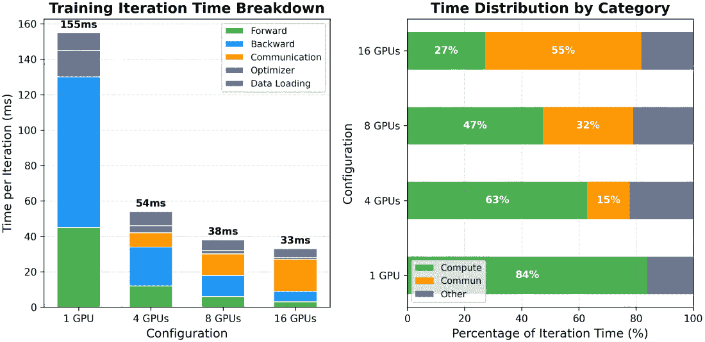
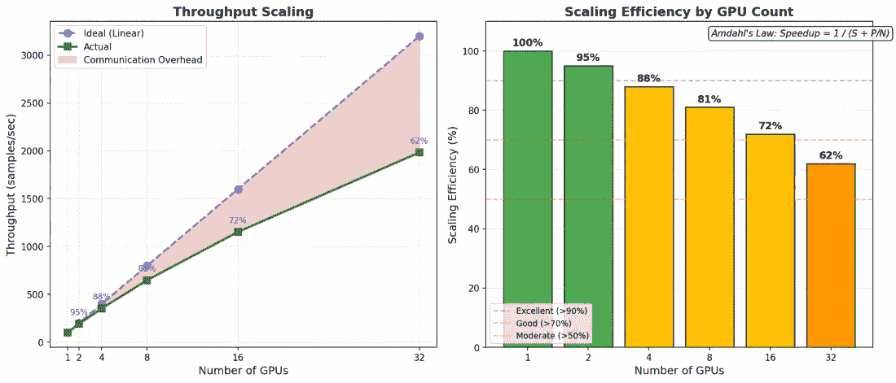
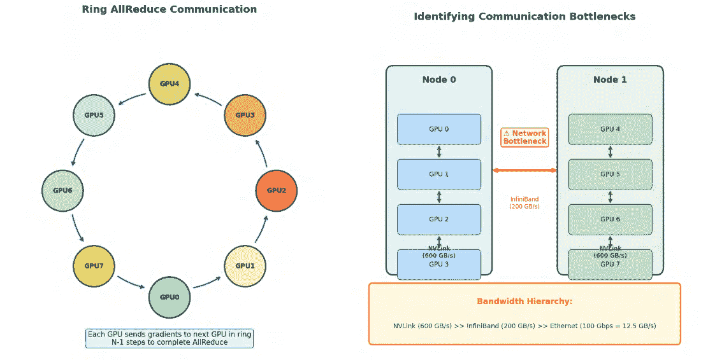
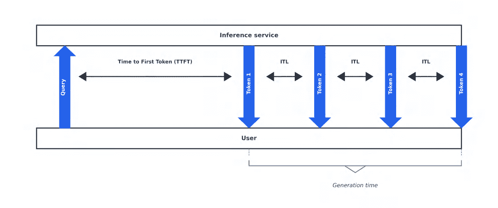
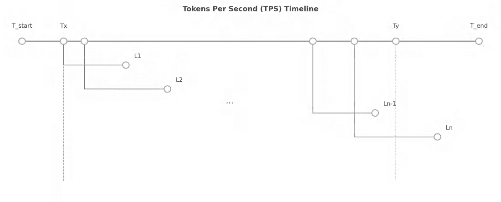
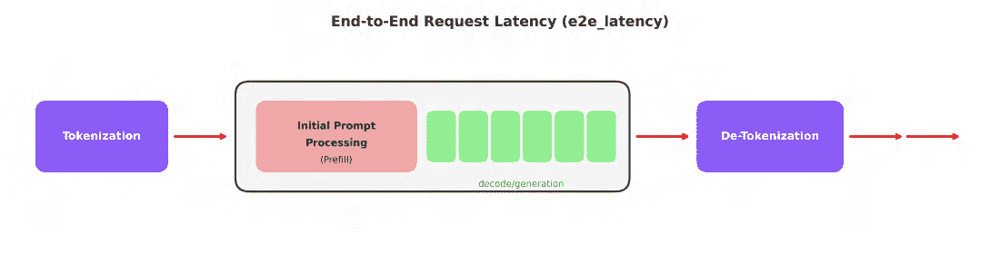
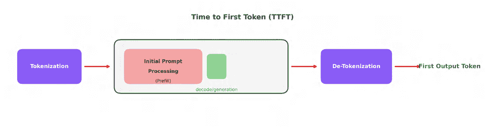
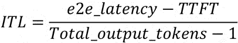
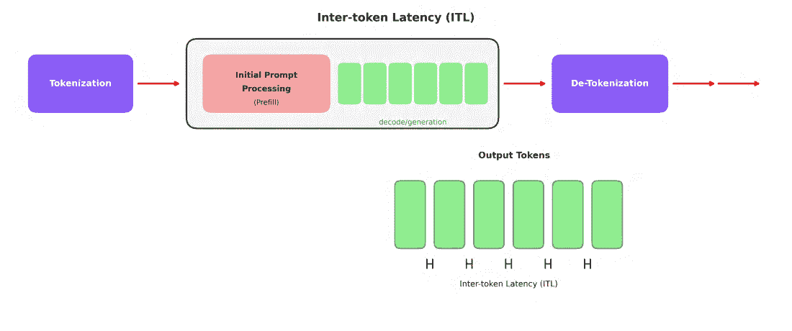
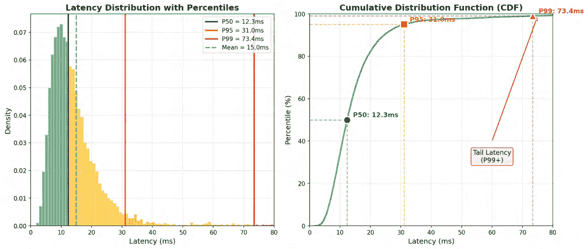

## 10 分布式基准测试与性能优化

### 衡量并优化分布式 AI 系统的性能

*如果你无法衡量它，就无法改进它。*

*彼得·德鲁克（Peter Drucker），管理顾问兼作家*

### 分布式系统中的性能差距

你已经构建了分布式 AI 系统。DDP 在 8-GPU 集群上同步梯度。FSDP 跨节点对 70B 参数模型进行分片。vLLM 通过连续批处理来服务推理请求。第 9 章中的生产栈将流量路由到正确的模型实例。一切*都能工作*——但它是否*工作得好*？

这个问题区分了功能正常的系统与经过优化的系统。一次能跑完的训练任务，并不等同于一次能高效利用你价值 10 万美元 GPU 的训练任务。一个能返回响应的推理端点，也不等同于一个满足 200ms P99 延迟 SLA 的端点。“能工作”与“工作得好”之间的差别，可能意味着数天被浪费的训练时间、违反服务协议以及不必要的云成本。

考虑这样一个场景：你的团队在 8 个节点的 64 块 GPU 上训练一个模型。训练完成，模型在基准测试中表现出色，所有人都为此庆祝。但日志中隐藏着一种令人不安的模式——GPU 利用率徘徊在 45% 左右，从 8 块扩展到 64 块 GPU 的扩展效率只有 52%。你为 64 块 GPU 付了钱，却只获得相当于 33 块 GPU 的有效算力。在为期两周的运行中（每块 GPU 336 小时），整个机群闲置的 48% 大约相当于 31 块 GPU 等效时长的浪费——按典型的云费率（每 GPU 小时 4–5 美元）计算，约合 50,000 美元。

本章将教你发现并修复这些隐藏的低效问题。我们将涵盖完整的基准测试生命周期：对分布式系统真正重要的指标、能揭示时间都花在哪里的性能剖析工具、确保优化不会降低模型质量的精度评估、针对通信瓶颈的网络诊断，以及帮助你理解系统极限的扩展性分析。到本章结束时，你将掌握系统性地识别性能瓶颈、做出数据驱动的优化决策，并验证分布式系统是否以峰值效率运行的技能。

### 为什么基准测试很重要

对单 GPU 训练循环进行基准测试很简单：对前向传播、反向传播和优化器步骤计时即可。这些数字可复现，方法简单，结果具有可操作性。然而，分布式系统则引入了根本不同的挑战。

当你从 1 块 GPU 扩展到 8 块时，你并不是简单地运行同一工作负载的 8 份副本。这 8 块 GPU 必须在每次反向传播之后同步梯度、协调内存分配以避免碎片化，并通过带宽和延迟各不相同的网络进行通信。这些协调点中的每一个都会引入单设备训练中不存在的开销。梯度同步中 10% 的低效在单个训练步骤中似乎微不足道，但在为期两周的训练运行中，它会累积成数天被浪费的 GPU 时间。

更复杂的是，分布式系统的性能取决于那些简单的计时测量无法察觉的因素。网络拓扑影响 AllReduce 性能。内存碎片化影响批大小。数据加载吞吐量影响 GPU 利用率。如果没有将这些因素考虑在内的系统性基准测试，优化工作就变成了盲目猜测。

#### 基准测试不足的后果以多种方式显现：

- **次优的技术选型：**一个团队使用固定长度提示词的基准测试来评估 vLLM 和 SGLang。vLLM 以微弱优势胜出。然而在生产环境中，请求长度差异巨大——有些提示词只有 50 个词元，另一些则有 5,000 个。对于这种工作负载，SGLang 的基数注意力（radix attention）提供了高出 40% 的吞吐量。该基准测试方法未能反映生产实际。

- **资源过度配置：**如果没有准确的扩展效率测量，容量规划就只能依赖保守估算。团队会配置两倍


他们为了“安全”所需要的硬件，使基础设施成本翻倍，却没有提升性能。

**未知瓶颈：** 一个训练任务在 64 块 GPU 上运行了两周。事后分析显示，GPU 利用率平均仅为 45%——瓶颈在于数据加载，而非计算。一块 50 美元的 SSD 升级本可以节省 10,000 美元的 GPU 时间浪费。

**生产 SLA 违规：** 一个推理服务通过了负载测试，测试中使用平均 100 个 token 的合成提示词。但在生产环境中，真实用户查询包含长文档，会触发不同的代码路径。P99 延迟飙升至 500ms——是承诺 SLA 的 2.5 倍。

本章将建立系统化、可复现的测量实践来应对这些挑战。我们首先介绍对分布式系统至关重要的指标，然后依次讲解性能分析工具、准确性评估、网络诊断和扩展性分析。

### 基准测试基础

在深入具体工具之前，让我们先确立适用于所有分布式 AI 基准测试（无论是训练还是推理）的基础概念。

#### 理解百分位延迟

对于任何性能测量，百分位延迟比平均值更重要。P50（中位数）代表典型行为，P95 通常是 SLA 目标，而 P99 则捕捉影响用户体验的最差情况性能。一个平均延迟 80ms 但 P99 为 500ms 的系统会让用户感到沮丧——那些慢请求才是关键。

#### 效率指标

原始性能数字只能说明部分问题。一个每秒处理 10,000 个样本的系统听起来很厉害——直到你发现它需要 64 块 GPU 才能达到这个吞吐量。效率指标弥合了这一差距。

> **注意：为什么 P99 比平均值更重要**
>
> 平均延迟可能具有误导性。考虑两个系统：系统 A 的平均延迟为 100ms，所有请求都在 90-110ms 之间。系统 B 的平均延迟为 80ms，但 5% 的请求需要 500ms。系统 B 的平均延迟更好，但用户体验更差——那 5% 的慢请求会使用户感到沮丧，并可能导致超时。在报告平均值时，务必同时报告 P95 和 P99。

- **扩展效率**回答了一个基本问题：当你将硬件翻倍时，性能是否也翻倍？如果 8 块 GPU 只提供了 6.5 倍而不是 8 倍的吞吐量，你的扩展效率就是 81.25%——意味着你额外硬件投入中近 20% 都损失在了协调成本上。
- **内存效率**衡量你有效利用 GPU 内存的程度。内存碎片可能导致你虽有 20GB “可用”空间，却无法分配一个 10GB 的张量，因为这些空闲空间分散在不连续的区域中。
- **每 Token/样本成本**将技术指标转化为业务现实。该指标将性能测量与实际基础设施成本（云实例定价、电力消耗、散热需求）相结合，以回答最终重要的问题：每个单位的有用工作需要花费多少成本？

### 基准测试方法论

严谨的方法论能将有意义的基准测试与噪声区分开来。以下三个关键实践同时适用于训练和推理：

- **测量前预热。** CUDA 操作是惰性编译的——首次执行会触发 JIT 编译、内存分配和缓存填充。运行足够的预热迭代使计时趋于稳定：标准的 eager 模式 PyTorch 大约需要 5–10 次，而当 `torch.compile` 或 CUDA graph 在早期步骤中进行捕获和编译时则需要 20–50 次。只有在预热完成后、并且在记录开始时间前执行完 `torch.cuda.synchronize()`，才能启动计时器。
- **测量多次迭代并统计。** 单次测量几乎说明不了任何问题。性能会因热降频、后台进程、内存碎片和网络拥塞而波动。至少运行 100 次迭代，并报告均值、标准差和百分位数。
- **隔离你要测量的内容。** 预先加载数据，在启动计时器之前调用 `torch.cuda.synchronize()`，在停止之前再次调用。同步确保所有 GPU 操作都已完成，而不仅仅是已排队。

参见 `code/benchmark_warmup.py` 获取完整实现，其中演示了正确的预热、同步和统计报告方法。

### 训练基准测试

训练分布式模型涉及一个复杂的流水线：数据加载、前向传播、反向传播、梯度同步和优化器更新。每个组件都会影响整体训练时间，瓶颈可能隐藏在任何一环。有效的训练基准测试需要分别测量每个阶段，以确定优化工作应聚焦在哪里。

#### 关键训练指标

- **每秒样本数**是你主要的训练吞吐量指标——所有 GPU 每秒处理的训练样本数量。这直接决定了训练时长：如果你每秒处理 1,000 个样本，每个 epoch 有 100 万个样本，那么每个 epoch 大约需要 17 分钟。
- **GPU 利用率**衡量 GPU 在积极计算与等待之间各自所占的时间百分比。低利用率（低于 80%）通常表明瓶颈在其他地方——数据加载过慢、通信阻塞计算，或 CPU 预处理造成停滞。
- **通信开销**量化了分布式训练的隐性成本。每次梯度同步都会消耗本可用于计算的时间。在优化良好的系统中，通信与反向传播计算重叠，从而掩盖了大部分成本。在配置不当的系统中，GPU 只能空闲等待 AllReduce 操作完成。



*图 10.1：按阶段和 GPU 数量划分的训练迭代时间分解*

上图展示了分布式训练中的一种常见模式。左侧，随着我们增加 GPU，绝对迭代时间不断下降——从单块 GPU 的 155ms 降至 16 块 GPU 的 33ms。但右侧面板揭示了隐性成本：通信开销从 0%（单块 GPU 无需同步任何内容）增长到 16 块 GPU 时的 55%。此时，每次迭代中超过一半的时间花在梯度同步而非实际计算上。这就是扩展效率下降的原因——你为 16 块 GPU 付费，但通信开销意味着你并没有获得 16 倍的吞吐量。理解这种分解是优化的第一步：如果通信占主导地位，你可以考虑梯度压缩、增大批量大小以分摊同步成本，或将通信与计算重叠。

### PyTorch 性能分析器

PyTorch 内置的性能分析器是您理解训练性能的第一工具。它能够捕获 CPU 和 CUDA 操作、内存分配，并可导出 trace 以便可视化。

#### 基本用法

PyTorch 性能分析器同时捕获 CPU 和 CUDA 操作，让您完整了解时间的去向。关键在于使用 `record_function` 标记代码区域，以便按阶段识别瓶颈。关键配置选项包括：

- `activities`：指定 `CPU` 和 `CUDA` 以同时捕获主机和设备操作
- `record_shapes`：记录张量形状，有助于理解内存模式
- `profile_memory`：跟踪内存分配和释放
- `with_stack`：捕获 Python 调用堆栈以便更深入调试

输出表格按总 CUDA 时间排序显示操作。寻找消耗时间不成比例的操作——这些就是您的优化目标。导出的 `trace.json` 可以在 `chrome://tracing` 中查看，以进行详细的时间线分析。

#### 使用 Schedule 的高级性能分析

对于多迭代分析，请使用能够自动处理预热的性能分析 schedule。schedule 参数控制性能分析的生命周期：`wait` 跳过冷启动迭代，`warmup` 运行不记录的迭代，`active` 对指定数量的迭代进行性能分析，`repeat` 多次循环此模式。`tensorboard_trace_handler` 会自动保存 trace，以便使用 TensorBoard 进行可视化。

参见 `code/pytorch_profiler.py` 获取基本性能分析和计划性能分析的完整实现。

### NVIDIA Nsight Systems

对于更深入的分析（尤其是 CUDA 内核和 NCCL 通信），NVIDIA Nsight Systems 提供了 PyTorch 性能分析器无法比拟的系统级性能分析能力。

#### 命令行用法

```bash
# Profile training script
nsys profile --trace=cuda,nvtx,osrt \
    --output=training_profile.nsys-rep \
```

`python train.py`

`# Generate report`

`nsys stats --report gputrace training_profile.nsys-rep`

Nsight 能够捕获 GPU 内核执行时间、内存传输时间（H2D、D2H）、CUDA API 调用、同步点以及 NCCL 通信操作。这种详细程度对于诊断微妙性能问题（如内核启动开销或次优的内存访问模式）至关重要。

### 自定义训练基准

要对各种配置进行系统化基准测试（idx_d3d0cac3），自定义基准类比临时分析提供了更多控制。该类分别测量每个训练阶段——数据加载、前向传播、反向传播和优化器步骤——使你能够精确定位时间花在哪里。

**为什么分阶段计时很重要：** 如果你的反向传播耗时是前向传播的 3 倍，可能存在梯度计算效率低下或内存碎片问题。如果数据加载占主导地位，你需要更多的 DataLoader 工作进程或更快的存储。没有分阶段的细分，你就是在盲目优化。

**解读结果：** 返回的 `stats` 字典包含每个阶段的平均值、标准差和百分位数。如果 `data_loading` 超过总时间的 10%，请增加 DataLoader 工作进程。如果 `backward` 是 `forward` 的 2 倍以上，请检查梯度检查点机会或内存碎片。高方差（平均值与 P99 之间差距大）表明系统不稳定——请调查热节流或竞争进程。

有关 idx_343b9960 完整的 `TrainingBenchmark` 类实现，请参阅 `code/training_benchmark.py`。

### 何时使用 Nsight 与 PyTorch Profiler

先从 PyTorch Profiler 开始进行高层分析——它更易于使用，并能与 TensorBoard 集成。当需要了解 CUDA 内核行为、NCCL 通信模式或系统级交互时，再转向 Nsight Systems。在分析自定义 CUDA 内核或调试 PyTorch 视图中不出现的性能问题时，Nsight 也是必不可少的。

**注意**

### 衡量扩展效率

扩展效率量化了你的 idx_99c42a46 系统利用额外资源的程度。完美的线性扩展（100% 效率）意味着 GPU 数量加倍则吞吐量加倍，但通信开销使得这在实践中不可能实现。衡量扩展效率有助于你判断何时增加更多 GPU 具有成本效益，以及何时已经遇到收益递减。

*图 10.2：扩展效率：理想与实际的吞吐量和效率百分比*

**解读扩展效率：**

- **>90%：** 优秀扩展——你的系统优化得很好
- **70-90%：** 良好扩展——典型于调优得当的分布式训练
- **50-70%：** 中等扩展——通信开销显著，请调查网络
- **<50%：** 较差扩展——存在主要瓶颈，可能是通信或数据加载

了解你的扩展效率有助于进行容量规划。如果你在 8 个 GPU 上拥有 81% 的效率，你可以预测 16 个 GPU 将提供大约 13 倍吞吐量（而非 16 倍），从而帮助你做出明智的硬件决策。

请参阅 `code/scaling_efficiency.py` 中的函数，以计算和基准测试扩展效率。

### 验证分布式训练的准确性

性能基准测试（idx_05759d2c）衡量速度，而准确性基准测试衡量正确性——两者都很重要。分布式训练的一个关键问题是：你的分布式设置是否产生与单 GPU 训练相同的模型质量？



- 
- 
- 
- 

这并不是理论上的担忧。梯度同步中的错误、不同的有效批次大小或数值精度问题可能导致分布式训练收敛到更差的解。损失曲线可能看起来相似，但下游任务准确性可能低 8%。如果没有系统性的准确性比较，你永远不会知道。

验证方法很简单：在单 GPU 和分布式设置上使用相同的超参数训练相同的模型，然后在保留的测试集上比较准确性。使用统计显著性检验——p=0.3 时 0.5% 的准确性下降可能只是噪声，但 p=0.001 时 0.5% 的下降则表明存在需要调查的真实问题。

请参阅 `code/accuracy_benchmark.py` 中的 idx_a2a06f8e 函数，以比较集中式与分布式训练的准确性并检验统计显著性。

### 网络与通信分析

在分布式训练中，网络（idx_24f045b7）往往是瓶颈。节点之间的一个慢速链路就可能限制整个系统的性能。理解通信模式并诊断网络问题对于高效扩展至关重要。

*图 10.3：Ring AllReduce 模式与多节点带宽层次结构*

带宽层次结构极其重要：同一节点内 GPU 之间的 NVLink 提供约 600 GB/s，节点之间的 InfiniBand 提供约 200 GB/s，而以太网仅提供约 12.5 GB/s（100 Gbps）。跨越这些边界的通信模式会付出显著的延迟代价。



在深入进行特定于 NCCL 的分析之前，请使用标准网络工具建立基线连通性。`iftop` 显示每个连接的实时流量，`nload` 显示带宽图表，`iperf3` 测量节点间的原始 TCP 带宽。如果 iperf3 显示 100 Gbps，但你的训练仅达到 20 Gbps 的有效带宽，那么瓶颈在于你的通信模式，而不是网络硬件。

AllReduce 是分布式训练中主要的通信操作（idx_a0bef4c5、idx_ef2a2dab）——它在所有 GPU 之间同步梯度。将 AllReduce 带宽与训练分开测试，有助于将网络问题与计算问题隔离开来。小消息具有高开销（受延迟限制），而大消息接近峰值带宽（受带宽限制）。如果你的大消息带宽明显低于硬件规格，请检查拓扑问题或 NCCL 配置问题。

请参阅 `code/network_diagnostics.py` 中的 AllReduce 带宽测试和通信开销分析函数。

### 扩展瓶颈分析

一旦你知道你的扩展效率（idx_d2b17392）不佳，下一步就是找出*原因*。阿姆达尔定律提供了理论极限：即使有无限多的处理器，加速比也受限于工作负载中的串行部分。如果有 10% 的串行工作，即使 GPU 无限多，也只能提供 10 倍加速。

常见的瓶颈模式包括：

- **数据加载无法扩展：** 你的 DataLoader 无法跟上多个 GPU。增加 `num_workers` 或使用更快的存储。
- **通信开销高：** 网络是瓶颈。考虑梯度压缩、更大的批次大小或更好的互连。
- **GPU 利用率低：** GPU 在等待某些东西——通常是数据或同步。

一旦确定，就应用相应的修复措施。DDP 使用梯度分桶将反向计算与梯度同步重叠——从 25MB 桶开始，并根据分析进行调整。对于数据加载，将每个 GPU 的 `num_workers` 设置为 CPU 核心数的 2-4 倍，并设置 `pin_memory=True`。如果通信开销较高，梯度累积可通过在多个微批次上累积来降低同步频率。

请参阅 `code/scaling_bottlenecks.py` 中的阿姆达尔定律计算、瓶颈分析函数和优化策略实现。

- 
- 
- 

### 推理基准测试

推理基准测试（idx_0ef5a2c9）带来了与训练不同的挑战（idx_198185ad）。请求模式多变，缓存效果很重要，尾部延迟要求严格。训练作业慢 10% 令人恼火；违反 P99 SLA 的推理端点会失去客户。

#### 关键推理指标

LLM 推理拥有自己的一套指标词汇表（idx_e797a3c7），这些指标捕捉了自回归生成的独特特征。理解这些指标及其相互关系对于有效的基准测试至关重要。

*图 10.4：LLM 推理性能指标概览*

### 优化多节点训练集群

要提高扩展效率（例如从 52% 提升到 80%），请遵循系统化的诊断过程：（1）分析通信与计算时间，（2）检查数据加载吞吐量，（3）测量 GPU 利用率，（4）测试节点间的网络带宽。常见修复措施对应特定的瓶颈：通信瓶颈 → 启用梯度压缩并优化桶大小；数据加载瓶颈 → 增加 `num_workers` 并使用 `pin_memory=True`；计算瓶颈 → 检查使执行串行化的 CPU-GPU 同步点。

**注意**




## 第10章：分布式基准测试与性能优化

**每秒 Token 数（Tokens per Second，TPS）** 衡量生成吞吐量。系统总 TPS 涵盖了所有并发请求——随着并发度增加，总 TPS 会上升，直到 GPU 计算资源饱和，之后可能因内存压力而下降。

*图 10.5：显示并发请求吞吐量的 TPS 时间线*

**每秒请求数（Requests per Second，RPS）** 捕获完整的请求生命周期，包括排队和路由。与 TPS 不同，该指标反映的是实际的 API 容量。

**端到端请求延迟（e2e_latency）** 是指从提交查询到收到完整响应的总时间，涵盖分词（tokenization）、预填充（prefill）、所有 token 生成以及反分词（detokenization）。

*图 10.6：端到端请求延迟流水线*

**首个 Token 时间（Time to First Token，TTFT）** 衡量直到第一个 token 出现所需的时间。用户将其感知为“响应时间”。TTFT 包括分词、预填充阶段（处理整个输入提示）、生成第一个 token 以及反分词。




*图 10.7：从输入到首个输出 token 的 TTFT 流水线*

**Token 间延迟（Inter-token Latency，ITL）**，也称为每个输出 Token 的时间（Time per Output Token，TPOT），是连续 token 之间的平均时间。这决定了流式响应被感知到的“打字速度”：

*图 10.8：显示输出 token 生成的 ITL 流水线*

这些指标之间的关系决定了你应该优化什么：

e2e_latency = TTFT + (output_tokens - 1) × ITL

对于短输出（10-20 个 token），TTFT 占主导——优化预填充和 KV 缓存初始化最为关键。对于长输出（数百个 token），ITL 占主导——内存带宽和解码效率变得至关重要。对于流式应用，用户将 TTFT 感知为“响应时间”，将 ITL 感知为“打字速度”，因此两者都需要关注。





理解延迟的分布对于设定现实的 SLA 至关重要。图 10.9 展示了一个典型的延迟分布，同时包含直方图和 CDF。CDF 使得直接读取百分位值变得容易：P50 位于 50% 交叉点，P95 位于 95%，P99 位于 99%。

*图 10.9：带百分位标记的延迟分布直方图和 CDF*

### 基准测试工具：genai-bench

对推理进行基准测试的最简单方法——在循环中发送相同请求——忽略了真实流量的复杂性。生产环境用户发送的提示词从 10 个 token 到 10,000 个 token 不等。负载从只有单个请求的安静时段，到数百个并发用户的突发流量。只测试固定长度提示词和恒定并发度的基准测试，几乎无法揭示你的系统在最关键时刻的表现。

genai-bench[1] 通过支持可配置的流量模式来弥补这一不足，这些模式镜像了生产工作负载。它不会发送相同请求，而是生成符合真实分布的提示词长度。



### 性能基准测试与准确性基准测试

本节介绍使用 genai-bench 等工具进行的**性能基准测试**，它衡量工程指标（吞吐量、延迟、扩展性）。这与用于文本到视觉评估的 GenAI-Bench 等**准确性基准测试**工具（`https://linzhiqiu.github.io/papers/genai_bench/`）有所不同，后者衡量模型输出质量。我们将在下一节介绍准确性基准测试。

**注意** 该工具使用流量场景来定义请求分布。`D(100,100)` 发送确定性请求，输入和输出 token 恰好各为 100 个——适用于受控对比。`D(512,512)` 测试更长的上下文。要进行真实可靠的基准测试，你需要测试一组场景矩阵：低并发 + 短上下文可建立无批处理效应时的基线延迟；高并发 + 短上下文可揭示系统批处理请求的能力；任何并发 + 长上下文都会暴露内存压力和 KV 缓存行为。当延迟随上下文长度增加而非线性增长时，说明你遇到了内存带宽瓶颈。

安装很简单：

`pip install genai-bench`

关于以编程方式运行 genai-bench 的完整示例，包括单个基准测试、测试矩阵和结果分析，请参阅 `code/genai_bench_example.py`。

### 自定义推理基准测试

对于 genai-bench 不适用的场景——自定义模型、非标准 API 或特定于应用的指标——构建自定义基准测试能提供你所需的控制力。关键是在遵循同样严谨方法论（预热、多次迭代、正确同步和统计报告）的同时，衡量对用例真正重要的指标。

自定义基准测试对于 CI/CD 集成尤其有价值。你可以定义性能门禁，当延迟回退时使构建失败，或者随时间跟踪指标，在渐进式性能劣化影响用户之前提前发现。

### 冷启动与热性能对比

加载模型后的第一个请求与后续请求的行为截然不同。CUDA 内核必须进行 JIT 编译，内存必须分配，缓存必须填充。对于小模型（1–3B），冷启动延迟通常是热解码的 3–5 倍；对于内核编译和缓存填充占主导的中型 LLM，约为 16 倍；对于 70B+ 的检查点，从磁盘加载需要数分钟，冷启动延迟可能达到 50 倍或更多。

这对自动扩缩容非常重要。如果冷启动需要 30 秒，而热请求在 100 毫秒内完成，激进的缩容策略会变成一个陷阱：你通过终止空闲实例来节省成本，但当流量回归时，用户会在新实例预热期间经历 30 秒的延迟。解决方案是同时对冷性能和热性能进行基准测试，然后利用这些数据配置自动扩缩容的最小实例数。保持足够的热实例运行，以处理基线流量而不会触发冷启动。

### 推理与多步骤模型

传统基准测试衡量的是单个请求-响应周期，但推理模型——思维链系统、工具增强型 LLM、多步骤智能体——需要不同的方法。一次用户交互可能涉及多次模型调用、外部 API 请求、数据库查询和检索操作。仅仅衡量模型推理时间会遗漏大部分情况。

对推理系统进行有效的基准测试，需要将延迟分解为各个组成部分。每步延迟（每个推理步骤的 TTFT 和 ITL）可以识别哪些步骤缓慢。端到端会话延迟捕获用户感知到的总延迟。最重要的是，将本地生成时间与外部调用分离，可以揭示优化工作的重点应该放在哪里。

在智能体工作流中，一个令人惊讶的模式经常出现：总延迟的 60% 或更多来自外部调用——工具调用、API 请求、数据库查询——而非模型推理。当用户实际上在等待一个缓慢的 API 响应时，优化模型带来的收益微乎其微。基准测试数据会告诉你，是应该优化模型、并行化工具调用，还是缓存外部结果。

有关自定义推理基准测试、冷启动测量和推理会话分析的完整实现，请参阅 `code/inference_benchmark.py`。

### 验证推理准确性

如果输出是错误的，速度就毫无意义。推理优化——量化、不同的服务引擎、批处理策略——可能会以不那么显而易见的方式轻微降低输出质量，而如果没有系统化评估，这些问题很难被发现。

以量化为例：INT8 量化可能将吞吐量提升 2 倍，但如果数学问题的准确率下降了 15%，这就是一笔糟糕的交易。由于采样或数值精度实现上的差异，不同的服务引擎对同一提示词可能产生不同的输出。其中一个可能是正确的，而另一个存在 bug。没有准确性基准测试，这些性能回退就会在未被发现的情况下进入生产环境。

标准方法使用成熟的基准测试和指标。对于文本生成，BLEU 和 ROUGE 衡量与参考文本的 n-gram 重叠度，而 BERTScore 捕获语义相似性。对于任务特定评估，可使用分类准确率、F1 分数、精确匹配（用于问答）或 Pass@k（用于代码生成）。GLUE/SuperGLUE、MMLU、HumanEval 和 HELM 等标准基准测试可在不同模型和配置间提供一致的评估。

在将量化模型与其全精度基线进行比较，或比较不同服务引擎的输出时，统计显著性非常重要。准确率下降 0.5% 且 p=0.3，可能只是噪声；而准确率下降 0.5% 且 p=0.001，则表明存在需要关注的真实性能回退。


有关用于评估量化影响和检验统计显著性的 `idx_b1d0dc28` 函数，请参阅 `code/accuracy_benchmark.py`。

### 摘要

本章为你提供了系统化基准测试和优化分布式 AI 系统的工具与技术。核心要点如下：

- **方法论至关重要：** 适当的预热、多次运行和方差分析能将有意义的基准测试与噪声区分开来。
- **选择合适的工具：** 训练用 PyTorch Profiler 和 Nsight；推理用 genai-bench；准确度用 GLUE、MMLU 和 HumanEval。
- **双重基准测试：** 性能（速度、吞吐量）和准确度（质量、正确性）都必须测量——损害准确度的优化不是优化。
- **网络往往是瓶颈：** 通信开销随规模增长。对它进行分析、理解并优化。
- **扩展存在极限：** 阿姆达尔定律设定了理论上限。测量你的扩展效率，以了解自己所处的位置。
- **可复现性推动进步：** 记录一切。对基准测试脚本进行版本控制。固定随机种子。

#### 你掌握的技能

- 设计具有适当预热和测量的可复现基准测试实验。
- 使用 PyTorch Profiler 和 Nsight Systems 分析训练工作负载。
- 使用 genai-bench 结合真实流量模式对推理系统进行基准测试。
- 使用标准基准评估模型准确度。
- 使用通信剖析诊断网络瓶颈。
- 计算并解读扩展效率。

#### 比较推理引擎

在选择推理引擎（vLLM、SGLang、TensorRT-LLM）时，先定义你的指标：吞吐量、延迟百分位数（P50/P95/P99）和内存占用。使用生产请求模式创建真实工作负载，用 genai-bench 运行基准测试以保证一致性，然后分析权衡。更高的吞吐量往往伴随更高的内存占用；更低的延迟可能牺牲批处理效率。“最佳”引擎取决于你的具体约束。

有效的基准测试是性能优化的基础。没有准确的测量，优化工作就是盲目猜测。本章介绍的技术提供了所需的可见性，以便你对分布式 AI 系统做出数据驱动的决策。

纵观本书，我们涵盖了分布式 AI 的当前状态：用于训练的 DDP 和 FSDP，用于推理的 vLLM 和 SGLang，用于作业调度的 Slurm，以及生产级服务技术栈。但该领域正在快速发展。最后一章探讨新兴趋势和未来方向：MoE 扩展、混合边缘-云架构、高级并行策略和成本优化技术。了解该领域的发展方向将帮助你为下一波分布式 AI 创新做好准备。

### 代码摘要

- `torch.profiler`：用于性能分析的 PyTorch Profiler
- `torch.utils.benchmark`：PyTorch 基准测试工具
- `nvidia-ml-py`：用于 GPU 监控的 Python 库
- `psutil`：用于资源监控的系统和进程工具
- `mlperf_logging`：用于标准化基准测试的 MLPerf 日志工具
- `tensorboard`：用于训练指标可视化的 TensorBoard
- `wandb`：用于实验跟踪的 Weights & Biases
- `py-spy`：用于 Python 应用程序的采样分析器
- `nsys`：用于系统级剖析的 NVIDIA Nsight Systems
- `ncu`：用于内核级剖析的 NVIDIA Nsight Compute

### 实用链接

#### 性能基准测试工具

- genai-bench：`https://github.com/sgl-project/genai-bench`
- PyTorch Profiler：`https://pytorch.org/tutorials/recipes/recipes/profiler_recipe.html`
- NVIDIA Nsight Systems：`https://developer.nvidia.com/nsight-systems`
- NVIDIA GenAI-Perf：`https://docs.nvidia.com/deeplearning/triton-inference-server/user-guide/docs/perf_analyzer/genai-perf/README.html`
- NVIDIA NIM Benchmarking：`https://docs.nvidia.com/nim/benchmarking/llm/latest/index.html`
- IBM FMWork：`https://github.com/IBM/fmwork`

#### 准确度基准测试

- GLUE Benchmark：`https://gluebenchmark.com/`
- MMLU Benchmark：`https://github.com/hendrycks/test`
- HumanEval（代码生成）：`https://github.com/openai/human-eval`
- HELM（全面评估）：`https://crfm.stanford.edu/helm/`
- Hugging Face Evaluate：`https://huggingface.co/docs/evaluate/`
- GenAI-Bench（文生视觉）：`https://linzhiqiu.github.io/papers/genai_bench/`
- NVIDIA NeMo Evaluator：`https://github.com/NVIDIA-NeMo/Evaluator`

#### 论文与标准

- MLPerf Inference Benchmark：`https://arxiv.org/abs/1911.02549`
- LLM-Inference-Bench：`https://arxiv.org/abs/2411.00136`
- MLCommons：`https://mlcommons.org/`

#### 参考

genai-bench：来自 SGLang 项目的 LLM 推理基准测试，支持可配置的输入/输出长度分布。`https://github.com/sgl-project/genai-bench`

### 练习

#### 多项选择题

1. **在基准测试中，预热迭代的主要目的是什么？**
   - A) 增加基准测试的总运行时间
   - B) 消除冷启动效应，如 JIT 编译和缓存预热
   - C) 减少 GPU 内存占用
   - D) 测试错误处理代码路径

2. **测量首 token 时间（TTFT）时，包括哪些阶段？**
   - A) 仅模型前向传播
   - B) 分词、预填充计算和首个 token 生成
   - C) 包括最终 token 在内的所有 token 生成
   - D) 仅网络延迟

3. **一个分布式训练任务在 8 块 GPU 上表现出 85% 的扩展效率。这意味着什么？**
   - A) 使用了 85% 的 GPU 内存
   - B) 该任务达到了理想线性加速的 85%（6.8 倍而非 8 倍）
   - C) 85% 的时间用于计算
   - D) 15% 的梯度被丢弃

4. **哪个指标最能反映流式 LLM 应用中用户感知的响应速度？**
   - A) 每秒 token 数（TPS）
   - B) 端到端延迟（E2E）
   - C) 首 token 时间（TTFT）
   - D) GPU 利用率

5. **在 PyTorch Profiler 输出中，哪些操作表示通信开销？**
   - A) `aten::matmul` 和 `aten::linear`
   - B) `nccl:all_reduce` 和 `nccl:all_gather`
   - C) `aten::relu` 和 `aten::gelu`
   - D) 仅 `cuda::memcpy`

6. **阿姆达尔定律对扩展效率有什么预测？**
   - A) 增加 GPU 总能实现线性扩展
   - B) 无论并行化程度如何，代码的串行部分限制了最大加速
   - C) 通信开销随 GPU 数量增加而减少
   - D) 内存占用随 GPU 数量线性增长

7. **在对推理吞吐量进行基准测试时，为什么需要在不同并发级别下测试？**
   - A) 为了找到最大批处理大小
   - B) 为了识别饱和点，即增加更多请求不再提高吞吐量
   - C) 为了测量冷启动延迟
   - D) 为了测试模型准确度

8. **哪种方法能在 DDP 训练中正确地将通信时间与计算时间分开测量？**
   - A) 测量总训练时间并除以 GPU 数量
   - B) 在梯度同步前后使用 `torch.cuda.synchronize()`
   - C) 统计模型中的参数数量
   - D) 仅测量前向传播时间

9. **Inter-token Latency（ITL）与 Time Per Output Token（TPOT）之间是什么关系？**
   - A) ITL 测量首个 token，TPOT 测量后续 token
   - B) 它们衡量的是同一件事——连续输出 token 之间的时间
   - C) ITL 用于训练，TPOT 用于推理
   - D) TPOT 包含网络延迟，ITL 不包含

10. **在比较分布式训练与单 GPU 训练的模型准确度时，什么问题表明出现了异常？**
    - A) 损失曲线完全相同
    - B) 出现统计上显著且超出预期方差的准确度下降
    - C) 更多 GPU 带来更快收敛
    - D) 每个 GPU 的内存占用更低


11. 在生产推理中，哪个百分位指标对 SLA 合规性最重要？
    - A) P50（中位数）延迟
    - B) P95 或 P99 延迟
    - C) 平均延迟
    - D) 最小延迟

12. 扩展效率的正确公式是什么？
    - A) `efficiency = throughput_N / throughput_1`
    - B) `efficiency = (throughput_N × N) / throughput_1`
    - C) `efficiency = throughput_N / (throughput_1 × N)`
    - D) `efficiency = N / throughput_N`

13. 在分析网络通信时，`nvidia-smi topo -m` 显示什么？
    - A) GPU 内存使用情况
    - B) GPU 互连拓扑（NVLink、PCIe 连接）
    - C) 网络带宽使用情况
    - D) CUDA 内核执行时间

14. 为什么基准测试应多次运行并进行统计分析？
    - A) 为了增加总运行时间
    - B) 为了考虑方差并确保可重复、具有统计显著性的结果
    - C) 为了预热 GPU
    - D) 为了测试不同的模型配置

#### 简答题

- 解释为什么在分布式训练中，扩展到更多 GPU 时通信开销通常会增加。
- 一个基准测试显示 P50 延迟为 50ms，P99 延迟为 500ms。这种分布表明系统的行为有何特点？
- 描述两种在不改变模型架构的情况下减少分布式训练中通信开销的方法。
- 为什么量化模型（INT8）即使在相同权重下，在不同推理引擎（vLLM 与 SGLang）上可能表现出不同的准确率？
- 训练基准中的“每秒样本数”与推理基准中的“每秒令牌数”有什么区别？

### 答案

1. B - 预热消除了冷启动效应
2. B - TTFT 涵盖从分词到生成第一个令牌的过程
3. B - 理想线性加速的 85%
4. C - TTFT 反映初始响应能力
5. B - NCCL 操作表示通信
6. B - 串行代码限制了最大加速比
7. B - 找到吞吐量饱和点
8. B - 使用同步屏障进行精确计时
9. B - 两者都衡量连续令牌之间的时间
10. B - 具有统计显著性的准确率下降
11. B - P95/P99 用于 SLA 合规性
12. C - `efficiency = throughput_N / (throughput_1 × N)`
13. B - GPU 互连拓扑
14. B - 统计显著性和可重复性

#### 简答题指南

1. 更多的 GPU 意味着跨更多节点进行更多的梯度同步，增加了 AllReduce 通信量，并可能经过较慢的互连（PCIe 与 NVLink）。
2. 较高的 P99/P50 比率（10 倍）表明存在尾延迟问题——大多数请求很快，但有些请求会经历显著延迟，这可能是由于垃圾回收、资源争用或缓存冷启动效应所致。
3. 梯度累积（减少同步点）、梯度压缩（减少数据量）、通信与计算重叠、使用更快的互连。
4. 不同的量化实现、内核优化和数值精度处理方式，即使权重相同，也可能导致轻微的准确率差异。
5. 样本/秒衡量的是已处理的完整训练样本数；令牌/秒衡量的是单个令牌的生成速率，该速率随序列长度和批处理而变化。

#### 预期学习成果

完成这些练习后，你应该能够：

- 理解关键基准测试概念及其实际含义
- 正确解读基准测试指标（TTFT、ITL、TPS、扩展效率）
- 识别分布式系统基准测试中的常见陷阱
- 分析性能分析输出以诊断性能瓶颈
- 将统计思维应用于基准测试结果
