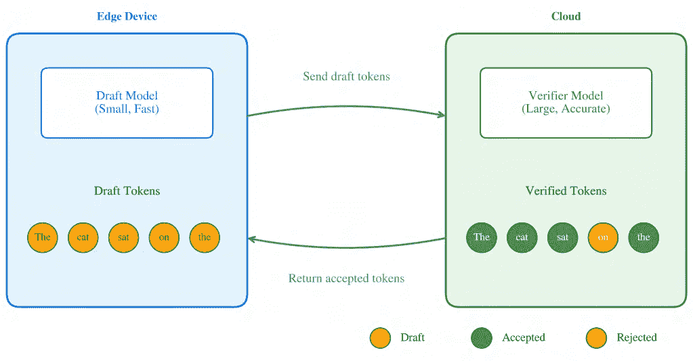
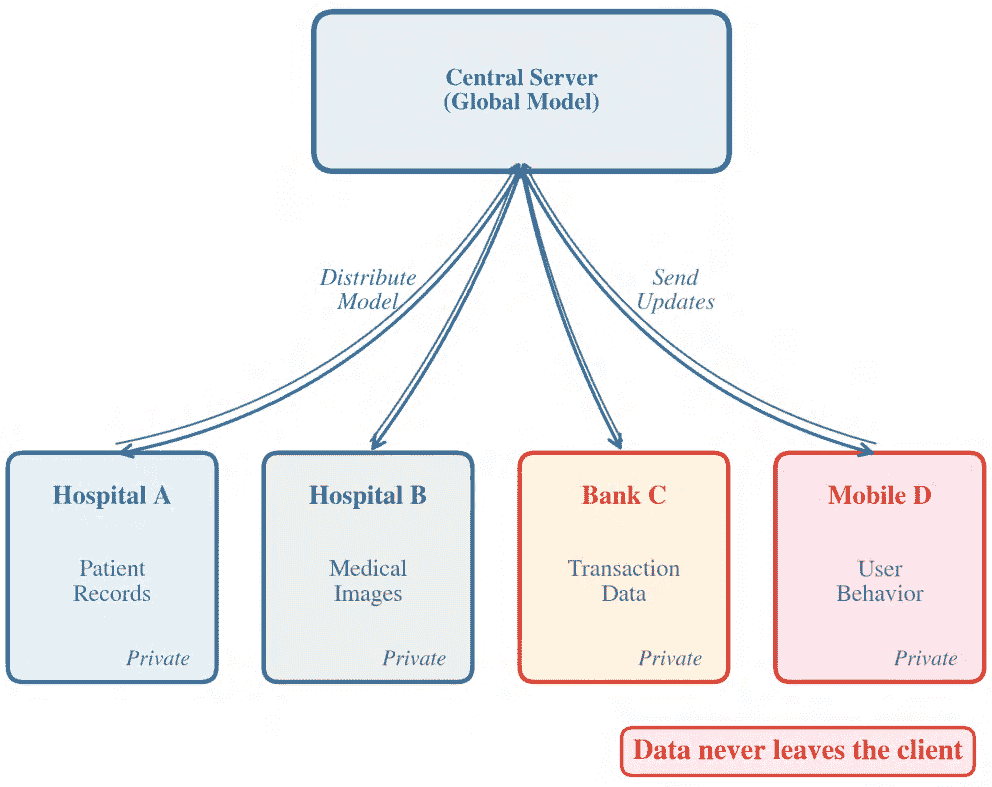
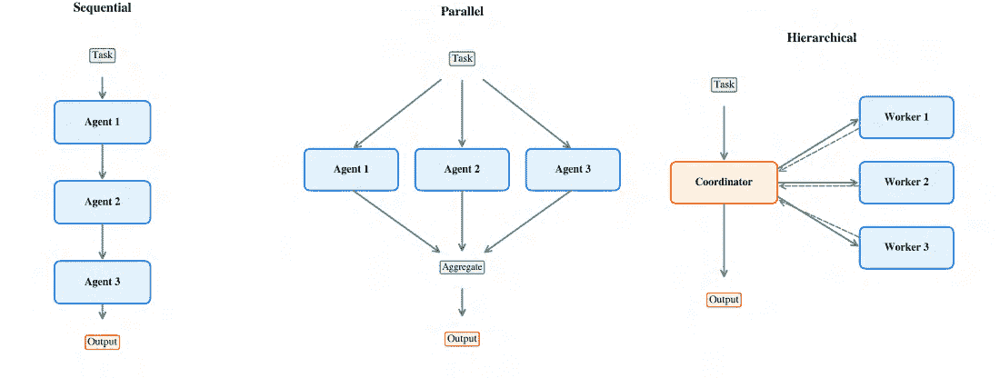
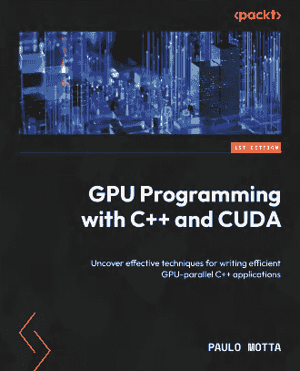
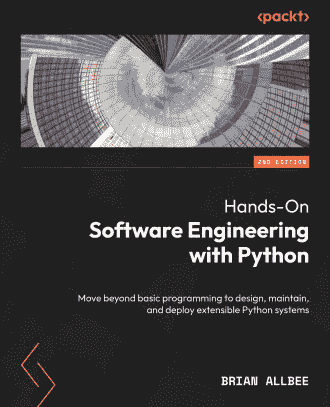
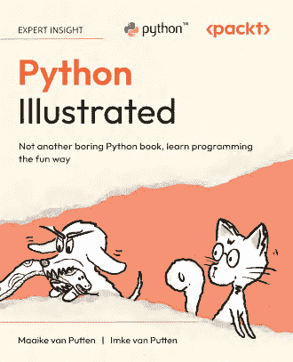

## 11 分布式人工智能的演变格局

### 探索分布式人工智能的新兴技术与未来方向

*预测未来的最好方式是创造未来。*  
*艾伦·凯，计算机科学家*

### 分布式人工智能的演变

在整本书中，我们探索了分布式人工智能的基础：从 DDP 的梯度同步到 FSDP 的内存优化，从 vLLM 的 PagedAttention 到 SGLang 的 RadixAttention。这些技术使得训练和服务几年前难以想象的模型成为可能。但这一领域并未止步——其格局仍在以连经验丰富的从业者都感到惊讶的方式不断变化。

### 我们如今所处的位置

数字讲述了一个非凡的故事。训练基础设施已扩展到单集群超过 100,000 个 GPU，这得益于 NCCLX 和 Torchcomms 等新型通信框架。SGLang 如今为全球超过 400,000 个 GPU 提供算力[1]，运行 xAI 的 Grok 3 和微软 Azure 的生产工作负载。最引人注目的或许是经济账：DeepSeek-V3 是一个拥有 6710 亿参数的 MoE 模型，每个令牌有 370 亿激活参数，仅在 2,048 个 H800 GPU 上以 550 万美元的成本完成训练——这个成本在几年前简直低得令人难以置信。

端侧 AI 已跨越一个关键门槛。像 Gemma 3n 这样的模型通过使用逐层嵌入（Per-Layer Embeddings）等技术，可以在 2-3GB 内存中流畅运行，使 LLM 在智能手机上变得切实可行。曾经看似实验性的 4 比特量化方法如今已成为标准做法。

但也许最重要的转变是优先事项的变化。多年来，AI 行业痴迷于训练：建设更大的集群、训练更大的模型、不断推进前沿。那个时代尚未结束，但它已不再是主导叙事。推理工作负载如今消耗了 AI 基础设施支出的 55% 以上，并且这一比例还在持续增长。对未来几年全球推理市场的预测从数千亿美元到远超万亿美元不等——这种差异反映了分析师们是否将芯片、云服务或打包应用计算在内。

细想之下，这种转变是有道理的。训练只发生一次；推理则发生数百万次。随着模型日趋成熟和部署规模扩大，经济性不可避免地偏向推理优化。过去几年基础设施成本大幅下降，使得在以前不切实际的场景中部署 AI 在经济上变得可行。

### 新的瓶颈

伴随这一增长而来的是新的约束。有趣的是，首要瓶颈不再是芯片的可用性，而是电力和散热。数据中心正在围绕热限制而非机架空间进行设计。组织如今将散热改造纳入总体拥有成本的计算，并提前数月协商云容量承诺。

其余的技术挑战同样有趣。高效扩展到超过 10 万个 GPU 需要新的通信模式和容错机制。在生产推理中平衡延迟和吞吐量既是一门科学，也是一门艺术。而跨混合云-边缘架构的成本优化正在成为一门独立的学科。

### 新兴趋势概览

在深入探讨每个领域之前，这里有一份正在重塑分布式 AI 的路线图：

- **先进 MoE 架构**：LatentMoE 带来了硬件-软件协同设计，以实现每个 FLOP 的最佳准确率，已被英伟达的 Nemotron-3 采用。MoSE（可精简专家混合）支持可变宽度专家执行，从而实现准确率与计算量的持续权衡。弹性 MoE 将推理时的专家数量扩展到训练值的 2-3 倍。ReMoE 引入了使用 ReLU 替代 TopK+Softmax 的完全可微路由。
- **端侧与边缘 AI**：低于十亿参数的模型如今能有效处理实际任务。Gemma 3n 的逐层嵌入减少了内存需求——5B/8B 模型以 2B/4B 的内存占用运行。限制边缘推理的是内存带宽，而非 FLOPs；当草稿模型能很好地跟踪目标模型时，推测解码会有所帮助。

**下一代通信**：Torchcomms 是 PyTorch 的新 API，专为支持异构硬件的 100K+ GPU 规模而设计。NCCLX/RCCLX（Meta 的增强后端）在 AllReduce 操作上可带来 10–50% 的加速。异步检查点现在借助缓存计划和更少的 GIL 争用，速度快了 6 倍。

**推理引擎演进**：SGLang 在 H100 上实现 16,215 tok/s 的吞吐，通过 RadixAttention 实现自动前缀复用，并通过流水线并行支持百万 token 上下文。vLLM 的 PagedAttention 将 KV 缓存浪费从 60–80% 降至 4% 以下。两者现在都支持 AMD MI355/MI300、Intel Xeon、Google TPU 和 Ascend NPU。

### 混合专家：主流架构

我们在第 5 章（用于训练的专家并行，见图 5.8）和第 6 章（使用 vLLM 的 MoE 推理）中介绍了 MoE 的基础知识。这里我们重点关注推动 MoE 能力进一步发展的研究前沿。

研究持续推动 MoE 的能力超越我们在前面章节中介绍的范围：

- **LatentMoE**[2] 利用软硬件协同设计，在不同推理场景中优化每 FLOP 的准确率。该方案被 Nvidia 的 Nemotron-3 模型采用，证明恰当的协同设计可以在不牺牲能力的前提下显著提升效率。

- **MoSE（Mixture of Slimmable Experts）**[3] 支持可变宽度的专家执行。与固定大小的专家不同，MoSE 可以在推理时动态调整专家宽度，实现精度与算力之间的连续权衡。这对于延迟要求各不相同的部署场景尤其有价值。

- **Elastic MoE**[4] 将活跃专家的数量扩展到训练时的数值之外。使用 top-2 路由训练的模型可以在推理时使用 top-4 或 top-6，在提升性能的同时达到训练时 2–3 倍的专家数量。这实现了训练与推理配置的解耦。

- **ReMoE**[5] 用完全可微的基于 ReLU 的路由取代了不可微的 TopK+Softmax 路由。这使得动态计算分配更加高效，并简化了训练动态。

`code/moe_layer.py` 中的代码提供了扩展第 5 章概念的实现，包括采用无辅助损失方法的负载均衡路由。

### 边缘-云连续体

分布式 AI 中最深刻的转变之一是云与边缘之间界限的模糊。多年来，人们的假设很简单：在云端训练，也许在云端提供服务，而边缘设备仅用于消费。这种模式正在瓦解。

#### 为什么边缘 AI 现在很重要

边缘 AI 的优势令人信服。消除网络往返后，延迟从数百毫秒降至个位数。当数据从不离开设备时，隐私性得到显著提升。当你不必为云端推理按 token 付费时，成本得以降低。而离线能力则开启了全新的用例。

是什么变化让这一切变得切实可行？三股力量汇聚在一起。首先，模型架构变得更高效。参数量低于十亿的模型现在可以处理以前需要 7B+ 模型才能完成的实际任务。其次，量化技术成熟了。从 16 位降到 4 位可将存储和内存流量都减少 4 倍，使用 GPTQ[6] 和 AWQ[7] 等方法时质量损失极小。第三，硬件进步了。移动端 NPU 现在已足够强大，能够以可接受的速度运行这些量化模型。

但这里有一个常被忽略的微妙之处。移动设备的瓶颈不是算力，而是内存带宽。手机的带宽约为 50–90 GB/s；而 H100 级别的数据中心 GPU 每秒可处理数 TB 数据——通常比较下来差距为 30–50 倍，与 H200 相比差距更大，与 V100 等较老的显卡相比差距则较小。量化之所以重要，是因为它减少了每次前向传播中经过该总线的字节数，而不仅仅是磁盘上存储的权重。

#### 实用的端侧模型

具备边缘能力的模型格局已经迅速成熟：

| 模型 | 参数 | 内存 | 用例 |
|---|---|---|---|
| Gemma 3n | 5B/8B | 2–3GB | 通用助手 |
| Llama 3.2 | 1B/3B | 1–2GB | 文本任务 |
| Phi-4 mini | 3.8B | 2GB | 推理 |
| Qwen2.5 | 0.5B–1.5B | <1GB | 轻量级任务 |

Google 的 Gemma 3n 使用 Per-Layer Embeddings（逐层嵌入）运行 5B 和 8B 参数模型，内存占用分别相当于 2B 和 4B 模型——总计约 2–3GB。Meta 的 Llama 3.2 提供专为边缘部署设计的 1B 和 3B 版本。Microsoft 的 Phi-4 mini 将强大的推理能力塞进 3.8B 参数。Alibaba 的 Qwen2.5 提供 0.5B 到 1.5B 的多种尺寸，满足最轻量级的任务需求。

关键的洞察在于，在小规模下，架构和训练质量比原始尺寸更重要。一个训练良好的 1B 模型在许多任务上可以胜过训练不佳的 3B 模型。

#### 边缘-云协同

最有趣的系统不会把边缘和云视为两个独立的世界——它们会设法让两者协同工作。还记得第 7 章中的推测解码吗？我们用一个小型草稿模型提议 token，再由一个更大的模型进行验证，从而在单台服务器上加速推理。同样的思路在边缘-云边界上也能出色地发挥作用。

想象一下，你的手机运行着一个小巧但快速的模型。它生成一串候选 token——比如 "The cat sat on the"——然后将其发送给一个强大的云端模型。云端不生成任何内容，只检查每个 token 是否与它本会生成的 token 一致。验证成本很低：云端模型可以在一次前向传播中评估全部五个 token，而逐个生成则需要五次。当草稿大部分正确时（对于可预测的文本，情况往往如此），你就能以边缘般的速度获得云端质量的输出。收益取决于任务：代码或 JSON 等结构化输出通常能实现 3–4 倍的端到端加速，而开放式创意文本可能只会提升 1.2–1.5 倍，因为拒绝的情况很常见[8]。

*图 11.1：边缘-云推测解码工作流*

*图 11.1* 展示了这一协作过程。边缘设备提议 token（黄色圆圈），将其发送到云端，验证器将每个 token 标记为接受（绿色）或拒绝（红色）。在这个例子中，"on" 被拒绝——也许云端模型更倾向于使用不同的介词——因此边缘设备需要从该位置重新生成。但五个 token 中有四个顺利通过，显著节省了延迟。

智能路由将这种协同推向了新的高度。并非每个请求都需要云端参与。一个设计良好的系统会评估每个请求的难度，检查边缘模型的置信度，观察网络状况，然后决定：在本地处理还是发送到云端？简单查询——"东京现在几点了？"——留在设备上处理。复杂的推理任务则交给云端。路由逻辑甚至可以从过去的决策中学习，在预测哪些请求可以在本地成功处理方面变得越来越准确。

`code/edge_cloud.py` 文件实现了这些模式：`EdgeCloudSpeculativeDecoding` 用于草稿-验证循环，`IntelligentOffloading` 用于基于复杂度的路由，以及随时间不断改进的 `AdaptiveRouter`。

### 大规模并行

我们之前介绍的并行策略——数据并行（第 3 章的 DDP、第 4 章的 FSDP）、张量并行和流水线并行（第 5 章）——仍然是基础。但在 100K+ GPU 规模下，新的挑战不断涌现，需要新的解决方案。

#### 通信革命

PyTorch 引入 Torchcomms 标志着分布式训练基础设施的重大演进。之前的通信栈虽然可用，但在大规模场景下已显老态。Torchcomms 从头开始为 100K+ GPU 部署设计，并带来了几项关键创新。

首先，它将通信原语与 PyTorch 核心解耦，使研究人员能够独立迭代新的集合通信和后端。其次，它使用即时初始化和模型特定提示，在大规模场景下优化通信器和资源分配。第三，它支持异构硬件——在单个训练任务中混合部署多个厂商和不同代际的 GPU。第四，它内置了以往事后才考虑的容错机制。

Meta 随 Torchcomms 一起发布的 NCCLX 后端，以及面向 AMD 平台的 RCCLX，通过 Direct Data Access（DDA）等技术为 AllReduce 操作带来 10–50% 的加速。这些不是渐进式的改进——它们可能决定一次训练运行在经济上是否可行。

#### 分层并行

在大规模场景下，你不是选择一种并行策略，而是将它们组合起来。一次典型的大型训练可能使用跨节点的数据并行、节点内的张量并行，以及跨模型阶段的流水线并行。计算很简单：如果你有 `world_size` 个 GPU，那么 `dp_size × tp_size × pp_size = world_size`。

精妙之处在于选择正确的组合。张量并行在节点内通信开销低（NVLink 速度快），但跨节点开销高。流水线并行可以隐藏通信延迟，但会引入气泡开销。数据并行扩展性好

但这需要梯度同步。最佳配置取决于你的模型架构、硬件拓扑和批大小约束。

`code/parallelism.py` 中的 `HierarchicalParallelism` 类负责管理所有三个维度的进程组创建，确保每个 GPU 都清楚自己在每种并行类型中属于哪些组。

### 面向长上下文的序列并行

随着上下文长度不断增长，序列并行变得至关重要。其核心思想是将序列维度拆分到多个 GPU 上。每个 GPU 对自己处理的序列分块计算注意力，但注意力机制需要看到完整的键（Key）和值（Value）张量。这意味着需要从所有序列并行 rank 上全量收集（all-gather）K 和 V。

SGLang 的流水线并行在长提示词场景下表现出色：DeepSeek-V3.1 上预填充吞吐量提升 3.31 倍，百万 token 上下文下 TTFT（首 token 延迟）最高降低 81%，扩展效率达 82.8%。这些技术解决了内存和延迟问题；而检索质量是另一个独立的问题——许多模型在处理远超其标称上下文长度的长文档时，准确率会明显下降。

### 环形注意力

我们在第 5 章作为上下文并行的一部分引入了环形注意力（见图 5.6）。这里我们重新审视它，探讨其在扩展到百万 token 序列时的作用。

环形注意力[9]为标准的序列并行提供了一种内存高效的替代方案。它不需要全量收集完整的 K 和 V 张量（这要求每个 GPU 占用 O(序列长度) 的内存），而是在 GPU 环上传递 K 和 V 分块，并在每一步计算部分注意力分数。每个 GPU 从自己的本地 Q、K、V 分块开始。在每一轮中，GPU 计算本地 Q 与当前 K、V 之间的注意力，然后将 K 和 V 传递给下一个 GPU。经过 N−1 轮后，每个 rank 都已对所有键和值完成注意力计算。

这种方案用通信轮数换取了内存效率——当你受内存限制但有富余的通信带宽时，它会很有用。在百万 token 规模下，这种权衡变得越来越有吸引力：避免全量收集 K、V 所节省的内存，可能正是任务能否成功运行与内存溢出之间的分水岭。`code/parallelism.py` 中的 `RingAttention` 类实现了这一模式。

### 当问题出现时：容错机制

假设每块 GPU 的日可靠度为 99.9%，那么一个拥有 10 万块 GPU 的集群在每 24 小时内预计会出现大约 100 次故障。所有设备当天都正常存活的概率是 0.999^(100,000) ≈ 3.7×10^(-44)——实际上等于零。在这种规模下，故障是常态运行条件，而不是例外。

#### 检查点带来的挑战

传统的检查点机制是同步的：暂停训练，将状态保存到磁盘，然后恢复。当检查点只需几秒、训练任务只需几小时时，这种方式可以接受。但在大规模场景下，检查点可能需要几分钟，训练任务则持续数周。开销变得相当可观。

PyTorch 的分布式检查点（DCP）引入了多项优化，使检查点处理速度提高了大约 6 倍：

- **缓存保存计划**：跨检查点复用张量元数据——形状和数据类型不会变化，何必重新计算？
- **后台保存**：将实际的 I/O 操作移到独立线程，减少 GIL 竞争
- **增量保存**：只写入自上次检查点以来发生变化的张量

`code/fault_tolerance.py` 中的 `AsyncCheckpointer` 实现了这些思路。它维护一个后台线程，从队列中处理保存请求，从而在写入检查点的同时继续训练。它还负责检查点的保留策略，自动清理旧检查点以节省磁盘空间。

#### 故障检测与处理

故障检测听起来很简单——只需检查工作节点是否响应——但细节很重要。你在宣告一个工作节点死亡之前会等待多久？等待太短，网络抖动会造成误报；等待太长，你又会浪费时间等待一个确实已经死掉的工作节点。

`FailureDetector` 类采用心跳机制。工作节点会定期发送心跳；心跳缺失会触发故障回调。系统随后可以决定如何响应：用剩余的工作节点继续，重启失败的工作节点，或者保存检查点并中止。

关键设计决策包括：

- **心跳间隔**：通常为 1-5 秒，在响应速度与开销之间取得平衡
- **超时阈值**：通常连续 3-5 次心跳缺失才宣告故障
- **故障回调**：采取的具体行动——记录日志、报警、保存检查点或中止

#### 弹性训练

最复杂的方法是弹性训练，即系统在不停止的情况下适应工作节点的变化。在训练过程中，工作节点可以随时加入或离开。当一个工作节点失败时，系统会保存检查点，在剩余工作节点间重新分配任务，然后继续。当新工作节点加入时，它会分到一部分任务。

这需要细致的协调：

- **梯度平均**必须考虑工作节点数量的变化
- **数据加载**必须动态重新分配数据分片
- **学习率调度**可能需要针对不同的工作节点数量进行调整
- **检查点机制**必须在状态转换期间处理部分状态

`code/fault_tolerance.py` 中的 `ElasticTrainer` 类处理了这些问题，在故障发生时自动保存检查点并优雅降级。

### 超越文本：多模态分布式训练

如今最受关注的模型并非纯文本模型——而是多模态模型。能够看和读的视觉-语言模型（VLM）、能处理视频的模型、能同时理解音频和文本的系统。高效地分布式训练这些模型需要新的模式。

#### 跨模态挑战

一个典型的 VLM 通常包含一个视觉编码器（通常是基于 ViT 的），用于生成图像特征，以及一个语言模型，它在处理文本的同时会关注这些图像特征。跨模态注意力——即文本 token 关注视觉特征的部分——正是两种模态交汇之处。

这种跨模态注意力可以使用张量并行进行并行化，将注意力头分散到多个 GPU 上。但有一个微妙之处：视觉编码器和语言模型可能有各自不同的最优并行策略。视觉编码器处理固定尺寸的图像，更受益于与语言模型不同的批大小，因为语言模型要处理的是可变长度的文本。

`code/multimodal.py` 文件提供了这些组件的实现：

- `VisionEncoder`：ViT 风格的图像编码器，包含 patch 嵌入和 transformer 块
- `CrossModalAttention`：支持张量并行的文本到视觉注意力
- `VisionLanguageModel`：结合视觉和语言组件的完整 VLM

#### 处理多种模态

不同模态具有不同的特性：

| 模态 | 尺寸 | 特性 |
| --- | --- | --- |
| 图像 | 预处理后固定 | 适合批处理，内存可预测 |
| 文本 | 长度可变 | 需要填充，内存动态变化 |
| 视频 | 多帧 | 内存需求高，具有时间结构 |
| 音频 | 时长可变 | 具有时间结构，流式处理 |

`MultimodalDataParallel` 负责将批次分散到各工作节点，同时保持模态对齐。这比听起来要复杂得多——你需要确保与文本提示对应的图像最终落在同一个工作节点上，即使不同模态的批大小不同。

### 联邦学习：另一种范式

贯穿本书，我们一直假设所有 GPU 都能访问共享数据集——或者至少能访问存储在共同数据中心中的数据集分片。但如果数据无法移动呢？如果隐私法规、竞争考量或纯粹的物流因素使得集中化不可行呢？这就是联邦学习发挥作用的地方。

#### 联邦范式

联邦学习扭转了传统思路：它不是将数据带给模型，而是将模型带给数据。每个参与者——无论是智能手机、医院还是银行——都在本地数据上训练，并且只共享模型更新，绝不共享原始数据。中央服务器聚合这些更新，生成一个全局模型。这种范式自 2016 年就已存在，如今已经发展成为隐私敏感领域的实用解决方案。

*图 11.2* 展示了这种架构。顶部是一台中央服务器，负责协调训练并持有全局模型。底部有四个客户端——一家拥有患者记录的医院、一家拥有交易数据的银行、一个拥有用户行为的移动应用，以及一个拥有传感器数据的物联网设备集群——每个客户端都在各自的私有数据上进行本地训练。蓝色箭头表示服务器分发当前模型；绿色箭头表示客户端发回更新。底部强调的关键一点是：数据永远不会离开客户端。只有梯度和权重在网络中传输。

*图 11.2：联邦学习：数据留在客户端*

典型算法是 FedAvg[10]。每一轮，服务器将当前模型发送给一部分客户端。客户端在本地训练若干 epoch，然后发回更新后的权重。服务器对这些权重求平均，生成新的全局模型。尽管听起来很简单，但这一协议已被证明非常有效——并且该领域在其基础上构建了许多改进。

#### 联邦学习蓬勃发展的领域

联邦学习在特定垂直领域得到了广泛应用：

- **医疗健康**：医院可以在不共享患者病历的情况下协同训练诊断模型。NVIDIA FLARE[11] 等项目支持多机构医学影像研究，同时保持 HIPAA 合规性。在 20 家医院联合训练的模型所看到的病理多样性，远超任何单一机构所能提供。

- **移动键盘**：谷歌的 Gboard 使用联邦学习来改进下一个词预测，而无需上传用户输入内容。模型从数百万台设备中学习，同时将文本保留在设备端。这是联邦学习最早的规模化生产部署之一。

- **金融服务**：银行可以在不共享交易数据的情况下协作构建欺诈检测模型。每家机构贡献其客户群体中的模式；组合后的模型能够捕捉单一银行数据无法揭示的欺诈行为。

- **边缘物联网**：工业传感器、自动驾驶车辆和智能设备产生的数据，集中起来成本高昂或不切实际。联邦学习可以在无需大规模数据传输的情况下改进模型。

#### 异构性带来的挑战

联邦学习面临着传统分布式训练中不存在的挑战：

- **非独立同分布（Non-IID）数据**：在数据中心，你可以打乱数据以确保每个 GPU 看到具有代表性的样本。而在联邦学习中，每个客户端的数据反映其本地分布。在日本训练的键盘模型看到的文本与在巴西训练的不同。这种统计异构性可能导致模型发散和收敛缓慢。

- **系统异构性**：客户端的计算能力差异巨大。旗舰智能手机和三年前的廉价手机无法以相同速度训练。有些客户端可能因电池限制或网络问题在训练中途退出。系统必须对掉队者和部分参与具有鲁棒性。

- **通信约束**：与通过 NVLink 连接的 GPU 不同，联邦客户端通过移动网络或互联网通信。带宽有限且昂贵。梯度压缩、量化和低频同步等技术变得至关重要——不是为了性能，而是为了可行性。

#### 现代联邦技术

研究通过日益复杂的方法解决了这些挑战：

- **FedProx**[12] 在本地目标中添加了一个近端项，防止客户端偏离全局模型过远。当数据高度非 IID 时，这能稳定训练。

- **Scaffold**[13] 使用控制变量来修正客户端漂移，在异构数据上比 FedAvg 收敛更快。

- **差分隐私**可以叠加在联邦学习之上，提供正式的隐私保证。通过对更新添加校准噪声，即使聚合后的模型也只能揭示关于任何个人数据的有限信息。这在医疗和金融领域尤为重要。

- **安全聚合**[14] 确保服务器只能看到客户端更新的总和，而非单个贡献。即使服务器被攻破，也无法提取任何单个客户端的模型更新。

#### 面向大语言模型的联邦学习

将联邦学习应用于大语言模型面临独特的挑战。7B 参数的模型无法放入智能手机，即使是微调也需要大量内存。近期研究探索了几种方法：

- **基于 LoRA 的联邦微调**：客户端不更新所有参数，而是训练低秩适配器。这减少了通信量（只交换适配器权重）和内存占用（适配器很小）。FedIT[15] 及类似方法使联邦大模型微调变得可行。

- **拆分学习**：模型在客户端和服务器之间拆分。客户端在本地数据上运行浅层，并将激活值（而非原始数据）发送给服务器，由服务器完成前向传播。这使得训练大型模型时客户端无需持有完整模型。

- **设备端个性化**：不是训练单一的全局模型，而是每台设备维护一个个性化版本。全局模型提供起点；本地微调适应用户个体。这对于应体现用户偏好的助手尤其重要。

#### Flower 框架

Flower[16] 已成为领先的开源联邦学习框架。它提供：

- 用于定义联邦训练循环的简单 API
- 支持多种聚合策略（FedAvg、FedProx 等）
- 与 PyTorch、TensorFlow 和 JAX 集成
- 用于开发和研究的仿真能力
- 生产部署工具

该框架抽象掉了大部分复杂性，让研究人员专注于算法而非基础设施。一个基本的联邦训练设置只需几十行代码。

#### 何时考虑使用联邦学习

联邦学习并非传统分布式训练的替代品——它是针对特定场景的工具：

| 在以下情况考虑联邦学习 | 在以下情况坚持传统训练 |
| --- | --- |
| 数据不能离开其来源（隐私、监管） | 数据可以集中 |
| 数据天然分布（移动设备、边缘） | 你掌控基础设施 |
| 参与者互不信任 | 单组织训练 |
| 通信成本高昂 | 可用的高带宽互联 |

联邦学习的开销——收敛更慢、通信约束、异构性挑战——意味着在你可以直接集中数据时，它不是正确的选择。但当隐私或现实条件使集中化不可能时，联邦学习实现了否则无法发生的协作。

### 智能体 AI：下一个前沿

也许近期最令人兴奋的发展是智能体 AI 的兴起——这类系统不仅响应提示，还能规划、使用工具并采取行动。这些系统将分布式推理推向新的方向。

#### 为什么智能体需要分布式

考虑当智能体决定调用工具时会发生什么。工具可能是代码解释器、网页浏览器、数据库查询或 API 调用。每个工具都有不同的资源需求和延迟特征。有些工具有状态，需要在特定的工作节点上运行；有些可以轻松并行；另一些则是顺序瓶颈。

多智能体系统又增加了一个层次。多个智能体可能协作完成一项任务，各自具备不同能力。它们需要沟通、协调，有时也会产生分歧。这种通信可以发生在单个节点内，也可以跨越分布式系统。

长推理链——类似 o1 和 DeepSeek-R1[17] 等模型产生的推理链——需要在多个步骤上进行持续推理。每一步都可能涉及工具调用、内存查找或与其他智能体的协调。推理不是一次简单的前向传播，而是一种可能运行数分钟的扩展计算。

#### 多智能体模式

你如何编排多个智能体协同工作？有三种模式已成为多智能体系统的中坚力量，每种模式适用于不同的问题结构。

*图 11.3：三种常见的多智能体协调模式*

*图 11.3* 展示了这些模式。在**顺序处理**中，智能体形成一条流水线：一个智能体提取信息，下一个对其推理，第三个格式化响应。每个智能体的输出成为下一个智能体的输入。当任务能自然地分解为具有明确交接点的阶段时，这种方法效果很好。

**并行处理**采用不同的方法——多个智能体同时处理同一任务。也许你想要不同的视角：一个智能体可能找到创造性解决方案，而另一个找到安全方案。或者你让多种策略竞速，选用先完成的那一个。结果流向一个聚合器，由它合并或从中选择。

**层次化处理**反映了人类团队常见的协作方式。协调者接收任务，将其分解为子任务，并委派给专门的工作节点。工作节点汇报结果（图中的绿色虚线箭头），协调者将他们的结果综合为最终输出。这种方法在处理自然分解的复杂任务时表现出色——协调者负责策略，工作节点负责执行。

`code/agentic_inference.py` 文件实现了全部三种模式，以及根据任务特征在它们之间进行选择的路由逻辑。

#### 分布式工具执行

当智能体决定调用工具时，该工具实际运行在哪里？并非所有工具都是平等的。代码解释器需要具备适当安全隔离的沙盒环境——你

不能在任何地方随意运行代码。网页浏览器可能需要 GPU 加速来进行渲染。而一个简单的计算器则可以在任何有空闲计算周期的节点上运行。

`code/agentic_inference.py` 中的 `DistributedToolExecutor` 负责这种路由。工具在注册时带有可选的节点约束：“我需要沙箱隔离”，“我需要 GPU”，或者“我是无状态的，可以任意运行”。当智能体请求某个工具时，执行器会找到合适的节点，分发调用，并返回结果。

这带来了复杂的放置策略。常用工具会在多个节点间复制以实现负载均衡。有状态工具——比如数据库连接或浏览器会话——会被固定在特定节点上，以便在多次调用之间保持状态。资源密集型工具会被隔离到专用节点上，以免它们挤占其他操作的资源。执行器会跟踪执行统计信息，随着时间推移学习哪些放置方式效果最好。

#### 推理智能体

最先进的智能体不只是响应——它们会思考。面对复杂问题时，它们会分解问题、尝试不同方法、观察结果并做出调整。这正是 o1 和 DeepSeek-R1 这类推理智能体的领域，其推理过程不是一次简单的前向传播，而是可能跨越数十步的扩展性深思。

`code/agentic_inference.py` 中的 `ReasoningAgent` 捕获了这一模式。它维护一个推理轨迹——即思考过程、工具调用和观察结果的持续记录。在每一步，智能体都面临一个选择：更深入地思考当前状态、调用工具收集信息，或者给出最终答案。当它调用工具时，结果会成为一个新的观察，并进入下一步思考。这个循环会一直持续，直到智能体有足够信心回答问题或达到步数上限。

这是生产级推理系统所做工作的简化版本，但它抓住了核心动态：思考与行动之间、内部深思与外部观察之间的相互作用，使得智能体能够解决那些单次推理无法解决的复杂问题。

### 规模经济

随着分布式 AI 日趋成熟，经济考量变得越来越重要。“多堆 GPU 就行”的时代已经结束；效率和成本优化现在已成为头等大事。

#### 工作负载分布

企业工作负载分布中，没有任何单一的主导类别：

| 工作负载类型 | 占比 |
|---|---|
| 大规模推理 | 34.6% |
| 基础模型训练 | 24.9% |
| 领域特定训练 | 23.3% |
| 微调 | 17.2% |

这种多样性意味着基础设施必须具备灵活性——如果只为某一种工作负载优化，就无法满足全部需求。

各类组织正在采用混合策略：

- **公有云**：处理需求不可预测的弹性、可变工作负载
- **本地部署**：服务于成本可预测性至关重要的大规模生产推理
- **近边缘数据中心**：处理对延迟敏感、面向用户的 AI 服务

#### 资源管理

当工作负载变化时，动态资源分配至关重要。`code/resource_management.py` 中的 `AdaptiveGPUAllocator` 会基于以下条件估算 GPU 需求：

- 模型大小（内存需求）
- 批量大小（吞吐量需求）
- 作业优先级（业务重要性）

它会为无法立即调度的作业维护一个队列，并在资源可用时处理该队列。

#### 多租户 GPU 共享

`MultiTenantGPUScheduler` 实现了时间片 GPU 共享：

- 优先权加权的轮询调度
- 租户间的公平分配
- 待处理工作的队列管理
- 高优先级作业的抢占

这允许多个团队或服务公平地共享 GPU 资源，优先级体现了业务重要性。

#### 梯度压缩

在规模较大时，通信开销可能主导计算时间。`code/resource_management.py` 中的 `GradientCompression` 可以降低这种开销：

- **Top-k 稀疏化**[18]：仅保留最大的 k 个梯度值。当 k 为总梯度的 1% 时，可实现 100 倍压缩。误差反馈——将丢弃的梯度累积到下一迭代——保持了收敛性。
- **量化**：将精度降低到 8 位。这可在对训练动态影响最小的情况下实现 4 倍压缩。可与稀疏化结合以得到更高压缩率。

关键的洞见在于梯度具有高度可压缩性。大多数梯度值很小，对学习的贡献微乎其微。通过将通信集中在最大的值上并累积其余部分，可以在不牺牲收敛性的前提下大幅降低带宽需求。

### 为未来做好准备

#### 需培养的技能

- **MoE 与稀疏架构**：随着 MoE 成为默认架构，理解专家路由策略（TopK、基于 ReLU 的）、负载均衡机制以及推理时的弹性专家扩展正变得越来越重要。
- **边缘-云协同**：推测解码实现、面向移动端的内存带宽优化，以及量化技术（GPTQ、AWQ）打开了直到最近才切实可行的新部署选项。
- **大规模通信**：Torchcomms API 与 NCCLX/RCCLX 后端、异步检查点策略以及异构硬件部署，支持更大规模的训练任务和更高效的基础设施利用。
- **推理优化**：RadixAttention 和 PagedAttention 内部机制、长上下文的流水线并行以及多租户 GPU 调度，可提高服务效率并降低成本。
- **智能体系统**：多智能体编排模式、分布式工具执行和推理链优化，代表了分布式 AI 与复杂问题求解相遇的下一个应用前沿。

#### 保持跟进

这个领域发展很快——今天看似前沿的技术，六个月后可能就成了标准做法。保持跟进需要在几个关键信息源上养成习惯。

对于日常学习，arXiv 不可或缺。cs.DC 和 cs.LG 每天都有新论文发布，而且许多最佳成果往往会提前几个月出现在这里，之后才在会议上发表。为“分布式训练”“推理优化”和“混合专家模型”等关键词设置提醒。开源项目同样重要：vLLM、SGLang、DeepSpeed 和 Megatron-LM 是理论与实践交汇的地方。关注它们的发布说明和 GitHub 讨论——在那里你能了解到哪些方法真的能在大规模下起作用。来自 xAI、Anthropic、Google 和 Meta 团队的行业博客会定期发布技术深度文章，揭示论文中从未出现的实用见解。也不要忽视社区：Hugging Face 论坛、PyTorch Discuss 和 SGLang Discord 是实践者分享经验教训、共同排查棘手问题的地方。

想要深入钻研，会议仍然必不可少。NeurIPS、ICML 和 ICLR 等研究会议是新算法和新架构的首发之地——要特别关注关于高效机器学习和大型系统的研讨会。MLSys、OSDI 和 SOSP 等系统会议则聚焦基础设施、通信优化和生产部署；如果你关心如何让系统变快，这些都是必读内容。GTC 和 PyTorch Conference 等行业活动是厂商发布新硬件和框架的场合，可以让你提前了解未来 12–18 个月的趋势。

本章末尾的“参考文献”部分提供了文中提及的关键论文和项目的 URL。

### 总结

本章探讨了分布式 AI 的现状以及塑造其未来的趋势：

1. **向推理的重大转变**：推理工作负载如今消耗了超过 55% 的 AI 基础设施支出，而训练在总算力中所占比例逐渐变小。这重塑了基础设施的优先事项和优化目标。
2. **MoE 主导地位**：像 DeepSeek-V3 这样的架构证明，671B 参数的模型只需 550 万美元即可完成训练，每个 token 仅激活 37B 参数。理解专家路由、负载均衡和并行性至关重要。
3. **端侧 AI 已切实可行**：十亿参数以下的模型、4-bit 量化以及逐层嵌入等技术使得大语言模型能够运行在移动设备上。瓶颈是内存带宽，而非算力。

## 分布式AI不断演变的格局

**10万+ GPU规模**：新的通信API（Torchcomms、NCCLX/RCCLX）和异步检查点技术使前所未有的规模训练成为可能。异构硬件支持日益重要。

**容错能力至关重要**：在超大规模下，故障是常态——在10万GPU集群中每天约发生100次故障。弹性训练和异步检查点不再是可选项，而是必选项。

**多模态与智能体**：VLM和多智能体系统需要新的分布式模式来支持跨模态注意力与工具执行。这些代表了下一个应用前沿。

**联邦学习作为替代范式**：当数据因隐私或监管限制无法集中时，联邦学习提供了一种成熟的替代方案。FedProx和安全聚合等技术解决了非独立同分布数据和不可信参与者带来的独特挑战。

**推理引擎演进**：SGLang借助RadixAttention实现了16,215 tok/s；vLLM的PagedAttention将KV缓存浪费降低到4%以下。两者都支持多种硬件平台。

本书涵盖的技术——DDP、FSDP、DeepSpeed、Megatron-LM、vLLM、SGLang——仍然是基础，但技术格局在持续快速演变。现在的首要瓶颈是功耗与散热约束，而非硅片供应。

如果你从第1章一路读到这里，你就是从大多数从业者的起点出发：一个超出单GPU容量的模型，以及一系列关于硬件、并行、训练框架、推理引擎和生产部署的问题。本章将这些内容放在未来的背景下——大规模MoE、端侧推理、容错，以及一个推理而非训练主导大部分基础设施支出的世界。工具会不断变化，但你一路建立的系统思维不会过时。

分布式AI的未来正在被书写，由那些突破边界的研究者和大规模部署的实践者共同创造。读完本书后，你已更有能力去跟进这些工作——并参与开创这些工作。

### 代码总结

- `torch.distributed.checkpoint.save`：使用DCP进行异步分布式检查点
- `torch.distributed.checkpoint.load`：跨rank加载分片检查点
- `torch.distributed.elastic.multiprocessing`：带容错能力的弹性训练
- `torch.ao.quantization.quantize_dynamic`：用于模型压缩的动态量化
- `flwr.client.NumPyClient`：Flower联邦学习客户端接口
- `flwr.server.strategy.FedAvg`：联邦平均聚合策略
- `megatron.core.transformer.moe.router.TopKRouter`：Megatron MoE top-k路由
- `vllm.LLM`：带PagedAttention的vLLM推理引擎
- `sglang.Engine`：带RadixAttention的SGLang运行时

### 实用链接

**MoE架构**

- DeepSeek-V3技术报告：`https://arxiv.org/abs/2412.19437`
- LatentMoE：实现每FLOP最优精度：`https://arxiv.org/abs/2601.18089`
- MoSE：可精简专家混合：`https://arxiv.org/abs/2602.06154`
- Elastic MoE：推理时专家扩展：`https://arxiv.org/abs/2501.03140`
- ReMoE：使用ReLU路由的全可微MoE：`https://arxiv.org/abs/2412.14711`

**通信与规模**

- NVIDIA NCCL：`https://developer.nvidia.com/nccl`
- Torchcomms API：`https://pytorch.org/blog/torchcomms/`
- 面向AMD平台的RCCLX：`https://engineering.fb.com/2026/02/24/data-center-engineering/rrcclx-innovating-gpu-communications-amd-platforms-meta/`
- PyTorch分布式检查点：`https://pytorch.org/docs/stable/distributed.checkpoint.html`
- 异步检查点改进：`https://pytorch.org/blog/6x-faster-async-checkpointing/`
- 深度梯度压缩：`https://arxiv.org/abs/1712.01887`

**推理引擎**

- SGLang（RadixAttention）：`https://arxiv.org/abs/2312.07104`
- SGLang流水线并行：`https://lmsys.org/blog/2026-01-15-chunked-pipeline/`
- SGLang文档：`https://sgl-project.github.io/`
- vLLM（PagedAttention）：`https://arxiv.org/abs/2309.06180`
- vLLM文档：`https://docs.vllm.ai/`
- 推测解码：`https://arxiv.org/abs/2211.17192`

**内存高效注意力**

- 多头潜在注意力（DeepSeek-V2）：`https://arxiv.org/abs/2405.04434`
- Ring Attention：`https://arxiv.org/abs/2310.01889`
- FlashAttention-2：`https://arxiv.org/abs/2307.08691`

**端侧AI与量化**

- GPTQ：训练后量化：`https://arxiv.org/abs/2210.17323`
- AWQ：激活感知权重量化：`https://arxiv.org/abs/2306.00978`
- KV缓存压缩：`https://arxiv.org/abs/2405.12981`
- Google LiteRT：`https://ai.google.dev/edge/litert`
- Gemma 3n：`https://ai.google.dev/gemma/docs/gemma-3n`

**推理与智能体AI**

- DeepSeek-R1：`https://arxiv.org/abs/2501.12948`
- ReAct：语言模型中的推理与行动：`https://arxiv.org/abs/2210.03629`

**容错与弹性训练**

- PyTorch Elastic：`https://pytorch.org/docs/stable/elastic/run.html`
- TorchSnapshot：`https://pytorch.org/torchsnapshot/`

**联邦学习**

- FedAvg：来自分散数据的通信高效学习：`https://arxiv.org/abs/1602.05629`
- FedProx：异构网络中的联邦优化：`https://arxiv.org/abs/1812.06127`
- SCAFFOLD：随机控制平均：`https://arxiv.org/abs/1910.06378`
- 用于隐私保护机器学习的安全聚合：`https://eprint.iacr.org/2017/281`
- Flower框架：`https://flower.ai/`
- NVIDIA FLARE：`https://github.com/NVIDIA/NVFlare`
- FedIT：LLM的联邦指令微调：`https://arxiv.org/abs/2409.12568`

### 参考文献

1. LMSYS/SGLang项目更新：`https://github.com/sgl-project/sglang`，`https://lmsys.org/blog/`
2. LatentMoE：实现每FLOP最优精度：`https://arxiv.org/abs/2601.18089`
3. MoSE：可精简专家混合：`https://arxiv.org/abs/2602.06154`
4. Elastic MoE：推理时专家扩展：`https://arxiv.org/abs/2501.03140`
5. ReMoE：使用ReLU路由的全可微专家混合：`https://arxiv.org/abs/2412.14711`
6. GPTQ：生成式预训练Transformer的精准训练后量化：`https://arxiv.org/abs/2210.17323`
7. AWQ：用于LLM压缩与加速的激活感知权重量化：`https://arxiv.org/abs/2306.00978`
8. 通过推测解码实现Transformer快速推理：`https://arxiv.org/abs/2211.17192`
9. 使用分块Transformer实现近无限上下文的Ring Attention：`https://arxiv.org/abs/2310.01889`
10. 从分散数据中进行深度网络的通信高效学习：`https://arxiv.org/abs/1602.05629`
11. NVIDIA FLARE：联邦学习应用运行时环境：`https://github.com/NVIDIA/NVFlare`
12. 异构网络中的联邦优化：`https://arxiv.org/abs/1812.06127`
13. SCAFFOLD：用于联邦学习的随机控制平均：`https://arxiv.org/abs/1910.06378`
14. 用于隐私保护机器学习的安全聚合实践：`https://eprint.iacr.org/2017/281`
15. 结合领域覆盖增强的LLM联邦指令微调：`https://arxiv.org/abs/2409.12568`
16. Flower：友好的联邦学习框架：`https://flower.ai/`
17. DeepSeek-R1：通过强化学习激发LLM的推理能力：`https://arxiv.org/abs/2501.12948`
18. 深度梯度压缩：降低分布式训练的通信带宽：`https://arxiv.org/abs/1712.01887`

### 练习

**选择题**

1. MoE（专家混合）架构的主要优势是什么？
   a) 更快的训练收敛
   b) 在不按比例增加计算量的情况下扩展模型容量
   c) 消除分布式训练需求
   d) 减小模型尺寸

2. 在一个包含64个专家并使用top-2路由的典型MoE层中，每个token由多少个专家处理？
   a) 1
   b) 2
   c) 32
   d) 64

3. 移动设备上端侧LLM推理的主要瓶颈是什么？
   a) CPU计算
   b) 存储空间
   c) 内存带宽
   d) 电池容量

4. 推测解码在边缘-云场景中实现了什么？
   a) 减小模型尺寸
   b) 使用一个小型草稿模型生成候选token，再由更大的模型验证
   c) 消除网络延迟
   d) 压缩梯度

5. 在10万GPU规模且单GPU可靠性为99.9%的情况下，每天大约会发生多少次故障？
   a) 1
   b) 10
   c) 100
   d) 1000

6. MoE训练中负载均衡损失的作用是什么？
   a) 减少内存使用
   b) 鼓励专家均匀利用
   c) 加速推理
   d) 压缩模型权重

7. 在专家并行中，哪种通信模式代价最高？
   a) 广播（Broadcast）
   b) 归约（Reduce）
   c) 全对全（All-to-all）
   d) 收集（Gather）

8. Ring Attention为降低内存使用带来了什么权衡？
   a) 精度
   b) 更多通信轮次
   c) 更大的批大小
   d) 更少的专家

**简答题**

1. 解释为什么推理工作负载现在消耗超过55%的AI基础设施支出，而仅仅几年前训练还占主导地位。

2. 描述同步和异步检查点之间的关键区别，以及为什么异步检查点在超大规模下至关重要。

VLM（视觉-语言模型）使用跨模态注意力。解释这意味着什么，以及在分布式部署它时面临的一个挑战。

比较用于梯度压缩的top-k梯度稀疏化与量化，二者有哪些权衡取舍？

#### 动手练习

##### 实现基本的MoE路由

创建一个简单的MoE路由器，它可以：

- 接收输入token并将其路由到top-k专家
- 计算负载均衡损失
- 返回加权后的专家输出

请参考`code/moe_layer.py`获取指导。使用4个专家和top-2路由进行测试，并在一批输入中衡量专家利用率。

#### 获取本书的PDF版本及更多内容

扫描二维码（或访问`packtpub.com/unlock`）。按名称搜索本书，确认版本，然后按照页面上的步骤操作。

*注意：请将您的购买凭证放在手边。直接从Packt购买时无需提供凭证。*

## 解锁您的专属福利

您所拥有的这本书包含以下专属福利：

### 通过3个简单步骤解锁本书的免费福利

#### 步骤1

请为*步骤3*准备好您的购买凭证。如果您有实体书，请用手机扫描并保存为PDF、JPG或PNG格式。

如需进一步了解如何查找购买凭证，请访问`https://www.packtpub.com/en-us/unlock?step=1`。

#### 步骤2

扫描二维码或访问`packtpub.com/unlock`。

在打开的页面（桌面端类似于*图12.1*）上，按名称搜索本书并选择正确的版本。

如果您直接从Packt购买本书，则无需购买凭证。完成*步骤2*后，您就可以立即访问专属内容。

**注意**

*图12.1：Packt桌面端解锁登录页面*

#### 步骤3

选择您的书籍后，登录您的Packt账户或免费创建一个账户。然后上传您的购买凭证（PDF、PNG或JPG格式，最大10 MB）。按照屏幕上的说明完成流程。

### 需要帮助

如果您遇到困难需要帮助，请访问`https://www.packtpub.com/unlock-benefits/help`，查看关于如何查找购买凭证等问题的详细常见问题解答。此二维码将带您进入帮助页面。

如果问题仍然存在，请联系`customercare@packt.com`。

**注意**

## 附录

### OpenAI兼容API端点

vLLM和SGLang都提供OpenAI兼容的API。

下表列出了常用端点及其用法：

| 端点 | 方法 | 描述 | 用法 |
|---|---|---|---|
| `/v1/models` | GET | 列出可用模型 | `curl http://localhost:8000/v1/models` |
| `/v1/completions` | POST | 用于基础模型的文本补全 | 与`prompt`参数一起用于基础模型 |
| `/v1/chat/completions` | POST | 用于指令微调模型的聊天补全 | 与`messages`参数一起用于聊天模型 |
| `/v1/embeddings` | POST | 从文本生成嵌入 | 与`input`参数一起用于嵌入模型 |
| `/v1/rerank` | POST | 按与查询的相关性对文档重新排序 | 与`query`和`documents`参数一起使用（仅限SGLang） |
| `/v1/classify` | POST | 对文本输入进行分类 | 与`input`参数一起用于分类模型 |
| `/generate` | POST | 使用扩散模型生成文本 | 与`text`参数一起用于扩散语言模型（仅限SGLang） |
| `/health` | GET | 健康检查端点 | `curl http://localhost:8000/health` |
| `/metrics` | GET | Prometheus指标 | `curl http://localhost:8000/metrics` |
| `/docs` | GET | API文档（Swagger UI） | 在浏览器中打开：`http://localhost:8000/docs` |

**注意：** vLLM的默认端口是8000，SGLang的默认端口是30000。请相应调整上述示例中的端口。有关详细的API文档和特定模型的要求，请参阅各自的文档：

- vLLM API参考
- SGLang文档

*2026*

## `packtpub.com`

订阅我们的在线数字图书馆，即可完整访问超过7,000本图书和视频，以及行业领先的工具，帮助您规划个人发展并推进职业生涯。

欲了解更多信息，请访问我们的网站。

### 为什么订阅？

- 借助来自4,000多位行业专业人士的实用电子书和视频，减少学习时间，增加编码时间
- 通过专为您打造的学习计划提升学习效果
- 每月免费获得一本电子书或视频
- 支持全文搜索，方便获取关键信息
- 可复制、粘贴、打印内容并添加书签

在`www.packtpub.com`上，您还可以阅读一系列免费技术文章，订阅多种免费电子报，并获得Packt图书和电子书的专属折扣和优惠。

## 其他您可能喜欢的图书

如果您喜欢这本书，您可能会对Packt的以下其他图书感兴趣：

### 使用C++和CUDA进行GPU编程

Paulo Motta

ISBN：9781805124542

- 管理GPU设备并加速您的应用程序
- 使用CUDA和C++有效应用并行性
- 在现有库和自定义GPU解决方案之间做出选择
- 将GPU代码打包为库以供Python使用
- 探索CUDA流等高级主题
- 实施优化策略以实现资源高效执行

### Python实战软件工程

Brian Allbee

ISBN：9781835888018

- 区分软件工程与通用编程
- 分解SDLC的每个阶段并将其应用于Python系统
- 在编写代码前创建系统模型以规划架构
- 应用敏捷、Scrum和其他现代开发方法论
- 使用dataclasses、pydantic和schemas进行稳健的数据建模
- 使用GitHub Actions和云构建工具设置CI/CD流水线
- 编写并组织单元测试、集成测试和端到端测试
- 评估并集成Poetry、pytest和Docker等工具

### Python图解

Maaike van Putten, Imke van Putten

ISBN：9781836646334

- 配置Python并编写您的第一个程序
- 理解变量、数据类型和条件语句
- 使用循环、列表、字典和元组高效处理数据
- 编写并使用函数创建可复用的代码
- 管理文件并理解面向对象编程和继承
- 调试您的Python代码以确保其完美运行
- 探索如何在这本书之外继续学习和构建

### Packt正在寻找像您这样的作者

如果您有兴趣成为Packt的作者，请访问`authors.packt.com`并立即申请。我们与成千上万的开发人员和技术专业人士（像您一样）合作，帮助他们与全球技术社区分享见解。您可以进行一般性申请，申请我们正在招募作者的特定热门主题，或提交您自己的想法。

### 分享您的想法

现在您已经读完了*分布式AI系统*，我们很想听听您的想法！扫描下方二维码直接进入本书的Amazon评论页面，分享您的反馈，或者在您购买本书的网站上留下评论。

`https://packt.link/r/1807301710`

您的评论对我们和技术社区都很重要，将帮助我们确保提供优质内容。

#### 订阅 Deep Engineering

加入成千上万的开发者和架构师，一起了解软件正如何变化、深化自身专业能力，并构建经久耐用的系统。

Deep Engineering 是一份由专家主笔的每周通讯，面向经验丰富的从业者，提供原创分析、技术访谈，以及关于架构、系统设计和现代编程实践的精选洞见。

扫描二维码或访问下方链接，即可免费订阅。

https://packt.link/deep-engineering-newsletter

## 索引

#### 符号

| 索引项 | 页码 |
| --- | --- |
| 1F1B（一次前向一次后向） | 232 |
| 2D 环形拓扑 | 73 |
| 3D 环形拓扑 | 73, 74 |

### A

| 索引项 | 页码 |
| --- | --- |
| A/B 测试 | 413 |
| A/B 流量拆分 | 412 |
| AI 核心 | 76 |
| AI 集群 | 73 |
| AI 集群 > 推理需求 | 60 |
| AI 集群 > 训练需求 | 60 |
| AMD GPU | 85 |
| 昇腾 | 336 |
| AWS Trainium | 76 |
| AllGather | 37, 38, 86 |
| AllReduce | 36, 37, 85, 115, 116, 460 |
| AlltoAll | 46, 47 |
| 昇腾 SuperPoD | 79 |
| 准确度基准测试 | 464 |
| 激活检查点 | 193 |
| 激活检查点 > 使用 | 193, 194 |
| 激活内存 > 优化 | 197 |
| 激活输出 | 8–13 |
| 激活表 > 约定 | 11 |
| DDP 高级特性 > 通信钩子 | 156, 157 |
| DDP 高级特性 > 梯度钩子 | 156 |
| DDP 高级特性 > 使用 join() 处理不均匀输入 | 157, 158 |
| SLURM 高级特性 > 检查点 | 389 |
| SLURM 高级特性 > 作业数组，用于超参数调优 | 387, 388 |
| SLURM 高级特性 > 作业依赖 | 388 |
| SLURM 高级特性 > 作业恢复 | 389 |
| SLURM 高级特性 > salloc，用于交互式作业 | 388 |
| 智能体 AI | 486 |
| 智能体 AI > 分布式工具执行 | 487 |
| 智能体 AI > 推理智能体 | 488 |
| 智能体 > 对分布式的需求 | 486 |
| 聚合顺序读取 | 66 |
| 算法带宽 | 101 |
| all-gather | 172, 173, 294 |
| all-reduce | 294 |
| all-to-all 通信 | 236 |
| 原子检查点 | 155 |
| 自动扩缩容 | 415 |
| 可用性 | 63, 71 |

### B

| 索引项 | 页码 |
| --- | --- |
| B200 | 71 |
| 全程 BF16 | 15 |
| Blackwell（2024） | 69 |
| Broadcast | 39 |
| 总线带宽 | 101 |
| 背压 | 415 |
| 反向预取 | 192 |
| 带宽测试 | 97 |
| 带宽最优 | 116 |
| 基准测试 | 452–454 |
| 基准测试 > 分析结果 | 452 |
| 基准测试 > 效率 | 453 |
| 基准测试 > 推理基准测试 | 461 |
| 基准测试 > 百分位延迟 | 453 |
| 基准测试 > 训练基准测试 | 454 |
| 块 | 82 |
| 缓冲区 | 117 |

### C

| 索引项 | 页码 |
| --- | --- |
| CPU 核心 | 66 |
| CPU 卸载 | 194, 195 |
| CPU-GPU 交互 | 65 |
| CUDA > 内存层次结构 | 84 |
| CUDA > 线程索引 | 83 |
| CUDA > 使用 | 84, 85 |
| 寒武纪 MLU | 77 |
| 中央处理器（CPU） | 75, 64 |
| 中央处理器（CPU） > 架构 | 64 |
| 中央处理器（CPU） > NUMA 拓扑 | 65 |
| 中央处理器（CPU） > 分布式训练需求 | 66 |
| Colossal-AI | 242 |
| 上下文并行 | 89, 95, 233, 234 |
| c10d 后端 | 161 |
| 缓存感知策略 | 344 |
| 金丝雀部署 | 413 |
| 检查点 > 最佳实践 | 155 |
| 检查点 > 挑战 | 480 |
| 检查点 > 加载 | 153 |
| 检查点 > 保存 | 153 |
| 芯片编程系统 | 81 |
| 分布式连续批处理？ | 292 |
| 集群吞吐量 | 62 |
| 集群 +113 | 59, 60 |
| 集群 > 用于 HPC 和 AI 训练 | 365 |
| 冷启动缓解 | 415 |
| 集合通信操作 | 36 |
| 集合通信操作 > AllGather | 37, 38 |
| 集合通信操作 > AllReduce | 36, 37 |
| 集合通信操作 > AlltoAll | 46, 47 |
| 集合通信操作 > Broadcast | 39 |
| 集合通信操作 > Gather | 42 |
| 集合通信操作 > Reduce | 40, 41 |
| 集合通信操作 > ReduceScatter | 45 |
| 集合通信操作 > Scatter | 43 |
| 集合通信操作 > 选择 | 48 |
| 列并行 | 294 |
| 列并行线性层 | 229 |
| 通信 > 优化 | 196 |
| 通信效率 | 62 |
| 通信钩子 | 156, 157 |
| 通信延迟 | 63 |
| 计算分片 > 与状态分片对比 | 228, 229 |
| 算力 | 57, 58 |
| 连续批处理 | 292 |
| 成本优化 | 416 |
| 每个词元/样本的成本 | 454 |
| 跨模态 | 481 |

### D

| 索引项 | 页码 |
| --- | --- |
| DCP API | 187 |
| DDP 性能 > 桶大小调优 | 151 |
| DDP 性能 > 通信重叠优化 | 150 |
| DDP 性能 > 分析计算-通信重叠 | 145, 146 |
| DDP 性能 > 梯度累积 | 149 |
| DDP 性能 > 混合精度训练 | 148, 149 |
| DDP 性能 > 性能分析 | 141 |
| DDP 性能 > 静态图优化 | 152 |
| DDP 性能 > 使用 torch.profiler.profile | 141–143 |
| DDP 性能 > 查找未使用参数 | 151 |
| DDP 训练 > 调试与故障排除 | 133–141 |
| DGX（Deep GPU Xceleration） | 70 |
| 数据并行（DP）与分布式数据并行（DDP） | 113 |
| 数据并行注意力（DP Attention） | 348 |
| 数据并行 | 339, 340 |
| 数据并行（DP） | 85, 113, 295, 337 |
| 数据并行（DP） > 优势 | 297 |
| 数据并行（DP） > 与其他策略结合 | 296 |
| 数据并行（DP） > 复制式数据并行（DDP） | 89 |
| 数据并行（DP） > 分片数据并行（FSDP/ZeRO） | 89 |
| 数据并行（DP） > 权衡 | 297 |
| DataLoader > 单进程与多进程 | 124 |
| 仅解码器 Transformer 架构 | 277, 278 |
| DeepSpeed | 218 |
| DeepSpeed > 与 SLURM 配合使用 | 380–383 |
| DeepSpeed-Ulysses | 236–238 |
| 去分词器 | 325 |
| 差分隐私 | 484 |
| 分布式数据并行（DDP） | 48, 49, 202 |
| 分布式数据并行（DDP） > AllReduce 操作 | 115, 116 |
| 分布式数据并行（DDP） > 最佳实践 | 158, 159 |
| 分布式数据并行（DDP） > 缓冲区同步 | 117 |
| 分布式数据并行（DDP） > 常见模式 | 158, 159 |
| 分布式数据并行（DDP） > 通信-计算重叠 | 114, 115 |
| 分布式数据并行（DDP） > 计算-通信重叠实现 | 118 |
| 分布式数据并行（DDP） > 设备选择 | 125 |
| 分布式数据并行（DDP） > 前向传播实现 | 117 |
| 分布式数据并行（DDP） > 梯度分桶 | 114 |
| 分布式数据并行（DDP） > 梯度缩放 | 116 |
| 分布式数据并行（DDP） > 内部工作原理 | 111, 112 |
| 分布式数据并行（DDP） > 混合精度 | 116 |
| 分布式数据并行（DDP） > 单节点示例 | 126–128 |
| 分布式数据并行（DDP） > 与 Transformer 结合使用 | 162 |
| 分布式数据并行（DDP） > 与 SLURM 配合使用 | 377–379 |
| 分布式数据并行（DDP）工作流 > 反向传播 | 112 |
| 分布式数据并行（DDP）工作流 > 前向传播 | 112 |
| 分布式数据并行（DDP）工作流 > 梯度同步 | 112 |
| 分布式数据并行（DDP）工作流 > 参数更新 | 113 |
| DistributedSampler | 49, 125 |
| DistributedSampler > 使用 | 121–123 |
| 决策树 | 22 |
| 分布式 AI > 瓶颈 | 474 |
| 分布式 AI > 现状 | 473 |
| 分布式 AI > 新兴趋势 | 474 |
| 分布式 AI > 演进 | 473 |
| 分布式 AI 技术栈 | 31–33 |
| 分布式通信 | 85, 86 |
| 分布式推理 | 319 |
| 分布式作业 > 启动 | 50 |
| 分布式优化器 | 243 |
| 分布式系统 | 1 |
| 分布式训练 > 环境搭建 | 24, 25 |
| 分布式训练 > 扩展训练 | 28, 29 |
| 分布式训练 > 多 GPU 分布式训练 | 26 |
| 分布式训练 > 单 GPU 基线 | 25 |
| 分布式训练 > 吞吐量扩展 | 30 |
| 分布式训练框架 > 与 SLURM 配合使用 | 376 |
| 动态模型选择 | 412 |

### E

| 索引项 | 页码 |
| --- | --- |
| Edge TPU | 77–79 |
| 弹性 MoE | 475 |
| 端到端请求延迟（e2e_latency） | 462 |
| 以太网 | 80 |
| 执行器 | 292 |
| 专家并行（EP） | 90–92, 95, 238–240, 293, 299, 337, 341 |
| 专家并行（EP） > 修改行为 | 303 |
| 边缘 AI | 476 |
| 支持边缘部署的模型 | 476 |
| 边缘云 | 477 |
| 效率 | 453 |
| 弹性 | 160 |
| 弹性代理 | 161 |
| 弹性数据并行 | 160 |
| 弹性训练 | 480 |
| 弹性训练 > 启动 | 161 |
| 弹性训练 > 使用 | 162 |
| 弹性训练 > 工作原理 | 160 |
| 能效 | 63 |
| 环境变量 | 121 |

### F

| 索引项 | 页码 |
| --- | --- |
| 每瓦 FLOPS | 63 |
| FP8 训练 | 244 |
| FSDP 问题 > 死锁 | 201 |
| FSDP 问题 > 调试 | 201 |
| FSDP 问题 > 结果不正确 | 202 |
| FSDP 问题 > 内存不足（OOM） | 201 |
| FSDP 问题 > 训练缓慢 | 201 |
| FSDP 训练 > 性能分析 | 195, 196 |
| 通过 SPMD 的 FSDP | 172 |
| FSDP1 | 171, 176, 182 |
| FSDP1 > 策略 | 184 |
| FSDP1 > 与 FSDP2 对比 | 174, 175 |
| FSDP1 > 包装器 | 184 |
| FSDP2 | 172, 175–177, 182, 203, 240 |
| FSDP2 > 编译器集成 | 205 |
| FSDP2 > 设备网格 | 178 |
| FSDP2 > 分层分片 | 181 |
| FSDP2 > 混合精度策略 | 185 |
| FSDP2 > 其他集成 | 205 |
| FSDP2 > 参数 | 179, 180 |
| FashionMNIST | 26 |
| FedProx | 484 |
| 全分片数据并行（FSDP） | 171 |
| 全分片数据并行（FSDP） > 数据加载 | 204 |
| 全分片数据并行（FSDP） > 调试工具 | 202 |
| 全分片数据并行（FSDP） > 梯度裁剪 | 204 |
| 全分片数据并行（FSDP） > 初始化最佳实践 | 204 |
| 全分片数据并行（FSDP） > 混合精度 | 204 |
| 全分片数据并行（FSDP） > 实用技巧 | 203 |
| 全分片数据并行（FSDP） > 渐进式优化 | 204 |
| 全分片数据并行（FSDP） > 通过 SPMD 用于 TPU/XLA | 205 |
| 全分片数据并行（FSDP） > 与 SLURM 配合使用 | 379, 380 |
| 全分片数据并行（FSDP） > 工作原理 | 173 |
| 故障检测 | 480 |
| 容错 | 415 |
| 容错 | 160 |
| 基于特征的路由 | 412 |
| 联邦学习 | 482, 483, 486 |
| 联邦学习 > 用于 LLM | 485 |
| 联邦技术 | 484 |
| 细粒度多线程（FGMT） | 83 |
| 扁平参数设计 | 174 |
| 每秒浮点运算次数（FLOPS） | 57, 58 |
| 前向预取 | 191 |
| 基础模型 | 18 |
| 完整状态字典 | 190 |

### G

| 索引项 | 页码 |
| --- | --- |
| GCP/Google 渠道 | 75 |
| GPU 工作节点 | 325 |
| GPU 硬件 > 检查 | 97, 98 |
| GPU 利用率 | 62 |
| GPUDirect RDMA | 80 |
| GPipe 调度 | 232 |
| Gather | 42 |
| Gemini | 242 |
| GenAI-Bench | 464 |
| 图形处理器（GPU） | 75, 64 |
| 图形处理器（GPU） > 架构特性 | 71, 72 |
| 图形处理器（GPU） > 架构里程碑 | 69 |
| 图形处理器（GPU） > 计算架构 | 66–68 |
| 图形处理器（GPU） > 分布式训练考量 | 69 |
| 图形处理器（GPU） > 内存架构 | 66–68 |
| 图形处理器（GPU） > 产品系列 | 70 |
| 图形处理器（GPU） > 选择 | 71 |
| 图形处理器（GPU） > 与神经网络处理器（NPU）对比 | 78 |
| 图形处理器（GPU） > 与张量处理单元（TPU）对比 | 74, 75 |
| 梯度累积 | 16 |
| 梯度分桶 | 114 |
| 梯度压缩 | 490 |
| 梯度钩子 | 156 |
| 梯度缩放 | 116 |

- **网格** — 82

### H

- **H100** — 71
- **H200** — 71
- **HGX（超大规模 GPU 交换）** — 70
- **Hopper（2022）** — 69
- **华为昇腾** — 76
- **混合并行** — 241, 249, 341
  - 配置模式 — 252
  - 选择配置 — 250, 251
  - 构建混合配置 — 250
  - 实际运营情况 — 251
  - 性能优化最佳实践 — 251
  - 双轴视图 — 249, 250
- **硬件检查** — 97
- **硬件拓扑**
  - 检查 — 98
- **异构性**
  - 挑战 — 484
- **层次并行** — 478
- **层次分区（hpZ）** — 226
- **高速互连** — 79–81
- **混合分片（HSDP）** — 205
- **超大规模云技术栈** — 79

### I

- **InfiniBand** — 80, 198
- **智能推理调度** — 431, 435
- **节点间（InfiniBand）** — 63
- **Token 间延迟（ITL）** — 463
- **节点内（NVLink）** — 63
- **推理** — 20, 267
- **推理 NPU**
  - 与训练 NPU 的对比 — 77
- **推理基准测试** — 461
  - 冷启动与热性能对比 — 465
  - 自定义推理基准 — 465
  - 验证推理精度 — 466, 467
  - 关键推理指标 — 461–464
  - 多步模型 — 466
  - 推理 — 466
  - 工具 — 464
- **推理策略决策树** — 94, 95
  - 考量 — 96
- **GPU 间通信**
  - 基准测试 — 100–102
- **交错流水线** — 232

### J

- **JAX** — 73

### K

- **KServe** — 431
- **KV 缓存** — 267, 276
  - 解决方案 — 283–285
- **KV 缓存碎片问题** — 287, 288
- **KubeAI** — 431
- **Kubernetes** — 416
  - 部署 LLM 服务 — 417, 418
  - URL — 416
- **k3d** — 419
  - 用于本地开发 — 419–421
  - URL — 419
  - 与 llm-d 对比 — 440, 441
  - 在 vLLM 上进行部署 — 421–423

### L

- **LLM 服务**
  - 部署，在 Kubernetes 上 — 417, 418
- **LatentMoE** — 475
- **学习阶段** — 20
- **最少连接** — 412
- **线性扩展** — 61
- **llm-d** — 431, 434
  - 部署架构 — 433, 434
  - 分离式前缀缓存 — 432
  - 硬件支持 — 432
  - 智能推理调度 — 431
  - 监控与可观测性 — 436
  - 多模型服务 — 436–439
  - 路径选择 — 436
  - 预填充/解码分离 — 432, 435
  - 变体自动伸缩 — 432
  - 与 k3d 对比 — 440, 441
  - 清晰路径 — 435
  - 宽专家并行 — 435
- **负载均衡** — 412
  - 最少连接 — 412
  - 轮询 — 412
  - 加权均衡 — 412

### M

- **MIG（多实例 GPU）** — 72
- **MTBF（平均故障间隔时间）** — 63
- **MTTR（平均恢复时间）** — 63
- **MXFP8** — 5
- **矩阵乘法单元（MXU）** — 73
- **Megatron** — 217, 228
  - 完整训练示例 — 248
  - 上下文并行 — 234
  - 分布式优化器 — 243
  - 流水线并行 — 231, 232
  - 实际训练配置 — 245–248
  - 序列并行 — 233
  - 张量并行（TP） — 229, 230
- **Megatron Core** — 242
- **Megatron-FSDP** — 242
- **Megatron-LM**
  - 与 SLURM 结合 — 383–387
- **MoE 架构** — 300
  - 解码器层结构 — 301
  - 专家结构 — 302
  - 路由机制 — 302, 303
- **MoSE（可精简专家混合）** — 475
- **模型 FLOPS 利用率（MFU）** — 61
- **Mooncake** — 336
  - PD 分离 — 350, 351
- **多引擎路由** — 427–430
- **多模型路由** — 424–427
- **多节点 FSDP**
  - 检查点 — 199
  - 网络配置 — 198
  - 扩展考量 — 200
  - 设置 — 198
  - SLURM 集成 — 199, 200
- **手动分片检查点** — 188, 189
- **内存** — 66
- **内存效率** — 454
- **内存碎片** — 286
- **内存剖析** — 197
- **指标收集** — 415
- **微批次** — 231
- **混合精度** — 15, 116, 184
- **专家混合** — 475
- **模态** — 482
- **模型并行** — 85, 89, 113
  - 上下文并行 — 89
  - 专家并行（EP） — 90
  - 流水线并行（PP） — 90
  - 序列并行 — 89
  - 张量并行（TP） — 89
- **模型资源需求**
  - 估算 — 5
  - GPU — 17
  - 推理 — 16, 17
  - 内存 — 6–16
  - 实际考量 — 17
- **模型选择** — 416
- **现代 AI**
  - 分布 — 2
  - 规模挑战 — 4
- **现代 AI 模型生命周期** — 19, 20
  - 推理 — 20
  - 服务 — 21
  - 训练 — 20
- **多智能体模式** — 487
  - 层次化处理 — 487
  - 并行处理 — 487
  - 顺序处理 — 487
- **多节点 DDP** — 128
  - 架构 — 129
  - 环境变量 — 132
  - 示例 — 132
  - 网络配置 — 131
  - 剖析 — 146–148
  - 使用 SLURM — 130
  - 训练 — 129, 130
- **多节点 SGLang 部署** — 342
  - 缓存局部性 — 345
  - 容错 — 345
  - 负载均衡 — 344
  - 路由策略 — 344
  - 基于路由器的多节点部署 — 343, 344
  - 会话亲和性 — 345
  - 与张量并行结合 — 342
- **多节点训练** — 233
- **多进程数据加载**
  - 工作原理 — 125
- **多租户 GPU 共享** — 489

### N

- **NCCL** — 85
- **NIXL** — 336
- **NVFP4** — 5
- **NVIDIA Nsight Systems** — 456
- **NVLink** — 79
- **NVLink-C2C** — 72
- **NVMe 存储** — 66
- **NVSwitch** — 80
- **神经处理单元（NPU）** — 76
  - 架构 — 77
  - 推理 — 77
  - 互连 — 78
  - 发展现状 — 79
  - 扩展 — 78
  - 意义 — 76
  - 软件栈 — 78
  - 训练 — 77
  - 与图形处理单元（GPU）的对比 — 78

### O

- **可观测性** — 415
  - 分布式追踪 — 415
  - 指标收集 — 415
  - 结构化日志 — 415
- **不透明的 XLA 编译错误** — 75
- **算子融合** — 326, 331
- **光路交换（OCS）** — 73, 74
- **优化器状态** — 6, 7
- **原始 FSDP** — 175
- **内存不足问题** — 291

### P

- **P99 延迟** — 63
- **PCIe** — 79
- **PCIe 通道** — 66
- **PUE（电源使用效率）** — 63
- **PagedAttention** — 287
  - 与分布式推理的关联 — 291
  - 消除填充 FLOPS — 289–291
  - 工作原理 — 288, 289
- **流水线并行（PP）** — 90–92, 95, 231, 232, 293, 298, 337–341
- **PyTorch profiler** — 456
- **并行** — 86, 478
  - 通信革命 — 478
  - 组合模式 — 90, 91
  - 数据并行 — 89
  - 确定 — 88
  - 层次并行 — 478
  - 模型并行 — 89
  - 选择正确策略 — 252–254
  - 环形注意力 — 479
  - 序列并行 — 479
  - 组合策略 — 90, 304–306
  - 分类表 — 87
- **每 GPU 吞吐量** — 62
- **逐参数分片** — 175
- **百分位延迟** — 453
- **性能基准测试** — 464
- **流水线气泡问题** — 298
- **策略** — 184
- **二选一策略** — 345
- **预测/生成阶段** — 20
- **预取** — 191, 192
  - 反向预取 — 192
  - 前向预取 — 191
- **预填充/解码（PD）分离** — 334, 335
  - 架构 — 335
  - 设置 — 336
  - 传输引擎 — 336
- **进程组** — 34
  - 初始化 — 34, 35
- **生产级 LLM 服务系统**
  - 结构 — 407–411
- **生产部署模式** — 348
- **生产服务栈**
  - API 网关 — 408
  - Model Runner — 408
  - 监控与可观测性 — 408
  - 分词器服务（可选） — 408
- **生产系统** — 21
- **编程模型** — 81

### Q

- **量化** — 291, 490
- **量化梯度（qgZ）** — 227
- **量化权重（qwZ）** — 226

### R

- **RDMA（远程直接内存访问）** — 80
- **RNG 状态**
  - 保存 — 154
- **ROCm** — 85
- **RadixAttention** — 319, 326–328
- **ReMoE** — 475
- **Reduce** — 40, 41
- **ReduceScatter** — 45, 85
- **复制式数据并行（DDP）** — 89–91
- **请求队列** — 324
- **每秒请求数（RPS）** — 462
- **ResNet18** — 26
- **RoCE（基于融合以太网的 RDMA）** — 80
- **Router** — 325
- **ranks** — 34
- **归约-散播** — 172, 173
- **可靠性指标** — 63, 415
- **会合** — 160
- **会合后端** — 161
- **请求级并行** — 94
- **请求级路由** — 320
- **资源管理** — 489
- **资源利用率** — 62
- **环形 AllReduce** — 115
- **环形注意力** — 234, 479
- **环形拓扑** — 115
- **轮询** — 344, 412
- **基于路由器的 DP** — 341
- **路由**
  - A/B 流量拆分 — 412
  - 动态模型选择 — 412
  - 基于特征的路由 — 412
- **行并行** — 294
- **行并行线性层** — 229

### S

- **SGLang** — 319, 320
  - 架构 — 324, 325
  - 基本多节点部署 — 349
  - 数据并行注意力（DP Attention） — 348
  - 数据并行 — 339, 340
  - Docker 设置 — 320–323
  - MoE 模型的专家 — 346, 347
  - 混合并行 — 341
  - 安装 — 320
  - MoE 模型，结合 EP+TP — 352

- 算子融合 — 331
- 并行策略 — 337
- PD 分离，基于 Mooncake — 350, 351
- 流水线并行 — 339
- 预填充/解码（PD）分离 — 334, 335
- 前置条件 — 320
- RadixAttention — 326 – 328
- 基于路由器的分布式架构 — 332, 333
- 会话亲和性，测试 — 351, 352
- 投机解码 — 347
- 张量并行 — 338
- XGrammar — 329, 330
- 零开销调度器 — 331, 332
- **SGLang 运行时（SRT）** — 324
- **SGLang 模型网关**
  - 架构 — 333
- **SIMD 执行单元** — 85
- **SIMT（单指令多线程）** — 82
- **SIMT 与 SIMD 对比**
  - 分支发散 — 83
  - 数据对齐 — 83
  - 动态分组 — 83
  - 编程模型 — 83
- **SLURM**
  - 架构 — 367
  - 常见问题排查 — 394, 395
  - 分布式训练性能分析 — 392, 393
  - 环境变量 — 373 – 375
  - 用于 AI 训练 — 366
  - 作业监控 — 390
  - 日志记录与输出 — 391
  - 多节点集群模拟 — 369
  - 多 GPU 训练环境搭建 — 368
  - 安装与验证 — 370
  - 实用链接 — 396
  - 与 DDP 配合使用 — 377 – 379
  - 与 DeepSpeed 配合使用 — 380 – 383
  - 与 FSDP 配合使用 — 379, 380
  - 与 Megatron-LM 配合使用 — 383 – 387
- **SLURM 最佳实践**
  - 检查点策略 — 393
  - 故障处理 — 394
  - 资源分配 — 393
- **SPMD（单程序多数据）** — 81, 82, 294
  - 在分布式训练中 — 85
- **Scaffold** — 484
- **Scatter** — 43
- **调度器** — 292, 325
- **序列并行** — 89, 92, 231 – 233, 479
- **分片数据并行（FSDP/ZeRO）** — 89 – 91
- **稀疏核心** — 73 – 75
- **SuperPOD** — 70, 76
- **salloc 命令** — 388
- **sbatch**
  - 批量提交 — 372, 373
- **扩展计算能力** — 59
- **扩展内存** — 59
- **扩展存储** — 59
- **扩展效率** — 454
- **调度器-执行器-工作节点模式** — 292
- **序列长度** — 233
- **服务部署** — 21
- **最短队列策略** — 345
- **单 GPU 基线** — 182
- **单 GPU 内存带宽**
  - 测量 — 99, 100
- **单节点 DDP**
  - 环境搭建 — 118
- **slurmctld** — 367
- **slurmd** — 367
- **slurmdbd** — 367
- **投机解码** — 347
- **竞价实例** — 416
- **squeue** — 390
- **srun**
  - 交互式执行 — 371, 372
- **状态分片** — 217, 228
  - 与计算分片的对比 — 228, 229
- **结构化日志** — 415
- **脉动阵列** — 73

*索引* — 519

### T

- **T5（FLAN-T5）** — 182
- **TPU 8t 工作负载** — 75
- **TPU 8t/8i** — 73
- **TPU Pod**
  - 架构 — 73
- **TPU7x/Ironwood** — 73
- **张量核心** — 71
- **张量并行（TP）** — 89, 92, 95, 228 – 230, 293, 294, 337, 338, 341
  - 优势 — 294
  - 使用方法 — 295
- **张量处理单元（TPU）** — 72
  - 架构 — 73
  - 产品代际 — 73
  - 编程模型 — 75
  - 重要意义 — 72
  - 稀疏核心 — 75
  - 与图形处理单元（GPU）对比 — 74, 75
- **通过 XLA 使用 TensorFlow** — 73
- **帕斯卡架构（2016）** — 69
- **首 Token 延迟（TTFT）** — 462
- **分词器** — 324
- **每秒 Token 数（TPS）** — 462
- **Torch 分布式弹性（TDE）** — 160
- **Torchcomms** — 478
- **Trainium** — 79
- **Trainium2** — 76
- **Transformer 引擎** — 71
- **Trillium** — 73
- **文本生成过程** — 279
  - 解码 — 281 – 283
  - 预填充 — 280
- **线程** — 82
- **吞吐量** — 62
- **top-k 稀疏化** — 490
- **torch.profiler.profile**
  - 用于 DDP 分析 — 141 – 143
- **torchrun** — 126
  - 使用方法 — 118 – 120
- **流量切换** — 413
- **训练** — 20, 267
- **训练专用 NPU**
  - 与推理专用 NPU 对比 — 77
- **训练基准测试** — 454
  - 扩展瓶颈分析 — 460
  - 自定义训练基准 — 457
  - 分布式训练
    - 精度验证 — 458, 459
  - 关键训练指标 — 455
  - 网络与通信性能分析 — 459, 460
  - 扩展效率测量 — 458
- **训练阶段** — 13 – 16
- **训练策略**
  - **决策树** — 91, 92
  - 考量因素 — 94
- **树形 AllReduce** — 115, 116

*索引* — 520

- **冯·诺依曼架构** — 64

### W

- **Wan2.2** — 176
- **线程束（warp）** — 82
- **线程束执行** — 82
- **加权负载均衡** — 412
- **清晰路径** — 435
- **工作节点** — 293
- **工作负载分配** — 489
- **封装策略** — 184

### X

- **XGrammar** — 326, 329
  - 结构化输出解码 — 329, 330
- **XLA（加速线性代数）** — 75

### Z

- **ZeRO** — 202
- **ZeRO++** — 226 – 228
- **ZeRO-1** — 218 – 220
- **ZeRO-2** — 220, 221
- **ZeRO-3** — 221
- **ZeRO-Infinity** — 223 – 225
- **ZeRO-Offload** — 222
- **零开销调度器** — 319, 326, 331

*索引* — 521

