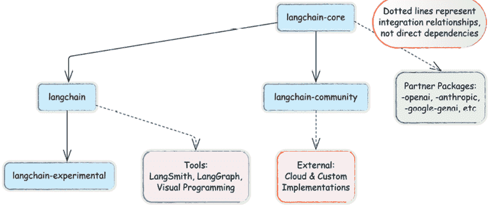
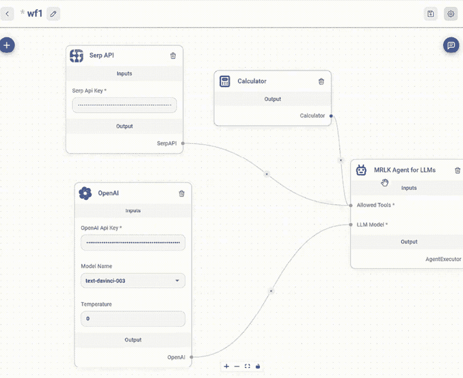
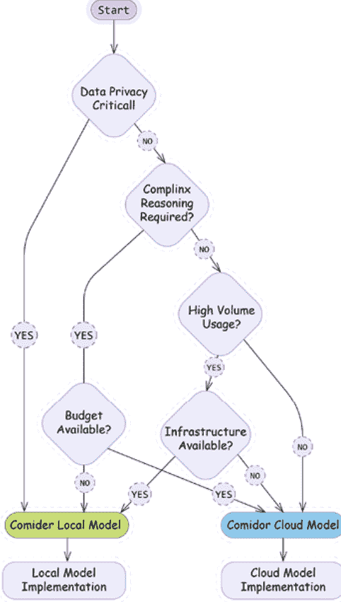
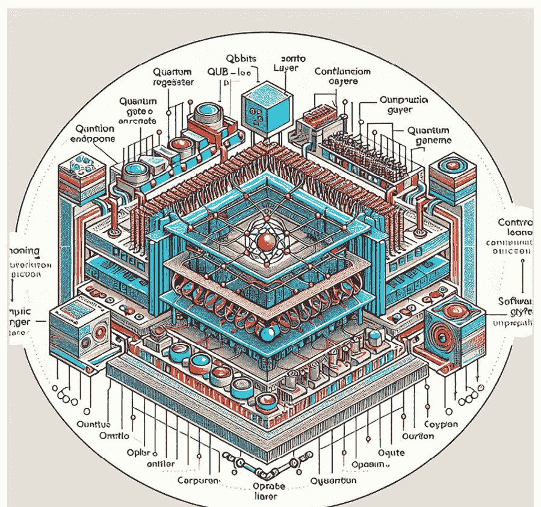
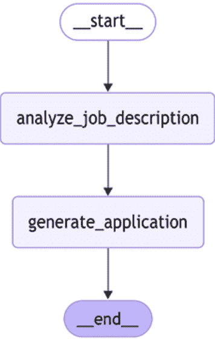
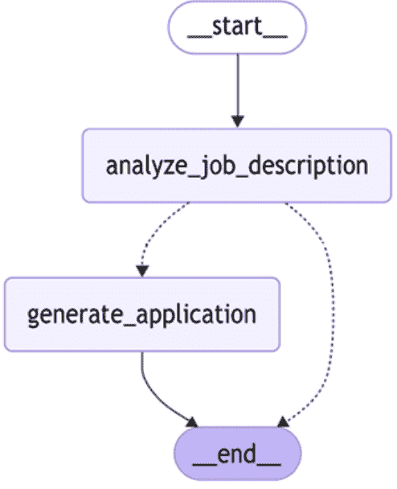
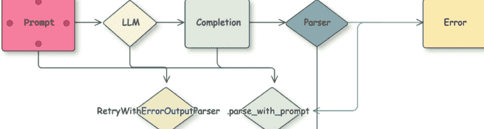

# 前言

随着**大语言模型 (LLMs)** 现在驱动着从客服聊天机器人到复杂的代码生成等一切领域，生成式 AI 已迅速从实验室的奇闻变为生产生产力。然而，在实验性原型和生产就绪的 AI 应用之间存在着巨大的差距。根据行业研究，虽然人们对生成式 AI 的热情很高，但超过 30% 的项目由于可靠性问题、评估复杂性和集成挑战无法超越概念验证。LangChain 框架已成为跨这一鸿沟的关键桥梁，为开发者提供了构建稳健、可扩展且实用的 LLM 应用的工具。

本书旨在帮助你缩小差距。这是一份构建在生产环境中真正有效的 LLM 应用的实用指南。我们专注于导致大多数生成式 AI 项目失败的现实世界问题：输出不稳定、调试困难、脆弱的工具集成以及扩展瓶颈。通过使用 LangChain、LangGraph 以及不断发展的生成式生态系统中其他工具的实践示例和经过测试的模式，你将学会构建让你的组织可以充满信心地部署和维护，以解决实际问题。

# 这本书适合哪些读者

这本书主要为具有基础 Python 知识、并希望使用大语言模型（LLMs）构建生产环境级应用程序的软件开发者编写。你不需要深厚的机器学习专业知识，但对 AI 概念的某些熟悉将帮助你更快地学习书中内容。读完本书，你将能够自信地实现高级的 LLM 架构，而这些架构通常需要专门的 AI 知识。

如果你是一名正转向 LLM 应用开发的数据科学家，你会发现这些实用的实现模式特别有价值，因为它们弥补了实验性笔记本与可部署系统之间的差距。书中关于 RAG 实现、评估框架和可观测性实践的结构化方法，解决了你可能在尝试将极具前景的原型扩展为可靠服务时可能遇到的常见挫败感。

对于在组织内部评估 LLM 技术的决策决策者来说，本书为成功的 LLM 项目实施提供了战略见解。你将理解区分实验性系统与生产级系统的架构模式，学习如何识别高价值用例，并发现如何避免导致大多数项目失败的集成和扩展问题。本书为评估实现方法和做出明智的技术决策提供了清晰的标准。

# 如何充分利用本书

在开始之前，确保你准备好一些工作以获得最佳学习体验。本书专为实践和实用设计，因此准备好环境、工具和心态将帮助你顺畅阅读并从每一章中获得价值。以下是我们的建议：

- 环境要求：在任何主流操作系统（Windows、macOS 或 Linux）上安装了 Python 3.10+ 的开发环境。所有代码示例均跨平台兼容并经过充分测试。

- API 访问（可选但推荐）：虽然我们演示了可以在本地运行的开源模型，但拥有 OpenAI、Anthropic 或其他 LLM 提供商的商业 API 将允许使用更强大的模型。许多示例包含了本地和基于 API 的方法，你可以根据预算和性能需求进行选择。

- 学习方法：我们建议自己输入代码而不是复制粘贴。这种动手实践可以加强学习实验。每一章都建立在之前介绍的概念之上，因此按照顺序学习这些内容将为你打下坚实的基础。

- **背景知识：** 需要具备基础 Python 熟练度，不需要机器学习或大语言模型（LLMs）的经验。我们会在关键概念出现时对其进行解释。如果你已经熟悉 LLMs，则可以关注于书中与其他资源区别的实现模式和生产就绪性方面。

| 本书涵盖的软件/硬件 |
| :--- |
| Python 3.10+ |
| LangChain 0.3.1+ |
| LangGraph 0.2.10+ |
| 各种 LLM 供应商（Anthropic, Google, OpenAI, 本地模型） |

你将在第 1 章节中找到关于环境搭建的详细指南，以及清晰的解释和逐步说明，帮助你快速上手。我们强烈建议按照概述执行这些设置步骤——考虑到 LangChain、LangGraph 以及整个生态系统快速演进的特性，跳过这些步骤可能会在后期导致可以避免的问题。

## 下载示例代码文件

本书的代码包托管在 GitHub 上，地址为 https://github.com/benman1/generative_ai_with_lang_chain。我们建议你在学习章节的过程中亲自输入代码或使用该仓库。如果代码有更新，GitHub 仓库将会同步更新。

我们从丰富的书籍和视频目录中还提供了其他代码包，可以在 https://github.com/PacktPublishing 获取。快去看看吧！

## 下载彩色图像

我们还提供了一个 PDF 文件，其中包含书中使用的截图/图表的彩色图像。你可以在此处下载：https://packt.link/gbp/9781837022014。

## 使用的约定

书中处使用了多种文本约定。`CodeText`：表示文本中的代码词汇、数据库表名、文件夹名、文件名、文件扩展名、路径名、虚拟 URL、用户输入和 Twitter 账号。例如：“让我们允许 `thread-a` 从初始检查点恢复。我们将看到从一个空历史开始：”

代码块的设置如下：

```python
checkpoint_id = checkpoints[-1].config["configurable"]
["checkpoint_id"]

_ = graph.invoke()
[HumanMessage(content="test")],

config={"configurable": {"thread_id": "thread-a",
"checkpoint_id": checkpoint_id}}
```

任何命令行输入或输出的写法如下：

```
pip install langchain langchain-openai
```

**粗体：**表示新术语、重要词汇或你在屏幕上看到的单词。例如，菜单或对话框中的单词会以这种形式出现在文中。例如：“Google Research 团队在 2022 年初引入了**思维链（CoT）**技术。

> 警告或重要提示显示如下所示。

> 提示和技巧显示如下所示。

## 与我们联系

订阅 AI_Distilled，这是 AI 专业人士、研究人员和创新者的首选通讯通讯，地址为 https://packkt.link/05UyU。

我们随时欢迎读者的反馈。

如果你发现任何错误或有建议，请尽量通过 GitHub issues、discord 聊天或 Packt 网站上的错误提交表进行报告。

关于 GitHub 上的问题，请参阅 https://github.com/benman1/generative_ai_with_lang-chain/issues。

如果你对书籍内容或定制项目有疑问，请随时通过 ben@chelseaai.co.uk 与我们联系。

**通用反馈：** 请发送邮件至 feedback@packpub.com 并在邮件主题中注明书名。如果你对本书的任何方面有疑问，请发送邮件至 questions@packpub.com 联系我们。

**勘误：** 尽管我们尽力确保内容的准确性，但错误仍然会发生。如果你在书中发现了错误，我们将不胜感激你向我们报告。请访问 http://www.packtpub.com/submit-errata，点击 **Submit Errata** 并填写表单。

**盗版：** 如果你在互联网上发现任何形式的我们作品的非法复制版，我们将不胜感激你提供所在地地址或网站名称。请带上材料链接通过 copyright@packtub.com 与我们联系。

**如果你兴趣成为作者：** 如果你有一个擅长的领域，并且对写作或为书籍做贡献，请访问 http://authors.packtub.com/。

## 分享你的想法

读完《Generative AI with LangChain, Second Edition》后，我们非常想听听你的想法！请点击此处直接进入本书的 Amazon 评论页面并分享你的反馈。

你的评论对我们和技术社区都非常重要，并将帮助我们确保交付高质量的内容。

## 下载本书的免费 PDF 副本

感谢购买本书！

你喜欢在旅途中阅读，但无法随身携带纸质书吗？

你的电子书购买与你选择的设备不兼容吗？

别担心，现在购买每本 Packt 书籍你都可以免费获得该书的无 DRM PDF 版本。

在任何地方、任何时间、任何设备上阅读。搜索、复制并交互。


我们随时欢迎读者的反馈。

如果你发现任何错误或有建议，请尽量通过 GitHub issues、discord 聊天或 Packt 网站上的错误提交表进行报告。

关于 GitHub 上的问题，请参阅 https://github.com/benman1/generative_ai_with_lang-chain/issues。

如果你对书籍内容或定制项目有疑问，请随时通过 ben@chelseaai.co.uk 与我们联系。

**通用反馈：** 请发送邮件至 feedback@packpub.com 并在邮件主题中注明书名。如果你对本书的任何方面有疑问，请发送邮件至 questions@packpub.com 联系我们。

**勘误：** 尽管我们尽力确保内容的准确性，但错误仍然会发生。如果你在书中发现了错误，我们将不胜感激你向我们报告。请访问 http://www.packtpub.com/submit-errata，点击 **Submit Errata** 并填写表单。

**盗版：** 如果你在互联网上发现任何形式的我们作品的非法复制版，我们将不胜感激你提供所在地地址或网站名称。请带上材料链接通过 copyright@packtub.com 与我们联系。

**如果你兴趣成为作者：** 如果你有一个擅长的领域，并且对写作或为书籍做贡献，请访问 http://authors.packtub.com/。

## 分享你的想法

读完《Generative AI with LangChain, Second Edition》后，我们非常想听听你的想法！请点击此处直接进入本书的 Amazon 评论页面并分享你的反馈。

你的评论对我们和技术社区都非常重要，将帮助我们确保交付高质量的内容。

## 下载本书的免费 PDF 副本

感谢购买本书！

你喜欢在旅途中阅读，但无法随身携带纸质书吗？

你的电子书购买与你选择的设备不兼容吗？

别担心，现在购买每本 Packt 书籍你都可以免费获得该书的无 DRM PDF 版本。

在任何地方、任何时间、任何设备上阅读。搜索、复制并交互。


我们随时欢迎读者的反馈。

如果你发现任何错误或有建议，请尽量通过 GitHub issues、discord 聊天或 Packt 网站上的错误提交表进行报告。

关于 GitHub 上的问题，请参阅 https://github.com/benman1/generative_ai_with_lang-chain/issues。

如果你对书籍内容或定制项目有疑问，请随时通过 ben@chelseaai.co.uk 与我们联系。

**通用反馈：** 请发送邮件至 feedback@packpub.com 并在邮件主题中注明书名。如果你对本书的任何方面有疑问，请发送邮件至 questions@packpub.com 联系我们。

**勘误：** 尽管我们尽力确保内容的准确性，但错误仍然会发生。如果你在书中发现了错误，我们将不胜感激你向我们报告。请访问 http://www.packtpub.com/submit-errata，点击 **Submit Errata** 并填写表单。

**盗版：** 如果你在互联网上发现任何形式的我们作品的非法复制版，我们将不胜感激你提供所在地地址或网站名称。请带上材料链接通过 copyright@packtub.com 与我们联系。

**如果你兴趣成为作者：** 如果你有一个擅长的领域，并且对写作或为书籍做贡献，请访问 http://authors.packtub.com/。

生成式 AI 的兴起：从模型到代理

实验性与生产就绪代理之间的差距是巨大的。我们将探索 LLMs 如何演进为基础

在本章中，我们将探索 LLMs 如何演进为代理 AI 的基础以及 LangChain 等框架如何将这些模型转化为功能完备的代理。

简而言之，本书将涵盖以下主题：

- 现代 LLM 景观

- 从模型到代理应用

- 介绍 LangChain

## 现代 LLM 景观

人工智能（AI）长期一直是人们着迷的研究课题，但近期生成式 AI 的进展推动了其主流化。与对数据进行分类或预测的 AI 系统不同，生成式 AI 可以利用海量训练数据创建新内容——图像、代码等。

生成式 AI 革命由 2017 年 Transformer 架构的引入催化，这使得模型能够以以前未有的深度处理上下文和关系。当研究人员将这些模型从数百万参数扩展到数十亿时，他们发现了一个惊人的现象：更大的模型不仅性能有逐步提升，还展现出了全新的涌现能力，如少样本学习、复杂推理和创造性生成，而这些并不是显式编程的。最终，2022 年 ChatGPT 的发布标记了一个转折点，向公众展示了这些能力并引发了广泛采用。

随着由 Llama 和 Mistral 等模型引领的开源革命，格局再次发生，让大型科技公司之外的人也能获得强大的 AI。然而，这些先进能力也伴随着巨大的局限性——模型无法可靠地使用工具、推理复杂问题，或在交互中保持上下文。原始模型能力与实用性之间的这种差距，产生了对像 LangChain 这样的专门框架的需求，将这些模型转化为功能完备的生产就绪代理。

# 关键术语

**工具：** AI 模型可以用来与世界交互的外部实用或函数。工具允许代理执行诸如搜索网页、计算数值或访问数据库以克服大语言模型（LLMs）固有的局限性。

**内存（Memory）：**允许 AI 应用在交互之间存储和检索信息的系统。内存通过跟踪之前的输入、输出和重要信息，使对话和复杂工作流具备上下文感知能力。


## 基于人类反馈的强化学习（RLHF）与智能体（Agents）

**基于人类反馈的强化学习（RLHF）：** 一种训练技术，AI 模型从人类直接反馈中学习，优化其性能以符合人类偏好。RLHF 有助于创建更有帮助、安全且符合人类价值观的模型。

**智能体（Agents）：** 能够感知环境、做出决策并采取行动以实现目标的 AI 系统。在 LangChain 中，智能体使用 LLM 来解释任务、选择合适的工具并在最少人工干预的情况下执行多步骤流程。

## 语言模型主要进展时间线

| 年份 | 进展 | 关键特征 |
|---|---|---|
| 1990年代 | IBM 对齐 | 统计机器翻译 |
| 2000年代 | 网页级数据集 | 大规模统计模型 |
| 2009 | 统计模型占据主导 | 大规模文本摄取 |
| 2012 | 深度学习获得关注 | 神经网络优于统计模型 |
| 2016 | 神经机器翻译 (NMT) | Seq2seq 深度 LSTM 替换了统计方法 |
| 2017 | Transformer 架构 | 自注意力机制彻底改变了 NLP |
| 2018 | BERT 和 GPT-1 | 基于 Transformer 的语言理解与生成 |
| 2019 | GPT-2 | 大规模文本生成，公众认知度增加 |
| 2020 | GPT-3 | 基于 API 的访问，顶尖的性能 |
| 2022 | ChatGPT | LLM 的主流采用 |
| 2023 | 大多模态模型 (LMMs) | AI 模型处理文本、图像和音频 |
| 2024 | OpenAI o1 | 更强的推理能力 |
| 2025 | DeepSeek R1 | 开源权重、大规模 AI 模型 |

表 1.1：语言模型主要进展时间线

LLM 领域正在迅速演变，多个模型在性能、能力和可访问性方面进行竞争。每个提供商都带来了独特的优势，从 OpenAI 的先进通用型 AI 到 Mistral 的开源权重高效率模型。了解这些模型之间的差异有助于从业者在将 LLM 集成到应用程序时做出明智的决策。

### 模型比较

以下点概述了比较不同 LLM 时需要考虑的关键因素，重点关注它们的可访问性、能力和专业化：

- **开源与闭源模型：** 像 Mistral 和 LLaMA 这样的开源模型提供了透明度和本地运行的能力，而像 GPT-4 和 Claude 这样的闭源模型可以通过 API 访问。开源 LLM 可以被下载和修改，允许开发者和研究人员对其架构进行研究并在此构建，尽管可能适用特定的使用条款。
- **尺寸与能力：** 较大的模型通常提供更好的性能，但需要更多的计算资源。这使得较小的模型非常适合在计算能力或内存有限的设备上使用，且可能便宜得多。**小型语言模型 (SLMs)** 的参数量相对较少，通常使用数百万到几十亿参数，相比之下，LLM 可能拥有数百亿甚至万亿个参数。
- **专业化模型：** 某些 LLM 针对特定任务进行了优化，例如代码生成（如 Codex）或数学推理（如 Minerva）。

### 模型缩放法则

语言模型规模的增加是其性能惊人提升的主要驱动力。然而，近期架构和训练方法发生了转变，这在性能方面带来了更好的参数效率。

| 模型缩放法则 |
|---|
| 经验得出的缩放法则根据给定的训练预算、数据集大小和参数数量来预测 LLM 的性能。如果属实，这意味着强大的系统将集中在科技巨头手中，然而，我们在最近几个月里看到了显著的转变。 |

由 Kaplan 等人提出的 KM 缩放法则，通过对不同数据大小、模型大小和训练计算的模型性能进行经验分析和拟合得出，它呈现出幂律关系，表明模型性能与模型大小、数据集大小和训练计算等因素之间存在强相互依赖关系。

由 Google DeepMind 团队提出的 Chinchilla 缩放法则涉及更广泛的模型尺寸和数据尺寸实验。它建议将计算预算优化分配给模型大小和数据大小，这可以通过约束条件下优化特定的损失函数来确定。

然而，未来的进展可能更多取决于模型架构、数据清洗和模型算法创新，而非仅仅是规模。例如，如 Textbooks Are All You Need (2023, Gunasekar et al.) 等拥有约 10 亿参数的模型表明，规模较小的模型也可以在评估基准上获得高准确率。作者建议提高数据质量可以极大改变缩放法则的形状。

此外，还有大量关于简化架构的研究，这些架构参数少得多，且准确率仅略微下降（例如 One Wide Feedforward is All You Need, Pessoa Pires et al., 2023）。此外，微调、量化、蒸馏和提示技术等可以让较小模型在不复制成本的情况下利用大型基础模型的能力。为了补偿模型的局限性，搜索引擎和计算器等工具已被纳入智能体，多步骤推理策略、插件和扩展可能会越来越多地用于扩展能力。

未来可能会看到大规模通用模型与更小、更易访问的模型共存，后者提供更快的速度、维护和推理。现在我们来讨论各种 LLM 的对比概述，突出它们的关键特征和区别因素。我们将深入探讨开源与闭源模型、模型尺寸与能力以及专业模型等方面。通过理解这些区别，你可以为特定需求选择最合适的 LLM。

## LLM 提供商格局

你可以通过网站或 API 访问 OpenAI、Google 和 Anthropic 等主要提供商的 LLM，以及越来越多的其他提供商。随着对 LLM 需求的增长，许多提供商进入该领域，每个提供商提供的能力独特。开发者需要了解不同的访问选项，以便将这些强大的模型集成到应用程序中。提供商的选择将显著影响开发体验、性能特性和运行成本。

下表领先 LLM 提供商的对比概述及其提供的模型示例：

| 提供商 | Note性模型 | 关键特征和优势 |
|---|---|---|
| OpenAI | GPT-4o, GPT-4.5; o1; o3-mini | 强大的通用性能、专利模型、跨文本、音频、视觉和视频的多模态推理 |
| Anthropic | Claude 3.7 Sonnet; Claude 3.5 Haiku | 在实时响应和扩展“思考”阶段之间切换；在代码基准中优于 OpenAI 的 o1 |
| Google | Gemini 2.5, 2.0 (flash and pro), Gemini 1.5 | 低延迟低成本、大上下文窗口（达 2M 标记）、多模态输入输出、推理能力 |
| Cohere | Command R, Command R Plus | 检索增强生成 (RAG)、企业级 AI 解决方案 |
| Mistral AI | Mistral Large; Mistral 7B | 开源权重、高效推理、多语言支持 |
| AWS | Titan | 企业级 AI 模型，针对 AWS 云端优化 |
| DeepSeek | R1 | 数学优先：解决奥林匹克级问题；高效益，针对多语言和编程任务优化 |
| Together AI | 运行开源模型的设施 | 竞争性的定价；不断增长的模型市场 |

表 1.2：用于 LangChain 实现的主要 LLM 供应商及其旗舰模型对比概述

其他机构也开发 LLM，但并不一定通过应用程序编程接口（API）向开发者提供。例如，Meta AI 开发了极具影响力的 Llama 模型系列，该系列具有强大的推理和代码生成能力，并以开源许可发布。

你可以通过 Hugging Face 或其他提供者访问琳琅多样的开源模型。你甚至可以下载这些开源模型、对它们进行微调或完全训练。我们将从第 2 章开始对这些内容进行实践尝试。

一旦你选择了合适的模型，下一步的关键步骤是理解如何控制其行为以适应你特定的应用程序需求。虽然访问模型赋予了你计算能力，但正是生成参数的选择，将原始模型能力转化为应用程序中不同用例的定制化输出。

现在我们已经涵盖了 LLM 供应商的格局，让我们讨论 LLM 实现的另一个关键方面：不同模型的许可条款将显著影响你如何在应用程序中使用它们。

AI 的演进使我们处于一个关键时刻，AI 系统不仅可以处理信息，还可以采取自主行动。下一节将探索从基础语言模型到更复杂、最后到完全代理化（agentic）应用程序的转变。

> 提供的关于 AI 模型许可的信息仅供教育之用，不构成法律建议。许可条款差异巨大且演变迅速。组织应就其 AI 实现的特定许可决策咨询资深法律顾问。

## 从模型到代理化应用

如前所述，LLM 在自然语言处理方面表现出了惊人的流利性。然而，尽管它们令人印象深刻，但从根本上说它们仍然是响应性的而非主动的。它们缺乏采取独立行动、与外部系统进行有意义交互或自主实现复杂目标的能力。

为了释放 AI 能力的下一阶段，我们需要超越被动的文本生成，转向代理化 AI——即能够规划、推理并采取行动以最少的人工干预完成任务的系统。在探索代理化 AI 的潜力之前，首先理解导致这种演变的 LLM 核心局限性是很。

### 传统 LLM 的局限性

尽管具有先进的语言能力，LLM 固的约束限制了它们在现实应用中的有效性：

1. **缺乏真正的理解：** LLM 通过根据训练数据中的统计模式预测下一个可能的词来生成类人类的文本。然而，它们并不像人类那样理解含义。这导致了幻觉——自信地将虚假信息陈述为事实——以及生成看似但错误、误导或无意义的输出。正如 Bender 等人 (2021) 所描述的，LLM 的功能就像“随机鹦鹉”——在没有真正理解的情况下重复模式。

2. **在复杂推理和问题解决方面面临困难：** 虽然 LLM 擅长检索和重新格式化知识，但它们在多步推理、逻辑谜题和数学问题解决方面非常吃力。它们往往无法将问题分解为子任务，或在不同上下文中合成信息。如果没有像思维链推理（chain-of-thought）这样的显式提示技术，它们的推断或推理能力仍然不可靠。

3. **知识过时和外部访问限制：** LLM 在静态数据集上进行训练，无法访问当前事件、动态数据库或实时信息源。这使得它们不适用于需要最新知识的任务，例如财务分析、突发新闻摘要或需要最新发现的科学研究。

4. **缺乏原生工具使用或行动能力：** LLM 在孤立状态运行——它们无法与 API 交互、检索实时数据、执行代码或修改外部系统。这种工具集成的缺乏使得它们在需要现实行动的场景（如进行网络搜索、自动化工作流或控制软件系统）中效果下降。

5. **偏见、伦理担忧和可靠性问题：** 由于 LLM 从可能包含偏见的大型数据集中学习，它们可能会无意中强化意识形态、社会或文化偏见。重要的是，即使是开源模型，对于大多数从业者来说，访问和审核完整的训练数据以识别并减轻这些偏见仍然具有挑战性。此外，它们可以在不理解输出伦理影响的情况下生成误导性或有害的信息。

6. **计算成本和效率挑战：** 大规模部署和运行 LLM 需要大量的计算资源，使得它们成本高昂且耗能。较大的模型还会引入延迟，减慢实时应用程序中的响应速度。

为了克服这些局限性，AI 系统必须从被动的文本生成器演变为能够规划、推理并与环境交互的活跃代理。这就是代理化 AI 的用武之地。虽然像 LangChain 这样的框架为 LLM 的局限提供了全面的解决方案，但理解基础提示工程技术仍然很有价值。少样本学习（few-shot learning）、思维链和结构化提示等方法可以显著提高模型针对特定任务的性能。第 3 章将介绍这些技术，展示 LangChain 如何帮助标准化和优化提示模式，同时最大限度地减少每个应用程序对自定义提示工程的需求。

集成。示例包括：

- 执行定义工作流的任务自动化智能体
- 信息收集与分析系统
- 用于复杂任务协调的多智能体系统

LangChain 为集成应用和自主智能体都提供了框架，提供了支持各种架构选择的灵活组件。本书将探索这两种方法，演示如何构建符合你特定要求的、可靠的生产就绪系统。

智能体自主系统具有巨大的潜力，因此值得对其进行进一步探索。

## 理解 AI 智能体

有时人们开玩笑说，AI 只是机器学习（ML）的一个花丽说法，或者说 AI 是穿西装的 ML，正如图片所示；然而，正如我们将看到的，它的意义远于此。


图 1.1：穿西装的 ML。由 replicate.com 上的模型 Diffusers Stable Diffusion v2.1 生成。

AI 智能体代表了原始认知能力与实际行动之间的桥梁。虽然 LLM 拥有海量的知识和处理能力，但在没有代理性（agency）的情况下，它们从根本上仍然是被动的响应。AI 智能体通过结构化工作流来解析需求、分析选项并执行操作，将这种被动能力转化为主动实用。

智能体 AI（Agentic AI）使自主系统能够在最少人工干预的情况下做出决策并独立行动。与遵循固定规则的确定性系统不同，智能体 AI 依赖模式和概率来做出明智选择。它通过一个称为智能体的自主软件组件网络运行，这些组件从用户行为和大数据中学习并随着时间的推移不断改进。

AI 中的代理性是指系统独立行动以实现目标的能力。真正的代理性意味着 AI 系统可以感知环境、做出决策、采取行动，并通过从交互和反馈中学习随时间进行适应。原始 AI 与智能体之间的区别类似于知识与专业知识之间的区别。考虑一位理解复杂理论但在实际应用方面挣扎的卓越科学家。智能体增加了目的行动这一关键要素，将抽象能力转化为具体结果。

在 LLM 的背景下，智能体 AI 涉及开发能够自主行动、理解上下文、适应新信息并与人类协作解决复杂挑战的系统。这些 AI 智能体利用 LLM 处理信息、生成响应并根据定义的目标执行任务。特别是，AI 智能体通过集成内存、工具使用和决策框架扩展了 LLM 的能力。这些智能体可以：

- 跨交互保留并召回信息。
- 利用外部工具、API 和数据库。
- 计划并执行多步工作流。

代理性的价值在于减少对持续人工监督的需求。智能体不需要为每个请求手动提示 LLM，而是可以主动执行任务、对新数据做出反应，并与真实世界的应用集成。

AI 智能体是设计用于代表用户行动的系统，它们利用 LLM 结合外部工具、内存和决策框架。AI 智能体后的希望是它们能够自动化复杂的工作流，在减少人类努力的同时提高效率和准确性。通过允许系统自主行动，智能体承诺开启 AI 驱动应用中更高级别的的自动化。但这些希望是合理的吗？

尽管具有潜力，AI 智能体仍面临着重大的挑战：

- **可靠性**：确保智能体在没有监督的情况下做出正确且感知上下文的决策是困难的。
- **泛化能力**：许多智能体在狭窄领域运行良好，但在开放式、多领域任务中表现不从心。
- **缺乏信任**：用户必须信任智能体会负责任地行动、避免意外操作并尊重隐私限制。
- **协调复杂性**：多智能体系统在协作执行任务时往往会遭遇效率低下和通信不畅。

生产就绪的智能体系统不仅必须解决理论挑战，还要解决实际实施障碍，例如：

- 速率限制和 API 配额
- Token 上文溢出错误
- 幻觉管理
- 成本优化

LangChain 和 LangSmith 为这些挑战提供了稳健的解决方案，我们将在第 8 章和第 9 章深入探讨。这些章节将涵盖如何构建在企业规模运行的可靠、可观测的 AI 系统。

因此，在开发基于智能体的系统时，几个关键因素需要仔细考虑：

- **价值产生**：智能体必须提供清晰的用途，使其在设置、维护和必要的人工监督方面的成本低于其收益。这通常意味着从定义良好的、高价值任务开始，自动化可以明确证明其改进结果。
- **信任与安全**：随着智能体承担更多责任，建立和维护用户信任变得至关重要。这包含了技术可靠性和透明操作，让用户能够理解并预测智能体的行为。
- **标准化**：随着智能体生态系统的增长，标准化的接口和协议对于互操作性至关重要。这类似于促进互联网应用增长的 Web 标准的发展。

虽然早期的 AI 系统关注于模式匹配和预定义模板，但现代 AI 智能体展示了推理、问题解决和长期规划等涌现能力。今天的 AI 智能体将 LLM 与交互环境相结合，使其能够在复杂领域中自主运行。

基于智能体的 AI 开发是从统计模型到深度学习，再到基于推理的系统的自然演进。现代 AI 智能体利用多模态能力、强化学习和内存增强架构来适应各种任务。这种演变标志着从预测模型向能够动态决策的真正自主系统的转变。

展望未来，AI 智能体将继续完善它们在结构化和非结构化环境中推理、计划和行动的能力。开源权重模型的兴起结合基于智能体的 AI 的进步，可能会驱动 AI 的下波创新，扩展其在科学、工程和日常生活中的应用。

通过 LangChain 等框架，开发者可以构建复杂的结构化代理系统，克服原始 LLM 的局限性。它为内存管理、工具集成和多步推理提供了内置解决方案，这些与此处介绍的生态模型保持一致。在下一节中，我们将探索 LangChain 如何促进生产就绪的 AI 智能体的开发。

## 介绍 LangChain

1. **上下文窗口限制：** LLM 将文本处理为 token（子词标记单位），而不是完整的单词。例如，“LangChain”可能会被处理为两个 token：“Lang”和“Chain”。每个 LLM 都有一个固定的上下文窗口——即它一次能处理的最大 token 数量——通常在 2,000 到 128,000 个 token 之间。这带来了几个实际挑战：
   - **文档处理：** 长文档必须进行有效的切块处理，以适应上下文限制。
   - **对话历史：** 在扩展对话中维护信息需要精细的内存管理。
   - **成本管理：** 大多数提供商根据 token 数量计费，因此高效地使用 token 成为业务上的必要要求。

这些限制直接影响应用架构，使得诸如 RAG（我们将在第 4 章中探讨）等技术对于生产系统至关重要。

2. **工具编排限制：** 虽然许多现代 LLM 提供了原生的工具调用能力，但它们缺乏发现适当工具、执行复杂工作流以及在多轮对话中管理工具交互的基础设施。没有这个编排层，开发者必须为每个集成构建构建自定义解决方案。

3. **任务协调挑战：** 使用 LLM 管理多步工作流需要结构化的控制机制。没有这些机制，涉及顺序推理或决策的复杂过程将难以可靠地实现。

在此语境下，“工具”指的是扩展 LLM 能力范围的功能性组件：用于搜索互联网的网页浏览器、用于精确计算的计算器、用于执行程序的代码环境，以及用于访问外部服务和数据库的 API。没有这些工具，LLM 仍然局限于在其训练范围内运行，无法执行现实世界的操作或访问最新信息。

这些根本性的限制为使用原始 LLM API 的开发者带来了三个关键挑战，如下表所示。

| 挑战 | 描述 | 影响 |
| --- | --- | --- |
| 可靠性 | 检测幻觉并验证输出 | 结果不一致，可能需要人工验证 |


| 资源管理 | 处理上下文窗口和速率限制 | 实现的复杂性和潜在的成本超支 |
| 集成复杂性 | 构建与外部工具和数据源的连接 | 延长开发时间和增加维护负担 |

表 1.3：开发者的三个关键挑战

LangChain 通过提供带有经过测试解决方案的结构化框架来解决这些挑战，简化了 AI 应用开发并使更复杂的用例成为可能。

## LangChain 如何赋能 Agent 开发

LangChain 通过其模块化架构和可组合模式为构建复杂的 AI 应用提供了基础基础设施。随着演进到 0.3 版本，LangChain 完善了其创建智能系统的方法：

- **可组合工作流：** LangChain 语言（LCEL）允许开发者将复杂任务分解为模块化组件，这些组件可以被组装和重新配置。这种组合性允许通过多个处理步骤的编排来实现系统性的推理。
- **集成生态系统：** LangChain 为所有生成式 AI 组件（LLM、嵌入、向量数据库、文档加载器、搜索引擎）提供了经过测试的抽象接口。这让你能够构建可以在提供商之间轻松切换的应用，而无需重写核心逻辑。
- **统一模型访问：** 该框架为各种语言和嵌入模型提供了一致的接口，允许在保持应用逻辑的同时在提供商之间无缝切换。

虽然早期版本的 LangChain 直接处理内存管理，但 0.3 版本对应用开发采取了更专业的方法：

- **内存和状态管理：** 对于需要在交互中需要持久上下文的应用，`LangGraph` 现在是推荐的解决方案。`LangGraph` 使用专门构建的持久化机制维护对话历史和应用状态。
- **Agent 架构：** 虽然 `LangChain` 包含了 Agent 的实现，但 `LangGraph` 已成为构建复杂 Agent 的首选框架。它提供了：
  - 用于复杂决策路径基于图的工作流定义
  - 跨多次交互的持久状态管理
  - 处理过程中实时反馈的流式支持
  - 用于验证和修正的人机参与（Human-in-the-loop）能力

LangChain 及其 `LangGraph`、`LangSmith` 等配套项目共同了一个全面的生态系统，将 LLM 从简单的文本生成器转变为能够处理复杂现实世界任务的系统，将强大的抽象与针对生产使用优化的实际实现模式相结合。

## 探索 LangChain 架构

LangChain 的哲学在于可组合性和模块化。LangChain 不再将 LLM 视为独立的服务，而是将其视为可以与其他工具和其他服务结合的组件，以创建更强大的系统。这种方法建立在几个原则之上：

- **模块化架构：** 每个组件都设计为可重用和可交换的，允许开发者将 LLM 无缝集成到各种应用程序中。这种模块化不仅限于 LLM，还包含了开发生成式 AI 应用的许多构建块。
- **对 Agent 工作流的支持：** LangChain 提供了顶级的 API，允许你快速开发复杂的 Agent。这些 Agent 能够以最小的开发开销做出决策、使用工具并解决问题。
- **生产就绪：** 该框架提供了用于生成式 AI 应用追踪、评估和部署的内置功能，包括用于管理跨交互内存和持久化的稳健构建块。
- **广泛的供应商生态系统：** LangChain 为所有生成式 AI 组件（LLM、嵌入、向量数据库、文档加载器、搜索引擎等）提供了经过测试的抽象接口。供应商开发出符合这些接口的自定义集成方案，允许你可以在任何第三方提供商之上构建应用，并在它们之间轻松切换。

值得注意的是，自本书第一版编写时（LangChain 0.1 版本）以来，已经发生了重大变化。早期版本尝试处理所有问题，而 LangChain 0.3 版本专注于对特定函数的优化，并由配套项目处理特殊需求。`LangChain` 管理模型集成和工作流，而 `LangGraph` 处理有状态的 Agent，`LangSmith` 提供可观测性。

LangChain 的内存管理也经历了重大变化。基础 LangChain 库中的内存机制已弃用，转而使用 `LangGraph` 进行持久化；虽然存在 Agent，但 `LangGraph` 是 0.3 版本中推荐的方法。然而，模型和工具仍然是 LangChain 功能的基础。在第 3 章中，我们将探讨 LangChain 和 LangGraph 的内存机制。

为了将模型设计原则转化为实际工具，LangChain 开发了一个包含库、服务和应用的全面生态系统。该生态系统为开发者提供了构建、部署和维护复杂 AI 应用所需的一切。让我们检查组成这个活跃生态系统的组件，以及它们如何在行业内获得采用。

## 生态系统

LangChain 取得了令人惊讶的生态系统指标，显示出强劲的市场认可度，每月下载量超过 2000 万，并驱动了超过 10 万个应用程序。其开源社区非常活跃，证据是 GitHub 上超过 10 万的 Star 数，以及来自 4000 多名开发者的贡献。这种规模的采用使 LangChain 成为 AI 应用开发领域的领先框架，特别是对于构建以推理为主的 LLM 应用。

- LangChain (Python): 用于构建 LLM 应用的可用组件
- LangChain.js: 该框架的 JavaScript/TypeScript 实现
- LangGraph (Python): 用于通过编排图构建 LLM 代理的工具
- LangGraph.js: 用于代理工作流的 JavaScript 实现

## 平台服务

- LangSmith: 用于调试、测试、评估和监控 LLM 应用的平台
- LangGraph: 用于部署和扩展 `LangGraph` 代理的基础设施

## 应用程序与扩展

- ChatLangChain: 用于回答框架相关问题的文档助手
- Open Canvas: 用于编写代码/markdown 的文档和聊天式用户界面 (TypeScript)
- OpenGPTs: OpenAI GPTs API 的开源实现
- Email assistant: 用于邮件管理的 AI 工具 (Python)
- Social media agent: 用于内容策划和调度的智能代理 (TypeScript)

该生态系统为构建以推理为核心的 AI 应用提供了完整的解决方案：从核心构建块到部署平台，再到参考实现。这种架构允许开发者独立使用组件，或将它们堆叠以获得更完整、更全面的解决方案。

根据客户证言和公司合作伙伴，LangChain 已被 Rakuten、Elastic、Ally 和 Adyen 等企业采用。这些机构报告说使用 LangChain 和 LangSmith 来确定实现 LLM 的最佳方案、提高开发者生产力并加速开发工作流。

LangChain 还为 AI 应用开发提供了全栈支持：

- **构建：** 使用可组合的框架
- **运行：** 使用 LangGraph Platform 进行部署
- **管理：** 使用 LangSmith 进行调试、测试和监控

基于我们使用 LangChain 构建的经验，以下是我们发现的一些对我们特别有帮助的优势：

- **加速开发周期：** LangChain 通过现成的构建块和统一 API 大大地缩短了上市时间，消除了数周的集成工作。
- **卓越的可观测性：** LangChain 和 LangSmith 的结合为复杂代理行为提供了无比拟的可见性，使得成本、延迟和质量之间的权衡更加透明。
- **可控的代理平衡：** LangGraph 处理代理 AI 的方法特别强大——允许开发者在赋予 LLM 对工作流的部分控制流的同时，保持可靠性和性能。
- **生产就绪的模式：** 我们的实现经验证明，LangChain 的架构提供了企业级的解决方案，能够有效减少幻觉并提高系统可靠性。
- **面向未来的灵活性：** 该框架与平台无关的设计创建了可以随着 LLM 领域演进而不断调整的应用，防止了技术锁定。

这些优势直接源于 LangChain 的架构决策，这些决策优先考虑真实世界应用的模块化、可观测性和部署灵活性。

## 模块化设计与依赖管理

LangChain 进化非常快，每天大约有10-40个合并请求被接受。这种快速的开发节奏结合框架广泛的集成生态系统，带来了独特的挑战。不同的集成通常需要特定的第三方 Python 包，这可能会导致依赖冲突。

LangChain 的包架构演变是对扩展挑战的直接响应。随着框架迅速扩展到支持数百种集成，原始的单体结构变得难以维持——迫使用户安装不必要的依赖，创建了维护瓶颈，并阻碍了贡献的性。通过划分为具有依赖懒加载功能的专门包，LangChain 在保持内凝聚生态系统的同时优雅地解决了这些问题。这种架构允许开发者只导入他们所需的内容，减少版本冲突，允许稳定功能与实验性功能拥有独立的发布周期，并极大简化了致力于特定集成的社区开发者的贡献路径。

LangChain 代码库遵循组织良好的结构，在分离关注点的同时保持了生态系统的凝聚力。

## 核心结构

- `docs/`: 为开发者提供的文档资源
- `libs/`: 包含单仓库中所有的库包

## 库组织

- `langchain-core/`: 定义框架的基础抽象和接口
- `langchain/`: 包含核心组件的主实现库：
  - `vectorstores/`: 与向量数据库（Pinecone, Chroma 等）的集成
  - `chains/`: 针对常见工作流的预构建链实现
  - 其他用于检索器、嵌入（embeddings）等组件的目录
- `langchain-experimental/`: 仍在开发中的前沿功能
- **langchain-community**: 存放由 LangChain 社区维护的第三方集成。这包括 LLM、向量存储和检索器等组件大部分集成。依赖是可选的，以保持包的轻量级。
- **Partner packages**: 流行的集成被分离到专用包中（例如 `langchain-openai`, `langchain-anthropic`）以增强独立支持。这些包位于 LangChain 仓库之外，但在 GitHub 的“langchain-ai”组织内（参见 [github.com/orgs/langchain-ai]）。完整列表可在 [python.langchain.com/v0.3/docs/integrations/platforms/] 获取。
- **External partner packages**: 某些合作伙伴独立维护他们的集成包。例如，来自 Google 组织的多个包 ([github.com/orgs/googleapis/repositories?q=langchain])，如 `langchain-google-cloud-sql-mssql` 包是在 LangChain 生态之外开发和维护的。



图 1.2：集成生态系统地图

> 有关数十可用模块和包的完整详细信息，请参考全面的 LangChain API 参考：https://api.python.langchain.com/。还有数百个代码示例演示了真实用例：https://python.langchain.com/v0.1/docs/use_cases

## LangGraph, LangSmith 以及辅助工具

LangGraph 的核心功能通过以下辅助项目得到扩展：

- **LangGraph**: 一个用于构建带有 LLM 的状态多角色应用程序的编排框架。虽然它与 LangChain 无缝集成，但也可以独立使用。LangGraph 了具有循环数据流的复杂应用，并支持人类回路（human-in-the-loop）交互。我们将在第 3 章详细讨论 LangGraph。
- **LangSmith**: 一个通过提供强大的调试、测试和监控功能来补充 LangChain 的平台。开发者可以检查、监控和评估他们的应用程序，确保持续优化和可靠部署。

这些扩展结合核心框架，为开发、管理和可视化 LLM 应用提供了全面的生态系统，每个扩展都有增强功能和用户独特特性。LangChain 还拥有大量的集成，我们将在第 5 章详细讨论。

## 第三方应用与可视化工具

许多基于 LangChain 或在其周围构建了第三方应用程序。例如，LangFlow 和 Flowise 为 LLM 开发引入了可视化界面，用户界面允许通过拖放方式将 LangChain 组件组成可执行的工作流。这种可视化方法实现了快速的原型设计和实验，降低了复杂流水线创建的门槛，如下所示的 Flowise 截图：



图 1.3：带有 LLM、计算器和搜索工具代理的 Flowwise 界面（来源：https://github.com/FlowwiseAI/Flowise）

在上述的 UI 中，你可以看到一个连接到搜索接口（Serp API）、LLM 和计算器的代理。LangChain 和类似的工具可以使用 Chainlit 等库在本地部署，也可以部署在包括 Google Cloud 在内的各种云平台上。

总而言之，LangChain 通过其模块化设计、广泛的集成以及支持生态系统简化了 LLM 应用开发。这对于希望构建复杂 AI 系统而无需重复发明基础组件的开发者来说，是一个价值巨大的工具。

## 总结

本章介绍了现代 LLM 的格局，并将 LangChain 定位为构建生产级 AI 应用的强大框架。我们探索了原生 LLM 的局限性，并展示了这些框架如何将模型转换为可靠的、代理系统，能够解决复杂的现实世界问题。我们还研究了 LangChain 生态系统的架构，包括其模块化组件、包结构以及支持完整开发生命周期的辅助项目。通过理解 LLM 与扩展它们的框架之间的关系，你现在已经了构建超越简单文本生成应用的能力。

在下一章中，我们将设置开发环境并迈出 LangChain 的第一步，将本章的性理解转化为可运行的代码。你将学习如何连接到各种 LLM 提供者、创建你的第一个链（chains），并开始实现构成企业级 AI 应用基础的模式。

## 问题

1. 原生 LLM影响生产应用的三个主要局限性是什么？LangChain 是如何解决每一个问题的？
2. 从部署选项、成本考虑和用例方面，对比开源和闭源 LLM。在什么情况下你会选择每种类型？
3. LangChain chain 和 LangGraph agent 之间的区别是什么？在什么情况下你会选择其中一个而不是另一个？
4. 解释 LangChain 的模块化架构如何支持 AI 应用的快速开发。提供一个这种模块化如何惠及企业用例的示例。
5. LangChain 生态系统的关键组件有哪些？它们如何协作以支持从构建到监控的开发生命周期？
6. 代理 AI (agentic AI) 与传统的 LLM 应用有何不同？描述一个代理比简单链提供显著优势的业务场景。
7. 在为生产应用选择 LLM 提供者时，你应该考虑哪些因素？列出除模型性能之外的至少三个考虑因素。
8. LangChain 如何帮助解决幻觉、上下文限制和工具集成等影响所有 LLM 的常见挑战？
9. 解释 LangChain 的包结构（langchain-core, langchain, langchain-community）如何影响应用程序中的依赖管理和集成选项。
10. LangSmith 在生产级 LangChain 应用的开发生命周期中起什么作用？

## LangChain 的第一步

在上一章中，我们探索了 LLM 并介绍了 LangChain 作为一个构建 LLM 驱动应用的强大框架。我们讨论了 LLM 如何通过其理解上下文、生成类人文本和执行复杂推理的能力彻底改变了自然语言处理。虽然这些能力令人印象深刻，但我们也研究了它们的局限性——幻觉、上下文限制以及缺乏最新知识。

在本章中，我们将从理论转向实践，构建我们的第一个 LangChain 应用。我们将从基础知识开始：设置合适的开发环境、学习 LangChain 的核心组件并创建简单的链。从那里开始，我们将探索更高级的功能，包括使用本地模型以实现隐私和成本效益，以及构建结合文本与视觉理解的多模态应用。到在本章结束时，你将在 LangChain 的构建块方面拥有坚实的基础，并准备好在后续章节中创建日益复杂的 AI 应用。

总结，本章将涵盖以下主题：

- 设置依赖项
- 探索 LangChain 的构建块（模型接口、提示词和模板以及 LCEL）
- 运行本地模型
- 多模态 AI 应用

> 考虑到 LangChain 和更广泛 AI 领域的快速演进，我们在 GitHub 存储库中维护最新的代码示例和资源：https://github.com/benman1/generative_ai_with_langchain。

如有问题或故障排除帮助，请在 GitHub 上创建一个 issue 或加入我们的 Discord 社区：https://packt.link/lang。

## 本书的依赖项设置

本书为运行代码示例提供了多种选项，从零设置的云笔记本到本地开发环境。请选择最适合你的经验水平和偏好的方法。即使你熟悉依赖管理，也请阅读这些说明，因为书中的所有代码都依赖于此处概述的正确环境安装。

为了在无需本地设置的情况下最快开始，我们为每一章提供了现成的在线笔记本：

- Google Colab：运行带有免费 GPU 访问的示例
- Kaggle Notebooks：使用集成数据集进行实验
- Gradient Notebooks：访问更高性能的计算选项

你在书中找到的所有代码示例都可以 GitHub 上的在线笔记本获取，地址为 https://github.com/benman1/generative_ai_with_langchain。

这些笔记本没有预配置所有依赖项，但通常只需运行几个安装命令即可启动。这些工具允许你立即开始实验，而无需担心设置。如果你喜欢在本地工作，我们建议使用 conda 进行环境管理：

1. 如果你还没有 Miniconda，请安装它。
2. 从此处下载：https://docs.conda.io/en/latest/miniconda.html。
3. 创建带有 Python 3.11 的新环境：

```bash
conda create -n langchain-book python=3.11
```

4. 激活环境：


## 使用 Conda 环境安装 LangChain

`conda activate langchain-book` 命令用于激活名为 `langchain-book` 的 Conda 环境。

### 安装 Jupyter 和核心依赖

```bash
conda install langchain jupyter
pip install langchain langchain-openai jupyter
```

### 启动 Jupyter Notebook

```bash
jupyter notebook
```

这种方法为使用 LangChain 提供了一个干净、隔离的环境。对于具有既定工作流的有经验开发者，我们还支持：

- 配合 `venv` 的 `pip`：GitHub 存储库中的说明

- Docker 容器：GitHub 存储库提供的 `Dockerfile`

- Poetry：GitHub 存储库中的配置文件

选择你最熟悉的方法，但请记住，所有的示例都假设环境为 Python 3.10+，且包含 `requirements.txt` 中列出的依赖项。

## API key 设置

LangChain 的供应商无关方法支持广泛的 LLM 提供商，每个提供商都有独特的优势和特性。除非你使用本地 LLM，否则为了使用这些服务，你需要获取相应的身份凭据。

| 提供商 | 环境变量 | 设置 URL | 有免费层级？ |
|---|---|---|---|
| OpenAI | `OPENAI_API_KEY` | platform.openai.com | 否 |
| HuggingFace | `HUGGINGFACEHUB_API_TOKEN` | huggingface.co/settings/tokens | 是 |
| Anthropic | `ANTHROPIC_API_KEY` | console.anthropic.com | 否 |
| Google AI | `GOOGLE_API_KEY` | ai.google.dev/gemini-api | 是 |
| Google VertexAI | Application Default Credentials | cloud.google.com/vertex-ai | 是（有限制） |
| Replicate | `REPLICATE_API_TOKEN` | replicate.com | 否 |

表 2.1：API key 参考表（概述）

大多数提供商都需要 API key，而 AWS 和 Google Cloud 等云提供商还支持替代身份验证方法，例如**应用程序默认凭据 (ADC)**。许多提供商提供无需信用卡信息的免费层级，让人轻松上手。

要在环境中设置 API key，在 Python 中，我们可以执行以下代码：

```python
import os
os.environ["OPENAI_API_KEY"] = "<your token>"
```

这里，`OPENAI_API_KEY` 是适用于 OpenAI 的环境变量键。在环境中设置密钥的优势是，在每次使用模型或服务集成时，不需要将其作为参数包含在代码中。

你也可以从终端在系统环境中暴露这些变量。在 Linux 和 macOS 中，你可以使用 `export` 命令从终端设置系统环境变量。

```bash
export OPENAI_API_KEY=<your token>
```

要在 Linux 或 macOS 中永久设置环境变量，你需要将上述行添加到 `~/.bashrc` 或 `~/.bash_profile` 文件中，然后使用命令 `source ~/.bashrc` 或 `source ~/.bash_profile` 重新加载 shell。

对于 Windows 用户，你可以在系统设置中搜索“环境变量”，编辑“用户变量”或“系统变量”，并添加 `export OPENAI_API_KEY=your_key_here` 来设置环境变量。

我们的选择是创建一个存储所有 API keys 的 `config.py` 文件。我们从该模块导入一个函数，将这些密钥加载到环境变量中。这种方法集中了凭据管理，并使需要时更容易更新密钥：

```python
import os

OPENAI_API_KEY = "..."

## 我省略了所有其他密钥

def set_environment():
    variable_dict = globals().items()
    for key, value in variable_dict:
        if "API" in key or "ID" in key:
            os.environ[key] = value
```

如果你在 GitHub 中搜索这个文件，你会发现它是缺失的。这是故意为之——我使用 `.gitignore` 文件将其排除了 Git 跟踪。`.gitignore` 文件告诉 Git 在提交更改时忽略哪些文件，这对于以下情况至关重要：

- 防止敏感凭据公开暴露
- 避免意外提交个人 API keys
- 保护自己免受未经授权的费用

要自己实现这一点，只需将 `config.py` 添加到你的 `.gitignore` 文件中：

```text
## 在 .gitignore 中
config.py
.env
**/api_keys.txt
```

## 其他敏感文件

你可以在 `config.py` 文件中设置所有密钥。如前所述，`set_environment()` 函数会将所有密钥加载到环境中。每当你想运行应用程序时，只需导入该函数并这样运行：

```python
from config import set_environment
set_environment()
```

对于生产环境，请考虑使用专用的密钥管理服务或在运行时注入的环境变量。这些方法在保持代码与凭据分离的同时，提供了额外的安全性。

虽然 OpenAI 的模型仍然具有影响力，但 LLM 生态系统正在快速多样化，为开发者的应用程序提供了多种选择。为了保持清晰，我们将 LLM 与提供这些访问的模型网关分开。

### 关键 LLM 家族

- Anthropic Claude：擅长推理、长内容处理和视觉分析，拥有多达 200K token 的上下文窗口
- Mistral 模型：强大的开源模型，具有强大的多语言能力和卓越的推理能力
- Google Gemini：先进的多模态模型，具有行业领先的 1M token 上下文窗口和实时信息访问能力
- OpenAI GPT-4o：领先的全模态能力，接受文本、音频、图像和视频，并增强了推理能力
- **DeepSeek 模型**：专注于代码和技术推理，在编程任务上具有顶尖的性能
- AI21 Labs Jurassic：擅长学术应用和长内容生成
- Inflection Pi：为对话式 AI 优化，具有卓越的情感智能
- Perplexity 模型：侧重于为研究应用提供准确、带引用的答案
- Cohere 模型：专注于企业级应用，具有强大的多语言能力

### 云提供商网关

- Amazon Bedrock：统一访问来自 Anthropic、AI21、Cohere、Mistral 等其他模型，并与 AWS 集成
- Azure OpenAI Service：对 OpenAI 及其他模型的企业级访问，具有强大的安全性和微软生态系统
- Google Vertex AI：访问 Gemini 及其他模型，并与 Google Cloud 集成

### 独立平台

- Together AI：托管 200 多个开源模型，提供无服务器和专用 GPU 选项
- Replicate：专门从事开源模型的部署，采用按需付费定价
- HuggingFace Inference Endpoints：数千个开源模型的生产级部署，具备微调功能

# 探索 LangChain 的构建模块

为了构建实际的应用程序，我们需要知道如何与不同的提供商协作。让我们探索从云服务到本地部署的各种选项。我们将从 LLM 和聊天模型等基础概念开始，然后深入研究提示（prompts）、链（chains）和内存系统。

## 模型接口

LangChain 提供了一个与各种 LLM 提供商交互的统一接口。这种抽象使得在保持一致代码结构的同时，可以在不同模型之间切换。以下示例演示了如何在实际场景中实现 LangChain 的核心组件。

> 注意，用户应该几乎只使用新的聊天模型，因为大多数模型提供商已采用类似聊天的界面与语言模型进行交互。我们仍然提供 LLM 接口，因为它作为“字符串输入，字符串输出”非常易用。

## LLM 交互模式

LLM 接口代表传统的文本补全模型，接受字符串输入并返回字符串输出。LangChain 中越来越多的用例仅使用 `ChatModel` 接口，主要因为它更适合构建复杂工作流和开发代理（agents）。LangChain 文档现在弃用 LLM 接口并建议使用基于对话的接口。虽然本章介绍了两种接口，但我们建议使用聊天模型，因为它们代表了跟上 LangChain 更新的当前标准。

让我们看看 LLM 接口的用法：

```python
from langchain_openai import OpenAI
```

```python
from langchain_google_genai import GoogleGenerativeAI
```

```python
## 初始化 OpenAI 模型
```

```python
openai_llm = OpenAI()
```

```python
## 初始化 Gemini 模型
```

```python
gemini_pro = GoogleGenerativeAI(model="gemini-1.5-pro")
```

```python
## 任意一个或两者都可以使用相同的接口
```

```python
response = openai_llm.invoke("Tell me a joke about light bulbs!")
```

```python
print(response)
```

请注意，在运行此代码时，你必须将环境变量设置为提供者的密钥。例如，在运行此代码时，我会先通过调用 config 中的 `set_environment()` 开始文件：

```python
from config import set_environment
```

```
set_environment()
```

我们得到了这个输出：

```
为什么灯泡去去看心理治疗？
```

```
因为觉得自己有点“暗”（dim/笨）！
```

对于 Gemini 模型，我们可以运行：

```python
response = gemini_pro.invoke("Tell me a joke about light bulbs!")
```

对我来说，Gemini 想出了下面这个笑话：

```
为什么灯泡被开了超速单？
```

因为它被发现超过了瓦数限制（watt limit）！

注意我们无论使用哪种提供者，都使用相同的 `invoke()` 方法。这种一致性使得实验不同模型或在生产环境中切换提供者变得非常简单。

## 开发测试

在开发期间，你可能希望在不进行实际 API 调用的情况下测试你的应用程序。LangChain 提供了 `FakeListLLM` 用于此：

```python
from langchain_community.llms import FakeListLLM

## 创建一个始终返回相同响应的假 LLM

fake_llm = FakeListLLM(responses=["Hello"])

result = fake_llm.invoke("Any input will return Hello")

print(result) # 输出: Hello
```

## 使用聊天模型

聊天模型（Chat models）是针对模型与人类之间多轮交互进行微调的 LLM。如今大多数 LLM 都为了多轮对话进行了微调。与其向模型提供输入，例如：

```
human: 第1轮

ai: 回答1

human: 第2轮

ai: 回答2
```

其中我们期望它通过继续对话来生成输出，但现在模型提供者通常暴露一个 API，要求每轮对话作为负载中独立的、格式良好的部分。模型提供者通常不在服务器端存储聊天历史，而是每次从客户端获取完整历史，仅在服务器端格式化最终提示。

LangChain 在 `ChatModels` 中遵循相同的模式，通过带有角色和内容的结构化消息来处理对话。每条消息包含：

- 角色（谁在说话），由消息类定义（所有消息都继承自 `BaseMessage`）
- 内容（说了什么）

消息类型包括：

- `SystemMessage`：为模型设置行为和上下文。示例：

`SystemMessage(content="You're a helpful programming assistant")`

- `HumanMessage`：代表用户输入，如问题、命令和数据。示例：

`HumanMessage(content="Write a Python function to calculate factorial")`

- `AIMessage`：包含模型的响应

让我们来看看它的实际操作：

```python
from langchain_anthropic import ChatAnthropic

from langchain_core.messages import SystemMessage, HumanMessage

chat = ChatAnthropic(model="claude-3-opus-20240229")

messages = [
    SystemMessage(content="You're a helpful programming assistant"),
    HumanMessage(content="Write a Python function to calculate factorial"),
]

response = chat.invoke(messages)
```

Claude 提供了一个函数、一个解释以及调用该函数的示例。

这是一个计算给定数字阶乘的 Python 函数：

```python
def factorial(n):
    if n < 0:
        raise ValueError("Factorial is not defined for negative numbers.")
    elif n == 0:
        return 1
    else:
        result = 1
        for i in range(1, n + 1):
            result *= i
```

让我们拆解一下。阶乘函数设计用于接收一个整数 `n` 作为输入并计算其阶乘。它首先检查 `n` 是否为负数，如果是，则抛出 `ValueError`，因为负数没有阶乘。如果 `n` 为 0，函数返回 1，这是合理的，因为根据定义，0 的阶乘是 1。

在处理正数时，函数通过将变量 `result` 设置为 1 开始运行。从那里，得益于 `range` 函数，它进入了一个从 1 到 `n`（包含 `n`）的循环。在循环的每一步，它将 `result` 乘以当前数字，逐步构建出阶乘。一旦循环完成，函数返回最终的计算值。你可以通过提供非负整数作为参数来调用此函数。这里有几个示例：

```python
print(factorial(0)) # 输出: 1
print(factorial(5)) # 输出: 120
print(factorial(10)) # 输出: 3628800
print(factorial(-5)) # 抛出 ValueError: Factorial is not defined for negative numbers
```

注意，阶乘函数增长非常快，因此计算大数的阶乘可能会超过 Python 中可表示的最大值。在这种情况下，你可能需要使用不同的方法或库。

同样，你可以使用 OpenAI 模型，例如 GPT-4 或 GPT-4o：

## 推理

Anthropic 3.7 Sonnet 引入了一种强大的能力，称为扩展推理，它允许在呈现最终答案之前进行逐步推理。在前述示例中：

- 在 64,000 token 的最大响应中，可以使用 15,000 token 用于推理。
- 剩余的 49,000 token 用于最终回答。
- Claude 并不总是使用推理预算——它根据需要使用。

```python
from langchain_anthropic import ChatAnthropic
from langchain_core.messages import SystemMessage, HumanMessage

chat = ChatAnthropic(
    model="claude-3-7-sonnet-20250219",
    max_tokens=64000,
    thinking={"type": "enabled", "budget_tokens": 15000}
)

template = ChatPromptTemplate.from_messages([
    ("system", "You are an experienced programmer"),
    ("user", "{problem}")
])

problem = """设计一个算法寻找无序数组中的第 k 大元素
分析你解决方案的时间空间复杂度，并解释为什么它是最优的。"""

chain = template | chat
response = chat.invoke([HumanMessage(content=problem)])
print(response.content)
```

虽然 Claude 提供显式推理，但你可以通过不同的技术在其他提供者处获得相似（但不完全相同）的结果。


```python
from langchain_openai import ChatOpenAI
from langchain_core.prompts import ChatPromptTemplate

template = ChatPromptTemplate.from_messages([
    ("system", "You are a problem-solving assistant"),
    ("user", "{problem}")
])

## 使用 reasoning_effort 初始化
chat = ChatOpenAI(
    model="o3-mini",
    reasoning_effort="high" # 选项："low", "medium", "high"
)

chain = template | chat
response = chain.invoke({"problem": "计算……的最优策略"})
```

`reasoning_effort` 参数通过消除对复杂推理提示的需求来简化工作流，允许在速度比详细分析更重要时通过减少投入来调整性能，并通过控制推理过程的功率来管理 Token 消耗。

DeepSeek 模型也通过 LangChain 集成提供了显式的推理配置。

## 控制模型行为

了解如何控制 LLM 的行为对于根据特定需求定制输出至关重要。如果不进行仔细的参数调整，模型可能会产生过度创意、不一致或冗长的响应，不适用于实际应用。例如，在客户服务中，你希望获得一致、属实的答案；而在内容生成中，你可能追求更具创意和推广性的输出。

LLM 提供了多个参数，允许精粒度地控制生成行为，尽管具体实现方式可能有所异。

不同提供商之间。让我们来探索最重要的几个：

| 参数 | 说明 | 典型范围 | 适用场景 |
| --- | --- | --- | --- |
| Temperature (温度) | 控制文本生成的随机性 | 0.0-1.0 (OpenAI, Anthropic) 0.0-2.0 (Gemini) | 较低 (0.0-0.3): 事实性任务、问答；较高 (0.7+): 创意写作、头脑风暴 |
| Top-k | 将 token 选择限制在概率最高的 k 个 token | 1-100 | 较低值 (1-10): 输出更聚焦；较高值: 生成更多补全内容 |
| Top-p (核采样) | 考虑累积概率达到阈值的 token | 0.0-1.0 | 较低值 (0.5): 输出更聚焦；较高值 (0.9): 产生具探索性的响应 |
| Max tokens (最大 token 数) | 限制响应的最大长度 | 取决于模型 | 控制成本并防止输出冗长 |
| Presence/frequency penalties (存在/频率惩罚) | 通过惩罚已出现过的 token 来抑制重复 | -2.0 到 2.0 | 不希望重复的长内容生成 |
| Stop sequences (停止序列) | 告诉模型何时停止生成 | 自定义字符串 | 控制生成的确切结束点 |

表 2.2: LLM 提供的参数

这些参数共同作用以塑造模型输出：

- **Temperature + Top-k/Top-p**: 首先，Top-k/Top-p 过滤 token 分布，然后温度影响该过滤集合内部的随机性
- **Penalties + Temperature**: 高温度配合低惩罚可以产生具有创意但但可能重复的文本

LangChain 为所有 LLM 提供者提供了统一的接口来设置这些参数：

```python
from langchain_openai import OpenAI

## 用于事实性、一致的响应
factual_llm = OpenAI(temperature=0.1, max_tokens=256)
```

```python
## 用于创意头脑风暴
creative_llm = OpenAI(temperature=0.8, top_p=0.95, max_tokens=512)
```

需要注意的几个特定提供商的考虑因素如下：

- **OpenAI**: 以在 0.0-1.0 范围内行为一致而闻名
- **Anthropic**: 可能需要较低的温度设置以达到与其他提供商相似的创意水平
- **Gemini**: 支持高达 2.0 的温度，允许在较高设置下产生更极端的创意
- **开源模型**: 通常比商业 API 需要不同的参数组合

## 为应用选择参数

对于需要一致性和准确性的企业级应用，通常倾向于使用较低的温度（0.0-0.3）结合中等的 top-p 值（0.5-0.7）。对于创意助手或头脑风暴工具，较高的温度会产生更多化的输出，特别是当配合较高的 top-p 值时。

记住，参数调节通常是经验性的——从提供商的建议开始，然后根据你的特定应用需求和观察到的输出进行调整。

## 提示词与模板

提示工程是 LLM 应用开发的一项关键技能，特别是在生产环境中。LangChain 提供了一个强大的系统来管理提示词，其功能解决了许多常见的开发挑战：

- 用于动态生成提示词的模板系统
- 用于跟踪更改的提示词管理和版本控制
- 用于提高模型性能的少样本（Few-shot）示例管理
- 用于可靠结果的输出解析和验证

LangChain 的提示词模板通过变量替换将静态文本转换为动态提示词——对比这两种方法查看关键区别：

1. 静态使用——在大规模应用下会有问题：

```python
def generate_prompt(question, context=None):

    if context:

        return f"Context information: {context}\nAnswer concisely: {question}"

    return f"Answer this question concisely: {question}"

# 使用示例:

prompt_text = generate_prompt("What is the capital of France?")
```

2. PromptTemplate – 生产就绪：

```python
from langchain_core.prompts import PromptTemplate

## 定义一次，到处复用

question_template = PromptTemplate.from_template("Answer this question concisely: {question}")

question_with_context_template = PromptTemplate.from_template("Context information: {context}\nAnswer this question concisely: {question}")

## 通过填充变量生成提示词

prompt_text = question_template.format(question="What is the capital of France?")
```

模板至关重要——原因如下：

- **一致性**: 它们规范了你整个应用中的提示词。
- **可维护性**: 它们允许你在一处更改提示词结构，而不是遍整个代码库。
- **可读性**: 它们清晰地将模板逻辑与业务逻辑分离。
- **可测试性**: 容易在于 LLM 调用之外对提示词生成进行单元测试。

在生产应用中，你通常需要管理几十或数百个提示词。模板提供了一种可扩展的方式来组织这种复杂性。

### 聊天提示词模板

对于聊天模型，我们可以创建包含不同角色的结构化提示词：

```python
from langchain_core.prompts import ChatPromptTemplate

from langchain_openai import ChatOpenAI

template = ChatPromptTemplate.from_messages(

    ("system","You are an English to French translator."),

    ("user","Translate this to French: {text}")

)

chat = ChatOpenAI()

formatted_messages = template.format_messages(text="Hello, how are you?")

response = chat.invoke(formatted_messages)
```

```python
print(response)
```

让我们先来看看 **LangChain 表达式语言 (LCEL)**，它提供了一种清晰、直观的方式来构建 LLM 应用。

# LangChain 表达式语言 (LCEL)

LCEL 代表了我们构建 LLM 驱动的应用的一种重大演进。LCEL 于 2023 年 8 月引入，是一种构建复杂工作流的声明式方法。它不再关注于*如何*执行每一步，而是让你*定义*想要实现的目标。

在核心部分，LCEL 作为一个极简的代码层，使得连接 LangChain 组件变得异常简单。如果你熟悉 Unix 管道或 pandas 等数据处理库，你会认这种直观的语法：组件通过管道操作符 (|) 连接起来。

- **快速开发**：声明式语法能够实现复杂链的快速原型设计和迭代。
- **生产就绪特性**：LCEL 为流式传输、异步执行和并行处理提供了内置支持。
- **提高可读性**：管道语法使得数据在应用程序中的流转变得易于可视化。
- **无缝生态系统集成**：使用 LCEL 构建的应用可以自动与 LangSmith 用于可观测性，并与 LangServe 用于部署。
- **可定制性**：通过 `RunnableLambda` 轻松将自定义 Python 函数整合到链中。
- **运行时优化**：LangChain 可以自动优化 LCEL 定义链的执行。

当你需要构建在复杂工作流中组合多个组件的复杂应用程序时，LCEL 真正大放异彩。在接下来的章节中，我们将探索如何使用 LCEL 构建真实应用，从基础构建块开始，并引入更高级模式。

管道操作符 (|) 是 LCEL 的基石，允许你按顺序链接组件：

## 1. 基础顺序链：从 prompt 传递到 LLM

```python
basic_chain = prompt | llm | StrOutputParser()
```

这里，`StrOutputParser()` 是一个简单的输出解析器，用于从 LLM 提取字符串响应。它接收 LLM 的结构化输出并将其转换为纯字符串，使其更易处理。当你只需要文本内容而不需要任何元数据时，这个解析器特别有用。

在底层，LCEL 使用 Python 的运算符重载来将此表达式转换为 `RunnableSequence`，其中每个组件的输出都会流向下一个组件的输入。管道 (|) 是语法糖，它重写了隐藏方法 `__or__`，换句话说，`A | B` 等同于 `B.__or__(A)`。

管道语法等同于通过程序创建 `RunnableSequence`：

```python
chain = RunnableSequence(first=prompt, middle=[llm], last=output_parser)
```

LCEL 还支持添加变换和自定义函数：`with_transformation = prompt | llm | (lambda x: x.upper())`

对于更复杂的工作流，你可以引入分支逻辑：

```python
decision_chain = prompt | llm | (lambda x: route_based_on_content(x)) | {

    "summarize": summarize_chain,

    "analyze": analyze_chain

}
```

非可运行的元素（如函数和字典）会自动转换为相应的 `Runnable` 类型：

## 函数转换为 Runnable

```python
length_func = lambda x: len(x)

chain = prompt | length_func | output_parser
```

## 转换为：

```python
chain = prompt | RunnableLambda(length_func) | output_parser
```

LCEL 灵活且可组合的特性使我们能够用优雅、可维护的代码应对现实世界的 LLM 应用挑战。

## 使用 LCEL 构建简单工作流

正如我们所见，LCEL 提供了一种声明式语法，用于管道操作符组合 LLM 应用组件。与传统的命令式代码相比，这种方法极大简化了工作流的构建。让我们构建一个简单的笑话生成器来观察 LCEL 的用法：

```python
from langchain_core.prompts import PromptTemplate

from langchain_core.output_parsers import StrOutputParser

from langchain_openai import ChatOpenAI
```

## 创建组件

```python
prompt = PromptTemplate.from_template("Tell me a joke about {topic}")

llm = ChatOpenAI()

output_parser = StrOutputParser()
```

## 使用 LCEL 将它们链联

```python
chain = prompt | llm | output_parser
```

## 通过单个调用执行工作流

```python
result = chain.invoke({"topic": "programming"})

print(result)
```

这产生了一个关于编程的笑话：

> 为什么程序员不喜欢自然？
> 因为 Bug（漏洞）太多了！

如果没有 LCEL，相同的工作流等同于带有手动数据传递的独立函数调用：

```python
formatted_prompt = prompt.invoke({"topic": "programming"})

llm_output = llm.invoke(formatted_prompt)
```

正如你看到，这种构建方式等同于：

```python
# 这种离散式的

## 链的构造
```

这种构建方式解耦了执行。

在生产级应用中，这种模式在处理分支逻辑或并行处理时变得更有价值，我们将在第 3 节探索高级模式。

### 复杂链示例

在生产级应用中，我们通常需要保留上下文：

```python
from langchain_core.runnables import RunnablePassthrough

## 使用 RunnablePassthrough 保留上下文

enhanced_chain = RunnablePassthrough().assign(

    story=story_chain # 添加 'story' 键

).assign(

    analysis=analysis_chain # 添加 'analysis' 键

)

result = enhanced_chain.invoke({"topic": "a rainy day"})

print(result.keys()) # 输出 ['topic', 'story', 'analysis']
```

为了更好地控制输出，我们也可以手动构建字典：

```python
from operator import itemgetter

## 另一种字典构建方法

manual_chain = (

    RunnablePassthrough() # 传递输入

    {

        "story": story_chain, # 添加故事结果

        "topic": itemgetter("topic") # 保留原始 topic

    }

) | RunnablePassthrough().assign(

    analysis=analysis_chain # 根据故事添加分析

)
```

分析结果为: 故事大部分是平静、宁静且略带浪漫的。雨带来了一丝忧郁感，但被温暖和希望所平衡。

我们可以使用 LCEL 简写来简化字典构建：

```python
# 简化的字典构建

simple_dict_chain = story_chain | {"analysis": analysis_chain}

result = simple_dict_chain.invoke({"topic": "a rainy day"})

print(result.keys()) # 输出 ['analysis']
```


虽然 `LCEL` 可以优雅地处理许多复杂的工作流，但对于状态管理和分支逻辑，你可能需要探索 `LangGraph`，我们将在第 3 章介绍它。


虽然我们之前的示例使用了 `OpenAI` 和 `Google` 的 `Gemini` 等云端模型，但 `LangChain` 的 `LCEL` 等功能也可以与本地模型无缝协作。这种灵活性允许你根据特定需求选择合适的部署方式。

# 运行本地模型

在使用 `LangChain` 构建 `LLM` 应用时，你需要决定模型运行在何处。

- 本地模型的优势：
  - 完全的数据控制和隐私保护
  - 无 API 费用或使用限制
  - 不依赖互联网
  - 可控制模型参数并进行微调
- 云端模型的优势：
  - 无需硬件要求或复杂的设置
  - 可以访问最强大、最先进的模型
  - 无需管理基础设施即可弹性伸缩
  - 无需手动更新即可持续改进模型
- 何时该选择本地模型：
  - 对数据隐私有严格要求的应用
  - 开发和测试环境
  - 边缘或离线部署场景
  - 具有预测性高流量使用的成本敏感应用

让我们从运行本地模型的最对开发者友好的选项之一开始。

## 使用 Ollama

`Ollama` 提供了一种对开发者友好的方法，可以在本地运行强大的开源模型。它提供了一个简单的接口来下载和运行各种开源模型。如果你按照本章的说明进行过，应该已经安装了 `langchain-ollama` 依赖；不过，我们还是简单回顾一下：

1. 安装 `LangChain` `Ollama` 集成：

```
pip install langchain-ollama
```

2. 拉取模型。从命令行（如 `bash` 或 `Windows PowerShell`）运行：

```
ollama pull deepseek-r1:1.5b
```

3. 启动 `Ollama` 服务：

```
ollama serve
```

以下是将 `Ollama` 与我们之前探索过的 `LCEL` 模式整合的方法：

```
from langchain_ollama import ChatOllama
from langchain_core.prompts import PromptTemplate
from langchain_core.output_parsers import StrOutputParser
```

### 使用你选择的模型初始化 Ollama

```
local_llm = ChatOllama(
    model="deepseek-r1:1.5b",
    temperature=0,
)
```

### 使用本地模型创建 LCEL 链

```
prompt = PromptTemplate.from_template("Explain {concept} in simple terms")
local_chain = prompt | local_lm | StrOutputParser()
```

### 使用你的本地模型运行链

```
result = local_chain.invoke({"concept": "quantum computing"})
print(result)
```

这个 `LCEL` 链的功能与我们的云端示例完全相同，展示了 `LangChain` 与模型无关的设计理念。

请注意，由于你运行的是本地模型，因此不需要设置任何密钥。答案非常长——尽管相当合理。你可以自己运行一下看看会得到什么答案。

现在我们已经看到了基础的文本生成，让我们另一种整合方式。`Hugging Face` 提供了一种易于上手的本地运行模型的方法，并可以访问庞大的预训练模型生态系统。

## 在本地使用 Hugging Face 模型

通过 `Hugging Face`，你可以在本地运行模型（`HuggingFacePipeline`），也可以在 `Hugging Face Hub` 上运行（`HuggingFaceEndpoint`）。这里我们讨论的是本地运行，因此我们将关注 `HuggingFacePipeline`。开始吧：

```
from langchain_core.messages import SystemMessage, HumanMessage
from langchain_huggingface import ChatHuggingFace, HuggingFacePipeline
```

### 使用小模型创建一个流水线

```
llm = HuggingFacePipeline.from_model_id(
    model_id="TinyLlama/TinyLlama-1.1B-Chat-v1.0",
    task="text-generation",
    pipeline_kwargs=dict(
        max_new_tokens=512,
        do_sample=False,
        petition_penalty=1.03,
    )
)
chat_model = ChatHuggingFace(llm=llm)
```

### 像使用其他 LangChain LLM 一样使用它

```
messages = [
    SystemMessage(content="You're a helpful assistant"),
    HumanMessage(content="Explain the concept of machine learning in simple terms")
]
ai_msg = chat_model.invoke(messages)
print(ai_msg.content)
```

这可能需要很长时间，特别是第一次运行时，因为模型必须先下载。为了简洁起见，我们省略了模型的响应。

`LangChain` 也通过其他集成支持本地运行模型，例如：

- **llama.cpp**：这种高性能的 `C++` 实现允许在消费级硬件上高效运行基于 `Llama` 的模型。虽然我们不会详细介绍设置过程，但 `LangChain` 为推理和微调提供了与 `llama.cpp` 的直接集成。
- **GPT4All**：`GPT4All` 提供可以在消费级硬件上运行的轻量级模型。`LangChain` 的集成使其易于使用。

在你开始使用本地模型时，请记住这些点：

## 本地模型提示

- **错误处理**：本地模型可能会遇到各种错误，从内存溢出到意外终止。健壮的错误处理策略至关重要。
- **资源管理**：本地模型需要仔细的配置。
- **量化**：量化通过用更少的位表示权重来减小模型尺寸，以精度换取显著的节省。
- **优化**：你希望根据硬件优化设置。

```
response = safe_chain.invoke({"concept": "quantum computing"})
```

你可能会遇到的常见本地模型错误如下：

- **内存溢出 (Out of memory)**：当模型所需的 `VRAM` 超过可用内存时发生
- **模型加载失败 (Model loading failure)**：当模型文件损坏或不兼容时
- **超时问题 (Timeout issues)**：当在资源受限的系统上推理耗时过长
- **上下文长度错误 (Context length errors)**：当输入超过模型的最大 `token` 限制时

通过实施这些优化和错误处理策略，你可以创建健壮的 `LangChain` 应用，在出现问题时能够有效利用本地模型，同时保持良好的用户体验。



图 2.1：本地模型与云端模型之间选择的决策图

在探索了如何使用 `LangChain` 构建基于文本的应用程序后，我们现在把理解扩展到多模态能力。随着 AI 系统越来越多地处理多种形式的数据，`LangChain` 提供了用于从文本生成图像以及理解视觉内容的接口——这些能力补充了我们已经涵盖的文本处理，并为更具沉浸感的应用开启了新的可能性。

# 多模态 AI 应用

AI 系统已经从纯文本处理演进为能够处理多种数据类型。在当前的格局下，我们可以区分两种经常被混淆但代表不同技术路径的关键能力。

多模态理解（`Multimodal understanding`）代表模型同时处理多种类型输入以执行推理并生成响应的能力。这些高级系统可以理解不同模态之间的关系，接受文本、图像、PDF、音频和结构化数据等输入。它们的处理能力包括跨模态推理、上下文感知和复杂的信息提取。`Gemini 2.5`、`GPT-4V`、`Sonnet 3.7` 和 `Llama 4` 等模型体现了这种能力。例如，多模态模型可以结合图表和文本问题提供关于数据趋势的洞察，将视觉和文本理解整合在单一处理流中。

相比之下，内容生成能力（`Content generation capabilities`）侧重于创建特定类型的媒体，通常具有极高的质量但功能更专门。文本到图像模型根据描述创建视觉内容，文本到视频系统根据提示词生成视频片段，文本到音频模型制作音乐或语音，而图像到图像则转换现有视觉效果。示例包括图像的 `Midjourney`、`DALL-E` 和 `Stable Diffusion`；视频的 `Sora` 和 `Pika`；音频的 `Suno` 和 `ElevenLabs`。与真正的多模态模型不同，许多生成系统专门针对特定的输出模态，即使它们可以接受多种输入类型。它们擅长创作而非理解。

随着 `LLM` 超越文本演进，`LangChain` 正在扩展以支持多模态理解和内容生成工作流。

该框架为开发者提供了工具，可以将这些高级能力整合到他们的应用程序中，而无需从零实现复杂的集成。让我们从从文本描述生成图像开始。`LangChain` 提供了多种方法通过外部集成和封装器引入图像生成。我们将探索多种实现模式，从简单的开始到可以整合到应用程序中的更复杂的技术。

## 文本到图像

`LangChain` 与各种图像生成模型和服务集成了，允许你：

- 从文本描述生成图像
- 根据文本提示词编辑现有图像
- 控制图像生成参数
- 处理图像变体和样式

`LangChain` 包含了流行的图像生成服务的封装器和模型。首先，让我们看看如何使用 `OpenAI` 的 `DALL-E` 模型系列生成图像。

### 通过 OpenAI 使用 DALL-E

`LangChain` 为 `DALL-E` 封装器简化了从文本提示生成图像的过程。该实现底层使用 `OpenAI` 的 API，但提供了与其他 `LangChain` 组件一致的标准化接口。

```
from langchain_community.utils.dalle_image_generator import DallEAPIWrapper
```

```
dalle = DallEAPIWrapper(
    model_name="dall-e-3",  # 选项："dall-e-2" (默认) 或 "dall-e-3"
    size="1024x1024",       # 图像尺寸
    quality="standard",     # DALL-E 3 的 "standard" 或 "hd"
    n=1                     # 生成图像的数量（仅限 DALL-E 2）
)
```

### 生成图像

```
image_url = dalle.run("A detailed technical diagram of a quantum computer")
```

### 在笔记本中显示图像

```
from IPython.display import Image, display
```

```
display(Image(url=image_url))
```

### 或者保存到本地

```
import requests
```

```
response = requests.get(image_url)
```

```
with open("generated_library.png", "wb") as f:
    f.write(response.content)
```

这是我们得到的图像：



图 2.2：由 `OpenAI` `DALL-E` 生成器生成的图像

你可能会注意到，这些图像中的文本生成并不是这些模型的强项。你可以在 `Replicate` 上找到许多用于图像生成的模型，包括最新的 `Stable Diffusion` 模型，这就是我们现在将使用的模型。

### 使用 Stable Diffusion

`Stable Diffusion 3.5 Large` 是 `Stability AI` 在 2024 年 3 月发布的最新文本到图像模型。它是一个多模态扩散 Transformer (MMDiT)，可以生成具有惊细节的高分辨率图像。它使用固定训练的文本编码器和归一化来保持稳定性，并支持各种艺术风格。

```
from langchain_community.llms import Replicate
```

```
## 使用 Stable Diffusion 3.5 Large 初始化文本到图像模型
text2image = Replicate(
    model="stability-ai/stable-diffusion-3.5-large",
    model_kwargs={
        "prompt_strength": 0.85,
        "cfg": 4.5,
        "steps": 40,
        "aspect_ratio": "1:1",
        "output_format": "webp",
        "output_quality": 90
    }
)
```

```
## 生成图像
image_url = text2image.invoke("A detailed technical diagram of an AI agent")
```

该模型的推荐参数包括：

- **prompt_strength**: 控制图像遵循提示词的紧密程度 (0.85)
- **cfg**: 控制模型遵循提示词的严格程度 (4.5)
- **steps**: 步骤越多，质量越高 (40)
- **aspect_ratio**: 设置为 `1:1` 以获得正方形图像
- **output_format**: 使用 `WebP` 以获得更好的质量/尺寸比
- **output_quality**: 设置为 `90` 以获得高质量输出

这是我们得到的图像：


图 2.3：由 `Stable Diffusion` 生成的图像

现在探索如何使用多模态模型分析和理解图像。

## 图像理解

图像理解是指 AI 系统以类似于视觉感知的方式解释和分析视觉信息。与传统的计算机视觉（专注于目标检测或人脸识别等特定任务）不同，现代多模态模型可以对图像进行通用推理，理解上下文、关系甚至隐含含义。

`Gemini` 和 `GPT-4 Vision` 等模型可以分析图像并提供详细描述或回答相关问题。

### 使用 Gemini 1.5 Pro

`LangChain` 通过相同的 `ChatModel` 接口处理多模态输入。它接受 `Messages` 作为输入，`Message` 对象有一个 `content` 字段。内容由多个部分组成，每个部分可以代表不同的模态（允许在提示词中混合不同的模态）。

你可以通过值或引用发送多模态输入。要通过值发送，你应该将字节编码为字符串，并按照下面的示例使用我们通过 `Stable Diffusion` 生成的图像来构造 `image_url` 变量：

```
import base64
from langchain_google_genai.chat_models import ChatGoogleGenerativeAI
from langchain_core.messages.human import HumanMessage
with open("stable-diffusion.png", 'rb') as image_file:
    image_bytes = image_file.read()
base64_bytes = base64.b64encode(image_bytes).decode("utf-8")

prompt = [
  {"type": "text", "text": "Describe the image:"},
  {"type": "image_url", "image_url": {"url": f"data:image/jpeg;base64,{base64_bytes}"}}
]
```

```
llm = ChatGoogleGenerativeAI(
    model="gemini-1.5-pro",
    temperature=0,
)
response = llm.invoke([HumanMessage(content=prompt)])
print(response.content)
```

这张图片展示了一个未来感的、风格化的类人机器人上半身，背景是发光的蓝色显示屏。机器人的头部呈圆形且以白色为主，脸部和耳朵周围有深色（可能是金属材质）的区域。脸部具有发光的橙色眼睛，设计光滑且极简，没有传统人类意义上的鼻子或嘴。头部和身体上散布着细小而明亮的点（可能是 LED 或传感器），暗示了先进的技术和复杂的构造。

可以看到机器人的颈部和肩膀，揭露了复杂的深色互连内部结构（可能是电线或电缆），这与白色外壳形成了对比。肩膀和上胸也是白色的，散布着类似的发光点，并隐约显示出内部机制。整体给人感觉是一台精密的、复杂的机器。


# 背景描述

背景是由各种数字界面构成的网格，显示着图表、统计图和其他抽象的数据可视化元素。这些元素全部呈蓝色调，营造出一种冷峻的技术氛围，衬托了机器人的外观。显示屏的大小和复杂程度各不相同，增加了一种精密控制面板或监控系统的感觉。机器人与背景的结合暗示了先进机器人、人工智能或数据分析的主题。

# 多模态输入处理

由于多模态输入通常较大，在请求中直接发送原始字节可能不是最好的主意。你可以通过指向 blob 存储（对象存储）的引用来发送，但具体的存储类型取决于模型提供者。例如，Gemini 接受指向 Google Cloud Storage 的多模态引用——这是 Google Cloud 提供的一种对象存储服务。

```python
prompt = [
    {"type": "text", "text": "用几句话描述这段视频。"},
    {"type": "media", "file_uri": video_uri, "mime_type": "video/mp4"},
]
```

```python
response = llm.invoke([HumanMessage(content=prompt)])
print(response.content)
```

构建多模态输入的具体细节可能取决于 LLM 提供者（相应的 LangChain 集成会相应处理与内容字段部分对应的字典）。例如，Gemini 接受一个额外的 `"video metadata"` 键，可以指向要分析视频片段的起始和/或偏移量：

```python
offset_hint = {
    "start_offset": {"seconds": 10},
    "end_offset": {"seconds": 20},
}
```

```python
prompt = [
    {"type": "text", "text": "用几句话描述这段视频。"},
    {"type": "media", "file_uri": video_uri, "mime_type": "video/mp4", "video_metadata": offset_hint},
]

response = llm.invoke([HumanMessage(content=prompt)])
print(response.content)
```

当然，某些多模态部分也可以被模板化。让我们用一个简单的模板来演示，该模板期望一个包含编码字节的 `image_bytes_str` 参数：

```python
prompt = ChatPromptTemplate.from_messages(
    ["user",
    [
        {"type": "image_url",
        "image_url": {"url": "data:image/jpeg;base64,{image_bytes_str}"}},
    ]]
)

prompt.invoke({"image_bytes_str": "test-url"})
```

## 使用 GPT-4 Vision

在探索了图像生成之后，让我们查看 LangChain 如何使用多模态模型处理图像理解。GPT-4 Vision 能力（GPT-4o 和 GPT-4o-mini 等模型可用）允许我们结合文本分析图像，从而实现能够“看到”并对视觉内容进行推理的应用。

LangChain 通过为多模态输入提供一致的接口简化了这些模型的使用。让我们来实现一个灵活的图像分析器：

```python
from langchain_core.messages import HumanMessage
from langchain_openai import ChatOpenAI

def analyze_image(image_url: str, question: str) -> str:
    chat = ChatOpenAI(model="gpt-4o-mini", max_tokens=256)
    message = HumanMessage(
        content=[
            {
              "type": "text",
              "text": question
            },
            {
              "type": "image_url",
              "image_url": {
                "url": image_url,
                "detail": "auto"
              }
            }
        ]
    )
    response = chat.invoke([message])
    return response.content
```

### 使用示例

```python
image_url = "https://replicate.delivery/yhqm/pMrKGpyPDip0LRciwSzrSOKb5u kcyXCYyft0IBElxsT7fMrLUA/out-0.png"
questions = [
    "你在图片中看到了哪些物体？",
    "整体氛围或情绪是什么？",
    "图片中有人吗？"
]
for question in questions:
    print(f"\nQ: {question}")
    print(f"A: {analyze_image(image_url, question)}")
```

模型对我们生成的城市街景提供了丰富且详细的分析：

Q: 你在图片中看到了哪些物体？

A: 这张图片展示了一个未来感的城市景观，有高大、光滑的大楼。这些建筑似乎有发光或霓虹效果，暗示了一个高科技环境。

Q: 整体氛围或情绪是什么？

A: 整体氛围是未来感且复杂的。

Q: 图片中有人吗？

A: 图片中没有人。

## 总结

在设置好开发环境并配置必要的 API 密钥之后，我们探索了 LangChain 的基础，从基础链到多模态能力。我们看到了 LCEL 如何简化工作流，以及 LangChain 如何与文本和图像处理相结合。这些构建模块为我们开发更高级的应用做了准备。在下一章中，我们将扩展这些概念以创建复杂的应用程序。

## 复习题

1. LangChain 解决了 LLM 的三个主要局限性是什么？

    - 内存限制

    - 工具集成

    - 上下文限制

    - 处理速度

    - 成本优化

2. 下列描述最符合 LCEL（LangChain 表达式语言）用途的是？

    - 一种用于 LLM 的编程语言

    - 用于组合 LangChain 组件的统一接口

    - 提示模板系统

    - LLM 的测试框架

3. 列出 LangChain 中可用的三种内存系统。

4. 比较 LangChain 中的 LLM 和聊天模型。它们的接口和用例有何不同？

5. Runables 在 LangChain 中起什么作用？它们如何有助于构建模块化的 LLM 应用？

6. 在本地运行模型时，哪些因素影响模型性能？（选择所有适用项）

    - 可用内存

    - CPU/GPU 能力

    - 网络连接速度

    - 模型量化水平

    - 操作系统类型

7. 比较以下模型部署选项，并识别它们各自最合适的场景：

    - 云端模型（例如 OpenAI）

    - 使用 llama.cpp 的本地模型

    - GPT4All 集成

8. 使用 LCEL 设计一个基础链，使其能够：

    - 接收用户关于产品的问题

    - 查询数据库获取产品信息

    - 使用 LLM 生成响应

9. 提供一个草图，概述各个组件及其连接方式。

10. 比较以下图像分析的方法，并提到它们之间的权衡：

    - 方法 A

```python
from langchain_openai import ChatOpenAI
chat = ChatOpenAI(model="gpt-4-vision-preview")
```

    - 方法 B

```python
from langchain_community.llms import Ollama
```

```python
local_model = Ollama(model="llava")
```

## 订阅我们的每周通讯报

订阅 AI_Distilled，这是 AI 专业人士、研究人员和创新者的首选通讯报，访问地址：https://packt.link/05Uyu。


# 3 使用 LangGraph 构建工作流

到目前为止，我们学习了 LLM、作为框架的 LangChain，以及如何在原生模式下使用 LangChain 使用 LLM（仅根据提示词请求生成文本输出）。在本章中，我们将首先快速介绍 LangGraph 这一框架，并学习如何通过链链多个步骤来使用 LangChain 和 LangGraph 开发更复杂的工作流。作为一个示例，我们将讨论解析 LLM 的输出，并研究 LangChain 和 LangGraph 中的错误处理模式。然后，我们将继续介绍更高级的提示开发方法，并探索 LangChain 为少样本提示（few-shot prompting）及其他技术提供了哪些构建块。

我们还将涵盖多模态输入处理、利用长上下文，以及调整工作负载以克服与上下文窗口大小相关的限制。最后，我们将研究使用 LangChain 管理内存（memory）的基本机制。理解这些基础且关键的技术将帮助我们阅读 LangGraph 代码、理解教程和代码示例，并开发我们自己的复杂工作流。当然，我们会讨论什么是 LangGraph 工作流，并在第 5 章和第 6 章中继续深化这一技能。

简而言之，本章将涵盖以下主要主题：

- LangGraph 基础

- 提示工程

- 处理短上下文窗口

- 理解内存机制

> 一如既往，你可以在我们的公共 GitHub 仓库中找到所有 Jupyter notebook 格式的代码示例：https://github.com/benman1/generative_ai_with_langchain/tree/second_edition/chapter3。


## LangGraph 基础

LangGraph 是由 LangChain（公司）开发的框架，旨在帮助控制和编排工作流。为什么我们需要另一个编排框架？让我们把这个问题留到第 5 章，届时我们将接触智能体（agents）和智能体工作流，但目前，让我们先提到 LangGraph 作为编排框架的灵活性及其在处理复杂场景时的健壮性。

与其他许多框架不同，LangGraph 允许循环（cycles）（大多数其他编排框架仅支持直接的无环图），支持开箱即用的流式输出，并许多许多许多生成式 AI 应用的内置循环和组件（例如人工审核）。LangGraph 还拥有非常丰富的 API，允许你在需要时对执行流进行细粒度的控制。虽然这在我们的书中没有完全涵盖，但请记住，如果你需要，你始终可以使用更底层的 API。

> 有向无环图（DAG）是图论和计算机科学中的一种特殊图类型。它的边（节点之间的连接）具有方向，这意味着从节点 A 到节点 B 的连接不同于从节点 B 到 A 的连接。它没有循环。换句话说，不存在一条从节点开始并通过遵循有向边返回同一节点的路径。

DAG 通常被用作数据工程中工作流的模型，其中节点是任务，边是这些任务之间的依赖关系。例如，从节点 A 到节点 B 的边意味着我们需要节点 A 的输出来执行节点 B。


现在，让我们从基础开始。如果你是该框架的新手，我们还非常推荐你参加 https://academy.langchain.com/ 上的免费 LangGraph 在线课程，以加深理解。

## 状态管理

状态管理（State management）在现实世界的 AI 应用中至关重要。例如，在客服聊天机器人中，状态可能会跟踪客户 ID、对话历史和未解决的问题等信息。LangGraph 的状态管理允许你跨多个 AI 组件的复杂工作流维护这种上下文。

LangGraph 允许你开发和执行称为图（graphs）的复杂工作流。在本章中，我们将交叉使用“图”和“工作流”。图由节点和它们之间的边组成。节点是你工作流的组件，而工作流具有状态。状态是什么呢？首先，状态通过跟踪用户输入和之前的计算让你的节点感知当前上下文。其次，状态允许你在任何时间点持久化你的工作流执行情况。第三，状态让你的工作流真正具有交互性，因为节点可以通过更新状态来改变工作流的行为。为了简单起见，将状态视为一个 Python 字典。节点是在此字典上操作的 Python 函数。它们接收字典作为输入并返回另一个字典，其中包含要在工作流状态中更新的键值。

让我们通过一个简单的示例来理解这一点。首先，我们需要定义状态的 schema：

```python
from typingextensions import TypedDict
```

```python
class JobApplicationState(TypedDict):
    job_description: str
    is_suitable: bool
    application: str
```

`TypedDict` 是一个 Python 类型构造器，允许定义具有预定义键集的字典，且每个键都可以有其类型。LangGraph 的状态并不一定需要定义为 `TypedDict`；你可以使用数据类（data classes）或 Pydantic 模型。在定义好 schema 之后，我们可以定义第一个工作流：

```python
from langgraph.graph import StateGraph, START, END

def analyze_job_description(state):
    print("...Analyzing job description...")
    return {"is_suitable": len(state["job_description"]) > 100}

def generate_application(state):
    print("...generating application...")
    return {"application": "some_fake_application"}

builder = StateGraph(JobApplicationState)
builder.add_node("analyze_job_description", analyze_job_description)
builder.add_node("generate_application", generate_application)

builder.add_edge(START, "analyze_job_description")
builder.add_edge("analyze_job_description", "generate_application")
builder.add_edge("generate_application", END)

graph = builder.compile()
```

在这里，我们定义了两个工作流组件的函数。然后我们添加了节点和边。`START` 和 `END` 是保留的内置节点，分别定义了工作流的开始和结束。让我们通过内置可视化查看我们的工作流：

```python
from IPython import Image, display

display(Image(graph.get_graph().draw_mermaid_png()))
```



图 3.1：我们第一个工作流的 LangGraph 内置可视化

我们的函数通过简单读取 LangGraph 自动提供的字典来访问状态。LangGraph 隔离状态更新。当节点接收状态时，它获得的是拷贝而不是实际状态的引用。节点必须返回包含它想要更新的特定键值的字典。LangGraph 然后处理这些这些更新到主状态中。这种模式防止了副作用，并确保状态更改是显式的且可追踪的。

图实例本身是一个 Runnable（准确来说，它继承自 `Runnable`），我们可以执行它。我们应该提供一个包含初始状态的字典，并将最终状态作为输出：

```python
res = graph.invoke({"job_description":"fake_jd"})
```

```python
print(res)
{'job_description': 'fake_jd', 'is_suitable': True, 'application': 'some_fake_application'}
```

我们使用了一个简单的图作为示例。在真实的工作流，你可以定义并行步骤（例如，你可以轻松地将一个节点连接到多个节点）甚至是循环。LangGraph 在所谓的超级步（supersteps）中执行工作流，这可以同时调用多个节点（然后合并这些节点的状态更新）。你可以控制递归深度和整体的图中的超步（supersteps），这可以帮助你避免无限循环，特别是因为大语言模型（LLMs）的输出是非确定性的。

> LangGraph 中的**超步**代表了对一个或多个节点的离散迭代，它的灵感源于 Pregel，这是 Google 构建的一个用于大规模处理大规模图的系统。它处理节点的并行执行以及发送到中心图状态的更新。

在我们的示例中，我们使用了从一个节点到另一个节点的直接边。这使得我们的图与我们用 LangChain 定义的顺序链没有区别。LangGraph 的关键功能之一是可以创建条件边（conditional edges），它可以根据当前状态将执行引导到一个或另一个节点。条件边是一个 Python 函数，它接收当前状态作为输入，并返回要执行的节点名称字符串。


# 构建 LangGraph 工作流：状态管理、Reducer 与受控输出

以下是一个逐步构建的示例，展示了如何使用 LangGraph 定义状态图（`StateGraph`）来处理求职申请分析的工作流。

## 构建基础图

首先，我们定义一个状态图，并添加两个节点：`analyze_job_description` 和 `generate_application`。

```python
from typing import Literal
builder = StateGraph(JobApplicationState)
builder.add_node("analyze_job_description", analyze_job_description)
```

```python
builder.add_node("generate_application", generate_application)
```

接下来，我们定义一个条件边函数 `is_suitable_condition`，它根据状态中的 `is_suitable` 字段决定流向 `generate_application` 节点还是结束（`END`）。

```python
def is_suitable_condition(state: StateGraph) -> Literal["generate_application", END]:
    if state.get("is_suitable"):
        return "generate_application"
    return END
```

然后，我们连接这些节点：从起点（`START`）连接到 `analyze_job_description`，并为其添加条件边。

```python
builder.add_edge(START, "analyze_job_description")
```

```python
builder.add_conditional_edges("analyze_job_description", is_suitable_condition)
```

```python
builder.add_edge("generate_application", END)
```

最后，编译图并可视化它：

```python
graph = builder.compile()
```

```python
from IPython.display import Image, display
display(Image(graph.get_graph().draw_mermaid_png()))
```

我们定义了一个边 `is_suitable_condition`，它接收一个状态并通过分析当前状态返回 `END` 或 `generate_application` 字符串。我们使用 `Literal` 类型提示，是因为 LangGraph 在创建条件边时用它来确定源节点连接到哪些目标节点。如果你不使用类型提示，可以直接向 `add_conditional_edges` 函数提供目标节点列表；否则，LangGraph 将将源节点与图中的所有其他节点连接（因为它在创建图时不会分析边函数本身的代码）。下面的图显示了生成的输出：



图 3.2：带有条件边（用虚线表示）的工作流

条件边用虚线表示，现在我们可以看到，根据 `analyze_job_description` 步骤的输出，我们的图可以执行不同的操作。

# Reducers

到目前为止，我们的节点通过更新相应键的值来更改状态。从另一个角度来看，在每个超步，LangGraph 可以为给定的键生成新值。换句话说，对于状态中的每个键，都有一个值序列，从函数式编程的角度来看，可以对此序列应用一个 reduce 函数。LangGraph 默认的 Reducer 总是用新值替换最终值。让我们想象想要跟踪自定义操作（由节点产生）并比较三个选项。

对于第一种方案，节点应该为 `actions` 键返回一个列表作为值。我们提供的短代码示例仅用于说明，但你可以在 Github 上找到所有的示例。如果状态中已经存在此类值，它将被新值替换：

```python
class JobApplicationState(TypedDict):
    ...
    actions: list[str]
```

另一种方案是使用带有 `Annotated` 类型提示的默认 `add` 方法。通过使用这种类型提示，我们告诉 LangGraph 编译器我们状态中变量的类型是字符串列表，它应该使用 `add` 方法来拼接两个列表（如果值已存在于状态中且节点产生了新值）：

```python
from typing import Annotated, Optional
from operator import add

class JobApplicationState(TypedDict):
    ...
    actions: Annotated[list[str], add]
```

最后一种方案是编写自定义的 Reducer。在这个示例中，我们写了一个自定义 Reducer，它不仅接受来自节点的列表（作为新值），还接受一个可以转换为列表的单个字符串：

```python
from typing import Annotated, Optional, Union

def my_reducer(left: list[str], right: Optional[Union[str, list[str]]]) -> list[str]:
    if right:
        return left + [right] if isinstance(right, str) else left + right
    return left

class JobApplicationState(TypedDict):
    ...
    actions: Annotated[list[str], my_reducer]
```

LangGraph 有几个内置的 Reducer，我们还将演示如何实现你自己的。其中之一是 `add_messages`，它允许我们合并消息。你的许多节点将是 LLM Agent，而 LLM 通常与消息一起。因此，根据稍将详细讨论的对话式编程范式：

```python
from langchain_core.messages import AnyMessage
from langgraph.graph.message import add_messages
class MessagesState(TypedDict):
    ...
    messages: Annotated[list[AnyMessage], add_messages]
```

现在我们讨论了 Reducers，让我们来讨论另一个概念：使图可配置。`RunnableConfig` 是一个强大的字典，允许你控制设置。例如，你可以在执行期间传递不同的 LLM 供应商。`RunnableConfig` 还允许你向节点传递自定义参数：

```python
from langchain_core.runnables import RunnableConfig

def generate_application(state: JobApplicationState, config: RunnableConfig):
    model_provider = config["configurable"].get("model_provider", "Google")
    model_name = config["configurable"].get("model_name", "gemini-1.5-flash-002")
    print(f"...generating application with {model_provider} and {model_name}...")
    return {"application": "some_fake_application", "actions": ["action2", "action3"]}
```

现在让我们使用自定义配置编译并执行我们的图（如果你不提供任何，LangGraph 将使用默认配置）：

```python
res = graph.invoke({"job_description":"fake_jd"}, config={"configurable": {"model_provider": "OpenAI", "model_name": "gpt-4o"}})

print(res)
```

```
>> ...Analyzing a job description ...
...generating application with OpenAI and gpt-4o ...
{'job_description': 'fake_jd', 'is_suitable': True, 'application': 'some_fake_application', 'actions': ['action1', 'action2', 'action3']}
```

## 受控输出生成

当你开发复杂的工作流时，你需要解决的常见任务之一是强制 LLM 生成遵循特定结构的输出。这被称为受控生成（controlled generation）。这样，下游组件就可以对其进行程序化消费。例如，我们可以要求 LLM 为 API 调用生成 JSON 或 XML，从文本中提取某些属性，或生成 CSV 表格。实现此点的有多种方法，我们将在本章开始探索并在第5 章继续。由于 LLM 并不总是遵循的结构，下一步可能会失败，你需要从错误中恢复。因此，我们将在本节也开始讨论错误处理。

## 输出解析

在将 LLM 集成到更大的工作流时，输出解析至关重要，因为后续步骤需要结构化数据而非自然语言响应。实现这一点的方法是在提示词（prompt）中添加相应的指令并解析输出。

让我们来看一个简单的任务。我们希望作为流水线的一步，分类某个职位描述是否适合初级程序员，并根据 LLM 的决定，继续进行申请或忽略特定的职位描述。我们可以从一个简单的提示词开始：

```python
from langchain_google_vertexai import ChatVertexAI
```

```python
llm = ChatVertexAI(model="gemini-1.5-flash-002")
job_description: str = ... #在此处输入你的 JD
prompt_template = (
"Given a job description, decide whether it suits a junior Java developer."
"\nJOB DESCRIPTION:\n{job_description}\n"
)

result = llm.invoke(prompt_template.format(job_description=job_description))

print(result.content)
```

> >> 不，此职位描述不适合初级 Java 开发人员。

>

> 关键原因：

> * ...（输出已缩减）

如你所见，LLM 的输出是自由文本，这在后续的管道步骤中可能难以解析或解释。如果我们在提示词中添加特定的指令呢？

```python
prompt_template_enum = (
"Given a job description, decide whether it suits a junior Java developer.")
```

```python
"\nJOB DESCRIPTION:\n{job_description}\n\nAnswer only YES or NO."
```

```python
result = llm.invoke(prompt_template_enum.format(job_description=job_description))
```

```python
print(result.content)
```

```python
>> NO
```

现在，我们如何解析这个输出呢？当然，我们的下一步可以仅仅查看文本并基于字符串比较进行判断。但对于更复杂的用例，这行不通——例如，如果下一步期望输出是一个 JSON 对象。为了处理这个问题，LangChain 提供了大量的输出解析器（OutputParsers），它们可以接收 LLM 生成的输出并尝试将其解析为所需的格式（如果需要会检查 schema）——列表、CSV、枚举、pandas DataFrame、Pydantic 模型、JSON、XML 等。每个解析器都实现了 `BaseGenerationOutputParser` 接口，该接口扩展了 `Runnable` 接口，并增加了一个额外的 `parse_result` 方法。

让我们来构建一个将输出解析为枚举的解析器：

```python
from enum import Enum
from langchain.output_parsers import EnumOutputParser
```

```python
from langchain_core.messages import HumanMessage
```

```python
class IsSuitableJobEnum(Enum):
```

```python
YES = "YES"
```

```python
NO = "NO"
```

```python
parser = EnumOutputParser(enum=IsSuitableJobEnum)
```

```python
assert parser.invoke("NO") == IsSuitableJobEnum.NO
```

```python
assert parser.invoke("YES\n") == IsSuitableJobEnum.YES
```

```python
assert parser.invoke(" YES \n") == IsSuitableJobEnum.YES
```

```python
assert parser.invoke(HumanMessage(content="YES")) == IsSuitableJobEnum.YES
```

`EnumOutputParser` 将文本输出转换为相应的枚举实例。注意，该解析器可以处理任何生成类的输出（不仅仅是字符串），它实际上会剥离输出中的额外字符。

> 你可以在文档 https://python.langchain.com/docs/concepts/output_parsers/ 中找到解析器的完整列表，如果你需要自己的解析器，可以随时构建一个新的！

最后一步，我们将所有内容整合成一个链（chain）：

```python
chain = llm | parser
```

```python
result = chain.invoke(prompt_template_enum.format(job_description=job_description))
```

```python
print(result)
```

```python
>> NO
```

现在，让我们将这个链成为我们的 LangGraph 工作流中：

```python
class JobApplicationState(TypedDict):
    job_description: str
    is_suitable: IsSuitableJobEnum
    application: str

analyze_chain = llm | parser

def analyze_job_description(state):
    prompt = prompt_template_enum.format(job_description=state["job_description"])
    result = analyze_chain.invoke(prompt)
    return {"is_suitable": result}

def is_suitable_condition(state: StateGraph):
```

```python
return state["is_suitable"] == IsSuitableJobEnum.YES
```

```python
builder = StateGraph(JobApplicationState)

builder.add_node("analyze_job_description", analyze_job_description)

builder.add_node("generate_application", generate_application)

builder.add_edge(START, "analyze_job_description")

builder.add_conditional_edges(
    "analyze_job_description", is_suitable_condition,
    {True: "generate_application", False: END}
)

builder.add_edge("generate_application", END)
```

我们做了两个重要的更改。首先，我们新构建的链现在是一个 Python 函数的一部分，该函数代表 `analyze_job_description` 节点，这就是我们在节点内部实现逻辑的方式。其次，我们的条件边函数不再返回字符串，而是向 `add_conditional_edges` 函数添加了返回值到目标边的映射，这正是你如何实现工作流分叉（branching）的示例。

让我们花些时间讨论如果解析失败，如何处理潜在的错误！

## 错误处理

有效的错误管理在任何 LangChain 工作流中都是至关重要的，包括在处理工具失败时（我们将在第 5 章介绍工具时探讨这一点）。在开发 LangChain 应用时，请记住失败可能发生在任何阶段：

* API 调用可能会失败

* LLM 可能会生成意外之外的输出

* 外部服务可能变得不可用

可能的方法之一是使用基础 Python 机制来捕获异常、记录日志并返回默认值。日志记录是关重要的，特别是在生产环境中。这里有一个记录异常但继续执行工作流的简单示例：


```python
import logging
logger = logging.getLogger(__name__)

llms = {
    "fake": fake_llm,
    "Google": llm
}

def analyze_job_description(state, config: RunnableConfig):
    try:
        model_provider = config["configurable"].get("model_provider", "Google")
        llm = llms[model_provider]
        analyze_chain = llm | parser
        prompt = prompt_template_enum.format(job_description=job_description)
        result = analyze_chain.invoke(prompt)
        return {"is_suitable": result}
    except Exception as e:
        logger.error(f"Exception {e} occurred while executing analyze_job_description")
        return {"is_suitable": False}
```

为了测试我们的错误处理，我们需要模拟 LLM 失败。LangChain 有几个 `FakeChatModel` 类可以帮助测试链：

- `GenericFakeChatModel` 根据提供的迭代器返回消息
- `FakeChatModel` 总是返回 `"fake_response"` 字符串
- `FakeListChatModel` 消息列表并在每次调用时逐个返回

让我们创建一个都会失败的假 LLM：

```python
from langchain_core.language_models import GenericFakeChatModel
from langchain_core.messages import AIMessage

class MessagesIterator:
    def __init__(self):
        self._count = 0
    def __iter__(self):
        return self
    def __next__(self):
        self._count += 1
        if self._count % 2 == 1:
            raise ValueError("Something went wrong")
        return AIMessage(content="False")
```

`fake_llm = GenericFakeChatModel(messages=MessagesIterator())`

当我们将其提供给图时（完整代码示例可在我们的 GitHub 仓库中找到），可以看到尽管遇到了异常，工作流仍在继续：

```python
res = graph.invoke({"job_description":"fake_jd"}, config={"configurable":{"model_provider": "fake"}})
print(res)
```

```python
>> ERROR: _main :Exception Expected a callable or dict.Instead got an unsupported type: <class str> occured while executing analyze_job_description
```

```python
{'job_description':'fake_jd', 'is_suitable': False}
```

当发生错误时，有时重试会有帮助。LLM 具有非确定性，下一次尝试可能会成功；此外，如果你正在使用第三方 API，提供端可能会发生各种故障。让我们讨论如何使用 LangGraph 实现适当的重试。

## 重试 (Retries)

有三种不同的重试方法，每种适用于不同的场景：

- 基于 Runnable 的通用重试
- 针对特定节点的重试策略
- 语义输出修复

让我们逐一查看这些方法，从适用于每个 Runnable 的通用重试开始。

你可以使用内置机制对任何 Runnable 或 LangGraph 节点进行重试：

```python
fake_llm_retry = fake_llm.with_retry(
  retry_if_exception_type=(ValueError),
  wait_exponential_jitter=True,
  stop_after_attempt=2,
)
analyze_chain_fake_retries = fake_llm_retry | parser
```

在 LangGraph 中，也可以为每个节点描述特定的重试。例如，如果发生 `ValueError`，让我们对 `analyze_job_description` 节点进行两次重试：

```python
from langgraph.pregel import RetryPolicy
```

```python
builder.add_node(
```

```python
"analyze_job_description", analyze_job_description,
retry=RetryPolicy(retry_on=ValueError, max_attempts=2))
```

你正在使用的组件（通常称为构建块）可能有它们自己的重试机制，该机制通过向 LLM 提供关于何错误的额外输入来尝试通过算法修复问题。例如，LangChain 中的许多聊天模型对特定的服务器端错误具有客户端重试机制。

Chatropic 有一个 `max_retries` 参数，你可以按实例或按请求定义它。另一个更高级构建块的良好例子是尝试从解析错误中恢复。重试解析步骤没有帮助，因为解析错误通常与 LLM 输出不完整有关。如果我们重试生成步骤并寄予好运，或者实际上给 LLM 提供一个关于错误的错误的提示会呢？这正是 `RetryWithErrorOutputParser` 正在做的。



为了使用 `RetryWithErrorOutputParser`，我们首先需要用 LLM（用于修复输出）和我们的解析器对其进行初始化。然后，如果解析失败，我们运行它并提供我们的初始提示（带有所有替换的参数）、生成的响应和解析错误：

```python
from langchain.output_parsers import RetryWithErrorOutputParser
```

```python
fix_parser = RetryWithErrorOutputParser.from_llm(
llm=llm, # 提供 llm 错误
parser=parser, # 你失败的原始解析器，
prompt=retry_prompt, # 可选参数，你可以重新定义默认提示
)
```

```python
fixed_output = fix_parser.parse_with_prompt(
```

```python
completion=original_response, prompt_value=original_prompt
```

我们可以阅读 GitHub 上的源代码以更好地理解发生了什么，但本质上，这是一个没有包含太多细节的伪代码示例。我们说明了如何将解析错误和导致此错误的原始输出传回给 LLM 并让它修复问题：

```python
prompt = ""
Prompt: {prompt} Completion: {completion} Above, the Completion did not satisfy the constraints given in the Prompt. Details: {error} Please try again:
""
```

```python
retry_chain = prompt | llm | StrOutputParser()
```

```python
## 尝试使用提供的解析器解析补全
parser.parse(completion)
## 如果失败，捕获错误并尝试恢复 max_retries 次
completion = retry_chain.invoke(original_prompt, completion, error)
```

我们在第 2 章中引入了 `StrOutputParser` 来将 `ChatModel` 的输出从 `AIMessage` 转换为字符串，这样我们就可以轻松将其传递给链的下一步。

另一个需要注意的是，LangChain 构建块允许你重新定义参数，包括默认提示。你始终可以在 Github 上检查它们；有时为你的工作流自定义默认提示是一个好主意。

> 你可以在此处阅读有关其他可用的输出修复解析器：https://python.langchain.com/docs/how_to/output_parser_retry/

## 回退 (Fallbacks)

在软件开发中，回退（fallback）是一种允许你在基础程序失败时进行恢复的备用程序。LangChain 允许你在 `Runnable` 级别定义回退。如果执行失败，将触发具有相同输入参数的备用链。例如，如果你使用的 LLM 在短时间内不可用，你的链将自动切换到另一个使用备用提供（以及可能不同的提示）的链。

我们的模拟模型每秒失败一次，所以给它添加一个回退。这只是一个打印语句的 lambda。正如我们看到的，每隔一秒执行一次回退：

```python
from langchain_core.runnables import RunnableLambda
```

```python
chain_fallback = RunnableLambda(lambda _ : print("running fallback"))
```

```python
chain = fake_llm | RunnableLambda(lambda _ : print("running main chain"))
```

```python
chain_with_fb = chain.with_fallbacks([chain_fallback])
```

```python
chain_with_fb.invoke("test")
```

```
running fallback
```

```
running main chain
```

生成遵循特定模板并可以可靠解析的复杂序列被称为结构化生成（或控制生成）。这有助于构建复杂的工作流，其中一个 LLM 驱动步骤的输出可以被另一个使用。我们将在第 5 和第 6 章详细讨论此。

发送到 LLM 的提示是你工作流最重要的构建块之一。因此，让我们讨论提示工程的基础知识。

## 提示工程 (Prompt engineering)

让我们通过查看提示工程并探索相关的 LangChain 语法来继续。首先，让我们讨论提示工程与提示设计的区别。这些术语有时互用，这导致了一定程度的困惑。正如我们在第 1 章中讨论的，关于 LLM 的重大发现之一是它们通过上下文学习具有领域适应的能力。用自然语言描述任务通常足够了，即使 LLM 没有在这一特定任务上训练过，它的表现非常好。但正如我们可以想象的，描述同一任务有多种方法，LLM 对此非常敏感。改进我们的提示（具体来说是模板）以提高特定任务的性能被称为提示工程。然而，开发引导 LLM 在广泛任务上生成更好响应的通用提示被称为提示设计。

存在大量的提示工程技术。我们在本节不会讨论许多，但我们将接触其中一些，以说明允许你构建任何想要提示的关键 LangChain 能力。

> 你可以在以下论文中找到提示分类的良好概述：Prompt Report: A Systematic Survey of Prompt Engineering Techniques，由 Sander Schulhoff 同事发布：https://arxiv.org/abs/2406.06608。


## 提示模板 (Prompt templates)

我们在[第 2 章]()中所做的是零样本提示（zero-shot prompting）。我们创建了一个包含任务描述的提示模板。当我们运行工作流时，用运行时参数替换此提示模板的某些值。LangChain 有了一些非常有用的抽象来帮助这些。

在[第 2 章]()中引入了 `PromptTemplate`，它是一个 `RunnableSerializable`。记住它在调用期间会替换字符串——例如，你可以根据 f-string 创建模板并添加你的链，LangChain 就会从输入传递参数，在模板中替换它们，并将字符串传递给链的下一步：

```python
from langchain_core.output_parsers import StrOutputParser
lc_prompt_template = 
PromptTemplate.from_template(prompt_template)
chain = lc_prompt_template | llm | StrOutputParser())
chain.invoke({"job_description": job_description})
```

对于聊天模型，输入不仅可以是字符串，还可以是消息列表——例如，一个系统消息后跟对话的历史。因此，我们也可以创建一个模板来准备消息列表，而模板本身可以根据消息列表或消息模板来创建，如下例所示：

```python
from langchain_core.prompts import ChatPromptTemplate,
HumanMessagePromptTemplate
from langchain_core.messages import SystemMessage,
HumanMessage
msg_template =
HumanMessagePromptTemplate.from_template(
prompt_template)
msg_example =
msg_template.format(job_description="fake_jd")
chat_prompt_template =
ChatPromptTemplate.from_messages([
SystemMessage(content="You are a helpful assistant."),
msg_template])
chain = chat_prompt_template | llm | StrOutputParser()
chain.invoke({"job_description": job_description})
```

你也可以更方便地做到这一点，无需使用对话提示模板，而是提交一个元组（因为有时这样更快、更方便），包含消息类型和模板化字符串：

```python
chat_prompt_template =
ChatPromptTemplate.from_messages(
[("system", "You are a helpful assistant."),
("human", prompt_template)])
```

另一个重要概念是占位符（placeholder）。它将变量替换为实时提供的消息列表。你可以通过使用占位符提示或添加 `MessagesPlaceholder` 来在提示中添加占位符：

```python
from langchain_core.prompts import ChatPromptTemplate, MessagesPlaceholder
```

```python
chat_prompt_template =
ChatPromptTemplate.from_messages(
[("system", "You are a helpful assistant."),
("placeholder", "{history}"),
# 等于 MessagesPlaceholder("history"),
("human", prompt_template)])
```

```python
len(chat_prompt_template.invoke({"job_description": "fake", "history": [("human", "hi!"), ("ai", "hi!")]}))).messages
>> 4
```

现在的输入包含四条消息——一个系统消息、我们提供的两条历史消息以及一个来自模板化提示的人类消息。使用占位符的最佳示例是输入对话历史，但我们将在本书后面介绍更高级的用法，届时讨论 LLM 如何与外部世界交互，或者不同的 LLM 如何多智能体设置中协作。

## 零样本（Zero-shot）与少样本（few-shot）提示

正如我们所讨论过的，我们想要尝试的第一件事是改进任务描述本身。不带解决方案示例的任务描述被称为**零样本提示（zero-shot prompting）**，你可以尝试许多种技巧。

通常有效的方法是为 LLM 分配一个特定的角色（例如，“你是一个为 XXX 世界500 强公司工作的有用助手”）并提供一些额外的指令（例如，模型应该是创造性的、简洁的还是基于事实的）。记住，LLM 见过的各种数据，并可以执行不同的任务，从写奇幻小说到回答复杂的推理问题。但你的目标是引导它们，如果你希望它们坚持事实，最好在它们的角色概况中提供非常具体的指令。对于对话模型，这种角色设置通常通过系统消息发生（但请记住，即使对于对话模型，所有内容也会合并到在服务器端格式化后的单个输入提示中）。


# Gemini 提示指南

## 提示的基本组成部分

Gemini 提示指南建议每个提示应包含四个部分：角色（persona）、任务、相关上下文和期望的格式。请记住，不同的模型提供者在提示的编写或格式上可能有不同的建议，因此如果你有复杂的提示，请务必检查模型提供者的文档，在切换到新的模型提供者之前评估工作流的性能，并在需要时相应调整提示。如果你在生产环境中使用多个模型提供者，你可能会有多个提示模板，并根据模型提供者动态选择它们。

另一个很大的改进是作为提示的一部分，为 LLM 提供几个该特定任务的示例作为输入输出对。这被称为少样本提示（few-shot prompting）。通常，少样本提示在需要长输入的场景中（如 RAG，我们将在下一章讨论）中较难使用，但对于提示词较短的任务（如分类、提取等），它仍然非常有用。

当然，你始终可以在提示模板本身中硬编码示例，但随着系统的增长，这使得管理它们变得困难。更好的方法可能是将示例存储在磁盘上的单独文件或数据库中，并将它们加载到你的提示中。

## 组合提示链（Chaining prompts together）

随着你的提示变得越来越高级，它们的规模和复杂性往往会增加。一个常见的场景是部分格式化你的提示，你可以通过字符串替换或函数替换来实现。如果提示的某些部分依赖于动态变化的变量（例如当前日期、用户名等），则后者是相关的。在下面，你可以找到一个提示模板中部分替换的示例：

```python
system_template = PromptTemplate.from_template("a: {a}\nb: {b}")
```

```python
system_template_part = system_template.partial(
a="a" # 你也可以在这里提供一个函数
)
```

```python
print(system_template_part.invoke({"b": "b"}).text)
>> a: a b: b
```

让你的提示更具管理性的另一种方法是将它们拆分成片段并链在一起：

```python
system_template_part1 =
PromptTemplate.from_template("a: {a}")
```

```python
system_template_part_2 =
PromptTemplate.from_template("b: {b}")
```

```python
system_template = system_template_part1 + system_template_part2
```

```python
print(system_template.invoke({"a": "a", "b": "b"}).text)
>> a: a b: b
```

你还可以使用 `langchain_core.prompts.PipelinePromptTemplate` 构建更复杂的替换。此外，你可以将模板传递给 `ChatPromptTemplate`：

```python
system_prompt_template = PromptTemplate.from_template("a: {a} b: {b}")
```

```python
chat_prompt_template =
ChatPromptTemplate.from_messages([
("system", system_prompt_template.template),
("human", "hi"),
("ai", "{c}")])
```

```python
messages = chat_prompt_template.invoke({"a": "a", "b": "b", "c": "c"}).messages
```

```python
print(len(messages))
>> 3
```

## 动态少样本提示（Dynamic few-shot prompting）

随着提示中使用的示例数量不断增加，你可能会限制传递的示例——通过搜索与用户输入相似的示例（我们将在第四章讨论语义相似性和嵌入）、按长度限制、获取最新的等。


`langchain_core.example_selectors` 下有一些内置选择器。你可以在实例化 `FewShotPromptTemplate` 时直接将示例选择器的实例传递。

# 思维链（Chain of Thought）

Google 研究团队在 2022 年初引入了思维链（CoT）技术。他们证明了对提示进行相对简单的修改，鼓励模型生成中间的推理步骤，可以显著提高 LLM 在复杂的符号推理、常识和数学任务上的性能。从那时起性能提升已被多次复制。

> 你可以阅读引入 CoT 的原始论文 Chain-of-Thought Prompting Elicits Reasoning in Large Language Models，由 Jason Wei 等人发布：https://arxiv.org/abs/2201.11903。

有不同的 CoT 提示修改，由于它的输出很大，通常 CoT 提示是零样本的。你添加指令鼓励 LLM 先思考问题，而不是立即生成代表答案的标记。CoT 的一个非常简单的示例只是在你的提示模板中添加类似“让我们一步步思考”的内容。

不同的论文中报道了各种 CoT 提示。你也可以探索 LangSmith 上可用的 CoT 模板。为了学习目的，让我们使用一个带有少样本示例的 CoT 提示：

```python
from langchain import hub
math_cot_prompt = hub.pull("arietem/math_cot")
cot_chain = math_cot_prompt | llm | StrOutputParser()
print(cot_chain.invoke("Solve equation 2*x+5=15"))
```

>> 回答：让我们一步步思考

两边同时减去 5：

2x + 5 - 5 = 15 - 5

2x = 10

两边同时除以 2：

2x / 2 = 10 / 2

x = 5

我们使用了来自 LangSmith Hub 的 prompt - 这是一个可以与 LangChain 使用的私有和公共算物集合。你可以在此处查看 prompt 本身：https://smith.langchain.hub。

在实践中，你可能希望将一个 CoT 调用封装在一个提取步骤中，以便为用户提供简洁的回答。例如，让我们先运行 `cot_chain`，然后将其它的输出（请注意，我们向下一个一步传递的是一个包含初始 `question` 和 `cot_output` 的字典）传递给 LLM，该 LLM 将使用 prompt 根据 CoT 推理创建一个最终答案：

```python
from operator import item
```

```python
parse_prompt_template = (
    "给定的初始问题和完整回答，"
    "提取简洁的回答。不要假设任何内容，且"
    "仅使用提供的完整回答。\n\n问题：n{question}\n\n"
    "完整回答：n{full_answer}\n\n简洁回答：n\n"
)

parse_prompt = PromptTemplate.from_template(
    parse_prompt_template
)

final_chain = (
    {
        "full_answer": itemgetter("question") | cot_chain,
        "question": itemgetter("question"),
    }
    | parse_prompt
    | llm
    | StrOutputParser()
)
```

```python
print(final_chain.invoke({"question": "Solve equation 2*x+5=15"}))
```

>> 5

虽然一个 CoT prompt 看起来相对简单，但它非常强大，因为正如我们所提到的，已经多次证明它在许多情况下都能显著提高性能。我们将在第 5 章和第 6 章讨论代理时看到它的演变和扩展。

如今，我们可以观察到 CoT 模式在所谓的 o3-mini 或 gemini-flash-thinking 等推理模型中的应用越来越多。在某种程度上，这些模型执行的是完全相同的事情（但通常以更先进的方式）——它们在回答之前进行思考，这不仅通过更改 prompt，还通过准备遵循 CoT 格式的训练数据（有时是合成的）来实现。

请注意，除了使用推理模型外，我们还可以通过额外的指令修改 CoT，让 LLM 首先生成代表推理过程的输出 token：

```python
template = ChatPromptTemplate.from_messages([
    ("system", """你是一个显示其推理过程的问题解决助手。首先，一步逐步描述你的思考过程，并将此部分标记为‘THINKING：’。在完成分析后，提供标记为‘ANSWER：’的最终回答.""""),
    ("user", "{problem}")
])
```

# 自一致性（Self-consistency）

自一致性背后的原理很简单：让我们增加 LLM 的温度（temperature），多次采样答案，然后从分布中获取频率最高的答案。事实证明，这可以提高基于 LLM 的工作流在某些任务上的性能，并且在分类或实体提取等任务上工作得非常好。

正如我们所的，让我们增加 LLM 的温度，多次采样答案，然后从分布中获取最频繁的答案。这已经证明证明，即使使用 CoT，我们更有可能得到正确的答案：

```python
generations = []
for _ in range(20):
    generations.append(final_chain.invoke({"question": "Solve equation 2*x+5=15"}, temperature=2.0).strip())

from collections import Counter
print(Counter(generations).most_common(1)[0])
```

>> x = 5

正如你所看到的，我们首先创建了一个包含多个输出的列表，然后从中获取最终答案。

# 切换模型提供者

不同的提供者在构建 prompt 方面略有不同。Anthropic 强调了 XML 标签的重要性。最后，除了使用推理模型外，我们还可以通过额外的指令使用 CoT 修改。既然我们已经学会了如何有效地组织 prompt，让我们讨论。

# 处理短窗口

上下文窗口对于几乎任何任务似乎都足够了。对于多态模型，我们将在后续章节中讨论如果输入过长该。

通常，有两个阶段：

- 输入无法放入上下文窗口。

- 我们需要像 Map-Reduce 这样的技术。

- 这对于 LLM 特别有效。

- 较短的输入有助于延迟。

- Map：我们将输入分成部分并对每一部分执行相同的任务。

- Reduce：我们将合并输出。

b468161fea00e7bef1e97c814dda

## 总结长视频

让我们构建一个实现上述 MapReduce 方法的 LangGraph 工作流。首先，我们定义图的状态，跟踪视频、期间产生的中间摘要以及最终摘要：

```python
from langgraph.constants import Send
import operator

class AgentState(TypedDict):
    video_uri: str
    chunks: int
    interval_secs: int
    summaries: Annotated[list, operator.add]
    final_summary: str

class _ChunkState(TypedDict):
    video_uri: str
    start_offset: int
    interval_secs: int
```

在主图中。为了调度这些 map 任务，我们将创建一个条件边，将 START `summarize_video_chunk` 节点与基于 `map_summaries` 函数的边连接起来：

```python
human_part = {"type": "text", "text": "Provide a summary of the video."}
```

```python
async def _summarize_video_chunk(state:_ChunkState):
    start_offset = state["start_offset"]
    interval_secs = state["interval_secs"]
    video_part = {
        "type": "media", "file_uri": state["video_uri"], "mime_type": "video/mp4",
        "video_metadata": {
            "start_offset": {"seconds": start_offset*interval_secs},
            "end_offset": {"seconds": (start_offset+1)*interval_secs},
        }
    }
    response = await llm.invoke(
        [HumanMessage(content=[human_part, video_part])]
    )
    return {"summaries": [response.content]}
```

```python
async def _generate_final_summary(state: AgentState):
    summary = _merge_summaries(
        summaries=state["summaries"],
        interval_secs=state["interval_secs"]
    )
    final_summary = await (reduce_prompt | llm | StrOutputParser()).ainvoke({"summaries": summary})
    return {"final_summary": final_summary}
```

```python
def _map_summaries(state: AgentState):
    chunks = state["chunks"]
    payloads = [
        {
            "video_uri": state["video_uri"],
            "interval_secs": state["interval_secs"],
            "start_offset": i
        } for i in range(state["chunks"])
    ]
    return [Send("summarize_video_chunk", payload) for payload in payloads]
```

现在，让我们把一切整合在一起并运行我们的图。我们可以以简单的方式将所有参数传递给流水线：

```python
graph = StateGraph(AgentState)

graph.add_node("summarize_video_chunk", _summarize_video_chunk)
graph.add_node("generate_final_summary", _generate_conditional_summary)
graph.add_conditional_edges(START, _map_summaries, ["summarize_video_chunk"])
graph.add_edge("summarize_video_chunk", "generate_final_summary")
graph.add_edge("generate_final_summary", END)

app = graph.compile()

result = await app.invoke(
    {"video_uri": video_uri, "chunks": 5, "interval_secs": 600, "max_concurrency": 3}
)["final_summary"]
```

现在，当我们准备好用 LangGraph 构建我们的第一个工作流时，还有一个最后一个重要的主题需要讨论。如果你的对话历史变得太长，无法放入上下文窗口，或者它开始分散 LLM 对最后输入的注意力怎么办？让我们讨论一下 LangChain 提供的各种记忆机制。

# 理解记忆机制

LangChain 链以及你封装它们的任何代码都是无状态的。当你将 LangChain 应用部署到生产环境时，它们也应该保持无状态，以便水平扩展（更多信息请参阅第 9 章）。在本节中，我们将讨论如何组织记忆，以跟踪你的生成式 AI 应用与特定用户之间的交互。

# 修剪聊天历史

每个聊天应用程序都应该保留对话历史。在原型阶段的应用中，你可以将其存储在变量中，但对于生产应用这并不可行，我们将在下一节中解决这个问题。

聊天历史本质上是消息列表，但在某些情况下，修剪这些历史是必要的。虽然在 LLM 上下文窗口有限时这是一个非常重要的设计模式，但现在它已经没那么相关了，因为大多数模型（即使是小型开源模型）现在也支持 8192 个 token 更多。尽管如此，理解修剪技术对于特定情况仍然具有价值。

修剪聊天历史有五种方法：


# 管理聊天历史

LangChain 中的聊天历史管理机制提供了多种策略来处理不断增长的会话记录，其主要方法包括基于长度的丢弃、对话总结、两者结合，以及自定义逻辑等。以下将展开详细说明。

## 基于长度丢弃消息

基于长度丢弃消息（如 token 或消息计数）是一种直接有效的方法：你只保留最近的消息，使它们的总长度短于阈值。LangChain 的特殊函数 `chain_core.messages import trim_messages` 允许你修剪消息序列。你可以向此 LLM 实例提供一个函数作为 `token_counter` 参数（并且相应的 LLM 集成应该支持 `get_token_ids` 方法；否则，可能会使用默认分词器，结果可能与该特定 LLM 提供者的 token 计数不同）。此函数还允许你自定义如何修剪消息——例如，是否保留系统消息，以及人类消息是否应该始终优先，因为许多模型提供者要求聊天必须以人类消息（或系统消息）开始。在这种情况下，你应该将原始的 `human, ai, human, ai` 序列修剪为 `human, ai`，而不是 `ai, human, ai`，即使所有三条消息都在上下文窗口阈值之内。

## 总结之前的对话

在每一轮对话中，你可以对之前的对话进行摘要，并将其置于下一个用户的输入之前。LangChain 提供了一些用于运行记忆实现的构建块，但截至 2025 年 3 月，推荐的方法是使用 LangGraph 构建你自己的摘要节点。你可以在 LangChain 文档部分找到详细的指南：https://langchain-ai.github.io/langgraph/tutorials/memory/add-summary-conversation-history/。

在实现摘要或修剪时，要考虑是否要在数据库中保留历史以便后续调试、分析等。你可能需要保留原始消息和摘要。如果是这样，请仔细设计你的应用程序。例如，你可能需要跟踪整个历史。你只需要将新消息存入数据库。

## 结合修剪和摘要

与其丢弃导致上下文窗口过长的消息，你可以对这些消息进行摘要并保留剩余的历史。

## 将长消息总结为短消息

你也可以总结长消息。这对于 RAG 用例可能特别相关，我们将在下一章讨论，当你的模型输入可能包含大量额外上下文时。

## 实现你自己的逻辑

推荐的方法是实现一个可以传递给 `trim_messages` 函数的自定义分词器，因为问题仍然在于如何持久化聊天历史。让我们下一个检查。

# 将历史保存到数据库

如上述，部署到生产环境的应用程序无法在内存中存储聊天历史。如果你的代码运行在多个机器上，无法保证同一个用户的请求会命中同一台服务器。当然，你可以在前端存储历史并在每次往传，但这会导致会话不可共享、增加请求大小等。

各种数据库提供者可能提供自 `langchain_core.chat_history.BaseChatMessageHistory` 的实现，允许你通过 `session_id` 存储和检索聊天历史。如果你在原型时将历史保存到本地变量中，我们建议使用 `InMemoryChatMessageHistory` 而不是列表，以便能够切换数据库集成。

让我们看一个示例。我们创建一个带有回调的伪聊天模型，它每次调用时都会打印输入消息的数量。然后我们初始化保存历史的字典，并创建一个根据 `session_id` 返回历史的函数：

```python
from langchain_core.chat_history import InMemoryChatMessageHistory
from langchain_core.runnables.history import RunnableWithMessageHistory
from langchain_core.language_models import FakeListModel
from langchain.callbacks.base import BaseCallbackHandler

class PrintOutputCallback(BaseCallbackHandler):
    def on_chat_model_start(self, serialized, messages, **kwargs):
        print(f"Amount of input messages: {len(messages)}")

sessions = {}
handler = PrintOutputCallback()
llm = FakeListModel(responses=["ai1", "ai2", "ai3"])

def get_session_history(session_id: str):
    if session_id not in sessions:
        sessions[session_id] = InMemoryChatMessageHistory()
    return sessions[session_id]
```

现在我们创建一个使用 `len` 函数和阈值 `i` 的修剪器——也就是说它始终移除整个历史并只保留系统消息：

```python
trimmer = trim_messages(
    max_tokens=1,
    strategy="last",
    token_counter=len,
    include_system=True,
    start_on="human",
)

raw_chain = trimmer | llm

chain = RunnableWithMessageHistory(raw_chain, get_session_history)
```

现在让我们运行它，并确保我们的历史保留了所有与用户的交互，但传递给 LLM 的是修剪后的历史：

```python
config = {
    "callbacks": [PrintOutputCallback()],
    "configurable": {"session_id": "1"}
}

_ = chain.invoke(
    [HumanMessage("Hi!")],
    config=config,
)

print(f"History length: {len(sessions['1'].messages)}")

_ = chain.invoke(
    [HumanMessage("How are you?")],
    config=config,
)

print(f"History length: {len(sessions['1'].messages)}")
```

>> 输入消息数量: 1

历史长度: 2

>> 输入消息数量: 1

历史长度: 4

我们使用了 `RunnableWithMessageHistory`，它接收一个链并在执行链之前对其进行包装（类似于装饰器），调用历史记录（以检索历史并将其传递给链），并在链完成后调用历史记录（以向历史中添加新消息）。

数据库提供者可能作为 `langchain_community` 包的一部分或在其之外——例如，用于独立 PostgreSQL 数据库的 `langchain_postgres` 库或用于托管数据库的 `langchain-google-cloud-sql-pg`。

> 你可以在文档页面找到存储聊天历史的完整集成列表：python.langchain.com/api_reference/community/chat_message_histories.html。

在设计实际应用时，你应该谨慎管理对用户会话的访问。例如，如果你使用顺序 `session_id`，用户可能会很容易访问不属于他们的会话。在实践中，使用 uuid（唯一生成的标识符）而不是顺序 `session_id` 可能就足够了，或者根据你的安全需求，在运行时添加其他权限验证。

# LangGraph 检查点 (checkpoints)

检查点（checkpoint）是图当前状态的快照。它保留了从拍摄快照时刻继续运行工作流的所有信息——包括完整状态、元数据、计划执行的节点以及失败的任务。这与存储聊天历史的机制不同，因为你可以在任何时间保存工作流，稍后从检查点恢复并继续。它对于多个原因至关重要：

- 检查点允许深度调试和“时间旅行”。

- 检查点允许你尝试复杂工作流中的不同路径，而无需每次都重新运行。

- 检查点通过允许在给定点实施人工干预并继续，实现了人类回路（human-in-the-loop）工作流。

- 检查点有助于实现生产级系统，因为它们增加了必要的持久化和容错能力。

让我们构建一个简单的示例，其中一个节点打印状态中的消息数量并返回一个伪的 `AIMessage`。我们使用内置的 `MessageGraph`，它表示一个仅包含消息列表的状态，并初始化 `MemorySaver`，它将检查点保存在本地内存中，并在编译期间将其传递给图：

```python
from langgraph.graph import MessageGraph
from langgraph.checkpoint.memory import MemorySaver

def test_node(state):
    # 忽略最后一条消息，因为它是输入
    print(f"History length = {len(state[-1])}")
    return [AIMessage(content="Hello!")]

builder = MessageGraph()
builder.add_node("test_node", test_node)
builder.add_edge(START, "test_node")
builder.add_edge("test_node", END)

memory = MemorySaver()
graph = builder.compile(checkpointer=memory)
```

现在，每当我们调用图时，都应该提供一个特定的检查点或 `thread-id`（每次运行的唯一标识符）。我们使用不同的 `thread-id` 值调用了两次图，确保它们都从空线程开始，然后检查在第二次调用第一个线程时，它是否有历史记录：

```python
_ = graph.invoke([HumanMessage(content="test")], config={"configurable": {"thread_id": "thread-a"}})
_ = graph.invoke([HumanMessage(content="test")], config={"configurable": {"thread_id": "thread-b"}})
_ = graph.invoke([HumanMessage(content="test")], config={"configurable": {"thread_id": "thread-a"}})
```

>> 历史长度 = 0

历史长度 = 0

# 历史长度 = 2

我们可以检查特定线程的检查点：

```python
checkpoints = list(memory.list(config={"configurable": {"thread_id": "thread-a"}}))

for check_point in checkpoints:
    print(check_point.config)
```

我们将看到从空历史开始：

```python
_ = graph.invoke([HumanMessage(content="test")], config={"configurable": {"thread_id": "thread-a"}})
```

>> 历史长度 = 0

我们也可以从中间检查点开始，如下：

```python
_ = graph.invoke([HumanMessage(content="test")], config={"configurable": {"thread_id": "thread-a"}})
```

>> 历史长度 = 2

检查点的一个明显用例是实现需要用户额外输入的工作流。我们将遇到相同的问题——当我们将生产环境部署到多个实例时，无法保证用户的下一次请求命中同一个服务器。我们的图在执行期间是有状态的，但封装它的应用程序应该是无状态的。因此，我们可以存储在数据库中。LangGraph 提供了两个集成：`SqlSaver` 和 `PostgresSaver`。你可以随时使用它们作为起点，如果你想使用其他数据库也可以构建自己的集成，你只需要实现存储检索表示检查点的字典。

在本章中，我们深入研究了使用 LangChain 和 LangGraph 构建复杂工作流，超越了简单的文本生成。我们引入了 LangGraph 作为一个为处理代理工作流设计的编排框架，还创建了带有节点、边以及根据当前状态进行分支的条件边的基础流。接下来，我们转向输出解析和错误处理，在这里我们看到了如何使用 LangChain 内置的输出解析器，并强调了优雅错误处理的重要性。

随后我们研究了提示工程，讨论了如何使用 LangChain 使用零样本和动态少样本提示，如何构建高级提示（如思维链 CoT 提示），以及如何使用变量替换机制。最后，我们讨论了如何处理长短上下文，探索了通过将输入拆分为较小部分并以 Map-Reduce 方式合并输出来管理大型上下文的技术，并处理了一个无法放入上下文的大视频示例。

最后，我们涵盖了 LangChain 中的内存机制，强调了生产部署中无状态性的需求，并讨论了管理聊天历史的方法，包括基于长度的修剪和对话总结。

我们将在此处学到的知识在第 4 章开发 RAG 系统，并在第 5 和第 6 章开发更复杂的代理工作流。

## 问题

1. 什么是 LangGraph？它的工作流与 LangChain 的原生链（chains）有何区别？

2. LangGraph 中的“状态”（state）是什么？它的主要功能是什么？

3. 解释 LangGraph 中 `add_node` 和 `add_edge` 的用途。

4. LangGraph 中的“超步”（supersteps）是什么？它们与并行执行有何关系？

5. 与顺序链相比，条件边（conditional edges）是如何增强 LangGraph 工作流的？

6. 在定义条件边时，Literal 类型提示的作用是什么？

7. LangGraph 中的归约器（reducers）是什么？它们是如何允许修改状态的？

8. 为什么错误处理在 LangChain 工作流中至关重要？实现策略有哪些？

9. 如何利用内存机制来修剪聊天机器人的历史？

10. LangGraph 检查点（checkpoints）的使用场景是什么？

## 订阅我们的每周通讯报

订阅 AI_Distilled，这是 AI 专业人士、研究人员和创新者的首选通讯报，地址：https://packt.link/05UyU。
