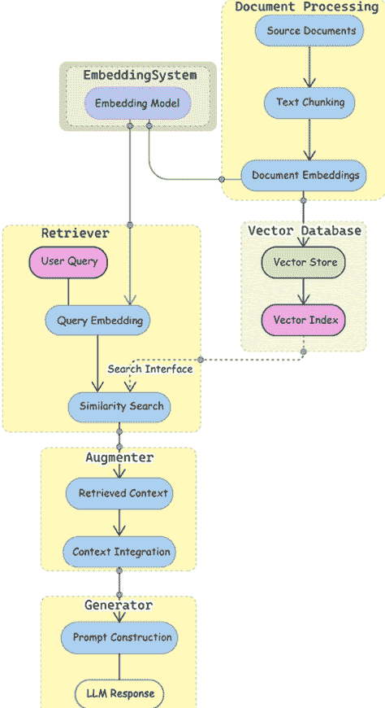
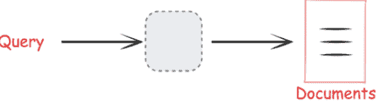
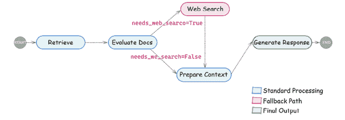

# 构建智能 RAG 系统

到本书为止，我们已经讨论了 LLM、token 以及如何在 LangChain 中使用它们。检索增强生成（RAG）通过在生成过程中动态结合外部知识来扩展 LLM，从而解决了训练数据限制、幻觉和上下文窗口狭小等局限性。简单来说，一个 RAG 系统接收查询，将其转换为语义向量嵌入，运行搜索提取相关文档，并将这些内容传递给模型，由模型生成与上下文匹配的用户回复。

本章将探索 RAG，包括向量数据库、文档处理、检索策略、实现和评估技术。之后，我们将通过构建一个聊天机器人，在实践中应用本书中学到的许多内容。我们将构建一个生产级的 RAG 流水线，以简化项目文档的创建和验证。这个企业级案例展示了如何生成初始文档、对其进行合规性和一致性评估，并结合人类反馈——所有这些都在一个模块化且可扩展的工作流中完成。

本章包含以下章节：

- 从索引到智能检索

- RAG 系统的组件

- 从嵌入到搜索

- 拆解 RAG 流水线

- 开发企业文档聊天机器人

- RAG 系统的故障排除

让我们从介绍 RAG、其重要性以及使用 RAG 框架的主要考虑因素开始。

## 从索引到智能检索

自记录知识诞生以来，信息检索一直是人类的基本需求。在过去的 70 年里，检索系统一直按照相同的核心范式运行：

1. 首先，用户将需求表述为查询。

2. 然后，他们将此查询提交给检索系统。

3. 最后，系统返回可能满足信息需求的文档引用：

- 引用可能按相关性从高到低进行排序

- 结果可能包含每份文档的相关片段（称为 snippets）

尽管这种范式保持不变，但实现方式和用户体验已经经历了巨大的变化。早期的信息检索系统依赖手动索引和关键词匹配。20 世纪 60 年代计算机索引的出现引入倒排索引（inverted index）——这种数据结构将每个词映射到包含该词的文档列表。这种词法方法驱动了第一代搜索引擎，如 AltaVista (1996)，其结果主要基于精确的关键词匹配。

然而，这种方法的局限性很快就显现出来。词可能有多个含义（多义性），而且不同的用户往往难以精确地表达自己的信息需求。

具有非货币成本的信息寻求活动：时间投入、认知负荷和交互性——研究人员称为“德尔斐成本”（Delphic costs）。用户对搜索引擎的满意度与结果的相关性无关，而是取决于用户提取所需信息的难易程度。

传统的检索系统通过各种优化来减少这些成本：

- 同义词扩展以降低构建查询时的认知负荷

- 结果排名以减少扫描结果的时间和成本

- 结果片段（显示搜索结果中的简短相关摘要）以降低评估文档相关性的成本

这些改进反映了一种理解，即搜索的最终目标不仅是找到文档，而是满足信息需求。

Google 的 PageRank 算法（20世纪90年代后期）通过考虑链接结构改进了结果，但即使是现代搜索引擎在理解方面也面临着根本性的局限。搜索从简单的文档列表演变为带有上下文片段的丰富呈现（始于20 世纪 90 年代末 Yahoo! 高亮显示词，随后演变为 Google 提取包含搜索词的最相关句的动态文档预览），但底层挑战仍然存在：桥接查询词与相关信息之间的语义鸿沟。


# 传统检索系统的局限与RAG的兴起

## 从词法检索到语义表示

传统检索系统的根本性局限性在于其文档检索的词法方法。在`Uniterm`模型中，查询词通过倒排索引映射到文档，词汇表中的每个词都指向文档位置的“排序列表”（`postings list`）。这种方法高效地支持布尔查询，但从根本上错过了词项之间的语义关系。例如，“`turtle`”（乌龟）和“`tortoise`”（陆龟）在倒排索引中被视为完全不同的词，尽管它们在语义上是相关的。早期检索系统试图通过检索前的阶段通过同义词增强查询来弥补这一差距，但底层局限性依然存在。

突破源于神经网络模型的进展，这些模型能够将词和文档的含义捕捉为密集向量表示——即嵌入（`embeddings`）。与传统的关键词系统不同，嵌入创建了一个语义地图，相关概念聚集在一起——“`turtle`”、“`tortoise`”和“`reptile`”（爬行动物）将出现在同一个邻居中，而“`bank`”（银行）会与“`money`”（钱）聚集在一起，但远离“`river`”（河流）。这种几何组织使得基于概念相似性而非单词匹配的检索成为可能。

这种转变随着`Word2Vec`（2013）以及后期基于Transformer的模型（如`BERT`，2018）的出现而获得动力，这些模型引入了上下文理解。`BERT`的创新在于意识到词可以根据其上下文具有不同的含义——作为金融机构的“`bank`”与作为河岸的“`bank`”。这些分布式表示从根本上改变了信息检索的可能性，使得开发能够理解查询意图而非仅仅匹配关键词的系统成为可能。

随着Transformer的语言模型规模扩大，研究人员发现它们不仅学习了语言模式，还从训练数据中记忆了事实性知识。Google研究人员表明，`T5`等模型可以在没有外部检索的情况下回答问题，充当隐式知识库。这提出了一种范式转移——从检索文档变为直接从内部知识中生成答案。然而，这些“闭卷”生成式系统面临着局限性：幻觉风险、训练数据截止日期限制、无法引用来源以及处理复杂推理的挑战。解决方案在RAG中出现，它将传统的检索系统与生成式语言模型相结合，结合了各自的优点并解决了各自的弱点。

## RAG系统的核心组件

- **检索器（Retriever）**：寻找相关信息的知识访问层
- **增强器（Augmenter）**：准备检索检索内容的集成层
- **生成器（Generator）**：生成最终输出的响应层

从流程的角度来看，RAG通过两个互连的流水线进行运行：
- 索引流水线：对知识库中的文档进行处理、分块和存储
- 查询流水线：检索相关信息并使用这些信息生成响应

RAG系统中的工作流遵循一个清晰的顺序：当查询到达时，会对其进行检索所需的处理；随后，检索器在知识库中搜索相关信息；通过增强过程将检索到的上下文与原始查询相结合；最后，语言模型根据查询和检索到的信息生成响应。我们可以在下面的图中看到：



图4.1：RAG架构与工作流

这种架构为生产系统提供了多许多优势：模块化允许组件独立开发；可扩展性允许根据特定需求分配资源；通过清晰的关注点分离提高了可维护性；灵活性允许在需求演进时切换不同的实现策略。

在接下来的章节中，我们将详细探讨图4.1中的每个组件，从现代RAG系统的基础构建块开始：驱动知识库和检索器组件的**嵌入（embeddings）和向量存储**。但在深入学习之前，重要的是首先考虑实现RAG或使用纯大语言模型（LLMs）之间的决策。这一选择将从根本上影响应用程序的整体架构和运行特性。让我们讨论一下权衡因素！

## 何时实现RAG

引入RAG带来了架构复杂性，必须根据应用程序需求对其进行仔细权衡。在当前或可验证的信息至关重要的专业领域中，RAG证明具有特别的价值。医疗健康应用必须同时处理医学图像和时间序列数据，而金融系统需要处理高维市场数据并伴随历史分析。法律应用受益于RAG处理复杂文档结构和维护来源归属的能力。这些领域特定的需求通常证明了实现RAG额外复杂性的性。

然而，RAG的优势伴随着重大的实现考虑。系统需要高效的索引和检索机制来保持合理的响应时间。知识库需要定期更新和维护以保持价值。基础设施必须设计为优雅地处理错误和边缘情况，特别是在不同组件交互的地方。开发团队必须准备好管理这些持续的运行需求。

另一方面，当这些复杂性超过收益时，纯LLM实现可能更合适。专注于创意任务、通用对话或对响应时间有要求的场景，通常在没有检索系统开销的情况下表现良好。在处理静态、有限的知识库时，微调或提示词工程等技术可能提供更简单的解决方案。

这种源自研究和实际实现的分析表明，知识时效性、准确性和领域知识的特定需求应引导RAG和纯LLM之间的选择，并与组织管理额外架构复杂的能力进行平衡。

> 在Chelsea AI Ventures，我们的团队观察到，监管行业的客户特别从RAG的可验证性中受益，而创意类应用在使用纯LLM时通常表现良好。

当应用程序需要以下内容时，开发团队应该考虑RAG：
- 获取LLM训练数据中不可用的当前信息
- 领域特定的知识集成
- 具有来源归属的可验证响应
- 特殊数据格式的处理
- 监管行业中的高精度要求

如此，让我们探索每个RAG组件的实现细节、优化策略和生产部署考虑。

## 从嵌入到搜索

如所述，RAG系统由一个寻找相关信息的检索器、一个集成这些信息的增强机制以及一个产生最终输出的生成器组成。在使用LLMs构建AI应用程序时，我们通常关注那些兴奋的部分——提示词（`prompts`）、链（`chains`）和模型输出。然而，任何健壮RAG系统的基础在于我们如何存储和检索向量嵌入（`vector embeddings`）。这就像建立一个图书馆——在找到书（向量搜索）之前，我们需要一个存储它们的建筑（向量存储）和一个用于找到它们的组织系统（向量索引）。在本节中，我们将介绍RAG系统的核心组件：向量嵌入、向量存储和优化检索的索引策略。

为了让RAG运行，我们首先需要解决一个基本挑战：我们如何帮助计算机理解文本的含义，以便它们找到相关信息？这就是嵌入用用场。

### 嵌入（Embeddings）

嵌入是文本的数值表示，能够捕捉语义含义。当我们创建一个嵌入时，是将单词或文本块转换为计算机处理的向量（数字列表）。这些向量可以是稀疏的（大部分为0，少数非零值）也可以是稠密的（大多数值非零零），现代LLM系统通常使用嵌入。

嵌入之所以强大，是因为具有相似含义的文本具有数值表示，使得能够通过最近邻算法进行语义搜索。

换句话说，嵌入模型将文本转换为数值向量。同一个模型被用于文档和查询，以确保向量存储中的一致性。以下是在LangChain中使用嵌入的方法：

```python
from langchain_openai import OpenAIEmbeddings

# 初始化嵌入
embeddings_model = OpenAIEmbeddings()

# 为原始示例句子创建嵌入
text1 = "The cat sat on the mat"
text2 = "A feline rested on the carpet"
text3 = "Python is a programming language"

# 使用LangChain获取嵌入
embeddings = embeddings_model.embed_documents([text1, text2, text3])

# 这些相似的句子将有相似的嵌入
embedding1 = embeddings[0] # "The cat sat on the mat"的嵌入
embedding2 = embeddings[1] # "A feline rested on the carpet"的嵌入
embedding3 = embeddings[2] # "Python is a programming language"的嵌入

# 输出显示3个文档及其维度
print(f"Number of documents: {len(embeddings)}")
print(f"Dimensions per embedding: {len(embeddings[0])}") # OpenAI的嵌入通常为1536维
```

一旦有了这些OpenAI嵌入（我们为上述示例句子生成的1536维向量），我们需要一个专门的系统来存储它们。与普通数据库值不同，这些高维向量需要特殊的存储解决方案。

> LangChain中的`Embeddings`类为各种供应商（OpenAI、Cohere、Hugging Face等）的嵌入模型提供了标准接口。它提供了两个主要方法：
> - `embed_documents`：接收多个文本并返回每个嵌入
> - `embed_query`：接收单个文本（您的查询）并返回其嵌入
>
> 某些供应商对文档和查询使用不同的嵌入方法，这就是为什么它们是独立的方法。

这引出了向量存储——为高维空间中的相似搜索优化的专用数据库。

### 向量存储（Vector stores）

向量存储是用于存储、管理和高效搜索向量嵌入的专用数据库。正如我们所见，嵌入将文本（或其他数据）转换为捕捉语义含义的数值向量。

向量存储解决了如何持久且高效地搜索这些高维向量的基本挑战。请注意，向量数据库作为一个独立的系统运行：
- 独立于RAG组件进行扩展
- 独立进行维护和优化
- 可能在多个RAG应用之间共享
- 作为专用服务托管

在处理嵌入（`embeddings`）时，会遇到若干挑战：
- **规模**：应用通常需要存储数百万个嵌入
- **维度**：每个嵌入可能具有数百或数千个维度
- **搜索性能**：快速找到相似向量会变成计算密集型任务
- **关联数据**：我们需要维护向量与其原始源文档之间的连接

考虑一个我们需要存储的真实世界示例：

```python
document_data = {
    "id": "doc_42",
    "text": "LangChain是一个用于开发语言模型驱动应用的框架。",
    "embedding": [0.123, -0.456, 0.789, ...], # OpenAI嵌入为1536维
    "metadata": {
        "source": "documentation.pdf",
        "page": 7,
        "created_at": "2023-06-15"
    }
}
```

向量存储的核心结合了两个至关重要的组件：
- **向量存储**：用于持久化向量和元数据的实际数据库
- **向量索引**：实现高效相似性搜索的特殊数据结构

效率挑战源于*维度灾难*——随着向量维度的增加，计算相似性的代价变得越来越高昂，对于`d`维和`N`个向量，需要`O(dN)`次操作。这使得朴的相似性搜索在大规模应用中是不行的。

向量存储通过高维空间中的距离计算来实现基于相似性的搜索。传统数据库擅长精确匹配，而向量嵌入允许语义搜索和近似近邻（ANN）检索。

与传统数据库的主要区别在于向量存储处理搜索的方式：

**传统数据库搜索：**
- 使用精确匹配（等等、范围）
- 针对结构化数据优化（例如，“找到所有年龄 > 30 的客户”）
- 通常利用B树或基于哈希的索引

**向量存储搜索：**
- 使用相似性度量（余弦相似度、欧几里得距离）
- 针对高维向量空间优化
- 采用近似近邻（ANN）算法

### 向量存储比较

向量存储管理用于检索的高维嵌入。下表比较了主流向量存储在各个关键属性上的情况，帮助你根据特定需求选择最合适的解决方案：

| 数据库 | 部署选项 | 许可证 | 特性 |
|---|---|---|---|
| Pinecone | 仅云端 | 商业 | 自动扩展、企业级安全、监控 |
| Milvus | 云、自托管 | Apache 2.0 | HNSW/JVF索引、多模态支持、CRUD操作 |
| Weaviate | 云、自托管 | BSD 3-Clause | 类图结构、多模态支持 |
| Qdrant | 云、自托管 | Apache 2.0 | HNSW索引、过滤优化、JSON元数据 |
| ChromaDB | 云、自托管 | Apache 2.0 | 轻量级、易设置 |
| AnalyticDB-V | 仅云端 | 商业 | OLAP集成、SQL支持、企业级功能 |
| pg_vector | 云、自托管 | OSS | SQL支持、PostgreSQL集成 |
| Vertex Vector Search | 仅云端 | 商业 | 易设置、低延迟、高扩展性 |

**表4.1：按部署选项、许可证和关键特性比较的向量存储**

每个向量存储在部署灵活性、许可证和专门能力方面提供了不同的权衡。对于生产级RAG系统，请考虑以下因素：
- 你是否需要云托管或自托管部署
- 是否需要特定功能（如SQL集成或多模态支持）
- 设置和维护的复杂性
- 针对预期嵌入量的扩展性需求

对于许多从RAG开始的应用，像ChromaDB这样的轻量级选项在相似性和功能之间极极平衡，而企业级部署则受益于Pinecone和AnalyticDB-V的高级功能。现代向量存储支持多种搜索模式：
- **精确搜索**：返回精确的近邻，但在大型向量集合上计算成本将变得难以接受
- **近似搜索**：使用LSH、HNSW或量化等技术以速度换精度；通过召回率（检索到的真实近邻的百分比）衡量
- **混合搜索**：在单次查询中结合向量相似性与文本搜索（如关键词匹配或BM25）
- **过滤向量**：在执行向量相似性搜索的同时应用传统数据库过滤器（例如元数据约束）

向量存储还处理类型的嵌入：
- **稠密向量搜索**：使用连续嵌入，大多数维度具有非零值，通常来自神经模型（如BERT、OpenAI嵌入）
- **稀疏向量搜索**：使用大多数值为零的高维向量存储，类似于传统的TF-IDF或BM25表示
- **稀疏混合**：结合两种方法以利用语义相似性（稠密）和关键词精度（稀疏）

它们还有多种相似性度量供选择，例如：
- **内积**：用于比较语义方向
- **余弦相似度**：对向量幅度进行归一化
- **欧几里得距离**：衡量向量空间中的L2距离（使用归一化嵌入，这在功能上等同于点积）
- **汉明距离**：用于二进制向量表示

在为RAG应用实现向量存储时，由于架构决策之一是使用本地存储还是云端解决方案。让我们探索每种方法的权衡和考虑因素：
- 当你需要最大控制权、有严格的隐私要求，或在负载可预测的较小范围内运行时，请选择本地存储。
- 当你需要弹性扩展、偏好托管服务，或运行具有可变负载的分布式应用时，请选择云存储。
- 当你想平衡性能和可扩展性，将本地缓存与云端持久化相结合时，请考虑混合存储架构。

### 向量存储的硬件考虑

无论采用何种部署方式，理解硬件需求对于优化性能至关重要：
- 内存需求：向量数据库是内存密集型的，生产系统通常需要16-64GB RAM。本地部署应为索引增长留出足够的内存。
- CPU与GPU：虽然基础向量操作可以在CPU上运行，但GPU加速可以显著提高大规模相似搜索的性能。对于高吞吐量应用，GPU支持可以提供10-50倍的速度提升。
- 存储速度：强烈建议生产存储使用SSD而非HDD，因为性能取决于I/O速度。这对于本地部署尤为关键。
- 网络带宽：对于云端或分布式设置，网络延迟和带宽是影响响应时间的关键因素。

对于开发和测试，大多数向量存储可以在配有8GB+内存的标准笔记本上运行，但生产部署应考虑专用基础设施或自动处理这些资源考虑的云向量存储。

### LangChain中的向量存储接口

现在我们已经探索了向量存储的作用并比较了一些常用选项，让我们来看看LangChain如何简化它们的操作。LangChain为向量存储提供了标准化的接口，允许你轻松切换不同的实现：

```python
from langchain_openai import OpenAIEmbeddings
from langchain_chroma import Chroma

# 使用嵌入模型初始化
embeddings = OpenAIEmbeddings()
vector_store = Chroma(embedding_function=embeddings)
```

LangChain中的`vector_store`基类提供了这些基本操作：

1. 添加文档：
```python
docs = [Document(page_content="Content 1"), Document(page_content="Content 2")]
ids = vector_store.add_documents(docs)
```

2. 相似性搜索：
```python
results = vector_store.similarity_search("How does LangChain work?", k=3)
```

3. 删除：
```python
vector_store.delete(ids=["doc_1", "doc_2"])
```

4. 最大相关性搜索：
```python
# 找到相关的多样化文档（减少冗余）
results = vector_store.max_marginal_relevance_search(
    "How does LangChain work?",
    k=3,
    fetch_k=10,
    lambda_mult=0.5 # 控制多样性 (0=最大多样性，1=最大相关性)
)
```

在介绍RAG之前，简要强调向量存储的应用是非常重要的：
- 大数据集中的异常检测
- 个性化和推荐系统
- NLP任务
- 欺诈检测
- 网络安全监控

然而，仅存储向量是不够的。在处理查询时，我们需要快速找到相似的向量。如果没有适当的索引，遍历向量就像是在一个没有组织系统的图书馆里找书——你必须检查每一本书。

## 向量索引策略

向量索引是使向量数据库适用于实际应用的关键组件。其核心解决了一个基础性的性能挑战：如何高效地找到相似的向量，而不需要与数据库中的每个向量进行比较（暴力法），这对于即使是中等规模的数据量在计算上也是不可接受的。


向量索引是特殊的数据结构，它们组织向量的方式，使系统能够快速识别向量空间的哪些部分最可能包含相似向量。系统不需要检查每个向量，而是专注于有希望的区域。

一些常见的索引方法包括：

- 分层划分向量空间的树结构
- 基于图的方法，例如分层导航小世界网络（HNSW），它创建了连接向量的可导航网络
- 哈希技术（Hashing），将相似的向量映射到同一个“桶”中

上述每种方法在以下几个方面都提供了不同的权衡：

- 搜索速度
- 结果的准确性
- 内存占用
- 更新效率（添加新向量的速度快慢）

在 `LangChain` 中使用向量存储时，索引策略通常由底层实现处理。例如，当你创建一个 `FAISS` 索引或使用 `Pinecone` 时，这些系统会根据你的配置自动应用适当的索引策略。

关键结论是，适当的索引将向量搜索从 `O(n)` 操作（`n` 是向量的数量）转变为接近 `O(log n)` 操作，使得在毫秒内搜索数百万个向量成为可能，而不是几秒或几分钟。

以下是策略概述表：

| 策略 | 核心算法 | 复杂度 | 内存占用 | 适用场景 | 备注 |
| :--- | --- | --- | --- | --- | --- |
| 精确搜索（暴力法） | 将查询与数据库中的每个向量进行比较 | 搜索: `O(N)`<br>构建: `O(1)` | 低 - 仅存储向量 | • 小数据集<br>• 需要100%召回率时<br>• 测试/基准 | • 实现简单<br>• 适用于小规模数据 |
| HNSW（分层导航小世界） | 创建一个从底部到顶部连接性递减的分层图 | 搜索: `O(log N)`<br>构建: `O(N log N)` | 高 - 存储图连接向量 | • 生产环境系统<br>• 需要高准确性时<br>• 大规模搜索 | • 行业标准<br>• 注意内存 |
| LSH（局部敏感哈希） | 使用哈希函数将相似向量映射到相同的桶中 | 搜索: `O(NP)`<br>构建: `O(N)` | 中 - 存储多个哈希表 | • 流式数据<br>• 频繁更新时<br>• 接受近似搜索 | • 动态良好<br>• 调整准确性 |
| IVF（倒排） | 向量聚类并划分空间 | 搜索: `O(DN/k)` | 低 - 存储聚类分配 | • 内存限制，大数据集 | • `k` = `n` 个簇 |
| 产品量化（PQ） | 通过划分子空间并量化压缩向量 | 搜索: 不同<br>构建: `O(N)` | 极低 - 压缩向量 | 内存受限系统，海量数据集 | 通常与 `IVF` 结合 |
| 基于树的（`KD-Tree`, `Ball Tree`） | 递归地将空间划分为区域 | 搜索: 最优情况 `O(D)`<br>构建: `O(N) log N` | 中等树结构 | 低维数据，静态数据集 | 在 `D < 20` 时效果良好，更新慢 |

表 4.2：按部署选项、许可和关键特征比较的向量存储

在为你的 `RAG` 系统选择索引策略时，请考虑这些实际的权衡：

- **对于小数据集的最大准确性**（<100K 向量）：精确搜索提供了完美的召回率，但随着数据集的增长，成本会变得极其昂贵。
- **对于数百万向量的生产系统**：`HNSW` 在搜索速度和准确性之间提供了最佳平衡，使其成为大规模应用的行业标准。虽然它比其他方法消耗更多内存，但其对数搜索复杂度即使在数据集扩展时也能提供稳定的性能。
- **对于内存受限的环境**：`IVF+Q`（带产品量化的倒排索引）大幅减少了内存需求——通常比原始行少 10-20 倍，且仅有微小的牺牲。这种组合对于边缘部署或嵌入数十亿文档特别有价值。
- **对于频繁更新的集合**：`LSH` 提供了高效的更新，无需重建整个索引，适用于不断添加文档的流式数据应用。

上图阐明了根据你的部署限制选择合适索引策略的决策树。该流程图帮助你引导关键决策点：

1. **从评估你的数据集大小开始**：对于较小的集合（少于 10 万个向量），精确搜索仍然可行，并能提供完美的准确率。
2. **考虑你的内存限制**：如果内存有限，请沿左侧分支走向压缩技术，如**乘积量化（PQ）**。
3. **评估更新频率**：如果你的应用需要频繁更新索引，请优先考虑支持高效更新的 `LSH` 等方法。
4. **评估搜索需求**：对于要求极低延迟的应用，`HNSW` 通常提供最快的内置搜索速度。
5. **平衡准确性需求**：随着你沿着流程图向下移动，请根据你的应用程序对近似结果的容忍度，考虑准确性与效率之间的权衡。

对于大多数生产环境中的 `RAG` 应用，你可能会选择 `HNSW` 或像 `IVF+HNSW` 的组合方法，它先对向量进行聚类（`IVF`），然后在每个簇内构建高效的图结构（`HNSW`）。这种组合在广泛的场景中提供了卓越的性能。

为了有效检索，必须对文档进行有效的处理和构建。下一节将探索各种文档类型以及多模态内容处理。

向量库如 Facebook（Meta）`Faiss` 或 Spotify 的 `Annoy` 提供了处理向量数据的功能。它们通常提供 **ANN** 算法的不同实现，例如聚类或基于树的方法，并允许用户为各种应用执行向量相似性搜索。让我们快速浏览最流行的几个：

- **Faiss** 是由 Meta（原 Facebook）开发的库，提供稠密向量的高效相似性搜索和聚类。它提供了多种索引算法，包括 `PQ`、`LSH` 和 `HNSW`。`Faiss` 被广泛用于大规模向量搜索任务，并支持 CPU 和 GPU 加速。
- **Annoy** 是一个由 Spotify 维护和开发的用于高维空间近似近邻搜索的 `C++` 库。它基于随机投影树森林实现 `ANN` 算法。
- **hnswlib** 是一个使用 `HNSW` 算法近似近邻搜索的 `C++` 库。
- **非度量空间库（nmslib）** 支持 `HNSW`、`SW-graph` 和 `SPTAG` 等多种索引算法。
- **SPTAG** 是微软实现的分布式 `ANN`。它带有 k-d tree 和相对邻域图（`SPTAG-KDT`），以及平衡的 k-means 树和相对邻域图（`SPTAG-BKT`）。

> 有许多向量搜索库供你选择。你可以在 https://github.com/erikbern/ann-benchmarks 获取完整概述。

在实现向量存储解决方案时，请考虑：

- 精确搜索与近似搜索之间的权衡
- 内存限制和扩展需求
- 结合向量和传统搜索的混合搜索能力
- 多模态数据支持需求
- 集成成本和维护复杂度

对于许多应用，结合向量搜索与传统数据库能力的混合方法提供了灵活的解决方案。

## 拆解 RAG 流水线

将 `RAG` 流水线想象成图书馆中的流水线，其中原材料（文档）被转换为可以回答问题的可搜索知识库。让我们来看看每个组件是如何发挥作用的。

### 1. 文档处理 - 基础

文档处理就像为图书馆准备书籍。当文档首次进入系统时，它们需要：

- 使用适用于其格式（`PDF`、`HTML` 等）的文档加载器进行加载
- 转换为系统可以处理的标准格式
- 拆分为更小的、有意义的块（chunks），以便处理和检索

例如，在处理教科书时，我们可能会将其分为章节大小或段落大小的块，同时在元数据中保留重要的上下文。

### 2. 向量索引 - 创建卡片索引

文档处理完成后，我们需要一种方法让它们变得可搜索。其工作原理如下：

- 嵌入模型将每个文档转换为向量（将其想象为用数字列表捕获文档的含义）
- 这些向量被组织在特殊的数据结构（向量存储）中，使其易于搜索
- 向量存储还维护了这些向量与其原始文档之间的连接

这类似于图书馆的卡片索引按主题组织书籍，便于找到相关材料。

### 3. 向量存储 - 组织的书架

向量存储就像我们图书馆中组织整齐的书架。它们：

- 同时存储文档向量和原始文档内容
- 提供高效的方法来搜索这些向量
- 提供不同的组织方法（如 `HNSW` 或 `IVF`），以平衡速度和准确性

例如，使用 `FAISS`（一种流行的向量存储），我们可能以分级结构组织向量，让我们能够快速缩小需要详细检查的文档范围。

### 4. 检索 - 找到正确的书籍

检索是所有环节汇聚的地方。当问题进入时：

- 问题使用相同的嵌入模型转换为向量
- 向量存储找到向量与问题向量最相似的文档

检索器可能会应用额外的逻辑，例如：

- 去除重复信息
- 平衡相关性和多样性
- 结合不同搜索方法的结果

一个基础的 `RAG` 实现如下：

```python
# 用于查询转换
from langchain.prompts import PromptTemplate
from langchain_openai import ChatOpenAI
from langchain_core.output_parsers import StrOutputParser

# 用于基础 RAG 实现
from langchain_community.document_loaders import JSONLoader
from langchain_openai import OpenAIEmbeddings
from langchain_community.vectorstores import FAISS

## 1. 加载文档
loader = JSONLoader(
    file_path="knowledge_base.json",
    jq_schema="[].content", # 这从每个项中提取内容字段
    text_content=True
)

documents = loader.load()

## 2. 转换为向量
embedder = OpenAIEmbeddings()
embeddings = embedder.embed_documents([doc.page_content for doc in documents])

# 3. 存储到向量数据库
vector_db = FAISS.from_documents(documents, embedder)

## 4. 检索相似文档
query = "What are the effects of climate change?"
results = vector_db.similarity_search(query)
```

此实现涵盖了核心 `RAG` 工作流：文档加载、存储和检索。

使用 `LangChain` 构建 `RAG` 系统需要理解两个基础模块，我们应该详细讨论一下：文档加载器和检索器。让我们探索这些组件如何协同工作以创建有效的检索系统。

## 文档处理

`LangChain` 提供了一个全面的系统，通过文档加载器从各种加载文档。文档加载器是 `LangChain` 中的一个组件，将各种数据源转换为可在 `LangChain` 生态系统中使用的标准文档格式。每个文档包含实际内容和相关的元数据。

文档加载器是 `RAG` 系统的基础：

- 将多种数据源转换为统一格式
- 从文件中提取文本和元数据
- 为后续处理（如分块或嵌入）准备文档

`LangChain` 支持通过专门的加载器从广泛的文档类型和来源加载文档，例如：

- `PDFs`：使用 `PyPDFLoader`
- `HTML`：使用 `WebBaseLoader` 提取
- 纯文本：使用 `TextLoader` 用于原始文本输入
- `WebBaseLoader` 用于提取网页内容
- `ArxivLoader` 用于科学论文
- `WikipediaLoader` 用于百科条目
- `YoutubeLoader` 用于视频字幕
- `ImageCaptionLoader` 用于图像内容

你可能已经注意到上上一个列表中包含了一些非文本内容类型。高级的 `RAG` 系统可以处理非文本数据；例如图像嵌入或音频转录。

下表将 `LangChain` 文档加载器整理成了一个综合表格：

| 类别 | 描述 | 显著示例 | 常见用场景 |
| --- | --- | --- | --- |
| 文件系统 | 从本地文件加载 | `TextLoader`, `CSVLoader`, `PDFLoader` | 处理本地文档、数据文件 |
| 网络内容 | 从在线源提取 | `WebBaseLoader`, `RecursiveURLLoader`, `SitemapLoader` | 网页爬虫、内容聚合 |
| 云存储 | 访问云端托管文件 | `S3DirectoryLoader`, `GCSFileLoader`, `DropboxLoader` | 企业数据集成 |
| 数据库 | 从结构化数据存储器加载 | `MongoDB`, `SnowflakeLoader`, `BigQueryLoader` | 商业智能、数据分析 |
| 社交媒体 | 导入社交平台内容 | `TwitterTweetLoader`, `RedditPostsLoader`, `DiscordChatLoader` | 社交媒体分析 |
| 生产力工具 | 访问工作区文档 | `NotionDirectoryLoader`, `SlackDirectoryLoader`, `TrelloLoader` | 知识库创建 |
| 科学来源 | 加载学术内容 | `ArxivLoader`, `PubMedLoader` | 研究应用 |

表 4.3：`LangChain` 中的文档加载器

最后，现代文档加载器提供了若干高级功能：

- 并发加载以提高性能
- 元数据提取与保留
- 针对特定格式的解析（例如从 `PDF` 中提取表格）
- 错误处理与验证
- 与转换流水线的集成

让我们来看加载 `JSON` 文件的示例。这里是使用文档加载器的典型模式：

```python
from langchain_community.document_loaders import JSONLoader

# 加载一个 json 文件
loader = JSONLoader(
    file_path="knowledge_base.json",
    jq_schema="[].content", # 这从每个数组项中提取 content 字段
    text_content=True
)

documents = loader.load()
```

文档加载器带有标准的 `load()` 方法接口，返回 `LangChain` 文档格式的文档。初始化是特定特定的。加载后，文档通常在存储和检索之前需要进行处理，而选择正确的分块策略决定了 AI 生成响应的关联性和多样性。

## 分块策略（Chunking strategies）

分块——即如何将文档划分更小的部分——会极大影响你的 `RAG` 系统的性能。糟糕的分块可能会拆散相关概念，丢失关键上下文，并最终导致无关的检索结果。分块文档的方式会影响：

- **检索准确性**：良好的分块保持了语义连贯性，使其更容易与相关查询匹配
- **上下文保留**：糟糕的分块会分割相关信息，导致知识缺口
- **响应质量**：当 `LLM` 接收到碎片化或无关的块时，它生成的响应准确性较低

让我们探索一种从简单到复杂的层级分块方法，以帮助你针对特定案例实现最有效的策略。

### 固定大小分块（Fixed-size chunking）

最基础的方法是在考虑内容结构的情况下将文本划分为指定长度的块：

```python
from langchain_text_splitters import CharacterTextSplitter

text_splitter = CharacterTextSplitter(
    separator="", # 按空格分割以避免拆断单词
    chunk_size=200,
    chunk_overlap=20
)

chunks = text_splitter.split_documents(documents)
print(f"Generated {len(chunks)} chunks from document")
```

固定大小分块适用于快速原型设计或文档结构相对均匀的情况，然而，它会在尴尬的位置切分文本，切断句子、段落或逻辑单元。

### 递归字符分块（Recursive character chunking）

此方法通过递归地应用不同的分隔符来尊重自然的文本边界：

```python
from langchain_text_splitters import RecursiveCharacterTextSplitter

text_splitter = RecursiveCharacterTextSplitter(
    separators=["\n\n", "\n", ".", " ", ""],
    chunk_size=150,
    chunk_overlap=20
)

document = """
# RAG 简介

检索增强生成 (RAG) 将检索系统与生成式 AI 模型结合起来。

它通过将回答建立在检索到的信息上，来帮助解决幻觉问题。

## 核心组件

RAG 由几个部分组成：

1. 文档处理
2. 向量嵌入
3. 检索
4. 增强
5. 生成

## 文档处理

这一步涉及恰当地加载和分块文档。
"""

chunks = text_splitter.split_text(document)
```

以下是分出的块：

> `['Introduction to RAG\nRetrieval-Augmented Generation (RAG) combines retrieval systems with generative AI models.', '## It addresses hallucinations by grounding responses in retrieved information.', '## Key Components\nRAG consists of several components:\n2. Document processing\n3. Vector embedding\n4. Augmentation\n5. Generation.', '### Document Processing\nThis step involves loading and chunking documents appropriately.']`


它的工作原理是，分割器首先尝试在段落换行符（`\n`）处划分文本。如果生成的文本块太大，它会尝试下一个分隔符（`\n`），依此类推。这种方法在保持合理分块大小的同时，保留了自然的文本边界。

递归分块是大多数应用程序推荐的默认策略。它对各种类型的文档都有效，并在保留内容与保持可管理的分块大小之间提供了优良的平衡。

# 特定于文档的分块

不同的文档类型有不同的结构。特定于文档的分块会适应这些结构。实现方式可能涉及根据语句根据文档类型使用专门的分割器。例如，我们可以根据内容使用`MarkdownTextSplitter`、`PythonCodeSplitter`或`HTMLHeaderTextSplitter`。

这在处理特殊格式（如 Markdown、Python 或 HTML）时非常有用。

## 语义分块

与依赖文本分隔符的先述方法不同，语义分块通过分析内容的含义来确定分块边界。

```
from langchain_experimental.text_splitter import SemanticChunker
```

```
from langchain_openai import OpenAIEmbeddings
```

```
embeddings = OpenAIEmbeddings()
```

```
text_splitter = SemanticChunker(
embeddings=embeddings,
add_start_index=True # 包含原始位置元数据
)
```

```
chunks = text_splitter.split_text(document)
```

这些是文本块：

> [# Introduction to RAG\nRetrieval-Augmented Generation (RAG) combines retrieval systems with generative AI models. It addresses hallucinations by grounding responses in retrieved information. ## Key Components\nRAG consists of several components:\n1. Document processing\n2. Vector embedding\n3. Retrieval\n4. Augmentation\n5. Generation.\n### Document Processing\nThis step involves loading and chunking documents appropriately. ]

`SemanticChunker` 的工作原理：

1. 将文本分割成句子
2. 为句子组（由缓冲区大小决定）创建嵌入
3. 测量相邻组之间的语义相似性
4. 识别主题或概念变化的自然断点
5. 创建保持语义连贯性的块

你可以在处理复杂的技术文档时使用语义分块，当语义连贯性对于准确检索至关重要，并且你愿意为嵌入生成支付额外的计算或成本时。

## 基于代理的分块

这种实验性方法使用 LLM 根据语义分析和内容理解来智能地划分文本，方式如下：

1. 分析文档的结构和内容
2. 根据主题切换识别自然断点
3. 确定保留语义的最优分块边界
4. 返回用于创建分块的起始位置列表

这种分块类型对于极其复杂的文档非常有用，在这种情况下，标准的分割方法无法保留概念之间的关键关系。这种方法在以下情况下特别有用：

- 文档包含需要保留的复杂逻辑流
- 内容需要特定的领域知识才能进行适当分块
- 最大的检索准确率足以抵消基于 LLM 处理的额外开销

其局限性在于它带来了更高的计算成本和延迟，且分块的大小预测性较低。

## 多模态分块

现代文档通常包含文本、表格、图像和代码的混合。多模态分块能够适当处理这些不同的内容类型。

我们可以想象多模态内容的处理流程：

1. 分别提取文本、图像和表格
2. 使用适当的文本分块器处理文本
3. 处理表格以保留结构
4. 对于图像：通过 OCR 或视觉 LLM 生成说明或提取文本
5. 创建链接相关元素的元数据
6. 对每个元素进行适当的嵌入

在实践中，你会使用专门的库（如 `unstructured`）进行文档解析，使用视觉模型进行图像理解，使用表格提取工具处理结构化数据。

## 选择正确的分块策略

如下表所示，你的分块策略应该受到文档特性、检索需求和计算资源的指导：

| 因素 | 条件 | 推荐策略 |
|---|---|---|
| 文档特性 | 高结构化文档（Markdown，代码） | 特定文档的分块 |
|  | 复杂技术内容 | 语义分块 |
|  | 混合媒体 | 多模态方法 |
| 检索需求 | 基于事实的 QA | 较小的块 (100-300 tokens) |
|  | 复杂推理 | 较大的块 (500-1000 tokens) |
|  | 重视上下文的回答 | 显著重叠的滑动窗口 |
| 计算资源 | API 预算有限 | 基础递归分块 |
|  | 性能敏感 | 预计算语义分块 |

*表 4.4：分块策略对比*

我们建议将第 2 层（递归字符分块）作为基准，如果检索质量需要提高，再尝试更高级的策略。

对于大多数 RAG 应用，带有适当块大小和重叠策略的`RecursiveCharacterTextSplitter`在简单性、性能和检索质量之间提供了极佳平衡。随着系统的成熟，你可以评估复杂的分块策略是否带来了有意义的改进。

然而，针对你的特定用例和文档类型尝试不同的块大小通常对性能至关重要。请参考第 8 章的测试和基准策略。

下一节将涵盖搜索、混合方法和高级排序技术。

## 检索

检索将向量存储与其他 LangChain 组件集成，以简化查询并实现兼容。检索系统是非结构化查询与相关文档之间的关键桥梁。

在 LangChain 中，检索器（retriever）本质上是一个接受自然语言查询和相关文档的接口。让我们详细探讨它的工作原理。

LangChain 检索器的核心遵循一个简单而强大的模式：

- **输入**：接收字符串形式的查询
- **处理**：对实现应用检索逻辑
- **输出**：返回文档对象列表，每个对象包含：
  - `page_content`：实际文档内容
  - `metadata`：相关信息，如文档 ID 或来源

此图（来自 LangChain 文档）说明了这种关系。

## 检索器



图 4.3：查询、检索器和文档之间的关系

LangChain 提供了丰富的检索器生态系统，每个都为解决特定的信息检索挑战而设计。

## LangChain 检索器

检索器大致可分为几类，满足不同的场景和实现需求：

- **核心基础设施检索器**包括像`ElasticsearchRetriever`这样的自托管选项，以及来自 Amazon、Google 和 Microsoft 等主要提供者的云解决方案。
- **外部知识检索器**连接到外部已有的知识库。`ArxivRetriever`、`WikipediaRetriever`和`TavilySearchAPI`在此脱颖而出，分别直接访问学术论文、百科条目和网页内容。
- **算法检索器**包含了若干种经典的信息检索方法。`BM25`和`TF-IDF`检索器在词法搜索方面表现出色，而`kNN`检索器处理语义相似性搜索。每种方法都有自己的优势——`BM25`擅长关键词精确性，`TF-IDF`适用于文档分类，`kNN`用于相似性匹配。
- **高级/专用检索器**通常解决生产环境中可能出现的特定性能需求或资源限制。LangChain 提供了具有独特能力的专用检索器。`NeuralDB`提供针对 CPU 优化的检索，而`LLMLing`专注于文档压缩。
- **集成检索器**与流行的平台和服务连接。这些检索器（如用于 Google Drive 或 Outline 的检索器）可以将现有的文档库整合到你的 RAG 应用中。

这是一个检索器使用的基本示例：

```
# 基本检索器交互
docs = retriever.invoke("What is machine learning?")
```

LangChain 支持几种复杂的检索方法：

## 向量存储检索器

向量存储是语义搜索的基础，将文档和查询转换为嵌入以进行相似性匹配。任何向量存储都可以通过`as_retriever()`方法变成检索器：

```
from langchain_community.retrievers import KNNRetriever
```

```
from langchain_openai import OpenAIEmbeddings
```

```
retriever = KNNRetriever.from_documents(documents, OpenAIEmbeddings())
```

```
results = retriever.invoke("query")
```

这些检索器包括：

1. **混合搜索**：结合语义和词法搜索以利用：
   - 语义理解的向量相似性
   - 关键词精确匹配
2. **最大边际相关 (MMR)**：通过以下方式优化相关性和多样性：
   - 选择与查询相似的文档
   - 确保检索到的文档彼此不同
3. **自定义检索**：LangChain 允许通过实现`BaseRetriever`类来创建专用检索器。

## 高级 RAG 技术

构建生产级 RAG 系统时，简单的向量搜索是不够的。现代应用需要复杂的方法来发现和验证信息。标准的向量搜索有很多限制：

- 它可能会错过使用不同术语的上下文相关文档
- 它无法区分权威性和可靠来源
- 它可能会返回冗余或冲突的信息
- 它无法验证生成的回答是否反映了源

现代检索系统通常采用多种技术来提高结果质量。两种特别强大的方法是混合检索和重排序（re-ranking）。

### 混合检索：结合语义和关键词搜索

混合检索并行结合了检索方法，并对结果进行融合，以利用这两种方法的优势：

- 稠密检索：使用向量嵌入进行语义理解
- 稀疏检索：使用`BM25`等词法方法进行关键词精确检索

例如，混合检索器可以使用向量相似性寻找语义相关的文档，同时运行关键词搜索以捕捉精确术语匹配，然后使用融合算法合并这些结果。

```
from langchain.retrievers import EnsembleRetriever
from langchain.community.retrievers import BM25Retriever
from langchain.vectorstores import FAISS

# 设置语义检索器
vector_retriever = vector_store.as_retriever(search_kwargs={"k": 5})

# 设置词法检索器
bm25_retriever = BM25Retriever.from_documents(documents)
bm25_retriever.k = 5

# 合并检索器
hybrid_retriever = EnsembleRetriever(
    retrievers=[vector_retriever, bm25_retriever],
    weights=[0.5, 0.5]
)
```

`weights=[0.7, 0.3]` # 语义搜索权重高于关键词搜索

```
results = hybrid_retriever.get_relevant_documents("climate change impacts")
```

# 重排序

重排序是一个跟在任何检索方法之后的后处理步骤，包括混合检索：

1. 首先，检索一个较大的候选文档集
2. 应用更复杂的模型对文档进行重新评分
3. 根据这些更精确的相关性评分进行重新排序

重排序遵循三种范式：

- 逐点重排序器（Pointwise rerankers）：独立地对每个文档进行评分（例如，在 1-10 分的范围内），并据此对生成的文档数组进行排序。
- 成对重排序器（Pairwise rerankers）：比较文档以确定偏好，然后根据文档在所有比较中的胜负记录通过排名构建最终的排序。
- 列表重排序器（Listwise rerankers）：重排序模型整体地处理整个文档列表（以及原始查询），通过优化 NDCG 或 MAP 来确定最佳顺序。

LangChain 提供了多种重排序实现方案：

- Cohere rerank：基于商业 API 的解决方案，质量优秀：

```python
# 文文档压缩器示例
from langchain.retrievers.document_compressors import CohereRerank
from langchain.retrievers import ContextualCompressionRetriever
# 初始化压缩器
compressor = CohereRerank(top_n=3)
# 创建压缩检索器
compression_retriever = ContextualCompressionRetriever(
    base_compressor=compressor,
    base_retriever=base_retriever
)
# 原始文档
print("Original documents")
original_docs = base_retriever.get_relevant_documents("How do transformers work?")
for i, doc in enumerate(original_docs):
    print(f"Doc {i}: {doc.page_content[:100]}...")
# 压缩文档
print("\nCompressed documents:")
compressed_docs = compression_retriever.get_relevant_documents("How do transformers work?")
for i, doc in enumerate(compressed_docs):
    print(f"Doc {i}: {doc.page_content[:100]}...")
```

- RankLLM：支持专门为重排序微调的开源 LLM：

```python
from langchain.community.compressors.rankllm_rerank import RankLLMRerank
compressor = RankLLMRerank(top_n=3, model="zephyr")
```

- 基于 LLM 的查询重排序器：使用任何 LLM 为文档相关性评分：

```python
# 简化示例 - LangChain 提供了更流畅的实现
relevance_score_chain = ChatPromptTemplate.from_template(
    "Rate relevance of document to query on scale of 1-10: {document}"
) | llm | StrOutputParser()
```

请注意，混合检索关注的是如何检索文档，而重排序关注的是检索后如何进行排序。这些方法可以且通常应该在流水线中使用。在评估重排序器时，使用位置感知的指标（如 `Re@k`），它衡量了重排序器多大有效地将所有相关文档推到前几个位置。

交叉编码器（Cross-encoder）重排序通常比初始检索能提高 10-20% 的指标，尤其是对于前几个位置。

## 查询转换：通过更好的查询改进检索

即使是最好的检索系统，在面对表述不当的查询时也会遇到困难。查询转换技术通过增强或重构原始查询来改进结果，解决这一挑战。

查询扩展（Query expansion）生成原始查询的多个变体，以捕捉不同的方面或解释。这弥补了用户与文档之间的词汇差距：

```python
from langchain.prompts import PromptTemplate
from langchain_openai import ChatGPT
```

```python
expansion_template = """Given the user question: {question}
```

生成三个表达相同信息需求但措辞不同的版本：

```python
expansion_prompt = PromptTemplate(
    input_variables=["question"],
    template=expansion_template
)
llm = ChatOpenAI(temperature=0.7)
```

```python
expansion_chain = expansion_prompt | llm | StrOutputParser()
```

让我们在实践中看一看：

- `original_query = "What are the effects of climate change?"`
- `expanded_queries = expansion_chain.invoke(original_query)`
- `print(expanded_queries)`

我们应该会得到类似这样的内容：

- How does climate change affect the environment?
- What are the consequences of climate change?

更高级的方法是假设性文档嵌入（HyDE）。

## 假设性文档嵌入

HyDE 使用 LLM 根据查询生成一个假设的答案，然后使用该文档的嵌入进行检索。这种技术对于查询与文档语言之间语义差距较大的复杂查询非常强大。


# RAG 增强技术

查询转换技术在处理模糊查询或与文档之间常见术语不匹配的情况时特别有用。

## 假设性文档生成

```python
from langchain.prompts import PromptTemplate
from langchain.openai import ChatOpenAI, OpenAIEmbeddings
```

```python
# 创建生成假设性文档的提示词
hyde_template = """Based on the question: {question}
Write a passage that could contain the answer to this question:"""

hyde_prompt = PromptTemplate(
    input_variables=["question"],
    template=hyde_template
)

llm = ChatOpenAI(temperature=0.2)
hyde_chain = hyde_prompt | llm | StrOutputParser()

# 生成假设性文档
query = "What dietary changes can reduce carbon footprint?"
hypothetical_doc = hyde_chain.invoke(query)
```

## 使用假设性文档进行检索

```python
embeddings = OpenAIEmbeddings()
query_vector = embeddings.embed_query(query)

results = vector_db.similarity_search(query_vector, k=3)
```

## 上下文处理

一旦检索到文档，上下文压缩提取最相关的部分，移除可能会分散生成器的无关内容：

```python
from langchain.retrievers.document_compressors import LLMFilter
from langchain.retrievers import ContextualCompressionRetriever
from langchain_openai import ChatOpenAI

llm = ChatOpenAI(temperature=0)
```

```python
compressor = LLMFilter.from_llm(llm)

# 从向量库创建基础检索器
base_retriever = vector_db.as_retriever(search_kwargs={"k": 3})

compression_retriever = ContextualCompressionRetriever(
    base_compressor=compressor,
    base_retriever=base_retriever
)

compressed_docs = compression_retriever.invoke("How do transformers work?")
```

这里是我们的压缩文档：

```python
[Document(metadata={'source': 'Neural Network Review 2021', 'page': 42},
page_content="The transformer architecture was introduced in the paper 'Attention is All Need' by Vaswani et al. in 2017."),

-Document(metadata={'source': 'Introduction to NLP', 'page': 137},
page_content="BERT uses bidirectional training of the Transformer, masked language modeling, and next sequence prediction tasks.')]
```

上下文处理技术在处理部分相关的长文档，或者为了全面覆盖主题需要多样化的观点时非常有价值。

## 最大边相关性

另一种强大的方法是最大边相关性（MMR），它平衡了文档的相关性与多样性，确保检索到的集合包含多样化而非重复的信息：

```python
from langchain_community.vectorstores import FAISS

vector_store = FAISS.from_documents(documents, embeddings)

mmr_results = vector_store.max_relevance_search(
    query="What are transformer models?",
    k=5, # 返回的文档数量
    fetch_k=20, # 初始获取的文档数量
    lambda_mult=0.5 # 多样性参数（0 = 最大相关性）
)
```

## 响应增强：改进生成器输出

RAG 增强的最后一个领域专注于改进生成的响应本身，确保其准确、可靠且有用。

这些响应增强技术在对准确性和透明度至关重要的应用中特别重要，例如教育资源、医疗信息或法律建议。它们通过让 AI 生成的内容更具可验证可靠性来建立用户的信任。

# 来源溯源

来源溯源将生成的信息与检索到的来源显式连接，帮助用户核实事实并理解信息的来源。让我们为来源溯源建立基础。我们将使用文档初始化向量存储库，并创建一个检索器，以为每个查询获取前 3 个最相关的文档。溯源提示词模板指示模型对每个断言使用引用，并包含引用列表：

```python
from langchain_core.prompts import PromptTemplate
from langchain_openai import ChatGPTAI
from langchain_core.output_parsers import StrOutputParser
from langchain_community.vectorstores import FAISS
from langchain_openai import OpenAIEmbeddings
```

### 创建向量存储和检索器

```python
embeddings = OpenAIEmbeddings()
vector_store = FAISS.from_documents(documents, embeddings)
retriever = vector_store.as_retriever(search_kwargs={"k": 3})
```

### 来源溯源提示词模板

```python
attribution_prompt = ChatGPTPromptTemplate.from_template("""
你是一个精确的 AI 助手，提供来源良好的信息。

仅根据提供的来源回答以下问题。对于你回答中的每个事实或断言，

请使用 [1], [2] 等引用来指向来源。在末尾包含带编号的引用列表。

问题：{question}

来源：
{sources}

你的回答：
""")
```

接下来，我们需要辅助函数来带引用数字格式化来源并生成带溯源的响应：

```python
# 从文档创建格式化的来源字符串

def format_sources_with_citations(docs):
    formatted_sources = []
    for i, doc in enumerate(docs, 1):
        source_info = f'{i} {doc.metadata.get("source", "Unknown source")}'
        if doc.metadata.get('page'):
            source_info += f', {doc.metadata["page"]}'
        formatted_sources.append(f"{source_info}\n{doc.page_content}")
    return "\n\n".join(formatted_sources)
```

```python
# 构建带有来源溯源的 RAG 链

def generate_attributed_response(question):
    # 检索相关文档
    retrieved_docs = retriever.invoke(question)

    # 带引用数字格式化来源
    sources_formatted = format_sources_with_citations(retrieved_docs)

    # 使用 LCEL 创建溯源链
    attribution_chain = (
        attribution_prompt
        | ChatOpenAI(temperature=0)
        | StrOutputParser()
    )

    # 生成带引用的响应
    response = attribution_chain.invoke({
        "question": question,
        "sources": sources_formatted
    })

    return response
```

此示例通过以下方式实现来源溯源：

1. 为查询检索相关文档
2. 为每个文档带上引用数字格式化
3. 使用显式要求对每个事实提供引用的提示词
4. 生成包含行内引用（`[1]`, `[2]` 等）的响应
5. 添加引用列表部分，将每个引用链接到其来源

这种方法的关键优势是透明度和可验证性——由于用户可以将每个断言追溯到其来源，这对于学术、医学或法律应用尤为重要。

让我们看看使用查询执行此操作时会得到什么：

```python
## 示例用法
question = "How do transformer models work and what are some examples?"
attributed_answer = generate_attributed_response(question)
attributed_answer
```

> 我们应该得到类似这样的响应：

Transformer 模型通过利用自注意力机制在做出预测时权衡不同输入标记重要性来工作。这种架构是由 Vaswani 等人在 2017 年的论文《Attention is All You Need》中首次引入的 `[1]`。

> Transformer 模型的一个例子是 BERT，它是对 Transformer 的双向训练、掩码语言建模和下一句预测任务 `[2]`。另一个例子是 GPT（生成式预训练转换器）模型，它们是自回归转换器，根据先前的标记预测下一个标记 `[3]`。

引用列表：

`[1]` Neural Network Review 2021, page 42

`[2]` Introduction to NLP, page 137

`[3]` Large Language Models Survey, page 89

自一致性检查通过将生成的响应与检索到的上下文进行比较，以验证准确性并识别潜在的幻觉。

# 自一致性检查：确保事实准确性

自一致性检查验证生成的响应是否准确反映了检索文档中的信息，为防止幻觉提供了一个关键的保护层。我们可以使用 LCEL 创建精化的验证流水线：

```python
from langchain_core.prompts import ChatPromptTemplate
from langchain_core.output_parsers import StrOutputParser
from langchain_openai import ChatOpenAI
from typing import List, Dict
from langchain_core.documents import Document
```

```python
def verify_response_accuracy(
    retrieved_docs: List[Document],
    generated_answer: str,
    llm: ChatOpenAI = None
) -> Dict:
    """
    验证生成的答案是否被检索到的文档完全支持。

    参数：
        retrieved_docs: 用于生成答案的文档列表
        generated_answer: RAG 系统产生的答案
        llm: 用于验证的语言模型

    返回：
        包含验证结果和任何识别出的问题的字典
    """
    if llm is None:
        llm = ChatOpenAI(model="gpt-3.5-turbo")

    # 从检索到的文档创建上下文
    context = "\n\n".join([doc.page_content for doc in retrieved_docs])

    # 定义验证提示词
    verification_prompt = ChatPromptTemplate.from_template("""
作为一个事实检查助手，验证以下答案是否完全被上下文支持。

上下文：
{context}

答案：
{answer}

以 JSON 格式返回你的分析，结构如下：
{{
  "claims": [
  {{
    "claim": "事实断言",
    "status": "fully_supported|partially_supported|contradicted|not_mentioned",
    "evidence": "来自中的支持或矛盾的文本",
    "explanation": "你的解释"
  }}
  ],
  "fully_grounded": bool,
  "issues_identified": "[列出任何问题]"
}}""")

    # 使用 LCEL 创建验证链
    verification_chain = (
        verification_prompt
        | llm
        | StrOutputParser()
    )

    # 验证
    result = verification_chain.invoke({
        "context": context,
        "answer": generated_answer
    })
    return result
```

### 示例用法

```python
retrieved_docs = [
    Document(page_content="The transformer architecture was introduced in the paper 'Attention Is All You Need' by Vaswani et al. in 2017. It relies on self-attention mechanisms instead of recurrent or convolutional neural networks."),
    Document(page_content="BERT is a transformer-based model developed by Google that uses masked language modeling and next sentence prediction as pre-training objectives.")
]

generated_answer = "The transformer architecture was introduced by OpenAI in 2018 and uses recurrent neural networks. BERT is a transformer model developed by Google."

verification_result = verify_response_accuracy(retrieved_docs, generated_answer)
print(verification_result)
```

```json
"claim": "BERT 是由 Google 开发的 transformer 模型",
"status": "完全支持",
"evidence": "BERT 是由 Google 开发的基于 Transformer 模型，使用掩码语言模型和下一句预测作为预训练目标。",
"explanation": "该断言被提供的上下文完全支持。",
"grounded": false,
"issues identified": "答案包含关于 transformer 架构引入及其对循环神经网络使用的的错误信息。"
```

根据验证结果，你可以：

1. 如果发现问题，则重新生成答案
2. 添加限定性声明以表示不确定性
3. 过滤掉不支持的断言
4. 为响应的不同部分包含置信度指标

这种方法通过对比源文档对生成的响应进行系统分析，识别出特定的不受支持的断言，而不仅仅是提供二元评估。对于每个事实性陈述，它都会确定其在上下文中是被完全支持、部分支持、矛盾还是未被提及。

自一致性检查对于可靠性至关重要的应用至关重要，例如医疗信息、财务建议或教育内容。在幻觉到达用户之前进行检测和过滤，可以显著提高 RAG 系统的可靠性。

可以通过以下方式进一步增强：

1. **细粒度断言提取**：将复杂的响应拆解为原子化的事实断言
2. **证据链接**：将每个断言显式连接到特定的支持文本
3. **置信度评分**：为响应的不同部分分配数值置信度分
4. **选择性重新生成**：仅重新生成响应中不支持的部分

这些技术创建了一个验证层，在保持生成响应的流畅性和连贯性的同时，大幅减少了向用户呈现错误信息的风险。


虽然我们讨论的技术增强了 RAG 流水线的单个组件，但纠性 RAG（Corrective RAG）代表了一种更全面的方法，它在系统层面解决了根本的检索质量问题。

# 纠性 RAG (Corrective RAG)

我们到目前为止探索的技术假设我们的检索机制返回相关的、准确的文档。但当它没有这样做时会发生什么？在现实应用中，检索系统经常返回无关、不足甚至具有误导性的内容。“垃圾进，垃圾出”是标准 RAG 系统中的一个关键漏洞。**纠性检索增强生成 (CRAG)** 通过在 RAG 流水线引入显式评估和纠正机制直接解决了这一挑战。

CRAG 通过评估和条件分支扩展了标准的 RAG 流水线：

- 1. **初始检索**：根据查询从向量存储中进行标准文档检索。
- 2. **检索评估**：检索评估组件评估每个文档的相关性和质量。
- 3. **条件纠正**：
  - 1. **相关文档**：将高质量文档直接传递给生成器。
  - 2. **无关文档**：过滤低质量文档以防止噪声。
  - 3. **不足/模糊文档**：当内部知识不足时触发替代的信息寻求策略（如网络搜索）。
- 4. **生成**：使用过滤或增强的上下文产生最终响应。此工作流将 RAG 从静态流水线转变为更动态的、自纠的系统，能够在需要时寻求额外信息。

CRAG: 纠性检索增强生成



图 4.4: 显示评估和条件分支的纠性 RAG 工作流

检索评估是 CRAG 的基石。它的工作是分析检索文档与查询之间的关系，确定哪些文档是真正相关的。通常使用带有精心设计的提示词（prompt）的 LLM：

```
from pydantic import BaseModel, Field
```

```
class DocumentRelevanceScore(BaseModel):
    """
    用于文档评估的二分类相关性评分。
    """
    is_relevant: bool = Field(description="文档是否包含与查询相关的信息")
    reasoning: str = Field(description="相关性决解释")

def evaluate_document(document, query, llm):
    """
    评估文档是否与查询相关。
    """

    prompt = "你是一个文档评估专家。你的任务是确定以下文档是否包含与给定查询相关的信息。\n\n    Query: {query}\n\nDocument content:\n    {document.page_content}\n\n    分析此文档是否包含有助于回答查询的信息。\n    ""
```

```
Evaluation = llm.with_structured_output(DocumentRelevanceScore).invoke(prompt)
```

```
return evaluation
```

通过独立评估每个文档，CRAG 可以对包含、排除或补充哪些内容做出精细决策，从而显著提高提供给生成器的最终上下文质量。

由于 CRAG 的实现构建在我们将在第 5 章介绍的概念之上，我们在这里不会显示完整代码，但你可以在书籍辅助仓库中找到实现。请注意，LangGraph 特别适用于实现 CRAG，因为它允许根据文档评估进行条件分支。

虽然 CRAG 通过在检索流水线中添加评估和纠正机制来增强 RAG，但 Agentic RAG 代表了一种更根本的范式转变，它通过引入自主 AI 智能体来编排整个 RAG 过程。

## 代理级 RAG (Agentic RAG)

代理 RAG 采用 AI 智能体——能够规划、推理和决策的自主系统——来动态管理信息检索和生成。与传统的 RAG 甚至 CRAG（遵循相对结构化的工作流）不同，代理 RAG 使用智能体来：

- 分析查询并将复杂问题分解为可管理的子问题
- 根据特定任务需求规划信息收集策略
- 选择合适的工具（检索器、网络搜索、计算器、API 等）
- 执行多步骤过程，可能涉及检索和推理的多个角色
- 对中间结果进行反思并相应调整

CRAG 和代理 RAG 的关键区别在于重点：CRAG 主要通过评估和纠正来增强数据质量，而代理 RAG 则通过规划和编排专注于过程智能。

代理推理对于需要以下内容的复杂用例特别有用：

- 跨多个信息源的多步推理
- 基于查询分析的动态工具选择
- 带有中间反思的持续任务执行
- 与各种外部系统和 API 集成

然而，代理 RAG 引入了实现复杂性、由于多个推理步骤导致的潜在延迟以及多次 LLM 调用带来的计算成本。

在第 5 章中，我们将深入探索代理系统的实现，包括创建代理 RAG 系统的模式。核心技术——工具集成、规划、反思和编排——对于系统以及特别是代理 RAG 都是基础性的。

通过理解 CRAG 和 代理 RAG 方法，你将能够根据特定需求选择最合适的 RAG 架构，平衡准确性、灵活性、复杂性和性能。

# 选择正确的技术

在实现高级 RAG 技术时，请考虑应用程序的具体需求和限制。为了引导你的决策过程，下表提供了本章中讨论的 RAG 方法的全面对比：

| RAG 方法 | 章节章节 | 核心机制 | 主要优势 | 主要缺点 |
| --- | --- | --- | --- | --- |
| 基础 RAG (Naive RAG) | 拆解 RAG 流水线 | 带有单次检索步骤的基本：索引→检索→生成工作流 | • 实现简单，• 初始资源消耗低，• 调试方便 | • 检索质量有限，• 容易幻觉，• 无法处理检索失败 |
| 混合检索 (Hybrid Retrieval) | 高级 RAG 技术 - 混合检索 | 结合稀疏（BM25）和密集（向量）检索方法 | • 平衡关键词精确性与语义理解，• 处理词汇不匹配，• 在不牺牲精确性的情况下提高召回率 | • 增加系统复杂度，• 融合权重优化挑战，• 计算开销较高 |
| 重排序 (Re-ranking) | 高级 RAG 技术 - 重排序 | 使用复杂的相关性模型对初始检索结果进行后处理 | • 改进结果排序，• 捕捉细微的相关性信号，• 适用于任何检索方法 | • 额外的计算层，• 可能成为大数据集的瓶颈，• 需要训练或配置排序器 |
| 查询转换 (HyDE) | 高级 RAG 技术 - 查询转换 | 从查询生成假设性文档以改进检索 | • 弥合查询与文档之间的语义差距，• 改进复杂查询的检索 | • 额外的 LLM 生成步骤，• 取决于假设文档的质量 |
| 上文处理 (Context Processing) | 高级 RAG 技术 - 上文处理 | 在发送到生成器之前优化检索到的文档（压缩, MMR） | • 处理隐含信息需求，• 最大化上下文窗口利用，• 减少冗余，• 关注最相关的信息 | • 存在查询漂移，• 有移除重要上下文的风险，• 处理增加延迟 |
| 响应增强 (Response Enhancement) | 高级 RAG 技术 - 响应增强 | 通过溯溯和一致性检查改进生成的输出 | • 增加输出的可信度，• 提供验证机制，• 增强用户信心 | • 可能降低流畅性或简洁性，• 额外的处理开销，• 实现复杂 |
| 修正 RAG (CRAG) | 高级 RAG 技术 - 修正 RAG | 评估检索到的文档并采取修正措施（过滤、网络搜索） | • 显式处理糟糕的检索结果，• 提高鲁棒性，• 可动态补充知识 | • 增加延迟，• 取决于评估器的准确性，• 更多的条件逻辑 |
| Agent RAG (Agentic RAG) | 高级 RAG 技术 - Agent RAG | 使用自主 AI 代理编排信息收集和合成 | • 高度适应复杂任务，• 可使用检索之外的工具 | • 实现复杂度高，• 成本和延迟较高，• 调试和维护困难 |

表 4.5：RAG 技术比较

对于具有复杂术语的技术或专业领域，混合检索通过同时捕捉语义关系和精确术语提供了一个坚实的基础。在处理只有部分内容相关的长文档时，使用上下文压缩来提取最相关的章节。

对于对准确性和透明度至关重要的应用，请实现源自属性和自一致性检查，以确保生成的响应忠实于检索到的信息。如果用户频繁提交模糊或表述不当的查询，查询转换技术可以帮助弥合用户语言与文档术语之间的差距。

那么，何时应该选择每种方法呢？

- 从基础 RAG 开始进行快速原型和简单问答
- 当遇到词汇问题或混合内容类型时，添加混合检索
- 当初始检索需要精炼时，实现重排序
- 对于复杂查询或用户难以表达信息需求时，使用查询转换
- 在处理有限上下文窗口或冗余信息时，应用上文处理
- 对于需要高信度和溯源的应用添加响应增强
- 当可靠性和事实准确性对任务至关重要时，考虑 CRAG

> 探索 Agent RAG（在第 5 章介绍），以处理需要推理的复杂、多步信息任务

在生产环境中，RAG 系统通常会结合多种方法。例如，一个健壮的企业级系统可能会使用带有查询转换的混合检索，应用上文处理来优化检索到的信息，通过源自属性增强响应，并为复杂应用实现 CRAG 的评估层。

从一或两个解决你最迫切挑战的关键技术开始，然后衡量它们对相关性、准确性和用户满意度等性能指标的影响。根据需要增量添加其他技术，并权衡结果改进与计算成本增加之间的关系。

为了在实践中演示 RAG 系统，在下一节中，我们将通过一个聊天机器实现，它可以检索并将外部知识集成到响应中。

# 开发企业文档聊天机器人

在本节中，我们将构建一个企业文档聊天机器人，利用 LangChain 进行 LLM 交互，利用 LangGraph 进行状态管理和工作流编排。LangGraph 在几个关键方面补充了实现：

- **显式状态管理**：与作为线性序列的基础 RAG 流水线不同，LangGraph 维护一个包含所有相关信息（查询、检索文档、中间结果等）的正式状态对象。
- **条件处理**：LangGraph 允许根据检索文档质量或其他评估标准进行条件分支——这对于确保可靠输出至关重要。
- **多步推理**：对于复杂的文档任务，LangGraph 允许将过程分解为离散步骤（检索、生成、验证、完善），并在过程中保持上下文。
- **人类参与集成**：当文档质量或合规性无法自动验证时，LangGraph 了人类反馈的无缝集成。

通过我们构建的**企业文档管理器**工具，你可以生成、验证并精炼项目文档，同时结合人类反馈以确保符合企业标准。在许多组织中，维护最新的项目文档至关重要。我们的流水线利用 LLM 来：

- **生成文档**：根据用户的提示词产生详细的项目文档
- **进行合规性检查**：分析生成的文档是否遵循企业标准和最佳实践
- **处理人类反馈**：如果检测到合规性问题，寻求专家反馈
- **最终完成**：根据反馈修订文档，确保其既准确又合规

其理念是，这个过程不仅简化了文档创建，还通过引入人类参与建立了安全网。代码被分为多个模块，每个模块处理流水线的特定部分，并由 Streamlit 应用将它们整合。

代码将演示以下功能：

- **模块化流水线设计**：为生成、合规性分析、人类反馈和最终完成定义清晰的状态
- **交互式界面**：将流水线与 Gradio 连接

虽然本章提供了性能测量和评估指标的概述，但观测性将在第 8 章详细讨论。请确保你已安装了第 2 章介绍所需的依赖，否则可能会出现问题。

此外，考虑到该领域的发展和 LangChain 库的发展，我们正努力使 GitHub 仓库保持最新 `https://github.com/benman/generative_ai_with_langchain`。

如有任何问题，或在运行代码时遇到困难，请在 GitHub 上创建 issue 或加入 Discord 讨论：`https://packt.link/lang`。

让我们开始吧！项目中的每个文件对于整个文档聊天机器人都有特定的作用。让我们先查看文档加载。

## 文档加载

此模块的主要目的是提供一个读取不同文档格式的接口。

> LangChain 中的 `Document` 类是存储和处理关联元数据的基本数据结构。它通过 `page_content` 参数存储文本内容，并存储可选的元数据。

> 该类还支持一个可选的 `id` 参数，理想情况下应格式为 UUID 以在集合中唯一标识文档，但这并非强制性的。可以通过传递内容和元数据来创建文档，如下所示：

```
Document(page_content="Hello, world!", metadata={"source": "https://example.com"})
```

该接口作为 LangChain 整个文档处理流水线的标准表示，确保在加载、拆分、转换和检索过程中的一致性。

此模块负责加载各种格式的文档。它定义了：

- 自定义加载器类：`EpubReader` 类继承自 `UnstructuredDocumentLoader`，并配置为使用元素提取的“快速”模式，从而优化了 EPUB 文档处理。
- **`DocumentLoader` 类**：一个核心类，通过维护文件扩展名与其相应加载器类之间的映射，管理跨不同文件格式的文档加载。
- **`load_document` 函数**：一个实用函数，它接受文件路径，确定其扩展名，从 `DocumentLoader` 的映射中实例化相应的加载器类，并将加载的内容作为 `Document` 对象的列表返回。

让我们先处理导入部分：

```python
import logging
import os
import pathlib
import tempfile
from typing import Any
from langchain_community.document_loaders.epub import import UnstructuredEPUBLoader
from langchain_community.document_loaders.pdf import PyPDFLoader
from langchain_community.document_loaders.text import TextLoader
from langchain_community.document_loaders.word_document import ( UnstructuredWordDocumentLoader )
from langchain_core.documents import Document
from streamlit.logger import get_logger

logging.basicConfig(encoding="utf-8", level=logging.INFO)
LOGGER = get_logger(__name__)
```

该模块首先定义了一个自定义类 `EpubReader`，它继承自 `UnstructuredEPUBLoader`。该类负责加载具有支持扩展名的文档。`supported_extensions` 字典将文件映射到对应的文档加载器类。这为我们提供了读取不同扩展名的 PDF、文本、EPUB 和 Word 文档的接口。

`EpubReader` 类继承自 EPUB 加载器，并配置为使用元素提取进行*快速*模式：

```python
class EpubReader(UnstructuredEPUBLoader):
    def __init__(self, file_path: str | list[str], **unstructured_kwargs: Any):
        super().__init__(file_path, **unstructured_kwargs, mode="elements", strategy="fast")

class DocumentLoaderException(Exception):
    pass

class DocumentLoader(object):
    """加载具有支持扩展名的文档."""
    supported_extensions = {
        ".pdf": PyPDFLoader,
        ".txt": TextLoader,
        ".epub": EpubReader,
        ".docx": UnstructuredWordDocumentLoader,
        ".doc": UnstructuredWordDocumentLoader,
    }
```

`DocumentLoader` 维护了一个 `supported_extensions` 映射，将文件扩展名（例如 `.pdf`、`.txt`、`.epub`、`.docx`、`.doc`）映射到各自的加载器类。我们还需要另一个函数：

```python
def load_document(temp_filepath: str) -> list[Document]:
    """加载文件并将其作为文档列表返回."""
    ext = pathlib.Path(temp_filepath).suffix
    loader = DocumentLoader.supported_extensions.get(ext)
    if not loader:
        raise DocumentLoaderException(
            f"无效的扩展类型 {ext}, 无法加载此类型的文件"
        )
    loaded = loader(temp_filepath)
    docs = loaded.load()
    logging.info(docs)
```

上述 `load_document` 函数接受文件路径，确定其扩展名，从 `supported_extensions` 字典中选择合适的加载器，并返回 `Document` 对象的列表。如果文件扩展名不支持，它将抛出 `DocumentLoaderException` 通知用户无法处理该文件类型。

## 语言模型设置

`llm.py` 模块为应用程序设置 LLM 和嵌入（embeddings）。首先是导入并将 API 密钥作为环境变量加载——如果你跳过了那部分，请参阅第 2 章。


- `from langchain.embeddings import CacheBackedEmbeddings`
- `from langchain.storage import LocalFileStore`
- `from langchain_groq import ChatGroq`
- `from langchain_openai import OpenAIAIEmbeddings`
- `from config import set_environment`

```python
set_environment()
```

让我们使用环境变量中的 API 密钥初始化 LangChain ChatGroq：

```python
chat_model = ChatGroq(
    model="deepseek-r1-distill-llama-70b", temperature=0,
    max_tokens=None,
    timeout=None,
    max_retries=2,
)
```

这使用 `ChatGroq`（配置了特定的模型、温度和重试次数）来生成文档草稿和修订版本。配置的模型是 DeepSeek 70B R1 模型。

我们将使用 `OpenAIAIEmbeddings` 将文本转换为向量表示：

```python
store = LocalFileStore("./cache/")
underlying_embeddings = OpenAIEmbeddings(
  model="text-embedding-3-large",
)
```

# 通过缓存嵌入来避免不费用

```python
EMBEDDINGS = CacheBackedEmbeddings.from_bytes_store(
  underlying_embeddings, store, namespace=underlying_embeddings
)
```

为了减少 API 成本并加速重复查询，它使用缓存机制（`CacheBackedEmbeddings`）封装嵌入，将向量存储在基于文件的存储（`LocalFileStore`）中。

## 文档检索

`rag.py` 模块基于语义相似性实现文档检索。我们有这些主要组件：

- 文本分分
- 内存向量存储
- `DocumentRetriever` 类

让我们再次开始导入：

```python
import os
import tempfile
from typing import List, Any
from langchain_core.callbacks import CallbackManagerForRetriever
from langchain_core.documents import Document
from langchain_core.retrievers import import BaseRetriever
from langchain_chain.vectorstores import import InMemoryVectorStore
from langchain_text_splitters import import RecursiveCharacterTextSplitter
from chapter4.document_loader import load_document
from chapter4.llms import EMBEDDINGS
```

我们需要为检索器设置一个向量存储：

```python
VECTOR_STORE = InMemoryVectorStore(embedding=EMBEDDINGS)
```

文档块存储在 `InMemoryVectorStore` 中，使用嵌入以便快速检索。该模块使用 `RecursiveCharacterTextSplitter` 将文档拆分为更小的单元：

```python
def split_documents(docs: List[Document]) -> list[Document]:
    """拆分文档."""
    splitter = RecursiveCharacterTextSplitter(
        chunk_size=1500, chunk_overlap=200
    )
    return splitter.split_documents(docs)
```

此自定义检索器继承自 `BaseRetriever` 并管理内部文档列表：

```python
class DocumentRetriever(BaseRetriever):
    """一个获取用户查询的检索器."""
    documents: List[Document] = []
    k: int = 5

    def model_post_init(self, Any) -> None:
        self.store_documents(self.documents)

    @staticmethod
    def store_documents(docs: List[Document]) -> None:
        """将文档添加到向量存储."""
        splits = split_documents(docs)
        VECTOR_STORE.add_documents(splits)

    def add_uploaded_docs(self, uploaded_files):
        """添加上传的文档."""
        docs = []
        temp_dir = tempfile.TemporaryDirectory()
        for file in uploaded_files:
            temp_filepath = os.path.join(temp_dir.name, file.name)
            with open(temp_filepath, "wb") as f:
                f.write(file.getvalue())
            docs.extend(load_document(temp_filepath))
        self.documents.extend(docs)
        self.store_documents(docs)

    def get_relevant_documents(
        self, query: str, *run_manager: CallbackManagerRetrieverRun
    ) -> List[Document]:
        """检索器的同步实现."""
        if len(self.documents) == 0:
            return []
        return VECTOR_STORE.similarity_search(query, k=self.k)
```

我们解释以下几个方法：

- `store_documents(docs)` 拆分文档并将其添加到存储。
- `add_uploaded_docs(docs)` 处理用户上传的文件，将其临时存储，加载为文档并添加到向量存储。
- `get_relevant_documents(query)` 从向量存储中获取与给定查询相关的 k 个文档。这就是我们使用的相似性结果。

## 设计状态图

`rag.py` 模块实现了 RAG 流水线，将文档检索与基于 LLM 的生成结合：

- 系统提示词：模板提示指示 AI 在生成响应时使用提供的文档片段。该提示词设置了上下文并指导如何利用检索到的信息。
- 状态定义：`TypedDict` 类定义了图状态的结构，跟踪关键信息，如用户查询、检索到的上下文文档、生成的答案、问题报告以及对话消息历史。此状态对象在我们的流水线中的每个节点之间流动并在每一步进行更新。

## Pipeline 步骤

该模块定义了几个关键函数，作为我们图中的处理节点：

- *retrieve function*：根据用户查询获取相关文档
- *generate function*：使用检索到的文档和查询创建草稿答案
- *double_check function*：评估生成的内容是否符合公司标准
- *doc_finalizer function*：如果没有发现问题，则返回原始答案；或者根据检查器的反馈进行修订
- *Graph compilation*：使用状态图（通过 `LangGraph` 的 `StateGraph`）定义步骤的序列。然后将流水线编译为可运行的图，该图能够通过整个工作流处理流程查询。

让我们先处理导入部分：

```python
from typing import Annotated
```

```python
from langchain_core.documents import Document
```

```python
from langchain_core.messages import AIMessage
```

```python
from langchain_core.prompts import ChatPromptTemplate
```

```python
from langgraph.checkpoint.memory import MemorySaver
```

```python
from langgraph.constants import END
```

```python
from langgraph.graph import START, StateGraph, add_messages
```

```python
from typing_extensions import List, TypedDict
```

```python
from chapter4.llms import chat_model, DocumentRetriever
```

正如我们之前提到的，系统提示词模板指示 AI 如何在生成响应时使用提供的文档片段：

```python
system_prompt = (
    "你是一个乐于帮助的 AI 助手。给定用户问题 "
    "和一些公司文档片段，请编写文档。"
    "如果没有任何文档与问题相关，"
    "请说明没有相关文档，然后"
    "根据你所知的知识尽力回答问题。"
    "\n\n以下是公司文档："
    "{context}"
)
```

然后我们将实例化一个 `DocumentRetriever` 和一个提示词：

```python
retriever = DocumentRetriever()

prompt = ChatPromptTemplate.from_messages(
    [
        ("system", system_prompt),
        ("human", "(question)"),
    ]
)
```

在这里我们需要定义图的状态。使用 `TypedDict` 状态来保存应用程序当前的状态（例如：问题、上下文文档、答案、问题报告）：

```python
class State(TypedDict):
    question: str
    context: List[Document]
    answer: str
    issues_report: str
    issues_detected: bool
    messages: Annotated[list, add_messages]
```

这些字段每一个对应于我们用 `LangGraph` 定义的图节点。我们在节点中执行了以下处理：

- *retrieve function*：使用检索器根据最新的消息获取相关文档
- *generate function*：通过聊天提示词将检索到的文档内容与用户问题结合，创建草稿答案
- *double_check function*：审查生成的草稿是否符合公司标准。它会检查草稿并在发现问题时设置标记
- *doc_finalizer function*：如果发现问题，它将根据提供的反馈修订文档；否则，返回原始答案

让我们从检索开始：

```python
def retrieve(state: State):
    retrieved_docs = retriever.invoke(state["messages"][-1].content)
    print(retrieved_docs)
    return {"context": retrieved_docs}
```

```python
def generate(state: State):
    docs_content = "\n\n".join(doc.page_content for doc in state["context"])
    messages = prompt.invoke(
        {"question": state["messages"][-1].content, "context": docs_content}
    )
    response = chat_model.invoke(messages)
    return {"answer": response.content}
```

我们将内容验证检查作为 RAG 流水线中一个关键的质量保证步骤。在生产环境中，我们可以实现人工参与（human-in-the-loop）的审查流程或更复杂的护栏。在这里，我们使用 LLM 来分析生成的内容是否存在问题：

```python
def double_check(state: State):
    result = chat_model.invoke(
        {
            "role": "user",
            "content": (
                "检查以下项目文档以符合符合我们的公司标准。\n"
                "返回 'ISSUES FOUND' 并跟上任何发现的问题，或者返回 'NO ISSUES'：{state['answer']}"
            )
        }
    )

    if "ISSUES FOUND" in result.content:
        print("issues detected")
        return {
            "issues_report": result.split("ISSUES FOUND", 1)[1].strip(),
            "issues_detected": True
        }
    print("no issues detected")
    return {
        "issues_report": "",
        "issues_detected": False
    }
```

最终节点整合任何反馈以生成最终的、合规文档：

```python
def doc_finalizer(state: State):
    """通过整合反馈完成文档编制。",
    if "issues_detected" in state and state['issues_detected']:
        response = chat_model.invoke({
            "role": "user",
            "content": (
                f"修订以下文档以解决这些反馈点：n{state['issues_report']}\n\n原始文档：{state['answer']}\n\n即使不需要更改，也始终返回完整的修订后文档。"
            )
        })
```

现在我们定义图：

```python
builder = StateGraph(State)

builder.add_node("retrieve", retrieve)
builder.add_node("generate", generate)
builder.add_node("double_check", double_check)
builder.add_node("doc_finalizer", doc_finalizer)

builder.set_entry_point(START, "retrieve")
builder.add_edge("retrieve", "generate")
builder.add_edge("generate", "double_check")
builder.add_edge("double_check", "doc_finalizer")
builder.add_edge("doc_finalizer", END)

memory = MemorySaver()
graph = builder.compile(checkpointer=memory)
```

测试图：

```python
inputs = {"messages": [HumanMessage("远程办公的政策是什么？")]}
config = {"configurable": {"thread_id": "1"}}

for event in graph.stream(inputs, config):
    print(event)
```

我们还可以可视化图：

```python
from IPython.display import Image, display
display(Image(graph.get_graph().draw_mermaid_png()))
```

## 集成 Streamlit

我们将流水线集成到 `Streamlit` 以实现交互式文档生成。该界面允许用户提交文档请求并实时查看过程：


```python
import streamlit as st
from langchain_core.messages import HumanMessage
from chapter4.document_loader import DocumentLoader
from chapter4.rag import graph, config, retriever
```

我们将配置 `Streamlit` 页面标题和宽布局以获得更好的可读性：

```python
st.set_page_config(page_title="公司文档管理器", layout="wide")
```

我们将初始化用于聊天和文件管理的会话状态：

```python
if "chat_history" not in st.session_state:
    st.session_state.chat_history = []
if 'uploaded_files' not in st.session_state:
    st.session_state.uploaded_files = []
```

每次重新加载应用时，我们在应用上显示历史中的聊天消息：

```python
for message in st.session_state.chat_history:
    with st.chat_message(message["role"]):
        st.markdown(message["content"])
```

```python
st.sidebar("上传文档")
```

检索器处理所有上传的文件并对其进行嵌入以供语义搜索：

```python
docs = retriever.add_uploaded_docs(st.session_state.uploaded_files)
```

> 请记住避免调用相同的文档，我们正在使用缓存。

我们需要一个调用图并返回字符串的函数：

```python
def process_message(message):
    """助手响应"""
```

```python
if prompt := st.chat_input("输入问题..."):
    st.session_state.chat_history.append({"role": "user", "content": prompt})
    with st.chat_message("user"):
        st.markdown(prompt)

    with st.chat_message("assistant"):
        response = process_message(prompt)
        st.markdown(response)
        st.session_state.chat_history.append({"role": "assistant", "content": response})
```

```python
response = graph.invoke({"messages": HumanMessage(message)}, config=config)
return response["messages"][-1].content
```

这忽略了之前的消息。我们可以更改提示词，将之前的消息提供给 `LLM`。然后我们可以使用 `markdown` 显示项目描述。简要介绍如下：

```python
st.markdown("""
```

## 带有引用的企业级文档管理器

接下来，我们将 UI 分为两列，一列用于聊天，另一列用于文件管理：

```python
col1, col2 = st.columns([2, 1])
```

第一列如下所示：

```python
with col1:
    st.subheader("Chat Interface")
    # 响应用户输入
    if user_message := st.chat_input("Enter your message:"):
        # 在聊天消息容器中显示用户消息
        with st.chat_message("User"):
            st.markdown(user_message)
        # 将用户消息添加到聊天历史
        st.session_state.chat_history.append({"role": "User", "content": user_message})
        response = process_message(user_message)
        with st.chat_message("Assistant"):
            st.markdown(response)
        # 将响应添加到聊天历史
        st.session_state.chat_history.append(
            {"role": "Assistant", "content": response}
        )
```

第二列获取文件并将其交给检索器：

```python
with col2:
    st.subheader("Document Management")
    ## File uploader

    uploaded_files = st.file_uploader(
        "Upload Documents",
        type=list(DocumentLoader.supported_extensions),
        accept_multiple_files=True
    )
    for file in uploaded_files:
        if file.name not in st.session_state.uploaded_files:
            st.session_state.uploaded_files.append(file)
```

若要在 Linux 或 macOS 上运行我们的企业级文档管理器应用程序，请按照以下步骤操作：

1. 打开终端并切换到项目文件所在的目录。这确保了 `chapter4/` 目录是可以访问的。

2. 设置 `PYTHONPATH` 并运行 `Streamlit`。项目中的导入依赖于当前目录在 Python 模块搜索路径中。因此，我们将在运行 `Streamlit` 时设置 `PYTHONPATH`。

   `PYTHONPATH= streamlit run chapter4/streamlit_app.py`

   前面的命令告诉 Python 在当前目录中查找模块，以便其找到 `chapter4` 包。

3. 命令成功运行后，`Streamlit` 将启动一个 Web 服务器。打开你的网络浏览器并导航到 http://localhost:8501 来使用该应用程序。

## 故障排除提示

- 确保你已安装所有所需的包。你可以按照第 2 节介绍的方法，使用 `pip` 或其他包管理器确保系统上安装了 Python。

- 如果遇到导入错误，请验证你是否处于正确的目录中，以及 `PYTHONPATH` 是否设置正确。


通过遵循这些步骤，你应该能够运行应用程序并轻松用其生成、检查和定稿企业级文档。

## 评估与性能考量

在第 3 章中，我们探索了在企业级文档管理器中实现带有引用的 `RAG`。为了进一步提高可靠性，可以在流水线中加入额外的机制。一种改进方法是集成健壮的检索系统（如 `FAISS`、`Pinecone` 或 `Elasticsearch`）来获取实时来源。配合精确率（`precision`）、召回率（`recall`）和平均倒数排名（`mrr`）等评分机制可以评估检索质量。另一项改进涉及通过将生成的响应与真实值（`ground-truth`）或策划的引用进行比较来评估准确性，并引入人工参与（`human-in-the-loop`）以确保输出正确且有效。

在每个节点内部实现健壮的错误处理程序同样重要。例如，如果引用检索失败，系统可能会回退到默认源或注明无法检索引用。通过记录 `API` 调用、节点执行时间和检索性能，在流水线中建立可观测性，对于扩展规模和维护生产环境的可靠性至关重要。在可能的情况下利用本地模型优化 `API`、缓存查询，并在处理大规模嵌入时高效管理内存，进一步支持成本优化和可扩展性。

评估和优化我们的文档机器人对于准确性和效率都至关重要。现代基准关注文档是否符合企业标准，以及它们多准确地回答了原始请求。检索质量指标（如精确率、召回率和平均倒数排名）衡量了合规性检查期间检索相关内容的有效性。将 `AI` 生成的文档与真实值或手动策划的示例进行比较，为评估准确性提供了依据。通过微调参数以实现快速检索、优化大规模嵌入的内存管理以及在适用于使用本地模型进行推理以降低 `API` ，可以提高性能。

这些策略构建了一个更可靠、透明且适用于生产的 `RAG` 应用，它不仅能生成内容，还能解释其来源。进一步的性能和可观测性策略将在第 8 章中介绍。

构建有效的 `RAG` 系统意味着理解其常见的失败点并通过定量和基于测试的策略解决它们。在下一节中，我们将探索 `RAG` 系统中的典型失败点和最佳实践。

## RAG 系统的故障排除

`Barnett` 及其同事在论文 *Seven Failure Points When Engineering a Retrieval Augmented Generation System* (2024) 中，以及 `Li` 同事在论文 *Enhancing Retrieval-Augmented Generation: A Study of Best Practices* (2025) 中强调了健壮设计和持续校准的重要性：

- **基础设置**：确保拥有全面且高质量的文档集合、清晰的提示词表述以及能够提高精确性和相关性的有效检索技术。

- **持续校准**：定期监控、用户反馈和更新知识库有助于解决运行期间出现的问题。

通过在开发早期实施这些实践，可以防止许多 `RAG` 失败。然而，即使是设计良好的系统也会遇到问题。接下来的章节将探讨 `Barnett` 及其同事（2024）识别的最常见失败点，并根据实证研究提供针对性的策略。

以下是一些常见的失败点及其补救措施：

- **内容缺失**：当系统缺少相关文档时发生失败。通过在摄取期间验证内容并添加领域特定资源来防止这一点。使用显式信号指示信息何时可用。

- **错过排名靠前的文档**：即使存在相关文档，排名不佳也会导致它们被排除。通过先进的嵌入模型、混合语义-词搜索以及句子级检索来改进这一点。

- **上下文窗口限制**：当信息分布在超过模型上下文限制的文档中时，可能会被截断。通过优化文档分块（`chunking`）和提取最相关的句子来缓解此。

- **信息提取失败**：有时 `LLM` 无法合成可用上下文。这可以通过改进提示词设计来解决——使用显式指令和对比示例可以提高提取准确性。

- **格式合规性问题**：答案可能是正确的但格式错误（例如错误的表格或 `JSON` 结构）。使用解析器强制结构化输出、精确的格式示例和后处理验证。

- **特定性不匹配**：输出可能太泛泛或过于详细。通过查询扩展技术和根据用户的专业水平定制提示词来解决此问题。

- **信息不完整**：答案可能捕获了专业细节的一部分。确保检索多样性（例如使用最大边际相关性）并优化查询转换方法以涵盖查询的所有方面。

集成检索方法（例如先检索文档再提取关键句子）已被证明可以提高性能——弥补了模型尺寸较小的某些差距。持续测试和提示词工程对于随着运行环境演变时保持系统质量至关重要。

## 总结

在本章中，我们探索了 `RAG` 的关键方面，包括向量存储、文档处理、检索策略和实现。随后，我们构建了一个全面的 `RAG` 机器人，它利用 `LangChain` 进行大语言模型（`LLM`）交互和工作流编排。这是一个如何设计模块化、可维护且用户友好 `LLM` 应用的典型示例，这些应用不仅能生成创造性输出，还能结合反馈循环。

这一基础为更高级的 `RAG` 系统开启了大门，无论你是在检索文档、增强上下文，还是根据用户需求定制应用程序。当你继续开发生产级别的 `LLM` 应用时，请考虑如何适配并扩展这些模式以满足你的需求。在第 8 章中，我们将讨论如何进行基准测试并量化 `RAG` 系统的性能，以确保性能符合要求。

在下一章中，我们将在此基础上引入智能体（`Agents`），它们可以利用工具来增强交互。我们将涵盖各种集成策略、结构化工具输出生成以及如 `ReACT` 等智能体架构。这将允许我们开发出更强大的 `AI` 系统，能够与外部资源动态交互。

## 问题

- 1. 在 `RAG` 中使用向量嵌入的主要优势是什么？

- 2. `MMR` 如何改进文档检索？

- 3. 为什么分块（`Chunking`）对于有效的文档检索是必要的？

- 4. 可以使用哪些策略来缓解 `RAG` 实现中的幻觉？

- 5. 混合搜索技术如何增强检索过程？

- 6. 为什么性能评估对于基于 `RAG` 的系统至关重要？

- 7. 为什么 `RAG` 系统中有不同的检索方法？

- 8. 上下文压缩在 `LLM` 处理之前如何精炼检索到的信息？

## 订阅我们的每周时报

订阅 `AI_Distilled`，这是 `AI` 行业人士、研究人员和创新者的首选时报，地址为：https://packt.link/05Uyu。
