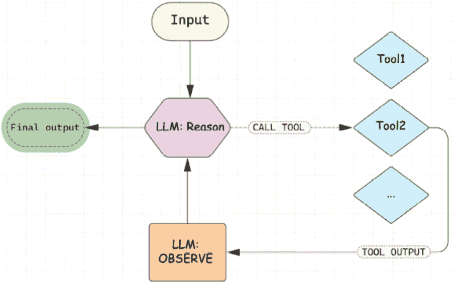
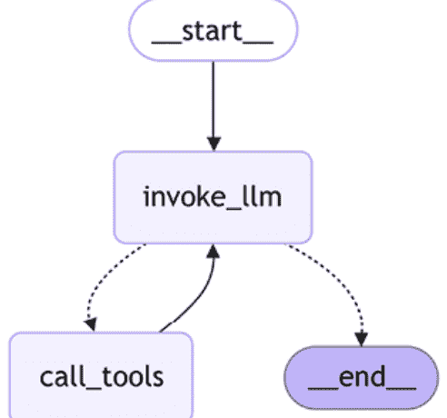
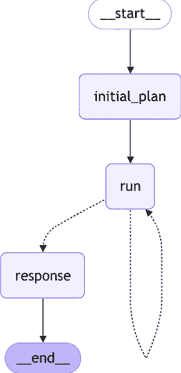
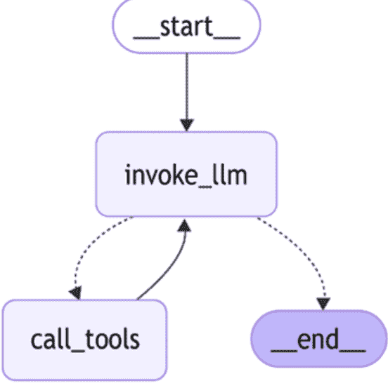

# 5 构建智能智能体

随着生成式 `AI` 的日益普及，我们开始使用 `LLM` 处理更开放、复杂的任务，这些任务需要关于新事件的知识或与世界进行交互。这通常被称为智能体应用（`agentic applications`）。我们将在本章稍后定义什么是智能体，但你可能已经在媒体上看到这个短语：2025 年是智能体 `AI` 之年。例如，在最近引入的包含复杂开放式任务的 `RE-Bench` 基准中，`AI` 智能体在某些设置下优于人类（例如，在 30 分钟的思考预算内），或在某些特定任务上（如编写 `Triton` 内核）。

为了理解实践中如何构建这些智能体能力，我们将从讨论与 `LLM` 的工具调用（`tool calling`）以及它如何在 `LangChain` 中实现开始。我们将详细研究 `ReACT` 模式，以及 `LLM` 如何使用工具与外部环境交互并提高它们在特定任务上的性能。然后，我们将涉及如何在 `LangChain` 中定义工具以及提供哪些预构建工具。我们还将讨论如何开发你自己的自定义工具、处理错误以及使用高级的工具调用能力。作为一个实际示例，我们将查看使用工具通过 `LLM` 生成结构化输出与使用模型提供者提供的内置能力相比。

最后，我们将讨论什么是智能体，并研究使用 `LangGraph` 构建智能体的更高级模式，然后我们将使用 `LangGraph` 开发我们的第一个 `ReACT` 智能体——一个遵循“计划与解决”设计模式并使用网络搜索、`arXiv` 和维基百科等工具的研究型智能体。

简而言之，本章将涵盖以下主题：

- 什么是工具？

- 定义内置的 `LangChain` 工具和自定义工具

- 高级工具调用能力

- 将工具整合到工作流中

- 什么是智能体？

> 你可以在书籍 `GitHub` 仓库的 `chapter5/` 目录中找到本章的代码。请访问 https://github.com/benman1/generative_ai_with_langchain/tree/second_edition 获取最新更新。设置说明请参见第 2 章。如果你在运行代码时有任何问题或遇到问题，请在 `GitHub` 上创建 `issue` 或加入 `Discord`（https://packt.link/lang）参与讨论。

让我们从工具开始。与其直接定义什么是智能体，不如探索通过工具增强 `LLM` 在实践中实际上是如何运作的更有帮助。通过逐步这些这些，你将看到这些集成如何释放新能力。那么，工具到底是什么？它们是如何扩展 `LLM` 功能的？

## 什么是工具？

`LLM` 在海量语料库数据（如网络数据和书籍）上进行训练，这赋予了它们广博的知识，但限制了它们在需要领域特定或最新知识的任务中的有效性。然而，由于 `LLM` 擅长推理，它们可以通过工具与外部环境交互——工具是允许模型与外部世界交互的 `API` 或接口。这些工具使 `LLM` 执行特定任务并接收来自外部世界的反馈。

使用工具时，`LLM` 执行三个特定的生成任务：

- 1. 通过生成特殊标记和工具名称来选择要使用的工具。

- 2. 生成发送到工具的有效负载（`payload`）。

- 3. 根据初始问题和与工具的交互历史（针对本次运行）为用户生成响应。

现在是时候弄清楚 `LLM` 如何调用工具，以及我们如何让 `LLM` 具备工具感知能力（`tool-aware`）了。考虑一个有些人为但具有启发性的问题：*现任美国总统年龄乘以 132 的平方根是多少？*这个问题提出了两个特定挑战：

- 它引用了当前信息（截至 2025 年 3 月），这些信息可能落在模型的训练数据之外。

- 它需要精确的数学计算，`LLM` 可能无法仅通过自回归标记生成来正确回答。

与其强制 `LLM` 仅根据内部知识生成答案，不如让 `LLM` 访问两个工具：搜索引擎和计算器。我们期望模型能够确定需要哪些工具以及如何使用它们。

为了清晰起见，我们从一个简单的问题开始，通过创建始终返回相同响应的虚拟函数来模拟我们的工具。在本章晚些时候，我们将实现功能完整的工具并调用它们：

```python
question = "美国总统多大了?"
```

```python
raw_prompt_template = (
    "你可以访问一个搜索引擎，它可以根据查询提供"
    "关于事件和新闻的信息。根据问题，判断你是否需要"
    "额外的信息（回复 'SEARCH: <生成的查询>' 或如果你有足够的"
    "知识回答则回复 'RESPONSE <最终回答>'）。\n"
    "现在，回答用户问题：\n{QUESTION}"
)
```

```python
prompt_template = PromptTemplate.from_template(raw_prompt_template)
```

```python
result = (prompt_template | llm).invoke(question)
```

```python
print(result.response)
```

>> 让我们确保当 `LLM` 有足够的内部知识时，它会直接回答用户：


## LangChain 工具调用与 ReACT 模式

```python
question1 = "德国的首都是哪里？"
```

```python
result = (prompt_template | llm).invoke(question1)
```

```python
print(result.response)
```

> > RESPONSE: 柏林

最后，让我们通过将工具整合到提示词中为模型提供输出：

```python
query = "现任美国总统的年龄"
search_result = (
"唐纳德·特朗普 年龄 78 岁 1946年6月14日\n"
"唐纳德·特朗普 美国第45任和第47任总统唐纳德·特朗普是一位"
"美国政治家、媒体人物和企业家，自 2025 年 1 月 20 日起担任"
"美国第47任总统。他是共和党成员，此前于 2017 年至 2021 年担任"
"第45任总统。维基百科"
)
```

"根据给的问题，判断你是否需要从搜索引擎获取额外的"
"信息（回复 'SEARCH: '）"
"<生成的查询语句' 或你已有足够的信息来回答用户"
"则回复 'RESPONSE <最终回复>'。\n"
"今天是 {date}。"
"现在，请回答用户的问题，并"
"考虑到你之前的操作：\n"
"人类: {question}\n"
"AI: SEARCH: {query}\n"
"来自搜索的结果: {search_result}\n"
)

`prompt_template` = `PromptTemplate.from_template(raw_prompt_template)`

`result = (prompt_template | llm).invoke(`

```python
{"question": question, "query": query, "search_result": search_result, "date": "Feb 2025"}
```

```python
print(result.content)
```

```>> RESPONSE: 现任美国总统唐纳德·特朗普 78 岁了。

作为最后一步观察，如果搜索结果不成功，LLM 将尝试精炼查询：

```python
query = "current US president"
```

```python
search_result = ( "Donald Trump 45th and 47th U.S." )
```

`result = (prompt_template | llm).invoke(`

```python
{"question": question, "query": query, "search_result": search_result, "date": "Feb 2025"}
```

```python
print(result.content)
```

```>> SEARCH: Donald Trump age```

至此，我们已经演示了工具调用（tool calling）是如何工作的。请注意，我们提供的提示示例仅用于演示。其他基础模型 LLM 可能需要一些提示工程（prompt engineering），而我们的提示仅仅是一个插例。好消息是：使用工具比这些示例看起来要简单得多！

正如你所注意到的，我们在提示中描述了一切内容，包括工具描述和工具调用格式。如今，大多数 LLM 为工具调用提供了更好的 API，因为现代 LLM 是在帮助它们在此类任务中表现优异的数据集上进行后训练的。LLM 的创建者了解这些数据集是如何构建的。这就是为什么，通常你不需要在提示中自己整合工具描述；你只需要将提示和工具描述作为独立的参数提供，它们会在提供者端被合并为单个提示。一些较小的开源 LLM 期望工具描述是原始提示的一部分，但它们期望一个定义良好的格式。

LangChain 使开发流水线变得简单，LLM 可以调用不同的工具并提供许多实用的内置工具访问。让我们看看 LangChain 是如何处理工具的。

## LangChain 中的工具

对于大多数现代 LLM，为了使用工具，你可以将工具描述列表作为单独参数提供。在 LangChain 中一如既往，每个特定的集成实现都会将接口映射到提供者的 API。对于工具，这是通过 LangChain 的 `invoke` 方法中的 `tools` 参数实现的（以及其他一些有用方法，如 `bind_tools` 等，我们将在本章中学习）。

在定义工具时，我们需要以 OpenAPI 格式指定其架构（schema）。我们提供了工具的*标题（title）*和*描述（description）*，并指定了它的参数（每个参数都有*类型（type）*、*标题（title）*和*描述（description）*）。我们可以从各种格式继承此类架构，LangChain 会将其转换为 OpenAPI 格式。在接几个章节中，我们将演示如何为函数、文档字符串（docstrings）、Pydantic 定义或通过继承 `BaseTool` 类并直接提供描述来实现此。对于 LLM 来说，工具是任何具有 OpenAPI 规范的东西——换句话说，它可以被外部机制调用。

LLM 本身并不关心这种机制，它只产生何时以及如何调用工具的指令。对于 LangChain 来说，工具也是我们在执行程序时可以被调用的东西（我们稍后会看到工具继承自 `Runnables`）。

在*标题（title）*和*描述（description）*字段中使用的措辞至关重要，你可以将其视为提示工程练习的一部分。更好的措辞有助于 LLM 在何时以及如何调用特定工具上做出更好的决策。请注意，对于更复杂的工具，编写这样的架构可能是繁琐的，我们将在本章稍些时候看到一种更简单的定义工具的方法：

```python
search_tool = {
  "title": "google_search",
  "description": "根据查询从 Google 搜索引擎返回最新事件和新闻",
  "type": "object",
  "properties": {
    "query": {
      "description": "发送到搜索引擎的查询语句",
      "title": "search_query",
      "type": "string"
    }
  },
  "required": ["query"]
}
```

`result = llm.invoke(question, tools=[search_tool])`

如果我们检查 `result.content` 字段，它将是空的。因为 LLM 决定调用工具，而输出消息包含该操作的提示。底层发生的情况是 LangChain 将模型提供者的特定输出格式映射到统一的工具调用格式：

```python
print(result.tool_calls)
```

> > [('name': 'google_search', 'args': {'query': 'age of Donald Trump'}, 'id': '6ab0de4b-f350-4743-a4c1-d6f6fce9d34', 'type': 'tool_call')]

请记住，某些模型提供者可能会返回非空内容，即使在工具调用的情况下（例如，关于模型决定调用工具的推理）。你需要查看模型提供者的规范以如何处理这些情况。正如我们看到的，LLM 返回了一个工具调用数组——每个字典包含一个唯一标识符、要调用的工具名称以及提供给此工具的参数。让我们进入下一步并再次调用模型：

```python
from langchain_core.messages import SystemMessage, HumanMessage, ToolMessage

tool_result = ToolMessage(content="Donald Trump 78 years June 14, 1946\n", tool_call_id=step1.tool_calls[0]["id"])

step2 = llm.invoke([HumanMessage(content=question), step1, tool_result], tools=[search_tool])

assert len(step2.tool_calls) == 0

print(step2.content)
```

> > 唐纳德·特朗普 78 岁。

`ToolMessage` 是 LangChain 中的一种特殊消息，允许你将工具的输出反馈给模型。此类消息的 `content` 字段包含工具输出，特殊的 `tool_call_id` 将其映射到特定的工具调用。

始终向 LLM 传递工具列表可能是奇怪的（因为通常情况下这种列表是固定的）。因此，LangChain 的 `Runables` 提供了一个 `bind` 方法，它可以记住参数并将其添加到每次调用中。看下面的代码：

```python
llm_with_tools = llm.bind(tools=[search_tool])

llm_with_tools.invoke(question)
```

这是因为 `bind` 已经“记住”了你的工具列表。本质上，你不再需要在每次 `invoke` 方法中传递 `tools` 参数。所以，调用上述代码与以下代码等同：

```python
## REACT（推理与行动）

正如你可能想到的，LLM 在生成最终回复之前可以调用多个工具（下一个要调用的工具或发送到此工具的负载可能取决于之前工具调用的结果）。这是普斯顿大学和 Google 研究的研究人员在2022年提出的 ReACT 方法：*Reasoning and ACT (https://arxiv.org/abs/2210.03629)*。这个想法很简单——我们应该让 LLM 访问工具以与外部环境交互，并让 LLM 循环：

- **Reason（推理）**：生成关于当前情况的观察和解决任务的文本输出。
- **Act（行动）**：根据上述推理采取行动（通过调用工具交互，或回答用户）。

已经证明，与我们在第 3 章讨论的 CoT 提示相比，REACT 有助于减少幻觉率。



图 5.1: ReACT 模式

让我们亲手构建一个 ReACT 应用。首先，让我们创建模拟的搜索和计算器工具：

```python
import math

def mocked_google_search(query: str) -> str:
    print(f"CALLED GOOGLE_SEARCH with query={query}")
    return "Donald Trump is a president of USA and he's 78 years old"

def mocked_calculator(expression: str) -> float:
    print(f"CALLED CALCULATOR with expression={expression}")
    if "sqrt" in expression:
        return math.sqrt(78*132)
    return 78*132
```

在下一节中，我们将看到如何构建实际工具。
现在，让我们为计算器工具定义一个模式（schema），并让 LLM 知到它可以使用的两个工具。我们还将使用已经熟悉的构建块——`ChatPromptTemplate` 和 `MessagesPlaceholder`，在调用我们的图时前置一个预定义的系统消息：

```python
from langchain.prompts import ChatPromptTemplate, MessagesPlaceholder
```

```python
calculator_tool = {
  "title": "calculator",
  "description": "计算数学表达式",
  "type": "object",
  "properties": {
    "expression": {
      "description": "由计算器评估的数学表达式",
      "title": "expression",
      "type": "string",
    }
  },
  "required": ["expression"]
}
```

`prompt = ChatPromptTemplate.from_messages([
    ("system", "始终使用计算器进行数学计算，并使用 Google Search 获取有关最新事件和新闻的信息."),
    MessagesPlaceholder(variable_name="messages"),
])`

`llm_with_tools = llm.bind(tools=[search_tool, calculator_tool]).bind(prompt=prompt)`

现在我们已经有了一个可以调用工具的 LLM，让我们创建所需的节点吧。我们需要一个调用另一个 LLM 的函数，另一个一个调用工具并返回工具调用结果的函数（通过向状态中的消息列表添加 `ToolMessages`），以及一个决定编排器应该继续调用工具还是可以将结果返回给用户的函数：

```python
from typing import TypedDict

from langgraph.graph import MessagesState, StateGraph, START, END
```

```python
def invoke_llm(state: MessagesState):
    return {"messages": [llm_with_tools.invoke(state["messages"])]}

def call_tools(state: MessagesState):
    last_message = state["messages"][-1]
    tool_calls = last_message.tool_calls
    new_messages = []

    for tool_call in tool_calls:
        if tool_call["name"] == "google_search":
            tool_result = mocked_google_search(**tool_call["args"])
            new_messages.append(ToolMessage(content=tool_result,
            tool_call_id=tool_call["id"]))
        elif tool_call["name"] == "calculator":
            tool_result = mocked_calculator(**tool_call["args"])
            new_messages.append(ToolMessage(content=tool_result,
            tool_call_id=tool_call["id"]))
        else:
            raise ValueError(f"{tool_call['name']} is not defined!")
    return {"messages": new_messages}

def should_run_tools(state: MessagesState):
    last_message = state["messages"][-1]
    if last_message.tool_calls:
        return "call_tools"
    return END
```

现在让我们将所有内容整合到 LangGraph 工作中：

```python
builder = StateGraph(MessagesState)
builder.add_node("invoke_llm", invoke_llm)
builder.add_node("call_tools", call_tools)
builder.add_edge(START, "invoke_llm")
builder.add_conditional_edges("invoke_llm", should_run_tools)
builder.add_edge("call_tools", "invoke_llm")
graph = builder.compile()
```

```python
question = "What is a square root of the current US president's age multiplied by 132?"

result = graph.invoke({"messages":[HumanMessage(content=question)]})

print(result['messages'][-1].content)
```

>> CALLED GOOGLE SEARCH with query=age of Donald Trump

```
CALLED CALCULATOR with expression=78 * 132
```

```
CALLED CALCULATOR with expression=sqrt(10296)
```

78 乘以 132（即 10296）的平方根约为 101.47。

这演示了 LLM 如何通过多次调用来处理复杂问题——首先是 Google Search，然后是两次调用 Calculator，并且每次都利用之前收到的信息来调整自己的行动。这就是 ReACT 模式的实际运作。

到此，我们已经通过自己构建学习了 ReACT 模式的工作原理。好消息是，LangGraph 提供了内置的 ReACT 模式实现，因此你不需要自己实现它：

```python
from langgraph.prebuilt import create_react_agent
```


# ReACT 工作流与自定义工具

## 预构建的 ReACT 工作流

以下代码使用 `create_react_agent` 创建一个 ReACT 代理，其包含搜索引擎和计算器两个工具，并指定了系统提示词：

```python
agent = create_react_agent(
    llm=llm,
    tools=[search_tool, calculator_tool],
    prompt=system_prompt
)
```



图 5.2: LangGraph 上预构建的 ReACT 工作流

这正是我们之前看到的——LLM 不断调用工具，直到决定停止并将答案返回给用户。让我们来测试一下！

当我们流式处理 LangGraph 时，我们会获得图状态更新的新事件。我们对状态中的 `message` 字段感兴趣。让我们打印出新增的消息：

```python
for event in agent.stream({"messages": [("user", query)]}):
    update = event.get("agent", event.get("tools", {}))
    for message in update.get("messages", []):
        message.pretty_print()
```

输出示例：

```
==================== Ai Message
============================================

## Tool Calls:
duckduckgo_search (a01a4012-bfc0-4eae-9c81-f11fd3ecb52c)
Call ID: a01a4012-bfc0-4eae-9c81-f11fd3ecb52c

## Args:
query: weather in Munich tomorrow

============================== Tool Message
==============================
Name: duckduckgo_search
明天慕尼黑清晨的温度为 4 °C... <TRUNCATED>

============================= Ai Message
================================
明天慕尼黑的天气将是 5°C，早晨降雨概率为 0%。风速为 11 km/h。晚些时候，气温将达到 53°F（约 12°C）。早晨天气晴朗。
```

我们的代理由消息列表表示，因为这是 LLM 期望的输入和输出。当我们深入研究代理架构并在下一章中讨论它时，我们会再次看到这种模式。

## 现有工具类型

现在，让我们简单提一下 LangChain 中已经提供的其他类型的工具：

- **增强 LLM 知识的工具**（除了使用搜索引擎外）：
  - 学术研究：arXiv 和 PubMed
  - 知识库：Wikipedia 和 Wikidata
  - 财务数据：Alpha Vantage、Polygon 和 Yahoo Finance
  - 天气：OpenWeatherMap
  - 计算：Wolfram Alpha

- **增强生产力的工具**：你可以与 Gmail、Slack、Office 365、Google Calendar、Jira、Github 等进行交互。例如，`GmailToolkit` 提供了 `GmailCreateDraft`、`GmailSendMessage`、`GmailSearch`、`GmailGetMessage` 和 `GmailGetThread` 工具，允许你使用 Gmail 账户搜索、检索、创建和发送消息。你可以看到，不仅可以为 LLM 提供关于用户的额外上下文，而且通过这些工具，LLM 可以执行实际上影响外部环境的操作，例如在 GitHub 上创建拉取请求或在 Slack 上发送消息！

- **让 LLM 访问代码解释器的工具**：这些工具通过远程启动隔离容器并允许 LLM 访问该容器来提供代码解释器。这些工具需要提供沙箱的供应商 API 密钥。LLM 特别擅长编程，一种广泛使用的模式是让 LLM 通过编写代码来解决某些复杂任务，而不是让它生成代表任务解决方案的 Token。当然，你应该谨慎执行 LLM 生成的代码，这就是为什么隔离沙箱起着巨大的作用。一些示例包括：
  - 代码执行：Python REPL 和 Bash
  - 云服务：AWS Lambda
  - API 工具：GraphQL 和 Requests
  - 文件操作：File System

- **通过编写和执行 SQL 代码让 LLM 访问数据库的工具**：例如，`SQLDatabase` 包含了获取数据库及其对象相关信息以及执行 SQL 查询的工具。你还可以通过 `GoogleDriveLoader` 访问 Google Drive，或使用 `FileManagementToolkit` 中常用的文件系统工具进行操作。

- **其他工具**：这些工具集成了第三方系统并允许 LLM 收集额外信息或执行操作。还有工具可以整合来自 Google Maps、NASA 以及其他平台和组织的数据检索。

- **用于其他 AI 系统或自动化的工具**：
  - 图像生成：DALL-E 和 Imagen
  - 语音合成：Google Cloud TTS 和 Eleven Labs
  - 模型访问：Hugging Face Hub
  - 工作流自动化：Zapier 和 IFTTT

任何带有 API 的外部系统如果像这样增强 LLM，就可以被封装为工具：
- 为用户或工作流提供相关的领域知识
- 允许 LLM 对用户的行为执行操作

在与 LangChain 集成此类工具时，请考虑以下方面：
- **身份验证 (Authentication)**：安全地访问外部系统
- **负载 (Payload schema)**：为输入/输出定义适当的数据结构
- **错误处理 (Error handling)**：为失败和边缘情况制定计划
- **安全考量 (Safety considerations)**：例如，在开发 SQL 转文本代理时，限制为只读操作以防止意外修改

因此，一个重要的工具包是 `RequestsToolkit`，它允许人们轻松地封装任何 HTTP API：

```python
from langchain_community.agent_toolkits.openapi.toolkit import RequestsToolkit
from langchain_community.utilities.requests import TextRequestsWrapper
```

更多集成工具参见：https://python.langchain.com/docs/integrations/tools/.

## 自定义工具

我们已经了解了 LangGraph 提供的各种内置工具。现在是时候讨论你如何创建自己的工具了，除了我们之前通过提供 API 规范并使用 `RequestsToolkit` 封装第三方 API 时看到的示例之外。让我们开始吧！

## 将 Python 函数封装为工具

任何 Python 函数（或可调用对象）都可以封装为工具。正如我们记忆的，LangChain 中的工具应该有一个名称、一个描述和一个参数架构。让我们基于 Python 的 `numexpr` 库构建一个我们自己的计算器——这是一个基于 NumPy（https://github.com/pydata/numexpr）的快速数值表达式评估器。我们将使用一个特殊的 `@tool` 装饰器将我们的函数封装为工具：

```python
import math
from langchain_core.tools import tool
import numexpr as ne

@tool
def calculator(expression: str) -> str:
    """计算单个数学表达式，包括
    复数。

    运算符之间务必添加 *，例如：
    73i -> 7*3i
    7pi**2 -> 7*pi**2
    """
    math_constants = {"pi": math.pi, "i": 1j, "e": math.exp}
    result = ne.evaluate(expression.strip(), local_dict=math_constants)
    return str(result)
```

让我们探索一下我们拥有的计算器对象！注意 LangChain 自动从文档字符串（docstring）和类型提示继承了名称、描述和参数架构。请注意，我们使用了少样本（few-shot）技术（在第 3 章中讨论），通过在文档字符串中添加两个示例来教 LLM 如何为我们的工具准备负载：

```python
from langchain.core.tools import BaseTool

assert isinstance(calculator, BaseTool)

print(f"Tool schema: {calculator.args_schema.model_json_schema()}")
```

输出：

```text
>> Tool schema: {'description': 'Calculates a single mathematical expression, incl. complex numbers.\n\nAlways add * to operations, examples:\n 73i -> 7*3i 7pi**2 -> 7*pi**2', 'properties': {'expression': {'title': 'Expression', 'type': 'string'}, 'required': ['expression'], 'title': 'calculator', 'type': 'object'}}
```

让我们尝试用我们的新工具评估一个包含复数的表达式，复数通过特殊的虚数单位 `i` 扩展了实数，`i` 具有 `i**2=-1` 的属性：

```python
query = "How much is 2+3i squared?"

agent = create_react_agent(llm, [calculator])

for event in agent.stream({"messages": ["user", query]}, stream_mode="values"):
    event["messages"][-1].pretty_print()
```

输出：

```text
>> ========================================Human Message
==================================
How much is 2+3i squared?

========================================= Ai Message
=========================================

Tool Calls:
calculator (9b06de35-a31c-41f3-a702-6e20698bf21b)
Call ID: 9b06de35-a31c-41f3-a702-6e20698bf21b
Args:
expression: (2+3*i)**2

Tool Message
Name: calculator
(-5+12j)
Ai Message
(2+3i)^2 = -5+12i.
```

只需几行代码，我们就成功扩展了 LLM 的能力使其能够处理复数。现在我们可以组合最初开始的那个示例：

```python
question = "What is a square root of the current US president's age multiplied by 132?"

system_hint = "Think step-by-step. Always use search to get the fresh information about events or public facts that can change over time."

agent = create_react_agent(
    llm, [calculator, search],
    state_modifier=system_hint
)

for event in agent.stream({"messages": [("user", question)]}, stream_mode="values"):
    event["messages"][-1].pretty_print()
    print(event["messages"][-1].content)
```

输出：

```text
>> The square root of Donald Trump's age multiplied by 132 is approximately 101.47.
```

我们没有在书中提供完整的输出（你可以在 GitHub 上找到），但如果你运行这段代码段，你应该看到 LLM 能够逐步查询工具：

1. 它使用查询语句 "current US president" 调用了搜索引擎。
2. 然后，它再次使用查询语句 "donald trump age" 调用了搜索引擎。
3. 作为最后一步，LLM 使用表达式 "sqrt(78*132)" 调用了计算器工具。
4. 最后，它向用户返回了正确答案。

每一步，LLM 都根据之前收集的信息进行推理，然后使用适当工具的行动——这就是 ReACT 方法的核心。

## 从 Runnable 创建工具

有时，LangChain 可能无法从函数推导出通过的描述或参数架构，或者我们可能在使用难以用装饰器封装的复杂可调用对象。例如，我们可以将另一个 LangChain 链 LangGraph 图作为工具。我们可以通过显式指定所有需要的描述从任何 Runnable 创建工具。让我们用另一种方式从函数创建计算器，并调整重试行为（在案例中，我们将重试三次，并在连续尝试之间添加指数退避）：

> 请注意我们使用了上面相同的函数，但删除了 `@tool` 装饰器。

```python
from langchain_core.runnables import RunnableLambda, RunnableConfig
from langchain_core.tools import tool, convert_runnable_to_tool

def calculator(expression: str) -> str:
    math_constants = {"pi": math.pi, "i": 1j, "e": math.exp}
    result = ne.evaluate(expression.strip(), local_dict=math_constants)
    return str(result)

calculator_tool = convert_runnable_to_tool(
    RunnableLambda(calculator),
    name="calculator",
    description="Calculates a single mathematical expression, incl. complex numbers.\n\nAlways add * to operations, examples:\n73i -> 7*3i\n7pi**2 -> 7*pi**2",
)
```

输出：

```
7pi**2 -> 7*pi**2
Args schema: {'properties': {'expression': {'title': 'Expression', 'type': 'string'}, 'required': ['expression'], 'title': 'calculator', 'type': 'object'}
```

让我们结合 LLM 一起测试：

```python
tool_call = llm.invoke("How much is (2+3i)**2"), tools=[calculator_tool]).tool_calls[0]

print(tool_call)
```

输出：

```python
>> {'name': 'calculator', 'args': {'expression': '(2+3i)**2', 'id': 'f8be9cbc-4bdc-4107-8cfb-fd84f5030299', 'type': 'tool_call'}
```

我们可以在运行时调用计算器工具，并将其传递给 LangGraph 配置：

```python
math_constants = {"pi": math.pi, "i": 1j, "e": math.exp}

config = {"configurable": {"math_constants": math_constants}}

calculator_tool.invoke(tool_call["args"], config=config)
```

输出：

```python
>> (-5+12j)
```

通过这些，我们学习了如何通过向 LangChain 提供额外细节，将任何 Runnable 轻松转换为工具，以确保 LLM 能够正确处理该工具。

## 子类 StructuredTool 或 BaseTool

（此部分内容未提供完整文本，可能存在截图或后续章节内容。）


定义工具的另一种方法是通过子类 `BaseTool` 类来创建自定义工具。与其他方法一样，你必须指定工具的名称、描述和参数模式（schema）。你还需要实现一个或两个抽象方法：用于同步执行的 `run`，如果需要，用于异步行为的 `arun`（如果它与简单封装同步版本有所不同）。当你的工具需要是有状态的（例如，为了维持长连接的客户端）或者其逻辑太复杂，无法用单个函数或 Runnable 实现时，这种选项特别有用。

如果你希望获得比 `@tool` 装饰器更多的灵活性，但又不想实现自己的类，那么有一种折中方法。你也可以使用 `StructuredTool.from_function` 类方法，它允许你仅几行代码即可显式地指定工具的元参数，如描述或 `args_schema`：

```python
from langchain_core.tools import StructuredTool

calculator_tool = StructuredTool.from_function(
name="calculator",
description=(
    "计算单个数学表达式，包括复数."),
func=calculator,
args_schema=CalculatorArgs
)
```

```python
tool_call = llm.invoke(
"How much is (2+3i)**2", tools=[calculator_tool]).tool_calls[0]
```

此时，有必要对同步和异步实现进行最后一点说明。如果除了你的工具之外的底层函数是同步函数，LangChain 将通过在单独线程中启动它来将其封装为工具的异步实现。在大多数情况下，这并不重要，但如果你在意创建单独线程的额外开销，你有两个选择——要么子类 `BaseTool` 并重写异步实现，或者创建函数的独立异步实现并将其作为协程参数传递给 `StructuredTool.from_function`。你也可以只提供异步实现，但你将无法以同步方式调用你的工作流。

最后，让我们再次看看创建 LangChain 工具的三种方案，以及何时何时使用它们。

| 创建工具的方法 | 适用场景 |
| :--- | :--- |
| @tool 装饰器 | 你有一个具有清晰文档字符串的函数，且该函数在代码的任何地方未被使用 |
| convert_runnable_to_tool | 你有一个现有的 Runnable，或者你需要更详细地控制如何将参数或工具描述传递给 LLM（在这种情况下你通过 RunnableLambda 封装现有函数） |
| 子类 StructuredTool 或 BaseTool | 你对工具描述和逻辑有完全控制权（例如，你想区分处理同步和异步请求） |

表 5.1：创建 LangChain 工具的选项。

当 LLM 生成有效负载并调用工具时，它可能会产生幻觉或其他错误。因此，我们需要仔细考虑错误处理。

## 错误处理
我们已经在第3章中讨论过错误处理，但当你用工具增强 LLM 时，它变得更加重要；你更需要日志记录、异常处理等。额外的考虑是，思考你是否希望在其中一个工具失败时，你的工作流继续并尝试自动恢复。LangChain 有一个特殊的 `ToolException`，它允许其中一个工具失败时允许工作流继续并尝试自动恢复。

通过这些，我们学习了如何通过向 LangChain 提供额外细节，将任何 Runnable 轻松转换为工具，以确保 LLM能够正确处理该工具。

## 高级工具调用能力
许多大语言模型（LLM）为工具调用提供了额外的配置选项。首先，某些模型支持并行函数调用——具体来说，LLM 可以同时调用多个工具。LangChain 原生支持此功能，因为 `AIMessage` 的 `tool_calls` 字段是一个列表。当 `ToolMessage` 对象作为函数调用结果时，你应该仔细地将 `ToolMessage` 的 `tool_call_id` 字段与生成的负载（payload）匹配。这种对齐是必要的，以便 LangChain 和底层 LLM 在进行下一轮对话时可以将它们匹配在一起。

另一个高级能力是强制 LLM 调用工具，甚至调用特定的工具。通常情况下，LLM 会决定是否应该调用工具，以及如果需要，应该从提供的工具列表中选择哪一个。这通常通过传递给 `invoke` 方法的 `tool_choice` 和/或 `tool_config` 参数处理，但实现取决于模型提供商。Anthropic、Google、OpenAI 以及其他主要供应商的 API 略有不同，尽管 LangChain 尝试统一参数，在这种情况下，你应该通过模型提供商双检细节。

通常，可用选项如下：
- `"auto"`：LLM 可以直接响应或调用一个或多个工具。
- `"any"`：强制 LLM 通过调用一个或多个工具来响应。
- `"tool"` 或带有提供的工具列表的 `"any"`：强制 LLM 通过从受限列表中调用工具来响应。
- `"None"`：强制 LLM 在不调用工具的情况下响应。

另一个需要注意的重要点是，架构（schemas）可能会变得非常复杂——即，它们可能包含可空字段或嵌套字段、枚举，或引用其他架构。根据模型提供商的不同，某些定义可能不受支持（你会看到警告或编译错误）。尽管 LangChain 旨在实现跨供应商的无缝切换，但对于某些复杂的工作流，情况可能并非，因此请注意错误日志中的警告。有时，将提供的 schema 编译为模型提供商支持的 schema 是在尽力而为的基础上完成的——例如，如果类型为 `Union[str, int]` 的字段对应的底层 LLM 不支持工具调用中的 `Union` 类型，则它会被编译为 `str` 类型。你会收到警告，但在迁移过程中忽略此类警告可能会导致应用程序的行为发生不可预测的变化。

最后，值得提到的是，某些供应商（例如 OpenAI 或 Google）提供了自定义工具，如代码解释器或 Google 搜索，这些工具由模型自身调用，模型将使用工具的输出来准备最终生成。这种方法降低了延迟和成本。在这种情况下，你通常为 LangChain 封装提供使用提供商 SDK 创建的自定义工具，而不是使用 LangChain 构建的工具（即不继承自 `BaseTool` 类的工具），这意味着你的代码无法跨模型迁移。

## 将工具整合到工作流
既然我们已经知道了如何创建和使用工具，让我们讨论如何将工具调用范式更深入地整合到我们开发的工作流中。

## 控制生成
在第 3 章中，我们开始讨论控制生成，即你希望 LLM 遵循特定的架构。我们不仅可以通过创建更复杂、更可靠的解析器来改进解析工作流，还可以通过更严格地强制 LLM 遵循某些架构。调用工具需要控制生成，因为生成的负载应该遵循特定的架构，但我们可以退后一步，用遵循预期架构的强制工具调用来代替我们预期的架构。LangChain 有一个内置机制来帮助实现——LLM 拥有 `with_structured_output` 方法，该方法接受一个 Pydantic 模型作为架构，将其转换为工具，通过通过给定提示词强制其调用此工具来调用 LLM，并通过将其编译为相应的 Pydantic 模型实例来解析输出。

在本章稍后部分，我们将讨论计划与解决代理（plan-and-solve agent），所以让我们开始准备一个构建模块。让我们的 LLM 为给的操作生成一个计划，但不是解析该计划，而是将其定义为 Pydantic 模型（`Plan` 是 `Steps` 的列表）：

```python
from pydantic import BaseModel, Field

class Step(BaseModel):
    """解决任务的计划中的步骤。"""
    step: str = Field(description="步骤的描述")

class Plan(BaseModel):
    """解决任务的计划。"""
    steps: list[Step]
```

请记住，我们使用了嵌套模型（一个字段引用另一个字段），但 LangChain 会为我们编译一个统一的架构。让我们组合一个简单的工作流并运行它：

```python
prompt = PromptTemplate.from_template(
    "准备一个逐步解决给定任务的计划。\n"
    "TASK:\n{task}\n"
)

result = (prompt | llm.with_structured_output(Plan)).invoke(
    "如何在 Amazon 上写一本关于生成式 AI 的畅销书？"
)
```

如果我们检查输出，会看到得到了一个 Pydantic 模型作为结果。我们不再需要解析输出；我们直接获得了一系列特定的步骤（稍后，我们将看到如何进一步使用它）：

```python
assert isinstance(result, Plan)
print(f"步骤数量: {len(result.steps)}")

for step in result.steps:
    print(step.step)
    break

# >> 步骤数量: 21
# **1. 想法生成与验证：****
```

## 供应商提供的控制生成
另一种方法取决于供应商的。某些基础模型提供商提供了额外的 API 参数，可以指示模型生成结构化输出（通常是 JSON 或枚举）。你可以像上面一样使用 `with_structured_output` 强制模型使用 JSON 生成，但提供另一个参数 `method="json mode"`（并双检底层模型提供商是否支持 JSON 的控制生成）：

```python
plan_schema = {
  "type": "ARRAY",
  "items": {
    "type": "OBJECT",
    "properties": {
      "step": {"type": "STRING"},
    }
  }
}
query = "如何在 Amazon 上写一本关于生成式 AI 的畅销书？"
```

```python
result = (prompt | llm.with_structured_output(schema=plan_schema, method="json mode")).invoke(query)
```

注意，JSON schema 不包含字段的描述，因此通常，你的提示词应该更详细且包含更多信息。但作为输出，我们得到了一个完全限定的字典：

```python
assert isinstance(result, list)
print(f"步骤数量: {len(result)}")

# >> 步骤数量: 10
# 'step': '1. 定义你的利基市场和目标受众。生成式 AI 是一个广泛的话题。关注一个特定领域，如营销、艺术、音乐或写作领域的生成式 AI。识别你的理想读者（例如营销人员、艺术家、开发者）。'
```

你可以直接指示 LLM 遵循控制生成指令。注意，特定的参数和功能可能因模型供应商而异（例如，OpenAI 模型使用 `response_format` 参数）。让我们看看如何指示 Gemini 返回 JSON：

```python
from langchain_core.output_parsers import JsonOutputParser

llm_json = ChatVertexAI(
    model_name="gemini-1.5-pro-002",
    response_mime_type="application/json",
    response_schema=plan_schema
)

result = (prompt | llm_json | JsonOutputParser()).invoke(query)
assert isinstance(result, list)
```

我们还可以要求 Gemini 返回枚举——换句话说，只返回一组值中的一个值：

```python
from langchain_core.output_parsers import StrOutputParser

response_schema = {"type": "STRING", "enum": ["positive", "negative", "neutral"]}

prompt = PromptTemplate.from_template(
    "分类以下客户评论的基调:"
    "\{review}\n"
)

review = "我喜欢这部电影!"
```

```python
llm_enum = ChatVertexAI(model_name="gemini-1.5-pro-002", response_mime_type="text/x.enum",
response_schema=response_schema)
```

```python
result = (prompt | llm_enum | StrOutputParser()).invoke(review)

print(result)
```

`positive` 通过 `method="json_mode"` 参数或允许将自定义 `kwargs` 传递给模型抽象了模型提供者的实现细节。某些受控生成能力是模型特定的。请检查您的模型文档以获取支持的 schema 类型、约束和参数。

## ToolNode
为了简化代理（agent）开发，LangGraph 构建了内置 `ToolNode` 和 `tool_conditions` 等。`ToolNode` 会检查 `messages` 中的最后一条消息（你可以重新定义键名）。如果此消息包含工具调用（tool calls），它将调用相应的工具并更新状态。另一方面，`tool_conditions` 是一个条件边，用于检查是否应该调用 `ToolNode`（否则则结束）。

现在我们可以在几分钟内构建我们的 ReACT 引擎：

```python
from langgraph.prebuilt import ToolNode, tools_condition
```

```python
def invoke_llm(state: MessagesState):
    return {"messages": [llm_with_tools.invoke(state["messages"])}

builder = StateGraph(MessagesState)
builder.add_node("invoke_llm", invoke_llm)
builder.add_node("tools", ToolNode([search, calculator]))
builder.add_edge(START, "invoke_llm")
builder.add_conditional_edges("invoke_llm", tools_condition)
builder.add_edge("tools", "invoke_llm")
graph = builder.compile()
```

## Tool-calling paradigm
工具调用（Tool calling）是一种非常强大的设计范式，要求改变你开发应用程序的方式。在许多情况下，与其进行多轮提示词工程并多次尝试改进提示词，不如思考是否可以要求模型调用工具。

假设我们正在开发一个处理合同取消的代理，它应该遵循某些业务逻辑。首先，我们需要理解合同的开始日期（而处理日期可能会困难！）。如果你尝试编写一个可以正确处理此类情况的提示词，你会发现这可能非常困难：

```python
examples = [
"我两年前签署了合同",
"我是在去年二月与贵公司开始交易的",
"我们的合同是年前 3 月 24 日开始的"
]
```

相反，强制模型调用工具（甚至可以通过 ReACT 代理！）。例如，我们在 Python 中有两个非常原生工具——`date` 和 `timedelta`：

```python
from datetime import date, timedelta

@tool
def get_date(year: int, month: int = 1, day: int = 1) -> date:
    """给定年、月、日返回日期对象。
    """
    默认月份和日期为 1（1月）和 1。
    YYYY-MM-DD 格式的示例：
```

2023-07-27 -> date(2023, 7, 27)

2022-12-15 -> date(2022, 12, 15)

March 2022 -> date(2022, 3)

2021 -> date(2021)

```python
return date(year, month, day).isoformat()
```

@tool

```python
def time_difference(days: int = 0, weeks: int = 0, months: int = 0, years: int = 0) -> date:
```

> """根据相对于当前日期的天、周、月、年的差返回日期。"""

默认情况下，天、周、月、年均为 0。

示例：

two weeks ago -> time_difference(weeks=2)

last year -> time_difference(years=1)

```python
dt = date.today() - timedelta(days=days, weeks=weeks)
new_year = dt.year+(dt.month-months) // 12 - years
new_month = (dt.month-months) % 12
```

```python
return dt.replace(year=new_year, month=new_month)
```

现在它运行得非常灵完美：

```python
from langchain_google_vertexai import ChatVertexAI
```

```python
llm = ChatVertexAI(model="gemini-1.5-pro-002")
```


# 使用工具调用来构建代理

我们学习了如何使用工具（或函数调用）来增强 LLM 在复杂任务上的性能。这是代理背后的基本架构模式之一——现在是讨论什么是代理了。

## 什么是代理？

代理（Agents）是如今生成式 AI 最热门的话题之一。人们经常讨论代理，有很多定义。LangChain 本身将代理定义为“一个使用 LLM 来决定应用程序流程的系统”。作为 Python 开发者，你可能熟悉通过鸭类型（duck typing）来确定对象的行为，所谓的鸭子测试：“如果它走起来像鸭子，叫起来像鸭子，那么它就是鸭子。”基于这一概念，让我们描述生成式 AI 背景下代理的一些属性：

- 代理帮助用户解决非确定性任务，高级代理甚至代表用户采取行动。由于为了解决任务，代理通常执行多个步骤：推理（生成新信息）、行动（与环境交互）、观察（纳入环境反馈）。

- 代理利用 LLM 进行推理。保留代理的行为——代理工作流——是 LangGraph 的核心概念。虽然 LangGraph 提供了丰富的构建块（如内存管理、工具调用），但其主要设计模式专注于管理 LLM 在执行任务时的流和自主性。

### 示例：创建 ReACT 代理

```python
agent = create_react_agent(
    llm, [get_date, time_difference], prompt="提取合同的开始日期。当前年份是2025。"
)
```

例如 `examples` 中的内容：

```python
result = agent.invoke({"messages": ["user", example]})
print(example, result["messages"][-1].content)
```

> >> 我两年前签署了合同 合同于 2023-02-07 开始。

> 我是在去年二月与贵公司开始交易的 合同于 2024-02-01 开始。

> 我们的合同是年前 3 月 24 日开始的 合同于 2023-03-24 开始。

## Plan-solve 代理

当我们面对复杂任务时，人类通常会做什么？计划！2023 年，Lei Want 等人证明了计划解决提示（plan-and-solve prompting）可以提高推理。多项研究表明，随着提示词复杂性（特别是长度和指令数量）的增加，LLM 的性能往往会下降。

因此，需要记住的第一种设计模式是任务分解——将复杂任务分解为一系列较小的任务，保持提示词简单并专注于单一任务，不要犹豫在提示词中添加示例。在案例中，我们将开发一个研究助手。

面对复杂任务，让我们首先要求 LLM 制定解决该任务的详细计划，然后使用相同的 LLM 执行每一步。记住，归结底，LLM 是根据输入令牌自回归地生成令牌的。像 ReACT 或计划解决这样的简单模式有助于我们更好地利用它们的隐含推理能力。

首先，我们需要定义规划器。这里没有新内容；我们在使用已经讨论过的构建块——聊天提示词模板和带有 Pydantic 模型的控制生成：

```python
from pydantic import BaseModel, Field
from langchain_core.prompts import ChatPromptTemplate

class Plan(BaseModel):
    """未来遵循计划"""
    steps: list[str] = Field(
        description="需要遵循的不同步骤，应排序"
    )
```

```python
system_prompt_template = (
    "对于给任务，请制定一个分步骤的计划。"
    "该计划应包含各个任务，这些任务如果执行正确，将产生正确的答案。不要添加任何多余的步骤。"
    "最后一步的结果应该是最终答案。确保每一步都包含了所需的信息——不要跳过步骤。"
)

planner_prompt = ChatPromptTemplate.from_messages(
    [("system", system_prompt_template),
     ("user", "Prepare a plan how to solve the following\ntask:\n{task}\n")],
)

planner = planner_prompt | ChatVertexAI(
    model_name="gemini-1.5-pro-002", temperature=1.0
).with_structured_output(Plan)
```

对于步骤执行，让我们使用一个带有内置工具的 ReACT 代理——DuckDuckGo 搜索、来自 `arXiv` 和 `Wikipedia` 的检索器，以及我们在在本章之前开发的自定义计算器工具：

```python
from langchain.agents import load_tools

tools = load_tools(
    tool_names=["ddg-search", "arxiv", "wikipedia"],
    llm=llm
) + [calculator_tool]
```

接下来，让我们定义工作流状态。我们需要跟踪初始任务和最初生成的计划，并向状态中添加 `past_steps` 和 `final_response`：

```python
class PlanState(TypedDict):
    task: str
    plan: Plan
    past_steps: Annotated[list[str], operator.add]
    final_response: str

def get_current_step(state: PlanState) -> int:
    """返回当前待执行的步骤数。"""
    return len(state.get("past_steps", []))

def get_full_plan(state: PlanState) -> str:
    """返回带有步骤编号和过去结果的格式化计划。"""
    full_plan = []
    for i, step in enumerate(state["plan"]):
        full_step = f'#{i+1}. Planned step: {step}\n'
        if i < get_current_step(state):
            full_step += f'Result: {state["past_steps"][i]}\n'
        full_plan.append(full_step)
    return "\n".join(full_plan)
```

现在，是时候定义节点和边了：

```python
from typing import Literal
from langgraph.graph import StateGraph, START, END

final_prompt = PromptTemplate.from_template(
    "你是一个执行了计划的得力助手。"
    "根据执行结果，准备最终响应。\n"
    "不要假设任何事情\n任务：\n{task}\n\n带结果的计划：\n{plan}\n"
    "最终响应:\n"
)

async def _build_initial_plan(state: PlanState) -> PlanState:
    plan = await planner.invoke(state["task"])
    return {"plan": plan}

async def _run_step(state: PlanState) -> PlanState:
    plan = state["plan"]
    current_step = get_current_step(state)
    step = await execution_agent.invoke({
        "plan": get_full_plan(plan), 
        "step": plan.steps[current_step], 
        "task": state["task"]
    })
    return {"past_steps": [step["messages"][-1].content]}

async def _get_final_response(state: PlanState) -> PlanState:
    final_response = await (final_prompt | llm).invoke({
        "task": state["task"], 
        "plan": get_full_plan(state)
    })
    return {"final_response": final_response}

def _should_continue(state: PlanState) -> Literal["run", "response"]:
    if get_current_step(state) < len(state["plan"].steps):
        return "run"
    return "final_response"
```

并组合最终的图：

```python
builder = StateGraph(PlanState)
builder.add_node("initial_plan", _build_initial_plan)
builder.add_node("run", _run_step)
builder.add_node("response", _get_final_response)
builder.add_edge(START, "initial_plan")
builder.add_edge("initial_plan", "run")
builder.add_conditional_edges("run", _should_continue)
builder.add_edge("response", END)

graph = builder.compile()

from IPython.display import Image, display
display(Image(graph.get_graph().draw_mermaid_png()))
```




图 5.3：计划与解决型代理工作流

现在我们可以运行工作流了：

```
task = "写一份关于建立 AI 初创公司的战略性单页报告"

result = await graph.ainvoke({"task": task})
```

你可以在我们的 GitHub 上看到完整的输出，我们鼓励你亲自尝试。调查与给定任务的单一 LLM 提示词相比，你是否更喜欢这个结果，可能会特别有趣。

## 总结

在本章中，我们探索了如何通过集成工具和工具调用模式来增强大语言模型（LLMs），包括 ReACT 模式。我们从零开始构建了一个 ReACT 代理，然后展示了如何使用一行代码创建一个自定义代理。

接下来，我们深入探讨了受控生成技术——展示了如何让 LLM 调用任何工具或特定工具，并使其以结构化格式（如 JSON、枚举或 Pydantic 模型）返回响应。在此背景下，我们介绍了 LangChain 的 `with_structured_output` 方法，它将数据结构转换为工具模式，提示模型调用工具，解析输出并将其编译为相应的实例。

最后，我们使用 LangGraph 构建了第一个计划与解决型代理，应用了我们目前学习的所有概念：工具调用、ReACT、结构化输出等。在下一章中，我们将继续讨论代理开发并查看更高级的架构。

## 问题

- 1. LLM 使用工具的主要优势是什么？为什么它们很重要？
- 2. LangChain 的 `ToolMessage` 类如何促进 LLM 与外部环境之间的通信？
- 3. 解释 ReACT 模式。它的两个主要步骤是什么？它如何提高 LLM 的性能？
- 4. 你如何定义生成式 AI 代理？这与 LangChain 的定义有什么联系或区别？
- 5. 说明使用 `with_structured_output` 方法与直接使用受控生成相比的优缺点。
- 6. 如何在 LangChain 中通过编程方式定义一个自定义工具？
- 7. 解释 LangChain 中 `Runnable.bind()` 和 `bind_tools()` 方法的用途。
- 8. LangChain 如何处理工具执行期间发生的错误？有哪些可用选项？

我们在第 5 章中学习了 agent，这是一个工具调用（tool-calling）模式的示例：



图 6.1：LangGraph 上预构建的 REACT 工作流

让我们来看看有助于构建高性能 agent 的相对简单的设计模式。你将在不同领域和 agent 架构中看到这些模式的各种组合：

- **工具调用（Tool calling）：** LLM 经过训练可以通过工具调用进行受控生成。因此，在适当的情况下，将你的问题封装为工具调用问题，而不是创建复杂的提示词。记住，工具应该具有清晰的描述和属性名称，对它们进行实验是提示词工程的一部分。我们在第 5 章中讨论过这种模式。

- **任务分解（Task decomposition）：** 保持提示词相对简单。提供带有少量示例（few-shot examples）的特定指令，并将复杂任务拆分为更小的步骤。你可以让 LLM 对任务分解和规划过程拥有部分控制权，并通过外部编排器管理工作流。我们在第 5 章构建“规划并解决”（plan-and-solve）agent 时使用了这种模式。

- **协作与多样性（Cooperation and diversity）：** 如果在多个启用能力的 agent 实例之间引入协作，可以改进复杂任务的最终输出。通信、辩论和共享不同观点有所帮助，你还可以通过启动具有不同系统提示词、可用工具集的 agent 来从各种技能组合中受益。自然语言是此类 agent 通信的原生方式，因为 LLM是在自然语言任务上训练的。

- **反思与适应（Reflection and adaptation）：** 添加隐式的反思循环通常会提高复杂任务端到端推理的质量。LLM 通过调用工具从外部环境获取反馈（这些调用可能会失败或产生意外结果），但同时，LLM 可以继续迭代并从错误中自我恢复。作为一个夸张，记住我们经常使用“LLM 作为裁判”（LLM-as-a-judge），因此当我们要求 LLM 评估自己的推理并发现错误时添加循环，通常有助于它恢复。我们将在本章晚些时候学习如何构建自适应系统。

- **模型是非确定性的可以生成多个候选结果（Models are nondeterministic and can generate multiple candidates）：** 不要专注于单一输出；在 LLM 与外部环境交互寻找解决方案时，通过扩展潜在选项的维度来探索不同的推理路径。我们将在下文讨论 ToT（思维树）和语言 agent 树搜索（LATS）示例时详细研究这种模式。

- **以代码为中心的问题建模（Code-centric problem framing）：** 写代码对 LLM 来说非常自然，因此如果可能，尝试将问题建模为代码编写问题。这可能成为解决任务的一种非常有力的方法，特别是当你将其与代码执行沙箱、基于输出的改进循环、访问用于数据分析或可视化的各种强大库以及之后的生成步骤封装时。我们将在第 7 章中详细介绍。

两个重要的注释：第一，根据最佳软件开发实践开发你的 agent，并使它们敏捷、模块化且易于配置。这将允许你将多个专业的 agent 组合在一起，并让用户能够根据其特定任务轻松调整每个 agent。

其次，我们想要强调（再次强调！）评估和实验的重要性。我们将在第 9 章更详细地讨论评估。但记住，成功没有明确的路径。不同的模式在不同类型的任务上表现更好。尝试、实验、迭代，并且不要忘记评估你的工作结果。数据（如任务和预期输出）以及模拟器（LLM 与工具交互的安全方式）是构建真正复杂且有效的 agent 的关键。

现在我们已经建立了各种设计模式的心理地图，我们将通过讨论各种 agent 架构和查看示例来深入研究这些原则。我们将首先通过 agent 方法增强我们在第 4 章中讨论过的 RAG 架构。
