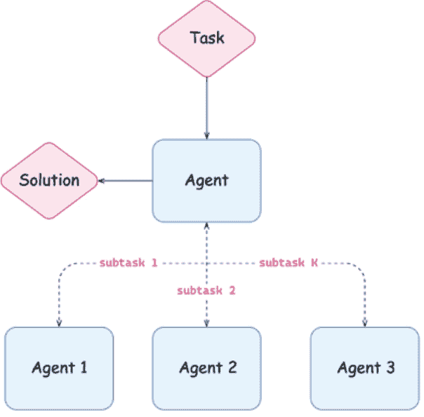
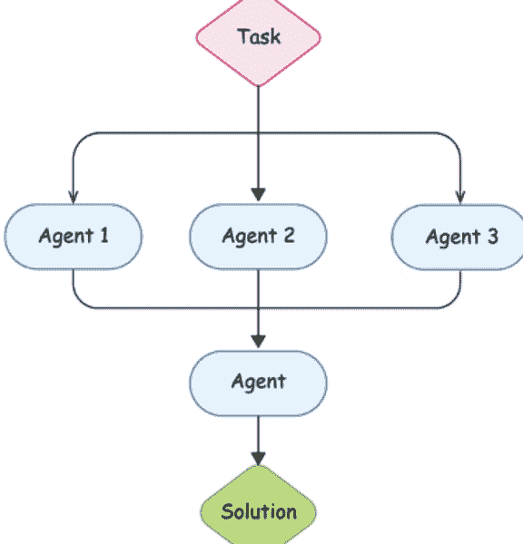
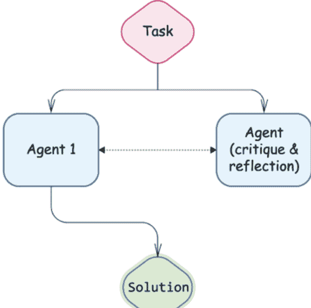
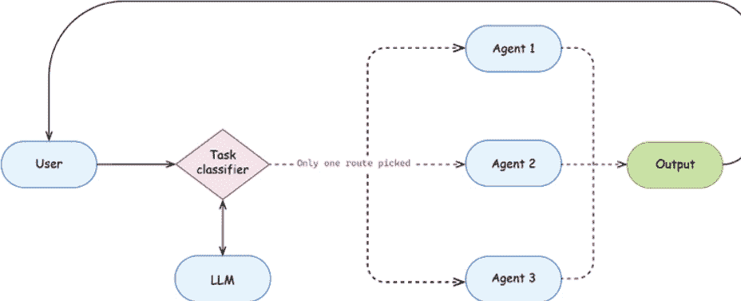
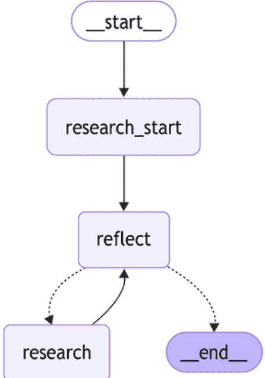

# Agentic RAG

LLM 使智能 agent 能够处理无法描述为确定工作流的复杂非重复任务。通过以不同的方式将推理拆分为步骤并以相对简单的方式进行编排，agent 在复杂任务上可以表现出更高的任务完成率。

这种基于 agent 的方法可以应用于许多领域，包括我们在第 4 章中讨论过的 RAG 系统。提醒一下，到底什么是 Agentic RAG？记住，RAG 系统的经典模式是根据查询检索分块，将它们合并到上下文中并根据系统提示词、结合上下文和问题让 LLM 生成答案。

我们可以使用上述讨论的原则（分解、工具调用和适应）来改进这些步骤中的每一个：

- **动态检索（Dynamic retrieval）：** 将检索查询的生成交给 LLM。它可以自己决定是否使用稀疏嵌入、混合方法、关键词搜索或网络搜索。你可以将检索封装为工具并作为 LangGraph 图进行编排。

- **查询扩展（Query expansion）：** 指派 LLM 根据初始查询生成多个查询，然后你根据倒数数融合（reciprocal fusion）或其他技术合并搜索结果。

- **对检索分块进行推理分解（Decomposition of reasoning on retrieved chunks）：** 允许你要求 LLM 根据问题评估每个分块（并过滤掉无关内容），以补偿检索的不准确性。你可以要求 LLM 总结每个分块，只保留针对输入问题提供的信息。无论如何，与其将一个巨大的上下文丢到 LLM 面前，不如先并行执行许多较小的推理步骤。这不仅可以提高 RAG 自身的质量，还能增加初始检索的数量（通过降低相关性阈值）或通过邻居扩展每个分块。换句话，你可以通过 LLM 推理克服一些检索挑战。这可能会提高应用程序的整体性能，但同时也带来了延迟和潜在成本的影响。

- **反思步骤和迭代（Reflection steps and iterations）：** 让 LLM 通过评估每次迭代后的输出对检索和查询进行动态迭代。你还可以将额外的落地（grounding）和归因工具作为工作流中的独立步骤，并据此推理是否需要继续处理答案或可以将答案返回给用户。

根据我们之前章节的定义，当你与 LLM 共享对执行流的部分控制权时，RAG 就变为了 Agentic RAG。例如，如果 LLM 决定如何检索、反思检索到的分块并根据第一个版本的答案进行适应，它就变成了 Agentic RAG。从我们的角度来看，此时迁移到 LangGraph 开始变得意义，因为它是专为构建此类应用而设计的，但当然你也可以留在 LangChain 或任何你喜欢的框架中（比较我们在第 3 章中分别用 LangChain 和 LangGraph 实现 map-reduce 视频摘要）。

## 多 agent 架构

在第 5 章，我们学习了将复杂任务分解为更简单的子任务通常会提高性能。我们构建了一个“规划并解决”agent，它比 CoT（思维链）更进一步，鼓励 LLM 生成规划并遵循它。在某种程度上，这种架构是多 agent 架构，因为负责生成和遵循规划的调研 agent 调用了另一个专注于不同类型任务的 agent —— 使用提供的工具解决非常特定的任务。

多 agent 工作流编排多个 agent，允许它们相互增强，同时保持 agent 的模块化（这使其更容易测试和重用）。

在本章的剩余部分，我们将查看一些核心 agent 架构，并介绍一些开发 agent 重要的 LangGraph 接口（如流细节和交接）。如果你感兴趣，可以在 LangChain 文档页面找到更多示例和教程：https://langchain-ai.github.io/langgraph/tutorials/#agent-architectures。我们将从讨论多 agent 系统中专业化的重要性开始，包括共识机制是什么。

## Agent 角色与专业化

在处理复杂任务时，我们人类知道通常拥有一个具有多样技能和背景的团队是有益的。许多研究和实验证据表明，对于生成式 AI 也是如此。

智能体。事实上，开发专门的智能体为复杂的 AI 系统提供了多项优势。

首先，专门化可以提高特定任务的性能。这允许你：

- 为每种任务类型选择最优工具集。
- 编写定制的提示词（prompts）和工作流。
- 针对特定上下文微调温度（temperature）等超参数。

其次，专门的智能体有助于管理复杂性。当前的 LLM 在同时处理过多工具时会显得不从心。作为最佳实践，请将每个智能体限制在 5-15 个不同的工具，而不是让单个智能体过载所有可用工具。如何分组工具仍然是一个开放的问题；通常，将它们分组为工具包（toolkits）以创建连贯的专门智能体是有帮助的。



图 6.2：主管模式

除了专业化之外，保持你的智能体模块化。这样更容易维护和改进此类智能体。此外，通过开发企业级助手用例，你最终将为组织内的用户和开发者提供许多不同的智能体，它们可以组合在一起。因此，请记住你应该让这些专门的智能体具有可配置性。

LangGraph 允许你通过将图作为大图中的子图来轻松组合图。实现此方法有两种：

- 将智能体编译为图，并在定义另一个智能体的节点时将其作为可调用对象传递：
  `builder.add_node("pay", payments_agent)`

- 用 Python 函数封装子智能体的调用，并在父智能体节点的定义中使用它：

```python
def run_payment(state):

    result = payments_agent.invoke({"client_id": state["client_id"]})

    return {"payment status": result}

builder.add_node
```

## 注意

## 共识机制

我们也可以让多个智能体并行处理相同的任务。这些智能体可能具有不同的“性格”（由其系统提示词引入；例如，某些可能更好奇且乐于探索，而另一些可能更严格且深度基于事实），甚至具有不同的架构。它们中的每一个都独立工作以为问题寻求解决方案，然后你使用共识机制从几个草案中选出最佳方案。



图 6.3：带有最终共识步骤的任务并行执行

我们在第 3 章中看过了基于多数投票实现共识机制的示例。你可以将其封装为独立的 LangGraph 节点，并且还有在多个智能体之间达成共识的替代方法：

- 让每个智能体查看其他解决方案并在 0 到 1 的范围内对每个方案进行评分，然后取得分最高的方案。

- 使用替代的投票机制。
- 使用多数投票。它通常适用于分类或类似任务，但如果你有自由文本输出，实现多数投票可能会困难。这是最快且最廉（（ token 消耗）的机制，因为你不需要运行任何额外的提示词。
- 如果存在，使用外部 Oracle（裁判）。例如，在求解数学方程时，你可以轻松验证解决方案是否可行。计算成本取决于问题，但通常较低。
- 使用另一个（可能更强大的）LLM 作为法官来挑选最佳解决方案。你可以要求 LLM 为每个方案打分，或者通过展示所有方案并让它挑选最佳的一个来将其任务化为多分类问题。
- 开发另一个智能体，它擅长从一组解决方案中为通用任务选择最佳方案。

值得提到的是，共识机制具有特定的延迟和成本影响，但通常与解决任务本身的成本相比，这些影响是微忽略不的。如果你指派 N 个智能体执行相同的任务，你的 token 消耗将增加 N 倍，共识机制在此基础上增加了相对较小的开销。

你还可以实现自己的共识机制。当你这样做时，请考虑：

- 使用 LLM 作为法官来处理不同的提示词。
- 考虑不同的输出。
- 使用多数投票。

一个关于并行化的重要说明，当你让 LangGraph 执行节点时，通过这种方式可以对你的应用保持一致性。

## 通信协议

第三种架构是让智能体协作处理任务。例如，智能体可能会通过不同的系统提示词受益于任务分解（为了获取灵感，请查看 [LangGraph 页面](https://langchain-ai.github.io/concepts/multi_agent/) 上的图表）。



图 6.4：反射模式

智能体可以通过提供批判来协作处理任务。有多种反射模式，从自反思（self-reflection，智能体分析自己的步骤）；交叉反思（cross-reflection，使用另一个智能体；例如使用另一个基础模型）；甚至是反思，这包含了**人类回路 (HIL)** 在关键检查点（我们将在下一节介绍自适应系统）。你可以让一个智能体作为主管，允许智能体在网络中通信（允许它们决定发送消息），引入某些层次结构或开发更复杂的流程。

设计智能体工作流仍然是一个开放的研究领域，你需要回答许多问题：

- 我们应该在系统中包含哪些以及多少智能体？
- 我们应该给这些智能体分配什么角色？
- 每个智能体可以使用哪些工具？
- 智能体之间如何交互？通过什么机制？
- 我们应该自动化工作流的哪些部分？
- 我们如何评估自动化，以及如何收集数据？此外，我们的成功标准是什么？

正如我们在第 3 章中所学的，一种提高 LLM 分类准确率的方法。



图 6.5: 语义路由模式

值得注意的是，一个任务可能属于两个或多个类别——例如，我可以问：“什么是 X，以及我该如何做 Y？” 这种在助手场景中可能不是这么常见的用例，你可以根据情况决定如何处理。首先，你可能可以通过回复解释来教育用户，告诉他们每轮只给应用分配一个单一问题。有时，开发者倾向于过度关注尝试用程序解决所有问题。但某些产品功能通过 UI 相对容易解决，而且用户（尤其是）已经准备好提供输入了。也许与其在 prompt 上解决分类问题，不如在 UI 中添加一个简单的复选框，或者让系统在置信度较低时进行双检。

你还可以使用工具调用（tool calling）或其他我们学过的控制生成技术来提取目标，并将执行路由到两个具有不同任务的专用代理。

语义路由的另一个重要方面是，你的应用程序性能很大程度上取决于分类准确率。你可以使用我们在书中讨论过的所有技术来提高它——少样本提示（包括动态少样本）、结合用户反馈、采样等。

## 组织交互

在多代理系统中，组织通信有两种方式：

- 代理之间通过特定的结构进行通信，这些结构迫使它们将想法和推理轨迹放入特定形式，正如我们在上一章的“计划并解决”示例中看到的。我们看到了规划节点如何通过带有良好结构计划的 Pydantic 模型与 ReACT 代理进行通信（而该计划反过来是 LLM 控制生成的 result）。

- 另一方面，LLM 经过训练，可以接受自然语言作为输入并产生相同格式的输出。因此，它们通过消息进行通信是一种非常自然的方式，你可以通过将不同代理的消息应用到共享的消息列表中来实现通信机制！

## 使用消息进行通信

另一种方案是仅共享每次执行的最终结果。这可以保持消息列表相对较短。

现在是时候看一个实际示例了。让我们开发一个研究代理，它使用工具根据公开的 MMLU 数据集回答复杂的多选择题（我们将使用高中地理题）。首先，我们需要从 Hugging Face 获取数据集：

```python
from datasets import load_dataset

ds = load_dataset("cais_mmlu", "high_school_geography")

ds_dict = ds["test"].take(2).to_dict()

print(ds_dict["question"][0])
```

>> 阻碍自给自足经济进步的主要因素是缺乏

这些是我们的备选项：

```
print(ds_dict["choices"][0])
```


让我们从 ReACT 代理开始，但我们要偏离默认的系统提示词并编写自己的提示词。让这个代理专注于创意和基于证据的解决方案（请注意，我们使用了在第 3 章中讨论过的思维链（CoT）提示的元素）：

```python
from langchain.agents import load_tools
```

```python
from langgraph.prebuilt import create_react_agent
```

```python
research_tools = load_tools(
    tool_names=["ddg-search", "arxiv", "wikipedia"],
    llm=llm
)
```

```python
system_prompt = (
    "You're a hard-working, curious and creative student. "
    "You're preparing an answer to a exam question. "
    "Work hard, think step by step."
    "Always provide an argumentation for your answer. "
    "Do not assume anything, use available tools to search "
    "for evidence and supporting statements."
)
```

现在，让我们创建代理本身。由于我们为代理准备了自定义提示词，我们需要一个包含系统消息的提示词模板、一个根据提供的问题和答案格式化第一个用户消息的模板，以及一个用于添加到图状态中的后续消息的占位符。我们还通过继承 `AgentState` 并为其添加额外的键来重新定义默认代理的状态：

```python
from langchain_core.prompts import ChatPromptTemplate, PromptTemplate
```

```python
from langgraph.graph import MessagesState
```

```python
from langgraph.prebuilt.chat_agent_executor import AgentState
```

```python
raw_prompt_template = (
    "Answer the following multiple-choice question. "
    "\nQUESTION:\n{question}\nnANSWER\n OPTIONS:\n{option}\n"
)
```

```python
prompt = ChatPromptTemplate.from_messages(
    [
        ("system", system_prompt),
        ("user", raw_prompt_template),
        ("placeholder", "{messages}")
    ]
)
```

```python
class MyAgentState(AgentState):
    question: str
    options: str

research_agent = create_react_agent(
    model=llm_small, tools=research_tools,
    state_schema=AgentState
)
```

我们本可以在此停止，但让我们更进一步。我们为它添加了一个反思步骤，一个专门的教授角色将用来批评答案：

```python
reflection_prompt = (
    "You are a university professor and you're supervising a student "
    "who tried to answer the exam question and get feedback from your "
    "professor. Work on improving your answer and incorporating the "
    "feedback.\nQUESTION:\n{question}\n\nANSWER OPTIONS:\n{options}\n\n"
    "STUDENT'S ANSWER:\n{answer}\n\nFEEDBACK:\n{feedback}\n\n"
    "Reflect on the answer."
)
```

```python
from pydantic import BaseModel, Field
from typing import Optional

class Response(BaseModel):
    """A final response."""
    answer: Optional[str] = Field(
        None,
        description="The final answer. It should be empty if critique has been provided."
    )
    critique: Optional[str] = Field(
        None,
        description="A critique of the initial answer. If you think it might be incorrect, provide actionable feedback"
    )
```

```python
reflection_chain = PromptTemplate.from_template(reflection_prompt) | llm.with_structured_output(Response)
```

现在我们需要另一个研究代理，它不仅接收问题和选项，还接收之前的答案和反馈，以改进答案。我们创建了一个说明性的示例。你可以通过添加错误处理、Pydantic 验证（例如检查提供了答案还是批评）或处理冲突或模糊的反馈（例如，帮助代理优先考虑反馈点的提示词）来改进它。

注意，我们在 ReACT 代理中使用了较弱的 LLM，仅仅是为了演示反思方法的强大（否则代理可能会在第一次迭代中得出正确答案）：

```python
raw_prompt_template_with_critique = (
    "You tried to answer the exam question and get feedback from your "
    "professor. Work on improving your answer and incorporating the feedback. "
    "\nQUESTION:\n{question}\n\nANSWER OPTIONS:\n{options}\n\n"
    "INITIAL\nANSWER\n{answer}\n\nFEEDBACK:\n{feedback}"
)
```

```python
prompt = ChatPromptTemplate.from_messages(
    [
        ("system", system_prompt),
        ("user", raw_prompt_template_with_critique),
        ("placeholder", "{messages}")
    ]
)
```

```python
class ReflectionState(ResearchState):
    answer: str
    feedback: str

research_agent_with_critique = create_react_agent(
    model=llm_small, tools=research_tools, 
    state_schema=ReflectionState, prompt=prompt
)
```

在定义图的状态时，我们需要跟踪问题和选项、当前答案以及批评。此外注意，我们跟踪了学生和教授之间的交互次数（以避免它们之间的无限循环），并为之使用了一个自定义的还原器（它在每次运行时都会汇总旧步骤和新步骤）。让我们定义完整的状态、节点和条件边：

```python
from typing import Annotated, Literal, TypedDict
```

```python
from langchain_core.runnables.config import RunnableConfig
from operator import add
from langchain_core.output_parsers import StrOutputParser

class ReflectionAgentState(TypedDict):
    question: str
    options: str
    answer: str
    steps: Annotated[int, add]
    response: Response

def _should_end(state: AgentState, config: RunnableConfig) -> Literal["research", END]:
    max_reasoning_steps = config["configurable"].get("max_reasoning_steps", 10)
    if state.get("response") and state["response"].answer:
        return END
    if state.get("steps", 1) > max_reasoning_steps:
        return END
    return "research"
```

```python
reflection_chain = PromptTemplate.from_template(reflection_prompt) | \
    llm.with_structured_output(Response)

def _reflection_step(state):
    result = reflection_chain.invoke(state)
    return {"response": result, "steps": 1}

def _research_start(state):
    answer = research_agent.invoke(state)
    return {"answer": answer["messages"][-1].content}

def _research(state):
    agent_state = {
        "answer": state["answer"],
        "question": state["question"],
        "options": state["options"],
        "feedback": state["response"].critique
    }
    answer = research_agent_with_critique.invoke(agent_state)
    return {"answer": answer["messages"][-1].content}
```

让我们将这一切整合在一起并创建我们的图：

```python
builder = StateGraph(ReflectionAgentState)
builder.add_node("research_start", _research_start)
builder.add_node("research", "research")
builder.add_node("reflect", _reflection_step)
builder.add_edge(START, "research_start")
builder.add_edge("research_start", "reflect")
builder.add_edge("research", "reflect")
builder.add_conditional_edges("reflect", _should_end)
graph = builder.compile()
display(Image(graph.get_graph().draw_mermaid_png()))
```



**图 6.6：带有反思能力的智能体**

让我们运行它并观察发生了什么：

```python
question = ds_dict["question"][0]
options = "\n".join([f"{i}. {a}" for i, a in enumerate(ds_dict["choices"][0])])

async for _, event in graph.astream({"question": question, "options": options}, stream_mode=["updates"]):
    print(event)
```

我们在这里省略了完整的输出（欢迎从我们的 GitHub 仓库获取代码并亲自进行实验），但第一个答案是错误的：

> 根据 `DuckDuckGo` 的搜索结果，提供的陈述中没有一个是完全正确的。搜索显示，全球范围内女性劳动力参与度有了显著进展，但尚未达到大多数女性都在农业领域工作的程度，也没有出现全球性的参与度下降情况。此外，关于工作时间的信息表明，在大多数地区女性的工作时间比男性长并非普遍事实。因此，在提供的选项中没有正确答案。

经过五次迭代，那个较弱的 LLM 能够找到正确答案（请记住，"教授"仅评估了推理本身，没有使用外部工具或自己的知识）。请注意，从技术上讲，我们实现的是交叉反思（cross-reflection）而不是自反思（self-reflection），因为我们用于反思的 LLM 与用于推理的不同。以下是第一轮提供的反馈示例：

> 学生的推理依赖于未提供的搜索结果，这很难评估其声明的准确性。学生声称没有答案是完全正确的，但多选题即使需要细微差别，通常也有一个最佳答案。为了正确评估答案，需要提供搜索结果，并根据这些结果对每个选项进行评估，以识别出最准确的选择，而不是全部拒绝它们。其中一个选项可能比其他选项更正确，即使并非完全真实。没有搜索结果，无法判断学生关于"没有正确答案"的结论是否有效。此外，学生应该明确说明搜索结果是什么。

接下来，让我们讨论多智能体设置的另一种通信方式，即通过共享的消息列表。在此之前，我们应该讨论 `LangGraph` 的交接机制（handoff mechanism），并深入了解 `LangGraph` 流式传输的一些细节。

## LangGraph 流式传输

`LangGraph` 的流式传输有时会让人困惑。每个图不仅有一个流和一个对应的异步 `astream` 方法，还有一个 `astream_events`。让我们深入了解它们的区别。

`stream` 方法允许你在每个超级步（super-step）之后流式传输图的状态变化。记住，我们在第 3 章讨论过超级步，但为了简单起见，它是图的单次迭代，其中并行节点属于同一个超级步，而顺序节点属于不同的超级步。如果你需要真正的流式行为（例如在聊天机器人中，让用户感觉事情正在发生且模型确实在思考），你应该使用 `messages` 模式的 `astream`。

你通过 `stream/astream` 方法有五种模式（当然，你可以组合多个模式）：

| 模式 | 说明 | 输出 |
| --- | --- | --- |
| `updates` | 仅流式传输节点产生的图更新 | 字典，每个节点名称映射到其对应的状态更新 |
| `values` | 在每个超级步后流式传输图的全状态 | 包含整个图状态的字典 |
| `debug` | 尝试在调试模式下尽可能流式传输信息 | 包含时间戳、事件类型和所有对应信息的字典 |
| `custom` | 流式传输节点内部发生的事件 | 包含 token 或 segment 的元组 |
| `messages` | 流式传输 LLM 生成的 tokens | 用于 `StreamWriter` 的字典 |

**表 6.1：`LangGraph` 的不同流式传输模式**

让我们看一个例子。如果我们使用上面提到的智能体并使用 `values` 模式流式传输，我们会发现消息总数一直在在增加：

```python
async for _, event in graph.astream({"question": question, "options": options}, stream_mode=["values"]):
    print(len(event["messages"]))
```

如果切换到 `updates` 模式，我们将得到一个字典，其键是节点名称：

```python
async for _, event in graph.astream({"question": question, "options": options}, stream_mode=["updates"]):
    node = list(event.keys())[0]
    print(node, len(event[node].get("messages", [])))
```

然后你需要 `astream_events`，它可以回传节点内部发生的事件——不仅是 LLM 生成的 token，还有任何可用于回调的事件：

```python
seen_events = set()
```


`async for event in graph.astream_events({"question": question, "options": options}, version="v1"):`

```python
if event["event"] not in seen_events:
    seen_events.add(event["event"])
    print(seen_events)
```

输出结果：

```python
>> {'on_chat_model_end', 'on_chat_model_stream', 'on_chain_end', 'on_prompt_end', 'on_tool_start', 'on_chain_stream', 'on_chain_start', 'on_prompt_start', 'on_tool_end', 'on_chat_model_start'}
```

## 交接

到目前为止，我们学习了 LangGraph 中的节点和边控制流。在实现多智能体架构时，你的节点不仅可以是函数，还可以是智能体或子图（它们有自己的状态）。你可能需要结合状态更新和流控制。

```python
from langgraph.types import Command

def _make_payment(state):
    ...
    if ...:
        return Command(
            update={"payment_id": payment_id},
            goto="refresh_balance"
        )
```

目标代理（destination agent）可以是当前图或父图（`Command.PARENT`）中的节点。换句话说，你只能在当前图中更改控制流，或者将其传回给启动该图的工作流（例如，你不能通过 ID 将控制权传递给随机的工作流）。你也可以从工具调用 `Command`，或者将 `Command` 封装为工具，然后 LLM 就可以决定将控制权交给特定的代理。在第 3 章中，我们讨论了 map-reduce 模式和 `Send` 类，它允许我们通过传递特定的输入状态来调用图中的节点。我们可以结合 `Command` 与 `Send` 使用（在本例中，目标代理属于父图）：

```python
from langgraph.types import Send

def _make_payment(state):
    ...
    if ...:
        return Command(
            update={
                goto=[Send("refresh_balance", {"payment_id": payment_id}, ...)]
            },
            graph=Command.PARENT
        )
```

## 通过共享消息列表进行通信

在之前的几个章节中，我们讨论了两个代理如何通过受控输出（通过向对方发送特殊的 Pydantic 实例）进行通信。现在让我们回到通信主题，说明代理如何与原生的 LangChain 消息进行通信。让我们以具有交叉反射（cross-reflection）的研究代理为例，让它通过共享消息列表进行工作。首先，研究代理本身看起来更简单了——它有一个默认状态，因为它接收的是用户问题作为 `HumanMessage`：

```python
system_prompt = (
    "You're a hard-working, curious and creative student."
    "You're working on exam question. Think step by step."
    "Always provide an argumentation for your answer. "
    "Do not assume anything, use available tools to search "
    "for evidence and supporting statements."
)

research_agent = create_react_agent(
    model=llm_small, tools=research_tools,
    prompt=system_prompt
)
```

我们还需要稍微修改一下反射提示词（reflection prompt）：

```python
reflection_prompt = (
    "You are a university professor and you're supervising a student who is "
    "working on multiple-choice exam question. Given the dialogue above, "
    "reflect on the answer provided and give a feedback "
    "if needed. If you think the final answer is correct, reply "
    "with an empty message. Only provide critique if you think the "
    "last answer "
    "might be incorrect or there are reasoning flaws. Do not assume anything,"
    "evaluate only the reasoning student provided and whether there is "
    "enough evidence for their answer."
)
```

节点本身看起来也更简单了，但我们在反射节点之后添加了 `Command`，因为我们通过节点本身决定下一步调用什么。此外，我们不再将 ReACT 研究代理封装为节点：

```python
from langgraph.types import Command

question_template = PromptTemplate.from_template(
    "QUESTION:\n{question}\n\nANSWER OPTIONS:\n{options}\n\n"
)
```

```python
def _ask_question(state):
    return {"messages": [("human", question_template.invoke(state).text)]}

def _give_feedback(state, config: RunnableConfig):
    messages = event["messages"] + [("human", reflection_prompt)]
    max_messages = config["configurable"].get("max_messages", 20)

    if len(messages) > max_messages:
        return Command(update={}, goto=END)

    result = llm.invoke(messages)
    if result.content:
        return Command(
            update={"messages": [("assistant", result.content)]},
            goto="research"
        )
    return Command(update={}, goto=END)
```

图本身也看起来非常简单：

```python
class ReflectionAgentState(MessagesState):
    question: str
    options: str

builder = StateGraph(ReflectionAgentState)
builder.add_node("ask_question", _ask_question)
builder.add_node("research", research_agent)
builder.add_node("reflect", _give_feedback)

builder.add_edge(START, "ask_question")
builder.add_edge("ask_question", "research")
builder.add_edge("research", "reflect")
graph = builder.compile()
```

如果我们运行它，我们将看到在每个阶段，图都在同一个（且不断增长的）消息列表上操作。

## LangGraph 平台

如所知，LangGraph 和 LangChain 是开源框架，但 LangChain 公司提供了 LangGraph 平台——这是一种帮助你开发、管理和部署代理应用的商业解决方案。LangGraph 平台的一个组件是 LangGraph Studio，另一个是 LangGraph Server。

你可以在官方网站 `https://langchain-ai.github.io/langgraph` 查看更多关于 LangGraph 平台的信息。

## 构建自适应系统

适应性是代理的一个伟大特性。它们应该适应外部和用户的反馈，并相应调整它们的行动。正如我们在第 5 章中讨论的，生成式 AI 代理通过以下方式具有适应性：

- **工具交互**：它们通过结合工具调用及其输出的反馈（通过代表工具调用结果的 `Messages`）来规划下一步（例如 ReACT 代理根据结果进行调整）。

- **显式反射**：可以被指示分析当前结果并刻意调整行为。

- **人类反馈**：它们可以在关键点结合用户输入。

## 动态行为调整

我们看到了如何为我们的计划-解决代理添加反射步骤。给定初始计划以及到目前为止已执行步骤的输出，我们将要求 LLM 对计划进行反射并进行调整。再次，我们继续强调核心思想——这种反射可能不会自然发生；你可能会将其作为一个独立的任务（分解），并通过设计其通用组件来保持对执行流的控制。

## 人交互（Human-in-the-loop）

此外，在开发复杂推理轨迹的代理时，在某些点引入人类反馈可能是有益的。代理可以请求人类批准或拒绝某些操作（例如，当它调用不可逆的工具时，如执行支付的工具）、提供额外的上下文，或通过修改图的状态给出特定输入。

假设我们正在开发一个搜索职位发布、生成申请并发送该申请的代理。我们可能在提交申请之前询问用户，或者逻辑更为复杂——代理可能正在收集用户数据，对于某些职位，它可能缺少有关过去经历的相关上下文。它应该询问用户并将这些知识持久化到长期记忆中，以实现更好的长期适应。

LangGraph 有一个特殊的 `interrupt` 函数用于实现 HIL 类型的交互。你应该在节点中包含此函数，并在首次执行时它将抛出 `GraphInterrupt` 异常（其值将呈现给用户）。为了恢复图的执行，客户端应该使用我们在本章较早讨论过的 `Command` 类。LangGraph 将从同一个节点重新执行它，并作为节点调用中断函数的结果返回相应的值（如果你的节点中有中断，LangGraph 将会保持某种顺序）。你也可以使用 `Command` 根据用户的输入路由到不同的节点。当然，只有在为图提供检查点管理器（checkpointer）时才能使用中断（interrupt），因为其状态应该是被持久化过的。

让我们构建一个非常简单的图，其中只包含一个询问用户家庭地址的节点：

```python
from langgraph.types import interrupt, Command
```

```python
class State(MessagesState):
    home_address: Optional[str]
```

```python
def _human_input(state: State):
    address = interrupt("What is your address?")
    return {"home_address": address}
```

```python
builder = StateGraph(State)
builder.add_node("human_input", "human_input")
builder.add_edge(START, "human_input")
checkpointer = MemorySaver()
graph = builder.compile(checkpointer=checkpointer)
```

```python
config = {"configurable": {"thread_id": "1"}}

for chunk in graph.stream({"messages": ["human", "What is weather today"]]}, config):
    print(chunk)
```

输出结果：

```python
>> {'_interrupt_': (Interrupt(value='What is your address?, resumable=True, ns=['human_input:b7e8a744-p404-0a60-7967-ddb8d30b11e3'], when='during')))}
```

图向我们返回一个特殊的 *interrupt* 状态并停止。现在我们的应用程序（客户端）应该向用户询问这个问题，然后我们就可以恢复。请注意，我们提供了相同的 `thread_id` 以从检查点中恢复：

```python
for chunk in graph.stream(Command(resume="Munich"), config):
    print(chunk)
```

输出结果：

```python
>> {'human_input': {'home_address': 'Munich'}}
```

注意，图继续执行了 `human_input` 节点，但这次中断函数返回了结果，图的状态也得到了更新。

到目前为止，我们已经讨论了开发智能体的几种架构模式。现在让我们来看另一个有趣的模式，它允许 LLM 在寻找解决方案时运行多个模拟。

## 探索推理路径

在第 3 章中，我们讨论了 CoT（思维链）提示。但通过 CoT 提示，LLM 在单次会话中创建一个推理路径。如果我们通过将这种推理分解为片段，并将分解模式和适应模式相结合会怎样？

## 思维树

来自 Google DeepMind 和普林斯大学的研究人员于 2023 年 12 月引入了 ToT（思维树）技术。他们泛化了 CoT 模式，并将思想作为探索全局解决方案过程中的中间步骤。

回到我们在上一章中构建的“规划与解决”智能体。利用 LLM 的非确定性来改进它。我们可以在每一步中为计划中的下一步生成多个候选方案（我们可能需要增加底层 LLM 的温度）。这将有助于智能体更具适应性，因为生成的计划将考虑到上一步的输出。

现在我们可以构建一个包含各种选项的树，并使用深度搜索或广度搜索方法探索这棵树。最后，我们将得到多个解决方案，并使用上面讨论的一些共识机制（例如 LLM 作为裁判）来选出最好的一个。


图 6.7：使用 ToT 进行解决方案路径探索

请注意，模型提供商应该支持在响应中生成多个候选（并非所有提供商都支持此功能）。

我们想强调（而且在本章中我们并不厌倦重复这一点），ToT 模式中并没有完全新颖的东西。你获取已经在其他领域使用的算法和模式，并利用它们来构建强大的智能体。

现在是时候编写代码了。我们将使用在 [第 5 章](#) 中开发的“规划与解决”智能体的相同组件：一个创建一个初始计划的规划器（planner），和一个执行智能体（`execution_agent`），后者是一个访问工具并处理计划中特定步骤的调研智能体。我们可以让执行智能体变得简单，因为不需要自定义的状态：

```python
execution_agent = prompt_template | create_react_agent(model=llm, tools=tools)
```

我们还需要一个重规划器（replanner）组件，它将根据之前的观察调整计划，并为下一步生成多个候选方案：

```python
from langchain_core.prompts import ChatPromptTemplate
class ReplanStep(BaseModel):
    """计划中重规划的下一步."""
    steps: list[str] = Field(description="建议的下一步的不同选项")
```

```python
llm_replanner = llm.with_structured_output(ReplanStep)
replanner_prompt_template = (
    "建议计划中的下一步操作。不要添加任何多余的步骤。\n"
    "如果你认为不需要任何操作，只需返回一个空列表。\n"
    "TASK: {task}\nPREVIOUS STEPS: {current_plan}"
)

replanner_prompt = ChatPromptTemplate.from_messages([
    ("system", "You're a helpful assistant. Your goal is to solve the task."),
    ("user", replanner_prompt_template)
])
```

这个 `replanner` 组件将处理基于之前观察的计划调整，并为下一步生成多个候选。`TreeNode` 类有助于跟踪探索过程。


# 智能体核心逻辑实现

以下是一个基于树状结构（Tree of Thoughts, ToT）的智能体核心逻辑实现，包含节点定义、深度搜索、动态规划、投票机制和图构建等关键部分。

## 1. 树节点定义

我们首先定义一个`TreeNode`类，用于表示计划树中的每个节点。每个节点包含一个唯一的`node_id`、一个计划步骤`step`、指向父节点的引用`parent`，以及可选的步骤输出`step_output`和子节点列表`children`。

```python
class TreeNode:
    def __init__(self, node_id: int, step: str, parent: Optional['TreeNode'] = None):
        self.node_id = node_id
        self.step = step
        self.parent = parent
        self.step_output: Optional[str] = None
        self.children = []

    def __repr__(self):
        parent_id = self.parent.node_id if self.parent else "None"
        return f"Node_id: {self.node_id}, parent: {parent_id}, children: {len(self.children)}"

    def get_full_plan(self) -> str:
        steps = []
        curr = self
        while curr:
            steps.append(f"{curr.node_id}. Planned step: {curr.step}")
            curr = curr.parent
        return "\n".join(reversed(steps))
```

## 2. 核心逻辑：深度搜索与动态规划

现在我们需要实现智能体的核心逻辑。我们将以深度搜索模式探索我们的动作树。这是 ToT 真正发挥作用的地方：

```python
async def _run_node(state: PlanState, config: RunnableConfig):
    node = state.get("next_node")
    visited_ids = state.get("visited_ids", set())
    queue = state["queue"]

    while queue and not node:
        node = queue.popleft()
        if node.node_id in visited_ids:
            node = None

    while node:
        if not node:
            return Command(goto="vote", update={})
            
        step = await execution_agent.ainvoke({
            "previous_steps": node.get_full_plan(),
            "step": node.step,
            "task": state["task"]
        })
        
        node.step_output = step["messages"][-1].content
        visited_ids.add(node.node_id)

    return {"current_node": node, "queue": queue, "visited_ids": visited_ids, "next_node": None}

async def _plan_next(state: PlanState, config: RunnableConfig) -> PlanState:
    max_candidates = config["configurable"].get("max_candidates", 1)
    node = state["current_node"]
    
    next_step = await replanner.invoke({
        "task": state["task"],
        "current_plan": node.get_full_plan()
    })

    if not next_step.steps:
        return {"is_current_node_final": True}

    max_id = state["max_id"]
    for step in next_step.steps[:max_candidates]:
        child = TreeNode(node=max_id+1, step=step, parent=node)
        max_id += 1
        node.children.append(child)
        state["queue"].append(child)

    return {"is_current_node_final": False, "next_node": child, "max_id": max_id}
```

```python
async def _get_final_response(state: PlanState) -> PlanState:
    node = state["current_node"]
    final_response = await responder.invoke({"task": state["task"], "plan": node.get_full_plan())
    node.final_response = final_response
    return {"paths_explored": 1, "candidates": [final_response]}
```

`_run_node` 函数执行当前步骤，而 `_plan_next` 生成新的候选步骤并将其它们添加到我们的探索队列中。当我们到达最终节点（即不再需要后续步骤的节点）时，`_get_final_response` 会从多个候选方案（源于探索的不同解决方案路径）中选出最佳的一个，从而锁定最终解决方案。因此，在代理的状态中，我们需要跟踪根节点、下一个节点、待探索的节点队列以及已经探索过的节点：

```python
import operator
from collections import deque
from typing import Annotated

class PlanState(TypedDict):
    task: str
    root: TreeNode
    queue: deque[TreeNode]
    current_node: TreeNode
    next_node: TreeNode
    is_current_node_final: bool
    paths_explored: Annotated[int, operator.add]
    visited_ids: set[int]
    max_id: int
    candidates: Annotated[list[str], operator.add]
    best_candidate: str
```

该状态结构跟踪了我们所需的所有内容：原始标签、树结构、探索队列、路径元数据和候选解决方案。注意这些`Annotated`类型，它们使用了自定义归约器（如`operator.add`）来正确处理状态值的合并。

需要记住的一点是，LangGraph 不允许你直接修改状态。换句话说，如果我们在节点内部执行以下操作，它不会对代理状态中的实际队列产生任何影响：

```python
def my_node(state):
    queue = state["queue"]
    node = queue.pop()
    ...
    queue.append(another_node)
    return {"key": "value"}
```

如果我们想修改属于状态本身的队列，我们应该使用自定义归约器（正如我们在第 3 章中讨论过的），或者返回要替换的队列对象（因为在底层，LangGraph 在将状态传递给节点之前总是会创建状态的深拷贝）。

现在我们需要定义最终步骤——即根据多个生成的候选方案选择最终答案的共识机制：

```python
prompt_voting = PromptTemplate.from_template(
    "Pick the best solution for a given task. \n\nTASK:{task}\n\nSOLUTIONS:{candidates}\n"
)

def _vote_for_the_best_option(state):
    candidates = state.get("candidates", [])
    if not candidates:
        return {"best_response": None}
    all_candidates = []
    for i, candidate in enumerate(candidates):
        all_candidates.append(f"OPTION {i+1}: {candidate}")
    response_schema = {
      "type": "STRING",
      "enum": [str(i+1) for i in range(len(all_candidates))]
    }
    llm_enum = ChatVertexAI(
      model_name="gemini-2.0-flash-001",
      response_mime_type="text/x.enum",
      response_schema=response_schema
    )
    result = (prompt_voting | llm_enum | StrOutputParser()).invoke(
      {"candidates": "\n".join(all_candidates), "task": state["task"]}
    )
    return {"best_candidate": candidates[int(result)-1]}
```

这种投票机制将所有候选解决方案呈现给模型，并要求它选择最佳的一个，利用了模型评估和比较选项的能力。

现在让我们添加代理剩余的节点和边。我们需要两个节点：一个用于初始计划，另一个用于评估最终输出。与此同时，我们定义了两个对应的边，用于评估代理是否应该继续探索以及它是否准备好为用户提供最终响应：

```python
from typing import Literal
from langgraph.graph import StateGraph, START, END
from langchain_core.runnables import RunnableConfig
from langchain_core.output_parsers import StrOutputParser
from langgraph.types import Command

final_prompt = PromptTemplate.from_template(
    "You're a helpful assistant that has executed on a plan."
    "Given the results of the execution, prepare the final response."
    "Don't assume anything\nTASK:\n{task}\nPLAN WITH RESULTS:\n{plan}\n"
    "FINAL RESPONSE:\n"
)
```

```python
responder = final_prompt | llm | StrOutputParser()

async def _build_initial_plan(state: PlanState) -> PlanState:
    plan = await planner.invoke(state["task"])
    queue = deque()
    root = TreeNode(step=plan.steps[0], node_id=1)
    queue.append(root)
    current_root = root

    for i, step in enumerate(plan.steps[1:]):
        child = TreeNode(node_id=i+2, step=step, parent=current_root)
        queue.append(child)
        current_root = child
        # ... logic for building tree

async def _get_final_response(state: PlanState) -> PlanState:
    # ... logic for final response
    return {"paths_explored": 1, "candidates": [final_response]}

def _vote_for_the_best_option(state):
    # ... voting logic
    pass

def _create_final_response(state: PlanState, config: RunnableConfig) -> Literal:
    # ... final response logic
    pass

def _should_continue(state: PlanState, config: RunnableConfig) -> Literal:
    # ... continuation logic
    pass
```

```python
builder = StateGraph(PlanState)
builder.add_node("initial_plan", _build_initial_plan)
builder.add_node("run", _run_node)
builder.add_node("plan_next", _plan_next)
builder.add_node("generate_response", _get_final_response)
builder.add_node("vote", _vote_for_the_best_option)

builder.add_edge(START, "initial_plan")
builder.add_edge("initial_plan", "run")
builder.add_edge("run", "plan_next")
builder.add_conditional_edges("plan_next", _should_continue)
builder.add_conditional_edges("generate_response", _create_final_response)
builder.add_edge("vote", END)

graph = builder.compile()
```

这创建了我们完成的代理。图从初始计划开始，经过执行和重新规划，为完成的路径生成响应，最后通过投票选择最佳解决方案。我们可以使用 Mermaid 生成器来可视化该流程，从而清晰地了解代理的决策过程：

## 使用 MCTS 裁剪思维树（ToT）

你们可能还记得 AlphaGo —— 第一个在围棋中击败人类的计算机程序。Google DeepMind 在 2015 年开发了它，并使用蒙特卡洛树搜索（MCTS）作为核心决策算法。以下是其原理的简单介绍：在游戏采取下一步之前，算法会构建一个包含潜在未来移动的决策树，其中节点代表你的移动以及对手的可能响应（你可以想象的，这棵树扩展得非常快）。为了防止树扩展得过快，我们使用 MCTS 只搜索那些通向游戏中更优状态的最前景的路径。

现在，回到我们在上一节中学习的 ToT 模式。请想一下，我们在上一节中构建的 ToT 维度可能会增长非常快。如果在每一步中我们生成 3 个候选方案，而工作流中只有 5 步，那么最终将有 $3⁵=243$ 步需要评估。这会产生大量的成本和时间。我们可以通过不同的方式裁剪维度，例如使用 MCTS。它包含了选择和模拟组件：

-   **选择（Selection）**：帮助你在分析树时选择下一个节点。你通过平衡探索（exploration）和利用（exploitation）来实现这一点（你估计最有前景的节点，但在这个过程中加入了一些随机性）。

-   **模拟（Simulation）**：当你通过添加新的子节点来扩展树后，如果它不是终端节点，你需要模拟它的后果。这可以通过随机执行所有后续移动直到结束来实现，也可以使用更复杂的模拟方法。在评估子节点后，你将结果反向传播到所有父节点，通过调整它们在下一轮选择中的概率评分。

我们并不是打算进入细节并教你 MCTS。我们只是想演示如何将已有的算法应用于智能体工作流（agentic workflows）中以提高它们的性能。其中一个例子是 Andy Zhou 及其同事于 2024 年 6 月在论文 *Language Agent Tree Search Unifies Reasoning, Acting, and Planning in Language Models* 中提出的 LAST 方法。在不涉及过多细节的情况下（欢迎查看原始论文或相应的教程），作者在 ToT 之上添加了 MCTS，并证明通过在 HumanEval 基准测试中获得第一，提升了在复杂任务上的性能。

核心思想是，不再探索整棵树，而是使用大语言模型（LLM）来评估你在每一步获得的解决方案的质量（通过查看这些特定推理步骤上的所有步骤序列以及你目前获得的输出）。


现在，由于我们已经讨论了一些允许我们构建更好智能体的高级架构，最后一个需要简要提及的组件是内存。帮助智能体从长期交互中保留和检索相关信息，有助于我们开发更先进、更有用的智能体。

## 智能体内存

我们在第 3 章中讨论了内存机制。回顾一下，`LangGraph` 通过 `Checkpointer`（检查点）机制具有短期记忆的概念，它会将检查点保存到持久化存储中。这就是所谓的“线程级持久化”（记得，我们在本节较早讨论过，`LangGraph` 中线程的概念类似于对话）。换句话说，智能体记得我们在给定会话中的交互，但每次都从零开始。

正如你想象的，对于复杂的智能体，这种内存机制可能因为两个原因而是低效的。首先，你可能会丢失关于用户的重要信息。其次，在寻找解决方案的探索阶段，智能体可能会学到关于环境的某些东西，但每次都会忘记——这看起来并不高效。这就是为什么存在长期记忆的概念，它可以帮助智能体积累知识并从历史经验中获益，使其在长周期内实现持续改进。

在实践中如何设计和使用长期记忆仍然是一个开放的问题。首先，你需要提取运行期间想要存储的有用信息（同时考虑到隐私需求；更多内容将在第 9 章介绍），然后你需要在下一次执行时提取它。提取与我们在讨论 `RAG` 时谈到的检索问题相似，因为我们只需要提取与给定上下文相关的知识。最后一个组件是内存的压缩（`compaction`）——你可能希望定期对所学到的内容进行自我反思，对其进行优化并遗忘无关的事实。

这些是需要考虑的关键考量，但我们还没有看到任何针对智能体工作流的长期记忆优秀实践实现。在实践中，这些人员通常使用两个组件：一个内置缓存（一种缓存 `LLM` 响应的机制）、一个内置存储器（一个持久化键值对存储器），以及一个自定义缓存或数据库。在以下情况下使用自定义选项：

- 你需要对组织内存需要额外的灵活性——例如，你想跟踪所有的内存状态。
- 在处理这些内存时，你需要高级的读取或写入访问模式。
- 你需要保持内存分布在多个工作节点之间，并且你想使用 `PostgreSQL` 以外的数据库。

## 缓存（Cache）

缓存允许你保存和检索键值。想象你正在开发一个企业级问答辅助应用程序，在 `UI` 中，你询问用户是否喜欢该答案。如果答案是肯定的，或者你有一组针对最重要主题的精选问答数据集，你可以将这些存储在缓存中。当以后问及相同（或类似）的问题时，系统可以快速返回缓存的响应，而不是从头开始生成。

`LangChain` 允许你通过以下方式为 `LLM` 响应设置全局缓存（在你初始化缓存后，`LLM` 的响应将会被添加到缓存中，正如我们将在下文所示）：

```python
from langchain_core.caches import InMemoryCache
```

```python
from langchain_core.globals import set_llm_cache
cache = InMemoryCache()
```

```python
set_llm_cache(cache)
```

```python
llm = ChatVertexAI(model="gemini-2.0-flash-001", temperature=0.5)
```

```python
llm.invoke("What is the capital of UK?")
```

`LangChain` 的缓存工作原理如下：每个厂商的 `ChatModel` 实现都继承自基类，基类在生成期间首先尝试在缓存中查找。它基于提示词的字符串表示和 `LLM` 实例的字符串表示（包括温度等参数）。

```python
import langchain
print(langchain.cache)
```

`LangChain` 支持内存和 `SQLite` 缓存（属于 `langchain_core`），还有许多厂商集成——可以通过 `langchain_community` 子包访问 https://python.langchain.com/api_reference/community/cache.html 或通过特定的厂商集成（例如，`langchain-mongodb` 提供了 `MongoDB` 的集成：https://mongodb.readthedocs.io/en/latest/langchain_mongodb/api_docs.html）。

我们建议引入独立的 `LangGraph` 节点访问真正的缓存（基于 `Redis` 或其他数据库），因为它允许你使用我们在第 4 章讨论 `RAG` 时提到的嵌入机制搜索相似问题。

## 存储（Store）

正如我们之前学过的，`Checkpointer` 机制允许你通过线程级内存增强你的工作流；线程级指的是对话级的持久化。每次对话都可以从停止的地方开始，工作流执行之前收集的上下文。

`BaseStore` 是一种持久化的键值存储系统，它通过命名空间组织你的值（字符串路径的层次结构组，类似于文件夹）。它支持标准的 `put`、`delete` 和 `get` 操作，以及一个实现不同语义搜索能力的 `search` 方法（通常基于嵌入机制），并考虑了命名空间的层次结构。

让我们初始化一个存储并向其中添加一些值：

```python
from langgraph.store.memory import InMemoryStore
```

```python
in_memory_store = InMemoryStore()
```

```python
in_memory_store.put(namespace=("users", "user1"), key="fact1", value={})
```

```python
in_memory_store.put(namespace=("users", "user1", "conv1"), key="address", value={})
```

我们可以轻松查询该值：

```python
in_memory_store.get(namespace=["users", "user1", "conv1"), key="address")
```

```python
>> Item(namespace=['users', 'user1'], key=fact1, value={'message': 'My name is John.', created_at=2025-03-18T14:25:23.305048+00:00, updated_at=2025-03-18T14:25:23.305048+00:00})
```

如果通过通过 `namespace` 的部分路径进行查询，我们将得不到任何结果（我们需要完全匹配的 `namespace`）。以下代码将返回空结果：

```python
in_memory_store.get(namespace=["users", "user1"], key="conv1")
```

另一方面，当使用搜索时，我们可以使用部分 `namespace` 路径：

```python
print(len(in_memory_store.search(["users", "user1", "conv1"], query="name")))
```

```python
print(len(in_memory_store.search(["users", "user1"], query="name")))
```

```python
>> 1
```

```
2
```

如你所示，我们能够通过部分搜索检索存储在内存中的所有相关事实。

`LangGraph` 内置了 `InMemoryStore` 和 `PostgresStore` 实现。代理内存机制（`Agentic memory mechanisms`）仍在演进中。你可以从可用组件构建自己的实现，但我们应该在未来几年甚至几个月内看到许多进展。

## 总结

在本章中，我们深入探讨了利用 `LangChain` 和 `LangGraph` 实现的 `LLM` 高级应用以及支持它们的架构模式。核心结论是，有效地构建复杂的 `AI` 系统不仅仅是向 `LLM` 提示；它对工作流本身、工具使用进行仔细的架构设计，并赋予 `LLM` 对工作流的部分控制权。我们还讨论了不同的代理设计模式，以及如何开发利用 `LLM` 工具调用能力来解决复杂任务的代理。

我们探索了 `LangGraph` 流式传输（`streaming`）是如何工作的，以及如何控制执行期间回传的信息。我们讨论了流式状态更新与部分流式答案 `Token` 之间的区别，学习了将 `Command` 接口作为将执行权移交给当前 `LangGraph` 工作流内部或外部特定节点的方法，查看了 `LangGraph` 平台及其主要功能，并讨论了 `LangGraph` 中的线程（`thread`）与传统的 `Python` 定义的区别（线程在某种程度上类似于对话实例），并学习了如何为我们的工作流添加按线程内存以及跨线程持久化。最后，我们学习了如何利用 `LangChain` 和 `LangGraph` 的高级能力，在基础 `LLM` 应用之外，构建健壮、自适应且智能的系统。

在下一章中，我们将看看生成式 `AI` 如何通过辅助代码开发和数据分析来转型软件工程行业。

## 问题

1. 构建生成式 `AI` 代理时至少要考虑三种设计模式。
2. 解释代理 `RAG` 场景下“动态检索”的概念。
3. 代理之间的协作如何提高复杂任务的输出？如何增加协作代理的多样性，这对性能会有什么影响？
4. 描述多个代理输出之间达成共识的示例。
5. 在 `LangGraph` 多代理系统中组织通信的两种主要方式是什么？
6. 解释 `LangGraph` 中 `stream`、`astream` 和 `astream_events` 的区别。
7. `LangGraph` 中的 `command` 是什么？它与交接（`handoffs`）有什么关系？
8. 解释 `LangGraph` 平台中线程（`thread`）的概念。它与 `Python` 线程有什么不同？
9. 解释思维树（`ToT`）技术背后的核心思想。`ToT` 与分解模式有何联系？
10. 描述代理系统背景下短期记忆和长期记忆的区别。

## 订阅我们的每周简报

订阅 `AI_Distilled`，这是面向 `AI` 专业人士、研究人员和创新者的首选通讯报，地址为 [https://packt.link/Q5UyU](。
