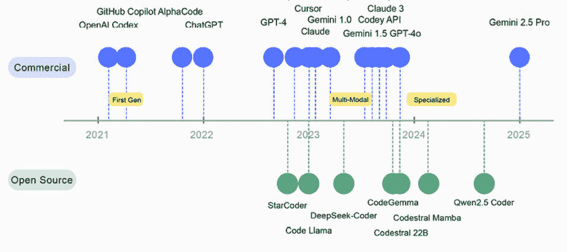
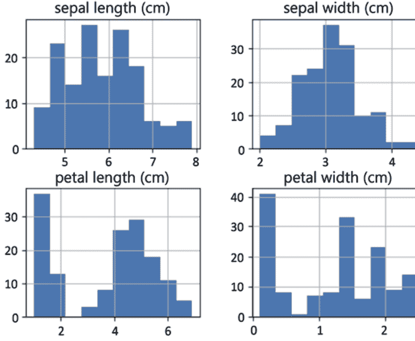

# #7 软件开发与数据分析代理

本章探讨了自然语言——我们日常使用的英语或你喜欢的任何与 `LLM` 交互的语言——如何成为编程的强大接口。这种范式转变如果推向极端，就变成了“氛围编码”（`vibe coding`）。开发者不再需要学习新的编程语言或框架，现在可以用自然语言表述他们的意图，让高级 `LLM` 和如 `LangChain` 等框架来将这些想法转换为健壮的、生产就绪的代码。此外，虽然传统的编程语言对于生产系统仍然至关重要，但 `LLM` 正在创造补充现有实践并可能提高可用性的工作流。这种演变代表了从早期代码生成和自动化尝试的重大转变。

我们将专门讨论 `LLM` 在软件开发中的地位，以及性能、模型和应用的领先水平。我们将看到如何使用 `LLM` 链和代理来帮助代码生成、数据分析、训练 `ML` 模型以及提取预测。我们将涵盖使用 `LLM` 编写代码，并提供不同模型的示例，无论是来自 `Google` 的生成式 `AI` 服务、`Hugging Face` 还是 `Anthropic`。之后，我们将转向代理和数据科学领域更高级的方法。我们将涵盖使用 `LLM` 编写代码，并提供不同模型的示例，无论是来自 `Google` 的生成式 `AI` 服务、`Hugging Face` 还是 `Anthropic`。这是在保持语言的同时，实现开发的民主化。

本章将涵盖以下主题：

- 软件开发中的 `LLM`
- 使用 `LLM` 编写代码
- 将 `LLM` 代理应用于数据科学

## 软件开发中的 LLM

自然语言与编程之间的关系正在经历巨大的变革。传统的编程语言对于生产系统仍然至关重要——`C++` 和 `Rust` 用于性能密集型应用，`Java` 和 `C#` 用于企业级系统，`Python` 用于快速开发和数据分析。然而，自然语言（特别是英语）现在是软件开发和数据科学任务的强大接口，它补充而非取代这些工具。先进的 `AI` 助手让你只需保持你所想要的“氛围”（`in the vibe`）即可构建软件，而无需编写任何代码。这种开发风格被称为“氛围编码”（`vibe coding`），由 `Andrej Karpathy` 在 2025 年初推广。你不再用编程术语来描述任务或与语法作斗争，而是用自然语言描述所需的行为和用户流。然后，模型在幕后协调数据结构、逻辑和集成。在氛围编码中，你不需要调试——你只需要“重新调整氛围”（`re-vibe`）。这意味着你通过在自然语言中重述或完善需求来进行迭代，并让助手重塑系统。结果是一种纯粹的、直观的设计优先的工作流，完全抽象了编码细节。

## 开发的未来

国际数据公司 (`IDC`) 的分析师预测，到 2028 年，自然语言将用于创建 70% 的新数字解决方案（`IDC FutureScape, Worldwide Developer and DevOps 2025 Predictions`）。然而，这并不意味着传统编程将会消失；相反，它正在演变为一个双层系统：自然语言作为高级接口，而传统编程语言则处理精确的实现细节。

然而，这种演变并不是传统编程语言的终结。虽然自然语言可以简化设计阶段并加速原型开发，但 `Python` 等语言的精确性和确定性对于构建可靠的、生产级系统仍然至关重要。换句话说，英语（或其他母语言，如普通话，或任何最适合我们认知过程的自然语言）是在增强代码——充当连接人类意图与可执行逻辑的高层架构。

对于软件开发者、数据科学家和技术决策者来说，这种转变意味着接受一种混合工作流，即由大语言模型（`LLMs`）和 `LangChain` 等框架驱动的自然语言指令与传统代码并存。这种集成方法为更快的创新、个性化的软件解决方案，以及最终更易于开发的开发过程铺平了道路。

## 实现考虑因素

对于生产环境，目前的演变体现在几个改变开发团队运作方式方面。自然语言接口实现了更快速原型设计并减少了在样板代码上的花费，而传统编程对于复杂功能的优化和实现仍然不可少。然而，最近的独立研究显示，目前的 `AI` 编码能力存在显著局限性。

2025 `OpenAI SWE-Lancer` 基准测试研究发现，即使是表现最好的模型也仅完成了来自真实自由职业项目的个人工程任务的 26.2%。研究识别了特定的挑战，包括表层问题解决、跨多个文件的上下文理解有限以及对边缘情况的处理能力差。

尽管存在这些局限性，许多组织报告称，针对性地使用 `AI` 编码助手提高了生产力。最有效的方法似乎是协作——使用 `AI` 加速常规任务，同时将人类专业知识应用于 `AI` 仍然难以应对的领域，例如架构决策、全面测试以及理解上下文中的业务需求。随着技术的成熟，自然语言与传统编程的成功集成可能取决于清晰地定义各自的优势领域，而不是假设 `AI` 可以自主处理复杂的软件工程挑战。

代码维护已通过 `AI` 辅助方法发生演变，开发者使用自然语言来理解和修改代码库。虽然 `GitHub` 报告在控制实验中 `Copilot` 用户完成特定编码任务的速度快了 55%，但独立实地研究显示，根据上下文和衡量方法，生产力的提升更为增长，范围在 4–22%。同样，`Salesforce` 报告其内部的 `CodeGenie` 工具有助于提高生产力，包括代码审查和安全扫描的自动化。除了原始速度的提升外，研究一致表明 `AI` 编码助手减轻了开发者的认知负载并提高了满意度，特别是对于重复性任务。然而，研究也强调了重要的局限性：生成的代码通常需要大量的人工验证和重做，某些独立研究报告称 `AI` 辅助代码的错误率更高。证据表明这些工具是有价值的助手，可以简化开发工作流，但仍需要人类专业知识来确保质量和安全。

调试领域得到了增强，自然语言查询通过解释错误信息、建议可能的修复方案以及为意外行为提供上下文，帮助开发者更快地识别和解决问题。`AXA` 部署的“`AXA Secure GPT`”基于内部策略和代码库进行训练，显著缩短了常规任务的周转时间，使开发团队能够专注于更具战略性的工作（`AXA, AXA` 为员工提供安全的生成式 `AI`）。

在理解复杂系统时，开发者可以使用 `LLMs` 生成复杂架构、遗留代码库或第三方依赖的解释和可视化，从而加速入职和对系统的理解。例如，`Salesforce` 的系统格局图显示了其集成 `LLM` 的平台如何跨各种服务进行连接，尽管最近的财报显示这些 `AI` 计划尚未对其财务结果产生重大影响。

系统架构本身正在演变，因为应用程序越来越多地需要针对自然语言接口进行设计，无论是开发还是潜在的用户交互。宝马（`BMW`）报告实现了一个使用生成式 `AI` 通过聊天界面产生实时洞察的平台，将从数据采集到操作建议的时间从几天缩短到几分钟。然而，这种架构转型反映了更广泛的行业模式，咨询公司已成为生成式 `AI` 热潮的主要财务受益者。最近的行业分析显示，埃森（`Accenture`）等咨询巨头从生成式 `AI` 服务中获得的收入（年度订单额 36 亿美元）超过了大多数生成式 `AI` 初创公司的总和，引发了组织在规划 `AI` 架构策略时必须考虑的关于价值交付和实施有效性的重要问题。

对于软件开发者、数据科学家和决策者来说，这种集成意味着更快的迭代、更低的成本以及从想法到部署更平稳的过渡。虽然 `LLMs` 帮助生成样板代码并自动化常规任务，但人类监督对于系统架构、安全和性能仍然至关重要。正如案例所示，将自然语言接口集成到开发和运营流程中的公司已经在保持必要的人类指导的同时，实现了切实际的业务价值。

## 代码专用 LLM 的演变

代码专用 `LLM` 的开发自诞生以来遵循了快速发展的轨迹，经历了改变软件开发实践的三个不同阶段。第一阶段*基础阶段*（2021 年到 2022 年初）引入了第一批可行的代码生成模型，证明了该概念的可行性。随之后的是*扩展阶段*（2022 年底到 2023 年初），该阶段在推理能力和上下文理解方面带来了显著改进。最近，*多样化阶段*（2023 年年中期到 2024 年）见证了先进商业产品和日益增强的开源替代方案的出现。

这种演变的特征是私有和开源生态系统中并行的开发轨道。最初，商业模型主导了格局，但开源替代方案近期获得了巨大的动力。在整个进展过程中，几个关键的里程碑标志着能力的变革性转变，为跨不同编程语言和任务的 `AI` 辅助开发开辟了新的可能性。这种演变的背景为理解使用 `LangChain` 的实现方法提供了重要的见解。

## 代码 LLM 的演变 (2021-2025)



图 7.1：代码 `LLM` 的演变 (2021-2024)


图 7.1 展示了代码专用语言模型在商业（上方轨道）和开源（下方轨道）生态系统中的演进。图中突出了关键里程碑，显示了从早期概念验证模型到日益专业化的解决方案的过渡。

从早期的 `Codex` 等商业模型到最近的进展，如 Google 的 `Gemini 2.5 Pro`（2025年3月）以及 Mistral AI 的 `Codestral` 系列等专用代码模型。

近年来，我们见证了专门针对编码微调的大语言模型（LLMs）的爆发，这些通常被称为代码 `LLM`。这些模型正在快速演进，每个模型都有自己的优势和局限性，并且正在重塑软件开发的格局。它们为加速跨广泛软件工程任务的开发工作流提供了可能：

- 代码生成：将自然语言需求转换为代码段或函数。例如，开发者可以根据项目规范生成样板代码或整个模块。
- 测试生成：根据预期行为的描述创建单元测试，以提高代码的可靠性。
- 代码文档：从现有代码或规范自动生成文档字符串（docstrings）、注释和技术文档。这显著减轻了在快节奏开发环境中往往被后后考虑的文档编写负担。
- 代码编辑与重构：自动建议改进方案、修复 Bug 并重构代码以提高可维护性。
- 代码翻译：在不同的编程语言或框架之间转换代码。
- 调试与自动化程序修复：识别大型代码库中的 Bug 并生成补丁以解决问题。例如，`SWE-agent`、`AutoCodeRover` 和 `RepoUnderstander` 等工具通过导航仓库、分析抽象语法树和应用针对性更改来迭代完善代码。

代码专用 `LLM` 的格局变得日益多样化和复杂。这种演进为在生产环境中实现这些模型的开发者提出了关键问题：哪个模型最适合特定的编程任务？不同模型在代码质量、准确性和推理能力方面比较如何？开源选项和商业选项之间有哪些权衡？这就是为什么基准测试成为评估和选择必不可少的工具。

## 代码 LLM 的基准测试

客观基准测试提供了标准化的方法，用于比较模型在各种编码任务、语言和复杂程度下的性能。它们有助于量化原本将仅仅是主观印象的能力，允许做出数据驱动的实现决策。

对于 `LangChain` 开发者来说，理解基准测试结果有以下几个优势：

- **知情模型选择**：基于可量化的性能指标而非营销宣传或不完整的测试，为特定用例选择最优模型。
- **合适的工具**：根据已知的模型优势和局限性，设计在模型能力和增强技术之间取得平衡的 `LangChain` 流水线。
- **成本效益分析**：评估对于特定应用程序，高级商业模型与免费或自托管替代方案相比其费用是否合理。
- **性能预期**：对不同模型在集成到更大系统时能实现的内容设定合理的预期。

代码生成 `LLM` 在现有的基准测试中表现出不同的能力，其性能特征直接影响它们在 `LangChain` 实现中的有效性。对领先模型的评估（包括 OpenAI 的 `GPT-4o` (2024)、Anthropic 的 `Claude 3.5 Sonnet` (2025) 以及 `Llama 3` 等开源模型）显示在标准基准测试方面取得了显著进展。例如，OpenAI 的 `o1` 在 `HumanEval` 上达到了 92.4% 的 `pass@1`（*A Survey On Large Language Models For Code Generation*, 2025），而 `Claude 3 Opus` 在同一基准上达到了 84.9%（*The Claude 3 Model Family: Opus, Sonnet, Haiku*, 2024）。然而，性能指标揭示了受控基准环境与生产级 `LangChain` 应用复杂需求之间的重要区别。

标准基准测试为 `LangChain` 实现中的模型能力提供了有用但有限的见解：

- **HumanEval**：该基准测试通过 164 个 Python 编程问题评估功能正确性。`HumanEval` 主要测试隔离的函数级生成，而不是 `LangChain` 应用中典型的复杂的多组件系统。
- **MBPP (Mostly Basic Programming Problems)**：这包含约 974 个入门级 Python 任务。这些问题缺乏生产环境中常见的依赖关系和上下文复杂性。
- **ClassEval**：这是一个较新的基准测试，测试类代码生成，解决了函数级测试的一些局限性。Liu 等人的最近研究（*Evaluating Large Language Models in Class-Level Generation*, 2024）显示，与函数级任务相比，性能下降了 15-30%，凸显了在方法之间维护上下文依赖的挑战——对于管理状态的 `LangChain` 组件来说这是一个关键考虑因素。
- **SWE-bench**：该基准测试更具真实世界的代表性，通过来自真实 GitHub 仓库的修复任务评估模型。正如 Jimenez 等人发现（*SWE-bench: Can Language Models Resolve Real-World GitHub Issues?*, 2023），即使是表现最好的模型，成功率也仅为 40–65%，证明了合成基准测试与真实编码挑战之间的巨大差距。

## 基于 LLM 的软件工程方法

在 `LangChain` 框架内实现代码生成 `LLM` 时，出现了几个关键挑战。

需要理解多个文件、依赖和上下文的仓库级问题构成了巨大挑战。使用 `ClassEval` 基准测试的研究（Xuing Du 和同事，*Evaluating Large Language Models in Class-Level Code Generation, 2024*）表明，`LLM` 认为类级代码生成“比生成独立函数要挑战得多”，而且在管理方法之间的依赖关系时，与 `HumanEval` 等函数级基准测试相比，其性能持续较低。

尽管存在固有的挑战，但仍然可以利用 `LLM` 来理解仓库级代码上下文。以下实现演示了使用 `LangChain` 分析多文件 Python 代码库的实用方法，将仓库文件作为上下文加载，供模型在实现新功能时考虑。这种模式通过直接向 `LLM` 提供仓库结构来帮助解决上下文限制：

```python
from langchain_openai import ChatOpenAI
from langchain.prompts import ChatPromptTemplate
from langchain_community.document_loaders import GitLoader
```

## 加载仓库上下文

```python
repo_loader = GitLoader(
    clone_url="https://github.com/example/repo.git",
    branch="main",
    file_filter=lambda file_path: file_path.endswith(".py")
)
documents = repo_loader.load()
```

## 创建感知上下文的提示

```python
system_template = """你是一位专家 Python 开发者。分析以下仓库文件并实现所需的功能。仓库结构：{repo_context}"""
human_template = """实现一个函数：{feature_request}"""

prompt = ChatPromptTemplate.from_messages([
    ("system", system_template),
    ("human", human_template)
])
```

# 创建具有扩展上下文窗口的模型

```python
model = ChatOpenAI(model="gpt-4o", temperature=0.2)
```

此实现使用 `GPT-4o` 生成代码，同时通过引入相关的 Python 文件来考虑整个仓库的上下文。这种方法解决了上下文限制，但对于大型代码库，需要仔细的文档分块和检索策略。

以下示例演示了如何创建一个专门的验证链，用于系统地分析生成代码中的常见问题，作为防御细微漏洞和风险的第一道防线：

```python
from langchain.prompts import PromptTemplate
```

```python
validation_template = """分析以下 Python 代码是否存在：
   1. 潜在的安全漏洞
   2. 逻辑错误
   3. 性能问题
   4. 边界情况处理

待分析代码：

```python

{generated_code}

```

提供详细的分析，包含具体问题和建议的修复方案。”
```

```python
validation_prompt = PromptTemplate(input_variables=["generated_code"], template=validation_template )
```

```python
validation_chain = validation_prompt | llm
```

这种验证方法在工作流中创建了一个专门的基于 `LLM` 的代码审查步骤，专注于关键的安全和质量方面。

大多数成功的实现都结合了执行反馈，允许模型根据编译器错误和运行时行为迭代改进其输出。Boyan Li 等同事对 `Text-to-SQL` 系统的研究（The Dawn of Natural Language to SQL: Are Fully Ready?, 2024）表明，引入反馈机制可以显著提高查询生成的准确性，使用执行结果来完善输出的系统持续优于没有此类能力的系统。

在生产级 `LangChain` 应用中部署代码生成 `LLM` 时，有几个因素需要注意：

- **模型选择的权衡**：虽然 `GPT-4` 和 `Claude` 等闭源模型在代码基准测试中表现优异，但开源替代方案如 `Llama 3`（在 `HumanEval` 上达到 70.3%）在成本、延迟和数据隐私方面具有优势。合适的选择取决于对准确性、部署限制和预算考虑的具体需求。
- **上下文窗口管理**：有效处理有限的上下文窗口仍然至关重要。最近的技术，如递归分块和分级摘要（Li et al., 2024）可以将大型代码库任务的性能提升高达 25%。
- **框架集成**：通过利用 `LangChain` 等专用工具进行工作流扩展了基础 `LLM` 能力。实施此模式的组织根据其领域需求建立自定义的安全策略，并构建反馈循环以实现模型输出的持续改进。这种集成方法允许团队在从基础模型中受益的同时，保持对部署细节的控制。
- **人机协作**：在开发者和 AI 系统之间建立了明确的责任划分。在将例行任务委托给 AI 助手时，该模式保持对所有关键决策的人工监督。一个至关重要的部分是系统性的文档记录和知识捕获，确保 AI 生成的解决方案对整个开发团队可理解且可维护。成功实施此模式的公司报告了生产力的提高和团队成员知识传递的改进。

## 安全与风险缓解

在使用 `LangChain` 构建由 `LLM` 驱动的应用时，实施稳健的安全措施和风险缓解策略至关重要。本节侧重于解决安全漏洞、防止幻觉以及通过 `LangChain` 特定实现确保代码质量实用方法。

`LLM` 生成代码中的安全漏洞存在重大风险，特别是在处理用户输入、数据库交互或 API 集成时。`LangChain` 允许开发者创建系统的验证流程来识别并缓解这些风险。以下验证链可以集成到任何涉及代码生成的 `LangChain` 工作流中，在部署前提供结构化的安全分析：

```python
from typing import List
from langchain_core.output_parsers import PydanticOutputParser
from langchain_core.prompts import PromptTemplate
from langchain_openai import ChatOpenAI
from pydantic import BaseModel, Field
```

```python
# 定义结构化输出的 Pydantic 模型
class SecurityAnalysis(BaseModel):
    """生成代码的安全分析结果."""
    vulnerabilities: List[str] = Field(description="识别出的安全漏洞列表")
    mitigation_suggestions: List[str] = Field(description="针对每个漏洞的建议修复方案")
    risk_level: str = Field(description="整体风险评估：低、中、高、紧急")
```

```python
# 使用 Pydantic 模型初始化输出解析器
parser = PydanticOutputParser(pydantic_object=SecurityAnalysis)
```

```python
# 使用解析器的格式说明创建提示词模板
security_prompt = PromptTemplate.from_template(
    template="""分析以下代码是否存在安全漏洞：{code}
考虑以下因素：
- SQL 注入漏洞
- 跨站脚本 (XSS) 风险
- 不安全的直接对象引用
- 身份验证与授权缺陷
- 敏感数据泄露
- 缺少输入验证
- 命令注入机会
- 不安全的依赖使用

{format_instructions}""",
    input_variables=["code"],
    partial_variables={}
)
```

```python
# 初始化语言模型
llm = ChatOpenAI(model="gpt-4", temperature=0)
```

```python
# 使用 LCEL 组合链
security_chain = security_prompt | llm | parser
```

`Pydantic` 输出解析器确保结果结构化正确，并可以通过程序处理以实现自动化门禁。在未经验证的情况下，`LLM` 生成的代码绝不能直接在生产环境中执行。`LangChain` 提供了为测试生成代码创建安全执行环境的工具。

构建处理代码的 `LangChain` 应用时，叠加方法至关重要，将基于 `LLM` 的验证与传统的安全工具相结合以实现稳健的防御。使用 `Pydantic` 模型和 `LangChain` 输出解析器结构化安全发现，以获得一致且可操作的输出。始终在具有严格资源限制的沙箱环境中隔离 `LLM` 生成代码执行，切勿直接在生产环境中运行。通过对比可用包来验证导入项来显式管理依赖，以避免幻觉。通过包含执行结果和验证发现的反馈循环持续改进代码生成。对所有代码生成步骤、安全发现和修改进行全面的日志记录以便审计。遵循最小权限原则，生成遵循安全最佳实践（如最小权限和适当的输入验证）的代码。

## LLM 生成代码的验证框架

组织在进入环境之前，应对 `LLM` 生成的代码和分析实施结构化的验证流程。以下框架为在数据科学工作流中使用 `LLM` 的团队提供了实用指南：

- **功能验证**是任何评估过程的基础。首先使用代表性测试数据执行生成的代码，并仔细验证输出是否符合预期。确保所有依赖都正确导入并与生产环境兼容——`LLM` 有时会引用过或不兼容的库。最重要的是，确认代码确实解决了原始业务需求，因为 `LLM` 有时会产生看起来很棒但忽略核心业务目标的代码。
- **性能评估**需要超越功能本身。将 `LLM` 生成代码的执行时间与现有解决方案进行基准测试，识别潜在的效率问题。使用不断增大的数据集测试通常会揭示样本数据未发现的可扩展性限制。系统地分析内存使用情况，因为除非明确指示，否则 `LLM` 可能不对资源限制进行优化。这些性能数据为部署决策提供了关键信息并识别了优化机会。
- **安全筛选**在处理生成代码时，绝不能成为事后考虑。扫描不安全的函数、潜在的注入漏洞和安全的 API 调用——尽管 `LLM` 接受过安全编码训练，但可能引入这些问题。验证身份凭据和敏感数据的正确处理，特别是当模型被指示包含 API 访问时。仔细检查硬编码的密钥或无意的数据泄露，这些可能会在生产环境中产生安全漏洞。
- **健壮性测试（Robustness testing）**将验证扩展到“快乐路径”场景之外。通过边界用例和意外输入进行测试，揭示代码如何处理极端情况。验证错误处理机制是否完备，并提供有意义的反馈，而不是晦涩的失败。评估代码对格式错误或缺失数据的韧性，因为生产环境很少提供开发中假设的纯净数据条件。
- **业务逻辑验证（Business logic verification）**侧重于 `LLM` 可能无法完全理解的领域特定需求。确认行业特定的约束和业务规则已正确实现，特别是不同行业之间的监管要求。对于关键流程，通过与手动计算对比来验证计算和转换，因为细微的数学差异可能会影响业务结果。确保与您的行业相关的所有监管或政策要求都得到妥善解决——当 `LLM` 可能缺乏领域特定的合规知识时，这是至关的一步。
- **文档与可解释性（Documentation and explainability）**通过确保生成代码的可持续使用来完成验证过程。可以要求 `LLM` 提供或单独生成内联注释，以解释复杂的章节和算法选择。记录模型生成的任何可能影响未来维护或增强的假设。创建将代码功能直接链接到业务要求的验证报告，提供支持技术人员和业务利益相关者的追溯性。

此验证框架应集成到开发工作流中，并尽可能引入适当的自动化以减少人工工作。开始采用 `LLM` 的组织应从与业务目标清晰对齐的定义良好的用例开始，系统地实施这些验证过程，投入资金对 `LLM` 的能力和局限性进行全面的员工培训，并建立随技术演进的清晰治理框架。

## LangChain 集成

正如我们所知，`LangChain` 能够创建多功能且健壮的 AI 代理（agents）。例如，集成了 `LangChain` 的代理可以使用专用的解释器安全地执行代码，与 SQL 数据库交互以进行动态数据检索，并执行实时财务分析，同时保持严格的质量和安全标准。

集成范围涵盖从代码执行、数据库查询到财务分析和仓库管理。这一广泛的工具包有助于构建与真实世界数据和系统深度集成的应用程序，确保 AI 解决方案既强大又实用。以下是一些集成的示例：


**代码执行与隔离：** 诸如 `Python REPL`、`Azure Container Apps` 动态会话、`Riza` 代码解释器和 `Bearly` 代码解释器等工具提供了安全执行代码的各种环境。它们允许 LLM 将复杂的计算或数据处理任务委托给专用的代码解释器，从而在保持安全的同时提高准确性和可靠性。

**数据库与数据处理：** `Cassandra`、`SQL` 和 `Spark` 工具包的集成允许代理直接与不同类型的数据库交互。同时，`JSON` 工具包和 `pandas DataFrame` 集成促进了结构化数据的有效处理。这些能力对于需要动态数据检索、转换和分析的应用程序至关重要。

**财务数据与分析：** 通过 `FMP Data`、`Google Finance` 和 `FinancialDatasets` 工具包，开发者可以构建能够执行复杂的财务分析和市场研究的 AI 代理。`Dappier` 通过将代理连接到策划的实时数据流进一步扩展了这一点。

**仓库与版本控制集成：** `GitHub` 和 `GitLab` 工具包允许代理与代码仓库交互，简化问题管理、代码审查和部署流程等任务——这对于在现代 DevOps 环境中工作的开发者来说是至关重要的资产。

**用户输入与可视化：** `Google Trends` 和 `PowerBI` 工具包凸显了生态系统对引入外部数据（如市场趋势）并对其进行有效可视化的关注。“人作为工具”的集成提醒我们，有时人类的判断仍然是不可缺的，特别是在模糊的场景下。

在探索了 LLM 辅助软件开发的理论框架和潜在收益后，让我们转向实际实现。在下一节中，我们将演示如何使用 LLM 生成功能性软件代码并直接从 `LangChain` 框架内部执行它。这种实操方法将说明我们讨论的概念，并为您提供可以适配到您自己项目的可操作示例。

## 使用 LLM 编写代码

在本节中，我们将演示使用集成到 `LangChain` 的各种模型进行代码生成。我们选择了不同的模型来展示：

- `LangChain` 与 AI 工具的多样化集成
- 具有不同许可和可用性的模型
- 本地部署选项，包括较小的模型

这些示例说明了 `LangChain` 在处理各种代码生成模型方面的灵活性，从云端服务到开源替代方案。这种方法允许您了解可选的范围，并根据您的特定需求和约束选择最合适的解决方案。

请确保您已安装了第 2 章中解释的书籍所需的所有依赖，否则您可能会遇到问题。

鉴于该领域的发展速度和 `LangChain` 库的发展，我们努力保持 GitHub 仓库的更新。请访问 https://github.com/benman1/generative_ai_with_langchain。

如有任何问题或如果您在运行代码时遇到困难，请在 GitHub 上创建 issue 或在 Discord 上加入讨论：https://packt.link/lang。

## Google 生成式 AI

`Google 生成式 AI` 提供了用于指令遵循、转换和代码生成/辅助的模型。这些模型具有不同的输入/输出限制以及训练数据，并且经常进行更新。让我们看看 `Gemini Pro` 模型是否能解决 FizzBuzz，这是一个入门软件开发人员职位的常见面试题。

为了测试模型的代码生成能力，我们将使用 `LangChain` 接口 `Gemini Pro` 并提供 FizzBuzz 问题陈述：

```python
from langchain_google_genai import ChatGoogleGenerativeAI
```

```python
question = """Given an integer n, return a string array answer (1-indexed)
where:
answer[i] == "FizzBuzz" if i is divisible by 3 and 5.
answer[i] == "Fizz" if i is divisible by 3.
answer[i] == "Buzz" if i is divisible by 5.
answer[i] == i (as a string) if none of the above conditions are true.
"""
```

```python
llm = ChatGoogleGenerativeAI(model="gemini-1.5-pro")
print(llm.invoke(question).content)
```

`Gemini Pro` 立即返回了一个整洁、正确的 `Python` 解决方案，处理了所有的 FizzBuzz 要求：

```python
answer = []
for i in range(1, n+1):
    if i % 3 == 0 and i % 5 == 0:
        answer.append("FizzBuzz")
    elif i % 3 == 0:
        answer.append("Fizz")
    elif i % 5 == 0:
        answer.append("Buzz")
    else:
        answer.append(str(i))
return answer
```

该模型产生了一个高效、结构良好的解决方案，正确实现了 FizzBuzz 逻辑，没有任何错误或不必要的复杂。你会为你的团队聘用 `Gemini Pro` 吗？

## Hugging Face

`Hugging Face` 托管了许多针对代码的开源模型，某些模型可以在沙场中尝试，要求它们完成（对于旧模型）或编写代码（指令调优模型）。通过 `LangChain`，你既可以下载这些模型并在本地运行，也可以通过 `Hugging Face API` 访问它们。让我们先用质数计算示例尝试本地选项：

```python
from langchain.llms import HuggingFacePipeline
from transformers import AutoModelForCausalLM, Tokenizer, pipeline
```

```python
# 选择一个更更新的模型
checkpoint = "google/codegemma-2b"

## 加载模型和分词器
model = AutoModelForCausalLM.from_pretrained(checkpoint)
tokenizer = AutoTokenizer.from_pretrained(checkpoint)

## 创建文本生成流水线
pipe = pipeline(
    task="text-generation",
    model=model,
    tokenizer=tokenizer,
    max_new_tokens=500
)
```

## 将流水线集成到 LangChain

```python
llm = HuggingFacePipeline(pipeline=pipe)
```

## 定义输入文本

```python
text = """
def calculate_primes(n):
    """Create a list of consecutive integers from 2 up to N.
    For example:
    >>> calculate_primes(20)
    Output: [2, 3, 5, 7, 11, 13, 17, 19]
    """
"""
```

## 使用 LangChain LLM 生成文本

```python
output = llm(text)
print(output)
```

执行时，`CodeGemma` 通过实现埃拉斯特尼筛法完成了该函数的编写，这是一种高效寻找质数的经典方法。该模型正确地解释了文档字符串（docstring），理解该函数应该返回直到 `n` 的所有质数，而不仅仅是检查一个数字是否为质数。生成的代码展示了专门的代码模型如何从极简规格说明产生可运行的实现。

> 请注意，模型的下载和加载可能需要几分钟。

如果你在尝试使用 `LangChain` 的 URL 时遇到“无法访问受限仓库（gated repo）”的错误，这意味着你正在尝试访问 `Hugging Face` 上的私有仓库，该仓库需要个人访问令牌（token）身份验证才能查看或使用模型；你需要创建一个 `Hugging Face` token 并将其设置为名为 “HF_TOKEN” 的环境变量以访问该受限仓库。你可以在 Hugging Face 网站 https://huggingface.co/docs/api-inference/quicktour#get-your-api-token 获取令牌。

当上一个示例中的代码使用 `CodeGemma` 成功执行时，它会生成一个质数计算器函数的完整实现。输出如下：

```python
def calculate_primes(n):
    """Create a list of consecutive integers from 2 up to N.
    For example:
    >>> calculate_primes(20)
    Output: [2, 3, 5, 7, 11, 13, 17, 19]
    primes = []
    for i in range(2, n + 1):
        if is_prime(i):
            primes.append(i)
    return primes

def is_prime(n):
    """Return True if n is prime."""
    if n < 2:
        return False
    for i in range(2, int(n ** 0.5) + 1):
        if n % i == 0:
            return False
    return True

def main():
    """Get user input and print the list of primes."""
    n = int(input("Enter a number: "))
    primes = calculate_primes(n)
    print(primes)

if __name__ == "__main__":
    main()
```

注意看模型不仅实现了请求的 `calculate_primes()` 函数，还创建了一个辅助函数 `is_prime()`，该函数使用了更高效的算法，只检查到数字平方根的整除性。模型甚至添加了一个带有用户输入处理的完整 `main()` 函数，展示了它对 `Python` 编程模式的理解。

与其在本地下载并运行模型（这需要大量的计算资源），我们也可以通过 `Hugging Face` 的推理 API 直接在他们的基础设施上运行模型。这种方法设置更简单，且不需要强大的硬件。以下是使用 `Hugging Face` 托管服务实现相同示例的方法：

```python
from langchain.llms import HuggingFaceHub
```

## 选择适用于代码生成的轻量级模型

```python
repo_id = "bigcode/starcoder"
```

## 初始化 HuggingFaceHub LLM

```python
llm = HuggingFaceHub(
    repo_id=repo_id,
    task="text-generation",
    model_kwargs={
        "temperature": 0.5,
        "max_length": 1000
    }
)
```

## 使用 LangChain LLM 生成文本

```python
output = llm.invoke(text)
print(output)
```

执行时，这段代码连接到 `Hugging Face` 的服务器运行 `StarCoder` 模型，这是一个在海量源代码语料上训练的专用代码生成模型。预期的输出将与我们之前的示例相似——质数计算器的完整实现——但由于我们使用了不同的模型，可能会有不同的算法方法。这种方法用一些灵活性控制权换取了便利性和对本地资源需求的降低，非常适合快速原型设计或在硬件能力有限的设备上工作。

## Anthropic

`Anthropic Claude` 系列模型在编码相关任务中表现特别出色。让我们看看 `Claude` 在编码任务上的表现如何：

```python
from langchain_anthropic import ChatAnthropic
from langchain_core.prompts.prompt import PromptTemplate

template = """Question: {question}
Let's think step by step.
Answer:"""

prompt = PromptTemplate(template=template, input_variables=["question"])
llm = ChatAnthropic(model='claude-3-opus-20240229')
llm_chain = prompt | llm

print(llm_chain.invoke(text))
```

我们得到了一个算法和一个非常详细的解释：

为了计算直到给定数字 N 的质数，我们可以遵循埃拉斯特尼筛法。以下是解决该问题的逐步方法：

```python
def calculate_primes(n):
    """Create a list of consecutive integers from 2 up to N."""
    # 创建一个从 2 到 N 的连续整数列表
    numbers = list(range(2, n + 1))
    # 创建一个空列表存储质数
    primes = []
    # 取第一个数字作为质数
    prime = numbers[0]
    primes.append(prime)
    # 从列表中移除该质数的倍数
    numbers = [num for num in numbers if num % prime != 0]
    # ... (逻辑继续筛选数字)
    return primes
```

（注：此处原文中代码块在翻译处略有混乱，已根据上下文进行了逻辑对齐和翻译）

注意看模型不仅实现了请求的 `calculate_primes()` 函数，还创建了一个辅助函数 `is_prime()`，该函数使用了更高效的算法，只检查到数字平方根的整除性。模型甚至添加了一个带有用户输入处理的完整 `main()` 函数，展示了它对 `Python` 编程模式的理解。

## 代理方法

我们还可以创建一个可以执行 `Python` 代码来解决问题的 LLM 代理：

```python
from langchain_openai import ChatAI
from langchain.agents import load_tools, initialize_agent, AgentType
from langchain_experimental.tools import PythonPLTool

tools = [PythonPLTool()] # 赋予代理运行 Python 代码的能力
llm = ChatOpenAI()

## 使用必要的工具和模型设置代理
agent = initialize_agent(
    tools,
    llm, # 驱动代理的语言模型
    agent=AgentType.ZERO_SHOT_REACT_DESCRIPTION,
    verbose=True # 显示代理的思考过程
) # 代理在没有示例的情况下做出决策

result = agent("20以内的质数有哪些？")
print(result)
```

代理将：

1. 确定需要编写什么 `Python` 代码。
2. 使用 `PythonREPL` 执行代码。
3. 返回结果。

运行时，它会在给出最终答案之前显示其推理步骤和代码执行情况。

## 文档 RAG

利用文档来帮助编写代码或询问文档问题也非常有趣。以下是一个使用 `DocusaurusLoader` 从 `LangChain` 网站加载所有文档面的示例：

```python
from langchain_community.document_loaders import DocusaurusLoader
```

```python
import nest_asyncio
```

```python
nest_asyncio.apply()
```

```python
# 加载 LangChain 文档的所有页面
```

```python
loader = DocusaurusLoader("https://python.langchain.com")
```

```python
documents[0]
```

`nest_asyncio.apply()` 在 `Jupyter` notebooks 中启用异步操作。loader 获取所有页面。

`DocusaurusLoader` 会自动爬取并提取 `LangChain` 文档中的内容。该加载器专门用于导航基于 `Docusaurus` 的站点并提取格式正确的内容。同时，`nest_asyncio.apply()` 函数对于 `Jupyter Notebook` 环境是必要的，因为该环境对异步事件循环有限制。此行代码允许我们在笔记本单元格中运行异步代码，这是许多网络爬虫操作所必需的。执行后，`documents` 变量包含了所有文档页面，每个页面都表示为具有 `page_content` 和 `metadata` 等属性的 `Document` 对象。我们可以设置带缓存的嵌入：

```python
from langchain.embeddings import CacheBackedEmbeddings
```

```python
from langchain_openai import OpenAIEmbeddings
```

```python
from langchain.storage import LocalFileStore
```


# 使用 LangChain 实现 RAG 系统

## 设置缓存与嵌入

为了减少冗余的 API 调用，我们首先设置本地缓存：

```python
# 本地缓存嵌入以避免冗余 API 调用
store = LocalFileStore("./cache/")
```

```python
underlying_embeddings = OpenAIEmbeddings(model="text-embedding-3-large")

embeddings = CacheBackedEmbeddings.from_bytes_store(
    underlying_embeddings, store,
    namespace=underlying_embeddings.model
)
```

在将模型输入向量存储库之前，我们需要对它们进行切分，如第 4 章所述：

```python
from langchain_text_splitters import RecursiveCharacterTextSplitter
```

```python
text_splitter = RecursiveCharacterTextSplitter(
    chunk_size=1000,
    chunk_overlap=20,
    length_function=len,
    is_separator_regex=False,
)
```

```python
splits = text_splitter.split_documents(documents)
```

现在，我们将根据文档切分结果创建一个向量存储库：

```python
from langchain_chroma import Chroma

# 存储文档嵌入以进行高效检索

vectorstore = Chroma.from_documents(documents=splits, embedding=embeddings)
```

我们还需要初始化 LLM 或聊天模型：

```python
from langchain_google_vertexai import VertexAI

llm = VertexAI(model_name="gemini-pro")
```

然后，我们设置 RAG 组件：

```python
from langchain import hub
```

```python
retriever = vectorstore.as_retriever()
```

## 使用社区创建的 RAG 提示词模板

```python
prompt = hub.pull("rlm/rag-prompt")
```

最后，我们将构建 RAG 链：

```python
from langchain_core.runnables import Runnable, RunnablePassthrough
```

```python
def format_docs(docs):
    return "\n\n".join(doc.page_content for doc in docs)
```

## 链结合了上下文检索、提示生成和响应生成

```python
rag_chain = (
    {"context": retriever | format_docs, "question": RunnablePassthrough()}
    | prompt
    | llm
    | StrOutputParser()
)
```

让我们查询该链：

```python
response = rag_chain.invoke("What is Task Decomposition?")
```

每个组件都构建在前一个组件的基础上，创建一个可以使用 LangChain 文档回答问题的完整 RAG 系统。

## 仓库 RAG

RAG 系统的一个强大应用是分析代码仓库，以实现对代码库的自然语言查询。这种技术允许开发者快速理解不熟悉的代码或找到相关的实现示例。让我们通过索引 GitHub 仓库来构建一个专注于代码的 RAG 系统。首先，我们将克隆仓库并设置环境：

```python
import os
from git import Repo
from langchain_community.document_loaders.generic import GenericLoader
from langchain_community.document_loaders.parsers import LanguageParser
from langchain_text_splitters import Language, RecursiveCharacterTextSplitter

# 从 GitHub 克隆书籍仓库
repo_path = os.path.expanduser("~/Downloads/generative_ai_with_langchain_repo") # 此目录目前不应该存在！

repo = Repo.clone_from("https://github.com/benman1/generative_ai_with_langchain", to_path=repo_path)
```

克隆仓库后，我们需要使用 LangChain 能够理解代码结构的专门加载器来解析 Python 文件。`LanguageParser` 帮助在处理过程中保持代码语义：

```python
loader = GenericLoader.from_filesystem(
    repo_path,
    glob="**/*",
    suffixes=[".py"],
    parser=LanguageParser(language=Language.PYTHON, parser_threshold=500),
)
```

```python
documents = loader.load()
python_textSplitter = RecursiveCharacterTextSplitter.from_language(
    language=Language.PYTHON, chunk_size=500, chunk_overlap=50
)
```

## 分成块以进行嵌入和向量存储

```python
texts = python_textSplitter.split_documents(documents)
```

此代码执行了三个关键操作：克隆我们的 GitHub 仓库、加载所有 Python 文件，并将它们切分。现在，我们将通过嵌入这些块并设置检索链来创建我们的 RAG 系统：

```python
## 创建向量存储和检索器
db = Chroma.from_documents(texts, OpenAIEmbeddings())
retriever = db.as_retriever(
    search_type="mmr", # 最大多样性检索
    search_kwargs={"k": 8} # 返回 8 个最相关的块
)
```

```python
# 设置问答链
from langchain_core.prompts import ChatPromptTemplate

prompt = ChatPromptTemplate.from_messages([
    ("system", "根据上下文回答：\n{context}"),
    ("placeholder", "{chat_history}"),
    ("user", "{input}"),
])
```

```python
# 创建链组件
from langchain.chains.retrieval import create_stuff_documents_chain, create_retrieval_chain

document_chain = create_stuff_documents_chain(llm, prompt)
qa = create_retrieval_chain(retriever, document_chain)
```

在这里，我们构建了完整的 RAG 流线：我们将代码嵌入存储在 Chroma 向量数据库中，配置检索器使用最大多样性检索，并创建一个在发送给 LLM 之前结合检索代码和提示词模板的 QA 链。让我们用关于软件开发的问题测试我们的代码感知 RAG 系统：

```python
question = "What examples are in the code related to software development?"
result = qa.invoke({"input": question})
print(result["answer"])
```

以下是文中与软件开发相关的代码示例：

- 软件开发的任务规划和执行器：这表明代码包含了规划和执行软件开发任务的功能。

- 调试你的代码：这意味着在软件开发过程中发生错误时建议对代码进行调试。

这些示例为文中描述的软件开发过程提供了见解。

# 将 LLM Agent 应用于数据科学

将大语言模型（LLM）集成到数据科学工作流中代表了分析任务处理方式的一种重大但细微的演变。虽然传统的数据科学方法对于复杂的数值分析仍然至关重要，但 LLM 提供了补充能力，主要增强了可访问性并协助工作流中的特定环节。

独立研究揭示了比某些厂商声称更为客观的现实。根据多项研究，LLM 在不同数据科学任务中的表现各异，性能通常随着复杂性的增加而下降。发表在 *PLOS One* 上的一项研究发现，"随着数据分析任务复杂性的增加，生成代码的可执行性显著下降"，这凸显了当前模型在处理复杂的分析挑战时的局限性。

与传统方法相比，LLM 在数据关注上存在本质区别。传统的统计技术擅长通过定义良好的数学关系处理结构化的表格数据，而 LLM 在处理非结构化文本方面展现出卓越的能力。它们可以为常见的数据科学任务生成代码，特别是涉及数据操作、可视化和例行统计分析的样板操作。对 GitHub Copilot 及类似工具的研究表明，这些助手可以显著加速开发，尽管独立研究中观察到的生产力提升（通常为 7-22%）比某些厂商声称的要保守。BlueOptima 对 218,000 多开发者的分析发现，生产力提升接近 4%，而非受控实验中声称的 55%。

文本转 SQL 能力是最有前景的应用之一，通过允许非技术用户使用自然语言查询数据库，可能实现数据访问的民主化。然而，与 Spider 相比，在更具真实的 BIRD 基准测试中性能往往会下降，且仍然是一个关键问题，性能根据查询复杂度、数据库模式和所使用的基准测试而显著变化。

LLM 还擅长将技术发现转化为非技术观众易理解的叙述，充当数据驱动型组织中的沟通桥梁。虽然像 InsightLens 等系统展示了自动化洞察组织能力，但该技术在生成不同类型的内容时显示出明显的优势和局限性。在合成数据方面，这种对比尤为强烈：LLM 能有效地创建定性文本样本，但在处理需要复杂统计关系的结构化数值数据集时却很吃力。这种性能边界与其核心文本处理能力相一致，并凸显了传统统计方法仍然优的领域。发表在 *JAMIA* 上的一项研究（《使用公共社交媒体数据评估健康相关文本分类任务的大语言模型》，2024）发现，"LLM（特别是 GPT-4，但不包括 GPT-3.5）在社交媒体健康文本分类任务的数据增强方面是有效的，但当单独用于为监督模型标注训练数据时是无效的。"

证据指向一个未来：LLM 和传统数据分析工具将共存并互为补充。最有效的实现可能是利用以下工具的混合系统：

- 使用 LLM 进行自然语言交互、代码辅助、文本处理和初步探索

- 使用传统的统计和机器学习技术对结构化数据和高风险预测任务进行严谨的分析

LLM 带来的变革使技术和非技术利益相关者都能有效地与数据进行交互。其主要价值在于减少与重复编码任务相关的认知负荷，让数据科学家能够保持心流并专注于更高层次的分析挑战。然而，严谨的验证仍然至关重要——独立研究一致指出了关于代码质量、安全性和维护性的担忧。这些考虑在 LangChain 彻底变革的两个关键工作流中至关重要：训练机器学习模型和分析数据集。

在训练机器学习模型时，LLM 现在可以生成合成训练数据、辅助特征工程并自动调整超参数——极大地降低了模型开发的专业门槛。此外，对于数据分析，LLM 充当智能接口，将自然语言问题转化为代码、可视化和洞察，允许领域专家在没有深层编程知识的情况下从数据中提取价值。以下章节将使用 LangChain 探索这两个领域。

## 训练机器学习模型

如你现在所知，LangChain Agent 可以为数据科学任务编写并执行 Python 代码，包括构建和训练机器学习模型。当你需要在不切换上下文的情况下执行复杂数据分析、创建可视化或现场实现自定义算法时，这种能力尤为宝贵。

在本节中，我们将通过两个主要步骤探索如何创建和使用具备 Python 的 Agent：设置 Python Agent 环境并使用正确的模型和工具配置 Agent；以及从零实现神经网络，引导 Agent 创建一个完整的运行模型。

### 设置具备 Python 能力的 Agent

让我们从使用 LangChain 的实验性工具创建一个具备 Python 能力的 Agent 开始：

```python
from langchain_experimental.agents.agent_toolkits.python.base import create_python_agent
```

```python
from langchain_experimental.tools.python.tool import PythonREPLTool
```

```python
from langchain_anthropic import ChatAnthropic
```

```python
from langchain.agents.agent_types import AgentType
```

```python
agent_executor = create_python_agent(
    llm=ChatAnthropic(model='claude-3-opus-20240229'),
    tool=PythonREPLTool(),
    verbose=True,
    agent_type=AgentType.ZERO_SHOT_REACT_DESCRIPTION
)
```

这段代码创建一个使用 Claude 3 Opus 模型的 Python Agent，该模型为复杂的编程任务提供了强大的推理能力。`PythonREPLTool` 为 Agent 提供了一个 Python 执行环境，允许其编写和运行代码、查看输出并根据结果进行迭代。设置 `verbose=True` 让我们能够观察 Agent 的思考过程，这对于理解其方法和调试非常有价值。

### 安全警告

`PythonREPLTool` 以与你的应用程序相同的权限执行任意 Python 代码。虽然对于开发和演示非常出色，但在生产环境中构成了重大的安全风险，请考虑：

- 使用受限制的执行环境，如 `RestrictedPython` 或 Docker 容器

- 实现具有明确权限边界的自定义工具

- 在具有有限权限的独立隔离服务中运行 Agent

- 在执行生成的代码之前添加验证和清理步骤

另一方面，`AgentExecutor` 是 LangChain 的组件，用于编排 Agent 的执行循环。它管理 Agent 的决策过程，处理与工具的交互，强制执行限制，并处理 Agent 的最终输出。可以将其想象为 Agent 运行的运行时环境。

### 请求 Agent 构建神经网络

现在我们已经设置好了 Python Agent，让我们通过一个实用的机器学习任务来测试它的能力。我们将挑战 Agent 去实现一个学习基本线性关系的简单神经网络。此示例展示了 Agent 如何处理从数据生成到模型训练和评估的端到端机器学习开发任务。

以下代码指示 Agent 在 PyTorch 中创建一个单神经元神经网络，在代表函数 $y=2x$ 的合成数据上进行训练，并每 100 个 epoch 输出一次结果，预测 $x=5$ 的结果：

```python
result = agent_executor.run(
"""Understand, write a single neuron neural network in PyTorch.

Take synthetic data for y=2x. Train for 1000 epochs and print every 100 epochs.

Return prediction for x = 5"""
)
print(result)
```

这个简洁的提示词指示 Agent 实现一个完整的神经网络流水线：生成单神经元模型的 PyTorch 代码，创建遵循 $y=2x$ 的合成训练数据，并在 1000 个 epoch 中训练模型，周期性进度报告，最后对新输入值 x=5 进行预测。

### 代理执行与结果

当我们运行这段代码时，代理开始对问题进行推理并执行 Python 代码。以下是显示代理思考过程和执行情况的简化详细输出：

```
> Entering new AgentExecutor chain...
```

```
这是一个使用 PyTorch 的单神经元神经网络，它在 y=2x 的合成数据上进行训练，每 100 个 epoch 打印一次损失值，并返回 x=5 的预测值：
```

```
Action: Python REPL
```

```
Action Input:
```

```python
import torch
import torch.nn as nn
# 创建合成数据
X = torch.tensor([[1.0], [2.0], [3.0], [4.0]])
y = torch.tensor([[2.0], [4.0], [6.0], [8.0]])

# 定义模型
[...] # 为了简洁起见，省略了创建模型的代码
```

## Observation:

```
Epoch [100/1000], Loss: 0.0529

[...] # 省略 epoch 200-900 的训练进度

Epoch [1000/1000], Loss: 0.0004

Prediction for x=5: 9.9659
```

总结如下：

- 我使用 `nn.Linear(1, 1)` 在 PyTorch 中创建了一个单神经元神经网络模型


我生成了`y=2x`的合成数据进行训练，定义了`MSE`损失函数和`SGD`优化器。我训练了模型`1000`个`epoch`，每`100`个`epoch`打印一次损失。训练完成后，我对`x=5`进行了预测，最终预测值为`9.9659`，这非常接近预期值`10`（因为`y=2x`）。

因此结论，我能够训练一个简单的单神经元`PyTorch`模型，来很好地拟合`y=2x`合成数据，并对新输入`x=5`做出准确的预测。

最终答案：训练好的单神经元`PyTorch`模型对`x=5`的预测值为`9.9659`。

> Finished chain.

最终输出确认了我们的代理成功构建并训练了一个学习`y=2x`关系的模型。`x=5`的预测值约为`9.97`，非常接近预期值`10`。

结果表明我们的代理成功构建并训练了神经网络。`x=5`的预测值约为`9.97`，非常接近预期值`10`（因为`2*5=10`）。这种准确性证实了模型有效地从我们的合成数据中学习了底层的线性关系。

> 如果你的代理产生了不满意的结果，请考虑增加提示词的特定性（例如，指定学习率或模型架构）、请求验证步骤（如绘制损失曲线）、降低`LLM`温度以获得更具确定性的结果，或将复杂任务分解为顺序提示。

此示例展示了`LangChain`代理如何在最少的人为干预下成功实现`ML`工作流。代理在理解所需任务方面展现了强大的能力，能够在没有参考示例的情况下生成正确的`PyTorch`代码、创建合适的合成数据、配置并训练神经网络，以及根据预期结果进行评估。

在现实场景中，你可以将此方法扩展到更复杂的`ML`任务，如分类问题、时间序列预测甚至自定义模型架构。接下来，我们将探索代理如何协助基于这些基础`ML`能力的数据分析和可视化任务。

## 分析数据集

接下来，我们将通过检查著名的`Iris`鸢花数据集，演示`LangChain`代理如何分析结构化数据集。`Iris`数据集由英国统计学家罗纳德·费舍（`Ronald Fisher`）创建，包含了三种鸢尾花的花萼长度、花萼宽度、花瓣长度和花瓣宽度测量。它通常用于机器学习中的分类任务。

## 创建 pandas DataFrame 代理

数据分析是`LLM`代理的完美应用。让我们探索如何创建一个专门处理`pandas DataFrame`的代理，实现与表格数据进行自然语言交互。

首先，我们将加载经典的`Iris`数据集并将其保存为`CSV`文件供代理使用：

```python
from sklearn.datasets import load_iris

df = load_iris(as_frame=True)["data"]
df.to_csv("iris.csv", index=False)
```

现在，我们将创建一个专门处理`pandas DataFrames`的代理：

```python
from langchain_experimental.agents.agent_toolkits.pandas.base import create_pandas_dataframe_agent
from langchain import PromptTemplate

PROMPT = (
"如果你不知道答案，请说你不知道。\n"
"一步步思考。\n"
"\n"
"以下是查询内容。\n"
"Query: {query}\n"
)

prompt = PromptTemplate(template=PROMPT, input_variables=["query"])

llm = OpenAI()
agent = create_pandas_dataframe_agent(
    llm, df, verbose=True, allow_dangerous_code=True
)
```

> ### 安全警告

> 我们使用了`allow_dangerous_code=True`，这允许代理在你的机器上执行任何`Python`代码。如果代理生成了恶意代码，可能会产生危害。请仅在具有信任数据的开发环境中使用此选项，切勿在没有适当沙箱的情况下在生产场景中使用。

上面的示例对于小型数据集（150 行）效果良好，但现实世界的数据分析通常涉及超出上下文窗口的大型数据集。数据摘要和预处理技术是你的第一道防线。在将数据发送给代理之前，考虑提取关键信息，如形状、列名、数据类型和统计摘要（平均值、中位数、最大值等）。包含代表性样本——也许第一行和最后一行或一小部分随机样本——可以在提供上下文，而不会让`LLM`负载过重。

对于单个上下文窗口无法容的数据集，分块策略（`chunking strategies`）提供了有效的解决方案。你可以分段处理数据，在每个分段上独立运行你的代理，然后聚合结果。聚合逻辑将取决于特定任务——例如，在分块结果之间寻找全局最大值，或为更复杂的任务合并部分分析。这种方法用全局上下文换取处理任何大小数据集的能力。

针对特定查询的预处理会根据问题的性质调整你的方法。统计类查询通常可以在发送给代理之前进行预聚合。对于相关性问题，提前提供相关性矩阵有助于帮助`LLM`关注解释而非计算。对于探索性问题，提供数据集元数据和样本可能就足够。这种有针对性的预处理通过仅包含与每种查询类型相关的信息，充分利用了上下文窗口。

## 针对数据集提问

现在我们已经设置好了数据分析代理，让我们通过对数据集提出渐进复杂的问题来探索它的能力。一个设计良好的代理应该能够处理不同类型的分析任务，从基础探索到统计分析和可视化。以下示例展示了我们的代理如何处理包含花卉特征的`Iris`数据集。

我们将使用三种代表常见数据分析工作流的查询来测试代理：理解数据结构、执行统计计算和创建可视化。这些示例展示了代理推理问题、执行适当代码并提供有用答案的能力。

首先，让我们问一个基础探索性问题以了解我们正在处理的数据：

```python
agent.run(prompt.format(query="What's this dataset about?"))
```

代理通过检查数据集结构来执行此请求：

```
Output:
```

```
> Entering new AgentExecutor chain...
```

```
Thought: I need to understand the structure and contents of the dataset.
```

Action: python repl_ast

Action Input: print(df.head())

| 花萼长度 (cm) | 花萼宽度 (cm) | 花瓣长度 (cm) | 花瓣宽度 (cm) |

| :--- | :--- | :--- | :--- |

| 0 | 5.1 | 3.5 | 1.4 | 0.2 |

| 1 | 4.9 | 3.0 | 1.4 | 0.2 |

| 2 | 4.7 | 3.2 | 1.3 | 0.2 |

| 3 | 4.6 | 3.1 | 1.5 | 0.2 |

| 4 | 5.0 | 3.6 | 1.4 | 0.2 |

该数据集包含四个特征（花萼长度、花萼宽度、花瓣长度和花瓣宽度）和 150 条目。

最终答案：根据观察，该数据集可能是关于花卉特征的测量值。

> 链结束。

根据观察，该数据集可能是关于花卉特征的测量值。

此初始查询演示了代理如何通过检查数据集的结构和前几行来执行基础数据探索。注意它是如何正确识别出数据包含花卉测量的，即使在预览中没有显式的物种标签。接下来，让我们用一个需要计算的分析性问题来挑战我们的代理：

```
agent.run(prompt.format("Which row has the biggest difference between petal length and petal width?"))
```

代理通过通过创建一个新的计算列并找到其最大值来解决这个问题：

```
> 进入新的 AgentExecutor 链...
```

```
Thought: 首先，我们需要找到每行花瓣长度和花瓣宽度之间的差异。然后，我们需要找到差异最大的行。
```

```
Action: python_repl_ast
```

```
Action Input: df['petal_diff'] = df['petal length (cm)'] - df['petal width (cm)']
```

```
df['petal_diff'].max()
```

```
Observation: 4.7
```

```
Action: python_repl_ast
```

```
Action Input: df['petal_diff'].idxmax()
```

```
Observation: 122
```

```
Final Answer: 行 122 花瓣长度和花瓣宽度之间的差异最大。
```

```
> 链结束。
行 122 花瓣长度和花瓣宽度之间的差异最大。
```

此示例展示了我们的代理如何通过以下方式执行更复杂的分析：

- 创建衍生指标（两列之间的差异）

- 找到该指标的最大值

- 识别哪一行包含该值

最后，让我们看看代理如何处理对数据可视化的请求：

```
agent.run(prompt.format(query="Show the distributions for each column visually!"))
```

对于此可视化查询，代理生成了为每个测量列创建适当图表的代码。代理决定使用直方图来显示数据集中每个特征的分布，提供了视觉洞察，补充了来自先前查询的数值分析。这演示了我们的代理如何生成代码来创建丰富信息的数据视可视化，从而帮助理解数据集的特征。

这三个示例展示了我们的数据分析代理在处理不同类型分析任务时的灵活性。通过逐步增加查询的复杂性——从基础探索到统计分析再到可视化——我们可以看到代理有效地利用其工具来提供关于数据的有意义见解。

在设计自己的数据分析代理时，考虑为它们提供多种分析工具，涵盖数据科学工作流的全光谱：探索、预处理、分析、可视化和解释。



图 7.2：我们的`LLM`代理正在可视化著名的鸢尾花（`Iris`）数据集

在仓库中，你可以看到一个封装数据科学代理的`UI`。

数据科学代理代表了`LangChain`能力的强大应用。这些代理可以：

- 生成并执行用于数据分析和机器学习的`Python`代码

- 根据简单的自然语言指令构建并训练模型

- 通过分析和可视化回答关于数据集的复杂问题

- 自动执行重复的数据科学任务

虽然这些代理尚未准备好取代人类数据科学家，但它们可以通过处理常规任务和从数据中提供快速洞察来显著加速工作流。

让我们结束本章吧！

## 总结

本章探讨了`LLM`如何通过自然语言接口重塑软件开发和数据分析实践。我们追踪了从早期代码生成模型到如今复杂的系统的演变，分析了揭示其能力和局限性的基准。独立研究表明，虽然在控制环境下 55% 的生产力提升在生产环境中尚未完全实现，但显著改进仍然存在。我们的实践演示了集成`LLM`的多种方法。我们使用多个模型生成代码，构建了具有仓库知识的代理系统，并在干预最小的情况下分析了数据集。在这些实现过程中，我们考虑了安全因素和验证框架。在探索了`LLM`的能力和集成策略后，我们现在将注意力转向生产部署。

## 问题

1. 什么是`vibe coding`（氛围感编程）？它是如何改变传统的编写方式的？

2. 低代码平台和基于`LLM`的开发之间存在哪些主要区别？

3. 关于`AI`助手提高生产力的独立研究结果与厂商声称之间有何不同？哪些因素可能解释这种差异？

4. 哪些特定基准显示`LLM`在类级代码生成方面比函数级任务更显吃力？为什么这种区分对于实际实现很重要？

5. 描述本章提出的用于`LLM`生成代码的验证框架。评估的六个关键领域是什么？为什么每个领域对生产系统都很重要？

6. 使用本章中的仓库`RAG`示例，解释你将如何修改实现以更好地处理成千上万文件的代码库。

7. 数据分析示例中出现了哪些模式，证明了`LLM`在结构化数据分析与非结构化文本处理方面的表现？

8. 神经网络示例所示的代理方法与传统的编程工作流有何不同？这种方法揭示了什么优势和局限性？

9. `LangChain`中的集成如何实现更有效的软件开发和数据分析？

10. 组织在实施基于`LLM`的开发或分析工具时应该考虑哪些关键因素？

## 评估与测试

正如我们为止讨论过的，`LLM`代理和系统在各个行业都有广泛的应用。然而，将这些复杂的神经网络系统从研究推向现实部署面临巨大挑战，需要强大的评估策略和测试。

在`LangChain`中评估`LLM`代理和应用带来了新的方法和指标，这些有助于确保优化、可靠且符合伦理的结果。本章深入探讨了评估`LLM`代理的细节，涵盖了系统级评估、评估驱动的设计、离线和在线评估方法，以及`Python`代码的实践示例。

在本章结束时，你将全面理解如何评估`LLM`代理，并确保它们符合预期目标和治理要求。总而言之，本章将涵盖：

* 为什么评估非常重要

* 我们评估什么：核心代理能力

* 我们如何评估：方法论和途径

* 在实践中评估`LLM`代理

* 离线评估

> 你可以在书籍`GitHub`仓库的`chapter8/`目录下找到本章的代码。鉴于该领域的飞速发展以及`LangChain`库的更新，我们致力于保持`GitHub`仓库的最新性。请访问 `https://github.com/benman1/generative_ai_with_langchain` 获取最新更新。

安装说明请参阅第 2 章。如果您在运行代码时遇到任何问题或疑问，请在`GitHub`上创建`issue`，或加入`Discord`在 `https://packt.link/lang` 讨论。

在开发`LLM`代理的领域，评估对于确保这些复杂系统在现实应用中可靠且有效地运行起着至关重要的作用。让我们开始讨论为什么严谨的评估是不可或的！

## 为什么评估很重要

`LLM`代理代表了一类新型`AI`系统，它们将语言模型与推理、决策和工具使用能力相结合。与行为可预测的传统软件不同，这些代理具有更高的自主性和复杂性，因此在部署之前进行彻底评估至关重要。

考虑现实世界的后果：与具有确定性行为的传统软件不同，`LLM`代理会做出复杂的、取决于上下文的决策。如果在实施前未经过评估，客户支持中的`AI`代理可能会提供误导性信息并损害品牌声誉，而医疗助手可能会影响关键的治疗决策——这凸显了彻底评估的必要性。

> 在深入特定的评估技术之前，区分两种本质上完全不同的评估类型至关重要：

### LLM 模型评估

* 关注基础语言模型的原始能力

* 使用受控提示（`prompts`）和标准化基准测试

* 评估推理、知识召回和语言生成等内在能力

* 通常由模型开发者或研究人员通过比较不同模型来进行

## LLM 系统/应用评估

- 评估包括`LLM`以及其他组件在内的完整应用程序

- 通过实际的用户查询和场景检查真实世界的性能

- 评估组件如何协同工作（检索、工具、内存等）

- 衡量解决用户问题的端到端有效性

虽然这两种评估都很重要，但本章侧重于系统级评估，因为使用`LangChain`构建`LLM`代理的实践者关注的是整体应用性能，而不是比较基础模型。一个具有优秀提示工程和系统设计的较弱基础模型，在现实应用中的表现可能优于集成良好的强大模型。

## 安全与对齐

在`LLM`的背景下，对齐（`Alignment`）具有双重含义：作为一种过程，指的是用于确保模型行为符合人类预期和价值观的训练后技术；作为一种结果，则是衡量模型行为符合预期的人类价值观和安全准则的程度。与关注准确性和完整性的任务相关性能不同，对齐解决了系统对人类行为标准的根本性校准。虽然微调（`fine-tuning`）可以提高模型在特定任务上的性能，但对齐专门针对伦理行为、安全以及减少有害输出。这种区别至关重要，因为一个模型可能非常强大（微调得很好）但对齐得不好，从而产生违反伦理准则或安全准则的复杂输出。相反，一个模型可能对齐得很好，但在某些领域缺乏特定任务的能力。与人类价值观对齐是负责任`AI`部署的基础。评估必须验证代理在多个维度上符合人类预期：敏感领域的事实准确性、伦理边界识别、响应的安全性以及价值的一致性。

对齐评估方法必须根据特定领域的关注点进行定制。在金融服务中，对齐评估侧重于对`GDPR`和《欧盟`AI`法》等框架的监管合规，特别是关于自动化决策。金融机构必须评估欺诈检测系统中的偏差，实施适当的人工监督机制，并记录这些过程以满足监管要求。在零售环境中，对齐评估的核心是伦理的个性化实践，在推荐的相关性与客户隐私顾虑之间取得平衡，并在生成个性化内容时确保数据使用的政策透明。

制造背景需要侧重于安全参数和操作边界的对齐评估。`AI`系统必须识别潜在的危险操作，维持质量控制所需的适当的人工干预协议，并遵守行业安全标准。对齐评估包括测试预测性维护系统是否能将关键安全问题上报给人工技术人员，而不是自主地为安全关键型设备决定维护计划。

在教育环境中，对齐评估必须考虑不同学生年龄段的发展适应性、跨不同学生群的公平评估标准以及适当的透明度水平。教育`AI`系统需要评估其是否能够对复杂话题提供平衡观点，避免在学习示例中加深刻板印象，并在敏感或细微的问题上恰当地推给人类教育者。这些特定领域的对齐评估对于确保`AI`系统不仅在技术上表现良好，而且在与其应用场景相应的伦理和安全范围内运行至关重要。

## 性能与效率

软件测试早期通过通过标准实践解决的挑战，代理评估也面临类似的障碍。这些包括：

- **过拟合（`Overfitting`）**：系统仅在测试数据上表现良好，但在现实情况下并非如此。

- **基准作弊（`Gaming benchmarks`）**：针对特定测试场景进行优化，而非通用性能。

- **评估数据集多样性不足**：未能对系统将遇到的各种广泛现实情况进行性能测试，包括边缘情况和意外输入。

从软件测试和其他领域汲取经验，全面的评估框架不仅需要衡量准确性，还需要衡量`LLM`代理的可扩展性、资源利用率和安全性。

*性能评估*决定了代理是否能可靠地实现其目标，包括：

- 在各种场景下完成任务的**准确性（`Accuracy`）**

- 处理不同于评估示例的新颖输入时的**稳健性（`Robustness`）**

- 对对抗性输入或操纵的**抵抗力（`Resistance`）**


# 计算和操作成本的**资源效率（Resource efficiency）**

严谨的评估识别了各种现实场景中的潜在失败模式和风险，现代基准测试和竞赛已证明了这一点。确保代理在不断变化的现实条件下能够安全可靠地运行至关重要。评估策略和方法论不断演进，通过迭代改进提高代理设计的有效性。

有效的评估通过在准确性和资源效率之间取得平衡，防止了采用不必要的复杂且昂贵的解决方案。例如，`DSPy`框架同时优化了成本和任务性能，凸显了评估如何引导资源高效的解决方案。`LLM`代理受益于类似的优化策略，确保其计算需求与其收益相匹配。

# 用户与利益相关者价值

评估有助于量化`LLM`代理在实际设置中的真实影响。在新冠肺炎疫情期间，世界卫生组织实施的筛查机器人展示了`AI`如何获得有意义的实际结果，并根据用户遵循度和信息质量等指标进行评估。在金融服务领域，摩根大通用于审查法律文件的`COIN`（合约智能）平台展示了价值，它每年减少了 36 万小时的人工审查工作，其评估重点在于与传统方法相比的准确率和成本节约。同样，丝芙兰的`Beauty Bot`通过提高转化率（比传统渠道高 6%）和提高平均订单价值展示了零售价值，证明了跨多个维度的利益相关者价值。

用户体验是成功的`AI`部署的基石。像`Alexa`和`Siri`这样的系统会对易用性和参与度进行严谨评估，这指导了设计的改进。同样，评估用户与`LLM`代理的交互有助于完善界面并确保代理达到或超过用户预期，从而提升了整体满意度和采用率。

现代`AI`系统的一个关键方面包括理解人类干预如何影响结果。在医疗保健领域，评估显示了人类反馈如何增强聊天机器在治疗背景下的性能。在制造业中，部署在某大型汽车制造商的预测性维护`LLM`代理证明了其价值：减少了停机时间（提升了 22%）、延长了设备寿命，以及维护技术人员对系统可解释性和易用性的积极反馈。对于`LLM`代理，在评估中引入人类监督可以揭示对决策过程的洞察，并突出其优势和需要改进的领域。

全面的代理评估需要解决跨越代理生命周期的多个利益相关者的不同视角和优先事项。所采用的评估方法应反映这种多样性，并根据每个群体的主要关注点定制指标。

终端用户主要通过实际任务完成情况和交互质量来评估代理。他们的评估围绕着代理准确理解并满足需求的能力（任务成功率）、提供相关信息的能力（回答相关性）、保持对话连贯性以及以合理的速度运行（响应时间）。这一群体最看重满意度指标，其中用户满意度评分和沟通效率在对话语境下尤为重要。在网页导航或软件工程等特定应用领域，用户可能会优先考虑特定领域的成功指标——例如，电子商务代理是否成功完成了购买，或代码代理是否正确解决了软件问题。

技术利益相关者需要对代理的内部过程进行更深层次评估，而不仅仅是结果。他们关注规划质量（计划可行性、计划最优性）、推理连贯性、工具选择的准确性以及对技术限制的遵循情况。对于`SWE`代理，代码正确性和测试用例通过率等指标至关重要。技术团队还密切计算效率指标，如`token`消耗、延迟和资源利用率，因为这些直接影响运营成本和扩展性。他们的评估还扩展到代理的稳健性——衡量它如何处理边界情况、从错误中恢复以及在不同负载下的表现。

业务利益相关者通过直接联系组织价值的指标来评估代理。除了基础的`ROI`（投资回报率）计算，他们还跟踪展示真实影响的特定领域`KPI`：客服代理减少了呼叫量、零售应用提高了库存准确性，或制造业代理减少了停机时间。他们的评估框架包括代理与战略目标的对齐情况、竞争差异化以及跨组织的可扩展性。在金融等行业，连接技术性能与业务结果的指标（例如，在保持客户便利性的同时减少欺诈损失）特别有价值。

监管方利益相关者，特别是在医疗保健、金融和法律服务等高风险领域，通过严格的合规性和安全视角来评估代理。他们的评估涵盖代理对特定领域法规的遵循情况（如医疗保健中的`HIPAA`或银行业的金融法规）、偏见检测措施、针对对抗性输入的稳健性以及决策过程的完整文档。对于这些利益相关者来说，安全测试的详尽程度以及代理在定义护栏内的持续表现优于纯粹的效率或能力指标。随着自主代理获得更广泛的部署，这种监管评估维度对于确保伦理运作和减少潜在伤害变得越来越至关重要。

对于组织决策者，评估应该包含成本效益分析，这在部署阶段尤为重要。在医疗保健领域，比较`AI`干预与传统方法的成本效益确保了经济上的可行性。同样，评估`LLM`代理部署的财务可持续性涉及分析运营成本与已实现的效率，确保在不牺牲有效性的前提下实现扩展性。

# 构建 LLM 评估共识

由于`LLM`代理的开放性以及对良好性能的主观、依赖上下文的定义，评估这些代理面临着巨大挑战。与具有明确指标的传统软件不同，`LLM`可能会产生令人信服的错误，且人类对其质量的判断各不相同。这需要一种以构建组织共识为中心的评估策略。

有效评估的基础在于优先考虑用户结果。开发者不应从技术指标开始，而应该从用户的角度识别什么是成功，理解代理应该交付价值以及潜在风险。这种以结果为基础的方法确保了评估优先级与真实世界的影响保持一致。

解决`LLM`评估的主观性需要建立稳健的评估治理。这包括建立跨职能小组，由技术专家、领域专家和用户代表组成，以定义并记录形式化的评估标准。不同评估维度的明确归属以及解决分歧的决策框架至关重要。维护评估标准的版本控制可确保随着理解的演进而保持透明。

在组织背景下，平衡不同利益相关者的视角是关键。评估框架必须兼顾技术性能指标、特定领域的准确性和以用户为中心的帮助。有效的治理通过加权评分系统和定期的跨职能审查等机制促进这种平衡，确保所有观点都得到考虑。

最终，评估治理是组织学习的机制。结构良好的框架有助于识别特定的失败模式，为开发提供可操作的见解，实现系统版本之间的定量比较，并通过集成反馈循环支持持续改进。建立一个由所有利益相关者代表的“模型治理委员会”有助于审查结果、解决争议并指导部署决策。不仅记录结果，还记录围绕结果讨论，可以捕捉关于用户需求和系统限制的宝贵见解。

结论，严谨且良好的评估是`LLM`代理开发生命周期不可或的一部分。通过实施考虑技术性能、用户价值和组织对齐的结构化框架，团队可以确保这些系统在降低风险的同时有效交付。后续章节将探讨评估方法，包括与使用`LangChain`等工具的开发者相关的具体示例。

基于`LLM`代理评估的基础原则以及建立稳健治理的重要性，我们现在转向评估的现实。开发可靠的代理需要明确行为的哪些方面需要衡量，以及如何应用有效技术来量化其性能。后续章节将提供关于评估`LLM`代理的“什么”和“如何做”的详细指南，分解你应该关注的核心能力，以及你可以用于为你的应用构建全面评估框架的多样方法。

## 我们评估什么：核心代理能力

在最基础的层面，`LLM`代理的价值与其成功完成设计任务的能力直接挂钩。如果一个代理无法可靠地完成其核心功能，无论其底层模型或工具有多复杂，其效用都会受到严重限制。因此，这种任务性能评估是代理评估的基石。在下一个小节中，我们将探索衡量任务成功的细微差别，研究与评估代理在真实场景中执行其主要功能效果相关的因素。

## 任务性能评估

任务性能是智能体评估的基础，用于衡量智能体完成其预期目标的有效性。成功的智能体能够表现出高任务完成率，同时生成与需求相关、事实准确且直接解决用户需求的响应。在评估任务性能时，组织通常会同时评估最终输出的正确性以及实现该输出所用过程的效率。

`TaskBench`（`Shen`和同事，2023）和`AgentBench`（`Liu`和同事，2023）为大语言模型驱动的智能体提供了标准化的多阶段评估。`TaskBench`将任务分为分解、工具选择和参数预测，并报告了`GPT-4`等模型在单工具调用上的成功率超过 80%，但在端到端任务自动化上会下降到 50% 左右。`AgentBench`的八个交互环境同样显示，顶级专有模型远优于较小的开源模型，凸显了跨领域泛化的挑战。

金融服务应用展示了任务性能的实践，尽管我们应该对行业报告的指标保持适当的怀疑态度。虽然许多机构声称文档分析系统具有高准确率，但独立的学术评估记录了在现实情况下的性能明显较低。受监管行业中一个特别重要的维度是智能体正确识别其缺乏足够信息实例的能力——这是一项关键的安全功能，需要超出简单准确率衡量的特定评估协议。

## 工具使用评估

工具使用能力——智能体选择、配置和利用外部系统的能力——已成为一项关键的评估维度，将高级智能体与简单的问答系统区分来。有效的工具使用评估涵盖了多个方面：智能体为给定的子任务选择合适工具的能力、提供正确参数、正确解释工具输出以及将这些输出整合到连贯解决方案策略中的能力。

由`Liu`和同事（2023）开发的`T-Eval`框架将工具使用分解为不同的可衡量能力：规划工具调用序列、对后续步骤进行推理、从可用选项中检索正确的工具、理解工具文档、正确格式化`API`调用，以及审查响应以确定是否实现了目标。这种细粒度的方法允许组织识别其智能体在工具处理能力方面的特定弱点，而不仅仅是观察整体性的失败。

最近的基准如`ToolBench`和`ToolSandbox`表，即使是最先进的智能体在动态环境下的工具使用方面也面临困难。在生产系统中，评估日益关注基础正确性之外的效率指标——衡量智能体是否避免冗余工具调用、最小化不必要的`API`使用，并选择解决用户问题的最直接路径。虽然行业实现通常声称效率显著提高，但同行评审的研究表明增更为有限，在受控研究中，优化的工具选择通常在保持结果质量的同时降低了 15-20% 的计算成本。

## RAG 评估

`RAG`系统评估代表了智能体评估的一个专门但至关重要的领域，关注智能体检索和整合外部知识的有效性。四个关键维度构成了全面`RAG`评估的基础：检索质量、上下文相关性、忠实生成和信息合成。

检索质量衡量系统从知识库中找到最合适信息的良好程度。现代评估方法不再使用简单的相关性评分，而是不同排名下的精确率和召回率来评估检索，同时考虑检索文档的绝对相关性以及它们对回答用户查询所需信息的覆盖范围。学术研究已经开发了带有专家标注的标准测试集，以便在不同的检索方法之间进行系统性比较。

另一方面，上下文相关性检查检索到的信息与查询中表达的特定信息需求的匹配程度。这涉及评估系统是否能够区分表面相似但上下文不同的信息请求。最近的研究开发了专门测试金融背景下消除歧义能力的评估方法，在这些背景下，相似的术语可能适用于根本不同的产品或法规。这些方法专门衡量了检索系统区分使用相似语言但具有不同信息需求的查询的能力。

忠实生成——智能体的响应准确反映检索信息而不虚构细节的程度——可能是`RAG`评估中最关键的方面之一。最近的研究发现，即使是经过良好优化的`RAG`系统，在复杂领域仍然表现出不可忽视的幻觉率（在 3-15% 之间），凸显了该领域持续的挑战。研究人员开发了各种针对忠实性的评估协议，包括来源溯源测试和系统比较生成内容与内容的冲突检测机制。

最后，信息合成评估智能体将多个来源的信息整合为连贯、结构良好的响应的能力，而不仅仅是拼接或改写单个文档。高级智能体必须调和潜在冲突的信息，并呈现平衡的观点。这里的评估扩展了自动化指标，包含了对智能体如何有效地将复杂信息转化为易于理解且准确的摘要的评估。

## 规划与推理评估

规划和推理能力构成了认知基础，使智能体能够解决无法通过单一操作解决的复杂多步问题。评估这些能力需要超越简单的输入输出测试，评估智能体的思考过程和解决问题的策略。

规划可行性衡量建议计划中的每个操作是否符合领域的置条件。使用`PlanBench`套件，`Valmeekam`和同事在 2023 年的论文《`PlanBench`: 用于评估大语言模型规划和推理能力的扩展基准》中显示，在零样本条件下，`GPT-4`在仅 34% 的经典领域领域生成完全执行的计划——远低于可靠阈值，凸显了在考虑环境动态和逻辑前提方面的持续失败。

规划最优性评估从基础可行性扩展到考虑效率。这一维度评估智能体是否不仅能找到可行的解决方案，还能实现目标的最高效率。`Recipe2Plan`基准通过测试智能体是否能够在时间限制下有效处理多任务来专门评估这一点。目前最先进的模型显示出巨大的改进空间，发表的研究表明，即使是最能力强大的系统，最优规划率也在 45% 到 55% 之间。

推理连贯性评估智能体解决问题方法的逻辑结构——各个推理步骤之间是否有逻辑连接、结论是否从前提得出，以及智能体在整个复杂分析中是否保持一致。与只关注最终输出的传统软件测试不同，智能体评估日益检查中间推理步骤，以识别可能被正确答案掩盖的逻辑进展失败。多项学术研究已经证明了这种方法的重要性，多个研究小组已经开发了推理轨迹分析的标准方法。

最近的研究（`CoLadder`: Supporting Programmers with Hierarchical Code Generation in Multi-Level Abstraction, 2023 以及 Generating a Low-code Complete Workflow via Task Decomposition and RAG, 2024）显示，将代码生成任务分解为更小的、定义明确的子任务——通常使用分层规划或按需规划——这在基准测试和实时工程环境中都能显著提升代码质量、开发者生产力和系统可靠性。

在大语言模型代理（`LLM agent`）评估的基础原则以及建立稳健治理的重要性的基础上，我们现在转向评估的实际情况。开发可靠的代理需要清晰了解其行为的哪些方面需要衡量，以及如何应用有效技术来量化其性能。

识别需要评估的核心能力是第一个关键步骤。下一步是确定如何有效地衡量它们，考虑到`LLM`代理与传统软件相比，其固有的复杂性和主观性。依赖单一的指标或方法是不够的。在下一个小节中，我们将探索以稳健、可扩展且具有洞察力的方式评估代理性能的各种方法论和途径。我们将涵盖用于一致性的自动化指标的角色、主观评估中对人类反馈的必要性、针对集成代理的系统级分析的重要性，以及如何将这些技术整合到一个驱动改进的实用评估框架中。

## 我们如何评估：方法论与途径

`LLM`代理（特别是那些使用`LangChain`或`LangGraph`等灵活框架构建的代理）通常由不同的功能部分或**技能**组成。代理的整体性能不是单一的整体化指标；它是执行这些个体能力优劣程度以及它们协作的有效程度的结果。在接下来的小节中，我们将深入这些区分有效代理的核心能力，概述我们应该评估的特定维度，以理解我们的代理在何处出色，在何处失败。

### 自动化评估方法

自动化评估方法为代理能力提供了可扩展、一致的评估，使得能够在不同版本或实现之间进行系统性的比较。虽然没有单一指标可以捕捉代理性能的所有方面，但结合互补的方法可以实现全面的自动化评估，从而对人类评估形成补充。

基于参考的评估将每个代理的输出与一个或多个标准答案或轨迹进行比较。虽然`BLEU/ROUGE`和早期的嵌入衡量如`BERTScore / Universal Sentence Encoder (USE)`是重要的第一步，但今天最先进的技术依赖于基于学习的指标（`BLEURT`, `COMET`, `BARTScore`）、基于`QA`的框架（`QuestEval`）以及`LLM`驱动的评判员，这些都得到了大型人工评分数据集的支持，以确保稳健且感知语义的评估。

现代评估不再使用直接的字符串比较，而是越来越多采用基于准则的评估框架，根据特定要求对输出进行评估。例如，`T-Eval`框架通过多阶段过程评估工具使用，检查规划、推理、工具选择、参数形成和结果解释。这种结构化方法允许精确识别代理在过程的哪个环节可能失败，提供了比简单的成功/失败指标更具操作性的洞察。

`LLM`即评判员（`LLM-as-a-judge`）方法代表了一种快速发展的评估方法论，强大的语言模型充当自动评判员，根据定义的评分标准评估输出。`Zheng`等人的研究（Judging LLM-as-a-Judge with MT-Bench and Chatbot Arena, 2023）表明，通过精心设计的提示，`GPT-4`等模型在事实准确性、连贯性和相关性维度上可以与人类评估员达成高度的一致性。这种方法可以帮助评估传统指标难以捕捉的主观质量，尽管人员强调了人工验证的重要性，以减轻评判员模型本身的潜在偏差。

## 人机回（Human-in-the-loop）评估

人类评估对于评估自动化指标无法完全捕捉的性能主观维度仍然至关重要。有效的人机回需要结构化的方法论，以确保一致性并减少偏差，同时在人类判断最具价值的地方发挥作用。

专家评审提供了来自领域专家的深层定性评估，他们可以识别细微错误、评估推理质量，并评估与特定领域最佳实践的对齐情况。现代专家评审采用标准化的量表而非非结构化反馈，将评估分解为特定维度，通常使用`Likert`量表或比较排名。医疗和金融领域的研究已经开发了专家评估的标准协议，特别是对于评估复杂监管背景下的代理响应。

用户反馈捕捉了终端用户在真实场景下与代理交互的视角。通过嵌入式评分机制（例如点赞/踩、1-5 星级）进行的结构化反馈收集提供了关于用户满意度的定量数据，而自由文本评论提供了对特定优势或劣势的定性洞察。对话代理有效性的学术研究越来越多地实施系统的反馈收集协议，通过分析用户评分来识别代理在不同查询类型、用户群体或时间段的性能模式。

`A/B`测试方法允许通过将用户随机路由到不同的实现并衡量性能差异，对不同的代理版本或配置进行受控比较。这种实验性方法对于评估代理提示词、工具集成或检索机制的变化特别有价值。在实施`A/B`测试时，研究人员通常定义主要指标（如任务完成率或用户满意度）以及帮助解释观察差异的次要指标（如响应长度、工具使用模式或对话时长）。

关于对话代理优化的学术研究已经证明了对照实验在识别代理配置特定改进方面的有效性。

## 系统级评估

系统级评估对于复杂的`LLM`代理（特别是`RAG`系统）至关重要，因为测试单个组件是不够的。研究表明，很大一部分失败（某些研究中超过 60%）源于在独立状态下运行正常的组件之间的集成问题。例如，可能会出现检索到的文档未被正确使用、查询重构更改了原始意图，或上下文窗口在交接期间截断了信息。系统级评估通过检查信息在组件之间的流向以及代理作为一个统一系统的表现来解决这个问题。

- 创建多样化的测试数据集：开发全面的测试数据集，涵盖常见的用户查询、具有挑战性的边缘情况以及潜在的合规性问题。系统地对示例进行分类，以确保广泛的覆盖。当你发现新的使用模式或失败模式时，不断扩展你的数据集。

- 结合多种评估方法：使用混合评估方法进行彻底评估。针对事实准确性和正确性的自动检查应与特定领域的标准相结合。在评估响应时，应同时考虑定量指标和来自领域专家的定性评估。


- 分阶段推广：采用分阶段部署的方法。首先针对离线基准进行开发测试，然后向一小部分用户进行有限的生产发布。只有在满足性能阈值后才全量推出。这种谨慎的方法有助于在问题影响大多数用户之前识别出来。

- 监控生产性能：在实时环境中实施持续监控。跟踪响应时间、错误率、token 使用和用户反馈等关键性能指标。针对可能指示性能下降或意外行为的异常设置告警。

- 建立改进循环：创建结构化流程，将评估洞察转化为具体的改进。发现问题时，调查根本原因，实施特定的解决方案，并通过重新评估来验证更改的有效性。记录问题模式和成功的解决方案供未来参考。

- 促进跨职能协作：在评估过程中包含多元化的视角。技术团队、领域专家、业务利益相关者和合规专家都能提供宝贵的见解。与这些跨职能团队定期进行评审有助于确保对 LLM 应用进行全面的评估。

- 维护动态文档：对评估结果、改进措施和成果进行集中记录。这些文档构建了组织知识，帮助团队从过去的经验中学习，最终加速开发更有效的 LLM 应用。

现在是时候将理论付诸实践，深入评估 LLM 代理的细节了。让我们开始吧！

# 在实践中评估 LLM 代理

LangChain 为不同的评估标准提供了几个预定义的评估器。这些评估器可以根据特定的评分标准或标准集来评估输出。

一些常见的标准包括简洁性、相关性、正确性、连贯性、帮助性和争议性。

我们还可以使用不同的方法将 LLM 或代理产生的结果与参考结果进行比较，从成对字符串比较、字符串距离和嵌入距离开始。评估结果可以根据输出的比较确定优选的 LLM 或代理。还可以计算置信区间和 p 值以评估评估结果的可靠性。

让我们学习一些基础知识并应用实用的评估策略。我们将从 LangChain 开始。

# 评估结果的正确性

让我们想一个例子，我们想要验证 LLM 的答案是否正确（或者它偏离有多远）。例如，当被问及联邦储备的利率时，你可能同时使用精确匹配和字符串距离评估器将输出与参考答案进行比较。

```python
from langchain.evaluation import load_evaluator, ExactMatchStringEvaluator

prompt = "What is the current Federal Reserve interest rate?"
```

```python
reference_answer = "0.25%"  # 假设这是正确的答案。
```

```python
# 来自你的 LLM 的示例预测结果
```

```python
prediction_correct = "0.25%"
```

```python
prediction_incorrect = "0.50%"
```

```python
# 初始化一个忽略大小写的精确匹配评估器
exact_evaluator = ExactMatchStringEvaluator(ignore_case=True)
```

```python
# 评估正确的预测
exact_result_correct = exact_evaluator.evaluate_strings(
    prediction=prediction_correct, reference=reference_answer
)
```

```python
print("Exact match result (correct answer):", exact_result_correct)
```

```python
# 预期输出：分数为 1（或 'Y'），表示完美匹配。
```

```python
# 评估一个错误的预测
exact_result_incorrect = exact_evaluator.evaluate_strings(
    prediction=prediction_incorrect, reference=reference_answer
)
```

```python
print("Exact match result (incorrect answer):", exact_result_incorrect)
```

```python
# 预期输出：分数为 0（或 'N'），表示不匹配。
```

现在更具通用性的方法是使用 LLM 作为法官（LLM-as-a-judge）来评估正确性。在这个例子中，我们不再使用简单的字符串提取或精确匹配，而是调用一个评估 LLM（例如像 Mistral 这样的中高级模型）来解析并对提示词、预测和参考答案评分，然后返回一个数值加上推理。这适用于预测表述不同但仍然正确的场景。

```python
from langchain_mistralai import ChatMistralAI
```

```python
from langchain.evaluation.scoring import ScoreStringEvalChain
```

# 初始化评估器 LLM

```python
llm = ChatMistralAI(
    model="mistral-large-latest",
    temperature=0,
    max_retries=2
)
```

# 创建 ScoreStringEvalChain.from_llm(llm=llm)

```python
chain = ScoreStringEvalChain.from_llm(llm=llm)
```

# 定义与金融相关的输入、预测和参考答案

```python
finance_input = "What is the current Federal Reserve interest rate?"
```

```python
finance_prediction = "The current interest rate is 0.25%."
```

```python
finance_reference = "The Federal Reserve's current interest rate is 0.25%."
```

# 使用评分链评估预测

```python
result_finance = chain.evaluate_strings(
    input=finance_input,
    prediction=finance_prediction,
    reference=finance_reference,
)
```

```python
print("Finance Evaluation Result")
print(result_finance)
```

输出展示了 LLM 评估器如何通过细致的推理来评估质量：

# Finance Evaluation Result:

> 'reasoning': "助理的回答是不可验证的，因为它没有提供日期或来源。联邦储备的利率随时间变化，而不是静态的。因此，在没有特定日期或来源的情况下，所提供的信息可能是错误的。助手应该建议用户检查联邦储备的官方网站或可靠的财经新闻来源以获取当前利率。该响应缺乏深度和准确性。评分：[[3]]", 'score': 3

此评估凸显了“LLM 作为法官”方法的一个重要优势：它可以识别出简单匹配会错过的细微问题。在这个例子中，评估器正确地识别出响应缺少重要的上下文。通过 5 分中的 3 分的评分，LLM 法官提供了比二元正确/错误评估更细致的评估，为开发者提供了可操作的反馈，以在准确性和归属至关重要的金融应用中改进响应质量。

## 创建可以使用参考答案的评估链

```python
labeled_chain = LabeledScoreStringEvalChain.from_llm(llm=llm)
```

## 定义与金融相关的输入、预测值和参考答案

```python
finance_input = "What is the current Federal Reserve interest rate?"
```

```python
finance_prediction = "The current interest rate is 0.25%."
```

```python
finance_reference = "The Federal Reserve's current interest rate is 0.25%."
```

## 根据参考答案评估预测值

```python
labeled_result = labeled_chain.evaluate_strings(
    input=finance_input,
    prediction=finance_prediction,
    reference=finance_reference,
)
```

```python
print("Finance Evaluation Result (with reference):")
```

```python
print(labeled_result)
```

输出显示了提供参考答案如何显著改变评估结果：

> 'reasoning': '该助手的回复是有用的、相关的且正确的。它直接回答了用户关于当前联邦储备利率的问题。然而，它缺乏深度，因为它没有提供关于利率的任何额外信息或背景，例如它是如何决定的或对经济意味着什么。评分：[[8]]', 'score': 8

注意当我们提供参考答案时，分数从 3（上一个示例中）大幅增加到 8。这证明了评估中地面真值（ground truth）的重要性。如果没有参考答案，评估器侧重于缺乏引用和时间戳。在有参考答案确认事实准确性的情况下，评估器现在侧重于评估完整性和深度，而不是可验证性。

这两种方法都利用 Mistral 的 LLM 作为评估器，它可以比简单的字符串匹配或统计方法提供更细致、更感知上下文的评估。当使用 `temperature=0` 时，这些评估结果应该是一致的，但由于提供商的变化，输出可能与书中所示有所不同。


## 评估语气和简洁性

除了事实准确性外，许多应用还需要符合某些风格标准的响应。例如，医疗保健应用必须以友好、易接近人的方式提供准确信息，而不会用不必要的细节干扰患者。以下示例演示了如何使用 LangChain 的标准评估器同时评估简洁性和语气，允许开发者评估响应质量中这些主观但至关重要的方面：

我们首先导入评估器加载器和用于评估的聊天 LLM（例如 GPT-4o）：

```python
from langchain.evaluation import load_evaluator
```

```python
from langchain.chat_models import ChatAI
```

```python
evaluation_llm = ChatAI(model="gpt-4o", temperature=0)
```

我们的示例提示词和我们获得的答案如下：

```python
prompt_health = "What is a healthy blood pressure range for adults?"
```

# 来自你的医疗助手的示例 LLM 输出：

```python
prediction_health = (
    'A normal blood pressure reading is typically around 120/80 mmHg. '
    'It is important to follow your doctor's advice for personal health management!'
)
```

现在，让我们使用内置的简洁性标准来评估简洁性：

```python
conciseness_evaluator = load_evaluator(
    "criteria", criteria="conciseness", llm=evaluation_llm
)

conciseness_result = conciseness_evaluator.evaluate_strings(
    prediction=prediction_health, input=prompt_health
)

print("Conciseness evaluation result:", conciseness_result)
```

结果包含一个分数（0 或 1）、一个值（"Y" 或 "N"）以及一个思维链。

简洁性评估结果：{'reasoning': '标准是简洁性。这意味着提交的内容应该是简短、要点且不包含不必要的信息。查看提交内容，它对问题提供了直接回答，说明正常血压在 120/80 mmHg 左右。这是对问题的简洁回答。\n提交还包含了一句额外的话，建议为了个人健康管理遵循医嘱。虽然这些信息与问题没有直接关系，但它们仍然相关且不会影响答案的简洁性。\n\n因此，提交符合简洁性标准。\nY', 'value': 'Y', 'score': 1}

至于友好性，让我们定义一个自定义（`custom`）标准：

```python
custom_friendliness = {
    "friendliness": "Is the response written in a friendly and approachable tone?"
}
# 加载带有此自定义标准的标准评估器。

friendliness_evaluator = load_evaluator(
    "criteria", criteria=custom_friendliness, llm=evaluation_llm
)

friendliness_result = friendliness_evaluator.evaluate_strings(
    prediction=prediction_health, input=prompt_health
)

print("Friendliness evaluation result:", friendliness_result)
```

评估器应该返回语气是否友好（Y/N）以及推理过程。事实上，这就是我们得到的结果：

> 友好性评估结果：{'reasoning': "标准是评估响应是否以友好且易接近人的语气编写。提交以直接的方式提供了信息，并以建议为了个人健康管理遵循医嘱结束。因此，该提交可以被认为是以友好且易接近人的语气编写的。\nY", 'value': 'Y', 'score': 1}

## 评估输出格式

在使用 LLM 生成 JSON、XML 或 CSV 等结构化数据时，格式验证至关重要。财务应用、报告工具和 API 集成通常依赖于格式正确的数据。技术上完美但未符合格式的响应可能会破坏下游系统。LangChain 提供了用于验证结构化输出的专用评估器，如下 JSON 示例所示：

```python
from langchain.evaluation import JsonValidityEvaluator

# 初始化 JSON 有效性评估器。
json_validator = JsonValidityEvaluator()
```

```python
valid_json_output = {'company': 'Acme Corp', 'revenue': 1000000, 'profit': 200000}
invalid_json_output = {'company': 'Acme Corp', 'revenue': 1000000, 'profit': 200000  # 缺少右括号

# 评估有效的 JSON。
valid_result = json_validator.evaluate_strings(prediction=valid_json_output)
print("JSON validity result (valid):", valid_result)

# 评估无效的 JSON。
invalid_result = json_validator.evaluate_strings(prediction=invalid_json_output)
print("JSON validity result (invalid):", invalid_result)
```

我们将看到 JSON 有效的分数：

JSON validity result (valid): {'score': 1}

对于无效的 JSON，我们得到的得分显示 JSON 无效：

JSON validity result (invalid): {'score': 0, 'reasoning': 'Expecting property name enclosed in double quotes: line 1 column 63 (char 62)'}

与格式相关的失败。考虑为您的应用程序可能生成的其他格式实现类似的验证器，例如 XML、CSV 或用于金融交易的 FIX 协议等特定领域格式。

## 评估智能体轨迹

复杂的智能体需要从三个关键维度进行评估：

- **最终响应评估：** 评估给用户的最终输出（事实准确性、有用性、质量和安全性）

- **轨迹评估：** 检查智能体得出结论所采取的路径

- **单步评估：** 孤立分析单个决策点

虽然最终响应评估关注的是结果，但轨迹评估关注的是过程本身。这种方法对于使用多个工具、推理步骤或决策点来完成任务的复杂智能体特别有用。通过评估所采取的路径，当最终答案错误时，我们可以准确识别智能体在何时以及如何成功或失败的。

轨迹评估将智能体采取的实际步骤序列与预期序列进行比较，并根据正确完成了多少个预期步骤来计算得分。这对于即使没有得到正确答案但遵循了某些正确步骤的智能体提供了部分分。

让我们为一个回答药物问题的医疗智能体实现一个自定义的轨迹评估器：

```python
from langsmith import Client
```

```python
def trajectory_subsequence(outputs: dict, reference_outputs: dict) -> float:
    """检查智能体采取了多少个目标步骤."""

    if len(reference_outputs['trajectory']) > len(outputs['trajectory']):
        return False

    i = j = 0

    while i < len(reference_outputs['trajectory']) and j < len(outputs['trajectory']):
```

```python
        if reference_outputs['trajectory'][i] == outputs['trajectory'][j]:
            i += 1
        j += 1

    return i == len(reference_outputs['trajectory'])
```

接下来，我们定义输入、参考轨迹和模型输出，然后评估轨迹：

```python
# 定义输入、参考轨迹和模型输出
```

```python
inputs = {
    "question": "What is the drug interaction between warfarin and aspirin?",
    "context": "Patient is a 65-year-old male with atrial fibrillation.",
}

reference_outputs = {
    "trajectory": [
        "retriever: search_drug_interactions(warfarin, aspirin)",
        "tool: lookup_interaction_database(warfarin, aspirin)",
        "llm: synthesize_answer(drug_interaction_info)"
    ],
    "answer": "Warfarin and aspirin increase bleeding risk when combined."
}

outputs = {
    "trajectory": [
        "retriever: search_drug_interactions(warfarin, aspirin)",
        "tool: lookup_interaction_database(warfarin, aspirin)",
        "tool: get_patient_history(patient_id=123)",
        "llm: synthesize_answer(drug_interaction_info)"
    ],
    "answer": "Warfarin and aspirin increase bleeding risk when combined."
}
```

```python
score = trajectory_subsequence(outputs, reference_outputs)
print("Trajectory subsequence score:", score)
```

通过这种轨迹评估，我们可以为智能体的过程提供部分信用，即使最终答案不完美，也能识别出正确的步骤，从而为改进智能体的决策路径提供有价值的反馈。


```
if reference_outputs['trajectory'][i] == outputs['trajectory'][j]:
    i += 1
j += 1
return i / len(reference_outputs['trajectory'])
```

## 创建带有预期轨迹的示例数据集

```python
client = Client()
trajectory_dataset = client.create_dataset(
    "Healthcare Agent Trajectory Evaluation",
    description="评估药物查询的智能体轨迹"
)
```

## 添加带有预期轨迹的示例

```python
client.create_example(
    inputs={
        "question": "成人服用布洛芬的推荐剂量是多少？",
    },
    outputs={
        "trajectory": [
            "intent_classifier",
            "healthcare_agent",
            "MedicalDatabaseSearch",
            "format_response"
        ],
        "response": "通常每 4-6 小时一次 200-400mg，每天不超过 3200mg。"
    },
    dataset_id=trajectory_dataset.id
)
```

> 请记住设置您的`LANGSMITH_API_KEY`环境变量！如果遇到`Using legacy API key`错误，您可能需要从 LangSmith 板生成新的 API key：`https://smith.langchain.com/settings`。您始终希望使用最新版本的 LangSmith 包。

为了评估智能体的轨迹，我们需要捕获实际采取的步骤序列。使用 LangGraph，我们可以使用流式功能记录每个节点和工具调用：

### 带有轨迹的图运行函数（示例实现）

```python
async def run_graph_with_trajectory(inputs: dict) -> dict:
    """运行图并跟踪其采取的轨迹以及最终响应."""
    trajectory = []
    # 在此处您将实现实际的图执行
    # 对于示例，我们将返回一个样本结果
    trajectory = ["intent_classifier", "healthcare_agent", "MedicalDatabaseSearch", "format_response"]
    final_response = "通常每 4-6 小时一次 200-400mg，每天不超过 3200mg。"
    return {
        "trajectory": trajectory,
        "response": final_response
    }

# 注意：这是一个异步函数，所以在 notebook 中您需要使用 await
experiment_results = await client.aevaluate(
    run_graph_with_trajectory,
    data=trajectory_dataset.id,
    evalators=[trajectory_subsequence],
    experiment_prefix="healthcare-agent-trajectory",
    num_repetitions=1,
    max_concurrency=4,
)
```

我们也可以分析数据集上的结果，我们可以从 LangSmith 中下载这些结果：

```python
results_df = experiment_results.to_pandas()
print(f"平均轨迹匹配得分: {results_df['feedback.trajectory_subsequence'].mean()}")
```

在这种情况下，这是没有意义的，但这是为了说明这一观点。

接下来的截图直观地展示了 LangSmith 界面中轨迹评估结果的样子。它显示了完美的轨迹匹配得分 (1.00)，这验证了智能体遵循了预期路径：


图 8.1：LangSmith 中的轨迹评估

请注意，LangSmith 并排显示实际轨迹步骤。轨迹评估提供了简单输出指标之外的独特见解：

- **识别失败点：** 精确确定智能体在何时偏离了预期路径
- **过程改进：** 识别智能体何时采取了不必要的路线
- **工具使用模式：** 理解智能体如何利用工具
- **推理质量：** 评估决策过程

这种方法在开发和调试期间特别有用，此时理解智能体行为背后的*原因*与最终输出一样重要。

## 评估 CoT（思维链）推理

现在假设我们想要评估智能体的推理。例如，回到我们的示例，智能体不仅要回答“利率是多少？”，还要提供推理。我们可以使用`COT`评估器。

```python
from langchain.evaluation import load_evaluator

# 智能体提供的思维链推理
agent_reasoning = (
    "当前利率是 0.25%。我得出这一结论是因为近期的货币政策旨在 "
    "通过保持低借贷成本来刺激经济增长。0.25% 的利率与低利率的持续趋势一致，"
    "鼓励了消费支出和企业投资。"
)
```

### 预期推理

```python
expected_reasoning = (
    "理想的推理应该提到联邦储维持着低利率（约 0.25%）以支持 "
    "经济增长，并简要解释其对借贷成本和消费支出的影响。"
)

# 加载思维链评估器
cot_evaluator = load_evaluator("cot_qa")

result_reasoning = cot_evaluator.evaluate_strings(
    input="当前的联邦储利率是多少？它为什么重要？",
    prediction=agent_reasoning,
    reference=expected_reasoning,
)

print("\n思维链推理评估:")
print(result_reasoning)
```

返回的得分和推理允许我们判断智能体的思维过程是否合理且全面：

```python
# 思维链推理评估:
'Reasoning': 学生正确识别了当前的联邦储利率为 0.25%。他们还正确解释了为什么这很重要，指出该利率旨在通过保持低借贷成本来刺激经济增长，从而鼓励了消费支出和企业投资。这一解释与提供的背景一致，该背景要求对借贷成本和消费支出的影响进行简要解释。因此，学生的答案在事实上是准确的。
GRADE: CORRECT", 'value': 'CORRECT', 'score': 1)
```

受控的测试场景，用于建立基准性能。

虽然人类评估有时被视为金标准，但它们难以扩展，并且需要精细的设计以避免来自主观偏好或权威语气带来的偏差。基准测试（Benchmarking）涉及将大语言模型（LLMs）的性能与标准化测试或任务进行比较。这有助于识别模型的优缺点，并引导进一步的开发和改进。

在下一节中，我们将讨论如何在 RAG 系统评估的语境下创建一个有效的评估数据集。

## 评估 RAG 系统

之前讨论的 RAG 评估维度（检索质量、上下文相关性、忠实生成和信息合成）为理解如何衡量 RAG 有效性提供了基础。理解 RAG 系统的失败模式有助于创建更有效的评估策略。Barnett 及其同事在 2024 年的论文 *Seven Failure Points When Engineering a Retrieval Augmented Generation System* 中识别出 RAG 系统在生产环境中发生失败的几种不同方式：

- 第一，**内容缺失失败**（missing content failures）发生在系统未能检索到知识库中存在的相关信息时。这可能是因为分块策略（chunking strategies）拆分了相关信息、嵌入模型（embedding models）错过了语义连接，或者知识库本身存在内容空白。

- 第二，**排序失败**（ranking failures）发生在相关文档存在但排名不够高，导致无法包含在上下文窗口内的情况。这通常源于次优的嵌入模型、查询与文档之间的词汇不匹配，或者分块粒度不当。

- **上下文窗口限制**（context window limitations）当关键信息分布在超过模型上下文限制的文档中时，会产生另一种失败模式。这迫使人们在包含更多文档和保持每个文档的充分细节之间做出艰难的权衡。

- 可能最关键的是，**信息提取失败**（information extraction failures）发生在检索到了相关信息但 LLM 未能正确进行合成时。这可能是由于提示词（prompting）无效、信息格式复杂或文档之间存在冲突信息导致的。

为了有效评估并解决这些特定的失败模式，我们需要一种结构化且全面的评估方法。以下示例了如何在 LangSmith 中构建一个精心设计的评估数据集，以便在财务咨询系统的语境下测试每一种失败模式。通过创建带有预期答案和相关元数据的真实性问题，我们可以系统地识别出哪些失败模式经常影响我们的特定实现：

## 使用查询、参考答案和上下文定义结构化示例

```python
financial_examples = [
    {
        "inputs": {
            "question": "提前提款 401(k) 有什么税务影响？",
            "context_needed": ["retirement", "taxation", "penalties"],
            "outputs": {
                "answer": "如果您未满 59.5 岁，提前提款 401(k) 可能会产生 10% 的罚金，此外还有常规所得税。然而，某些困难提款可能符合免罚金条件。",
                "key_points": ["10% penalty", "income tax", "hardship exemptions"],
                "documents": ["IRS publication 575", "Retirement plan guidelines"]
            }
        }
    },
    {
        "inputs": {
            "question": "平均成本法与一次性投入相比表现如何？",
            "context_needed": ["investment strategy", "risk management", "market timing"]
        },
        "outputs": {
            "answer": "平均成本法通过随时间分散投资来降低时机风险，而一次性投入通常在市场上涨时表现更好，因为其市场暴露时间更长。DCA 通过减少波动暴露可能提供心理收益。",
            "key_points": ["timing risk", "market exposure", "psychological benefits"],
            "documents": ["Investment strategy comparisons", "Market timing research"]
        }
    }
]
```

## 此处将添加更多示例

该数据集结构服务于多个评估目的。首先，它识别了应该检索的特定文档，允许评估检索准确性。然后，它定义了应该出现在回答中的关键点，能够对信息提取进行评估。最后，它将每个示例连接到测试目标，更容易诊断特定的系统能力。

在实践中实现此数据集时，组织通常会将这些示例加载到 LangSmith 等评估平台，允许对它们的 RAG 系统进行自动化测试。结果揭示了系统性能中的特定模式——也许检索能力强但合成能力弱，或者在简单的事实问题上表现出色，但在复杂的视角查询上很挣扎。

然而，实施有效的 RAG 评估不仅仅是创建数据集；它还需要使用诊断工具来精确定位故障发生在系统流水线中的哪个位置。借鉴研究结果，这些诊断识别了特定的失败模式，例如文档排序不佳（信息存在但未被优先考虑）或上下文利用率低（代理忽略了相关的检索文档）。通过诊断这些问题，组织可以获得可操作的见解——例如，持续的排序失败可能建议实施混合搜索，而上下文利用问题可能导致精炼提示词或结构化输出。

RAG 评估的最终目标是驱动持续改进。取得最成功的组织遵循迭代周期：运行全面的诊断以寻找特定的失败模式，根据其频率和影响优先考虑修复方案，实施针对性的更改，然后重新评估以衡量改进情况。通过系统地诊断问题并利用这些见解进行迭代，团队可以构建更准确、更可靠的 RAG 系统，并减少常见的错误。

在下一节中，我们将看到如何使用 LangChain 的配套项目 LangSmith 在数据集上对我们的系统性能进行基准测试和评估。让我们逐步开始。

## 向数据集中添加示例

```python
for example in financial_examples:
    client.create_example(
        inputs=example["inputs"],
        outputs=example["outputs"],
        dataset_id=dataset.id
    )
```

```python
print(f"Created evaluation dataset with {len(financial_examples)} examples")
```

此代码在 LangSmith 中创建了一个包含财务咨询问题的新评估数据集。每个示例都包含一个输入查询和一个预期的输出答案，建立了一个参考基准，我们可以根据它来评估我们的 LLM 应用程序的响应。

我们现在可以使用如下这样的函数来定义我们的 RAG 系统：

```python
def construct_chain():
    return None
```

在完整的实现中，你将需要准备一个包含相关财务文档的向量存储器，创建合适的提示词模板，并配置检索和响应生成组件。构建健壮 RAG 系统的概念和技术在第 4 章有详细介绍，该章节提供了关于文档处理、嵌入创建、向量存储设置和链构建的逐步指导。

我们可以对链进行修改，并评估应用程序中的更改。更改是否改进了结果？更改可以发生在应用程序的任何部分，无论是新模型、新提示词模板，还是新的链或代理（agent）。我们可以使用相同的输入示例运行两个版本的应用程序并保存运行结果。然后我们通过并排对比来评估结果。

要在数据集上运行评估，我们可以指定一个 LLM 或者——为了实现并行化——使用构造函数为每个输入初始化模型或 LLM 应用。现在，为了针对我们的数据集评估性能，我们需要像上一节中看到的那样定义一个评估器：

```python
from langchain.smith import RunEvalConfig
```

```python
# 定义针对 RAG 系统的特定评估标准
evaluation_config = RunEvalConfig(
    evaluators=[
        # 正确性：将响应与参考答案对比
        RunEvalConfig.LLM(
            criteria={
                "factual_accuracy": "响应是否仅包含与参考答案一致的事实准确信息？",
            }
        ),
        # 事实性（Groundedness）：确保响应有检索到的上下文的支持
        RunEvalConfig.LLM(
            criteria={
                "groundedness": "响应是否完全由检索文档支持，且没有引入未支持的信息？",
            }
        ),
        # 检索质量：评估检索文档的相关性
        RunEvalConfig.LLM(
            criteria={
                "retrieval_relevance": "检索到的文档与回答问题相关吗？"
            }
        )
    ]
)
```

这展示了如何为 RAG 系统配置多维度评估，使用基于 LLM 的判别器来评估事实准确性、事实性和检索质量。这些标准由一个字典定义，其中包含一个准则作为键，以及一个待检查的问题作为值。

我们现在将数据集以及带有评估器的评估配置传递给`run_on_dataset()`以生成指标和反馈：

```python
from langchain.smith import run_on_dataset

results = run_on_dataset(
    client=client,
    dataset_name=dataset_name,
    dataset=dataset,
    llm_or_chain_factory=construct_chain,
    evaluation=evaluation_config
)
```

同样，我们可以将数据集和评估器传递给`run_on_dataset()`，以异步方式生成指标和反馈。

这种实际实现提供了一个你可以根据特定领域进行调整的框架。通过创建一个全面的评估数据集并在多个维度（正确性、事实性和检索质量）上评估你的 RAG 系统，你可以识别出特定的改进区域，并在精炼系统时跟踪进度。

在实现这种方法时，考虑包含从你的应用程序日志中获取真实用户查询（经过适当的匿名处理），以确保你的评估数据集反映了实际的使用模式。此外，定期用新查询和更新后的信息刷新数据集有助于防止过拟合，并确保你的评估随着用户需求的演变而保持相关性。

让我们使用 HuggingFace 的数据集和评估库来检查一种使用 LLM 解决编程问题的方法。

## 使用 HF 数据集和 Evaluate 评估基准测试


提醒一下：`pass@k`指标是评估 LLM 在解决编程练习题方面性能的一种方法。它衡量了 LLM 在前 `k` 个候选结果中生成至少一个正确解决方案的练习题占总比例。`pass@k`分数越高表示性能越好，因为这意味着 LLM 能够在前 `k` 个候选结果中生成正确解。

HuggingFace 的 Evaluate 库使得计算 `pass@k` 和指标变得非常简单。这里是一个示例：

```python
from datasets import load_dataset
```

```python
from evaluate import load
```

```python
from langchain.core.messages import HumanMessage
```

```python
human_eval = load_dataset("openai_humaneval", split="test")
```

```python
code_eval_metric = load("code_eval")
```

```python
test_cases = ["assert add(2,3)==5"]
```

```python
candidates = [["def add(a,b): return a*b", "def add(a,b): return a+b"]]
```

```python
pass_at_k, results = code_eval_metric.compute(references=test_cases,
predictions=candidates, k=[1, 2])
```

```python
print(pass_at_k)
```

我们应该得到类似这样的输出：

```python
{'pass@1': 0.5, 'pass@2': 1.0}
```

> 为了运行这段代码，你需要设置环境变量 `HF_ALLOW_CODE_EVAL`。

这段代码展示了如何为 RAG 系统配置多维度评估，使用基于 LLM 的判别器评估事实准确性、事实性和检索质量。这些标准由一个字典定义，其中包含一个准则作为键，以及一个待检查的问题作为值。

我们现在将数据集以及带有评估器的评估配置传递给 `run_on_dataset()` 以生成指标和反馈：

```python
from langchain.smith import run_on_dataset

results = run_on_dataset(
  client=client,
  dataset_name=dataset_name,
  dataset=dataset,
```

```python
llm_or_chain_factory=construct_chain,
evaluation=evaluation_config
)
```

同样，我们可以将数据集和评估器传递给 `run_on_dataset()`，以异步方式生成指标和反馈。

这种实际实现提供了一个你可以根据特定领域进行调整的框架。通过创建一个全面的评估数据集并在多个维度（正确性、事实性和检索质量）上评估你的 RAG 系统，你可以识别出特定的改进区域，并在精炼系统时跟踪进度。

在实现这种方法时，考虑包含从你的应用程序日志中获取真实用户查询（经过适当的匿名处理），以确保你的评估数据集反映了实际的使用模式。此外，定期用新查询和更新后的信息刷新数据集有助于防止过拟合，并确保你的评估随着用户需求的演变而保持相关性。

## 使用 HF 数据集和 Evaluate 评估基准测试

让我们使用 HuggingFace 的数据集和评估库来检查一种使用 LLM 解决编程问题的方法。提醒一下：`pass@k`指标是评估 LLM 在解决编程练习题方面性能的一种方法。它衡量了 LLM 在前 `k` 个候选结果中生成至少一个正确解决方案的练习题占总比例。`pass@k`分数越高表示性能越好，因为这意味着 LLM 能够在前 `k` 个候选结果中生成正确解。

Hugging Face 的 Evaluate 库使得计算 `pass@k` 和指标变得非常简单。这里是一个示例：

```python
from datasets import load_dataset
```

```python
from evaluate import load
```

```python
from langchain.core.messages import HumanMessage
```

```python
human_eval = load_dataset("openai_humaneval", split="test")
```

```python
code_eval_metric = load("code_eval")
```

```python
test_cases = ["assert add(2,3)==5"]
```

```python
candidates = [["def add(a,b): return a*b", "def add(a,b): return a+b"]]
```

```python
pass_at_k, results = code_eval_metric.compute(references=test_cases,
predictions=candidates, k=[1, 2])
```

```python
print(pass_at_k)
```

我们应该得到类似这样的输出：

```python
{'pass@1': 0.5, 'pass@2': 1.0}
```

> 为了运行这段代码，你需要设置环境变量 `HF_ALLOW_CODE_EVAL`。

## 向数据集中添加示例

```python
for example in financial_examples:

client.create_example(
    inputs=example["inputs"],
    outputs=example["outputs"],
    dataset_id=dataset.id
)
```

```python
print(f"Created evaluation dataset with {len(financial_examples)} examples")
```

此代码在 LangSmith 中创建了一个包含财务咨询问题的新评估数据集。每个示例都包含一个输入查询和一个预期的输出答案，建立了一个参考基准，我们可以根据它来评估我们的 LLM 应用程序的响应。

我们现在可以使用如下这样的函数来定义我们的 RAG 系统：

```python
def construct_chain():

    return None
```

在完整的实现中，你将需要准备一个包含相关财务文档的向量存储器，创建合适的提示词模板，并配置检索和响应生成组件。构建健壮 RAG 系统的概念和技术在第 4 章有详细介绍，该章节提供了关于文档处理、嵌入创建、向量存储设置和链构建的逐步指导。

我们可以对链进行修改，并评估应用程序中的更改。更改是否改进了结果？更改可以发生在应用程序的任何部分，无论是新模型、新提示词模板，还是新的链或代理。我们可以使用相同的输入示例运行两个版本的应用程序并保存运行结果。然后我们通过并排对比来评估结果。

要在数据集上运行评估，我们可以指定一个 LLM 或者——为了实现并行化——使用构造函数为每个输入初始化模型或 LLM 应用。现在，为了针对我们的数据集评估性能，我们需要像上一节中看到的那样定义一个评估器：

```python
from langchain.smith import RunEvalConfig
```

```python
# 定义针对 RAG 系统的特定评估标准

evaluation_config = RunEvalConfig(
    evaluators=[
        # 正确性：将响应与参考答案对比

        RunEvalConfig.LLM(
            criteria={
                "factual_accuracy": "响应是否仅包含与参考答案一致的事实准确信息？",
            }
        ),

        # 事实性（Groundedness）：确保响应有检索到的上下文的支持

        RunEvalConfig.LLM(
            criteria={
                "groundedness": "响应是否完全由检索文档支持，且没有引入未支持的信息？",
            }
        ),

        # 检索质量：评估检索文档的相关性

        RunEvalConfig.LLM(
```

```python
criteria={
  "retrieval_relevance": "检索到的文档与回答问题相关吗？})
)
```

这展示了如何为 RAG 系统配置多维度评估，使用基于 LLM 的判别器来评估事实准确性、事实性和检索质量。这些标准由一个字典定义，其中包含一个准则作为键，以及一个待检查的问题作为值。

我们现在将数据集以及带有评估器的评估配置传递给 `run_on_dataset()` 以生成指标和反馈：

```python
from langchain.smith import run_on_dataset

results = run_on_dataset(
  client=client,
  dataset_name=dataset_name,
  dataset=dataset,
```

```python
llm_or_chain_factory=construct_chain,
evaluation=evaluation_config
)
```

同样，我们可以将数据集和评估器传递给 `run_on_dataset()`，以异步方式生成指标和反馈。

这种实际实现提供了一个你可以根据特定领域进行调整的框架。通过创建一个全面的评估数据集并在多个维度（正确性、事实性和检索质量）上评估你的 RAG 系统，你可以识别出特定的改进区域，并在精炼系统时跟踪进度。

在实现这种方法时，考虑包含从你的应用程序日志中获取真实用户查询（经过适当的匿名处理），以确保你的评估数据集反映了实际的使用模式。此外，定期用新查询和更新后的信息刷新数据集有助于防止过拟合，并确保你的评估随着用户需求的演变而保持相关性。

让我们使用 HuggingFace 的数据集和评估库来检查一种使用 LLM 解决编程问题的方法。

## 使用 HF 数据集和 Evaluate 评估基准测试

提醒一下：`pass@k`指标是评估 LLM 在解决编程练习题方面性能的一种方法。它衡量了 LLM 在前 `k` 个候选结果中生成至少一个正确解决方案的练习题占总比例。`pass@k`分数越高表示性能越好，因为这意味着 LLM 能够在前 `k` 个候选结果中生成正确解。

Hugging Face 的 Evaluate 库使得计算 `pass@k` 和指标变得非常简单。这里是一个示例：

```python
from datasets import load_dataset
```

```python
from evaluate import load
```

```python
from langchain.core.messages import HumanMessage
```

```python
human_eval = load_dataset("openai_humaneval", split="test")
```

```python
code_eval_metric = load("code_eval")
```

```python
test_cases = ["assert add(2,3)==5"]
```

```python
candidates = [["def add(a,b): return a*b", "def add(a,b): return a+b"]]
```

```python
pass_at_k, results = code_eval_metric.compute(references=test_cases,
predictions=candidates, k=[1, 2])
```

```python
print(pass_at_k)
```

我们应该得到类似这样的输出：

```python
{'pass@1': 0.5, 'pass@2': 1.0}
```

> 为了运行这段代码，你需要设置环境变量 `HF_ALLOW_CODE_EVAL`。

```python
from langchain.chat_models import ChatOpenAI
from langchain.output_parsers.openai_functions import JsonOutputFunctionsParser

instructions = (
    "Extract the following structured information from the insurance claim text: "
    "claimant_name, claim_id, policy_number, claim_amount, accident_date, "
    "accident_description, and status. Return the result as a JSON object following "
    "this schema: " + InsuranceClaim.schema_json()
)

llm = ChatOpenAI(model="gpt-4", temperature=0).bind_functions(
    functions=[InsuranceClaim.schema()],
    function_call="InsuranceClaim"
)
output_parser = JsonOutputFunctionsParser()
extraction_chain = instructions | llm | output_parser | (lambda x: {"output": x})
```

最后，我们可以在我们的保险理赔示例文本上运行提取链。


# Python 示例：使用 Pydantic Schema 与 LangSmith 进行信息提取

```python
# Test the extraction chain
sample_claim_text = (
    "I was involved in a car accident on 2023-08-15. My name is Jane Smith, "
    "Claim INS78910, Policy Number POL12345, and the damage is estimated at $3500. "
    "Please process my claim."
)

result = extraction_chain.invoke({"input": sample_claim_text})

print("Extraction Result.")
print(result)
```

这展示了如何使用 Pydantic schema 来标准化提取，并使用 LangSmith 评估从保险理赔文本中提取结构化信息的效能。

## 总结

在本章中，我们概述了评估 LLM 应用的关键策略，以确保在生产环境部署之前具有稳健的性能。我们概述了评估的重要性、架构挑战、评估策略以及评估的类型。随后，我们通过代码示例演示了实用的评估技术，包括使用精确匹配（exact matches）和“LLM 作为法官”（LLM-as-a-judge）的方法进行正确性评估。例如，我们展示了如何实现`ExactMatchStringEvaluator`来比较关于美联储利率的回答，以及如何使用`StringEvalChain`进行更细致的评估。这些示例还涵盖了使用`JsonValidityator`进行 JSON 格式验证，以及对医疗场景下智能体（agent）轨迹的评估。

LangChain 等工具提供了针对简洁性和相关性等标准的预定义评估器，而 LangSmith 等平台则允许进行全面的测试和监控。本章展示了使用 LangSmith 创建和评估数据集的代码示例，演示了如何跨多个标准评估模型性能。我们还展示了使用 Hugging Face 的 Evaluate 库实现`passk`指标来评估代码生成能力。我们还详细介绍了使用结构化 schema 和 LangChain 评估能力评估保险理赔文本提取的示例。

现在我们已经评估了 AI 工作流，在下一章中我们将学习如何部署和监控它们。让我们讨论部署和可观测性吧！

## 问题

1. 描述用于评估 AI 智能体的三个关键指标。

2. 在线评估和离线评估的区别是什么？

3. 什么是系统级评估和应用级评估？它们有什么不同？

4. 如何使用 LangSmith 比较不同版本的 LLM 应用？

5. 思维链（chain-of-thought）评估与传统的输出评估有何不同？

6. 为什么轨迹评估（trajectory evaluation）对于理解智能体行为至关重要？

7. 在为生产环境部署 LLM 智能体时，关键考虑因素有哪些？

8. 使用语言模型作为评估器时，如何减轻偏见？

9. 标准化基准（benchmarks）起什么作用？我们可以为 LLM 智能体评估创建基准数据集吗？

10. 在生产系统中，如何平衡自动化评估指标与人工评估？
