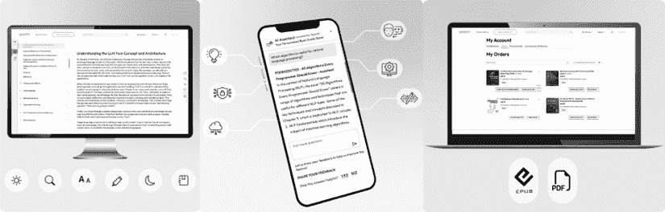
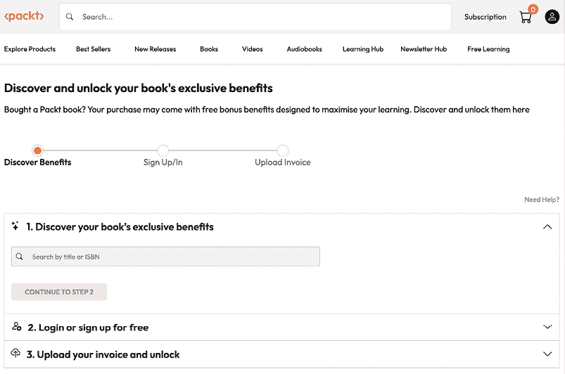

# 贡献者

# 关于作者

Pavlo Cherkashin 是一位软件工程师兼作家，在软件工艺领域拥有超过二十年的经验。他的一半生活在乌克兰，另一半生活在美国，始终将乌克兰放在心上。他的职业生涯包括在 Oracle 和 Nike 等领先公司工作，他是一项现由 Oracle 拥有的企业软件专利明的共同作者。他对神经网络的痴迷始于大学时期，当时他也对语法解析器产生了持久的兴趣。在职业道路之外，Pavlo 是三个青少年的自豪的父亲。他喜欢探索开源 AI、健壮系统设计、MVP 产品工程，以及对下一代工程师的指导和培训的交叉领域。

我将本书献给我的孩子们 Katerina、Anastasia 和 PJ，他们用活力、好奇心和韧性不断带给我启发。在这里写的每一页都承载着从他们身上学到的一点点反思，以及他们给予我继续探索、构建和分享的动力。这段旅程还伴随着无数杯咖啡，以及我那固执的迷你腊犬 Aki 的坚定陪伴，它无论是通过让我保持清醒还是提醒我休息，都坚持要参与其中。当然，特别要提一下 PJ，他每天提醒我，虽然我可能在教机器如何推理，但他对 TikTok 的了解远比我对 Mistral 的了解得多。

# 关于评审员

Naresh Dulam 是一位具有远见的技术领袖，在数据分析、云计算和人工智能方面拥有深厚的专业知识。在职业生涯中，他曾在医疗保健、电信和金融服务等领域担任影响力角色，领导了变革性的分析平台，提供可持续且富有影响力的解决方案以满足不断变化的行业需求。作为一名具有前瞻性的创新者，Naresh 将卓越的技术与分享知识、指导有志专业人士以及培养伦理实践的热情相结合。他推动创新和创造意义影响的承诺与其他激励下一代技术人员的愿景相得益彰。工作之余，Naresh 喜欢在大自然中探险并赋予他人发挥全部潜力。

Rustam Mamedov 是一位经验丰富的软件工程主管，在分布式系统、金融科技和云基础设施方面拥有 20 年的经验。他来自乌克兰，在哈尔科夫卡拉津津国立立大学获得计算机科学硕士学位。在`AWS`，Rustam 在过去的四里里领导团队负责优化`S3`存储和 Web 服务器容量的状况和利用率，同时直接参与编码、架构和技术评审。在加入`AWS`之前，他在金融科技行业工作了 12 年，开发消费者和小型微企业贷款产品。Rustam 热衷于指导工程师并构建支持性的、高效的团队。

Astha Puri 是`CVS Health`的高级数据科学家，她在那里领导数字平台推荐引擎的设计，帮助客户发现合适的产品，并让患者获得他们所需的健康服务和支持。她专精主屏幕个性化，使用数据驱动的洞察来增强用户体验。凭借在科技行业的深厚背景，Astha 现在正利用她的专业知识来推动医疗保健领域的创新和转型。

# 前言

本书是一本关于使用`Mistral`模型和检索增强生成 (`RAG`) 的实用指南，旨在希望弥合理论与应用之间差距的开发者、数据科学家和技术专业人员。它介绍了大型语言模型和嵌入的核心概念，然后通过实战工作坊，涵盖了构建聊天系统、调优模型、设计`RAG`流水线、代码助手、安全应用以及通过`AWS Bedrock`和`Google Vertex AI`进行大规模部署。

本书面向那些通过实践中学习效果最好的构建者、爱好者和好奇心强的人。每一章都将基础理论与模块化工作坊相结合，允许你深入你最感兴趣的话题，同时确保前面的章节为你准备好了必要的设置。这种方法强调低成本的实用技能——使用`Python`、`Google Colab`、`VS Code`以及可以在免费层级运行的云服务。

虽然书中大约三分之二是实操，但早期的理论章节不应跳过。它们建立了`LLMs`、嵌入和`RAG`的构建块，使得随后的练习更有意义且更有效。每个工作坊都是自包含的，但常见的设置步骤（如 API 密钥和环境配置）仅介绍一次，并在后续章节中假设已知。对于那些准备好进一步发展的人，书中穿插课外挑战，鼓励在引导练习之外进行实验，并启发读者将项目扩展到新的方向。

简而言之，本书既是工作坊伴侣，也是参考指南。它让你具备了构建智能系统的知识和技能，同时也为创意、探索和创新留下了空间。

# 本书适用读者

本书的设计对于数据科学专业人士、软件工程师以及希望通过`Mistral`模型和`RAG`构建实用技能的 AI/LLM 爱好者来说同样充满趣味。无论你是从事软件工程、数据科学、商业智能还是行业应用，本书都提供了在跨领域现实场景中有效应用 AI 所需的理念和实战项目。

掌握`Python`以及`NumPy`和`pandas`的基础知识会有帮助；然而，内容仍然易于理解，书中提供了详尽的逐步指南来弥补任何知识空白。熟悉数据结构（列表、字典、数组）以及线性代数、概率论和微积分中的核心数学概念会有帮助，但并非严格要求。本书旨在桥接理论与应用，让任何准备好实验和构建的人都能理解高级思想。

# 本书涵盖的内容

探索了 Mistral 8B 等大语言模型（LLMs）擅长的领域（摘要、翻译、文本生成、上下文理解）以及它们的不足（包括实时决策、泛化能力和偏差）。它还介绍了贯穿本书的基础方法：`RAG`、语义搜索、文档分类和性能评估，同时预览了智能体工作流以及在`AWS Bedrock`和`Google Vertex A`部署。

解释了`temperature`、`top_k`、`top_p`和惩罚因子等参数如何影响语言模型的输出，以及系统提示词如何塑造上下文、语气和行为。它提供了数学基础和实战工作坊，让读者能够精炼生成质量，并针对精度、创造力和控制力调整模型。

介绍了向量如何在多维空间中表示含义，并演示了衡量和可视化语义相似性的方法。提供了使用`Mistral`和`Pinecone`的实战工作坊，以构建语义搜索系统、比较嵌入并将其应用于推荐、文档分类和搜索等现实应用中。

解释了`AWS Bedrock`如何通过提供托管 Mistral 模型、安全的`IAM`集成、无服务器可扩展性和成本效益来简化 LLM 部署。引导读者通过实战工作坊（涵盖环境搭建、通过`boto3`进行 API 交互以及使用`CloudWatch`进行监控）来构建真实世界的 AI 应用。

### 第 11 章:通过 Google Cloud Vertex AI 挥 Mistralralral]

演示了如何在 Google Cloud 上使用`Vertex AI`和`Model Garden`部署并交互 Mistral 模型，涵盖身份验证、同步和流式推理以及与云服务的集成。引导读者通过`Colab`和`VS Code`中的实战工作坊，构建模块化的、生产级`Python`工作流，以便在托管、可扩展的环境中运行 LLM。

- 机器上安装`Python 3.8+`开发环境（带`pip`）。

- `Git`和`GitHub`权限，用于克隆并处理包含所有章节官方仓库。

- 一个如`VS Code`的 IDE，用于编写和运行`Python`脚本。

- `Mistral`账户和 API Key，用于访问和实验 Mistral 模型。

- 用于运行笔记本的`Google Colab`。

- 适用的云账户：`AWS`账户（用于第 10 章)）和`Google Cloud`账户（用于第 11 章)），均已配置 CLI 工具。

准备好这些基础后，你可以遵循示例并专注于核心学习目标，而每章都会提供特定服务的步骤指南。

本书的代码包托管在 GitHub：`https://github.com/PacktPublishing/Learn-Mistral`。我们在丰富的书籍中还有其他代码包，请访问`https://github.com/PacktPublishing`。去看看吧！

我们还提供了一个包含书中截图/图表的彩色 PDF 文件。你可以在这里下载：`https://packt.link/gbp/9781835888643`。

本书使用了多种文本约定。

代码块设置如下：

```
from mistral import MistralClient
api_key = userdata.get("MISTRAL_API_KEY")
client = MistralClient(api_key)
```

成功安装的输出示例：

```
Successfully installed eval-type-backport-0.2.2 jsonpath-python-1.0.6 mistralai-1.5.1 mypy-extensions-1.0.0 typing-inspect-0.9.0
```

警告或重要注释显示如下所示。

# 与我们联系

**通用反馈**：如果您对本书的任何方面有任何疑问，或有任何通用反馈，请发送邮件至`customercare@packt.com`并在邮件主题中注明书名。

**勘更 (Errata)**：尽管我们已尽全力确保内容的准确性，但错误在所难免。如果您在书中发现了错误，如能向我们报告，我们将不胜感激。请访问[`www.packt.com/submit-errata`](http://www.packt.com/submit-errata)，点击`Submit Errata`并填写表单。

**盗版**：如果您在互联网上发现任何形式的我们作品的非法副本，如能提供位置地址或网站名称，我们将不胜感激。请通过`copyright@packt.com`与我们联系并提供材料链接。

# 您的书籍附带专属福利 - 如何解锁

扫描此二维码或访问[packtpub.com/unlock](https://packtpub.com/unlock)，然后按书名搜索本书。确保其是正确的版本。 |  |



使用我们的下一代阅读器 (Next-gen Reader) 增强阅读体验：

 **多设备进度同步**：通过无缝进度同步从任何设备进行学习。

 **书签**：随时回顾您最重要的学习内容。

 **深色模式**：通过切换到深色或褐色模式，以最小眼部疲劳专注于阅读。

 **AI 代码解释**：在下一代 Packt 阅读器中，点击每个代码块上方的`Explain`按钮获取 AI 驱动的代码解释。

随时随地学习：

 使用无 DRM 的 PDF 和 ePub 版本离线访问内容——兼容您喜爱的电子阅读器。

您的书籍副本附带以下专属福利：

 下一代 Packt 阅读器

 AI 助手（beta）

如果您尚未解锁，请参考以下指南。该过程仅需几分钟，且只需操作一次。

## 第一步

准备好本书的购买发票，因为您在`第 3 步`中需要它。如果您收到的是纸质发票，请用手机扫描，并将其准备为 PDF、JPG 或 PNG 格式。

**注意**：您是直接从 Packt 购买这本书的吗？您不需要发票。完成`第 2 步`后，您可以直接跳转到您的专属内容。

## 第二步

| 在打开的页面上（如果您在桌面电脑上，它将与图 0.1 类似），按书名搜索本书。确保您选择了正确的版本。图 0.1：桌面设备上的 Packt 解锁落地页 |

登录您的 Packt 账户或免费创建一个新账户。登录后，上传您的发票。它可以是 PDF、PNG 或 JPG 格式，且大小不得超过 10 MB。按照屏幕上的其余指令完成该过程。

## 需要帮助吗？

**注意**：联系

读完 *Mistral* 后，我们想听听您的想法！请点击此处直接进入本书的 Amazon 评论页。您的评论对我们非常重要，并将帮助我们确保交付质量。
