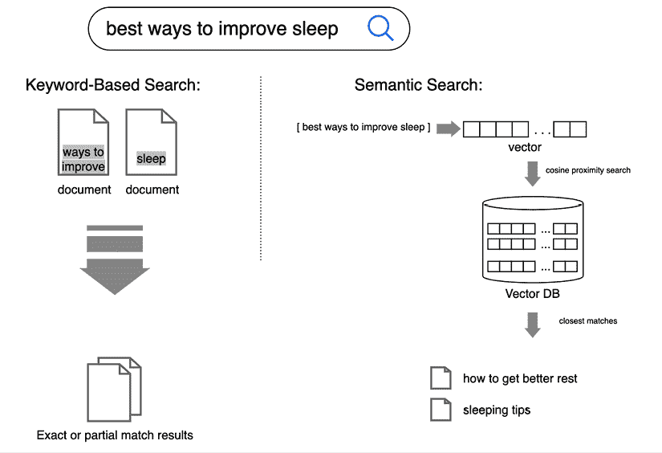
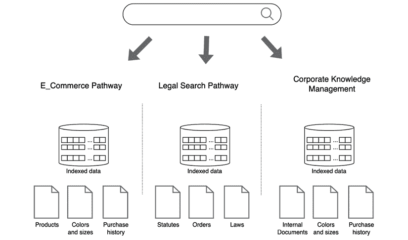
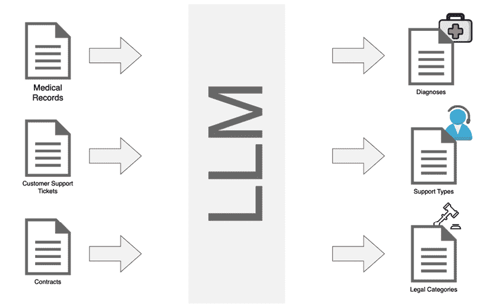
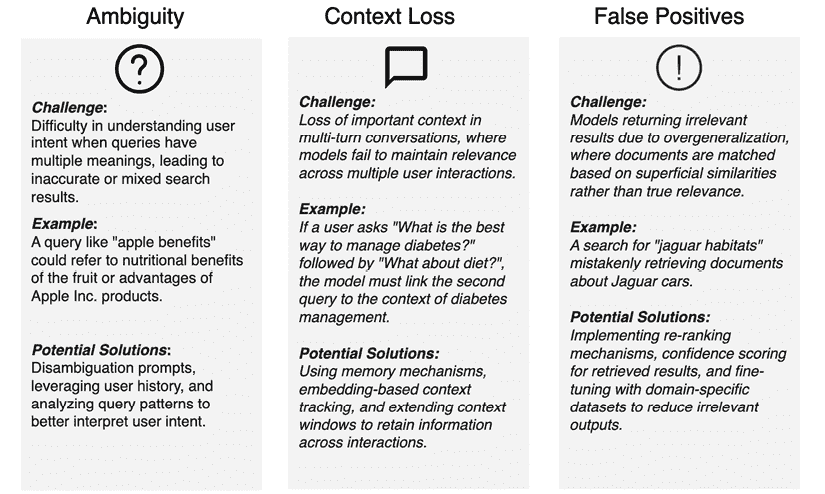
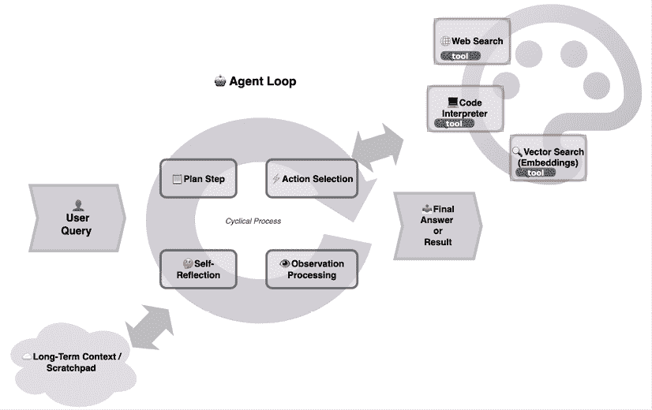
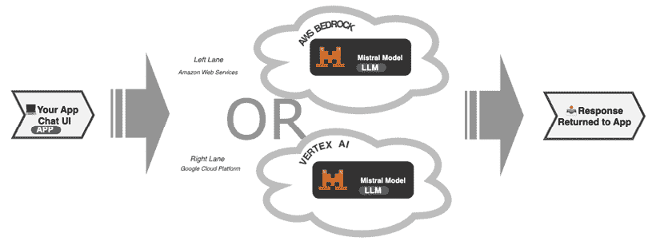

# 语言模型的优势、局限性和应用场景

> AI 系统镜像了我们自身的智能。这是它们日益增长的商业和科学力量的来源。

语言模型不仅仅是 AI 的趋势——它们正在改变我们与技术交互的方式。**大语言模型 (LLMs)** 可以理解、处理并生成人类文本，开启了新的可能性。当我们在本书中探索 Mistral LLM 时，你会发现它们不仅是工具，更是解决复杂问题、处理海量信息和提供个性化解决方案的伙伴。Mistral 模型正在重新定义 AI 能力，无论是驱动虚拟助手还是分析数据。它们的开源特性和创新（特别是 **Mistral 8B**）允许您对其进行塑造和定制以满足您的需求。

本章是书中理论性最多的一章，没有实际练习，但请不要跳过。这里涵盖的概念将使您能够做出明智决策，并从后的实战章节中获更多。

-   LLM 适用于哪些场景，哪些场景不太适用
-   检索增强生成
-   能够思考和行动的智能体

当我们进入下一章节`LLM 的适用场景`时，请记住这不仅仅是一项技术练习。它是一次探索未来的邀请，在那里，机器将帮助我们导航、处理甚至理解人类语言的复杂性。通过掌握这些模型的潜力和局限性，你将准备好充分利用它们力量，开启你自己的转型之旅。让我们开始吧。

首先，理解 LLM 在哪些方面真正表现出色，以及在哪些方面仍然面临重大局限性至关重要。本节通过探索 LLM（如`Mistral 8B`）在摘要、翻译和内容生成等任务中的实际能力奠定基础，同时也承认在传统算法或人工监督可能优于模型的场景。

在深入研究`Mistral`的具体现实应用之前，理解不同规模的能力至关重要。从高层面上看，LLM 擅长几项核心 NLP 任务：

-   **摘要**：LLM 让大量文本的摘要变得快速且高效，无论是对于法律文件、学术论文还是新闻文章。通过识别关键点和重新表述信息，LLM 简化了数据密集型任务。`Mistral 8B`在`抽取式`（选择直接文本）和`生成式`（重述内容）摘要方面均表现出色，节省了时间并减少了人工监督。

-   **翻译**：与传统系统不同，LLM 提供更具上下文、更准确的翻译，能够理解成语和文化细微差别。这使得对于客服聊天机器人和在多种语言运营的企业具有无价价值。通过`Mistral 8B`等模型，翻译感觉更加自然，在满足全球通信的同时不会丢失含义。

-   **规模优势**：得益于其规模，`Mistral 8B`等模型能够以惊人的精度管理复杂的语言模式，在广泛的任务中表现出色。尽管它们需要更大的计算能力，但带来的性能提升通常超过了成本——使它们成为高精度、高速度 NLP 应用的不可或缺。

先进的 LLM 改变了 NLP 任务，实现了自动化和创造力的突破。随着它们的演进，它们将更深入融入我们的日常生活，标志着人机协作新纪元的开启。然而，要完全理解为什么像`Mistral 8B`这样的先进模型真正强大，我们必须跳出这些高层任务。

在接下来的子章节中，我们将深入研究特定的功能能力——例如上下文理解、任务自适应和个性化——这些能力构成了并丰富了这些高层应用。理解这些细微的能力有助于澄清为什么`Mistral 8B`这样的 LLM 会脱颖而出，不仅是在执行孤立的任务方面，更是在处理复杂的现实交互方面。

在人类交流中，上下文就是一切。从理解对话中的细微差别到在主题之间无缝切换，我们保留和处理上下文的能力决定了我们沟通的有效性。在 LLM 的世界中，上下文理解是现代模型与其前代模型区分的关键因素之一。对于 AI 系统来说，生成连贯的句子是不够的——它还必须理解对话、任务甚至用户偏好的更广泛上下文才能真正有效。

接下来，我们将探索这种能力的几个维度，详细说明`Mistral 8B`和类似模型如何将上下文处理扩展到更深层、更动态的场景。

`Mistral 8B`大模型家族最令人印象深刻的特征之一是它们能够处理长期的、多轮对话而不会丢失对话流。在早期的 AI 系统中，上下文通常在几次交换后就会消失，导致无关的回答。上下文理解在这里是关键。LLM 使用注意力机制和记忆模型来保留重要信息，确保随着对话的演进，保持相关性和连贯性。

例如，`Mistral 8B`可以在维护上下文的同时跟踪客服中的主题转换，提供基于早先交互的响应。这是通过 transformer 架构及其自注意力机制实现的，它优先考虑对话中的相关部分，即使在主题变化或重叠时也能提供准确的回答。

除了处理长对话外，`Mistral 8B`和其他类似系统擅长任务自适应——在不丢失上下文的情况下无缝切换之间切换。例如，用户可以要求模型安排会议，然后切换到总结报告。`Mistral 8B`能够流畅地处理这两个任务，并记住早期交互中的关键细节。

这种适应性源于 LLM 的多任务学习能力。与需要重新训练的旧模型不同，`Mistral`可以动态适应跨领域的不同任务，例如生成内容、回答问题或翻译文本，同时保持上下文和准确性。这种灵活性使其在各种设置中都非常有效。

可能是 LLM 技术最令人兴奋的发展之一是其提供上下文敏感和个性化体验的能力。用户期望 AI 能迎合他们的偏好和习惯。例如，LLM 可能会在学习平台上跟踪进度，并根据表现和学习风格调整响应。

`Mistral 8B`通过利用之前的交互来定制响应，在个性化方面出色。在教育或电子商务等领域，这种个性化方法提高了用户参与度。该模型可以根据行为调整课程计划或推荐产品，不断优化建议以更好地匹配个人需求。

尽管`Mistral 8B`这样的现代 LLM 在上下文理解和任务自适应方面展示了卓越的能力，但仍然面临重大挑战。在扩展对话或多次交互中保持准确的上下文特别困难，因为由于固定的输入上下文窗口，这会导致早期关键信息的丢失。

总的来说，无论是管理多轮对话、适应不同的任务，还是提供个性化的、上下文敏感的响应，像 `Mistral 8B` 这样强大的架构都展示了在复杂且富内容的环境中运行的卓越能力。然而，与所有先进系统一样，仍然面临尚未解决的挑战，特别是与维护长期上下文以及理解细微的多层次交互相关的挑战。

随着 AI 的不断演进，这些领域无疑将进一步改进，推动大语言模型（LLMs）在自然语言理解方面的边界。

## 预测准确性的局限性

除了这些上下文挑战，LLMs（包括 `Mistral 8B` 级别的模型）在预测准确性方面仍存在显著局限性，特别是在需要精度或快速响应的关键场景中。挑战包括：实时决策受阻、训练数据过拟合、难以泛化到不可预见的情况，以及表现出从底层数据集中学到的偏见。接下来我们将讨论这些局限性，因为识别 LLMs 的不足之处有助于强调，随着 AI 系统的进一步演进，持续需要人工监督以及整合补充技术的必要性。

### 实时决策

实时决策在自动系统、医疗保健和金融交易中至关重要，在这些领域，每一秒都至关重要。然而，由于处理速度和上下文适应方面的固有限制，LLMs 往往难以满足实时应用的需求。这些模型依赖于预训练知识和推理过程，这些过程对于瞬时决策并不总是最优的。

这种局限性的主要原因之一是延迟——LLMs 需要大量的计算能力来生成准确的响应。尽管模型优化减少了延迟，但实时决策需要近乎瞬间的处理，这是 LLMs 并不总是能保证的。例如，自动车辆需要做出实时决策以确保安全。秒级的延迟可能导致对环境变化的误判，从而引发事故。目前的 LLM 架构无法足够快地解释并处理来自摄像头或 LiDAR 系统的视觉数据等实时传感器输入。

此外，LLMs 通常不具备动态更新上下文的能力。这些模型依赖于固定的输入窗口和预定义的数据，使得在新的信息出现时难以持续进行适应调整。在金融市场中，决策基于快速变化的数据，如果依赖 LLMs 进行实时交易或风险管理，一旦模型未能准确且及时地处理最新信息，可能会导致昂贵的错误。

### 处理不可预见的情况

LLMs 的另一个重大局限性是难以处理不可预见的情况——即其训练数据之外的场景。重量级 LLMs 依赖于海量数据集中的模式，在面对新输入时往往会失败。

在医疗保健等关键领域，罕见症状可能导致错误的诊断。为每个新场景重新训练 LLMs 是不现实的，而且它们缺乏常识推理来处理新颖或演变的问题，使得它们在法律或监管等动态环境中适应性较差。

### 过拟合与缺乏泛化能力

过拟合发生在 AI 在其训练数据上表现出色，但在处理新的、未见的输入时遇到困难的情况。这是高参数模型的局限性，它们面临过拟合风险，特别是在针对特定任务进行微调时。

例如，在法律领域，在特定案例法上训练的 LLM 可能会错过新案件中的关键细微差别，无法有效泛化。同样，在医学影像中，基于文本的 LLM 可能难以理解图像解释，导致不准确的结果。

### 偏见与伦理关注

AI 模型中的偏见严重影响预测准确性。在大型数据集上训练的 LLMs 会继承人类的偏见，导致在现实应用中产生不准确或不公平的预测。

例如，在刑事司法中，如果在存在偏差的数据上训练，LLMs 可能会产生有偏见的再犯率预测。在招聘中，LLMs 可能会偏好特定背景，从而加剧不平等。这些偏见在所有领域都带来了严肃的伦理挑战，特别是在医疗和执法领域，需要更多元化的训练数据和更大的监督来减轻伤害。

### 理解复杂的多模态数据

最后，LLMs 主要在文本数据上训练，这限制了它们对图像、音频或视频等多模态输入的预测准确性。尽管多模态模型正在进步，但像 `Mistral 8B` 这样的 LLM 难以整合多种数据源。

Mistral 引入了名为 `Pixtrail` 的独立模型系列，专门处理视觉输入。这些模型与核心语言模型独立开发，代表了 Mistral 在图像处理语境下多模态学习的方法。

例如，在医学诊断中，LLMs 擅长处理文本，但难以处理 MRI 扫描等视觉数据，使得提供全面的预测变得困难。这限制了 LLM 在需要全面多模态理解的领域的应用。尽管 LLM 取得了进展，挑战依然存在，意识到这些局限性可以确保其负责任的使用。

在涵盖这些基础后，让我们转向比较 LLMs 与传统算法。

## LLMs 与传统算法

下一代架构扩展了 AI 在自然语言处理和机器学习领域的边界。然而，它们并不总是最佳选择。在许多情况下，传统算法的表现优于 LLMs，提供了更高的效率和可靠性。

本节将探索传统算法的优势所在，包括效率、可解释性、领域特定准确性以及实时一致性。理解这些优势可以确保我们在尖端 AI 与传统方法经过验证的可靠性之间取得平衡：

- **效率和资源使用**：传统算法相比 LLMs 的一个关键优势是效率。LLMs 拥有数十亿个参数，需要巨大的计算能力和内存，使其不适合需要快速、轻量级计算的任务。

相比之下，`quicksort`（快速排序）或 `binary search`（二分查找）等传统算法针对速度和最小资源消耗进行了优化，使其成为大型数据集和基础任务的理想选择。与需要专用 GPU 的 LLMs 不同，它们可以在通用硬件上运行。在能源敏感的应用中，传统算法是更实用、更高效的选择。

- **可解释性与透明性**：传统算法出色的另一个领域是可解释性和透明性。它们遵循透明的、循序渐进的过程，使其决策易于理解，这在金融、法律合规和科学研究等领域至关重要。

例如，`decision trees`（决策树）提供了透明、可审计的推理，而 LLMs 往往像黑箱一样，导致其决策过程难以解释。这种透明度的缺失为需要监管审查的行业带来了挑战。尽管`可解释 AI`（`XAI`）正在开发中，但在需要完全透明的任务中，传统算法仍然更优。

- **领域特定任务的准确性**：在领域特定任务方面，传统算法通常比 LLMs 更准确。虽然 LLMs 是通用型模型，但传统算法针对特定领域进行了微调，在专业领域通常表现优于 LLMs。

例如，在图像识别中，`convolutional neural networks`（`CNNs`）或专门的算法优于专注于文本的 LLM。在工程或数值分析中，诸如 `finite element methods`（`FEM`）等算法提供了 LLM 缺乏的精度。传统算法建立在数十年的领域知识之上，更适用于这些精确的应用场景。

- **一致性与确定性**：传统算法的特点之一是其一致性和确定性本质。在相同的输入下，传统算法总是产生相同的输出，确保了需要预测性的任务的可靠性。相比之下，概率性的 LLM 即使在输入相同的情况下，输出也可能不同。

- **对实时和嵌入式系统的适用性**：传统算法更适用于实时和嵌入式系统，这些系统的处理能力和内存有限。汽车控制、工业机械或电子设备中的嵌入式系统依赖于低延迟运行的快速、高效算法，例如 `PID controllers`。

相比之下，LLM 是资源密集型的，并不是低功耗实时环境的理想选择。虽然 LLM 擅长翻译等大规模任务，但对于需要低延迟和高效的系统，传统算法仍然保持优势。

尽管 LLM 改变了 AI 的许多方面，但传统算法在特定领域仍然具有显著优势。它们更高效、更透明、更一致，使其更适用于需要高精度、可重复性和低计算开销的任务。了解传统方法在何处优于 LLM，对于开发能够利用这两种方法优势的平衡 AI 系统至关重要。在接下来的章节中，我们将探索混合模型和技术如何结合两者的优势，提供既前沿又可靠的解决方案。

现在我们已经知道了诸如 `Mistral 8B` 等 LLM 在哪些方面表现良好，它们的局限性在哪里，现在是时候看看这些模型如何转化为现实应用了。`Mistral 8B` 是一款多功能 AI 模型，应用广泛。从驱动聊天机器人和数据摘要工具到提供个性化用户体验，它在各个领域都表现出色。凭借强大的多语言支持甚至代码辅助，`Mistral 8B` 重新定义了 AI 在增强效率和用户交互中的角色。

本节深入探讨了 `Mistral 8B` 在多个领域的实际优势。这些示例看起来可能是理论性的，但它们构成了你贯穿本书构建的应用系统和工作流的基石。理解这些核心能力将帮助你识别在何处将 `Mistral` 接入你自己的项目，以及何时将其与其他技术结合以产生最大影响。

`Mistral 8B` 通过快速准确地从海量数据集中识别关键点，擅长数据摘要。它将长文档、报告或研究论文提炼为简洁的摘要，同时保留核心上下文，这对于记者、律师和学者来说是无价的。此外，`Mistral 8B` 能够从非结构化文本中高效提取数据，提取出财务指标或法律细节等相关信息。它高效处理大规模数据的能力改进了决策并减少了花费在手动分析上的时间。

`Mistral 8B` 通过分析用户行为和偏好来提供定制化内容和推荐，从而驱动个性化引擎。从个性化的购物建议到流媒体平台上的定制化内容，`Mistral 8B` 使用高级算法理解用户模式并实时适应。它的灵活性允许企业提供独特的、以用户为中心的体验，提高客户的参与度和忠诚度。`Mistral 8B` 个性化交互的能力确保了企业能够为每个用户提供高度相关且吸引人的内容。

`Mistral 8B` 具有强大的多语言能力，支持英语、法语、德语、西班牙语、意大利语、葡萄牙语、阿拉伯语、印地语、俄语、中文、日语和韩语。这种通用性能使企业能够有效地与全球观众互动，在不同地区和语言之间提供无缝通信。

`Mistral 8B` 是客户服务、电子商务和内容本地化的理想选择，无论语言如何都能确保高质量的用户交互。多语言支持使其成为需要在多种语言中进行一致、准确通信的行业的强大工具，提高了可访问性并扩大了市场范围。

`Mistral 8B` 是一款强大的编码助手，允许开发者通过生成代码、编写单元测试和自动化脚手架任务来简化其工作流。它的 `fill-in-the-middle`（`FiM`）能力允许它从部分输入创建代码段，从而缩短开发时间。它还可以通过理解代码结构来协助编写单元测试，确保覆盖率和准确性。`Mistral 8B` 自动处理用于脚手架的重复性编码任务，允许开发者专注于更高层次的问题解决，最终提升了生产力。

让我们转换一下，从基础概念转向应用技术，并学习 `RAG`、语义搜索和模型微调。

在当今快速发展的 AI 领域，将生成式语言模型与实时知识检索相结合，为创建更智能、更具上下文感知能力的系统开启了新的可能性。`RAG` 代表了这种融合，其中 LLM 利用外部数据库或知识源来生成更准确、信息丰富的响应。`RAG` 不仅仅依赖于预训练数据，而是能够动态访问最新信息，使其在知识密集型任务中具有极高价值。

`RAG` 结合了两个关键组件：知识检索和生成式 AI。虽然传统的生成模型从预训练知识中生成响应，但 `RAG` 引入了检索步骤，模型访问外部数据源以提供更准确、最新的信息。这种交互允许 `RAG` 产生听起来像人类且基于实时事实的响应。这种混合方法增强了响应的准确性，特别是在对精确、当前信息有要求的领域。

随着我们的进展，探索语义搜索和文档分类如何增强 RAG（检索增强生成）的能力至关重要。这些技术能够对信息进行精确的检索和分类，确保输入到生成模型中的数据是准确且符合上下文的。通过理解语义搜索的复杂之处，我们可以进一步提高 AI 驱动系统的准确性和效率，使其在处理复杂信息检索任务时更加强大。

随着数字信息量的增长，对能够高效检索和组织这些数据的 AI 系统的需求也随之增加。传统的基于关键词的搜索在理解用户意图方面往往存在局限，特别是处理复杂查询时。语义搜索提供了一种更细致的方法，允许模型解释用户查询背后的含义，并交付超越简单关键词匹配的结果。结合文档分类（将内容排序并组织到相关的类别中），这些技术使企业和研究人员能够从海量数据集中提取有价值的见解。本节将深入探讨这些过程的工作原理、关键应用以及在现实环境中部署它们面临的挑战。

## 语义搜索：理解关键词之外的意图

例如，如果用户搜索“如何治疗感冒”，传统的关键词搜索引擎会寻找包含“治疗”（treat）和“感冒”（cold）单词的文档。然而，由于缺乏直接的关键词匹配，它可能会漏掉使用“流感药物”（remedies for flu）或“感冒居家护理”（home care for colds）等术语的资源。另一方面，语义搜索引擎会理解这些短语含义相似，提供更准确、更有帮助的结果。语义搜索的核心是先进的机器学习模型，例如 `Mistral 8B`，它们利用嵌入（embeddings）和向量空间表示来理解并匹配查询与文档的含义。`Mistral 8B` 并不是搜索精确的单词，而是将查询和文档映射到高维向量空间，在该空间中，相似的含义彼此靠近。这允许模型识别含义上的相似性，即使措辞有所不同。例如，当用户查询“提高睡眠质量的最佳方法”时，模型将此输入处理为一个向量——其含义的数值表示（参见*图 1.2*）。同时，它将许多文档的内容处理为类似的向量。`Mistral 8B` 通过比较这些向量之间的距离，识别与用户查询最对齐的文档。这一过程通常被称为语义相似性搜索，能够检索不仅符合关键词匹配而且符合上下文的文档。

### 上下文在查询解释中的作用

语义搜索的一个关键方面是其解释用户查询时维持并应用上下文理解的能力。与将每个查询视为孤立输入的关键词搜索不同，由 `Mistral 8B` 等驱动的语义搜索引擎会考虑查询的更广泛上下文。这些上下文可能包括之前的交互或类似查询的典型意图。

*图 1.2* 显示了关键词搜索与语义邻性搜索的区别：

在处理模糊查询时，上下文理解也至关重要。例如，“苹果的好处”这类查询可能指水果的健康益处，也可能指苹果公司产品的优势。语义搜索引擎使用上下文线索（如用户的搜索历史或其他查询中的内容）来确定哪种解释更有可能，提供更准确且以用户为中心的结果。

### 示例用例

语义搜索通过关注用户查询背后的意图而非简单的关键词匹配改变了我们检索信息的方式。这种方法能够产生更准确、更相关的结果，使其在电子商务的个性化产品推荐、法律研究的精确判例检索以及企业环境的高效知识管理中具有价值。

图 1.3：不同业务领域中的语义搜索

- **电子商务应用**：语义搜索已成为电子商务领域的游戏规则改变者，改变了在线商店管理产品搜索和推荐的方式。与传统的基于关键词的系统（它们可能因为精确单词匹配返回无关结果）不同，语义搜索会解释用户查询背后的意图，从而提供更准确、更相关的产品建议。例如，当客户搜索“200 美元以下舒适的办公椅”时，语义搜索引擎会理解对舒适度、价格限制和特定产品类型的需求。它会优先考虑符合这些标准的物品（例如预算内的人体工程学椅），提供个性化的购物体验。这种细致的理解提高了转化率并增强了用户满意度，因为客户更有可能快速找到他们想要的东西。

- **法律检索系统**：在法律领域，由于法律文档数量巨大且极其复杂，寻找特定的判例法或先例可能非常耗时。语义搜索简化了这一过程，让律师和研究人员能够找到相关的案例、法条或法律意见，即使查询语言与文档中的文本不一致。例如，律师可能会搜索“涉及职场骚扰和雇主责任的案例”。语义搜索引擎可以识别出符合这一意图的案例，即使案例文本中没有出现查询中使用的精确短语。它理解法律概念和关系，使其能够快速找到相关的先例，从而节省了数小时的人工研究。这项能力对于那些无需筛选数百文档即可获取精确且相关信息的法律专业人士来说至关重要。

- **知识管理**：在企业环境中，管理和检索内部文档、研究论文或存档通信是一项挑战，尤其是组织每天产生海量数据时。语义搜索在知识管理中起着关键作用，使员工能够根据查询背后的含义找到正确的信息。例如，寻找“营销策略的年度绩效报告”的员工可能会收到包含“营销 KPI”、“年度销售分析”或“战略审查”等相关术语的文档，即使查询中没有这些准确词汇。这种方法确保了员工能够快速获取做出决策所需的知识，从而提高了生产力并促进了团队间更好的协作。

## 文档分类：用于自动排序和分类的 LLM

LLM（大语言模型）将传统的、耗时且耗工的过程自动化。通过理解文档的上下文和内容，这些模型以高精度对信息进行分类，减少了对人工干预的需求。这种能力使得 LLM 在处理大量非结构化数据的领域非常有价值，从医疗保健到客户支持，在这些领域，快速准确的文档排序对效率至关重要。

`Mistral 8B` 和类似模型通过解释文本数据的内容和上下文来完成文档分类，允许它们将信息排序到预定义的类别中。这种能力超越了简单的关键词匹配，因为模型理解文档内部更深层次的含义，从而导致更准确的分类。例如，与其依赖预定义规则来识别特定单词，`Mistral 8B` 可以处理整个文档，识别文本中的主题和意图。这使其能够以极少的人工输入分类复杂内容（如技术报告或客户查询）。通过自动化这一过程，LLM 节省了大量的时间和精力，让专业人员能够专注于更高价值的任务。

`Mistral 8B` 等 LLM 使用多种技术来提高分类准确性：

- **零样本分类**：该方法允许模型将文档分类到其训练过程中从未见过的类别。通过利用其对语言的广泛理解，`Mistral 8B` 可以对新文档可能所属分类做出合理的推断，使其在频繁出现新类别的动态环境中非常有用。

- **监督微调**：在这种方法中，`Mistral 8B` 在带有特定类别的标记的数据集（例如法律文档类型或患者记录）上进行微调。微调允许模型理解数据中的特定细微差别，从而实现高度准确的分类。

- **多标签分类**：某些文档可能同时属于多个类别。`Mistral 8B` 可以配置为为文档分配多个标签，使其成为复杂数据集的理想选择，因为一个文档可能跨越多个主题，例如同时涵盖研究结果和实施策略的技术报告。

上述技术使 `Mistral 8B` 能够处理各种分类挑战，灵活满足多种行业的需求。

### 示例用例

高阶模型（包括 `Mistral 8B`）在文档分类中的应用涵盖了多个领域：

- **医疗报告**：在医疗保健领域，`Mistral 8B` 可以根据诊断类型、患者状况或建议治疗对医疗报告进行分类，这有助于医疗专业人员快速获取所需信息，改善患者护理并减少行政工作负载。

- **法律文档排序**：律师事务所可以使用 `Mistral 8B` 将法律诉述书、合同和案件文件组织到相关类别中，使律师在案件准备期间更容易检索相关文档。

*图 1.4* 展示了文档分类流水线。它显示了不同类型的文档如何通过 `Mistral 8B` 进行处理、准确分类并定向到相关的输出类别，突出了这一自动化过程的效率和精确性。

图 1.4: 分类流水线

至此，我们探索了`Mistral 8B`如何通过理解内容和上下文来简化文档分类，减少对人工排序的需求。该模型使用零样本分类、监督微调和多标签分类等技术处理多样化且复杂的数据集。现实世界的应用（如分类医疗报告、排序客户支持工单和组织法律文档）说明了它们的通用性。

在清晰了解语言模型如何应用之后，是时候看看它们在现实环境中的表现如何了。我们将密切关注它们的准确性如何、响应速度有多快，以及在将这些模型投入生产时将面临的日常挑战。

## 评估模型性能

在部署`Mistral 8B`等 Transformer 大模型执行搜索和分类任务时，评估它们的性能对于理解其有效性至关重要。需要考虑的两个关键方面是*准确性*和*速度*。准确性决定了模型输出的可靠性，而速度影响用户体验，特别是在时间敏感的应用中。在这些因素之间取得平衡确保了模型在从电子商务搜索到实时分析的各种用例中表现良好。

### 模型准确性

为了评估基于 LLM 系统的准确性，我们依赖于几个关键指标，包括精确率、召回率和 F1 分。精确率衡量了模型返回的所有结果中相关结果的比例，突出了检索到的文档中有多少是有帮助的。例如，如果使用`Mistral 8B`来识别相关的客户支持工单，高精确率可以确保大多数返回的工单确实符合目标类别。

召回率衡量了模型检索数据集中所有相关实例的能力。在错过关键信息可能会导致高昂代价的场景中（例如法律或医疗文档检索），它尤为重要。高召回率意味着模型捕获了最相关的文档，即使其中包含了一些没那么用的文档。

F1 分数将精确率（precision）和召回率（recall）结合为一个单一指标，为模型性能提供了平衡的衡量。它是精确率和召回率的调和平均数，对于这两个指标同样重要的情况是非常理想的。高 F1 分数表明模型能够有效检索相关文档，同时尽可能地减少无关结果，提供了对其准确性的全面视角。

### 速度考虑

除了准确性之外，速度是评估大语言模型（LLM）性能的关键因素，特别是在依赖于快速响应时间的应用程序中。例如，在电子商务搜索引擎中，用户在浏览产品时期望获得时结果。如果 LLM 检索和处理信息花费过长时间，会导致糟糕的用户体验，并可能导致销售损失。

在处理大型数据库时，速度考虑变得更加关重要，因为处理时间可能会显著增加。模型提供快速、相关响应的能力在高流量环境（如在线购物平台或实时客户支持系统）中可以产生巨大影响。在不牺牲准确性的前提下优化模型速度，可以确保其即使在重数据负载下也能保持响应。

## 实现过程中的挑战

有效的语义搜索和文档分类面临着若干影响其准确性和相关性的挑战。歧义性、上下文丢失和误报（false positives）等问题需要解决，以确保在实际应用中的稳健性能。理解这些挑战并探索管理它们的策略，对于在顶尖 AI 领域完善`Mistral 8B`并使其在各种用例中更加有效至关重要。

请参考`Figure 1.5`获取简短且描述性的视觉辅助：

图 1.5：歧义、上下文丢失和误报的挑战与示例

 **快速提示**：需要查看此图像的高分辨率版本吗？请在下一代 Packt Reader 中打开此书，或在 PDF/ePub 版本中查看。

 购买此书将免费赠送**下一代 Packt Reader**。扫描二维码 码或访问`packtpub.com/unlock`，然后使用搜索框通过名称找到此书。双击检查显示的版本以确保获取的是正确的版本。

让我们详细探索这些主要的每一个挑战。

### 歧义性

语义搜索中持续持续的挑战之一是处理歧义查询。还记得之前提到的“苹果的好处（apple benefits）”例子吗？与传统的基于关键词的搜索不同（后者中歧义通常会导致无关结果），语义搜索试图通过理解查询的更广泛上下文来解释用户的意图（用户是在询问水果的健康益处，还是苹果公司的产品优势？）。

为了解决这些歧义，`Mistral 8B`及其同时模型依赖用户历史、查询模式和上下文线索来做出合理的判断。然而，此类模型在上下文有限的情况下仍可能遇到困难，导致混合或部分相关的结果。在此类场景下，引入去歧技术（如后续澄清提示或利用用户上下文数据）可以显著提高语义搜索引擎的精确度。

### 上下丢失

上下文丢失是另一个重大障碍，特别是对于涉及多轮对话或基于之前交互的查询应用程序而言。例如，在对话中，用户问“管理糖尿病的最佳方法是什么？”，然后接着问“饮食呢？”，语义搜索系统必须识别出第二个查询与糖尿病有关。然而，对于`Mistral 8B`类 LLM 来说，维护这种上下文可能是挑战性的，特别是当存在多次交互或会话很长时。语言模型中的上下文窗口是有局限性的。随着轮数的增加，LLM 可能会忘记对话的早期部分或丢失相关性，这可能会影响搜索准确性。诸如持久内存机制和基于嵌入的上下文跟踪策略有助于保持理解的连续性，确保模型在整个对话过程中关注用户的意图。

### 误报

文档分类和语义搜索中的一个常见问题是出现误报，即模型由于过度泛化返回了无关结果。这发生在模型误解了查询并检索了虽然用词相似但与用户需求无关的文档时。例如，关于“美洲栖息地（jaguar habitats）”的查询，如果模型从“jaguar”一词过度泛化，可能会错误地检索关于捷豹汽车的文档。

为了管理此类误报，使用了精炼技术，如重排序（re-ranking，根据相关性对检索到的文档进行排序）和置信度评分（confidence scoring）。通过为每个结果分配置信水平，模型可以优先考虑更相关的响应，同时降低低概率匹配的权重。

在搜索、检索和语言理解基础稳固的基础上，我们现在转向代表我们行动的动态决策系统：自主代理（autonomous agents）。

# 展望：思考并行动的代理

语言模型不仅限于理解和生成文本。它们还可以被结构化为做出决策、使用工具并执行任务。本书的`第 5 章`介绍了此类系统——**代理（agents）**。这些代理结合了推理、记忆和工具使用，逐步实现目标，而不是简单地响应单个提示。

代理从一个目标开始，通过分析输入、选择下一个最佳行动、执行该行动然后观察结果来工作。它重复这个循环直到任务完成。这种迭代的、感知上下文的过程将被动模型转变为自主的问题解决者。

代理设计的核心是决策循环：规划、行动、观察和反思的序列。在每一次循环中，代理都会选择继续、调整还是结束。与遵循固定指令的传统自动化脚本不同，代理运行具有灵活性。它们可以响应新信息，根据需要切换工具，并实时确定最佳策略。

这使得它们适用于广泛的应用程序——从多步问答到协调涉及搜索、摘要和外部 API 调的工作流。无论是管理对话、检索相关文档还是从多个源汇总输出，代理的功能都像一个引导的导航员，在每个阶段决定该做什么。

`第 5 章`通过实用的代码示例介绍了这一概念。你将探索如何定义代理可用工具、如何通过结构化提示塑造其推理，以及如何管理驱动其行为的逻辑。这种方法轻量且注重实践，不需要大型框架——只需要一个清晰的循环、一个模型和一个使命。

代理代表了语言模型使用方式的转变。它们不再仅仅提供答案，而是朝着结果努力。在本书更广泛的背景下，它们充当自然语言理解与现实行动之间的桥梁，使其成为生成式 AI 最具表现力的方式之一

图 1.6：基本代理工作流概述

此图展示了 AI 智能体（Agent）如何将静态语言模型转换为主动的决策系统。智能体首先接收用户请求，然后进入规划循环，在循环中它对任务进行推理、选择工具并逐步采取行动。它将每个操作的结果视为新的观测结果，据此调整策略，并在整个过程中保持上下文感知。这种架构使得模型不仅能够作为一个文本生成器，更是一个智能流程管理器——能够进行动态推理、工具编排和迭代解决问题。

当你读到`第 5 章`时，你已经熟悉了嵌入（embeddings）和语义搜索等工具。智能体通过有目的的工作流将这些工具整合在一起，向你展示如何超越提示词（prompts）的局限——并开始设计能够思考、适应和行动的系统。

# 云端上的 Mistral：同一种理念，迥然不同的面貌

随着`Mistral Small`和`Mistral Nemo`等模型进入现实应用，许多用户在想他们是否需要搭建服务器来使用它们。答案是否定的。`AWS Bedrock`和`Google Vertex AI`现在都提供`Mistral`模型作为其托管服务的一部分，这比以往任何时候都要将这些强大的工具接入到你的产品或工作流中——而无需触碰 GPU。

虽然云平台在外观和工具链上有所不同，但核心概念是相同的：你发送一个提示词，云端运行模型，你获得结果——这一切都在几毫秒内完成。无论你是在构建机器人、摘要器还是搜索助手，云端都会处理扩展、安全和速度问题，让你专注于真正的事情。

这种方法让开发者和企业能够更快地进行实验、更早地发布原型并根据需要进行扩展，同时依赖底层基础设施的稳健性。

图 1.7：通过 AWS 或 Google Cloud 部署 Mistral，向用户返回响应

该图显示了两个并行的流水线：一个用于`AWS Bedrock`，另一个用于`Google Vertex AI`。两者都从左侧的用户输入开始，通过中间各自的云服务流，并汇聚到`Mistral`模型。箭头继续返回给用户以交付结果。视觉图标包括云平台、表示处理的齿轮符号以及返回路径上的聊天机器人图标。

我们现在正接近`LLMs`纯理论探索的终声。从理解它们的优势到探索用例和部署路径，本章奠定了坚实的基础。在下一章中，我们将转向实战模式——亲自动手搭建一个你自己的 AI 聊天机器人。

# 总结

在本章中，我们为使用`LLMs`奠定了基础。我们现在了解了这些模型在什么地方表现最好，它们的局限性在哪里。我们探索了它们在摘要、分类、推理以及医疗和法律等特定领域应用中的优势。我们还涵盖了它们在预测准确性和实时响应方面的差距，特别是在多模态设置下。

我们引入了关键概念，例如`RAG`作为一种通过外部知识丰富模型输出的方法；`语义搜索`和`分类`对大规模信息处理至关重要；以及`微调`（fine-tuning）策略，使`LLMs`能够通过交互和针对性训练随时间不断适应。有了这些核心思想，我们准备好切换节奏了。从`第 2 章`开始，你将深入实操练习，从如何设置你自己的 AI 聊天系统开始。准备好构建、调整和探索。

# 参考文献

*   `Retrieval-Augmented Generation for Knowledge-Intensive NLP Tasks`: [`arxiv.org/abs/2005.11401`](https://arxiv.org/abs/2005.11401)

*   LangChain `RAG` 文档：[`docs.langchain.com/oss/python/integrations/retrievers/index#retrievers`](https://docs.langchain.com/oss/python/integrations/retrievers/index#retrievers)

*   `Mistral 7B` 发布：[`mistral.ai/news/announcing-mistral-7b`](https://mistral.ai/news/announcing-mistral-7b)

*   `Mistral Small 3.1`：[`mistral.ai/news/mistral-small-3-1`](https://mistral.ai/news/mistral-small-3-1)

*   `模型概述`：[`docs.mistral.ai/getting-started/models/models_overview/`](https://docs.mistral.ai/getting-started/models/models_overview/)

*   ArtificialAnalysis.ai 基准测试：[`artificialanalysis.ai/models/mistral-small-3-1`](https://artificialanalysis.ai/models/mistral-small-3-1)

# 加入我们的 Discord 和 Reddit 空间

你不是唯一一个在碎片化工具、持续更新和不不最佳实践中摸索的人。加入一个不断增长的专业人士社区，交流见解。

| 获取最新更新、讨论以及来自作者的幕后见解。加入我们的 Discord：[`packt.link/z8ivB`](https://packt.link/z8ivB) 或扫描下方二维码：Images/Discord_Code.jpg | 与同行交流，分享想法并讨论现实中的 AI 挑战。在 Reddit 上关注我们：[`packt.link/0rL`](https://packt.link/0rL) 或扫描下方二维码：Images/Reddit_Code.png |
