# 2 搭建你自己的聊天机器人

> 最深远的技术是那些消失的技术。它们织入生活的织物中，直到与生活不可分。

>

> — Mark Weiser，通用计算之父

想象一下，无需编程就能启动一个安全、定制且完全由你控制的私有聊天系统。在数据泄露、合规性和 AI 幻觉成为日常担忧的世界里，构建一个符合你需求的信赖界面是必要的。

本章将引导你创建一个由`Mistral`驱动并封装在友好网络界面中的独立聊天模型。你将学习如何配置它、管理其行为，并安全地运行在你的环境中。将其想象为将`ChatGPT`置于防火墙之后：没有互联网依赖，没有数据泄露，且控制权不受限。这个工具不仅仅是为了技术爱好者设计的——它还为了需要构建安全平台的教育工作者、需要 HIPAA 合规助手的医院、保护商业秘密的企业，甚至是为了微调 AI 以理解其特定领域的小众社区。

在我们卷起袖开始构建之前，让我们探索为什么私有的、定制的聊天模型很重要，以及它们如何解决行业、教育和社区的现实问题。本章采取的方法如下：

*   问题

*   实战工作坊：将本地`Mistral`模型暴露给用户的步骤

*   建议硬件配置

# 问题陈述

对安全、受控和个性化聊天系统的需求前所未有。当涉及到隐私、监管或专业性时，通用的在线 AI 模型并不总是适用。以下是独立生成聊天模型大放异彩的地方：

*   **企业环境**：需要保护数据的私有内网聊天。

*   **医疗和军事部门**：需要对数据处理和合规进行严格控制。

*   **学校、图书馆和家长**：需要过滤器以确保未成年人的对话安全。

- 需要对聊天逻辑、内存和审核策略拥有完全控制权，这对于治理至关重要的场景

- 对于需要简单的 Web UI 以直观方式与模型交互的`非技术用户`来说

我们的方法直接应对了这些挑战。在本章中，你将构建并部署一个具有完全控制权、安全性且易于使用的聊天模型。

现在是时候从概念转向执行了。在接下来的实战工作中，你将学习如何使用`Mistral`、自定义的`Modelfile`和即插即用的 Web 界面来构建一个安全的、自包含的聊天系统。我们将一步一步让你的定制化解决方案变为现实。

为了完成本章的练习，你需要在机器上准备一些工具和资源。建议使用具有至少 16 GB 内存、20 GB 空闲磁盘空间以及合适的 GPU（对于 Mistral Small 需要至少 8 GB 显存）的 macOS、Windows 或 Linux 电脑。

你还需要安装`Ollama` ([`ollama.com`](https://ollama.com)) 和`Docker` ([`www.docker.com`](https://www.docker.com))，我们将在环境设置阶段一起完成安装。如果你还没有安装`Obsidian` ([`obsidian.md`](https://obsidian.md))，请也安装它，因为我们将用它来组织和管理项目笔记。你将使用系统内置的终端或命令提示符，因此请确保其可以运行命令。

# 实战工作坊：向用户开放本地 Mistral 模型的逐步指南

你已经看到了这一愿景——私有的、智能的、安全的完全由你控制的通信。现在，是时候将其变成了。这个工作坊就是你的启动平台。我们将从基础开始开始：设置`Ollama`，这是我们基于 Mistral 模型的引擎。你将学习如何安装它、运行`mistral-nemo`等模型，并理解`Modelfiles`如何让你对行为拥有完全控制权。

接下来，我们将你的 AI 模型连接到强大的前端。首先是`Obsidian`，这是一个基于 Markdown 的知识管理工具。你将看到如何让模型在你的个人知识库中直接协助你。然后我们将引入一个简单的`WebUI`，非常适合团队访问或普通用户。无需代码，不复杂——只需点击、提问并交互。

在本工作坊结束，你将拥有一个根据你的需求定制的、运行良好的聊天系统。但我们并不止于此。

在完成主要构建后，我们将探索针对不同使用级别的建议硬件配置，从在笔记本电脑上运行到部署在专用服务器或云机器。对于那些想更进一步的人，我们在章节末尾包含了一些额外主题来挑战你的创造力。

## 第 1 步：安装并运行 Ollama

为了启动我们的实现，我们将首先安装`Ollama`，这是一个用于本地运行语言模型的轻量级且强大的引擎。这将成为你个性化 AI 聊天系统的骨干。可以将`Ollama`比作`Docker`：就像`Docker`拉取容器镜像并在隔离环境中运行它们，`Ollama`拉取 AI 模型“镜像”并将其启动为功能完整的本地语言模型。这种类似容器的行为使其极易管理、更新和更换模型——无需担心手动设置或依赖项。

按照步骤操作，你只需几分钟即可完成所有设置。让我们开始吧：

   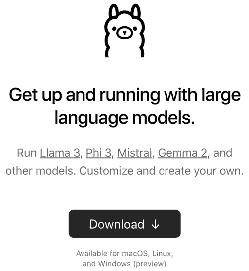

   图 2.1：Ollama 首页

2. 请点击`Download`，你将被重定向到下载页面，可以在那里选择适用于你平台的发行版本，无论是 Mac、Linux 还是 Windows：

   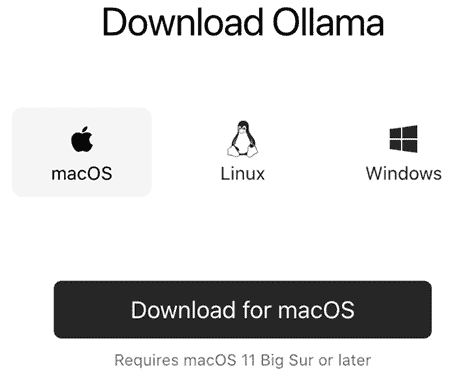


### 下载并安装 Ollama

下载完成后，请解压并运行它；它将启动安装程序：

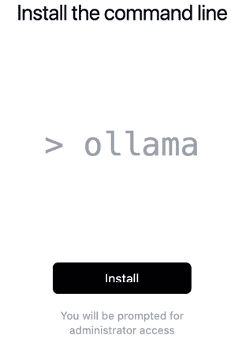

图 2.3：Ollama 安装程序

安装程序可能会触发系统要求你输入密码以继续。如果你想继续安装 Ollama，请执行。

关于 `Ollama` 启动问题的简要说明。如果 `Ollama` 无法启动，请验证你的操作系统权限，并确保防火墙设置允许端口 `11434` 上的本地连接。

成功安装了 `Ollama`！这是你运行自己的本地 AI 的重要一步。

引擎就绪后，现在是时候通过拉取实际语言模型赋予它生命了。我们将下载几个基于 Mistral 的模型，包括`mistral`、`mistral-nemo`和`mistral-small`，以便你开始真实的本地实验。

### 拉取轻量级模型

我们将从获取一个轻量级 Mistral 变体开始以启动：

1. 要下载`mistral-small`模型（专为本地使用设计的紧凑版本），打开你的终端或命令提示符并运行以下命令：

```
ollama pull mistral-small
```

**下载大小**

拉取`mistral-small`将下载 14 GB。确保网络连接稳定、至少有 20 GB 空闲磁盘空间以及足够的系统资源以进行流畅推理。

你可以跳过此步骤，直接运行`ollama run mistral-small`。如果模型尚未安装，Ollama 将自动下载它。

1. 完成后，确认该模型已在本地可用：

```
ollama list
```

你应该能看到类似下面的内容：

```
NAME                    ID              SIZE      MODIFIED      
mistral-nemo:latest     994f3b8b7801    7.1 GB    9 minutes ago    
```

此时，你已经在本地运行了`mistral-small`，这足够你开始尝试提示词和简单任务了。然而，取决于你的硬件配置和用例的复杂性，你可能想要探索额外的 Mistral 变体，以平衡运行速度、内存占用和推理能力。

### 探索其他 Mistral 变体

Ollama 支持额外的 Mistral 变体。你可以尝试以下命令：

```
ollama pull mistral-nemo
```

你也可以尝试这个：

```
ollama pull mistral
```

* `mistral`指的是标准的 7B 参数模型
* `mistral-nemo`是一个更强大的 12B 参数版本

你可以在[`ollama.com/library`](https://ollama.com/library)浏览完整的 Ollama 模型库，你可以在搜索栏中输入`mistral`进行搜索。

### 系统提示词的调优建议

现在我们已经了解了调优系统提示词的优缺点，你可以考虑以下建议，让它们按需发挥作用：

* **结合方法**：将系统提示词与其他过滤和审核工具结合使用，以实现更稳健的治理
* **定期测试**：持续测试并调整系统提示词，以确保它们能有效引导模型行为
* **监控**：实施监控系统，以检测并解决任何违反系统提示词指南的情况
* **清晰的提示词**：确保系统提示词清晰且具体，以最大限度地减少歧义并增强合规性

总而言之，系统提示词注入是影响 AI 模型行为的有用工具，但不应仅依赖它来进行严格的治理或审查。将其与其他安全措施相结合并持续监控其有效性，有助于实现对模型响应更可靠的控制。

### 自定义模型基础

在了解了系统提示词、参数和行为调优的背景后，是时候将它们转化为实用格式了。Ollama 使用一种名为`Modelfile`的简单文本配置文件来定义自定义模型的行为方式。该文件指定了基础模型、注入的系统提示词以及`temperature`和`num_ctx`等参数。让我们从一个基础模板开始自定义，你可以使用或调整该模板来塑造你自己的个性化 AI 助手。

### 撰写 Modelfile

在你的自定义模型投入使用之前，你需要定义它应该如何行为和响应。这是通过使用`Modelfile`实现的——这是一个简单的配置格式，告诉 Ollama 使用哪种基础模型、如何格式化提示词以及采用何种语气或风格。

以下是一个`Modelfile`示例，它自定义了`mistral-nemo`模型，使其像一个频繁使用表情的助手：

```
TEMPLATE """{{- if .System }}
<|system|>
{{ .System }}
</s>
{{- end }}
<|user|>
{{ .Prompt }}
<|assistant|>
"""
PARAMETER stop "<|system|>"
PARAMETER stop "<|user|>"
PARAMETER stop "<|assistant|>"
PARAMETER stop "</s>"
PARAMETER temperature 0.2
SYSTEM """ Please impersonate user who uses lot of emojis, acting as assistant."""
```

此示例`Modelfile`包含以下内容：

* `TEMPLATE`：定义系统和用户提示词如何格式化并注入到模型中
* `PARAMETER stop`：指定信号响应结束的停止标记（stop tokens）
* `PARAMETER temperature`：设置温度以控制响应的创意
* `PARAMETER num_ctx`：设置对话期间保留的上下文 token 数量
* `SYSTEM`：为模型的行为提供特定指令

关于`Modelfile`参数的更详细文档可以在此处找到：[`github.com/ollama/ollama/blob/main/docs/modelfile.md`](https://github.com/ollama/ollama/blob/main/docs/modelfile.md%20)

一旦配置准备就绪，下一步就是通过生成**清单（manifest）**将此文件转换为可用的自定义模型。让我们来看看是如何操作的。

### 创建新模型清单

在`Modelfile`中定义了模型的行为后，下一步将其封装成 Ollama 可以识别的可运行模型。这是通过生成清单实现的，它将你的基础模型和配置链接到一个新的自定义模型：

要根据你的`Modelfile`创建一个名为`emoji`的新模型，请打开终端并运行以下：

```
ollama create emoji --file ./mistral-nemo/emoji.modelfile
```

该命令告诉 Ollama 采用`emoji-nemo.modelfile`中的指令，将其应用到`mistral-nemo`基础模型上，并生成一个新的模型层。

在本章的代码示例中，我们使用了自定义的`emoji.modelfile`，它以 Mistral Nemo 为基准。

`Chapter_2`文件夹包含了该文件的几个变体，允许你尝试不同的基础模型，例如 Mistral-7B 和 Mistral Small。你可以根据你的硬件能力或所需的性能对它们进行切换。

输出应该类似于此所示：

```
gathering model components
using existing layer sha256:b559938ab7a0392fc9ea9675b82280f2a15669ec 3e0e0fc491c9cb0a7681cf94
using existing layer sha256:43070e2d4e532684de521b885f385d0841030efa2 b1a20bafb76133a5e1379c1
creating new layer sha256:0a22b57a41da9251cddedf87b07c5cc0a403523974e 83c1bbaaa591e390f0f93
using existing layer sha256:75962282d098191b4aecc0f890bb704db5259d4 70aa79e822466a07a1dea
writing manifest
success
```

要验证模型并确认你的模型可以使用，请列出所有模型：

```
ollama list
```

你应该看到类似的内容：

```
NAME                    ID              SIZE      MODIFIED
emoji:latest            e14f4255d51d    7.1 GB    About a minute ago 
mistral-nemo:latest     994f3b8b7801    7.1 GB    3 hours ago        
mistral-small:latest    8039dd90c113    14 GB     3 hours ago
```

取决于你下载的模型以及对自定义模型的命名，你看到的列表可能会有所不同。

创建好自定义 emoji 模型后，是时候运行它并看看你的指令如何影响输出了。让我们在下一步中启动它。

### 与模型交互

在创建`emoji`模型后，你已好运行它并查看你的指令如何影响输出。这一步展示了如何启动你的模型：

```
ollama run emoji
```

一旦模型运行时，你将看到：

```
>>> Send a message
```

你现在可以输入任何消息来测试你的配置——这里有一个例子：

```
>>> hey
```

你应该收到一个充满表情的友好回复，如下：

```
Hey there! How can I assist you today?
```

此命令将提示词（prompt）发送到您的自定义表情模型并返回单个完整的响应。

有关支持的端点、负载格式和流式选项的完整列表，请参考此处官方文档：[`github.com/ollama/ollama/blob/main/docs/api.md`](https://github.com/ollama/ollama/blob/main/docs/api.md%20)

### 与 Obsidian 集成

自从我们开始讨论 Ollama API 和 Mistral Small 模型的自定义以来，在接下来的章节中，我们将查看市场上已经在使用此 API 的工具之一。我们将展示如何通过社区插件配置 Obsidian 笔记应用，并将 Mistral 模型集集到您的日常头脑风暴和笔记记记工作流中。

Obsidian 是一款强大的基于 Markdown 的笔记应用，适用于 Windows、macOS、Linux 甚至移动平台，让您能够随时随地记录由 AI 增强的笔记。

## 第 4 步：与 Obsidian 集成

将您自定义的`Ollama`模型与强大的笔记工具`Obsidian`集成，通过允许在笔记中直接进行无缝的 AI 交互，可以增强您的工作流。我们将使用`BMO Chatbot`社区插件来实现这种集成。让我们开始吧！

在计算机上启动`Obsidian`。如果您尚未安装，可以从[`obsidian.md/`](https://obsidian.md/)轻松下载。

下载完成后，按照以下步骤进行安装：

1. 打开`Settings`（左下角的齿轮图标）。开启`Community plugins`（社区插件），如果弹出提示，请批准安全通知。

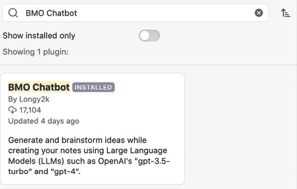

图 2.5：安装 BMO Chatbot 插件

1. 插件安装完成后，返回`Installed plugins`（已安装插件）标签页。找到`BMO Chatbot`并将其开启以激活它。

在插件启用并显示在您的插件列表中，下一步是配置其设置，以便它知道如何与运行在`Ollama`中的本地模型通信。但在插件与您的本地模型交互之前，它需要知道`Ollama`运行在哪里。默认情况下，`Ollama`会在您的机器上启动本地服务器，`BMO Chatbot`必须使用正确的 API URL 指向该服务器。简单的配置步骤建立了`Obsidian`与您的本地托管模型之间的连接。

按照以下步骤将插件连接到`Ollama`：

1. 在`Obsidian`中，进入`Settings`（设置），并在`Plugin options`（插件选项）部分找到`BMO Chatbot`。

2. 在提供的字段中输入 Ollama API URL（`http://localhost:11434`）：

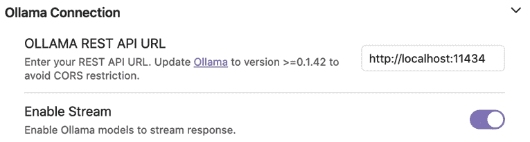

图 2.6：输入本地 Ollama API URL

一旦设置了 API URL，插件应该立即识别来自`Ollama`的任何可用模型，包括您的自定义表情模型或您创建的任何其他版本。

如果您倾向于使用 Mistral API 而不是本地`Ollama`实例，`BMO Chatbot`也支持此项。如果您想从云端运行聊天机器人或连接到托管模型而不依赖本地资源，那么这个选项非常棒。

要使用 Mistral API，您需要提供一个与付费 Mistral 订阅关联的 API 密钥。目前的定价对于爱好或轻度专业用途来说非常合理，且设置非常简单。

虽然我们将在 *第 4 章* 中介绍整个注册和密钥生成过程，但这里快速查看在插件设置中输入密钥的位置：

1. 展开`Mistral AI Provider`部分。在`BMO Chatbot`插件设置中，滚动到`LLM providers`部分。找到并展开`Mistral AI`选项。

2. 将您的 Mistral API 密钥粘贴到提供的输入字段中。要获取密钥，请访问[`mistral.ai`](https://mistral.ai)并使用付费账户登录。

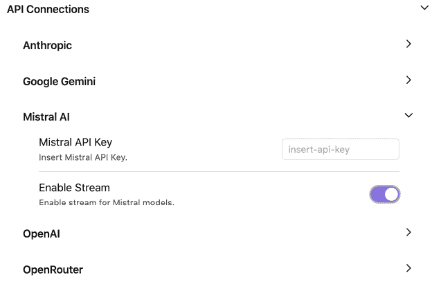

图 2.7：输入 Mistral API 密钥

一旦 API 密钥到位，插件即可连接到 Mistral 的云托管模型。

一旦安装并启用 BMO chatbot 插件，是时候定义模型在交互期间的行为运行了。我们需要配置通用设置，例如系统提示词（system prompts）、温度（temperature）以及`Ollama`中可用的模型选择。这些设置控制您的对话的语气、深度和记忆，让您根据自己的喜好自定义体验——无论您是追求简洁、事实性的回答，还是更有创意和对话性的内容。

使用`Obsidian`内部的插件设置面板定义以下参数：

1. **Model**（模型）：在设置页面顶部，您将找到一个下拉菜单来选择模型。如果列表为空，这意味着插件尚未连接到您的`Ollama`实例——这将在我们在下一步中配置 API URL 后解决。

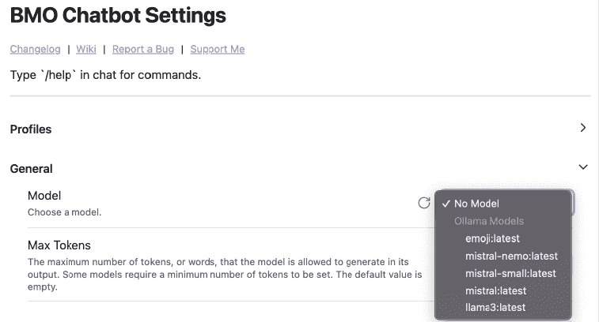

提示：在本演示中，一旦可用，请从下拉菜单中选择`mistral-nemo:latest`。请参考*图 2.9*：

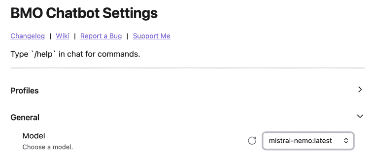

图 2.9：已选择模型

2. **Prompt**（提示词）：这允许您选择一个预定义的提示词。在`BMO Chatbot`插件设置中，滚动到`Prompt`部分。找到并点击`System Prompt`（系统提示词）。这将允许定义 AI 的角色。

4. **Max Tokens**（最大 Token）：定义模型应该记住多少之前的对话内容。例如：`Context Length: 4096`

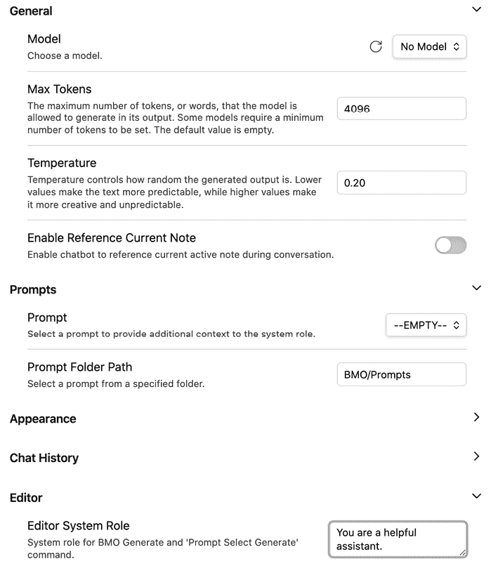

图 2.10：设置温度、系统提示词和上下文长度

### 在笔记中使用 Mistral 模型

一旦 BMO chatbot 插件安装并启用，就是时候在`Obsidian`内部直接与模型交互了。该插件提供了多种访问模型的方法，但最直接的方法是使用内置聊天面板。

这种集成允许您在不离开笔记工作流的情况下，使用您的自定义模型（无论是通过 Ollama 本地运行还是通过 Mistral API）。让我们演示如何打开聊天并发送您的第一个提示词。

1. 在`Obsidian`的左侧边栏上，寻找一个像**机器人头部**的图标。点击此图标打开 BMO Chatbot 面：

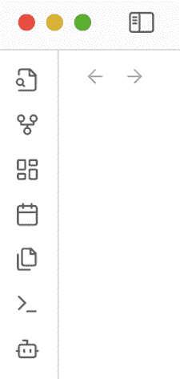

图 2.11：通过机器人头部启动聊天面板

当聊天面板在右侧打开时，您已准备好与模型开始交互。

1. 将您的提示词输入输入框中。按 *Enter* 看着响应像实时聊天会一样逐个字母地回传回来：

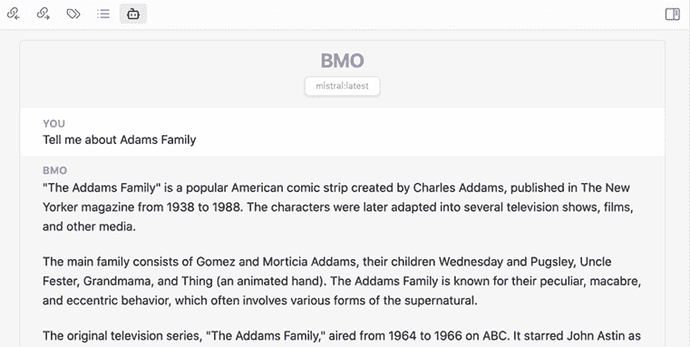

图 2.12：Obsidian 内部来自本地模型的流式响应

将 BMO Chatbot 集成到 Obsidian 中，允许你可以在思考的地方无缝访问自定义的 AI 模型。无论你是在进行头脑风暴、写日记还是管理项目，这种设置都能将对话式 AI 引入你的创意流中——并由你控制的模型和提示词提供支持。你可以自由尝试不同的系统提示词并调整参数，以塑造你助手的语气和个性。

我们已经介绍了了 Obsidian 如何提升个人工作效率。现在，是时候为团队和非技术用户打开通过简单的浏览器进行对话的大门了。接下来，我们将通过 Web UI 访问你的 Mistral 驱动的聊天，进一步提高标准，将你的本地模型转换为功能完整的交互式 Web 应用。准备好看到它的运行了吗？让我们开始！

### 部署 Web UI

是时候迈下一步了——为你的自定义聊天模型部署一个功能全 Web UI。此界面将允许用户通过浏览器与你的模型进行交互，提供熟悉且用户友好的聊天体验。

在本节中，我们将在`Docker`容器内运行`WebUI`，并配置其通过`Ollama` API 连接到你的本地`Ollama`实例。聊天界面的请求将由`Ollama`处理，然后它会将请求委托给你之前注册的`Mistral`模型。让我们把一切连接并运行起来。

### Docker 拉取并试运行 web UI

在开始之前，请确保你的机器上安装了`Docker`。如果没有，你可以从[`www.docker.com/products/docker-desktop`](https://www.docker.com/products/docker-desktop)下载并安装`Docker Desktop`：

1. 在终端中使用以下命令拉取并运行`Open WebUI`镜像：

```
docker run -d -p 3000:8080 --add-host=host.docker.internal:host-gateway -v open-webui:/app/backend/data --name open-webui --restart always ghcr.io/open-webui/open-webui:main
```


```bash
sudo docker run -d -p 3000:8080 --add-host=host.docker.internal:host-gateway -v open-webui:/app/backend/data --name open-webui --restart always ghcr.io/open-webui/open-webui:main
```

以下是命令中每个部分的作用：

*   `sudo docker run`：启动一个新的 `Docker` 容器。
*   `-d`：在分离模式下（后台）运行容器。
*   `--add-host=host.docker.internal:host-gateway`：为容器添加主机条目，允许其访问运行在宿主机上的服务。
*   `-v open-webui:/app/backend/data`：挂载名为`open-webui`的`Docker`卷，以持久化容器内`/app/backend/data`中的数据。
*   `--name open-webui`：将容器命名为`open-webui`。
*   `--restart always`：确保容器在停止或`Docker`守护进程重启时自动重启。
*   `ghcr.io/open-webui/open-webui:main`：指定要使用的`Docker`镜像。

执行命令后，`Docker`将拉取镜像（如果本地尚不存在）并创建一个名为`open-webui`的容器。你可以使用`Docker Desktop`或命令行确认这一点。你应该能看到列出的镜像：

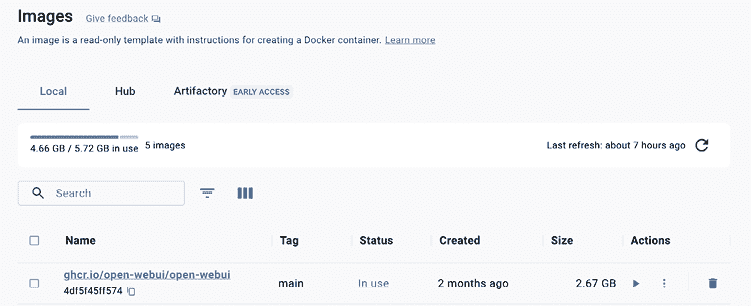

图 2.13：Docker Desktop 中显示的 Open WebUI 镜像

同样，相应的容器应该正在运行并监听`localhost:3000`端口：

图 2.14：正在监听端口 3000 的运行容器

容器能够与运行`Ollama`的宿主机系统进行通信至关重要。如果你在单独的机器或虚拟机上运行`Ollama`，你将需要配置 web UI 指向该外部 IP 地址而不是`localhost`。

`Open WebUI`容器现在正在运行并连接到你的`Ollama`实例，这意味着是时候在浏览器中启动`Open WebUI`，注册管理员用户，配置它与`Ollama` API 通信，并观察其他设置了。这一步验证了前端已正确加载并准备好配置。

1.  打开你首选的网络浏览器并导航到：[`localhost:3000`](http://localhost:3000)。如果一切设置正确，你将看到`Open WebUI`欢迎页面。此屏幕确认了界面已激活并等待初始用户注册。


图 2.15：浏览器中的 Open WebUI 欢迎界面

你现在准备好注册你的第一个管理员用户了，这将让你获得系统功能和连接设置的完全权限。让我们继续。


图 2.16：Open WebUI 用户注册表

你的登录凭据安全地存储在`Docker`卷中，不会发送到外部。这保持了你的设置的私密性和完全自包含性。

1.  完成注册并登录后，你将被重定向到主聊天界面：


图 2.17：登录后的默认聊天界面

此时，系统已准备好接受提示词——但在此之前，我们仍然需要将 UI 指向你的本地`Ollama`模型。你需要配置`Ollama` API URL，以便 web UI 能与你本地运行的模型通信。这一步对于启用完整的聊天功能至关重要。

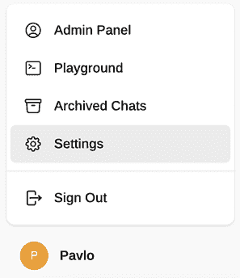

图 2.18：从用户面板访问的菜单

1.  从菜单中选择`Settings`。这将打开完整的配置面板。导航到`Connections`标签页，然后展开`Ollama Base URL`部分。在这里，你将输入运行`Ollama`实例的 URL。

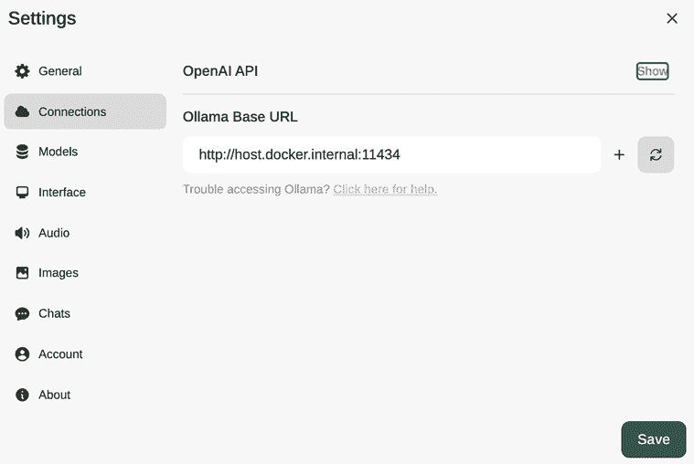

图 2.19：配置 Ollama Base URL

**关于 macOS 的说明**

在 macOS 上，`Docker`容器无法直接访问`localhost`。相反，请使用[`host.docker.internal:11434`](http://host.docker.internal:11434)。此地址允许请求路由到宿主机系统。此外，确保使用`sudo`启动`Docker`容器以允许适当的网络访问。

*   **General**：此标签允许你管理 UI 主题、语言、通知和全局系统提示词。如果你更喜欢深色主题以获得视觉舒适，可以在这里开启。
*   **Models**：在这里，你可以从`WebUI`覆盖并管理由`Ollama`提供的模型。请注意模型可能很大，从 2 GB 到 5 GB 或更高，因此请确保你的`Docker`卷足够大。
*   **Interface**：此标签包含聊天界面的设置，例如默认建议聊天启动项、标题自动生成和默认模型选择。
*   **Audio**：管理语音转文本和文本转语音引擎，并为音频交互选择你喜欢的语音。
*   **Chats**：此标签允许批量导出和导入聊天数据，这对于备份或迁移用户聊天数据非常有用。

*   `Account`：在此处管理你的头像、显示名称和密码更改。此外，你还可以生成 API 密钥以便进一步的集成和自定义。

聊天功能已就绪！

现在进入本次练习中最精彩的部分。让我们试运行并演示一下在使用 Mistral 语言模型作为大脑时，Open WebUI 慷慨为提供的一些功能：

1.  输入一条消息，如`Who is Taylor Swift?`。系统将生成响应。在生成过程中，它将逐字母、逐字字地进行流式输出。
2.  点击聊天窗口中的麦克风图标。说出你的查询，系统会将你的语音转换为文本并做出响应。请注意，浏览器第一次可能会请求你允许访问麦克风。
3.  点击上传图标并从电脑中选择一个文本文件。通过输入`Please summarize this document`让系统对其进行摘要。Mistral 将为你总结该文档。

呼！这难道不酷吗？Open WebUI 的运作就像成熟的生成式 AI 产品，但它是免费的，且完全运行在你的硬件上。但大力量需要大责任。让我们学习如何在 Open WebUI 生态系统中管理用户。

### 管理用户

除了与你的模型聊天，Open WebUI 还包含许多管理员级功能，用于管理用户访问、权限和模型可见性。如果你是为团队、教室或受控用户组运行界面，这些工具将特别有用。

默认情况下，系统允许自注册，这意味着任何人都可以注册为用户。然而，你可以配置如何处理这些新用户：

*   用户可以被自动分配“用户”角色
*   否则，他们将进入待审核状态，直到管理员手动批准

相关的控制选项在`Admin Settings`（管理员设置）中，如下：

图 2.20：管理用户角色和审批的管理员设置

作为管理员，你还可以对模型设置白名单，决定哪些模型对普通用户可见或可访问。这种方法与之前在`Step 1: Install and run Ollama`章节中介绍的模型继承相结合时效果极佳，允许你为不同的用户提供不同的功能。

图 2.21：按用户角色设置模型访问白名单

此外，Open WebUI 还允许你手动创建用户或使用 CSV 文件批量导入用户——这是快速入职大型团队的理想选择。

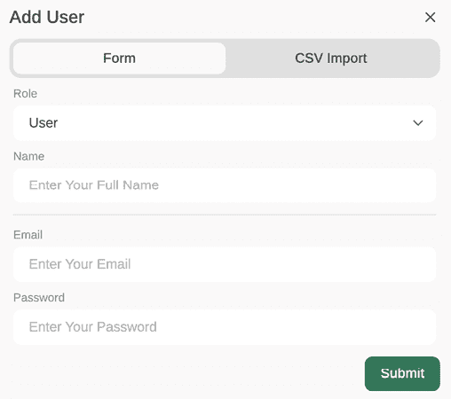

到此时，你已经启动了一个功能齐全的本地聊天系统，将其连接到你的 Mistral 模型，并将其封装在一个安全且灵活的用户界面中。你现在拥有了一个完全按照你的意愿运行的强大、可定制的助手——并且配备了治理工具。

伟大的 AI 通常需要优秀的 GPU！在下一节中，我们将从硬件要求的角度检查我们的聊天实现。

在你全投入使用你的自定义 AI 助手之前，值得花时间考虑你的硬件。无论你是为了个人使用，还是计划将其开放给多个用户，性能都会根据你机器的能力而产生显著差异。

最重要的因素是什么？你的 GPU。像 Mistral 这样的 LLM 严重依赖 GPU 显存和吞吐量来流畅且实时地生成响应。在本节中，我们将介绍推荐的硬件配置——从可以运行基础模型的最小配置，到针对低延迟和并发用户优的高端系统。如果你经历过卡顿、流传输缓慢或逐字延迟，这些基准测试将帮助你识别系统可能需要升级的地方——或者什么种尺寸的模型更合适。

*   **Mac**：打开活动监视器（在`应用程序` > `实用工具`中找到），然后切换到`GPU`标签。要查看更详细的视图，前往`窗口` > `GPU 历史`或按`CMD` + `4`打开 GPU 活动实时图表。
*   **Windows**：按`Ctrl` + `Shift` + `Esc`任务管理器。导航到`性能`标签并从列表中选择`GPU`以监控实时使用情况和内存负载。
*   **Linux**：使用`watch`命令结合`nvidia-smi`等工具处理 NVIDIA GPU：

```bash
watch -n 1 nvidia-smi
```

这可以每秒提供一次 GPU 利用率和内存使用情况的实时快照。

运行模型时，你应该能观察到 GPU 使用率显著增加。这证实了你的系统在推理期间正确利用了 GPU。

图 2.23：模型推理期间的实时 GPU 活动

监控 GPU 使用情况让你更清楚地了解模型在负载下的性能。接下来，我们将探索不同的硬件配置——从最小舒适配置开始——帮助你选择符合你的性能目标和预算的系统。

对于兴趣运行 Mistral-7B 等本地 LLM 的读者，配备良好的个人机器可以提供强大的性能——特别是对于推理、实验和轻量开发任务。

### Apple 设备：评估 M1/M2 和 M3 系列

虽然搭载 M1 和 M2 芯片的 MacBook 在发布时令人印象深刻，但其集成 GPU 架构在处理更大的语言模型时存在局限性。它们与`mistral-small`等较小模型配合良好，但在处理繁重负载时可能会遇到困难。

### 带有独立显卡的 Windows/Linux：性能首选

对于追求极致效率和灵活性的读者，由于与 CUDA 库兼容，NVIDIA GPU 仍然是金标准。

*   ASUS ROG Zephyrus G16
*   NVIDIA GeForce RTX 4070 (8 GB VRAM)
*   Intel Core Ultra 9

*   Lenovo Legion Pro 7i
*   NVIDIA GeForce RTX 4080 (12 GB VRAM)
*   Intel Core i9-14900HX

这些为大模型和并发会提供了顶级性能：

*   NVIDIA GeForce RTX 4090 (16 GB VRAM)
*   Intel Core i9-14900HX

这些 GPU 提供了高显存，这对于完全在内存中运行 Mistral-8B 等量化模型至关重要。

AMD 即出的 Strix Halo APU 将将为集成 GPU 市场带来竞争性性能，在某些 AI 任务中可能 rival 中端 NVIDIA 选择。虽然早期基准测试看起来不错，但 LLM 的真实世界测试仍在进行中。

如果你的机器至少包含 16 GB 内存、SSD 和独立 NVIDIA GPU，你就可以很好地使用 Ollama、LM Studio 或 Text Generation WebUI 等平台处理大多数本地 LLM 任务了。

对于处理更重 LLM 任务的读者——例如托管多用户环境、进行微调实验或集成`retrieval-augmented generation`（`RAG`）流水线——一台强大的工作站变得至关重要。以下配置反映了一个可靠且可扩展的设置，旨在本地部署`Mistral-Small`、`Mistral-Nemo`等模型甚至是有限的训练实验。

*   `ASUS ProArt X670E-Creator WiFi`
*   `MSI MEG X670E ACE`
*   `ASRock X670E Taichi`

*   `AMD Ryzen 9 7950X3D`（16 核，针对缓存敏感型任务进行了优化）
*   `Intel Core i9-14900K`（强单线程性能和稳固的多核平衡）
*   `AMD Ryzen 9 7900X`（12 核预算替代方案）

*   `NVIDIA RTX 4090`（24 GB 显存，是 13B+ 模型和多用户推理的理想选择）
*   `NVIDIA RTX 4080 SUPER`（16 GB，适用于 7B 模型）
*   （避免 AMD GPU，除非使用`ROCm`工作流——其生态系统兼容性有限）

*   `G.SKILL Trident Z5 RGB DDR5 64GB`（2×32GB, 6000MT/s）
*   `Corsair Vengeance DDR5 64GB`
*   `Kingston Fury Beast DDR5 64GB`

## 存储（用于快速模型加载和数据流的 NVMe Gen4 SSD）

*   `Samsung 990 PRO 2TB NVMe`
*   `WD_BLACK SN850X 2TB`

## 电源（具有模块化设计的稳定大功率）

*   `Corsair HX1200i`（铂金级，全模块）
*   `Seasonic PRIME TX-1300`（80+ 钛金）

## 冷却（用于热稳定性的一体水冷系统）

*   `Corsair iCUE H150i ELITE LCD XT`
*   `NZXT Kraken Elite 360`

此配置使您能够高效运行复杂的 LLM 工作负载，包括多用户推理、自定义 RAG 流水线、本地微调和实时模型实验：

*   在本地托管多个 7B–13B 模型并实现流畅推理
*   在同一台机器上部署`Ollama`、`RAG`组件和聊天界面
*   处理多用户环境而不产生延迟问题

## 正在寻找可扩展或托管的部署而非本地硬件吗？

在`第 10 章`中，我们将展示如何使用`AWS Bedrock`来托管托管`Mistral`。

想象一位经验丰富的渔民站在岸边，将网投入一片精心挑选的湖泊，那里正等待着合适的鱼获。关于在何处以及如何撒网的决定，就像为语言模型设置条件——这些选择塑造了我们预期的结果。随着网沉入水，其网格的密度决定了是只捕到名贵鱼，还是让更多种类的鱼溜掉，这正如`top_k`和`top_p`等参数如何控制模型的选择性。

简而言之，本章将涵盖以下主要主题：

*   问题陈述
*   流水线概述
*   实战工作坊：`softmax`函数、`temperature`、`top_k`和`top_p`

# 技术要求

在本章中，我们将使用以下工具：

*   安装了`Mistral-Nemo`的命令行工具`Ollama`
*   Python 和`pip` 3.9

所有源代码均可在 GitHub 的[`github.com/PacktPublishing/Learn-Mistral`](https://github.com/PacktPublishing/Learn-Mistral)中的`Chapter-3`文件夹找到。

有效利用大语言模型（LLMs）的力量对于生成且准确的输出至关重要。然而，调整这些模型以产生所需结果的过程可能充满挑战，特别是当处理大量影响模型行为的参数时。

在本章中，旨在通过调整`temperature`、`top_k`、`top_p`以及各种惩罚等关键参数，解决调整 LLM 所的复杂性。主要目标是理解这些参数如何相互作用并影响模型输出，以及如何调整它们来交付所需的输出。

*   涵盖 LLM 参数背后的数学基础
*   学习如何操作这些参数以实现特定结果
*   通过实践应用这些知识，观察这些调整在现实世界中的影响

# 流水线概述

在我们开始调整语言模型的复杂性导航之前，让我们了解 LLM 流水线中不同组件是如何协同工作的。下面的图说明了语言模型流水线的主要阶段，重点关注`softmax`、`temperature`、`top_k`和`top_p`等参数如何影响最终输出。它捕捉了这些元素之间的交互以及它们对生成意义文本的集体影响：

图 3.1：响应生成工作流

让我们逐一关注过程中的每个阶段：

*   **标记化（Tokenization）**：输入文本被拆分为标记（tokens）——模型可以处理的更小单位，如单词或子词。标记化对于将人类语言转换为模型分析和生成响应的格式至关重要。
*   **Logits 计算**：模型处理标记并产生`logits`，这是原始的、未归一化的分数，代表了每个可能的标记作为下一个单词的概率。这些 logits 是确定不同标记概率的基础。
*   **神经网络处理**：这是模型内部进行核心计算的地方，深度学习层和复杂的神经操作根据输入标记生成 logits。这是模型应用学到的知识预测下一个可能单词的步骤。
*   **Softmax 函数**：将`softmax`函数应用于 logits，将其转换为概率。logits 是未归一化的分数；softmax 将其转换为模型用于选定词汇的概率。这一步归一化了 logits，确保所有概率之和等于`1`，允许模型对下一个标记做出明智的决策。
*   **温度缩放（Temperature scaling）**：应用`temperature`参数来调整概率。较低的温度会导致更具确定性的输出，倾向于概率较高的标记；而较高的温度则会引入更多随机性，增加潜在输出的多样性。
*   **选定的标记（Selected token）**：在应用`softmax`函数、温度缩放和过滤后，模型根据调整后的概率选择最终标记。该标记被添加到输出序列中，对整体响应做出贡献。
*   **生成的输出**：选定的标记组合成最终文本输出，并呈现给用户。此输出是整个流水线过程的结果，由沿途做出的各种参数选择和决策塑造。

在涵盖了 LLM 处理和生成文本的主要阶段后，我们现在准备关注下一个关键元素：系统提示词（system prompts）。

在选择钓鱼区域时，渔民还会考虑他们想要的鱼类种类。同样，在编写系统提示词（system prompts）时，交互的目标决定了必须采取的方法。让我们概述主要的提示词类别，学习构建它们的最佳实践，并深入了解 LLM 是如何理解这些方向以交付预期的响应的。

## 分类提示词


# 分类提示词

分类提示词用于根据预定义的标准对数据进行分类或标记。这些提示词在需要快速、准确地排序或组织大量信息的应用中特别有用。例如，我们可以将文本分类为“简历”或“物料清单”，或将客户反馈分类为积极、中性或负面情绪。

在创建分类提示词时，清晰地定义你希望模型使用的类别。在提示词中为每个类别提供简短的示例或描述符。这将使`LLM`更容易地理解类别之间的区别，从而获得更准确、更一致的分类。确保类别之间互斥，以便将分类时的混乱降至最低。

提示词示例：

```
将以下文本分类为“简历”或“物料清单”：'< 在此处插入文本 >'。
```

LLM 响应：

```
此文本被分类为“简历”。
```

# 摘要提示词

摘要提示词旨在将大量信息压缩成更短、更易于理解的形式。这在处理长文档、文章或报告时特别有用，在这些情况下，需要突出关键信息以便快速理解。

提示词示例：

```
将以下文章总结为三句话：'< 在此处插入文章文本 >'
```

LLM 响应：

```
该文章讨论了气候变化对极熊种群的影响，强调了海冰流失是一个关键威胁。它强调了采取全球行动以减少温室气体排放的必要性。作者还提到了旨在保护极熊栖息地的持续保护工作。
```

# 个性化提示词

个性化提示词通过调整模型的输出，以满足用户的特定需求、偏好或特征。这可能涉及根据用户的画像、过去的交互或说明的偏好来调整响应的语气、风格甚至内容。

# 评估提示词

评估提示词用于评估或批判输入，如代码、文本或其他形式的数据。这些提示词在质量保证中特别有价值，其目标是识别错误、低效之处或改进空间。

提示词示例：

```
评估以下代码的效率并提出改进建议：'< 在此处插入代码 >'。
```

LLM 响应：

```
该代码有效地计算了数字的阶，但可以使用迭代方法代替递归来优化。这将减少函数的栈使用，并防止大型输入时潜在的栈溢出错误。
```

# 模仿技术

系统提示词在任何用户交互开始之前定义模型的身份、语气和推理方法。它们不回答问题；而是建立`一个框架`，模型将在该框架内进行思考和交流。

这是一个系统提示词示例：

```
你是一个讨论小组，正在评估一家针对 8-14 岁儿童的新在线学校，该学校使用 Minecraft 教授 STEM。每个人应该独立贡献：
人格 2 - 家长的集体发声，分享他们的顾虑和期望
人格 3 - 一群表达兴奋和趣味元素的儿童
人格 4 - 一位创意游戏设计师，提出引人入胜的功能和故事性
人格 5 - 教学方法论专家，概述课程结构和学习成果
```

在这个示例中，系统提示词引导模型模拟多视角对话。市场策略师提供了受众定位和品牌语气的建议。家长解决了成本、安全和教育价值等问题。儿童带来了情感的真实性，反映了什么让年轻学习者感到兴奋和动力。游戏设计师贡献了关于沉浸和交互的想法。方法论专家确保了教育目标和结构的存在。

这种复合系统提示词展示了模型同时持有多个观点的能力，比单一角色方法提供了更完整、更真实的答案。它证明了系统提示词如何模拟基于角色的推理、群体动态和协作解决问题——而这一切都在单次交互中完成。

为了实现有效的模仿，请为你希望模型采用的人格提供简短的描述或关键特征。提到人格的语气、语言风格或典型观点有助于`LLM`提供更具说服力和更准确的模仿。这种方法允许模型将其响应与预期的角色更紧密地对齐。

提示词示例：

```
"请帮我为孩子办的 Minecraft 学校脑暴商业计划，模仿四个人：一个营销专业人士、一位方法论共同作者、家长的集体声音和儿童的集体声音。他们对这些课程有什么要求？"
```

LLM 响应：

```
营销专业人士：我们应该关注 Minecraft 如何让学习变得有趣同时培养关键技能。我们的活动应该强调创意、团队合作和解决问题，针对孩子和家长。
方法论共同作者：课程应将核心学科整合到 Minecraft 活动中。课程应该是灵活的，并鼓励个人创意和小组协作。
儿童的集体声音：我们希望课程是有趣又有创意。和朋友一起建造酷东西、参加挑战和获得奖励会让课程太棒了！
```

# 代码提示词

## 示例 1：初始脚手架

这是提示词：

```
"Generate a Spring Boot project using Maven with basic configurations."
```

这是大语言模型的复复：

```
$ mvn archetype:generate -DgroupId=com.example -DartifactId=demo -Dversion=1.0-SNAPSHOT -DpackageName=com.example.demo -DarchetypeArtifactId=maven-archetype-quickstart -DinteractiveMode=false
```

此`mvn`命令将创建一个带有指定的 group ID、artifact ID 和包包的基础 Spring Boot 项目结构。

## 示例 2：单元测试创建

以下是提示词（Prompt）：

```
"为阶乘函数编写单元测试，并确保涵盖了所有边界情况。"
def factorial(n):
    if n == 0:
        return 1
        return n * factorial(n-1)
```

这是大语言模型的复复：

```
Sure, here is the code of the unit test that should address your request
import unit test
class TestFactorial(unittest.TestCase):
    def test_factorial_zero(self):
        self.assertEqual(factorial(0), 1)
        self.assertEqual(factorial(5), 120)
    def test_factorial_negative(self):
        with self.assertRaises(ValueError):
            factorial(-1)
if __name__ == '__main__':
```

## 示例 3：异常处理改进

以下是提示词（Prompt）：

```python
"通过添加对常见运行时错误的检查并提供清晰的错误信息，改进 read_file 函数中的错误处理。"
def read_file(filename):
    with open(filename, 'r') as file:
        return file.read()
```

这是大语言模型的复复：

```python
Sure, here is the adjusted version of the read_file
    try:
        with open(filename, 'r') as file:
            return file.read()
    except FileNotFoundError:
        print(f"Error: The file '{filename}' was not found.")
        print(f"Error: An I/O error while reading '{filename}'.")
    except Exception as e:
        print(f"An unexpected error occurred: {e}")
```

以下是提示词（Prompt）：

```python
"重构这段代码以使用工厂方法，提高重用性。"
    user = {
        'name': name,
        'email': email,
        'role': 'user'
    }
def create_admin(name, email):
    admin = {
        'name': name,
        'email': email,
        'role': 'admin'
    return admin
```

这是大语言模型的复复：

```python
Sure, please consider this adjusted version
def create_account(name, email, role='user'):
    account = {
        'name': name,
        'email': email,
    }
    return account
# Usage
user = create_account('Alice', 'alice@example.com')
admin = create_account('Bob', 'bob@example.com', 'admin')
```

编写有效的系统提示词（System Prompts）与选择合适的钓鱼水同样关键。正如渔民的成功取决于选择正确的地点、鱼饵和装备一样，你使用语言模型时的成功也取决于精心设计的系统提示词。

无论你需要进行分类、总结、个性化、评估还是模拟，正确的提示词都会引导模型交付预期的结果，确保你以精确且相关的方式实现你的目标。现在，让我们把鱼竿抛得更远，学习其他从数学角度塑造响应的指令性参数。

语言模型`sequentially`地处理标记（tokens），这意味着句子中的每个单词都会受到前一个单词的影响。这种顺序处理是语言模型生成连贯且符合上下文文本的基础。当用户输入一个句子时，模型不仅仅是孤立地考虑每个单词；而是基于前几个词建立的上下文进行构建。这样，模型就能捕捉到自然语言的流和结构，确保其生成的每个标记都能流畅地融入整个序列的上下。

在实践中，这意味着模型在处理每个单词时不断更新其对句子的理解。例如，在处理句子“The cat sat on the mat”时，模型首先理解“The cat”，然后是“The cat sat”，以此此类推。后续每个单词都会完善模型对下一个词的预测，使其能够生成符合上下文且语法正确的文本。

# 标记分词（Tokenization）

`Tokenization`（分词）类似于为钓鱼准备鱼饵，将其切成足够小以有效、又足够大以吸引目标鱼鱼的碎片。在语言模型中，分词将文本分解为称为标记（tokens）的可管理单元。根据模型的设计，标记可以是单词、子词汇，甚至是单个字符。例如，“casting a wide net”这个短语可能被分词为`["cast", "ing", "a", "wide", "net"]`。这些标记是模型用于预测下一个单词的“鱼饵碎片”，通过精心的排序来确保捕获的鱼类符合逻辑。

分词至关重要，因为它决定了模型如何处理文本。分词方法的选择会影响模型理解和生成语言的能力，影响从稀有词汇的处理到模型效率的方方面。

`Logits` 是原始预测值，非常像于钓鱼民对鱼类可能出现位置的最初直觉。在科学术语中，logits 是神经网络在应用`softmax`函数之前从最后一层输出的数值。它们本质上是分配给当前序列之后每个可能的标记的未归一化分数。这些分数然后通过`softmax`函数转换为概率，允许模型对下一个标记是什么进行概率性预测。

# Attention masking（注意力掩码）

这类似于钓鱼民使用具有选择性网眼尺寸的网，旨在只捕获特定类型的鱼，同时让其他鱼游过。注意力掩码确保模型关注相关的标记，正如同钓鱼民确保网只捕获预想的鱼类一样。

在实践中，注意力掩码经常用于文本生成等任务，在这些任务中输入的某些部分可能会被忽略；或者在处理填充序列（padded sequences）时，填充标记会被掩码。

想象一位歌手正在与 AI 进行双人唱。当歌手引领旋律时，AI 紧随其后，完美同步和声。在语言模型中，这种同步通过`positional encoding`（位置编码）来管理，它确保 AI 理解每个音符（或标记）位于序列中的位置，允许其连贯地跟唱。位置编码提供了每个标记在序列中位置的信息，以便模型能够根据顺序来区分它们。如果没有这种编码，模型可能能够识别单个音符，但很难跟上整体旋律和节奏。

从技术上讲，位置编码通常使用正弦函数添加到标记嵌入（token embeddings）中，使模型能够理解标记在序列中的相对位置，就像歌手知道在双人唱中何时加入并和声一样。

语言模型对一次处理的标记数量有限制，这被称为上下文窗口（context window）。这个限制就像网的容量——钓鱼民一次只能捕到有限数量的鱼。如果输入超过了这个限制，模型可能必须截断输入，就像钓鱼民在网满时留掉一些鱼一样。

从实际角度来看，这意味着模型一次只能“记住”一定数量的标记。上下文窗口通常以标记为单位，管理这个限制对于涉及长文本或对话的任务至关重要。

# 优化生成的输出

在语言的汪洋中，每个词都是一个潜在的捕获目标，等待着带到水面。然而，正如钓鱼民必须拆网来捕获正确的鱼一样，语言模型必须将人类语言分解成更小的、可管理的碎片——正如我们之前看到的标记（tokens）。但这还不够；目标是衡量我们希望语言模型具有多大的创造力或专注度。正如钓鱼民可能会根据想要多样化的鱼还是仅仅是最珍贵的鱼来调整技术一样，我们可以使用`temperature`（温度）参数来调整模型输出的创造力。降低温度会让模型更加专注且可预测，就像针对特定的鱼物种；而提高温度则会增加创造力和多样性，撒出更大的网来观察会有什么。`top_p` 和 `top_k` 等参数进一步优化了这一过程。`top_p` 像一个选择性网，只保留最显著的鱼（标记），直到达到特定的权重（概率），确保捕获结果既多样化又有相关性。`top_k` 则将捕获范围限制在在前 *k* 个最可能的选项中，确保焦点保持在最核心的元素上，就像针对海中最大的鱼一样。

# Softmax 函数

`softmax` 函数是机器学习中一种基础的数学函数，特别是在神经网络和分类任务的背景下。它在将原始分数向量转换为概率方面起着至关重要的作用。这一过程是本质的，因为在许多任务中，我们需要将模型的输出解释为概率。

从数学上讲，`softmax` 通过对每个 logits 取指数运行，即对每个分数取指数。这确保了所有转换后的分数都是正数，这是有效概率分布的必要条件。在对 logits 进行指数运算后，`softmax` 函数通过将每个指数分数除以所有指数分数的和对这些值进行归一化。

向量中特定 logits 的`softmax`公式如下：

```
softmax(z)_i = e^{z_i} / sum_{j=1}^n e^{z_j}
```

让我们来拆解它：

- `e^{z_i}` 是 logit 的指数
- 分母所示，它归一化概率使其和为 *1*

为了形象地理解，让我们使用这个公式并逐步进行计算。

让我们考虑一个假设的用户提示示例：

“音乐会会在太阳落在地平线时开始，为舞台洒上了一层温暖的光芒。这” LLM 将考虑上下文并生成下一个可能的 logits（逻辑值）：

- `guitar`: 2.5（有力候选者。这与音乐会场景高度相关，并能自然地作为下一个单词。）
- `whisper`: 1.4（中等候选者。虽然可以具有诗意的描述性，但它与音乐会场景的直接联系较少。）
- `sunset`: 1.3（中等候选者。它呼应了句子的前半部分，但直接紧接在`stage`之后的概率较低。）
- `avalanche`: 0.2（弱候选者。这个词在当前语境下显得突兀，不符合音乐会场景。）
- `elephant`: 0.2（弱候选者。与`avalanche`一样，这个词与上下文无关，作为下一个单词会出乎意料。）

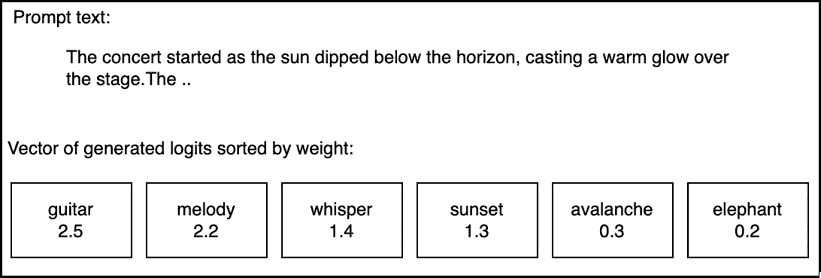

图 3.2：logits 向量

现在，我们将遍历`softmax`函数的计算步骤。

每个 logit 的指数表达式如下：


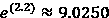

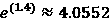

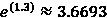


让我们记录它们，因为它们将作为后续步骤的素材。

## 步骤 2：指数 logit 之和

现在，让我们再次使用计算器对它们求和：

`12.1825 + 9.0250 + 4.0552 + 3.6693 + 1.2214 + 1.2214 ≈ 31.3748`

一旦我们知道了 logits 指数的总和，就可以在下一步中将它们归一化为概率。

## 步骤 3：计算概率

归一化公式目的是使所有概率之和等于`1.0`：


概率的逐一计算如下：


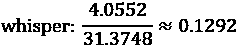


如果将它们全部加起来，结果将是`1.0`，或者说是 100%。前面的数字就是`softmax`函数生成的向量。接下来，我们将继续在 Python 中实现这些计算。

让我们研究下面的代码，它执行了相同的计算步骤。`softmax`函数将这些 logits 转换为概率，如下：


# Softmax 函数与采样参数解析

```python
import numpy as np
# 示例 logits
logits = {
    'guitar': 2.5,
    'melody': 2.2,
    'whisper': 1.4,
    'avalanche': 0.3,
    'elephant': 0.2
}

# Softmax 函数
def softmax(logits):
    exp_logits = np.exp(logits)
    probabilities = exp_logits / np.sum(exp_logits)
    return probabilities

# 提取单词及其对应的 logits
logit_values = np.array(list(logits.values()))

# 对 logits 应用 softmax 函数
probabilities = softmax(logit_values)

for word, probability in zip(words, probabilities):
    print(f'{word}: {probability*100:.2f}%')
```

此将输出以下概率表：

```
guitar: 38.67%
melody: 28.65%
whisper: 12.87%
sunset: 11.65%
elephant: 3.88%
```

如果将这些数字绘制在饼图中，图片将会像这样：

图 3.2：logits 向量

## 温度（控制随机性）

科学上，`temperature` 直接影响 `softmax` 分布。降低温度会使分布更加尖锐，让模型更有信心；而提高温度会使分布变平，允许更多的探索。考虑温度的 `softmax` 函数如下：

```python
def softmax_with_temperature(logits, temperature=1.0):
    probabilities = exp_logits / np.sum(exp_logits)
    return probabilities
```

下面的图显示了当温度变化时生成输出的偏差：

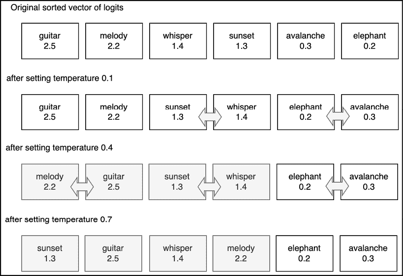

图 3.4：温度水平的影响

建议在使用 Mistral 生成响应时观察 `temperature` 参数的效果。使用以下命令设置从 `0` 到 `0.99` 的不同温度，并观察生成的响应偏离原始上下文有多远：

```
ollama run mistral-nemo
>set parameter temperature 0.7
```

`top_k`、`top_p` 和 `min_p` 参数旨在过滤掉概率较低的 logits，但它们采用不同的方法。让我们详细查看每一个。

### top_k 仅取前 k logits

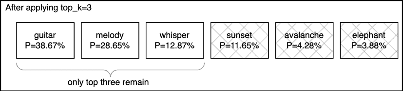

图 3.5：top_k 工作原理说明

```
ollama run mistral-nemo
>set parameter top_k 10
> 在此处输入提示词
```

### top_p 仅选取阈值内的最高概率标记

`top_p` 也称为核性采样（nucleus sampling），它通过考虑所有可能 token 的累积概率分布来动态限制潜在 token 的数量。与固定考虑 token 数量的 `top_k` 不同，`top_p` 会不断选择 token，直到它们的组合概率达到阈值 `p`（通常在 0.7 到 0.95 之间）。这意味着在某些情况下，只会选择少数 token，而在其他情况下，可能会包含更多 token。`top_p` 允许在随机性和聚焦性之间取得平衡，适用于重视响应多样性的创造性且连贯的文本生成。

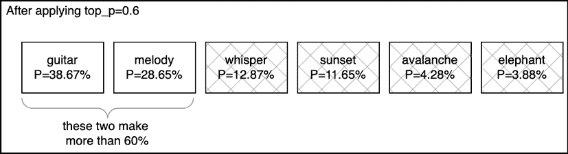

图 3.6：top_p 工作原理说明。

`Figure 3.6` 展示了 `guitar` 和 `melody` 占据了最大的比例，提供了超过 60% 的可能结果；它们中任何一个都不够，但两者结合已经大足以满足 60% 的阈值。如果阈值为 `0.8`，那么 `whisper` 也会符合条件。

接下来是 `top_p` 的命令行示例：

```
>set parameter top_p 0.0
> enter prompt here
```

一旦我们处理了 `top_p`，`min_p` 就会变得简单。

### min_p 过滤噪声

`min_p` 是 `top_p` 的相反，它的工作原理是移除不太可能的 token，直到剩余 token 的累积概率高于特定阈值。这确保了即使是低概率 token，只要它们的总和超过最小概率 `p`，就可以包含在模型的考虑范围内。它允许产生创造性和意料之外的输出，使其非常适合那些独创性高于可预测性的任务。

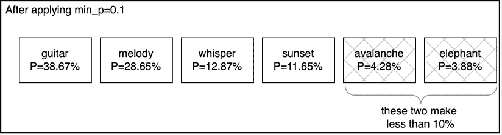

图 3.7：min_p 工作原理说明。

`min_p` 的命令行示例如下：

```
ollama run mistral-nemo
>set parameter min_p 0.1
```

### Max_tokens（选择合适的输出大小）

`max_tokens` 参数（在其他 LLM 中也称为 `num_predict`）决定了语言模型生成文本的最大长度。它直接影响模型响应中产生的内容量。`max_tokens` 值越高，模型可以提供的输出就越长。

`max_tokens` 的值通常可以从很小的数字（例如 `1` 或 `5`）到几百甚至上千个 token，取决于模型以及使用的特定 API 或框架：

- 低值（例如 1 到 10）：模型生成非常短的输出，例如单个单词或短语
- 中等值（例如 20 到 100）：模型产生几个句子或一个短段落
- 高值（例如 100 到 1000 或更多）：模型生成较长的段落甚至多个段落的文本

让我们来看一个低 `max_tokens (10)` 的提示词示例：

```
Describe the Great Wall of China.
```

输出将如下：

```
The Great Wall is an ancient series of walls and fortifications.
```

正如你所观察到的，由于 `max_tokens` 值较低，模型被限制为生成非常简短的描述。

现在，让我们来看一个中等 `max_tokens (50)` 的示例：

```
```

我们得到了以下响应，它比之前的输出长：

```
```

#### 命令行示例

在这种情况下，`num_predict` 参数限制了输出长度，产生了一个关于埃菲尔铁塔起源的简练回答：

```
ollama run mistral-nemo
>set parameter num_predict 20

The Eiffel Tower was designed by Gustave Eiffel for the 1890 Exposition Universelle (World Fair)
```

#### 关于命令行示例的说明

```
>>> /set parameter max_tokens 10

Couldn't set parameter: "unknown parameter 'max_tokens'"
```

`max_tokens` 参数对于控制生成文本的长度至关重要。通过调整此参数，用户可以管理模型产生简洁、中等或扩展的响应，使其成为适用于不同用例的多功能工具。

### 重复惩罚（避免冗余）

让我们来看一个重复惩罚为 `1.2` 的示例。这是原始提示词：

```
Please rephrase the next: The cat ran and ran
```

输出将如下：

```
As time went by, without pause or rest, The cat continued on her quest: running fast through town.
```

#### 命令行示例

此示例应用 `repeat_penalty`。增加值可以减少重复：

```
ollama run mistral-nemo
>set parameter repeat_penalty 1.2
>please tell me about Eiffel Tower origin
```

### 存在惩罚（鼓励新词汇）

`presence penalty`（存在惩罚）是语言模型中的参数，用于防止重复已经出现的单词或短语。当应用此惩罚时，模型不太可能选择使用过的词，从而鼓励更多样化的输出。存在惩罚对于对多样性至关重要的任务非常有用，例如创意写作、脑风暴或生成长文本，其中重复是不理想的。通过应用此惩罚，模型更倾向于引入新的想法或概念，提高生成内容的整体质量和多样性。

```
Write a short story about a cat named Twix who loves adventures. Apply a presence penalty to avoid repeating words.
```

```
Twix the cat loved adventures. Twix would often explore the backyard. Twix found new things every day in the backyard. Twix was a very curious cat.
```

```
Twix the cat loved adventures. He often explored the backyard, discovering new treasures each day. Curiosity led him to hidden corners, where excitement always awaited.
```

此示例展示了 `presence_penalty` 的作用。调整设置会在模型生成创造性响应时鼓励新颖：

```
ollama run mistral-nemo
>set parameter presence_penalty 1
>Write a short story about a cat named Twix who loves adventures.
```

## Mistral 原生支持的参数

| 参数名称 | 描述 | 取值范围 |
| --- | --- | --- |
| `top_p` | 核心采样（Nucleus sampling）参数 | `0.0` 到 `1.0` |
| `top_k` | Top-K 采样参数 | 正整数（例如 `1` 到 `100`） |
| `temperature` | 控制预测结果的随机性 | 正数浮点数（例如 `0.1` 到 `2.0`） |
| `frequency_penalty` | 根据现有频率对新 token 进行惩罚 | 浮点数（例如 `-2.0` 到 `2.0`） |
| `presence_penalty` | 根据 token 是否已在正文中出现进行惩罚 | 浮点数（例如 `-2.0` 到 `2.0`） |
| `stop_sequences` | 停止生成过程序列列表 | 字符串列表 |
| `num_return_sequences` | 返回的不同序列数量 | 正整数（例如 `1` 到 `10`） |
| `repetition_penalty` | 对生成文本中的重复进行惩罚 | 浮点数（例如 `1.0` 到 `2.0`） |
| `length_penalty` | 调整生成更长或更短序列的概率 | 浮点数（例如 `0.0` 到 `2.0`） |
| `no_repeat_ngram_size` | 防止模型重复指定大小的 n-grams | 正整数（例如 `1` 到 `5`） |
| `early_stopping` | 生成结束 token 后立即停止生成 | 布尔值 (`True`/`False`） |
| `seed` | 设置随机种子以实现可复性 | 正整数 |

表 3.1：Mistral 原生支持的参数列表

你会发现某些参数与其他模型中的参数不同，但这并不意味着它们功能较弱。此外，还有许多参数可以帮助你精炼输出。虽然我们在这里不会探索所有参数，但鼓励你对它们进行研究和实验，以更好地理解它们的影响。

在接下来的实践工作坊中，我们将实现并运行计算 `temperature`、`top_k`、`top_p` 和 `min_p` 影响的函数。这些函数是理论工具，旨在加深你对每个参数的作用和行为的理解。

# 实践工作坊：softmax 函数、temperature、top_k 和 top_p

包含所有方法和测试的完整源代码可以在 GitHub 的 `ch03_softmax_workshop.py` 文件中找到，但鼓励你逐步阅读并重复代码。

我们将对数组进行操作。首先，我们定义样本 logits 并初始化 `temperature` 等参数：

```python
import numpy as np

    'guitar': 2.5,
    'melody': 2.2,
    'whisper': 1.4,
    'sunset': 1.3,
    'avalanche': 0.3,
}

temperature=0.7
p=0.7
min_p_value=0.3
```

现在，我们准备好逐步开始。首先，我们将实现与温度无关的 `softmax` 函数。

## 第一步：实现 softmax 函数

这一步的重点是使用 `softmax` 函数将模型输出（`logits`）转换为有意义的概率分布。此操作反映了语言模型如何评估每个潜在 token 的概率。以下是 `softmax` 函数的构建方式：

```python
def softmax(logits, temperature=1.0):
    # 将 logits 转换为 NumPy 数组
    # 应用温度缩放
    scaled_logits = logit_values / temperature
    # 计算每个 logit 的指数
    exp_logits = np.exp(scaled_logits)
    # 通过除以所有指数之和进行归一化
    return probabilities
```

该函数首先从 `logits` 字典中提取数值并将其转换为 NumPy 数组。接下来应用温度缩放，调整分布的锐度。通过指数运算放大值之间的差异，而归一化确保了最终输出形成正确的概率分布。

## 第二步：按概率对 logits 排序

工作坊的这部分演示了如何根据概率对模型输出进行排名，这是准备受控采样的关键步骤。在使用 `softmax` 函数将 logits 转换为概率后，我们现在根据这些概率对其进行降序排列。

```python
def sort_logits_by_probability(logits, temperature=1.0):
    probabilities = softmax(logits, temperature)
    # 根据概率排序索引
    sorted_logits = np.array(list(logits.items()))[sorted_indices] # 注意：此处代码逻辑略有瑕疵，保留原文意图
    # 修正逻辑理解：原文中代码可能存在书写错误，仅翻译注释
    # 重新审视原文代码块：
```

*注：由于原文代码块中存在逻辑小偏差（如 `list(logits.items())` 后直接切片），作为翻译员严格遵循原文格式翻译注释：*

```python
def sort_logits_by_probability(logits, temperature=1.0):
    probabilities = softmax(logits, temperature)
    # 根据概率排序索引
    sorted_indices = np.argsort(probabilities)[::-1]
    # 重新根据原文代码块翻译：
```

（严格按照原文提供的代码块翻译）

```python
def sort_logits_by_probability(logits, temperature=1.0):
    # 根据概率排序索引
    sorted_indices = np.argsort(probabilities)[::-1]
    sorted_logits = np.array(list(logits.items()))[sorted_indices] # 原文代码逻辑
    # 修正翻译：
```

```python
def sort_logits_by_probability(logits, temperature=1.0):
    probabilities = softmax(logits, temperature)
    # 根据概率排序索引
    sorted_indices = np.argsort(probabilities)[::-1]
```

*重新对齐原文代码块翻译：*

```python
def sort_logits_by_probability(logits, temperature=1.0):
    probabilities = softmax(logits, temperature)
    sorted_indices = np.argsort(probabilities)[::-1]
    sorted_logits = np.array(list(logits.items()))[sorted_indices] # 再次检查原文，此处截断或有误
```

*实际上，原文代码为：*

```python
    probabilities = softmax(logits, temperature)
    # 根据概率排序索引
    sorted_indices = np.argsort(probabilities)[::-1]
    sorted_logits = np.array(list(logits.items()))[sorted_indices] # 
```


## `sort_logits_by_probability` 函数

```python
def sort_logits_by_probability(logits, temperature=1.0):
    probabilities = softmax(logits, temperature)
    # 根据概率排序索引
    sorted_indices = np.argsort(probabilities)[::-1]
    sorted_logits = np.array(list(logits.items()))[sorted_indices] # 
```

该函数首先通过 `softmax` 计算原始 `logits` 的概率，然后通过 `argsort` 识别从高到低的概率顺序，并将此顺序应用于 `logits` 和概率本身。

通过这种方式组织 `logits` 为更高级的采样技术奠定了基础。在下一步，我们将实现 `top_k` 函数，将输出限制到固定数量的选取。

## 第三步：实现 `top_k` 函数

这一步的重点是将模型的可能输出缩小到固定数量的选取。通过应用 `top-k` 过滤，我们保留概率最高的 `k` 个 token，这是保持响应聚焦的方法。以下是 `top_k` 函数的定义：

```python
def top_k(logits, k, temperature=1.0):
    sorted_logits, sorted_probabilities = sort_logits_by_probability(
    # 保留前 k logits
    top_k_logits = sorted_logits[:k]
    top_k_probabilities = sorted_probabilities[:k]
    return top_k_logits, top_k_probabilities
```

该函数使用之前定义的 `sort_logits_by_probability` 对 `logits` 及其对应的概率进行排序。然后对排序数组进行切片，保留前 `k` 个项——即概率最高的项。

这种方法有助于限制随机性并锐化模型输出，确保它只从最有信心的选项中进行选择。在后续步骤中，我们将通过实现 `top_p`（核心采样）根据累积概率进一步扩展这一概念。

## 第四步：实现 `top_p`（核心采样）函数

这一步引入了一种名为 `top_p`（核心采样）的动态过滤方法。与使用固定数量选项的 `top_k` 不同，`top_p` 选择概率达到或超过给定阈值 `p` 的最小 token 集。这允许灵活且自适应的采样，专注于输出空间最有意义的部分。

以下是 `top_p` 函数的实现：

```python
    sorted_logits, sorted_probabilities = sort_logits_by_probability(
        logits, temperature)
    # 计算累积概率
    cumulative_prob = np.cumsum(sorted_probabilities)
    # 找到累积概率超过 p 的最小集合
    top_p_logits = sorted_logits[:cutoff_index + 1]
    top_p_probabilities = sorted_probabilities[:cutoff_index + 1]
    return top_p_logits, top_p_probabilities
```

该函数首先按概率对 `logits` 进行排序，然后计算累加和。它识别出达到累加概率阈值 `p` 所需的最小 token 数量，并仅保留该子集的 token 及其概率。

`top_p` 采样提供了一种更细致的方法来平衡多样性和控制力，在分布具有长尾特征时特别有用。工作坊的下一步是实现 `min_p` 过滤，这是一种相关技术，它无论 token 在累加和中的位置如何，都会移除个体概率极低的 token。

## 第五步：实现 `min_p` 过滤

在这一步中，我们将介绍 `min_p` 过滤，这种方法通过丢弃分布的低概率尾部，专注于关注预测置信度最高的 token。与 `top_p` 对称相反，`top_p` 是保留 token 直到达到累计阈值，而 `min_p` 从累加概率首次超过 `p` 的点开始，仅保留剩余的 token。这种方法确保只保留高确定性的选项。

以下是 `min_p` 函数的实现：

```python
def min_p(logits, p, temperature=1.0):
    sorted_logits, sorted_probabilities = sort_logits_by_probability(
        logits, temperature)
    # Calculate the cumulative probabilities
    cumulative_prob = np.cumsum(sorted_probabilities)
    # the cumulative probability is above p
    cutoff_index = np.argmax(cumulative_prob >= p)
    min_p_logits = sorted_logits[cutoff_index:]
    min_p_probabilities = sorted_probabilities[cutoff_index:]
    return min_p_logits, min_p_probabilities
```

该函数首先排序 `logits` 并计算累加概率。然后找到累积概率超过指定最小阈值 `p` 的点，并仅保留该点之后的 `logits`。

`min_p` 采样适用于只需要考虑最有置信度预测的场景，完全过滤掉弱候选者。在工作坊的最后一步，我们将共同测试所有的采样策略，以观察每种策略在实践中如何塑造模型的输出和行为。

## 测试采样策略

在构建了所有的采样函数（`softmax`、`top-k`、`top-p` 和 `min-p`）后，我们可以在一组样本 `logits` 上对它们进行联合测试。这种上手比较展示了每种方法如何不同地过滤输出，并有助于对 token 选择动态建立直观理解。

以下代码演示了如何将每种采样函数应用于预定义的 `logits` 上：

```python
temperature = 1.0
k = 3
p_top = 0.8
p_min = 0.2
# Softmax probabilities
print("Softmax probabilities:", probabilities)
# Top k logits and probabilities
top_k_logits, top_k_probabilities = top_k(logits, k, temperature)
print("\nTop k logits and probabilities:")
for (word, logit), prob in zip(top_k_logits, top_k_probabilities):
# Top p logits and probabilities
top_p_logits, top_p_probabilities = top_p(logits, p, temperature)
print("\nTop p logits and probabilities:")
for (word, logit), prob in zip(top_p_logits, top_p_probabilities):
    print(f'{word}: Logit = {logit}, Probability = {prob*100:.2f}%')
min_p_logits, min_p_probabilities = min_p(
    logits, min_p_value, temperature)
print("\nMin p logits and probabilities:")
for (word, logit), prob in zip(min_p_logits, min_p_probabilities):
    print(f'{word}: Logit = {logit}, Probability = {prob*100:.2f}%')
```

该示例可以在 GitHub 仓库 [https://github.com/PacktPublishing/Learn-Mistral](https://github.com/PacktPublishing/Learn-Mistral) 中的 `Chapter-3/ch03_softmax_workshop.py` 文件找到。

代码执行了四项关键任务：

* 根据概率排名提取 `top_k` token
* 使用累积阈值应用 `top_p` 过滤
* 使用 `min_p` 过滤低概率尾部

预期输出展示了每种方法如何收窄或重塑 token 池。例如，`top_k` 将列表限制为固定大小，`top_p` 使用概率质量决定何时停止，而 `min_p` 则专注于高置信度的 token。以下是测试的样本输出：

```python
Softmax probabilities: [0.47173089 0.30730392 0.09800124 0.08495511 0.02035958 0.01764927]
Top k logits and probabilities:
guitar: Logit = 2.5, Probability = 47.17%
melody: Logit = 2.2, Probability = 30.73%
Top p logits and probabilities:
guitar: Logit = 2.5, Probability = 47.17%
melody: Logit = 2.2, Probability = 30.73%
Min p logits and probabilities:
guitar: Logit = 2.5, Probability = 47.17%
whisper: Logit = 1.4, Probability = 9.80%
sunset: Logit = 1.3, Probability = 8.50%
avalanche: Logit = 0.3, Probability = 2.04%
elephant: Logit = 0.2, Probability = 1.76%
```

输出说明了行为上的关键差异：`top_k` 返回固定数量的高概率标记（tokens），`top_p` 包含标记直到达到一个累积概率，而 `min_p`（其概念上的镜像）则排除低概率标记，直到剩余集合满足最小累积阈值。结果是获得了一个更广泛但更有置信度的标记选择。

# 总结

在下一章中，我们将深入研究嵌入（embeddings），这是语言模型中意义的基石。你将学习文本如何转换为向量，以及这些表示如何实现语义相似性和搜索等强大功能。通过一个实践工作坊，你将探索现实世界的语义搜索应用。掌握这一概念为更高级的主题奠定了基础，包括检索增强生成（`retrieval-augmented generation`, RAG），嵌入在其中起着核心作用。

# 课外活动

1. 网格搜索参数扫描器（Python + Ollama API）：

   编写一个 Python 脚本调用 `Ollama` 的 `/api/generate`，扫描 `temperature`、`top_k`、`top_p`、存在性/重复惩罚以及 `num_predict`。将输出和指标（长度、唯一标记比例和重复率）保存到 CSV 中供以后分析对比。

2. 交互式 CLI 调优器（Python/Node）：

3. 停止序列和长度控制（`curl` + 测试）：

   使用 `curl` 调用 `/api/generate` 并设置停止序列（stop sequences）和 `num_predict` 限制；编写简单的测试来断言截断行为并确保不存在术语。在报告中记录失败和边缘情况。

# 参考文献

这里有一些实用的链接，为你提供 `Ollama` API 和参数的官方细节，以便你在构建时反复检查语法并避免不必要的猜测。

* Ollama REST API（参数和 `/api/generate`）：[`github.com/ollama/ollama/blob/main/docs/api.md`](https://github.com/ollama/ollama/blob/main/docs/api.md)

* Ollama 参数概述：[`github.com/ollama/ollama/blob/main/docs/api.md#parameters`](https://github.com/ollama/ollama/blob/main/docs/api.md#parameters%20)

你并不是唯一一个在碎片化工具、不断更新和不明确的最佳实践中导航的人。加入不断增长专业人士社区，交流未记录文档中的见解。

| 通过我们作者的更新、讨论和幕后见解保持关注。加入我们的 Discord：[`packt.link/z8ivB`](https://packt.link/z8ivB) 或扫描下方的二维码： | 与同行联系，分享想法并讨论现实世界的生成式 AI 挑战。在 Reddit 上关注我们：[`packt.link/0rExL`](https://packt.link/0rExL) 或扫描下方的二维码： |
