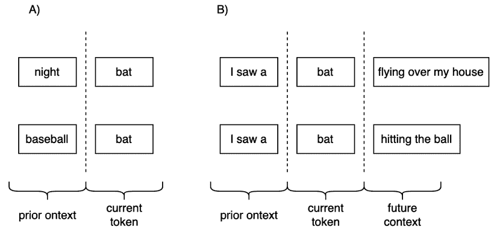
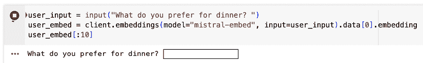
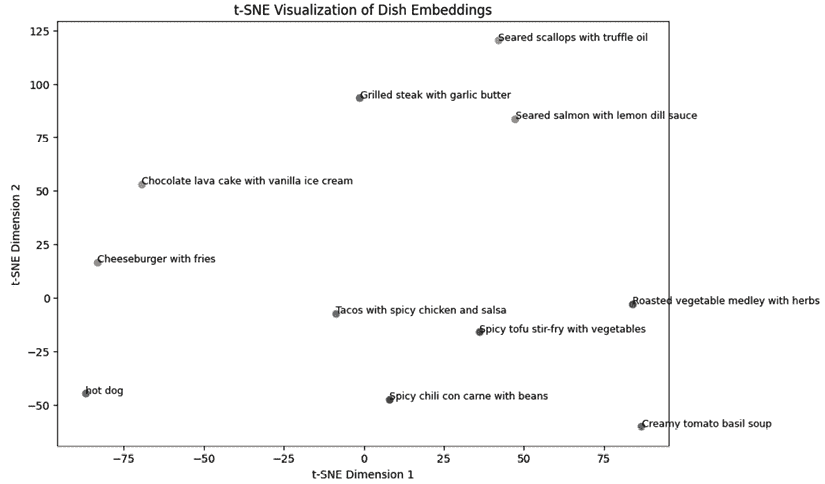

# 精通嵌入

> 你将通过一个词所处的伙伴来认识它。

人类使用单词运行，计算机使用数字运行。AI 网络通过嵌入、逻辑回归值（logits）、数字标记和浮点权重运行。想象你正在策划一个派对，需要以让每个人都开心的方式安排客人。你有一些喜欢跳舞的朋友，有些喜欢深谈，还有几个是吃客。你如何确保每个小组都能得到他们想要的？这就是向量嵌入（vector embeddings）魔法所在，但我们处理的不是客人，而是单词、短语甚至是更大的段落。

在本章中，我们将获得向量嵌入的实践经验。你将学习如何使用向量在易理解的多维空间中表示复杂数据，使 AI 变得更智能、更高效。我们将使用 `SciPy` 和 `NumPy` 等强大的 Python 库来请求和使用这些嵌入。此外，你将学习如何将语义相似性转换为定量值并搜索意义。我们将涵盖向量的概念以及它们如何表示语言，通过使用 `Mistral` 的实践工作坊，并探索可视化。简而言之，我们将涵盖内容：

* 嵌入可视化
* 实践工作坊：使用 `Mistral` 和 `Pinecone` 进行语义搜索
* 应用与实践练习

# 技术要求

本章介绍了嵌入的实际概念。为了确保体验顺利，请准备以下环境：

* 基础 Python 编码技能（例如处理列表、字典）
* 一个 `Mistral` API 密钥（用于访问端点）
* 一个 `Pinecone` API 密钥（用于数据库操作）

实践工作坊支持任何主流系统（Mac, Windows, Linux）。本章材料位于 `Chapter-4` 文件夹：[`github.com/PacktPublishing/Learn-Mistral`](https://github.com/PacktPublishing/Learn-Mistral)

在编码之前，理解向量的概念是非常重要的——这是机器表示意义的基础。

向量是数据作为数字数组的数学表示，捕捉了多维空间中的幅度和方向。这听起来起初很抽象，让我们用熟悉的例子来引入。回到我们的派对类比。

让我们从一个简单的 2D 空间开始。在一个轴上，我们衡量某对跳舞的热爱程度，在另一个轴上，衡量他们有多喜欢聊天。每个朋友可以表示此空间中的一个点。所以，你那个喜欢跳舞但不善于聊天的朋友可能在 `(9, 2)`，而你那个话多但不爱跳舞的朋友可能在 `(3, 8)`：

2D 表示有助于你看到在兴趣方面谁和谁更近。如果两个朋友在舞池上很近，他们可能有相似的偏好，并且会玩得很开心。

现在让我们增加难度。在现实数据中，我们很少停留在两个维度。想象一个拥有几十个维度的派对，偏好包括音乐流派、食物选择、对话话题等。在这种情况下，每个偏好为我们的空间增加了一个新维度。


`set1 = ["apple", "banana", "cherry", "date", "elderberry", "fig", "grape", "honeydew", "kiwi", "lemon"]`

与此之下，第二组单词是随机的：

`set2 = ["bolt", "cloud", "delta", "echo", "flare", "gamma", "horizon", "iceberg", "jet", "kinetic"]`

下图显示了热力图。请注意，“apple”和“cloud”具有很强的相关性，而“elderberry”与任何单词几乎没有共同点：

**图 4.6：语义相似性热图可视化**

热力图的主要特征如下：

- **模式识别**：有助于识别数据内部相似和不相似的模式
- **对比分析**：便于简要比较多个嵌入

通过使用热力图，你将能够直观地评估哪些嵌入最相似，从而增强你理解数据内部关系的能力。

我们已经涵盖了一些关于向量的数学概念。现在是开始实战工作坊，并将我们的知识和编码能力应用于实践、尝试真实的 LLM 嵌入并计算语义相似性了。

# 实战工作坊：使用 Mistral 和 Pinecone 构建语义搜索系统

在此过程中，你将看到我们涵盖的概念（向量表示、相似性量和可视化）如何转化为可运行的代码。到结束时，你将拥有一个功能完备的语义搜索原型，并将其应用于自己的 AI 驱动项目中的技巧。

## 第 1 步：环境设置

### 克隆工作坊仓库

要访问本章使用的源文件，请开始克隆官方 GitHub 仓库：[`github.com/PacktPublishing/Learn-Mistral`](https://github.com/PacktPublishing/Learn-Mistral)。

```bash
git clone https://github.com/PacktPublishing/Learn-Mistral.git
```

接下来，我们将打开`Google Colab`，直接在云端笔记本环境中开始工作。

### 打开 Google Colab

要开始，请访问 [`colab.research.google.com/`](https://colab.research.google.com/) 打开`Google Colab`。你可以创建一个新笔记本，或者上传克隆的 GitHub 仓库中`Chapter-4`文件夹下提供的笔记本。

在整个工作坊中，我们将使用`Colab`运行代码示例、管理 API 密钥并与`Mistral`和`Pinecone`等服务交互。

对于涉及嵌入的练习，我们建议使用`Google Colab`提供的 GPU 运行时。利用`GPU`可以显著加快计算，使体验更加流畅且高效。

要在`Google Colab`中启用`GPU`，请执行以下操作：

1. 进入菜单并选择**运行时 (Runtime)** | **更改运行时类型 (Change runtime type)**。
2. 在弹出的窗口中，从**硬件加速器 (Hardware accelerator)** 下拉菜单中选择 **T4 GPU**。下图展示了运行时选择的硬件选项：


3. 点击**保存 (Save)**。

### 上传草稿笔记本

通过遵循笔记本，你将能够对电影描述运行嵌入，使用`cosine similarity`（余弦相似度）比较向量，并使用 t-SNE 和热力图等各种技术可视化结果。

## 第 2 步：初始化 Mistral AI 客户端

### 安装 mistralai 包

在你新建笔记本的第一个单元格中，输入以下命令来安装所需的库：

```
!pip install mistralai
```

点击**播放**按钮执行该命令。这将安装 Mistral AI 库，我们在整个练习都会使用它。最后的成功消息确认了安装完成：

```
Successfully installed eval-type-backport-0.2 jsonpath-python-1.0.6 mistralai-1.5.1 mypy-extensions-1.0.0 typing-inspect-0.9
```

现在 Mistral AI 库已安装，让我们开始初始化客户端。

作为测试，我们将检索并显示库提供的所有模型。我们将确保每个模型都换行打印，以便于阅读。

```python
from mistralai import Mistral
# 实例化 Mistral 以创建一个客户端对象
client = Mistral()

# 使用客户端对象列出所有可用模型
models = client.models.list()
## 遍历模型列表并打印每个模型
for model in models.data:
    print(model.id)
```

1. 导入`Mistral`客户端类：

```python
from mistralai import Mistral
```

2. 实例化`Mistral`客户端：

```python
client = Mistral()
```

3. 列出可用模型：

```python
models = client.models.list()
```

4. 换行打印每个模型：

```python
for model in models:
    print(model)
```

最后，我们使用`for`循环遍历`models`列表并`print`每个模型。这确保每个模型都单独行显示，便于阅读。

输出将包含一个错误，这是预期之中的：

```
```

### 设置 Mistral API 密钥

开始之前，请访问 [`console.mistral.ai/api-keys`](https://console.mistral.ai/api-keys) 生成你的 API 密钥。如果你尚未登录，系统会提示你登录或创建账户。一旦 API 密钥准备就绪，返回 Colab 笔记本继续。

然后，按照以下步骤在 Google Colab 中设置 API 密钥：

1. 在左侧边栏中找到并点击标题为`Secrets`的密钥图标。
2. 点击`+ Add new secret`（添加新密钥）。
3. 在`Value`字段中，粘贴真实的 Mistral API 密钥。
4. 要允许访问，点击密钥旁边的三个点菜单并勾选`Notebook access`（笔记本访问）。

下图展示了在 Google Colab 界面中设置和管理密钥的过程。

**图 4.8：Google Colab 密钥管理器**

在本章后面，我们将以完全相同的方式配置和使用 Pinecone API 密钥。请确保你熟悉这种方法——它将成为一种模式。你现在也可以配置`PINECONE_API_KEY`。

```python
from google.colab import userdata

from mistral import MistralClient
api_key = userdata.get("MISTRAL_API_KEY")

client = MistralClient(api_key)
```

```python
models = client.models.list()

## 遍历模型列表并打印每个模型
for model in models.data:
    print(model.id)
```

预期的输出如下：

```
ministral-3b-2410 ministral-3b-latest ministral-8b-2410 ministral-8b-latest open-mistral-7b mistral-tiny mistral-tiny-2312 open-mistral-nemo open-mistral-nemo-2407 mistral-tiny-2407 mistral-tiny-latest open-mixtral-8x7b mistral-small mistral-small-2312 open-mixtral-8x22b open-mixtral-8x22b-2404 mistral-small-2402 mistral-small-2409 mistral-medium-2312 mistral-large-2402 mistral-large-2407 mistral-large-2411 mistral-large-latest pixtral-large-2411 pixtral-large-latest mistral-large-pixtral-2411 codestral-2405 codestral-2501 codestral-latest codestral-2412 codestral-2411-rc5 devstral-small-2505 devstral-small-latest codestral-mamba-2407 open-codestral-mamba codestral-mamba-latest pixtral-12b-2409 pixtral-12b pixtral-12b-latest mistral-small-2501 mistral-small-2503 mistral-small-latest mistral-saba-2502 mistral-saba-latest mistral-medium-2505 mistral-medium-latest mistral-medium mistral-embed mistral-moderation-2411 mistral-moderation-latest mistral-ocr-2503 mistral-ocr-2505 mistral-ocr-latest
```

对于我们的目的，我们将使用`mistral-embed`模型。现在工具已经准备绪，我们将转向生成驱动语义搜索和理解的嵌入（embeddings）。

### 第三步：生成嵌入

让我们从获取一个任意静态字符串的嵌入开始。我们将使用 Mistral AI 模型生成嵌入并检查响应结构。这将帮助我们理解嵌入是如何表示的，以及如何处理它们。

#### 为单行生成嵌入

让我们逐行分析并学习代码。我们将获取一个示例句子的嵌入，清理响应，并打印嵌入数组的前几个元素以及其长度。

在第一行中，我们提供了示例句子并分配一个变量：

```python
sample_sentence = "这是一横测试句子。"
```

然后我们定义了一个想要获取嵌入的示例句子。

要获取示例句子的嵌入，请使用以下代码：

```python
sample_embed=client.embeddings.create(
    model='mistral-embed', input=[sample_sentence])
```

以下代码从结构化负载中提取所需的部分：嵌入数组：

```python
clean_sample_embed = sample_embed.data[0].embedding
```

下一行打印嵌入数组的长度：

```python
print(len(clean_sample_embed))
```

前一行代码产生了以下输出：

```
1024
```

我们打印了嵌入数组的长度。对于来自同一模型的所有响应，该长度是一致的，无论我们发送了多少单词（标记）——一个单词还一段文本。

下一行打印嵌入数组的前几个元素：

```python
print(clean_sample_embed[:10])
```

在这里，我们打印了嵌入数组的前 10 个数字以检查数值。

```
[-0.032470703125, -0.002910614013671875, 0.06439208984375, 0.020599365234375, 0.00814056396484375, 0.021026611328125, 0.0465087890625, -0.003429412841796875, -0.022308349609375, -0.05792236328125]
```

### 上下文分析

上下文是理解句子中单词含义的关键元素，对于 Mistral 来说也是如此。在 Mistral 嵌入（embeddings）的语境下，它指的是目标词周围的词。这些周围词提供了关于目标词含义和用法的价值信息。例如，“bank”一词可以根据其上下文有不同的含义，如金融机构或河岸。



**图 4.9：先验和未来上下文**

正如我们在`Figure 4.9`中所示，在部分`A`中，之前的上下文是不同的，根据这些之前的词，可以清楚地判断它是球棒（bat）还是蝙蝠（bat）。在部分`B`中，之前的上下文是相同的，只有通过未来上下文才能确定它是哪种“bat”。在下一节中，我们将回顾先验上下文的作用。

#### 之前的词在 Mistral 中的作用

在收集嵌入时，Mistral 会考虑之前的词，以帮助理解句子的结构和构建。这在具有强大语法规则的语言中尤为重要，因为词序会显著影响句子的含义。

在先验上下文分析中，只考虑位于目标词之前的词。这意味着一个词的嵌入完全受句子中前面词的影响。考虑`Figure 4.9`的部分`A`：“night bat”（夜蝙蝠）对比“baseball bat”（棒球棒）。

在`night bat`的情况下，这里单词“bat”紧跟在“night”之后：

- 使用先验上下文的模型将为“bat”生成的嵌入将受到“night”的影响。
- 由于“night”与夜行动物相关，“bat”的嵌入可能会反映与动物（会飞的哺乳类动物）相关的含义。
- 单词“bat”紧跟在“baseball”之后。
- 使用先验上下文的模型将为“bat”生成的嵌入将受到“baseball”的影响。

由于“baseball”与运动器材相关，“bat”的嵌入可能会反映与物体（运动器材）相关的含义。在这两种情况下，“bat”的含义都源于先前的词，导致在每种上下文中“bat”生成了不同的嵌入。

#### Mistral 对未来邻近词的考虑

除了之前的词之外，Mistral 在收集嵌入时还会考虑未来邻近词（位于目标词之后的词）。这是因为它们可以提供额外的上下文，帮助消除目标词含义的歧义。

让我们看看`Figure 4.9`的部分`B`：“I saw a bat flying over my house”（我看到一只蝙蝠飞过我家）对比“I saw a bat hitting the ball”（我看到击击球）。

在`I saw a bat flying over my house`的情况下，适用以下规则：

- 目标词“bat”同时受到前面的词（“I saw a”）和后面的词（“flying over my house”）的影响。
- 双向模型生成的“bat”嵌入将考虑完整的上下文，识别“flying”和“house”表示动物（会飞的哺乳类动物）。
- 目标词“bat”同时受到前面的词（“I saw a”）和后面的词（“hitting the ball”）的影响。
- 双向模型生成的“bat”嵌入将考虑完整的上下文，识别“hitting”和“ball”表示运动器材（棒球中使用的球棒）。

通过处理整个句子，`bidirectional`模型可以从周围的上下文准确确定单词“bat”的预期含义。

正如我们所见，上下文在 Mistral 的嵌入收集过程中起着至关重要的作用。之前的词和未来邻近词都提供了有助于确定目标词含义的价值信息。Mistral 的双向方法使其能够对语言有更全面的理解。

现在我们已经拆解了 Mistral 如何同时利用先验和未来上下文来构建嵌入，现在是将这些理解付诸实践了。在下一步中，我们将看到如何比较嵌入，根据语义相似性将用户输入与相关项进行匹配。

## 第 4 ：嵌入比较

重申一下，我们将通过实践的方法来理解如何使用嵌入将用户查询与相关项进行匹配。具体而言，我们将开始为一组短小的菜肴描述及其成分生成嵌入。这将帮助我们看到不同的菜肴及其组件在嵌入空间中是如何被表示的。然后，我们将准备一种让用户输入他们的口味兴趣的方法，例如对某种食物的渴望或感兴趣特定成分。使用嵌入，我们将通过计算嵌入之间的余弦距离（cosine distance）来比较用户的输入与菜肴描述。与用户输入余弦距离最短的菜肴将是最相关的匹配项。

余弦距离帮助我们衡量用户兴趣与可用菜肴之间的相似性。距离越小，菜肴与用户寻找的内容越相似。这种方法利用嵌入的力量来有效地理解和匹配复杂的文本描述。准备好探索嵌入如何个性化推荐，并提供 AI 在日常场景中的实际应用！

让我们从初始化菜肴描述数组并为它们生成所有嵌入开始。

```python
dish_descriptions = [
    "Grilled steak with garlic butter",       # 肉
    "Seared salmon with lemon dill sauce",    # 鱼
    "Roasted vegetable medley with herbs",    # 蔬菜
    "Tacos with spicy chicken and salsa",     # 墨西哥
    "Spicy chili con carne with beans",       # 辣
    "Chocolate lava cake with vanilla cream",  # 甜
    "Creamy tomato soup",                   # 液体
    "Cheeseburger with fries",                # 快餐
]
dish_embeds = client.embeddings.create(inputs=dish_descriptions)
dish_embeds_arr = []
for embed in dish_embeds.data:
    dish_embeds_arr.append(embed.embedding)
print(len(dish_embeds_arr[0]))
```

代码产生了以下输出：

```
10
1024
```


每个菜肴的嵌入都存储在一个大小为`10`的数组中，每个元素是一个大小为`1024`的浮点数数组。嵌入的顺序与`dish_descriptions`字符串数组对应。

## 读取输入用于语义比较

现在我们有了菜肴的嵌入，下一步是获取用户的偏好。我们将提示用户输入想吃什么，并使用相同的模型为他们的输入生成嵌入。这将允许我们将用户的偏好与预定义的描述进行比较并找到最相关的匹配。

为了实现，我们将使用以下代码：

```python
user_input = input("What do you prefer for dinner? ")
user_embed = client.embeddings.create(
    model='mistral-embed', inputs=[user_input]).data[0].embedding
print(user_embed[:10])
```

`Figure 4.10` 显示了输入框。输入的值将被赋值给变量`user_input`：



输入后，代码将继续执行并产生输出：

```
What do you prefer for dinner? pizza
```

这段代码段将提示用户输入他们的晚餐偏好，为输入生成嵌入（embedding），并显示嵌入数组的前几个元素。这个过程帮助我们理解用户的偏好如何在嵌入空间中表示，为将这些偏好与我们的菜谱描述进行比较以找到最匹配的选项奠定基础。

## 步骤 5：用户输入与现有选项的语义匹配

首先，我们需要导入所需的库：

```python
from scipy.spatial.distance import cosine
```

`scipy.spatial.distance`模块提供了`cosine`函数，它可以计算两个向量之间的余弦距离。余弦距离衡量的是不相似性，其中值为`0`表示向量相同，值为`1`表示向量完全不同。通过从`1`中减去余弦距离，我们可以将其转换为相似性度量，值越高表示相似性越高。

以下是将用户嵌入与菜谱描述中的第一个项目进行比较的代码段：

```python
# 将用户嵌入与菜谱描述的嵌入比较
similarity_score = 1 - cosine(user_embed, dish_embeds_arr[0])
print(similarity_score)
```

```
0.6589278106354763
```

### 计算到所有可用嵌入的距离

现在我们已经知道如何比较一对嵌入了，让我们扩展比较范围以包含所有的菜谱描述。为了实现这一点，我们将使用来自`scipy.spatial.distance`模块的`cdist`函数，它可以计算两组向量之间的两两对距离。这允许我们一次性高效地计算用户嵌入与所有菜谱嵌入之间的余弦距离。

```python
from scipy.spatial.distance import cdist
distances = cdist(user_embed, dish_embeds_arr, "cosine")
```

代码给出了以下输出：

```
--------------------_----------------------------------------------------
ValueError                              Traceback (most recent call)
<ipython-input-23-0b415054d20a> in <cell line:3>()
      1 from scipy.spatial.distance import cdist
----> 3 distances = cdist(user_embed, dish_embeds_arr, "cosine")
/usr/local/lib/python3.10/dist-packages/scipy/spatial/distance.py in cdist(XA, XB, metric, out, **kwargs)
   2980
   2981     if len(s) != 2:
-> 2982         raise ValueError('XA must be a 2-dimensional array.')
   2984         raise ValueError('XB must be a 2-dimensional array.')
```

然而，这段代码导致了：`ValueError: XA must be a 2-dimensional array.`。

```python
# 重塑为 1N 数组
user_embed_reshaped = user_embed.reshape(1, -1)
distances = cdist(user_embed_reshaped, dish_embeds_arr, "cosine")
```

这会将用户的嵌入重塑为`1x1024`（假设嵌入大小为`1024`），使其与二维嵌入数组兼容。

### 寻找最相关的菜肴

```python
import numpy as np
# 找到最相关菜肴的索引
most_relevant_index = np.argmin(distances)
```

要找到数组中项目最相关的索引，可以使用`argmin`方法：

```python
most_relevant_index = np.argmin(distances)
```

### 显示最相关的语义匹配

找到最相关的索引只是完成了一半。让我们显示匹配的菜肴，让结果对用户一目了然。

```python
print(f"Based on your preference,)
print(f"you might find tasty: {dish_descriptions[most_relevant_index]}")
```

此行打印`most_relevant_index`处的菜肴描述，为用户提供最符合其输入的菜肴。

以下是定位最接近项目的完整代码：

```python
from scipy.spatial.distance import cosine, cdist
import numpy as np

distances = cdist(

# 最相关电影的索引 
mostRelevant = np.argmin(distances)
print(f"most relevant index: {mostRelevant}")
print(f"Then you might find tasty: {dish_descriptions[mostRelevant]}")
```

对于用户输入的值“hot dog”，该代码产生了以下输出：

```
most relevant index: 8
```

通过重塑用户的嵌入（embedding）、计算距离并识别最相关的菜肴，我们有效地将用户的偏好与我们数据集中最合适的菜肴描述匹配在了一起。

现在我们完成了一个闭环：从用户的纯文本偏好到从我们的数据集中提取语义匹配。这结束了单次查询匹配的闭环，并为我们在进一步扩展之前回顾整个过程做好了准备。

## 演示回顾

在这个端到端的演示中，我们初始化了`Mistral AI`客户端，捕获了用户的晚餐偏好（“热狗”），并生成了一个表示其语义含义的嵌入。随后，我们为几个预定义的菜肴准备了嵌入，并计算了用户输入与每个选项之间的余弦距离。通过识别最小距离，我们找到了最接近的语义匹配——“芝士汉堡”，这展示了 AI 如何意义地解释语言。结果不仅反映了关键词的相似性，还反映了共同的上下文和特征。此演示展示了如何使用嵌入和相似性量在实时应用中提供智能的感知推荐。

主要的端到端演示到此结束！让我们探索一些加分练习，以扩展和扩展我们所构建的内容。我们将从学习如何使用专用向量数据库`Pinecone`来扩展此系统开始。

## 加分练习：使用 Pinecone DB 进行语义搜索

在这个加分练习中，我们将探索如何使用`Pinecone DB`高效地管理和查询嵌入。`Pinecone`是一个强大的向量数据库，旨在处理高维向量数据，是存储和查询嵌入的理想选择。在本节中，我们将首先设置并初始化`Pinecone`客户端以与`Pinecone DB`服务交互。接下来，我们将在`Pinecone`中创建一个索引来存储我们的嵌入。索引类似于关系型数据库中的表，对于组织和查询数据至关重要。创建索引后，我们将嵌入插入到`Pinecone`索引中，将菜肴描述的向量表示上传到数据库。然后，我们将演示如何运行查询以寻找最近邻嵌入，帮助我们根据用户的输入识别最相关的项目。最后，我们将尝试`Pinecone`中提供的其他接近性算法（例如欧几里得距离和点积相似性），以查看它们如何影响结果。练习结束时，你将牢固地理解如何利用`Pinecone DB`管理和查询嵌入，并获得使用不同接近性算法的实战经验，以优化你的搜索能力。

要开始使用`Pinecone DB`，首先需要安装`Pinecone`客户端库。以下命令将从`Python Package Index`（`PyPI`）下载并安装必要的包。该库提供了与`Pinecone`向量数据库交互所需的工具和函数，使我们能够高效地创建索引、插入嵌入并运行查询。

### 初始化 Pinecone 客户端

我们将在当前的 colab 中使用`pip`包管理器安装`Pinecone`客户端：

```python
!pip install pinecone
```

我们的下一个目标是初始化`Pinecone`客户端。这涉及设置 API 密钥并配置客户端与`Pinecone`服务交互。

首先，导入`pinecone`库：

```python
import pinecone
```

接下来，为了与`Pinecone`服务进行身份验证，你需要使用之前处理`MISTRAL_API_KEY`时相同的方法提供你的`Pinecone` API 密钥。

假设你已经在 Google Colab Secret Manager 中添加了密钥并使其对笔记本可用，可以使用以下方式访问：

```python
from pinecone import Pinecone, ServerlessSpec

api_key = userdata.get("PINONE_API_KEY")
pcone = Pinecone(api_key=api_key)
```

此代码安全地检索你的 API 密钥并初始化`Pinecone`客户端。`Pinecone`类用于与`Pinecone`向量数据库交互，而`ServerlessSpec`允许需要指定无服务器配置。

我们的`Pinecone`客户端已准备就绪。接下来，我们将创建一个新的索引来存储嵌入。

### 创建 Pinecone 索引

在存储和查询菜肴嵌入之前，我们需要确保`Pinecone`索引处于整洁且已知的状态。与其更新现有记录，不如删除任何同名的之前的索引并从头开始创建。

这种方法更快，并且避免了不必要的索引增长，如果你计划多次重复此练习时特别有用。

```python
existing_index_names = [index.name for index in existing_indexes]

# 如果索引已存在，则删除
if 'dish-embeddings' in existing_index_names:
    pcone.delete_index('dish-embeddings')
### 创建新索引
pcone.create_index(
    name='dish-embeddings',
    dimension=1024,
    metric='cosine',
)
```

此代码首先列出你`Pinecone`项目中的所有现有索引。如果找到`'dish-embeddings'`，则将其删除以确保我们不会积累过时或重复的数据。重新创建索引比更新现有记录更快，而且对于相同工作流的重复运行非常理想。

一旦索引创建并配置完成，我们就可以向其填充数据了。下一步是插入我们之前为每个菜肴生成的嵌入。这将允许`Pinecone`在过程的后期存储并组织它们以进行快速相似性搜索。

### 将嵌入写入 Pinecone

```python
index = pcone.Index('dish-embeddings')
for i, embed in enumerate(dish_embeds_arr):
    index.upsert([(f'dish_{i}', embed)])
```

此代码获取我们之前创建的名为`dish-embeddings`的索引。通过名称引用索引，我们可以执行各种操作，如插入、查询和删除记录。

循环将每个嵌入插入索引。以下行遍历`dish_embeds_arr`列表，其中`i`是嵌入的索引，`embed`是嵌入向量本身。

```python
for i, embed in enumerate(dish_embeds_arr):
```

`index.upsert([(f'dish_{i}', embed)])`方法用于在索引中插入或更新记录。该方法接受一个元组列表，每个元组包含一个 ID 和对应的嵌入向量。在这种情况下，我们使用`f'dish_{i}'`为每个嵌入向量创建一个唯一 ID（例如`'dish_0'`、`'dish_1'`等），而`embed`是实际的嵌入向量。

`upsert`方法用于插入或更新记录。如果已经存在相同 ID 的记录，它将用新的嵌入向量对其进行更新。如果不存在，将创建一个新记录。为了提高效率，特别是在处理大量嵌入向量时，请考虑对`upsert`操作进行批处理。这涉及到将多个嵌入向量分组到单个`upsert`调用中，以减少对服务器的请求次数。

通过查找索引并使用`upsert`方法，我们可以将菜肴嵌入向量插入 Pinecone 索引中。这种设置允许我们高效地管理和查询高维向量数据。

当所有菜肴嵌入向量都成功插入索引后，我们现在准备好执行该系统的构建初衷——语义搜索。在下一步，我们将获取用户查询，将其转换为嵌入向量，并搜索 Pinecone 索引以找到语义上最相似的菜肴。这就是向量搜索展现其真实威力的地方。

### 寻找最匹配项

要找到与用户偏好最匹配的菜肴，我们使用以下代码在 Pinecone 索引中搜索最近的向量：

```python
result = index.query(vector=[user_embed], top_k=1)
closest_dish_id = result['matches'][0]['id']
closest_dish_index = int(closest_dish_id.split('_')[1])
print(closest_dish_index)
print(dish_descriptions[closest_dish_index])
```

这段代码执行了以下操作：

*  首先，我们查询 Pinecone 索引以找到与用户嵌入向量最近的向量。`result = index.query(vector=[user_embed], top_k=1)`这一行使用用户的嵌入（`user_embed`）向索引发送查询。`vector=[user_embed]`参数指定了我们用于查询的嵌入，而`top_k=1`表示我们想要单个最接近的匹配项（即最近邻居）。

*  接下来，我们从查询结果中提取最匹配项的 ID 并将其转换为索引。该 ID 是像`'dish_8'`这样的字符串；我们对其进行拆分以数字 8，然后使用该数字从列表中检索匹配的菜肴。

*  最后，我们打印最匹配的索引，然后使用该索引从菜肴列表中检索并显示其描述。

代码输出了以下内容：

```
8
Cheeseburger with fries
```

输出显示项目 8 “Cheeseburger with fries”（薯条芝士堡）是与用户输入“hot dog”（热狗）最接近的语义匹配项。这一结果反映了嵌入向量是如何捕捉上下文相似性的——两种菜肴都是经典的快餐，具有相似的配料和场景，使得它们在向量空间中密切相关。

随着我们继续加深对嵌入的理解，我们将转向这些高维表示的可视化。接下来，你将探索热力图和 t-SNE 图等实用技术，以便以更直观、人类可读的形式更好地解释和比较向量之间的关系。

### 额外练习：带热力图可视化的语义相似性

为了可视化两个句子中单词之间的语义相似性，我们将为每个单词生成嵌入，然后计算这些嵌入之间的余弦相似度。我们将使用这些相似性评分创建一个热力图，帮助我们理解单词之间的关系。

首先，我们定义句子以及其中的单词。然后，我们使用 Mistral 模型为每个单词生成嵌入。获取嵌入后，我们对其进行清理并准备用于进一步处理的数组。

我们计算两个句子中每对单词之间的余弦相似度。最后，我们使用相似性评分创建并显示热力图，提供单词之间语义相似性的视觉化表示。

本节省略了逐行描述，因为假设你到这里已经熟悉了大部分代码。


```python
import numpy as np
import seaborn as sns
import matplotlib.pyplot as plt
from sklearn.metrics.pairwise import cosine_similarity
```

### 定义句子和单词

```python
sentence1 = ["I", "enjoy", "spicy", "food"]
sentence2 = ["She", "likes", "hot", "meals"]
```

# 为每个单词生成嵌入

```python
embeddings1 = client.embeddings.create(
    model='mistral-embed', inputs=sentence1)
embeddings2 = client.embeddings.create(
    model='mistral-embed', inputs=sentence2)
```

# 清理嵌入数组

```python
embeddings1_arr = []
embeddings2_arr = []

for embed in embeddings1.data:
    embeddings1_arr.append(embed.embedding)
for embed in embeddings2.data:
    embeddings2_arr.append(embed.embedding)
```

# 计算每对单词之间的余弦相似度

```python
similarity_scores = cosine_similarity(embeddings2_arr, embeddings1_arr)
```

### 创建热力图

```python
plt.figure(figsize=(8, 6))
sns.heatmap(
    similarity_scores, annot=True, cmap='Blues', 
    xticklabels=sentence1, yticklabels=sentence2
)
```

### 设置标题和标签

```python
plt.title('Semantic Similarity Heatmap')
plt.xlabel('Words in Sentence 1')
plt.ylabel('Words in Sentence 2')
```

# 显示热力图

```python
plt.show()
```

`tsne_results = tsne.fit_transform(dish_embeds_np_arr)`

* `perplexity=5` 控制 t-SNE 如何平衡局部结构与全局结构
* `random_state=42` 确保结果的可重复性
* `fit_transform()` 执行实际的降维，为每个嵌入（embedding）生成一个 2D 坐标

最后，我们绘制 2D 投影图：

```python
plt.figure(figsize=(10, 7))

for i, label in enumerate(dish_descriptions):
    x, y = tsne_results[i, :]
    plt.scatter(x, y)
    plt.text(x + 0.1, y + 0.1, label, fontsize=9)
plt.title('t-SNE Visualization of Dish Embeddings')
plt.xlabel('t-SNE Dimension 1')
plt.ylabel('t-SNE Dimension 2')
plt.show()
```

代码段遍历每个菜肴描述及其对应的 2D 坐标，然后为每个嵌入（embedding）绘制一个点（散点图），并在点略微偏移处叠加文本标签。最后，它标记了轴线并显示带有描述性标题的图表。图表已准备就绪！

可视化代码的输出显示在以下生成的图中：



图 4.12: t-SNE 可视化代码输出

**快速提示**：需要查看此图像的高分辨率版本吗？请在下一代 Packt Reader 中打开此书，或在 PDF/ePub 版本中查看。

购买此书时将免费赠送**下一代 Packt Reader**。扫描 QR 码或访问 [`packtpub.com/unlock`](https://packtpub.com/unlock)，然后使用搜索栏通过名称查找此书。双检显示的版本以确保您获得正确的版本。


正如我们所看到的，`Cheeseburger`（芝士汉堡）离 `hot dog`（热狗）最近。我们带着良好的视觉结果和丰富的知识达到了工作坊的结尾。

## 工作坊完成！

你现在已经完成了工作坊的所有核心步骤——做得好。从初始化 `Mistral` 和 `Pinecone` 客户端到生成、存储和查询嵌入，你已经使用现代向量的 AI 工具构建了一个功能完备的语义搜索系统。在此过程中，你处理了用户输入处理、向量相似性匹配，甚至探索了如何使用向量数据库扩展系统。这段实践性旅程让你既掌握了技术工作流，又理解了嵌入在实际应用中背后的概念。

但这仅仅是一个开始。接下来，我们将探索这些概念如何应用于真实世界的场景中，从推荐系统到文档搜索，并引导你完成一些实性练习，这些练习将挑战你把所学知识从受控示例扩展到具有实际意义的应用中。

# 嵌入的应用与实战练习

现在你已经掌握了生成和查询嵌入的机制，是时候将这些技能应用于真实世界的问题了。在本节中，我们将探索实际的用例，例如语义文档搜索、个性化推荐和 FAQ 匹配，在这些领域中嵌入增加了切实的价值。每个示例都配有一个练习挑战，旨在帮助你练习实现解决方案。

在深入开始练习之前，请以系统设计者的身份对待每个问题。请记住这些步骤：

* **定义问题**：清晰地概述你想要解决的问题，无论是将职位描述与候选人匹配、对文档分类，还是开发推荐系统。
* **收集数据**：为你的应用程序收集必要的数据。例如，收集职位描述和候选人简历，或者收集文档或项目的数据集。
* **生成嵌入**：使用预训练模型为你的数据生成嵌入。
* **存储并查询嵌入**：选择向量数据库如 `Pinecone`、`Neo4j` 或 `FAISS` 来存储并高效查询嵌入。
* **实现解决方案**：编写代码使用嵌入和所选数据库来解决问题。使用 `cosine similarity`（余弦相似度）或其他适当距离度量来比较嵌入。
* **评估与迭代**：测试你的解决方案，评估其性能并根据需要进行改进。

## 职位描述与候选人匹配服务

语义搜索可以通过理解底层的技能、经验和要求，将职位描述与候选人简介进行匹配。嵌入有助于识别那些技能和经验在语义上与职位要求的候选人，即使精确的关键词并不匹配。这将带来更高效、更准确的招聘过程，帮助雇主找到最佳候选人，帮助求职者找到适合其专长的职位。

## 文档分类服务

嵌入可以通过捕捉语义内容将文档归类为预定义的类别。这对于组织大型文档集（如法律摘要、学术论文和新闻文章）特别有用。可以使用网页爬虫库中的 `LlamaIndex` 和 `Smart PDF Loader` 等服务从网络或 PDF 文件收集并预处理文档，提取相关的文本和元数据。

嵌入确保每个文档根据其内容被准确分类，实现高效的信息检索和管理。对于长文档，通常需要将其拆分为具有重叠的较部分以保留上下文。Python 库如 `chunkipy` 对此任务很有帮助。

## 推荐系统

嵌入被用于增强产品、电影、音乐等的推荐系统。通过在更深语义层面上理解用户偏好和物品特征，嵌入可以根据过去的行为和相似的用户画像推荐用户可能喜欢的物品。这种个性化方法提升了用户的满意度和参与度。

## 新闻分析与与股价的相关性

语义搜索可用于分析新闻文章并并将其与股价波动相关联。通过对新闻内容和财务数据进行嵌入，算法可以识别模式并预测某些新闻事件可能如何影响股价。`LlamaIndex` 等工具可以从各种来源收集实时新闻数据，嵌入可以处理并分析这些数据以提供对市场趋势的洞察。该应用对于寻求根据最新新闻做出明智决策的投资者和金融分析师来说非常有价值。

这些实践练习将帮助你将嵌入的理论概念应用于现实问题，增强你的理解和技能。无论你选择预定义的应用还是想出自己的，这种经历对于掌握在各个领域使用嵌入都是无价的。投入其中，进行实验，发现嵌入的变革力量！

# 总结

本章带你从嵌入的基础走向它们的实际应用。你学习了嵌入如何捕捉语义含义，如何使用它们进行相似性比较，以及 `Pinecone` 等工具如何支持解决方案。通过实践练习，你获得了生成、存储和查询嵌入的经验——这些技能可以驱动个性化的系统。嵌入不仅仅是向量——它们解锁了 AI 驱动的应用。无论你是在增强搜索、构建助手还是分析内容，这些知识都推动了创新。下一章关注智能体（agents）——通过使用工具、做出决策和推理完成复杂任务。这是构建动态工作流的重要一步。

# 课外拓展

在建立了处理嵌入的坚实基础后，你现在准备好探索更高级、创意的应用了。让这些练习为你的项目带来灵感：

1. **尝试不同的数据库**：虽然 `Pinecone` 是强大的向量数据库，但还有其他可以探索，如 `FAISS`、`Annoy`、`Milvus`。每个数据库都有自己的优势和用例。

2. **探索不同的距离度量**：`cosine similarity` 常用于比较嵌入，但其他距离指标如 `Euclidean distance` 和 `dot-product similarity` 同样有用。尝试不同的指标看看它们如何影响结果并理解哪种最适合你的数据。

3. **理解嵌入生成的机制**：深入研究嵌入背后的算法和神经网络架构。探索 `BERT`、`GPT` 和 `Word2Vec` 等模型如何创建嵌入，以及支撑这些过程的数学原理。理解底层发生了什么有助于在各种上下文中优化嵌入。

4. **实现自定义嵌入**：通过在专用数据集上训练模型，为特定用例创建自己的嵌入。在预训练模型可能捕捉微妙之处的情况下尝试不同的训练技术并评估性能。

5. **高级可视化技术**：除了 `t-SNE`，探索其他降维和可视化技术，如 `Uniform Manifold Approximation (UMAP)` 或 `Principal Component Analysis (PCA)`。

6. **与其他 AI 技术集成**：将嵌入与 `Natural Language Processing (NLP)`、计算机视觉或强化学习结合以创建系统。例如，将嵌入与 `NLP` 集成可以增强机器人，而与计算机视觉结合可以改进搜索和分类。

7. **现实应用开发**：使用嵌入开发完整的端到端应用程序。这可以是从推荐系统到搜索引擎的个人爱好项目。记录过程、挑战和解决方案以创建一个全面的案例研究。

| 立即解锁此书的专属权益：扫描此 QR 码或访问 [`packtpub.com/unlock`](https://packtpub.com/unlock)，然后通过名称搜索此书。 |  |

| **注意**：在开始之前准备好你的购买发票。 |
