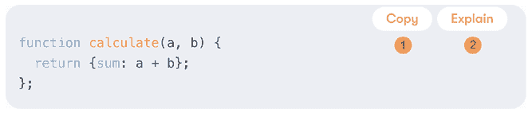
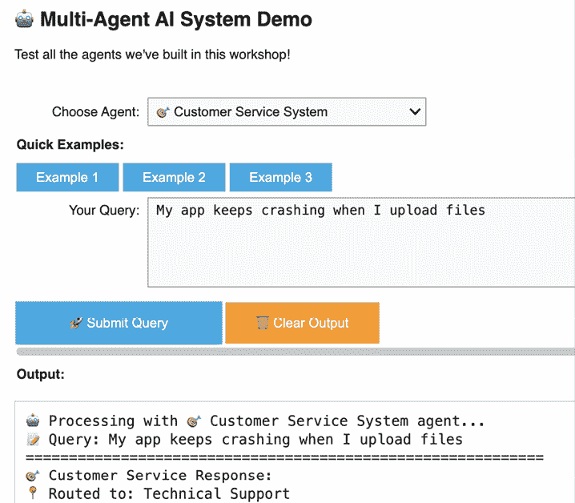

# 5 智能体：从自动化到智能

> 产生想法是一回事，Gromit——让它们运行是另一回事！
>
> ——Wallace & Gromit (Nick Park, Aardman Animations)

让我们从一个火花开始：本章关于智能体（agents）。不是科幻中的机器人，而是能够思考、适应并完成工作的真实系统。如果传统的自动化感觉像直行，那么智能体就是在学习与复杂性共舞。

接下来的理论简洁集中，旨在提供足够的深度来理解为什么智能体很重要、它们如何工作以及它们与旧方法的区别。每个部分都面向行动，让你实验、构建和评估自己的智能体。到结束时，你将看到智能体不仅仅是噱，而是下一次大飞跃。在本章中，你将完成：

* 定义智能体并理解工具、内存和推理循环等核心组件
* 工作坊 1：多智能体回答服务
* 工作坊 2：使用 n8n 的视觉 AI 智能体

# 技术要求

让我们通过准备好工作来为成功奠定基础。你需要准备一些基本的工具和账户，以便跟随本章中的示例和实验：

* **Mistral 账户**：拥有 `Mistral` 账户对于访问高级语言模型以及训练和部署大规模语言模型所需的工具和资源至关重要。
* **Google Colab 或本地 Jupyter 服务器**：`Google Colab` 提供了一个云平台，可以运行免费访问 GPU 和 TPU 的 Jupyter 笔记本，适用于执行密集计算。或者，本地 Jupyter 服务器允许在自己的硬件上运行这些笔记本，对计算环境拥有完全控制权。
* **GitHub 仓库**：`GitHub 仓库` 中的 `Chapter-5` 文件夹（位于 [`github.com/PacktPublishing/Learn-Mistral`](https://github.com/PacktPublishing/Learn-Mistral））包含了第五章的所有代码和资源。该仓库是下载章节中讨论的代码段和示例的价值资源。

# 问题描述

传统的自动化已经业务向前走了很多，但其僵性已显露无遗。传统的自动化在压力下挣扎——当边缘情况出现时，工作流就会失败。在当今动态环境中，很少存在预测性；输入在变化，数据在移动，异常不断。大语言模型 (`LLMs`) 提供了智能，但缺乏持久性、内存结构。挑战是显而易见的：我们需要一种将推理、适应性整合工作流的方法。智能体解决了这一空白，将生成模型转变为以目标为导向的问题解决系统。

# 定义 AI 系统中的智能体

本节揭开了智能体系统的面纱，并奠定了基础：智能体是什么、它们如何运作以及它们与旧方法的区别。通过工具、内存和推理循环等核心组件，解锁更深理解。智能体不仅仅是回答，无论是增强搜索、构建助手还是分析内容，这些知识驱动了 AI 驱动的应用。你将学习智能体如何使用工具、做出决策并通过推理完成任务。这种持续循环将原本被动的 LLM 转化为适应性系统。

```bash
!pip install langchain langchain-mistralai requests beautifulsoup4 chromadb faiss-cpu sentence-transformers ipywidgets
```

```python
print("✅ All packages installed successfully!")
```

 **快速提示**：使用 `AI Code Explainer` 和 `Quick Copy` 功能增强您的编码体验。请在下一代 Packt Reader 中打开此书。点击 `Copy` 按钮（`1`）可以将代码快速复制到您的编码环境中，或点击 `Explain` 按钮（`2`）让 AI 助手为您解释一段代码。



 购买此书将免费赠送**下一代 Packt Reader**。扫描二维码或访问 `packtpub.com/unlock`，然后使用搜索栏通过名称查找此书。双击检查显示的版本以确保获取的是正确的版本。


基础工作完成后，我们现在可以通过安全加载 API 密钥、初始化聊天模型并测试响应，配置与 Mistral 的连接。

## 步骤 2：准备 Mistral API 密钥并测试连接

基础工作完成后，现在是时候将注意力转移到连接 Mistral API 了：

1. 我们首先导入所需的模块和核心库。这些模块允许我们处理环境变量并与 Mistral 聊天客户端交互：

```python
from google.colab import userdata
import os
from langchain_mistralai import ChatMistralAI
```

2. 随后我们初始化 API 密钥以验证请求并开启对 Mistral 服务的安全访问。API 密钥从 Colab 用户数据中安全检索并放入环境变量，以便其他组件可以使用它：

```python
# 安全地获取 Mistral API key
# 从 https://console.mistral.ai/ 获取您的免费 Mistral API 密钥
mistral_api_key = userdata.get('MISTRAL_API_KEY')
os.environ["MISTRAL_API_KEY"] = mistral_api_key
```

3. 凭据就绪后，下一步是设置 LLM 客户端、配置模型参数并准备其有效处理处理查询。如下列表所示，客户端使用选定的模型、温度和最大 token 长度进行初始化：

```python
# 初始化 Mistral LLM
llm = ChatMistralAI(
    model="mistral-small",
    mistral_api_key=mistral_api_key,
    temperature=0.7,
    max_tokens=1000
)
```

* `model="mistral-small"` 选择了一个适用于快速原型构建的紧凑模型
* `mistral_api_key` 将客户端绑定到您的账户
* `temperature=0.7` 提供了平衡的创造力
* `max_tokens=1000` 设置了响应的上限

4. 一旦客户端准备就绪，我们就运行一个快速测试查询以确认连接正常且模型按预期做出响应。我们发送一个短提示来检查 LLM 是否响应正确，同时捕获可能出现的错误：


# 测试连接

```python
try:
    response = llm.invoke("Hello! Please confirm you're working")
    print("✅ Connected to Mistral successfully!")
    print(f" Response: {response.content}")
except Exception as e:
    print(f"❌ Connection failed: {str(e)}")
    print("Please check your API key and try again.")
```

一旦客户端响应，连接即被完全确认。准备阶段完成。现在，可以开始深入添加智能体可以调用的外部工具（例如计算器或解析器），并在将它们组装成最小代理循环之前进行。

## 创建安全的计算器工具

在满足先决条件后，让我们开启智能体可以调用的第一个工具门。我们导入原始类，定义一个安全的算术助手，将其封装为 LangChain 工具，然后用一些直接表达式对其进行测试。

让我们开始吧：

1. 我们首先引入用于工具、代理和提示词模板的 LangChain 类。这些导入提供了核心类——用于定义可重用函数的`Tool`，构建代理的`create_react_agent`和`AgentExecutor`，以及用于拉取标准提示词模板的`hub`：

```python
from langchain.tools import Tool
from langchain.agents import create_react_agent, AgentExecutor
from langchain import hub
```

2. 接着，我们创建一个助手函数来验证表达式并确保基础数学运算的安全执行。该助手函数会去除空格、检查无效字符、拒绝长表达式，并在处理错误的同时评估基础数学。该设计优先考虑安全性和受控的评估，防止格式错误的表达式破坏工作流：

```python
def safe_calculate(expression: str) -> str:
    """安全地评估数学表达式"""
    try:
        expression = expression.strip()
        allowed_chars = set('0123456789+-*/()%. ')
        if not all(c in allowed_chars for c in expression):
            return "Error: Invalid characters in expression. Only numbers and +, -, *, /, (, ), %, . are allowed."
        if len(expression) > 100:
            return "Error: Expression too long"
        result = eval(expression)
        return f"Result: {result}"
    except ZeroDivisionError:
        return "Error: Division by zero"
    except SyntaxError:
        return "Error: Invalid mathematical expression syntax"
    except Exception as e:
        return f"Error: {str(e)}"
```

3. 现在，我们将安全的计算器暴露给 LangChain 作为一个智能体稍后调用的工具，如下列表所示：

```python
calculator_tool = Tool(
    name="calculator",
    description="Safely evaluate math expressions like '2+2', '10*5', or '(15+25)/2'. Only basic operations are supported.",
    func=safe_calculate
)
```

* `name`: 智能体调用工具时使用的唯一标识
* `description`: 对 LLM 的引导，确保仅在支持数学表达式时调用该工具
* `func`: 实现逻辑的 Python 函数——在这里是`safe_calculate`

4. 工具定义好后，下一步是验证它是否能独立工作。此时，我们可以用该工具尝试几个示例表达式，以验证它运行正常并返回预期的输出：

```python
test_expressions = ["2+2", "10*5", "15/3", "(10+5)*2"]
print("\n🧪 直接测试计算器工具:")
for expr in test_expressions:
    result = calculator_tool.func(expr)
    print(f"  {expr} = {result}")
```

此循环遍历表达式，调用工具并打印结果。这在将其嵌入代理之前，提供了一个对计算器行为是否符合预期的快速检查。

在落实基础之后，下一阶段是将此工具与推理循环相结合以扩展智能体的能力。

## 使用共享的 ReAct 提示词并精炼代理循环

基础工作就绪后，我们现在可以转向从 LangChain Hub 采用标准的 ReAct 提示词。这为智能体提供了一个用于工具使用和答案合成的一致推理模板：

1. 我们首先获取一个编码了 ReAct 推理格式的精选提示。该模板为智能体提供了结构化的推理指令，用于逐步使用工具并生成答案：

```python
react_prompt = hub.pull("hwchase17/react")
```

2. 接下来，我们将计算器工具与提示词结合，创建一个新的代理和执行器来管理其行为，如下列表所示：

```python
tools = [calculator_tool]
agent = create_react_agent(llm, tools, react_prompt)
calculator_agent = AgentExecutor(
    agent=agent,
    tools=tools,
    verbose=True,
    max_iterations=5,
    max_execution_time=30,
    handle_parsing_errors=True,
    early_stopping_method="generate"
)
```

* `agent`: 由模型、工具和 ReAct 提示创建的核心推理循环
* `tools`: 可用工具列表——在这里，只有计算器
* `verbose=True`: 打印逐步推理的足迹
* `max_iterations=5`: 将推理循环限制为五步
* `max_execution_time=30`: 整体执行的安全限制（秒）
* `handle_parsing_errors=True`: 如果大语言模型（LLM）生成了格式错误的输出，则允许恢复
* `early_stopping_method="generate"`: 决定在达到最大迭代次数时如何优雅地停止

3. 设置好`agent`之后，是时候测试它在自然语言查询上的行为了。在这里，我们为智能体提供了日常语言提示词，并观察它如何使用`calculator`工具来生成答案：

```python
test_queries = [
    "What is 25 multiplied by 47?",
    "Calculate 150 divided by 6",
    "What's 15 percent of 200?"
]

for query in test_queries:
    print(f"\n{'='*60}")
    print(f" Query: {query}")
    print('='*60)
    try:
        result = calculator_agent.invoke({"input": query})
        if 'output' in result:
            print(f"✅ Agent Response: {result['output']}")
        else:
            print(f"⚠️  Agent Response: {result}")
    except Exception as e:
        print(f"❌ Error: {str(e)}")
        if "25" in query and "47" in query:
            print(f"🔧 Fallback calculation: 25 * 47 = {25 * 47}")
        elif "150" in query and "6" in query:
            print(f"🔧 Fallback calculation: 150 / 6 = {150 / 6}")
        elif "15" in query and "200" in query:
            print(f"🔧 Fallback calculation: 15% of 200 = {200 * 0.15}")
```

在此阶段，循环在自然语言查询上进行了测试，将它们映射为工具调用。错误处理确保了如果智能体表现不当，会打印回退计算，展示了推理、工具使用和输出之间是如何连接的。

## 构建网页搜索工具

这是一个简单的工具概念，但智能体框架（agent frameworks）可以成长得更为强大。想象一下，工具不仅可以计算，还能打开你房间的灯、代表你交易股票，或设计完整的旅行行程。潜在列表几乎是无尽的。作为朝此方向的第一步，让我们通过将外部知识访问（从简单的网页搜索开始）纳入现有智能体框架来扩展工作流：

```python
# 我们引入了用于 HTTP 用的 requests、用于结构化输入的 typing 和 pydantic，以及作为新工具基础的 LangChain BaseTool。此设置为定义输入模式、创建工具类和发送网络请求提供了构建块。
import requests
from langchain.tools import BaseTool
from typing import Optional, Type
from pydantic import BaseModel, Field
import json
```

我们接着定义了一个仅包含一个字段的模式——一个代表将用于搜索的查询字符串。该模式确保了当工具被调用时，它接收的是一个有效且描述清晰的查询字符串：

```python
class WebSearchInput(BaseModel):
    query: str = Field(description="用于查找信息的搜索查询")
```

### 实现网页搜索工具

我们现在定义一个`Tool`子类，执行针对 DuckDuckGo API 的搜索。让我们按照接下来的列表描述，确定工具类结构形状及其`async`委托的形状：

```python
class SimpleWebSearchTool(BaseTool):
    name: str = "web_search"
    description: str = "搜索网络获取当前信息。当你需要训练数据中没有的最新数据或事实时使用此项。"
    args_schema: Type[BaseModel] = WebSearchInput

    async def _arun(self, query: str) -> str:
        # 异步实现逻辑
        pass

    def _run(self, query: str) -> str:
        # 同步实现逻辑
        pass
```

* `name`: 智能体调用工具时使用的标识
* `description`: 智能体决定何时使用该工具的说明
* `args_schema`: 定义输入格式的类
* `_arun`: 异步执行方法
* `_run`: 同步执行方法

现在我们定义一个针对 DuckDuckGo API 执行搜索的`Tool`子类。让我们按照下面的描述，确定工具类结构形状及其`async`委托：

```python
    def _run(self, query: str) -> str:
        try:
            query = query.strip().replace(" ", "+")
            url = f"https://api.duckduckgo.com/?q={query}&format=json&no_html=1&disambig=1"
            response = requests.get(url, timeout=10)
            data = response.json()

            if data.get("AbstractText"):
                return (
                    f"搜索结果（{query}）：\n"
                    f"{data['AbstractText']}\n\n"
                    f"Source: {data.get('AbstractURL', 'DuckDuckGo')}"
                )
            elif data.get("RelatedTopics"):
                topic = data["RelatedTopics"][0]
                if isinstance(topic, dict) and topic.get("Text"):
                    return f"关于 '{query}' 的相关信息：\n{topic['Text']}"
            return f"未找到关于 '{query}' 的直接答案。"

        except requests.exceptions.Timeout:
            return "请求超时。"
        except requests.exceptions.RequestException as e:
            return f"请求错误：{e}"
        except Exception as e:
            return f"发生未知错误：{e}"
```

`_run`方法执行了搜索逻辑。`try`块处理了“快乐路径”（正常情况），`except`分支处理了异常。向内看，这里是请求准备的过程：

1. 清洗查询并将空格替换为`+`。
2. 构建 URL。
3. 发送 GET 请求，并设置 10 秒超时防止挂起。
4. 将响应解析为 JSON 字典。

有了 JSON 负载后，工具会选择最具信息的字段。工具检查了几个字段：

```python
            if data.get("AbstractText"):
                return (
                    f"搜索结果（{query}）：\n"
                    f"{data['AbstractText']}\n\n"
                    f"Source: {data.get('AbstractURL', 'DuckDuckGo')}"
                )
```

此块处理了 DuckDuckGo API 响应包含`AbstractText`的情况，这通常是一个简短的直接解释。括号内的多行字符串避免了杂乱的转义符。第一行用查询标记结果，最后一行引用来源。

下一个`elif`处理了存在`Definition`字段的情况：

```python
            elif data.get("Definition"):
                return (
                    f"定义（{query}）：\n"
                    f"{data['Definition']}\n\n"
                    f"Source: {data.get('DefinitionURL', 'DuckDuckGo')}"
                )
```

这与摘要的想法相同，但专门用于字典形式的定义。格式完全一致，只有键和标签不同。`https://api.duckduckgo.com/?q={query}&format=json&no_html=1&disambig=1`

最后是`RelatedTopics`情况：

```python
            elif data.get("RelatedTopics") and len(data["RelatedTopics"]) > 0:
                topic = data["RelatedTopics"][0]
                if isinstance(topic, dict) and topic.get("Text"):
                    return f"关于 '{query}' 的相关信息：\n{topic['Text']}"
```

这些共同确保了用户能够以可读的格式获得清晰的答案和引用。

如果既没有摘要也没有定义，工具将回退到`related topics`（相关主题）：

- 从列表中选取第一个`topic ([0])`


确保它是一个包含 `Text` 字段的字典。将该片段作为答案返回。这样即使没有直接的摘要，也能提供一些回退上下文。工具定义完成后，下一步是测试它是否能对常见查询做出正确响应。

### 测试网络搜索工具

在此阶段，我们初始化工具并针对几个示例查询运行它，以验证其是否如下列表所示按预期工作：

```python
# Test the web search tool

web_search_tool = SimpleWebSearchTool()

print("🌐 Web Search Tool created successfully!")
```

- `SimpleWebSearchTool()` 使用预定义的名称、描述和`args`架构构建工具。
- `print`确认信息在演示期间很有帮助，用于初始化成功。

实例准备就绪后，我们可以准备一些真实的输入来测试不同的答案类型。

接下来是准备测试搜索。我们收集了一个较小且多样化的列表，以探测摘要、事实和定义，如下列表所示：

```python
### Test searches

print("\n🧪 Testing Web Search Tool:")

test_searches = [
    "Python programming language",
    "current population Tokyo",
    "photosynthesis definition"
]
```

- 这种组合针对常见的响应模式：通用摘要、当前事实和类字典定义。
- 短短列表保持了演示的快速，同时展示了多样性。

现在输入已就绪，我们终于准备好运行搜索循环。我们遍历查询，执行工具，并打印一个紧凑的预览：

```python
for search_query in test_searches:
    print(f"\n Searching: {search_query}")
    result = web_search_tool._run(search_query)
    print(f" Result: {result[:200]}...")
```

该循环宣布每个查询，调用工具的同步`_run`方法，并只打印前约200个字符以提高可读性。这是一个快速且实用的检查，验证了网络访问、JSON解析和格式化逻辑，而不会让控制台崩溃。这个测试循环展示了工具如何从网络返回有用信息的片段。每个查询都会经过清理，通过DuckDuckGo API，并打印结果的第一部分供检查。

搜索工具就绪后，下一阶段将其与计算器结合，形成一个丰富的智能体。

## 第6步：创建一个具有多个工具的研究智能体

现在我们既有了计算器又有网络搜索工具，接下来的逻辑步骤是将它们集成到单一智能体中。这个研究智能体能够在同一个推理循环中执行计算并获取当前信息。

### 定义研究智能体类

```python
class ResearchAgent:
    """可以搜索网络并执行计算的高级研究智能体"""
    def __init__(self, llm):
        self.llm = llm
        self.tools = [
            web_search_tool,
            calculator_tool
        ]
        self.agent = create_react_agent(llm, self.tools, react_prompt)
        self.agent_executor = AgentExecutor(
            agent=self.agent,
            tools=self.tools,
            verbose=True,
            max_iterations=3,
            max_execution_time=30,
            handle_parsing_errors=True,
            return_intermediate_steps=True
        )
```

- `self.tools`: 可用工具列表（搜索 + 计算器）。
- `create_react_agent`: 使用LLM、工具和ReAct提示构建推理智能体。
- `AgentExecutor`: 管理带有限制和调试选项的执行。
- `max_iterations=3`: 保持研究循环较短。
- `max_execution_time=30`: 防止无限制执行。
- `return_intermediate_steps=True`: 记录工具调用和输出以保持透明度。

继续后续，我们在新初始化的类中定义了处理单个研究查询和批量处理的方法。

### 添加研究方法

这些方法将执行器封装为面向用户的函数，用于单个和多次查询：

```python
def research(self, query: str) -> dict:
    """对给定查询进行研究"""
    try:
        result = self.agent_executor.invoke({"input": query})
        return {
            "success": True,
            "query": query,
            "answer": result['output'],
            "error": None
        }
    except Exception as e:
        return {
            "success": False,
            "query": query,
            "answer": None,
            "error": str(e)
        }
```

`research`方法执行带有错误处理的单个搜索。它调用`agent_executor`，捕获输出并返回一个结构化字典，包含成功状态、查询文本、答案以及如果发生任何异常时的错误消息。

```python
def batch_research(self, queries: list) -> list:
    """研究多个查询"""
    results = []
    for query in queries:
        print(f"\n Researching: {query}")
        result = self.research(query)
        results.append(result)
    return results
```

该方法自动处理多个查询。它遍历每个查询，打印进度，在内部调用`research`并将结果聚合到字典列表中。这是一个用于批量执行的便捷封装器，同时复用了单查询逻辑。`batch_research`方法循环多个查询，收集结果并以字典列表的形式返回。

### 测试研究智能体

我们创建智能体，运行几个查询并观察结果。让我们从准备查询开始：

```python
# Create research agent
research_agent = ResearchAgent(llm)
print("🔬 Research Agent created successfully!")

# Test the research agent
print("\n Testing Research Agent:")
research_queries = [
    "What is the current population of Japan and how has it changed over the last decade?",
    "How does machine learning work and what are its main applications?",
    "What are the environmental benefits of solar energy?"
]
```

此区块使用语言模型（`llm`）设置了`ResearchAgent`。打印一条确认信息，随后是宣布测试的短幅。然后准备`research_queries`列表，包含三个多样化的查询供智能体处理。

查询准备好后，代码进入执行循环：

```python
for query in research_queries:
    print(f"\n{'='*80}")
    print(f"🔬 Research Query: {query}")
    print('='*80)
    result = research_agent.research(query)
    if result['success']:
        print(f"✅ Research Complete!")
        print(f" Answer: {result['answer']}")
    else:
        print(f"❌ Research Failed: {result['error']}")
```

此循环遍历每个准备好的查询。为了可读性，在显示查询之前会打印分隔符行。每个查询都会传递给智能体的研究方法。根据执行成功与否，代码将打印带有✅标记的答案或带有❌的错误。

测试演示了组合智能体如何通过搜索实时数据并应用带计算的推理来回答复杂问题。这展示了将多个工具链入一个连贯工作流的潜力。

在确保这一进展后，智能体不再仅仅是一个简单的原型，而是一个不断成长的系统，准备好应对更广泛的挑战。从这里开始，视野将扩展到调度、数据分析以及与外部服务的无缝连接，每个新工具都会将智能体转化为一个更具活力、更有能力的协作者。

## 第7步：专业化客户服务代理

在此阶段，我们将为技术、账单和通用查询构建特定角色的代理。我们将定义一个可重用的基类，配置其执行器，然后实现具有针对性提示词（`prompts`）和工具集的专业化子类。

### 定义基专业化代理

在以下代码中，我们创建了一个可重用的代理包装器，它设置了专业领域、系统提示词和执行策略：

1. 我们首先定义一个捕获角色、工具和提示默认值的可重用基类。构造函数存储了语言模型、角色标签和工具集。如果没有提供系统提示词，它会自动生成一个与专业领域匹配的提示词，以确保代理在行为和语气上保持一致：

```python
class SpecializedAgent:
    """专业化客户服务代理的基类"""
    def __init__(
        self, llm, specialty: str, tools: list, system_prompt: str = None
    ):
        self.llm = llm
        self.specialty = specialty
        self.tools = tools
        self.system_prompt = system_prompt or f"You are a helpful {specialty} specialist."
```

2. 随后，我们创建代理本身，使用`ReAct`框架将推理与工具使用结合。在这里，智能体绑定了语言模型、它可以使用的工具以及一个引导提示词，该提示词指示如何在推理和行动之间交替：

```python
self.agent = create_react_agent(llm, tools, react_prompt)
```

3. 接下来，我们初始化`AgentExecutor`，这是一个管理智能体运行方式、限制执行时间并优雅处理错误的运行时组件：

```python
self.agent_executor = AgentExecutor(
    agent=self.agent,
    tools=tools,
    verbose=False,
    max_iterations=2,
    max_execution_time=20,
    handle_parsing_errors=True,
    return_intermediate_steps=False
)
```

这种设置确保了代理的高效运行：它最多只会尝试两次推理动作循环，不会超过20秒，并且在输出需要轻微修正时能够恢复。为了清晰起见，中间步骤被隐藏，为终端用户保持结果的简洁。

基础到位后，我们现在可以定义每个角色如何处理传入的消息。

### 在角色中处理传入的查询

简单查询通过`LLM`直接回答；更复杂的查询则使用代理：

1. 我们首先查看方法本身及其整体结构。该方法路由传入的客户查询。它从一个`try`块开始，其中对查询进行分析和处理，单个`except`分支确保能够优雅地捕获任何意外错误，返回回退消息：

```python
def handle(self, query: str) -> str:
    """带有更佳错误处理的客户查询"""
    try:
        # 简单查询与复杂查询的逻辑
        ...
    except Exception as e:
        ...
```

2. 接下来是`try`块中的成功路径。逻辑区分了`simple`查询（简短且不涉及计算或搜索）和`complex`查询。简单查询直接传递给语言模型以获得快速答案。复杂查询则路由通过代理执行器，该执行器可以推理并使用工具。如果失败，则返回礼貌的回退消息：

```python
### 对于简单查询，直接尝试LLM输出
if len(query.split()) < 10 and not any(word in query.lower() for word in ['calculate', 'search']):
    return llm.invoke(query)

### 对于复杂查询，使用代理
enhanced_query = f"As a {self.specialty} specialist, help with {query}"
result = self.agent_executor.invoke({"input": enhanced_query})
return result.get('output', 'I apologize, I was unable to process your request.')
```

3. 最后，我们查看异常处理。此区块确保了韧性。与其暴露错误，会将客户引导至人工支持。这维护了用户信任：

```python
except Exception as e:
    return "I apologize for the technical difficulty. Please contact our support team."
```

这种方法让简单问题保持快速且无需工具。

### 实现特定角色代理

为了构建能够处理不同类型客户查询的代理，我们将实现`SpecializedAgent`子类。每个代理类都设置了针对性的提示词和定制工具集。我们将逐步完成它们，从技术支持开始，然后是账单，最后是通用查询：

1. 我们从技术支持代理开始。该类继承自`SpecializedAgent`并将其角色设置为处理技术问题。它带有一个精心设计的系统提示词，强调故障排除和逐步指导。为了支持这一角色，代理被赋予了`web_search_tool`的权限，使其能够在推理过程中查找已知问题和解决方案：

```python
class TechnicalSupportAgent(SpecializedAgent):
    """处理技术问题的专业化代理"""
    def __init__(self, llm):
        system_prompt = """你是一个技术支持专家。你帮助客户处理：
            - 软件Bug和错误
            - 安装和设置问题
            - 性能问题
            - 功能使用和配置
            - 故障排除步骤
            尽可能提供清晰的步骤化解决方案。"""
        super().__init__(
            llm=llm,
            specialty="technical support",
            tools=[web_search_tool],  # 查看已知问题和修复
            system_prompt=system_prompt
        )
```

2. 账单代理遵循相同的结构，但将其角色转向支付和订阅问题。它的系统提示词鼓励同理和清晰的下一步，而工具集切换到`calculator`以处理退款和比例计算：

```python
class BillingSupportAgent(SpecializedAgent):
    """处理账单和支付问题的专业化代理"""
    def __init__(self, llm):
        system_prompt = """你是一个账单支持专家。你帮助客户处理：
            - 支付处理问题
            - 订阅管理
            - 退款申请
            - 发票问题
            - 价格咨询
            始终保持同理心并提供清晰的下一步。"""
        super().__init__(
            llm=llm,
            specialty="billing support",
            tools=[calculator_tool],  # 计算退款或比例
            system_prompt=system_prompt
        )
```

3. 最后，通用代理将处理不属于前两个角色的其他问题，利用整个工具集，并具备更开放式的系统提示词。

```python
class GeneralSupportAgent(SpecializedAgent):
    """处理通用查询的专业化代理"""
    def __init__(self, llm):
        system_prompt = """你是一个通用客户支持专家。你帮助客户处理：
            - 一般性问题
            - 产品信息查询
            - 账户管理
            - 合作伙伴或销售咨询
            保持专业、友好，并提供有用的信息。"""
        super().__init__(
            llm=llm,
            specialty="general support",
            tools=[web_search_tool, calculator_tool],
            system_prompt=system_prompt
        )
```


最后，通用支持代理采用相同的基础模式来处理如账户问题和产品信息等广泛的查询。它的回答旨在简洁且友好，并且它再次使用网络搜索工具来提供最新的通用性解答：

```python
class GeneralSupportAgent(SpecializedAgent):
    """用于通用查询的专业化代理"""

    def __init__(self, llm):
        system_prompt = """你是一个通用的客户支持专家。你帮助客户处理：

            - 通用产品信息
            - 账户问题
            - 政策说明
            - 基础操作指南

            保持回答简洁友好。"""

        super().__init__(
            llm=llm,
            specialty="general customer support",
            tools=[web_search_tool],  # 搜索通用信息
            system_prompt=system_prompt
        )
```

每个子类都定义了自己的系统提示词，在塑造语气和范围的同时，选择了与其领域相匹配的工具——技术和通用角色使用搜索工具，账单角色使用计算器。尽管存在这些差异，它们都继承了相同的处理方法，确保了逻辑的一致性，并为编排多代理系统做好了准备。

现在专业化代理库已经就绪，是时候将它们整合在一起了。通过协调它们互补的优势，我们可以创建一个协同工作的多代理系统，能够处理多样化的客户需求。

## 步骤 8：多代理客户服务系统

现在，我们将专业代理组装一个统一的服务。`CustomerServiceSystem` 类初始化每个角色，对输入的查询进行分类，将其路由到正确的代理，并返回结构化结果：

1. 我们首先创建系统并初始化代理。我们构建了一个控制器，它拥有每个特定角色代理的实例。这个初始化器让系统能够在无需在调用代码中额外配置的情况下，处理技术、账单和通用查询：

```python
class CustomerServiceSystem:
    """带有多个专业化代理的智能客户服务系统"""

    def __init__(self, llm):
        self.llm = llm
        self.technical_agent = TechnicalSupportAgent(llm)
        self.billing_agent = BillingSupportAgent(llm)
        self.general_agent = GeneralSupportAgent(llm)
```

2. 然后我们分类应该由哪个代理进行响应。一个简短的 LLM 提示词使用`exactly one word`指令将查询映射到 `TECHNICAL`、`BILLING` 或 `GENERAL`：

```python
def route_inquiry(self, inquiry: str) -> str:
    """使用直接调用 LLM 确定哪个代理应该处理查询"""
    routing_prompt = f"""分类此客户查询。仅回答一个单词：TECHNICAL, BILLING, 或 GENERAL。

    TECHNICAL：应用崩溃、漏洞、错误、安装、性能、登录
    BILLING：支付、订阅、退款、发票、定价
    GENERAL：信息、账户问题、政策、操作指南

    查询："{inquiry}"
    分类结果："""

    try:
        result = self.llm.invoke(routing_prompt)
        classification = result.content.strip().upper()

        if "TECHNICAL" in classification:
            return "TECHNICAL"
        elif "BILLING" in classification:
            return "BILLING"
        else:
            return "GENERAL"
    except Exception as e:
        print(f"路由失败：{e}, 默认为 GENERAL")
        return "GENERAL"
```

这个简单的分类器保持了路由的轻量化，避免了不必要的工具调用，同时便于日后扩展更多类别。

3. 一旦分类完成，系统就会调用相应的代理并返回一个结构化记录：

```python
def handle_inquiry(self, inquiry: str) -> dict:
    """通过适当代理处理客户查询"""
    route = self.route_inquiry(inquiry)

    if route == "TECHNICAL":
        agent_name = "Technical Support"
        response = self.technical_agent.handle(inquiry)
    elif route == "BILLING":
        agent_name = "Billing Support"
        response = self.billing_agent.handle(inquiry)
    else:
        agent_name = "General Support"
        response = self.general_agent.handle(inquiry)

    return {
        "inquiry": inquiry,
        "routed_to": route,
        "agent_name": agent_name,
        "response": response
    }
```

返回的字典可以直观地显示哪个代理回答了问题以及原因。

4. 一个小方法处理查询列表并返回一个列表。这个辅助方法支持批量操作：

```python
def batch_handle(self, inquiries: list) -> list:
    """处理多个查询"""
    results = []

    for inquiry in inquiries:
        result = self.handle_inquiry(inquiry)
        results.append(result)

    return results
```

5. 最后，我们创建系统并端到端运行几个示例以观察：

```python
cs_system = CustomerServiceSystem(llm)
print("🎯 多代理客户服务系统创建成功!")

test_inquiries = [
    "应用启动时崩溃",
    "需要上个月的退款",
    "你们的营业时间是时候？",
    "重置密码帮助"
]

for inquiry in test_inquiries:
    print(f"\n{'='*80}")
    print(f"🎫 客户查询：{inquiry}")
    print('='*80)
    result = cs_system.handle_inquiry(inquiry)
    print(f"🎯 路由至：{result['agent_name']} ({result['routed_to']})")
    print(f" 回答：{result['response']}")
```

这些测试验证了整个流程：分类、路由和响应。从这里开始，你可以添加更多专业、扩展路由逻辑或集成真实操作的 API。

## 步骤 9：交互式演示界面设置

在交互式测试编排好的代理之前，我们需要引入一个轻量级界面（输入、下拉菜单和按钮）来直接测试我们的代理。这让我们能够在 notebook 中关注代理的行为。

### 导入 UI 组件

为了实现这一点，我们将 IPython 的显示工具与 `ipywidgets` 结合，从而获得了从按钮、下拉菜单到可以内联渲染的输出面板和 HTML 代码段的所有组件：

```python
from IPython.display import display, clear_output, HTML
import ipywidgets as widgets
```

这些导入为交互元素和辅助工具提供了基础组件，稍后会将代理响应连接到可见的笔记本输出。

### 创建界面类

我们将 UI 逻辑封装在一个专门的类中。这种方法使得职责清晰。组件的创建、事件绑定和渲染整齐地组织在一个地方，便于日后复用或扩展：

```python
class AgentDemoInterface:
    """使用 Jupyter widgets 的代理交互式演示界面"""

    def __init__(self):
        # 存储所有代理的引用
        self.calculator_agent = calculator_agent
        self.research_agent = research_agent
        self.cs_system = cs_system

        # 创建界面小组件
        self.create_widgets()
        self.setup_event_handlers()
        # 显示界面
        self.display_interface()
```

构造函数锚定了现有智能体（agents）的引用，然后立即构建小组件、绑定处理程序并在笔记本中展示界面。

通过将所有内容集中在一个类中，该演示界面就像一个控制面板。它允许我们在 Colab 环境中切换智能体、输入查询并并排查看答案，而无需额外的设置。

### 创建小组件

我们现在定义标题、智能体选择器、查询区域、按钮、输出容器以及用于快速测试的示例按钮：

1. 我们首先创建一个标题，以便让界面能够立即传达意图和背景：

```python
self.title = widgets.HTML(
    value="<h2>🤖 多智能体 AI 系统演示</h2><p>测试我们在本次工作坊中构建的所有智能体！</p>",
    layout=widgets.Layout(margin='0 0 20px 0')
)
```

这个 `HTML` 小组件渲染了一个标题和一个带有额外下边距的短副标题。它在视觉上锚定了 UI，并为演示设定了统一的基调。清晰的标题立即建立了背景，使界面感觉是有目的的、精良的并且准备好进行实践实验。

2. 接下来，智能体选择器允许我们在计算器、研究和客户服务功能之间轻松切换：

```python
self.agent_selector = widgets.Dropdown(
    options=[
        ('🧮 计算器智能体', 'calculator'),
        ('🔬 研究智能体', 'research'),
        ('🎯 客户服务系统', 'customer_service')
    ],
    value='calculator',
    description='选择智能体:',
    style={'description_width': '120px'},
    layout=widgets.Layout(width='400px')
)
```

这个 `dropdown` 将可读标签映射到内部值，设置了默认值并设置了描述和控件的大小。它是主要的路由开关。单一的描述性选择器减少了摩擦，引导了流程并防止对哪个智能体将处理请求产生困惑。

3. 然后我们添加了一个多行文本区域，以便方便地输入或粘贴查询：

```python
self.query_input = widgets.Textarea(
    value='What is 25 * 47 + 138?',
    placeholder='在此输入您的查询...',
    description='您的查询:',
    layout=widgets.Layout(width='100%', height='100px'),
    style={'description_width': '120px'}
)
```

`text area` 为较长的提示（prompt）提供了空间，具有合理的默认值、占位符引导以及与其他控件对齐的一致标签宽度。宽大的输入框鼓励实验，容纳更长的问题，并保持了 UI 的整洁和可预测。

4. `Submit` 按钮触发使用所选智能体处理当前提示：

```python
self.submit_button = widgets.Button(
    description='🚀 提交查询',
    button_style='primary',
    layout=widgets.Layout(width='200px', height='40px')
)
```

`button` 使用引人注目的样式和固定尺寸来清晰地传达其主要操作，并在不同布局中保持稳定。醒目的行动号召引导交互，指明了点击位置，并使工作流一目了然，以便快速测试。

5. 一个 `Clear` 按钮重置输出区域，帮助迭代运行保持可读性：

```python
self.clear_button = widgets.Button(
    description='🗑️ 清空输出',
    button_style='warning',
    layout=widgets.Layout(width='150px', height='40px')
)
```

独特的视觉样式将此控件与提交操作区分开，而固定尺寸维持了整体的对齐和平衡。轻松清空输出支持快速循环，防止混乱并使每次运行的结果集中且可见。

随后，输出容器显示带有边框、内边距和针对长内容的滚动条响应：

```python
self.output_area = widgets.Output(
    layout=widgets.Layout(
        border='1px solid #ccc',
        padding='10px',
        margin='10px 0',
        height='400px',
        overflow='auto'
    )
)
```

带边框和内边距的框将结果与控件隔离开；固定的高度和滚动行为在较长的会话期间保持布局紧凑。良好的输出区域框了可读性，并在响应增长时保留了结构，确保界面保持冷静和井然有序。

6. 我们还为每个智能体定义了示例提示，使得测试运行触手可及：

```python
self.examples = {
    'calculator': [
        'What is 25 * 47 + 138?',
        'Calculate 15% of 250',
        'If I have $1000 and spend $347, how much is left?'
    ],
    'research': [
        'What is the current population of Tokyo?',
        'How does solar energy work?',
        'What are the benefits of electric vehicles?'
    ],
    'customer_service': [
        'My app keeps crashing when I upload files',
        'I was charged twice for my subscription',
        'How do I change my password?'
    ]
}
```

精心挑选示例展示了每个智能体的典型用例，使得无需构思提示即可轻松探索。预填充的示例加速了发现，揭示了每个智能体的优势，并为快速健康检查提供了可靠的基准。

7. 最后，我们生成了点击时加载这些示例的按钮。每个示例都获得了一个带有信息风格的小按钮，点击时会将文本注入输入框。可点击的示例消除了摩擦，鼓励快速迭代，并允许在跨智能体之间一致地比较输出：

```python
self.example_buttons = {}

for agent_type, examples in self.examples.items():
    buttons = []
    for i, example in enumerate(examples):
        btn = widgets.Button(
            description=f"示例 {i+1}",
            button_style='info',
            layout=widgets.Layout(width='100px', margin='2px')
        )
        btn.example_text = example
        btn.on_click(self.load_example)
        buttons.append(btn)
    self.example_buttons[agent_type] = buttons
```


该方法整合了协调的面板、标识、路由、输入、操作和示例，使得实验流畅、可重复且视觉有序，便于对智能体行为进行评估。

### 构建聊天工作流

为了完成应用程序的用户端，我们需要将界面与模型连接起来。这不仅仅是发送查询，它需要连接事件、渲染界面、处理响应，并通过加载状态和清除输入保持良好的用户体验。

在这一部分中，我们将这些组件组合成一个驱动聊天的连续工作流：

1. 我们首先将用户操作（如按钮点击和下拉菜单更改）连接到相应的处理函数，以便界面能够动态响应。这些绑定将用户操作引导到相应的方法——`submit` 处理，`clear` 重置输出，`agent_change` 刷新示例按钮和默认文本：

```python
def setup_event_handlers(self):
    """设置小组件的事件处理器"""
    self.submit_button.on_click(self.handle_query)
    self.clear_button.on_click(self.clear_output)
    self.agent_selector.observe(self.on_agent_change, names='value')
```

2. 然后我们将控件和输出按垂直堆叠，并渲染完整界面，使其直接显示在笔记本中，如下文列表所示：

```python
def display_interface(self):
    """显示完整界面"""
    # 控制面板
    controls = widgets.VBox([
        self.title,
        self.agent_selector,
        widgets.HTML("<b>Quick Examples:</b>"),
        widgets.HBox(
            self.example_buttons[self.agent_selector.value]),
        self.query_input,
        widgets.HBox([self.submit_button, self.clear_button])
    ])

    # Main interface
    main_interface = widgets.VBox([
        controls,
        widgets.HTML("<b>Output:</b>"),
        self.output_area
    ])

    display(main_interface)
```

- `widgets.VBox([...])` 将控件垂直堆叠；内层的 `HBox` 将示例按钮和操作按钮分组。
- `display(main_interface)` 在当前 notebook 单元格中渲染复合 UI。

现在 UI 已经可见，我们将添加用于智能体切换、加载示例、清除输出和处理查询的行为。

1. 当切换选定的智能体时，界面会更新其示例按钮并自动将匹配的示例查询加载到输入字段中。这确保了界面与选定的智能体同步，立即为用户提供相关的示例提示词：

```python
def on_agent_change(self, change):
    """Handle agent selection change"""
    new_agent = change['new']
    # 更新示例按钮
    for widget in self.example_buttons[new_agent]:
        widget.layout.display = 'block'
    # 根据智能体更新示例文本
    examples = self.examples[new_agent]
    if examples:
        self.query_input.value = examples[0]
```

2. 点击示例按钮将将其预定义的提示词直接放入输入字段，使其无需手动输入即可测试查询。这是一个小小的便利功能，可以加速对不同智能体场景的尝试，而无需手动打字：

```python
def load_example(self, button):
    """Load example query when button is clicked"""
    self.query_input.value = button.example_text
```

3. 该方法随后会清除输出显示，为下一次交互提供整洁的状态，并保持界面易于追踪。使用 `clear_output()` 可以保持运行之间的显示整洁，特别是在演示期间：

```python
def clear_output(self, button):
    """Clear the output area"""
    with self.output_area:
        clear_output()
```

### 处理查询提交

此方法获取激活的智能体和当前查询，将请求发送到相应的后端，然后以结构化、可读的格式显示响应：

1. 我们从方法签名开始为处理来自界面的提交查询建立入口：

```python
def handle_query(self, button):
    """Handle query submission"""
```

此方法绑定到 `Submit` 按钮上。点击时，它将编排清除显示、验证输入、按智能体类型路由以及打印结果或错误。

2. 现在，我们将输出范围限制在组件，清除之前的内容，并准备待处理的输入：

```python
with self.output_area:
    clear_output()
    agent_type = self.agent_selector.value
    query = self.query_input.value.strip()
    if not query:
        print("❌ Please enter a query")
        return
    print(f"🤖 Processing with {self.agent_selector.label} agent...")
    print(f" Query: {query}")
    print("=" * 60)
```

`with` 上下文将所有打印内容发送到输出组件，`clear_output()` 擦除旧结果，读取并验证输入，短标题会显示哪个智能体将处理查询。

3. 接下来是 `try`/`except` 骨架，它将正常执行路径与错误处理分开：

```python
try:
    # route by agent type and print structured results
    ...
except Exception as e:
    # print a helpful error and guidance
    ...
```

`try` 块包含路由和打印逻辑；`except` 块提供了优雅的回退机制，确保 UI 不会崩溃，并且用户可以看到清晰的后续步骤。

4. 在 `try` 块内部，我们首先处理计算器分支——调用智能体并打印其输出：

```python
if agent_type == 'calculator':
    result = self.calculator_agent.invoke({"input": query})
    print("🧮 Calculator Result:")
    print(f"✅ {result.get('output', 'Calculation completed')}")
```

此路径将查询发送到计算智能体的 `invoke` 方法，并为数学或简单计算打印带标签的简洁结果。

5. `research` 分支委托给 `research_agent.research(query)` 并打印答案或显式错误：

```python
elif agent_type == 'research':
    result = self.research_agent.research(query)
    if result['success']:
        print("🔬 Research Complete:")
        print(f"📋 {result['answer']}")
    else:
        print(f"❌ Research Error: {result['error']}")
```

在这里，辅助方法返回一个结构化字典。成功打印答案；失败则显示捕获的错误消息而不抛出异常。

6. `customer_service` 分支调用多智能体系统，然后显示路由信息和最终响应：

```python
elif agent_type == 'customer_service':
    result = self.cs_system.handle_inquiry(query)
    print("🎯 Customer Service Response:")
    print(f"📍 Routed to: {result['agent_name']}")
    print(f" Response: {result['response']}")
```

此路径揭示了哪个智能体处理了查询并显示其消息，提供了路由决策的透明度。

7. 在任何分支完成后，一个结束标记会确认成功并在视觉上区分运行过程：

```python
print("\n" + "=" * 60)
print("✅ Query completed!")
```

这些最后的打印增加了分割符和完成说明，使得多次运行更容易扫描。

8. 最后，异常处理器会将意外错误转换为友好的指导：

```python
except Exception as e:
    print(f"❌ Unexpected error: {str(e)}")
    print("Please try again or contact support.")
```

任何意外错误都会被捕获、总结，并提供清晰的后续步骤，保持界面的韧性和以用户为中心。

9. 最后的消息确认类已定义并可以实例化：

```python
print("🎨 Interactive demo interface created successfully!")
```

这很好地完成了准备工作，下一步可以专注于演示。

## 第 10 步：启动交互演示

界面定义后，我们现在可以在 notebook 中启动实时演示。此步骤将打印简单的使用说明并创建界面，界面通过其 `display_interface()` 方法自动渲染。

### 使用说明

为新用户提供了一个简要清单，提供了如何有效地与演示交互的清晰指南：

```python
# 显示使用说明
print("🚀 Launching Interactive Multi-Agent Demo Interface!")
print("\nℹ️  How to use:")
print("1. 从下拉菜单中选择智能体")
print("2. 点击示例按钮或输入自己的查询")
print("3. 点击 'Submit Query' 查看智能体的运行情况")
print("4. 使用不同类型的问题尝试不同的智能体")
print("\n" + "="*60)
```

这些指令将指导并在并在工作坊期间减少困惑。

### 创建并显示界面

我们创建 `AgentDemoInterface` 的实例，将其与我们的智能体关联，并允许界面在 notebook 内部构建并显示自身：

```python
# 创建并显示演示界面
demo_interface = AgentDemoInterface()
```

这一行代码将整个系统整合到一个可用的 UI 中。你可以选择一个智能体，尝试示例，并观察输出流式进入面板。



图 5.7：代理测试 UI 界面

界面已就绪。不要只读代码——去使用它。选择一个智能体，输入查询并点击 `Submit Query`。尝试示例或编写自己的问题。观察每个智能体如何做出不同的响应。这种实践将理论转化为具体的、交互式的体验。

## 第 11 步：代理性能测试

现在智能体和 UI 均运行正常，是时候衡量它们在真实负载下的表现了。这一步提供了一个脚手架性能框架，用于对响应进行计时、统计成功/失败次数并汇总结果，便于比较不同的智能体并识别优化机会。

### 定义性能测试类

测试逻辑被组织在一个专门的类中，在这里我们以脚手架的形式概述 `test_agent_performance` 方法，以突出其流程，而不被过多细节淹没：

```python
import time
from datetime import datetime

class AgentPerformanceTester:
    """测试并衡量代理性能"""
    def __init__(self):
        self.test_results = []

    def test_agent_performance(self, agent_name: str, agent_func, test_queries: list):
        """对智能体运行多次查询并收集计时与成功率指标"""
        # 1) 初始化结果结构
        # 2) 遍历测试查询
        #    - 开始计时
        #    - 尝试调用智能体
        #    - 成功：计算已用时间，更新成功计数器，构建 query_result
        #    - 失败：计算已用时间，更新失败计数器，构建 query_result
        #    - 将 query_result 添加到结果中
        # 3) 计算最终平均值 / 成功率
        # 4) 持久化到 self.test_results 并打印摘要
        # 5) 返回结果
        ...
```

该脚手架概述了控制流，同时省略了特定的 `print` 语句和微细节，使注意力集中在你将衡量和报告的核心机制上。

### 结果初始化

该方法通过设置 `results` 字典开始，建立计数器和存储字段，这些将在整个性能测试过程中跟踪查询结果、用时间和整体成功指标：

```python
results = {
    'agent_name': agent_name,
    'total_queries': len(test_queries),
    'successful_queries': 0,
    'failed_queries': 0,
    'total_time': 0,
    'average_time': 0,
    'query_results': []
}
```

此字典积累了整个运行过程指标和每个查询的记录。它跟踪计数、总/平均时间以及一个用于粒度分析或后期导出的 `query_results` 列表。

### 所有测试循环

方法继续对所有测试查询进行循环，对每次尝试进行计时，处理成功和错误情况，并将结构化记录添加到 `results` 列表中以保持一致性：

```python
for i, query in enumerate(test_queries, 1):
    # 🕒 开始测量时间
    start_time = time.time()
    try:
        # ▶️ 尝试运行智能体调用
        #    例如，result = agent_func(query)
        # ⏱️ 成功后测量已用时间
        ...
    except Exception as e:
        # ⏱️ 错误时测量已用时间
        ...
    # 📦 添加每个查询记录
    results['query_results'].append(query_result)
```

循环对每次尝试进行计时，分离成功和错误路径，并确保每个查询都生成一个一致的 `query_result` 条目并添加到 `results['query_results']`。

### 处理计时的智能体调用（成功路径）

在成功路径中，捕获智能体的输出，测量执行时间并更新计数器。会存储一个结构化记录，包括 `result_length`，以帮助检测异常短或过长的响应：

```python
result = agent_func(query)
end_time = time.time()
execution_time = end_time - start_time
results['successful_queries'] += 1
results['total_time'] += execution_time
query_result = {
    'query': query,
    'success': True,
    'execution_time': execution_time,
    'result_length': len(str(result))
}
```

成功后，我们计算已用时间，增加成功计数器并存储紧凑的每个查询记录。跟踪 `result_length` 对于发现极短或意外的输出很有用。

### 处理错误（失败路径）

在失败路径中，仍然测量执行时间，增加失败计数器并捕获异常消息。这确保即使在发生错误时，每个查询也能生成一致的记录：

```python
end_time = time.time()
execution_time = end_time - start_time
results['failed_queries'] += 1
results['total_time'] += execution_time
query_result = {
    'query': query,
    'success': False,
    'execution_time': execution_time,
    'error': str(e)
}
```


在`'error': str(e)`中，异常信息被转换为字符串并存储在`'error'`键中。

错误仍然产生有效记录：我们对其计时，增加失败计数器并存储异常文本。

### 最终指标计算与持久化

在结束时，计算平均值和成功率。结果被存储，打印摘要，框架已准备好进行测试：

```python
if results['total_queries'] > 0:
    results['average_time'] = results['total_time'] / results['total_queries']
    results['success_rate'] = results['successful_queries'] / results['total_queries']
self.test_results.append(results)
self.print_performance_summary(results)
```

平均延迟和成功率汇总了运行情况。我们随后持久化`results`对象并输出摘要。有了这个基准框架，你可以完善提示词、调整工具或添加缓存。然后重新运行测试以确认改进。

### 方法：打印指标摘要

此辅助函数在运行完成后打印简洁报告：

```python
def print_performance_summary(self, results):
    """打印性能摘要"""
    print(f"\n📊 {results['agent_name']} 的性能摘要:")
    print(f"   总查询数: {results['total_queries']}")
    print(f"   成功: {results['successful_queries']}")
    print(f"   失败: {results['failed_queries']}")
    print(f"   成功率: {results.get('success_rate', 0):.1%}")
    print(f"   平均时间: {results['average_time']:.2f}s")
    print(f"   总时间: {results['total_time']:.2f}s")
```

此报告显示了关键 KPI：吞吐量、可靠性和延迟。你以后可以将其扩展为导出 CSV/JSON。

### 创建测试器并定义特定的代理函数

我们实例化测试器，定义代表性查询，并将每个智能体调用封装在符合`agent_func(query)`签名的小函数中：

```python
# 创建性能测试器
tester = AgentPerformanceTester()

# 测试每个智能体
print("🔬 开始全面的代理性能测试...")

# 测试计算器智能体
calc_queries = [
    "15 + 25 等于？",
    "计算 12 * 8",
    "100 / 4 等于？"
]

def test_calculator(query):
    return calculator_agent.invoke({"input": query})['output']
```

- `tester = AgentPerformanceTester()`: 初始化测试框架和结果存储器
- `calc_queries`: 小型算术测试用例
- `test_calculator(query)`: 将计算器代理适配到预期的函数签名并提取`'output'`字段

在准备好计算路径后，我们可以添加研究和客户服务的封装器。

### 研究代理封装与查询

该封装器在成功时返回答案，并在研究代理报告错误时抛出异常：

```python
# Test Research Agent
research_queries = [
    "什么是人工智能？",
    "再生能源的益处"
]

def test_research(query):
    result = research_agent.research(query)
    if result['success']:
        return result['answer']
    else:
        raise Exception(result['error'])
```

该封装器执行快速失败策略，以确保错误被记录并计数，从而生成真实的可靠性指标。

### 客户服务系统封装与查询

我们将查询路由到客户服务系统，并返回人类可读的响应：

```python
# Test Customer Service System
cs_queries = [
    "应用程序启动时崩溃",
    "需要退款帮助"
]

def test_customer_service(query):
    result = cs_system.handle_inquiry(query)
    return result['response']
```

这个小型适配器隔离了结果提取的方式，而无需更改测试器的核心逻辑。

### 执行性能运行

我们将每个封装器及其对应的查询集传递给测试器，测试器将按照列表所示打印实时进度和每个代理的摘要：

```python
tester.test_agent_performance("Calculator Agent", test_calculator, calc_queries)
tester.test_agent_performance("Research Agent", test_research, research_queries)
tester.test_agent_performance("Customer Service", test_customer_service, cs_queries)
```

- 每次调用都会触发计时、日志记录和最终的 KPI 总结
- 结果将附加到`tester.test_results`中供稍后检查

在此阶段，我们的代理已经完成了设计、编排并配备了交互式界面。最后一步是性能测试，成功率和平均响应时间等指标将揭示个体的有效性和整个系统的行为。这些基准测试凸显了优势，暴露了劣势，并为迭代改进提供了基础。通过对提示词、新工具或缓存策略的完善，系统可以稳定地变得更加可靠和响应，且每个周期都会根据这些基准进行验证。

在整个研讨会上，我们从基础组件进展到动态多代理框架。在此过程中，我们集成了工具，创建了专用代理并构建了交互式演示，确保理论通过动手实践得到强化。到结束时，参与者可以直接对代理进行实验，比较它们的输出并衡量跨任务的性能。这种设计、执行和评估的结合展示了简单的原型如何成长可扩展的生产级系统，同时也指向了创意扩展和现实应用。
