# 研讨会 2：使用 n8n 构建视觉 AI 代理

有时，从头编写解决方案并不是选择——太慢、太复杂，或者简单不值得投入这些成本。这就是 n8n 发挥作用的地方，它让我们能够快速构建既快速又高效的工作流。在本次研讨中，我们将把金融数据、新闻源和 Mistral AI 连接到一个自动化流水线中，最后直接向 Telegram 发送个性化交易见解。结束时，你将看到复杂的想法如何快速转变为可行的解决方案。

是时候做好准备了。我们将从安装和准备 n8n 开始，然后将其连接到几个为我们的工作流提供支持的免费数据源。这些基础将提供所需的输入（符号、价格历史和新闻），后续步骤将对其进行增强和分析。

## 第 1 ：设置 n8n 和免费数据源

在起始步骤中，我们为工作流奠定了坚实的基础：一致的 n8n 环境和可以免费访问的数据流。你将使用 Docker 启动 n8n，注册实例，浏览界面并准备第一个手动触发（Manual Trigger）节点。通过此，画布将成为我们后续 AI 增强的乐场。让我们开始吧：

1. 我们将在本地启动 n8n，以在机器间建立一个干净、可重复的基准：

```bash
# 使用 Docker 启动 n8n
docker run -it --rm --name n8n -p 5678:5678 -v ~/.n8n:/home/node/.n8n docker.n8n.io/n8nio/n8n
```

运行此操作后，本地工作空间将启动，准备好连接你的第一个工作流。此步骤解锁了编辑器，并确保你可以放心地保存、执行和管理工作流。

2. 对于首次使用的用户，n8n 注册屏幕会显示带有`Get started`（开始使用）按钮的欢迎页面。点击后，你将看到创建所有者账户的表单：

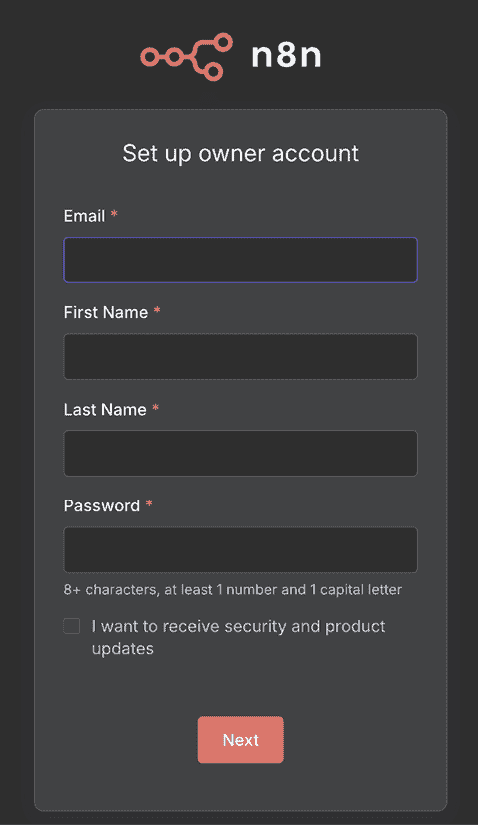
图 5.8：n8n 注册界面

注册完成后，你将立即进入带有空白画布的主工作空间：

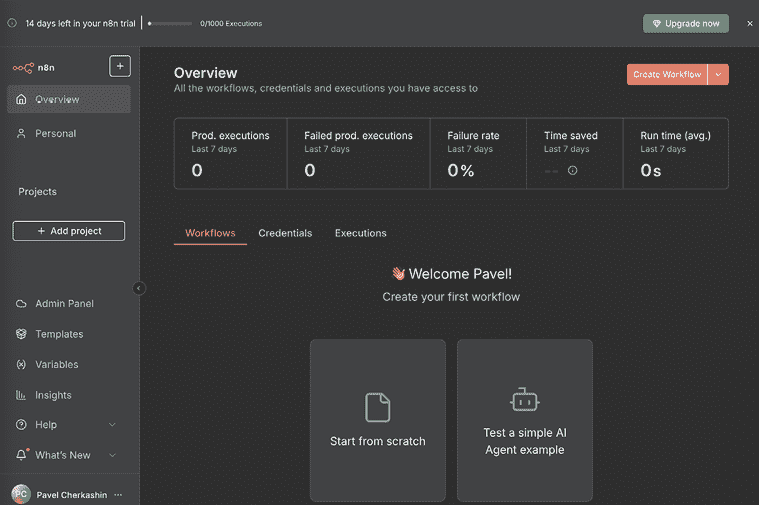
图 5.9：n8n 主工作空间

3. 现在找到并添加`Manual Trigger`（手动触发）节点，这是我们工作流测试的关键起点。记住，可以在右侧的面板中搜索任何节点，然后简单地将其拖到画布上，这样即使是组装复杂的流程也变得快速：

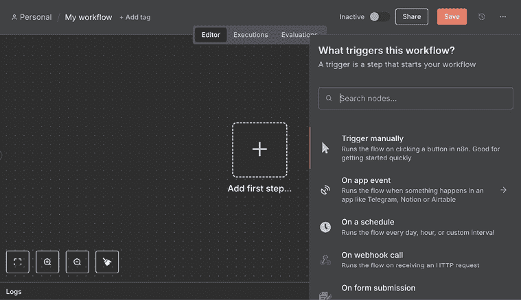
图 5.10：节点选择搜索框

你现在有了一个运行中的 n8n、一个已注册的工作空间，并知道如何添加第一个触发节点。界面看起来应该很熟悉，画布已准备就绪。这个基础让我们能够安全地迭代——没有谜团，只有清晰。很棒的开始！n8n 工具有了心跳，有了成长的空间。

接下来，我们将为 Telegram 准备友好的通知，创建一个接收见察的机器人和群聊。

## 步骤 2：配置用于的 Telegram 机器人和聊天

在这一步中，我们将自动化与人连接起来。你将创建一个 Telegram 机器人，获取其访问令牌（access token），设置群聊并获取聊天 ID。这为你你的工作流最终发布见察的通道做好准备，使自动化可见且具有协作性。我们从与`@BotFather`的 Telegram 通信开始。

Telegram 支持 iPhone、Android、Windows 和 macOS，因此你可以在任何喜欢的设备上使用它。如果你还没有账户，注册非常快速且免费。只需从`telegram.org/apps`下载应用并按照屏幕上的步骤操作。几分钟后你就可以与`@BotFather`聊天了。

过程从`@BotFather`开始，它是 Telegram 官方的机器人创建工具。打开 Telegram，搜索`@BotFather`并与其开始聊天。然后按照以下步骤操作：

1. 通过输入`/newbot`创建新机器人，在提示时为你的机器人提供一个`name`（这是用户看到的名称）。选择一个以"bot"结尾的`username`（例如`MistralFinancialInsightBot`）。`@BotFather`将回复一个`unique API token`（唯一 API 令牌）。复制并安全地存储它。此令牌用于从代码中验证并连接你的机器人：

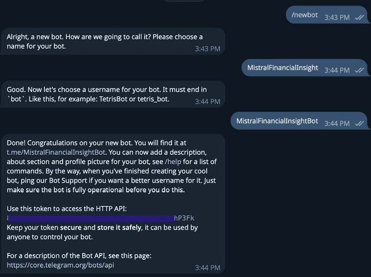
图 5.11：创建机器人

正如*图 5.11*所示，`@BotFather`返回了基本的访问令牌，你之后需要它来授权 n8n。

此时，请务必安全地存储机器人令牌。它是允许你的工作流可靠地发布消息的关键。

2. 接下来，你把我们的新机器人邀请到结果交付的群聊中。这可以是合作者小组，也可以是你自己的测试空间。*图 5.12*展示了你的机器人被成功加入群组的时刻，确认它已准备好转发消息：

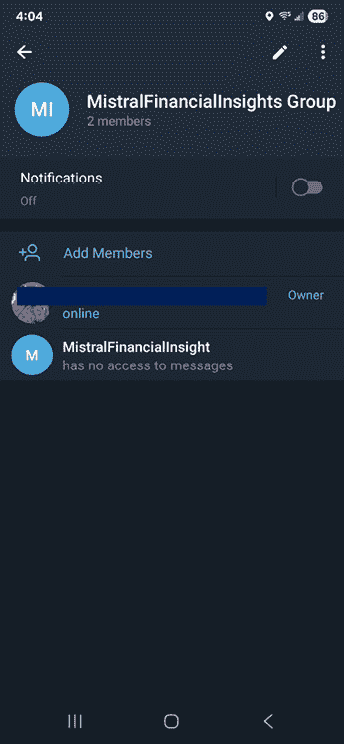
图 5.12：机器人已加入群组

3. 为了传递消息，n8n 必须确切知道在哪里发布（`https://api.telegram.org/bot%3cBOT_TOKEN%3e/getUpdates`）。我们将查询 Telegram 的 API 来提取数字聊天标识符。URL 模板位于下方`https://api.telegram.org/bot<BOT_TOKEN>/getUpdates`。你需要将 URL 的该部分替换为你从`@BotFather`收到的自己的访问令牌。然后，只需将其粘贴到浏览器地址栏中。

*图 5.13*描述了 JSON 响应，其中嵌入了 chat ID。此值将你的工作流连接到正确的对话：

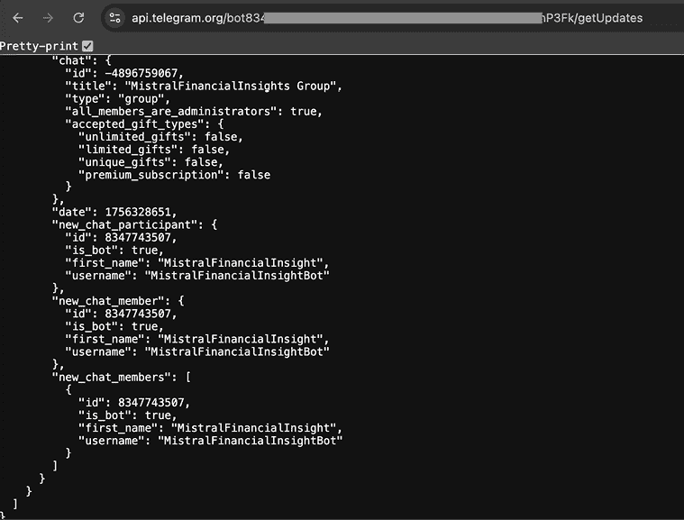
图 5.13：通过 API 获取聊天 ID

4. 接下来，滚动 JSON 直到找到`"chat"`对象并记录其`"id"`字段的值。在*图 5.14*中，你会注意到聊天 ID 在负载中被清晰地高亮，方便之后将其复制到 n8n 中。

使用`VS Code`或`Sublime Text`等合适的编辑器打开 JSON。格式化和语法高亮将使其更容易被发现。

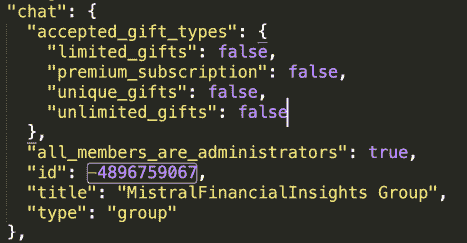
图 5.14：高亮显示的聊天 ID

完成此步骤后，你现在已经创建了 Telegram 机器人，保存了凭据并识别了聊天 ID。通知现在有了确定的归处。当你打开数据与对话之间的界线时，自动化将感觉更有活力。

此之后，我们将把手动触发器连接到 HTTP 请求，并从 Yahoo 获取实时数据以丰富我们的工作流。

## 步骤 3：添加手动触发器并配置 HTTP 请求

在这一步中，我们引入了动态数据。你将添加一个手动触发器来启动工作流，然后配置 HTTP 请求节点以从 Yahoo 拉取信息。这些包括最活跃的股票、涨幅最高和跌幅最大的股票，它们非常适合分析。

### 添加手动触发器

`manual trigger`（手动触发器）允许你随时启动工作流，方便我们在进行过程中进行测试和完善。

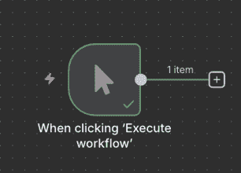
图 5.15：手动触发器节点

正如*图 5.15*所示，触发节点位于画布的最开始，确保每次执行都从这里开始。

### 添加第一个 HTTP 请求

接下来，我们将配置 HTTP 请求节点以从 Yahoo 拉取信息。这些包括最活跃的股票、涨幅最高和跌幅最大的股票，它们非常适合分析。

```javascript
// ---- config
const LIMIT = 5;
```

这设置了排序后返回代码数量上限。在我们的案例中，列表限制为五个。

选择五个作为限制是为了快速获得结果。后续步骤将为每个代码调用外部服务，因此保持小数量可以避免不必要的请求。

现在，我们引入处理归一化和过滤的辅助函数：

```javascript
function normNum(v) {
  if (typeof v === 'number' && isFinite(v)) return v;
  if (v == null) return 0;
  const n = parseFloat(String(v).replace('%','').trim());
  return isFinite(n) ? n : 0;
}

function cleanSymbol(s) {
  return (s || '').toString().trim().toUpperCase();
}

function isLikelyEquity(sym, quoteType) {
  if (!sym) return false;
  if (sym.startsWith('^')) return false;
  if (sym.includes('=')) return false;
  if (quoteType && quoteType !== 'EQUITY') return false;
  return true;
}
```

- `normNum(v)`标准化百分比和数字
- `cleanSymbol(s)`确保代码为大写并去除了空格
- `isLikelyEquity()`移除非股票类工具（如指数和外汇对）

如果数学或财务逻辑看起来很晦涩，不要担心。你不需要完全掌握也能跟上工作坊的。查看代码作为参考就足够了。要点是理解这些辅助函数处于什么位置，而繁重的工作已经为你完成了。

下一部分处理从每个输入项中提取行：

```javascript
function extractRowsFromItem(it) {
  const row = it?.json ?? it ?? {};
  const quotes = row.finance?.result?.[0]?.quotes;
  if (Array.isArray(quotes) && quotes.length) {
    return quotes.map(q => ({
      symbol: q.symbol,
      changePct: normNum(q.regularMarketChangePercent),
      quoteType: q.quoteType
    }));
  }
  return [{
    symbol: row.symbol || row.ticker,
    changePct: normNum(
      row.changePct ??
      row.regularMarketChangePercent ??
      row.changesPercentage ??
      row.percentchange
    ),
    quoteType: row.quoteType
  }];
}
```

这确保了我们能够一致地处理结构化的筛选器响应和单行输入。

准备完成后，我们可以将所有行收集到一个桶中：

```javascript
const bucket = [];
for (const it of items) {
  const rows = extractRowsFromItem(it);
  for (const r of rows) bucket.push(r);
}
```


接下来，对代码去重并过滤掉无效内容：

```javascript
const seen = new Set();
const flat = [];

for (const r of bucket) {
  const sym = cleanSymbol(r.symbol);
  if (!isLikelyEquity(sym, r.quoteType)) continue;
  if (seen.has(sym)) continue;
  seen.add(sym);
  flat.push({ symbol: sym, changePct: normNum(r.changePct) });
}
```

最后，我们按百分比变化的绝对值进行排序，并只取前五个：

```javascript
flat.sort((a, b) => Math.abs(b.changePct) - Math.abs(a.changePct));
const top = flat.slice(0, LIMIT);
return top.map(x => ({ json: { symbol: x.symbol, changePct: x.changePct } }));
```

这产生了一个按波动幅度强弱排序的清洁股票列表。每行都以 JSON 格式输出，为下一步做准备。

当执行时，`Code`节点的输出将显示五个项目，每个项目包含一个代码符号及其百分比变化。

### 重新运行工作流

现在，从手动触发重新运行工作流。三个 HTTP 请求将全部执行，`Merge`节点将合并它们，`Code`节点将返回一个五个项目的列表。

打开`Code`节点查看输出。你应该看到类似这样的结构：

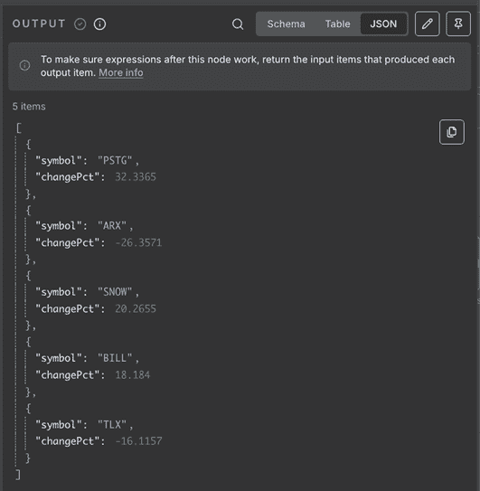

图 5.22:Code 节点输出

*图 5.22* 展示了生成的五个代码列表，每个代码都有其百分比变化，证实了去重和排序逻辑是有效的。非常干净利落，不是吗？

```json
[
  { "symbol": "PSTG", "changePct": 32.3365 },
  { "symbol": "ARX",  "changePct": -26.3571 },
  { "symbol": "SNOW", "changePct": 20.2655 },
  { "symbol": "BILL", "changePct": 18.184 },
  { "symbol": "TLX",  "changePct": -16.1157 }
]
```

JSON 输出是一个数组，每个项目包含一个`symbol`属性。该字段作为所有后续处理步骤的键，因为随着工作流的扩展，我们将为每个代码附加额外数据。

完成此步骤后，你现在拥有了跨三个类别的前五个波动去重排序列表。工作流不再仅仅是获取原始馈，它已经开始提供结构化的、排名的见解。

之后，我们将准备附加外部智能，为每个代码提供丰富的数据。

## 第 5 步：配置 Yahoo Finance

为了让决策基于实时市场背景，我们将从 Yahoo Finance 获取日内序列，并将每个代码的历史压缩为单条记录。我们将请求五天的五分钟 **OHLCV** (**开盘价、最高价、最低价、收盘价、成交量**) 线，然后计算快速信号——**z-scores**（标准化移动）和 **ATR**（平均真实范围，一种波动率指标），外加上简单的波动率标记来引导路由。

不要被`OHLCV`、`ATR`或`z-score`等缩写吓到。你不需要深奥数学即可跟随——代码已提供并可以直接复制。本章仅突出供参考的最有趣部分，因此关注流程而非公式。

### HTTP Request 节点配置

* **Method**: `GET`
* **URL**: `https://query1.yahoo.com/v8/finance/chart/{{ $json.symbol }}`
* **Query Parameters**: `interval=5m`, `range=5d`

此配置抓取了一个紧凑的日内窗口，易于评估趋势、冲击和参与度，而没有过大的负载。

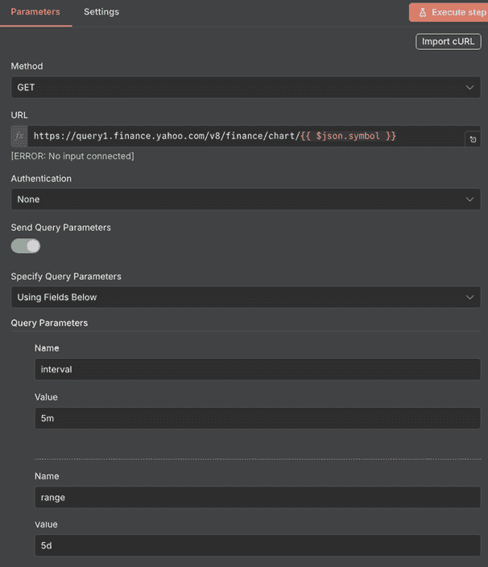

图 5.23:Yahoo 图表请求配置

在*图 5.23*中，请求显示的`interval`和`range`参数决定了每个代码返回的 OHLCV 数组。

在请求之后附加`Code`节点。它的作用是归一化输入并为每个代码返回一个紧凑的对象：最新价格、百分比变化、短期漂移 (`zH`)、最后一个 K 线冲击 (`z1`)、ATR 缩放移动、`volume-spike`标记以及组合的`volatilityFlag`：

```javascript
// 解析器返回的最小形状
return [{
  json: { symbol, price, change, changePercent, z1, zH, moveVsATR, volSpike, volatilityFlag, timestamp }
}];
```

这种`一进一出`的约定确保了下游节点的可预测性——当符号数据稀疏时，不会出现列表爆炸或字段缺失。

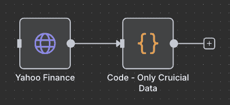

图 5.24：Yahoo 请求后的解析器

`图 5.24` 展示了布局：`Code`节点紧随 Yahoo 请求之后，将原始数组转换为单个包含丰富遥测数据的项。

连接到最后一个节点并从头开始执行，确认解析器为每个输入符号恰好输出一个项。当序列过短时，节点仍应返回一个安全的存根（stub），在避免错误的同时指示数据不足。

接下来，我们将通过 Google News 获取最近的标题，并为每个股票代码保留几个整洁的片段，以保持平衡且人类可读的上下文。

## 步骤 6：获取并解析新闻（Google News RSS，最近两天）

在这一中，你将为每个股票代码添加一个 Google News HTTP 请求，然后顺序运行两个`Code`节点：一个用于将每个 RSS 负载附加到其股票代码符号，另一个用于将 RSS XML 解析为紧凑的标题列表。

### 添加 Google News HTTP 请求

搜索`HTTP Request`，将其拖到画布上，并连接在你的 Yahoo `5d`/`5m`指标节点之后（或者在分批的 Split in Batches 节点之后）。配置以下内容：

* **Method**: `GET`
* **URL**: `https://news.google.com/rss/search?q={{$json.symbol}}%20stock%20when:2d&hl=en-US&gl=US&ceid=US:en`

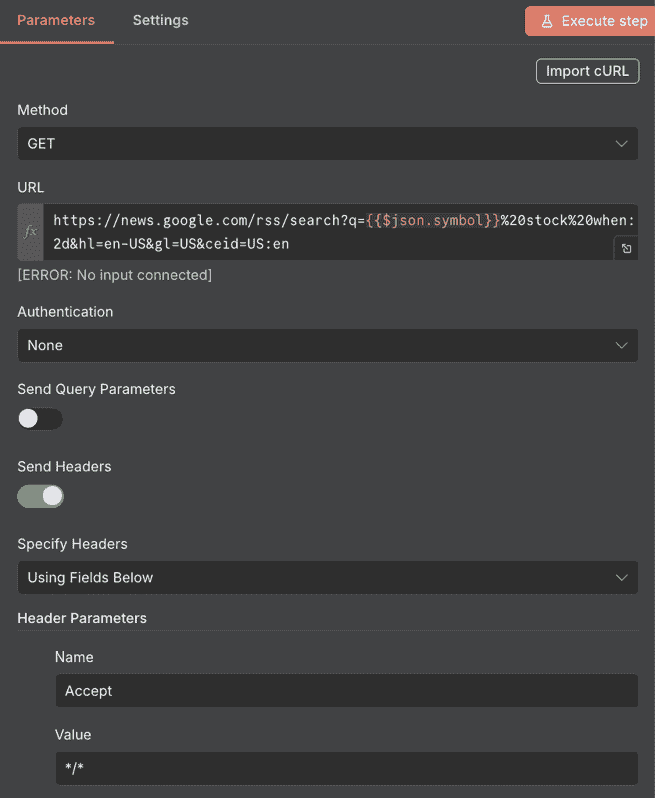

图 5.25：为每个股票代码配置 RSS 的 Google News HTTP 请求（最近两天）

在 Google News 之后连接两个 Code 节点

将两个`Code`节点拖到画布，并在`Google News`节点之后串联连接：

* **Attach Symbol** 将每个 RSS 负载与正确的股票代码配对
* **Parse RSS** 从 RSS XML 中提取标题（以及简短片段）到`news[]`数组

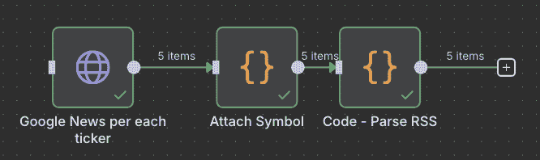

图 5.26：Google News HTTP 节点连接两个 Code 节点：Attach Symbol → Parse RSS

#### Code 节点 1：Attach Symbol

你可以从`Code03_Attach_Symbol.js`复制并粘贴完整脚本。核心思想是获取每个项返回的 RSS XML，并附加从你之前的去重节点获取的对应符号。两行代码最为重要，如下列表所示：

```javascript
const SYMBOLS_NODE = 'Code - Dedupe and Sorting';  // <-- 必须与节点标签完全匹配
const symItems = $items(SYMBOLS_NODE, 0) || [];
```

* `SYMBOLS_NODE`必须与输出`{ symbol: ... }`的节点的画布标签完全匹配（你的去重/排序步骤）
* `symItems`获取该节点发送的所有项，为你提供与当前 RSS 项对齐的符号列表

文件的其余部分遍历输入项，将每个项与其符号配对，并输出`{ symbol, data }`，其中`data`携带原始 RSS XML。

**重要依赖**

此新闻获取子流无法孤立运行。在未将其连接到产生股票代码符号的主工作流（来自`Code – Dedupe and Sorting`）之前，符号列表将是空的。这意味着没有内容可以请求新闻，也没有从 RSS 馈中解析任何内容。

如果你重命名了去重节点，请更新`SYMBOLS_NODE`为新名称。

#### Code 节点 2：Parse RSS

你可以从`Code04_Parse_RSS.js`复制并粘贴完整脚本。关键程序是`parseRss(xml, symbol)`，它将原始 RSS XML 转换为紧凑的字符串列表，例如`"标题 — 短描述"`：

```javascript
function parseRss(xml, symbol) {
  const reItem = /<item\b[\s\S]*?<\/item>/gi;
  const blocks = Array.from(xml.matchAll(reItem)).map(m => m[0]);
  if (!blocks.length) return [];

  const reTitle = /<title>([\s\S]*?)<\/title>/i;
  const reDesc  = /<description>([\s\S]*?)<\/description>/i;
  const seen = new Set();
  const out = [];

  for (const block of blocks) {
    const t = stripHtml((block.match(reTitle)?.[1]) || '');
    const d = stripHtml((block.match(reDesc)?.[1]) || '');
    if (!t) continue;
    const key = t.toLowerCase();
    if (seen.has(key)) continue;
    seen.add(key);
    out.push(d ? `${t} — ${d.slice(0, 240)}` : t);
    if (out.length >= 5) break;
  }

  return out;
}
```

以下是它的执行步骤：

1. 在 XML 中定位每个`<item> ... </item>`块
2. 提取每个项目的`<title>`（标题）和`<description>`（描述）
3. 清理 HTML/CDATA 以确保保留可读文本
4. 通过标题进行去重、截断片段，并限制在少数几个项目内以保持提示词（prompt）简洁

节点每个股票代码输出一个项目，格式为`{ symbol, news: [ "...", "..." ] }`，供你的 LLM 步骤使用。

## 重要依赖项

此新闻抓取子流无法独立运行。在将其连接到生成股票代码符号的主工作流（来自`Code – Dedupe and Sorting`）之前，符号列表将为空。这意味着没有内容可以请求新闻，也没有从 RSS 馈中解析任何内容。

### 建立连接并验证运行

从`Code – Dedupe and Sorting`画出两条连接：

* 连接到`Yahoo Finance` (5d/5m HTTP 请求)。
* 连接到`Google News` (RSS HTTP 请求)。这是此子步骤中唯一的更改。

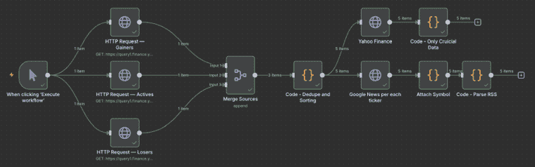

图 5.27: 整体工作流：Code – Dedupe and Sorting 同时连接到 Yahoo Finance 和 Google News 分支

我们现在已经可以从头运行流水线，以确保目前没有错误。

### 重新运行工作流

从手动触发执行整个工作流。确认以下内容：

* 每个节点都变为绿色
* 两个分支都接收到了项目
* 任何节点的执行面板中没有错误

在此阶段，市场指标和新闻馈送均已就绪，下一个任务是将它们整合。通过将每个股票代码的金融信号与其相关的标题对齐，我们为`Mistral`创建了统一的上下文。这为`Step 7`奠定了基础，在那里所有内容将整合为一个结构化的输入以进行深层分析。

## Step 7：合并指标与新闻并准备 Mistral 提示词

现在 Yahoo Finance 指标和 Google News 标题已经在流转，我们准备好按股票代码将它们合并，并将一个整洁的、按符号分组的数据传递给`Mistral`，以生成简洁的买入/卖/持有建议。

### 设置合并块

放置一个`Merge`节点并配置为按字段合并：

* **Mode（模式）**: `Combine`
* **Combine by（合并依据）**: `Matching fields`
* **Fields to Match（待匹配字段）**: `symbol`
* **Inputs（输入）**:
    * 输入 1: 处理后的 Yahoo Finance 指标（你的 5d/5m`Code`输出）
    * 输入 2: 解析后的 Google News 标题（你的 Parse RSS`Code`输出）

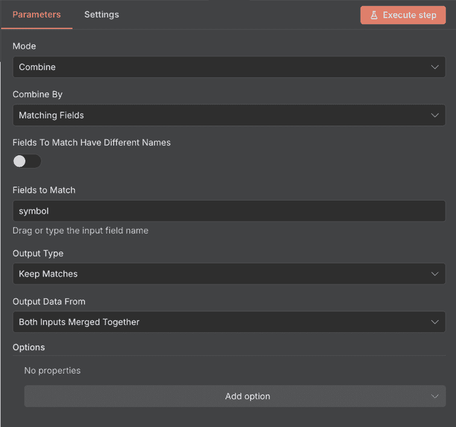

图 5.28: Merge 节点配置，通过符号合并两个输入

运行节点。你现在应该看到每个股票代码对应一个项目，其中包含了金融指标和新闻数组。每个项目将携带`{ symbol, ...financial fields..., news: [ ... ] }`。

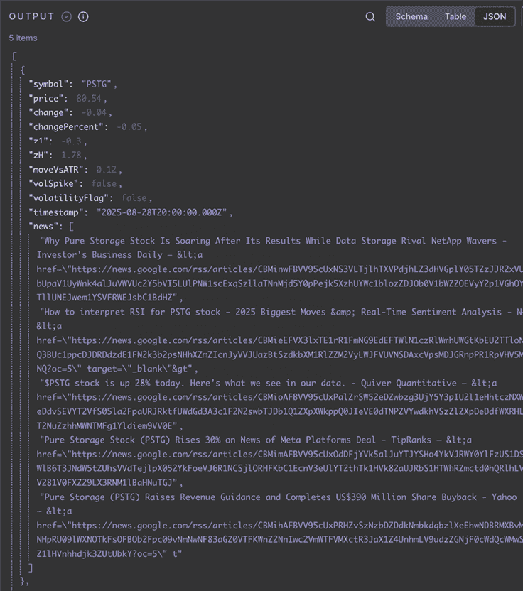

图 5.29: 输出预览，显示每个合并项目包含符号、金融参数和新闻（标题/片段）

在此阶段，我们成功合并并精炼了金融指标和新闻馈送的输出，为每个符号创建了单一的丰富数据集。下一步是为`Mistral`准备这些信息。为此，我们将构建一个结构化的提示词，将金融指标与新闻上下文相结合，为模型提供清晰的视角以生成可操作的建议。

### 构建 Mistral 提示词

你可以从`Code05_Build_Mistral_Prompt.js`复制并粘贴完整的构建器，但让我们过一遍最重要的部分，这样你就确切知道它是工作的：

1. 我们定义了小型辅助函数和限制。我们修剪长标题并只保留少数几个以控制 token；`fmt`安全地格式化数字：

```javascript
const MAX_NEWS = 5;     // 只保留几个标题
const MAX_LINE = 300;   // 截断任何过长的行

function fmt(n, d = 2) { /* 返回 'n/a' 或固定小数 */ }
```

**为什么？**

这在保持提示词简短、可预测且廉价的同时，仍然保留了信息量。

2. 然后我们遍历合并后的项目。我们为每个股票代码构建一个 Mistral 请求，因此每个符号都有自己的建议：

```javascript
for (const itWrap of items) {
  const it = itWrap.json || {};
  // …
}
```

**为什么？**

按项目的调用使得路由、重试和下游发布（Telegram）变得简单。

3. 接下来，我们组装`news`块。我们获取你的新闻数组（标题/片段）并将每个项渲染为项目符号；空列表将获得一个礼貌的占位符：

```javascript
const newsLines = Array.isArray(it.news) ? it.news : [];

const newsBlock = newsLines
  .filter(Boolean)
  .slice(0, MAX_NEWS)
  .map(s => String(s).slice(0, MAX_LINE))
  .map(s => `- ${s}`)
  .join('\n') || '— no news —';
```


**为什么？**

Mistral 会看到一组紧凑、易扫描的、与该股票代码相关的最新标题。

- `系统提示词 (System prompt)`：设置格式规则（适用于 Telegram、无 JSON、无代码块、转义特殊字符）
- `模型与温度 (Model and temperature)`：小型、稳定的模型，输出方差低，以保持格式一致

预期的结果是 Mistral 在 `choices[0].message.content` 中返回一条**单一 MarkdownV2 消息**，可以直接发送到 Telegram。它看起来像这样：

- `*SYM*`
- 评分：`*X/10*`
- 建议：`*买入/持有/卖出*`
- 预测（1 周）：`*N.NN%*`
- 简短的**理由**和一行**不确定性**说明

现在 JSON 体已经就绪，下一步是将其传递到 **HTTP 请求 (HTTP Request)** 节点。这将我们将合并的财务和新闻数据传输到 Mistral API 进行分析。

## 第 8 步：将提示发送到 Mistral 并交付到 Telegram

在此阶段，我们已准备好调用 Mistral API，稍后将每个 MarkdownV2 响应转发到 Telegram：

1. 我们首先开始创建 Mistral HTTP 请求。在你的 **Code** – **Build Mistral Prompt** 节点之后添加一个 **HTTP Request (HTTP 请求)** 节点。将 **Method (方法)** 设置为 **POST**，**Body Content Type (主体内容类型)** 设置为 **JSON**，并将 **Body (主体)** 设置为构建器的输出（例如 `{{$json}}`）。

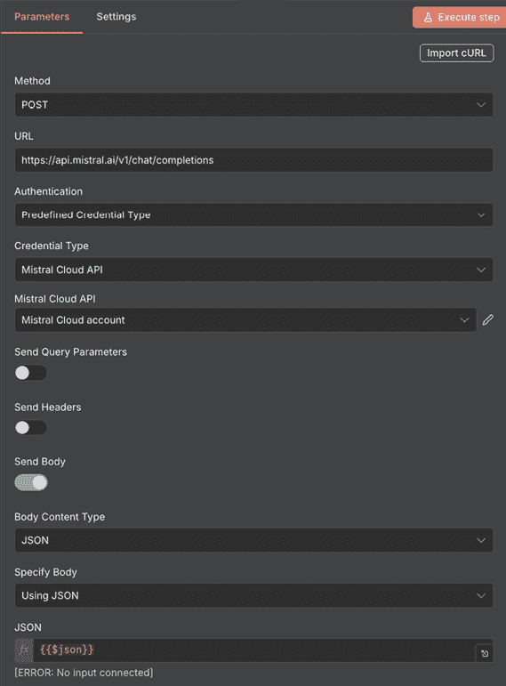

图 5.30：为 Mistral 推理设置的 HTTP 请求节点

2. 然后，配置 Mistral 身份验证。打开节点的 **Authentication (身份验证)** 下拉，选择 **Mistral Cloud API**（内置），并粘贴你的 Mistral API 访问密钥。将其保存为可重用的凭据（例如 `Mistral – Workshop`）。

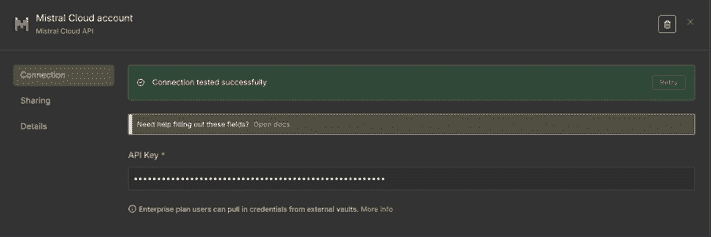

图 5.31：将访问密钥存储为命名凭据的 Mistral Cloud API 凭据

3. 点击 **Execute Node (执行节点)**。响应应包含每个项目的单条消息，可以通过 `choices[0].message.content` 访问，并且已格式化为 MarkdownV2（根据*第 7 步*）。

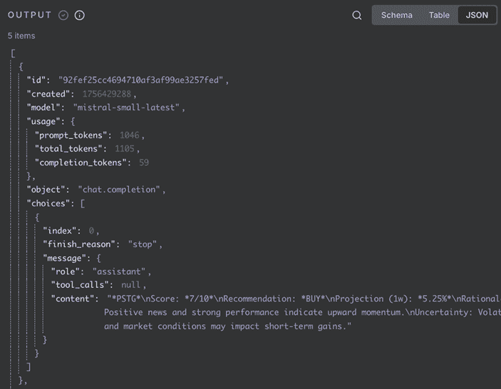

图 5.32：成功的 Mistral 响应

4. 从 Mistral 安全返回响应后，我们现在将焦点转移到提取实际的建议文本。关键内容嵌套在 JSON 回复中，位于 `{{$json["choices"][0]["message"]["content"]}}` 路径下。该值包含了我们将向下传递的洞察，它是模型输出与我们最终交付通道之间的桥梁。
5. 我们通过添加 **Telegram → Send Message (发送消息)** 节点并连接在 Mistral 节点之后来连接 Telegram。在 **Text (文本)** 中，直接使用助手内容，如下例所示：

- **Text (文本)**（表达式）：`{{$json["choices"][0]["message"]["content"]}}`
- **Parse Mode (解析模式)**：**MarkdownV2**

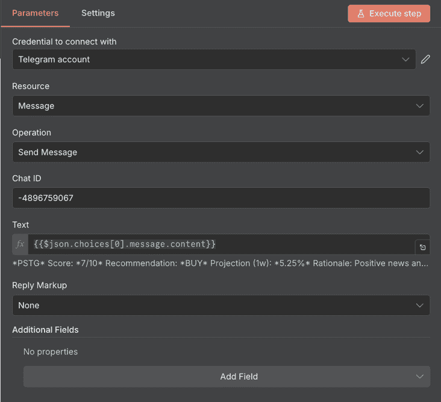

图 5.33：带有 Chat ID 和凭据的 Telegram 发消息

6. 如果尚未配置 Telegram 凭据，你必须在 n8n 中进行设置。请使用从 `@BotFather` 接收到的访问令牌。将此令牌作为 Telegram 凭据输入工作流。

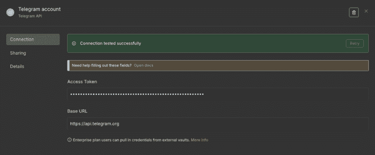

图 5.34：使用访问令牌设置的 Telegram 账户凭据

到此时，我们即将成功完成我们的解决方案。随着 Telegram 的完全连接，已经准备好将流水线作为一个无缝的工作流运行，确保每个节点都能正确处理并无错误地将洞察交付到聊天中。

 **快速提示**：需要查看此图像的高分辨率版本吗？在下一代 Packt Reader 中打开此书，或在 PDF/ePub 副本中查看。

 **购买此书时免费赠送下一代 Packt Reader**。扫描二维码或访问 `packtpub.com/unlock`，然后使用搜索栏通过名称找到此书。双检显示的版本以确保你获得的是正确的版本。


## 第 9 步：运行整个工作流

从手动触发开始运行整个工作流。确保所有节点都成功执行且没有错误，并且每个项目都流到最后，交付 Telegram 消息。

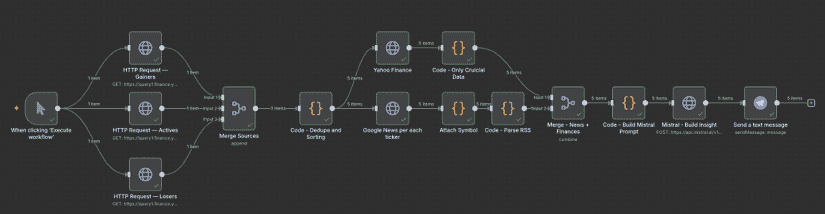

图 5.35：最终成功的工作流

在手机上打开你的 Telegram 聊天——你应该能看到交付了五条消息，每条消息都包含符号、评分、建议、周预测和理由的财务洞察，就像屏幕上显示的一样。

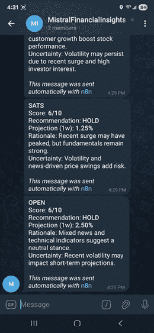

图 5.36：显示目标聊天中收到的 Telegram 消息的手机截图

通过完成这一步，我们实现了一个端到端的工作流，从市场数据和新闻收集，通过 Mistral 分析，到清晰交付。

# 总结

本工作坊逐步让智能的理论变为现实。我们从设置依赖项和验证对 Mistral API 的连接开始。有了这些基础后，我们构建了第一个工具——一个简单的计算器——然后将其封装为智能。从那里，通过添加网络搜索和组装智能，我们扩展了能力。旅程继续到针对角色的智能，并在一个协作解决任务的多智能系统中达到。最后，交互演示让我们测试这些系统，观察它们的推理和适应。实践课程很明确：智能已经是可用、可适应且有价值的。

在深入探索智能之后，我们准备好迎接下一次飞跃：**检索增强生成 (RAG)**。如果说智能给了我们适应性，RAG 则给了我们增强版的记忆——在海量基础中进行推理的能力。在接下来的章节中，你将看到检索和生成如何融合为一个强大的工作流。

# 课外活动

在建立了嵌入工作的良好基础后，你现在准备好探索更高级、更有创意的应用。让这些练习为你的项目激发灵感：

- **构建自定义 n8n 流水线**：从零开始并在 n8n 内部设计你自己的工作流。将数据馈、AI 分析和交付通道相结合，根据独特目标定制快速原型。
- **连接 n8n 与 Discord**：通过将 n8n 与 Webhooks 或机器人集成来扩展你的工作流。这让洞察自动流向专用频道，方便与社区实时协作。
- **在 n8n 中嵌入图表**：通过附加蜡烛图或技术研究增强你的工作流。这创建了丰富的更新，帮助快速理解洞察而非阅读文本。
- **使用 n8n 内置节点替换代码节点**：使用 n8n 的原生节点（如 `Set`、`IF`、`Merge` 或 `Math`）重构工作流部分。这减少了代码复杂性，并突出了 n8n 的无代码潜力。
- **在代码中重新实现 n8n 流水线**：将你在 n8n 构建的自动化工作流在 `Python` 或 `Node.js` 中完全复制。这项练习加强了编码技能，并强化了每一步后的自动化逻辑。
- **使用 Make (Integromat) 进行实验**：设计一个多步骤场景，从 API 获取数据，根据条件分支并做出反应。注意添加推理 (`LLM`) 如何将其提升纯自动化。
- **混合智能挑战**：选择一个任务（例如总结会议记录，然后自动更新 Trello）。使用 Zapier 等无代码工具构建 LLM 智能框架。反思每个部分的闪光之处。

# 加入我们的 Discord 和 Reddit 空间

你不是唯一在应对碎片化工具、不断更新和不明最佳实践的人。加入不断成长的人士社区，交换文档化的洞察。

| 通过更新、讨论和作者的幕后洞察保持联系。加入我们的 Discord `packtpub.com/z8ivB` 或扫描下方二维码：(Images/Discord_Code.jpg) | 在 Reddit 上关注我们，分享想法并讨论真实的 GenAI 挑战。访问 `packtpub.com/0rExL` 或扫描下方二维码：(Images/Reddit_Code.png) |

# 6
