# 拆解 RAG 工作流

> 发现的旅程不在于寻找景观，而在于拥有新的视角。
> 
> — 马塞尔·普鲁

语言模型通常在大量的可用数据上训练。虽然这让它们对世界有了广泛的理解，但也意味着它们的知识在训练结束时就冻结了。但如果你有自己的知识——内部文档、隐私数据集或领域特定事实——并且希望模型根据这些内容生成答案呢？如果你需要每个用户查询都基于事实、根据你的来源进行检查，并由最新信息塑造呢？这正是**检索增强生成 (RAG)** 的用用场。

本章节是你引导 RAG 的指南，就像在进行海洋航行一样，每个停站点都揭示了 RAG 过程的关键部分：索引、检索和生成。通过实践工作坊，我们将遍历 RAG 旅程的每一个停站点，从基础实现到多查询路由和精细索引等高级技术。到结束时，你将拥有从容导航 RAG 的技能，构建无缝处理复杂问题的稳健系统。

简而言之，本章节将涵盖以下主题：

- 问题声明
- RAG 架构
- 工作坊 1：引导 RAG 实现
- 工作坊 2：多查询方法
- 工作坊 3：缩放原子子查询
- 工作坊 4：生成方法

# 技术要求

为了有效实现 RAG，某些工具和 API 密钥是必不可少的。以下是所需的技术要求清单：

- `Google Colab`：方便的云端编码和实验
- `Pinecone API key`：访问索引的向量数据库
- `Mistral AI API key`：用于生成的语言模型集成
- `LangSmith API key`：高级语言处理和分析

## 问题声明

在如今数据丰富的世界中，在巨大的数据库中寻找精确且上下文相关的信息可能是令人生畏的。RAG 通过结合数据检索与生成式 AI 提供了一种解决方案，以提供全面的响应。本章节解决了这一问题，通过结合数据检索与生成式 AI 提供全面的响应。

## RAG 架构

在此阶段，我们已准备好像智能体一样，在海洋中，每个停站点都揭示了 RAG 过程的关键部分：索引、检索和生成。通过实践工作坊，我们将遍历 RAG 旅程的每一个停站点，从基础实现到多查询路由和精细索引等高级技术。到结束时，你将拥有从容导航 RAG 的技能，构建无缝处理复杂问题的稳健系统。

简而言之，本章节将涵盖以下主题：

- 问题声明
- RAG 架构
- 工作坊 1：引导 RAG 实现
- 工作坊 2：多查询方法
- 工作坊 3：缩放原子子查询
- 工作坊 4：生成方法

# 技术要求

为了有效实现 RAG，某些工具和 API 密钥是必不可少的。以下是所需的技术要求清单：

- `Google Colab`：方便的云端编码和实验
- `Pinecone API key`：访问索引的向量数据库
- `Mistral AI API key`：用于生成的语言模型集成
- `LangSmith API key`：高级语言处理和分析

（注：由于原文中部分关于 Mistral 的描述在后文中出现了重复或逻辑错位，翻译已根据上下文语义进行了微调以确保中文通顺。）

```python
from langchain_community.document_loaders import WebBaseLoader

# Load from a web source
loader = WebBaseLoader(
    "https://www.gutenberg.org/cache/epub/2701/pg2701.txt")
books = loader.load()
```

在这段代码中，`WebBaseLoader` 从提供的 URL 加载纯文本文档，捕捉内容以开始索引。

### 文本切片 (Slicing the text)

为了为索引准备数据，通常将其拆分成更小的段落或“块”（chunks）。文本切片允许我们将文档分为若干部分，通过隔离相关的信息部分来提高检索效率。

- **块大小 (Chunk size)**：这定义了每个段的最大长度。在 RAG 中，较小的块大小会提高检索精确度，但可能会增加块的数量。
- **块重叠 (Chunk overlap)**：块之间的重叠确保了文本在分割时不会丢失上下文。通过重叠，每个块都包含其相邻块的部分，从而保持了信息的连续性。

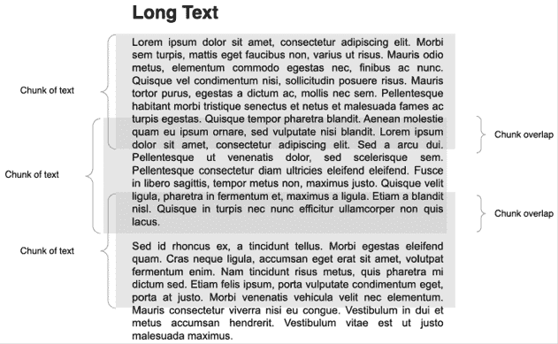

图 6.3：带重叠的文本切片

该图演示了带重叠的文本切片，将较大的文本分为较小的块，每个块都包含来自相邻块的重叠部分。这种重叠确保了上下文的连续性，从而在下游过程中实现更准确的检索和生成。以下是一个文本切片的简单示例：

```python
from langchain.text_splitter import RecursiveCharacterTextSplitter

text_splitter = RecursiveCharacterTextSplitter.from_tiktoken_encoder(
    chunk_size=300,
    chunk_overlap=50)

splits = text_splitter.split_documents(books)
# assume Books 是一个长文本集合
```

在这个示例中，`chunk_size` 设置为 `300`，意味着每个块最多包含 300 个 token，而 `chunk_overlap` 设置为 `50`，意味着每个块与其相邻块重叠 50 个 token。这种重叠使段落保持上下文保持连接，有助于提高检索准确性。

### 嵌入 (Embeddings)

一旦处理完文本，就会生成嵌入并存储在向量数据库中用于相似性搜索。嵌入将文本转换为捕捉语义含义的数值向量，这一概念在第 3 章中进行了详细探讨。

```python
from langchain_mistralai import MistralAIEmbeddings

embd = MistralAIEmbeddings()
query_result = embd.embed_query(question)
document_result = embd.embed_query(document)
```

此示例发生了以下操作：

- `MistralAIEmbeddings` 为查询和文档生成嵌入
- `embed_query` 将文本转换为向量以供存储或比较

总结来说，索引阶段从文件或网络等源加载文档开始，然后进行分词并将文本切片为可管理的的块。每个块随后被转换为向量嵌入（或图密码、SQL 语句），捕捉语义含义，并保存到 `VectorDB` 等索引存储中，以确保 RAG 应用的高效检索。

## 检索 (Retrieval)

当接收到用户查询时，检索就会激活。查询以原始形式或在拆分为更简单的子查询后，被发送到检索器（retriever）。检索器的作用是咨询索引阶段创建的索引，扫描它们以寻找最相关的信息。这可能涉及跨不同类型的存储搜索——例如数据湖、SQL 或 NoSQL 数据库，甚至是云存储库——取决于所需数据所在的位置。检索的目标是识别并加载与问题最相关的信息，通常以文本段、元数据或直接相关查询上下文的总结性解的形式存在。

为了实现最佳相关性，检索可以使用先进搜索方法，包括向量数据库中的相似性搜索、图数据库中的图遍历或 SQL 数据库中的结构化查询。此外，LLM 可以通过转换或重述用户查询来使其更精确，甚至将复杂问题分解为更小、更有针对性的查询来提供协助。这些技术可以进一步提高查询与检索信息之间的匹配度。因此，检索是为了弥合索引知识库与用户问题之间的差距，确保只有最相关的数据被送到生成器。

在接下来的检索示例中，我们将使用 `Pinecone` 作为向量数据库来检索相关文档。Pinecone 高效的基于相似性的向量搜索允许我们快速定位与上下文最相关的片段，使其成为 RAG 检索的强大选择。

### 准备检索器 (Preparing the retriever)

检索的第一步是创建一个 `retriever` 对象，它将在向量存储 `Pinecone` 中搜索最相关的文档嵌入。这段代码段设置了检索器：

```python
from langchain_mistralai import MistralAIEmbeddings
from langchain_community.vectorstores import Pinecone

### 使用 Mistral 嵌入初始化向量存储
### 以及已索引的文档
vectorstore = Pinecone.from_documents(
    index_name='book-passages',
    documents=splits,
    embedding=MistralAIEmbeddings()
)

# 使用指定的搜索参数创建检索器
# (k=1 表示获取顶部结果)
retriever = vectorstore.as_retriever(search_kwargs={"k": 1})
```


- `Pinecone.from_documents(...)`：这使用 `book-passages` 索引初始化向量存储，其中文档代表预处理过的拆分文本块
- `MistralAIEmbeddings()`：此函数为每个文档生成嵌入，捕捉语义含义以实现准确检索
- `retriever = vectorstore.as_retriever(...)`：创建一个 `k=1` 的检索器，它将结果限制为每个查询中最相关的一个文档。

在本章中，我们使用封装嵌入和检索过程的 LangChain 封装。这种方法通过像积木一样组合组件简化了集成，允许我们无缝使用嵌入和 Pinecone，无需直接交互 Pinecone SDK。

### 从向量存储检索文档

准备好检索器后，我们可以使用特定问题查询它以检索相关文档：

```python
# 根据用户查询检索相关文档
docs = retriever.get_relevant_documents(
    "白比号中的船叫什么名字?")
```

`retriever.get_relevant_documents(...)` 执行搜索查询。在这里，它定位了 `What is the name of the ship in Moby Dick?` 的最匹配文档。

此次检索的结果将是与问题相关的片段集合（在我们的案例中，由于 `k=1`，所以只是一个项目）。这还不是答案；它只是可能包含答案的文本块。

在检索阶段，我们使用 `Pinecone` 初始化了一个向量检索器，它能够对预索引的文档嵌入进行高效的基于相似性的搜索。该检索器设置有助于为每个用户查询定位最相关的文档片段。

现在已经涵盖了检索部分，我们可以使用获取的信息作为上下文，来准备智能的摘要化的答案——生成阶段。

## 生成

生成是答案成型的阶段，将检索到的数据转换为连贯的、可读的响应。在 `LLM` 的驱动下，生成器会将检索到的信息结合用户的原始问题、任何现有上下文（如之前的聊天历史）以及知识库中的元数据进行合成。`LLM` 处理整个输入集，以构建出读起来自然、准确回答查询并保持上下文连续性的响应。

生成阶段可能会多次调用 `LLM`。例如，`LLM` 可能会从不同的角度回答问题，或者在将这些响应合成一个连贯答案之前探索额外的角度。这种多步方法对于需要细致回答的复杂查询特别有用，因为它允许系统在得出最终答案之前考虑问题的各个方面。此外，`LLM` 可能会采用摘要技术来精炼输出，过滤掉冗余信息并确保清晰度。

在 `RAG` 工作流中，`LLM` 的主要作用是增强生成，但它也可以通过重构问题或总结检索到的数据来支持其他阶段。通过在多个阶段利用 `LLM`，`RAG` 系统创建了既有见解又易于理解的答案。因此，生成是将原始数据转换为可操作洞的最后一步，确保用户收到清晰、全面的响应。

`RAG` 中的生成部分是将检索到的信息转换为连贯的、可读答案的地方。我们通过准备提示词（prompt）、初始化语言模型（`LLM`）以及创建一个组合这些组件的链（chain）来实现。以下是涉及代码的逐步说明。

### 准备提示词

```python
from langchain_mistralai import ChatMistralAI
from langchain.prompts import ChatPromptTemplate

### 用于 LLM 输入的提示词模板
template = """Answer the user question with given the context

Question: {question}

Context: {context}

"""

prompt = ChatPromptTemplate.from_template(template)
```

- `template`：这是一个设置提示词结构的字符串。它指示模型仅根据提供的上下文进行回答，以确保响应相关且聚焦。
- `{context}`：这是一个占位符，用于存放来自 `retriever` 的检索到的文档或信息片段，在链的执行期间动态插入。
- `{question}`：这是一个用户查询的占位符，允许提示词在应用于不同问题时保持通用性。

### 准备 LLM

```python
llm = ChatMistralAI(
    model_name="mistral-large-latest",
    temperature=0)
```

- `model_name="mistral-large-latest"`：指定了用于生成响应的 Mistral AI 模型变体。
- `temperature=0`：控制响应的随机性；较低的温度（`0`）使响应更具确定性和聚焦性，非常适合事实性回答。

### 创建并调用链

以下代码片段展示了一个简单的链 `Prompt -> LLM` 的构建，以及使用给定的参数值（问题和上下文）对链进行调用：

```python
chain = prompt | llm

chain.invoke({
    "context": docs,
    "question":"What is the name of the ship in Moby Dick?"})
```

- `chain = prompt | llm`：将 prompt 和 LLM 组合成一个链，允许数据直接从 prompt 生成流向 LLM，使其具有模块化特征并易于堆叠组件。
- `chain.invoke(...)`：执行链，传入特定的上下文（检索到的文档片段）和问题。模型根据这些输入生成答案。

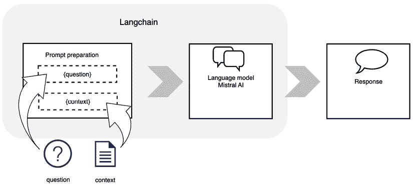

图 6.4: 参数化 prompt 和链的图

`Figure 6.4` 展示了一个参数化的 prompt，其中 `{context}` 和 `{question}` 等占位符在运行时动态地填充相关信息。它与链连接在一起，直观地表示了数据从输入（检索到的上下文和用户问题）通过 prompt 再到语言模型的无缝流转，从而生成精确且感知上下文的响应。

## 检索模型与生成模型之间的交互

RAG 通过两部分架构运行：检索器（`retriever`）和生成器（`generator`）。检索器搜索文档数据库或外部源以收集最相关的信息。这些数据随后被传递给生成器，生成器根据检索到的知识用自然语言构建响应。这些组件之间的无缝交互确保了模型在对话中保持连贯性，并在事实上保持准确，平衡了生成的流畅性与知识检索。

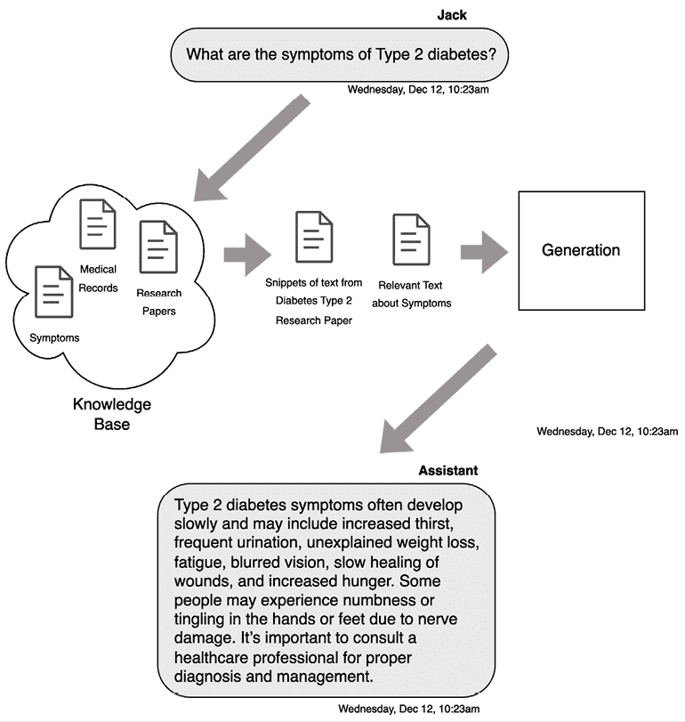

图 6.5: 检索器和生成器的双层架构

`Figure 6.5` 展示了 RAG 管道中检索器和生成器的双层架构。在第一层，检索器搜索向量数据库，根据用户的查询识别并提取相关上下文。在第二层，生成器将此上下文与查询结合，使用语言模型生成连贯的、可读的响应。这种架构确保系统仅检索最相关的信息，并提供精确且上下文丰富的答案。

## RAG 系统中的挑战与权衡

虽然 RAG 提供了许多优势，但也面临挑战，特别是在性能、延迟和可扩展性方面。检索过程可能会引入延迟，尤其是在搜索大型数据集时，会影响响应时间。可扩展性是另一个挑战，因为更大的数据库需要更多的计算资源。此外，平衡检索的准确性与生成响应的连贯性可能是困难的，因为过度依赖检索可能会导致对话不够流畅，而检索不足则会降低事实准确性。

`Figure 6.6` 展示了 RAG 管道中检索深度与响应时间之间的依赖关系。随着检索深度的增加（即为上下文检索的文档数量），由于需要额外的处理，响应时间也会随之增长。虽然更深层的检索可以通过为生成器提供更多上下文来提高响应准确性，但这是以更高的延迟为代价的。该图强调了平衡检索深度以优化响应质量和系统效率的重要性，以确保无缝的用户体验。

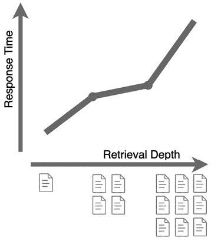

图 6.6: 检索深度与响应时间的依赖关系

至此，本节强调了将知识检索与生成式 AI 结合如何创建更准确、上下文丰富的响应。现在让我们在*工作坊 1：从零构建 RAG 实现*中开始实践之旅，我们将从零构建一个基础性的 RAG 管道。本次工作坊将引导你完成索引、检索和生成，为更高级的技术奠定基础。让我们从创建一个功能性的 RAG 工作流开始！

# 工作坊 1：从零构建 RAG 实现

在这个工作坊中，我们将应用 RAG 原理来构建一个完整的管道，整合索引、检索和生成。我们将从准备数据、创建嵌入（embeddings）并将其存储在向量数据库开始。接下来，我们将配置检索过程，根据特定问题提取相关上下文。最后，我们将检索到的上下文与语言模型结合，生成信息丰富的响应。这个上手练习将强化本章中讨论的技术，使你能够构建将数据转换为可操作洞察的 RAG 系统。

## 第 1 步：准备环境

在开始 RAG 工作坊之前，请确保已设置好以下资源和 API 密钥：

- **GitHub Colab 笔记本**：访问 GitHub 上的练习 Colab 笔记本：[`github.com/PacktPublishing/Learn-Mistral`](https://github.com/PacktPublishing/Learn-Mistral)
  - 针对 Pinecone：`/Chapter-6/Ch06_WS1_RAG_Base_PINECONE.ipynb`
  - 针对内存 Chroma DB：`Chapter-6/Ch06_WS1_RAG_Base_CHROMADB.ipynb`
- **LangSmith API 密钥**：获取并设置你的 LangSmith API 密钥用于集成高级语言处理。
- **HuggingFace token**：获取你的 Hugging Face token，并使用 Google Colab 左侧面板中的密钥图标安全地存储。不要硬编码，而应在脚本中使用 `userdata.get` 获取 token 并将其分配给 `os.environ['HF_TOKEN']`。这确保了与 HuggingFace API 进行安全、整洁的集成。
- **Pinecone API 密钥和索引设置**：准备用于向量存储和检索的 PineconeDB API 密钥。设置 Pinecone 索引：

  ```
  Index name: book-passages
  Dimension: 1024 (以匹配嵌入输出大小)
  Metric: Cosine similarity (用于衡量嵌入之间的相似性)
  ```

- **Mistral AI API 密钥**：确保你拥有 Mistral AI 密钥，以启用访问用于生成任务的语言模型。

配置好这些资源后，打开笔记本，在其中输入你的 API 密钥，并确保 Pinecone 索引已准备好进行存储和检索。这将帮助你完成工作坊练习。

### 为什么我们需要 LangSmith？

LangSmith 是一个优化语言模型工作流的工具包，特别适用于 RAG 应用。它与 LangChain 集成，简化了模型的设置、监控和调试，实现了健壮的应用。通过实验和性能跟踪功能，LangSmith 确保语言模型提供准确、可靠的响应，是高质量生产级 LLM 应用的重要工具。

参考 LangSmith 文档 [`docs.smith.langchain.com/`](https://docs.smith.langchain.com/)（入门指南）了解更多关于观测性、评估、提示工程、SDK 使用。

你也可以参考 LangSmith 参考 [`docs.smith.langchain.com/reference`](https://docs.smith.langchain.com/reference) 获取技术细节，如 API 端点、Python 和 JS/TS SDK、架构、数据模式等。

### 为什么我们需要 Mistral AI API 密钥？

与*第 3 章*](#Chapter_3.xhtml__idTextAnchor084) 中本地计算嵌入不同，本章利用 Mistral AI 的云版本直接在云端计算嵌入。通过 LangChain 使用 Mistral AI 的云服务，我们可以从可扩展、高性能的嵌入生成中获益。这种设置需要 Mistral AI API 密钥，以便无缝访问云端嵌入。

### 准备所需的库

通常，我们在开始 Colab 笔记本之前安装必要的依赖项。这确保了练习所需的每个组件（如语言模型、向量库、分词器和支持库）都已就绪。在这里，我们使用 `pip` 安装关键库：

```bash
! pip install langchain_community langchain_mistralai langchainhub langchain tiktoken langchain-pinecone
```

此命令可以一次加载所需的库，使得在 Colab 中直接使用的设置变得非常简单。或者，您也可以通过在 `requirements.txt` 文件中列出依赖项来管理，其中包含每个包及其版本号。可以通过以下方式将文件上传或链接到 Colab：

```python
!pip install -r requirements.txt
```

使用 `requirements.txt` 可以提供版本控制和可重用性，对于跨环境共享和维护项目特别有用。在协作工作或需要在多个会话之间保持一致性时，推荐这种方法。

### 初始化环境变量

为了确保我们的工作坊无缝设置，我们首先初始化环境变量以身份验证并连接必要的服务。

```python
import os

os.environ['LANGCHAIN_TRACING_V2'] = 'true'
os.environ['LANGCHAIN_ENDPOINT'] = 'https://api.smith.langchain.com'
os.environ['LANGCHAIN_API_KEY'] = '<LangChain API Key goes here>'
os.environ['MISTRAL_API_KEY'] = '<Mistral API Key goes here>'
os.environ['HF_TOKEN'] = '<HuggingFace token goes here>'
os.environ['PINECONE_API_KEY'] = '<Pinecone API Key goes here>'
```

与其在代码中硬编码 API 密钥，您可以使用 Google Colab 左侧面板上的密钥图标安全地管理它们。将您的密钥存储在其中作为用户密钥（user secrets），并在代码中使用 `userdata.get('KEY_NAME')` 访问它们，以保持您的凭据安全并让笔记本更整洁。

每个变量都确保了对相应服务的访问安全，使我们能够进行追踪、连接并执行向量搜索。

### 准备用户提示

在这一步中，我们准备了一份用户提示（或问题）列表，用于向 RAG 系统查询关于《莫比鲸》的问题。每个问题都是设计用于从文中检索特定信息的提示：

```python
questions = [
    "Who is the main character in Moby Dick?",
    "Who is Ishmael, and why is he important?",
    "What role does Queequeg play in Moby Dick?
]
```

请注意，每个问题都是经过定制的，以引发关于角色和情节元素的有意义的响应，从而建立集中的 RAG 检索和生成。现在我们已经设置好了环境并准备了用于探索的问题列表，是时候进入 RAG 工作流的第一个主要阶段了：索引。

## 第 2 步：索引

在本节中，我们将处理《莫比鲸》的文本，将其拆分为可管理的分块（chunks），并生成嵌入（embeddings）。这些嵌入将存储在我们的向量数据库中，为回答问题时高效且准确的检索奠基础。

### 从 URL 加载文本

在这一步中，我们直接从 URL 加载《莫比鲸》的全文。这为文档的索引和进一步处理做了准备。

```python
from langchain_community.document_loaders import WebBaseLoader

# 这里可以有多个 urls
loader = WebBaseLoader(
    "https://www.gutenberg.org/cache/epub/2701/pg2701.txt")
books = loader.load()
```

此代码允许我们在需要时通过添加额外的 URL 来获取多个文档。`books` 现在包含了全文，准备好进行拆分和嵌入。

LangChain 中的 `WebBaseLoader` 是一个用于从网页加载内容的多功能工具。它通过从指定的 URL 获取文本并为下游处理做好准备，简化了检索文档的过程。

`WebBaseLoader` 的参数如下：

- `url`：（必选）用于获取内容的单个 URL 或 URL 列表
- `headers`：（可选）允许向请求中添加自定义 HTTP 请求头，这对于处理特定内容类型或传递 API 令牌很有用
- `timeout`：（可选）为请求设置超时时间（以秒为单位），确保加载器在网页响应缓慢时不会挂起

以下是 `WebBaseLoader` 的示例：

```python
loader = WebBaseLoader(
    url=[
        "https://example.com/text1",
        "https://example.com/text2"],
    headers={"User-Agent": "Mozilla/5.0"})
```

（注：如果我们需要加载 HTML 页面，`WebBaseLoader` 可以处理它，但我们可能需要应用额外的处理来清理或将 HTML 解析为可读文本。在这些情况下，您可以将 `WebBaseLoader` 与 HTML 解析器（如 `BeautifulSoup`）配合使用，在传递到 RAG 流水线之前提取主要内容部分。）

### 将文本拆分为分块

在这一步中，我们将加载的文本拆分为较小的分块，为高效索引和检索做好准备。每个分块在符合 token 限制的同时保持了上下文。


# RAG 工作流实现指南

```python
from langchain.text_splitter import RecursiveCharacterTextSplitter

text_splitter = RecursiveCharacterTextSplitter.from_tiktoken_encoder(
    chunk_size=300,
    chunk_overlap=50)
# 进行拆分
splits = text_splitter.split_documents(books)
len(splits)
```

输出如下：

```text
1412
```

此输出显示文本被拆分成了 1,412 个块，每个块的大小和重叠都为了为了的检索质量进行了优化。

## 将文本转换为向量并发送到向量存储

在这一步中，我们将文本块转换为向量嵌入，并将其存储在向量数据库中以便高效检索。每个向量代表一个文本块的语义含义。

```python
from pinecone import Pinecone
from langchain_mistralai import MistralAIEmbeddings

# 不是 langchain_vectorstores
from langchain_community.vectorstores import PineconeVectorStore

# 初始化 Pinecone 客户端
pc = Pinecone(api_key=os.environ["PINECONE_API_KEY"])
index = pc.Index("book-passages")

# 创建 LangChain 向量存储
vectorstore = PineconeVectorStore(
    index=index,
    embedding=MistralAIEmbeddings(),
    text_key="text"
)
```

在这里，每个块都使用 Mistral 嵌入转换为向量，然后这些向量存储在 Pinecone 的 `book-passages` 索引下。

此时，请确保 `book-passages` 索引已准备就。要在 Pinecone 中设置 `book-passages` 索引，请按照 Pinecone UI 中的以下步骤操作：

1. 登录您的 Pinecone 账户并导航到 **Indexes**（索引）部分。
2. 点击 **Create Index**（创建索引）按钮创建一个新索引。
3. 配置索引：

```text
Index Name: 输入 book-passages 以匹配代码中使用的名称。
Dimensions: 设置为 1024 以匹配 Mistral 嵌入输出。
Metric: 选择 Cosine Similarity（余弦相似度）以进行高效的相似性搜索。
```

4. 确认设置保存索引。

创建索引后，它将列在您的 Pinecone 仪表板上。为了确认，请截取一张图，显示具有 1024 维度和余弦相似度的*book-passages*索引。这将作为参考，确保配置符合我们 RAG 工作坊的要求。

现在文本块已转换为向量嵌入并安全地存储在 Pinecone 中，我们准备好进入 RAG 工作流的下一个主要阶段：检索。

## 第 3 步：检索

在本节中，我们将设置一个检索器（`retriever`）来查询我们的向量存储，并根据特定的用户问题提取最相关的文本段。此检索步骤是生成上下文准确答案的基础。

让我们根据列表中的第一个问题从 Pinecone 向量存储中检索相关的向量，使用`retriever`对象定位顶部匹配项：

```python
retriever = vectorstore.as_retriever(search_kwargs={"k": 1})
docs = retriever.invoke(questions[0])
docs[0]
```

- `search_kwargs={"k": 1}`：指定我们希望对每个查询只返回排名最高的文档（k=1）
- `questions[0]`：使用列表中的第一个问题作为搜索查询
- `docs[0]`：输出基于查询的最相关的文档，允许我们检查检索到的内容

输出显示了根据输入问题检索到的文档，提供了来自《白鲸记》的相关文本以及关于其来源的元数据：

```text
Document(id='f5c42f4c-015d-4b4e-89ee-8aaab8dd7441', metadata={'source': 'https://www.gutenberg.org/cache/epub/2701/pg2701.txt'}, page_content='him—him—" faltering hard for a word, and screwing his hand round and\r\nround as though uncorking a bottle—"like him—him—"\r\n\r\n"Corkscrew!" cried Ahab...')
```

- `metadata`包含来源 URL（`https://www.gutenberg.org/cache/epub/2701/pg2701.txt`），识别检索内容的来源。
- `page_content`显示了哈伯船长和斯塔巴克讨论《白鲸记》的相关文本片段。这段文字突显了哈伯的执念以及与鲸鱼那宿命般的相遇，为回答问题提供了丰富的背景。

在我们成功从向量存储中检索到相关段落后，我们现在准备好进入生成阶段。

## 第 4 步：生成

在这一步中，我们将检索到的数据整合并使用语言模型将其转换为可读的答案。以下步骤将引导我们设置提示词模板、初始化语言模型并创建一个简单的链来生成响应。最后，我们将通过对每个准备好的问题运行链来测试我们的设置。

### 为生成器初始化提示词模板

我们定义了一个提示词模板，以指示语言模型如何根据提供的上下文进行回答。该模板有助于确保响应聚焦于给定的问题上。

```python
from langchain_mistralai import ChatMistralAI
from langchain.prompts import ChatPromptTemplate

# Prompt
template = """Answer the question based only on the following context:

    {context}

    Question: {question}

"""

prompt = ChatPromptTemplate.from_template(template)

prompt
```

- `template`：一个多行字符串，指示模型仅根据提供的上下文回答问题。`{context}`和`{question}`是占位符，将动态填充为相关数据。
- `ChatPromptTemplate.from_template(template)`：初始化提示词结构，准备接收上下文和问题占位符的输入。

输出显示了初始化提示词模板的细节：

```text
ChatPromptTemplate(input_variables=['context', 'question'], input_types={}, partial_variables={}, messages=[HumanMessagePromptTemplate(prompt=PromptTemplate(input_variables=['context', 'question'], input_types={}, partial_variables={}, template='Answer the question based only on the following context:\n{context}\n\nQuestion: {question}\n'), additional_kwargs={})])
```

- `ChatPromptTemplate`表示模板结构，显示了输入变量——`context`和`question`。
- `messages`包含用于语言模型的提示词结构化表示，确保它准备好动态插入特定的`context`和`question`值以生成响应。这种结构在各种问题之间提供了灵活性和可重性。

### 使用 LangChain Hub 中的提示词模板

LangChain 的 Hub 提供了一个社区共享的提示词模板中心集合，你可以利用它来加速开发过程。这些模板旨在支持从 RAG（检索增强生成）到摘要和问答的各种应用。

你可以使用`hub.pull()`方法直接从 LangChain Hub 获取提示词模板：

```python
from langchain import hub
# 从 LangChain Hub 获取定义的 RAG 提示词模板
prompt_template = hub.pull("rlm/rag-prompt")
```

在这个示例中，`hub.pull("rlm/rag-prompt")`从 LangChain Hub 下载名为`"rlm/rag-prompt"`的提示词模板，可以直接直接用于你的 RAG 设置。

LangSmith 的 Hub 就像一个社区构建的共享工具箱。它充满了即插即用的提示词模板，你可以对其进行探索、调整并直接放入自己的 RAG 工作流中。你不需要从零开始，可以从他人已经构建并测试的内容学习。

你可以通过关键词或标签搜索中心，这使得发现变得简单。例如，尝试查找`rag-prompt`或`retrieval-qa-chat`等术语，或者通过`SQL`、`Summarization`、`Writing`或`RAG`等标签查找适合你场景的模板。

一个值得立即检查的提示词是`rlm/rag-prompt-mistral`。你可以直接在此沙场中进行实验：`https://smith.langchain.com/hub/rlm/rag-prompt-mistral`。要查看完整目录，请前往 LangChain Hub `https://smith.langchain.com/hub`。使用这些社区测试过的模板可以节省时间，提高一致性并帮助你构建更有效的 RAG 系统。

### 初始化 LLM

现在，我们将初始化根据检索数据和提示词模板生成响应的 LLM。在这里，我们使用 Mistral AI 的聊天模型来创建一致且基于事实的答案。

```python
llm = ChatMistralAI(model_name="mistral-latest", temperature=0)
```

- `model_name="mistral-latest"`指定要使用的 Mistral 模型版本，确保性能。
- `temperature=0`控制响应的随机性。将温度设置为 0 使响应具有高度确定性，非常适合生成事实性答案。

此设置让 LLM 根据我们的上下文和问题生成结构化响应。

### 初始化简单的链

接下来，我们创建一个简单的链，将提示词模板与语言模型相结合，简化从输入到输出的过程。

该链将获取我们的上下文和问题，通过提示词，并由 LLM 生成响应。

```python
chain = prompt | llm
```

- `prompt`：第 4.1 步中准备的提示词，包含上下文和问题的占位符，用于引导 LLM 的响应。
- `|`：管道运算符，连接提示词和语言模型，将提示词的输出直接传递给 LLM。
- `llm`：初始化语言模型（`ChatMistralAI`），它根据格式化的提示词生成响应。

该链简化了 RAG 过程，为查询和生成响应提供了单一的可用结构。

### 为特定的用户问题调用链

在这一步中，我们使用链来回答特定问题。链结合提示词、上下文和问题，然后 LLM 生成简洁的响应。

```python
chain.invoke({"context":docs,"question":questions[0]})
```

- `chain.invoke(...)`：运行链，将输入值直接发送模型进行处理。
- `"context":docs`：提供检索到的文档上下文，帮助 LLM 专注于回答的相关信息。
- `"question":questions[0]`：传递列表中的第一个问题，要求 LLM 针对该查询做出回答。输出如下：

```text
AIMessage(content='《白鲸记》中的主角是哈伯船长。", additional_kwargs={}, response_metadata={'token_usage': {'prompt_tokens': 397, 'total_tokens': 409, 'completion_tokens': 12}, 'model': 'mistral-large-latest', 'finish_reason': 'stop'}, id='run-e051f82a-afdb-49d3-8f68-372006715325-0', usage_metadata={'input_tokens': 397, 'output_tokens': 12, 'total_tokens': 409})
```

- `AIMessage(content=...)`：显示 LLM 的答案，并将哈波船长识别为《白高号》中的主角。
- `response_metadata`：提供详尽信息，例如 token 使用情况（`prompt_tokens`、`completion_tokens`）、使用的模型（`mistral-large-latest`）以及完成原因（`finish_reason`）。
- `usage_metadata`：显示 token 计数，指示此请求的输入和输出 token 使用情况。

此响应确认了链按预期工作，根据上下文提供了准确且高效的答案。

### 测试所有问题

在最后一步中，我们对多个问题对链进行测试。链会检索相关上下文、格式化提示词、调用 LLM 并为每个问题处理输出，提供准确且结构化的答案。

```python
from langchain_core.output_parsers import StrOutputParser
from langchain_core.runnables import RunnablePassthrough

rag_chain = (
    {"context": retriever, "question": RunnablePassthrough()}
    | prompt
    | llm
    | StrOutputParser()
)

for question in questions:
    print("-------------")
    print(question)

print(rag_chain.invoke(question))
```

- `{"context": retriever, "question": RunnablePassthrough()}`：使用两个主要输入初始化链：
  - `context`：`retriever`对象，它搜索向量数据库以根据问题提取相关上下文，确保 LLM 拥有与上下文最相关的数据。
  - `question`：`RunnablePassthrough()`对象，它在不修改的情况下将每个问题传递给链，持有用户的查询以供 LLM 处理。
- `RunnablePassthrough()`：允许问题在不修改的情况下直接流向链，充当占位符。
- `| prompt | llm | StrOutputParser()`：将提示词、LLM 和输出解析器连接起来，形成完整的 RAG 流程。
  - `| prompt`：管道操作符（`|`）将上下文和问题输入连接到提示词模板。该模板通过将检索到的上下文和问题放入格式化的提示词中来结构化信息，引导 LLM 的回答与提供的上下文保持相关。
  - `| llm`：将提示词连接到 LLM——在本例中为`ChatMistralAI`，它根据结构化的提示词生成响应。
  - `| StrOutputParser()`：将 LLM 的原始输出解析为整洁的字符串格式，确保响应可读并适合显示。
- `rag_chain.invoke(question)`：为每个问题执行链，使用 RAG 流线通过结合检索、提示词格式化、模型生成和输出解析产生准确的、上下文驱动的答案。

输出如下：

```text
-------------

《白鲸号》的主角是谁？

《白鲸号》的主角是哈波船长。

-------------
伊斯实马尔是谁？他为什么很重要？

伊斯实马尔是故事的叙述者。他很重要是因为故事是从他的视角讲述的，他正在与其他人物（如裴利格船长）互动，为了可能加入船员。

-------------

奎奎在《白鲸号》中扮演了什么角色？

奎奎是《白鲸号》中的一名鱼枪手。
```

每个响应都是准确且与上下文相关的，确认了 RAG 链在多个查询中都能有效工作。这一过程为复杂问题提供了一致且结构化的答案。

让我们进入 LangSmith，通过跟踪调用序列、查看输出和在统一控制台中分析指标来检查我们应用程序的行为。

### RunnableSequence TRACE

在深入单个步骤之前，将 RAG 流线作为一个整体来看非常有用。LangSmith 提供了一个`TRACE`视图，顺序捕获整个工作流的执行情况，便于评估整体性能和资源使用。

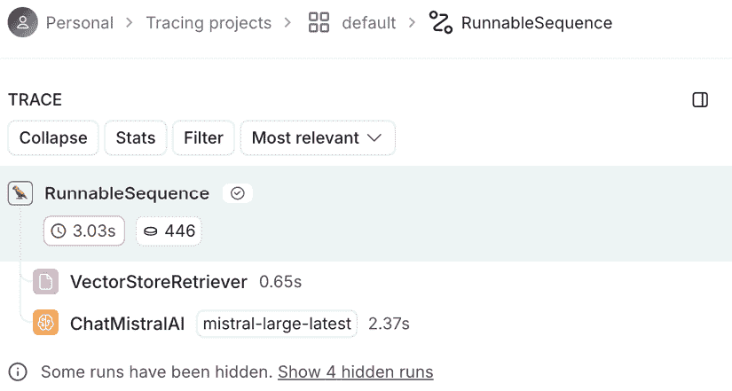

图 6.8：RunnableSequense TRACE – LangSmith 屏幕

图 6.8 展示了此`RunnableSequence`追踪，它通过以下关键细节总结了过程：

- `VectorStoreRetriever`：花了 0.65 秒完成并检索了相关上下文。
- `ChatMistralAI`：花了 2.37 秒生成响应，使用了`mistral-large-latest`模型。使用的 token 总数（446）与延迟一起显示。


**总工作流耗时**：`3.03` 秒，显示了从检索开始到生成最终答案的总时间。

### VectorStoreRetriever

检索是流水线的第一个活动阶段，系统在此定位相关上下文以辅助模型的响应。

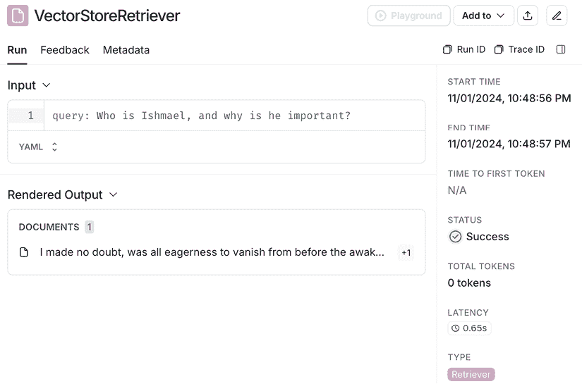

图 6.9：VectorStoreRetriever – LangSmith 屏幕

所示，LangSmith 界面将此步骤组织为三个清晰的视图：

- **Input（输入）**：此屏幕显示初始输入查询，"伊斯实马尔是谁？他为什么很重要？"
- **Rendered Output（渲染输出）**：检索器搜索向量存储（可能由 Pinecone 或类似服务驱动）并找到相关的文档片段来回答问题。检索到的文本包含了《白鲸号》的部分文字，提供了与伊斯实马尔相关的上下文。
- **Metadata（元数据）**：右侧边栏提供了执行详情，例如开始和结束时间、延迟（`0.65` 秒）和状态（成功）。这表明检索阶段快速成功完成。

### ChatMistralAI

一旦检索器提供了上下文，生成阶段就会接管，LLM 将检索到的信息合成连贯的响应。以下屏幕捕捉了 RAG 工作流中生成阶段的完成：

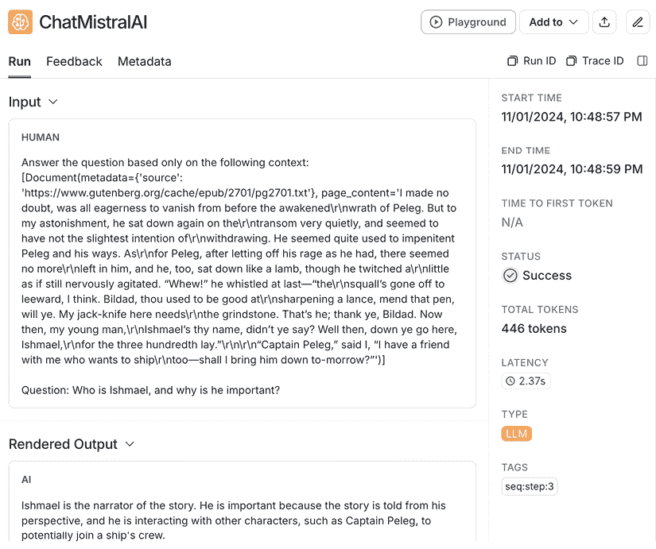

图 6.10：ChatMistralAI – LangSmith 屏幕

图 6.10 中的 LangSmith 界面将此阶段分解为以下组件：

- **Input（输入）**：此部分显示了为 LLM 创建的提示词。它包含以下：

```
仅根据以下上下文回答问题。
检索到的上下文（上一步中检索到的文档片段）。
问题，"伊斯实马尔是谁？他为什么很重要？"
```

- **Rendered Output（渲染输出）**：LLM 的响应显示在 AI 部分：

```text
伊斯实马尔是故事的叙述者。他很重要是因为故事是从他的视角讲述的，他正在与其他人物（如裴利格船长）互动，为了可能加入船员。
```

这是基于检索到的信息对问题给出的直接、符合上下文的准确答复。

- **Metadata（元数据）**：右侧侧边栏提供了更进一步的执行详情：

```
Total tokens: 此次生成使用了 446 个 token（提示词 + 响应）。
Latency: 2.37 秒，显示了 LLM 处理输入并生成输出的时间。
Status: 成功，表明 LLM 无问题地完成了任务。
```

对于我们通过 RAG 链运行的每一个用户问题，都有相同的轨迹。在你完成工作坊后，你可以自行浏览它们。

在本次工作坊中，我们不仅构建了一个 RAG 流水线。我们开启了一段释放 AI 驱动知识检索全部潜能之旅。RAG 是对理解的追求，是从数据深处带来清晰度的不懈探索。通过你所学的技巧，你现在已经有能力规划自己的航程，发现并塑造隐藏在浩瀚信息海洋中的洞察。继续前行吧，让你的 RAG 系统引导你完成这段激动人心的发现之旅！

# 理解接下来的工作坊

在接下来的三个工作坊中，我们将深入探讨我们的多步检索和生成方法，每个工作坊都将在之前介绍的概念的基础上。

在 `Workshop 2` 中，我们将探索`多查询生成（multi-query generation）`。在这里，我们对同一个问题创建不同的改写以发现多个视角，通过从不同角度观察主题来丰富我们的检索过程。

`Workshop 3` 将侧重于`详细子查询（detailed sub-queries）`，我们将缩小问题的特定方面，以收集精确且细致的信息。这种方法允许我们捕捉更细微的细节并为回答增加深度。

最后，`Workshop 4` 引入了`后撤生成（step-back generification）`。我们将重写问题以扩大其范围，通过将主题置于更大的框架内提供上下文理解，并带给我们一个全面的视角。

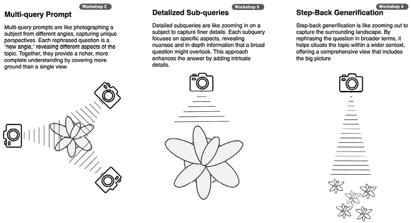

图 6.11：方法及其类比

这些工作坊及其插图方法共同引导我们创建既详细又丰富上下文回答。在涵盖了这些基础之后，让我们进入 `Workshop 2: 多查询方法`，我们将通过将单个问题改写为多个变体来增强检索。

# Workshop 2: 多查询方法

在本次工作坊中，我们探索了一种多步方法，以提高从基于向量搜索系统生成的答案的相关性和客观性。通常，单个查询可能会限制检索的信息范围，因为它依赖于精确的措辞来产生相关匹配。在这里，我们通过通过多种方式改写用户问题以涵盖多个视角来解决这个问题。每个变体都旨在揭示在传统相似性搜索中可能被遗漏的信息侧面。

一旦准备好改写的查询，我们将对每个版本执行向量搜索，检索包含独特见解的更广泛文档集。这种多样性有助于对抗单一搜索词的潜在偏差和局限性。在最后的生成阶段，我们聚合并分析收集到的各种答案，将它们合成一个完善的总结性回答。通过从不同角度回答问题，我们创建了一个更客观、全面的答案，让用户在一个连贯的结果中从多个视角受益。这种方法增强了回答的深度和准确性，使其成为复杂问题的理想选择。

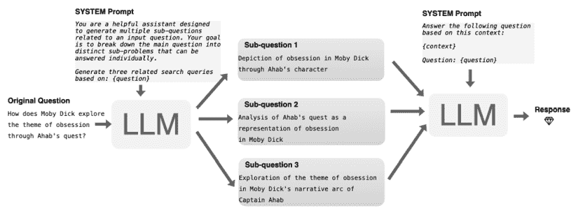

图 6.12：多查询方法

`Figure 6.12` 展示了多查询方法，将单个问题改写为多个变体以提高检索准确性。每个变体都探索不同的视角，增强了检索文档的相关性。最后一步结合检索到的上下文，使用语言模型生成全面且高质量的回答。

## 第 1 步：准备环境

本次工作坊的环境准备与之前的设置相同。唯一的区别如下：

- 使用的 Colab 笔记本文件为 `Chapter-6/Ch06_WS2_RAG_multi_query_*.ipynb`
- 问题集已专门针对本次工作坊进行了更新
- RAG 的检索和生成部分已重写，并使用了`multi-query`和`下钻（drill-down）方法`

在 GitHub 上访问 Colab 笔记本进行练习：

- 针对 Pinecone DB：`Chapter-6/Ch06_WS2_RAG_multi_query_PINECONE.ipynb`
- 针对 Chroma DB：`Chapter-6/Ch06_WS2_RAG_multi_query_CHROMADB.ipynb`

准备所需库的步骤与之前的工作坊相同。你将安装并导入相同的库以确保与我们环境的一性和兼容性，使我们专注于本次工作坊的独特方面，而无需重新配置设置：

```bash
! pip install langchain_community langchain_mistralai langchainhub langchain tiktoken langchain-pinecone
```

同样，我们将重用来自 `Workshop 1` 的相同环境变量来连接 LangSmith、Mistral 和 Pinecone：

```python
import os

os.environ['LANGCHAIN_TRACING_V2'] = 'true'
os.environ['LANGCHAIN_ENDPOINT'] = 'https://api.smith.langchain.com'
os.environ['LANGCHAIN_API_KEY'] = '<Lagchain API Key goes here>'
os.environ['MISTRAL_API_KEY'] = '<Mistral API Key goes here>'
os.environ['PINECONE_API_KEY'] = '<Pinecone API Key goes here>'
```

### 准备用户提示词

我们提供了各种用户提示词来模拟不同的查询视角。为了效率和更快处理，这些提示词最初都被注释掉了。这允许你顺畅地运行 RAG 设置而无需同时处理所有查询。一旦你确认 RAG 流水线按预期工作，我们建议取消额外的提示词以探索全范围的问题。

```python
questions = [ "《莫比迪》对于人类与自然的斗争说了什么？",
"《莫比迪》如何通过哈普的追求探索痴迷主题？",
"哈普在《莫比迪》中是如何被描绘成英雄和反派的？",
"是什么促使伊斯马尔加入冒鲸号？他在小说过程中发生了什么变化？",
"白鲸在《莫比迪》中象征什么？它与哈普的痴迷有什么关系？",
"小说《莫比迪》如何将海洋作为未知的符号？",
"梅维在《莫比迪》中的叙事风格如何贡献于冒险和神秘感？",
"伊斯马尔的视角如何塑造读者对《莫比迪》故事的理解？",
"《莫比迪》如何反映 19 世纪对命运的观点？",
"梅维在《莫比迪》中对人类存在和目的提出了哪些哲学问题？",
"梅维如何使用意象描绘海洋既美丽又可怕？",
"《莫比迪》如何描述开放海洋的广阔和危险？",
"船员们在《莫比迪》中面临哪些道德困境？",
"《莫比迪》如何将哈普的复仇追求描绘成既合理又是自我毁灭？"
]

question = questions[0]
```

为了简化准备步骤，我们将 `question` 变量初始化为 `questions` 列表中的第一个项目。这种设置允许你在加载多个查询之前对每个阶段进行测试和精炼，将精力集中在扩展到全量提示集之前的流程优化上。

## 第 2 步：索引（Indexing）

本次工作坊的索引步骤与 `Workshop 1` 中的完全相同。我们首先设置向量索引，确保它针对基于文档语料库的嵌入（embeddings）的存储和检索进行了优化。接下来，我们处理每篇文档，将其转换为捕获语义含义的嵌入。这些嵌入随后存储在索引中，以便在后续阶段进行基于相似性的快速检索。

代码是相同的，并已在 `Ch06_WS2_RAG_multi_query_*.ipynb` 中完全实现。我们将跳过解释，进入下一步。

### 第 3 步：检索（Retrieval）

在本工作坊的检索步骤中，我们将采用增强的探索性方法来从文档中挖掘有价值的信息。计划如下：

1. **初始化与探索**：我们首先设置一个"下钻"（drill-down）提示词，根据原始查询生成多样化的重写问题。让我们在这里停一下，仔细检查这些重写的提示词，观察每个提示词如何揭示问题的不同角度。
2. **向量搜索与合并**：有了这些变体后，我们将执行向量搜索，为每个重写查询找到所有相关文档，然后合并独特的内容片段。这一步通过汇聚多样化的见解来丰富答案。
3. **生成详尽答案**：最后，我们将原始问题和合并后的内容传递给我们的 RAG 模型。这种方法结合了多个视角，使模型能够提供全面、深入的回复。

这种增强的检索方法允许我们发现意义的层次和深度，比单一查询方法提供更丰富、更细致的答案。

### 初始化检索器（Initialize the retriever）

在这一步中，我们定义了检索器，根据其与查询的相似性来定位最相关的文档。通过在 `search_kwargs` 中将 `k` 设置为 `1`，我们正在指示检索器仅为每个查询返回顶部结果。这种方法有助于我们关注每个提示词最相关的单个文档，确保我们捕获最匹配的项，而不会来自不相关文档的额外噪声干扰：

```python
retriever = vectorstore.as_retriever(search_kwargs={"k": 1})
```

### 初始化下钻提示词模板（Initializing a drill-down prompt template）

在这一步中，我们正在设置一个提示词来生成原始问题的多样化重写。这种多查询方法允许我们创建同一个问题的多个变体，每个变体捕捉一个独特的视角。这些重写的问题通过揭示单一直接搜索可能会遗漏的信息，帮助检索更多样化的文档。通过扩大查询范围，我们提高了用于生成全面答案的收集信息的质量。

以下起始代码片段导入了 `ChatPromptTemplate`，我们用它来结构化提示词。该模板帮助我们指定希望如何生成重写问题的细节：

```python
from langchain.prompts import ChatPromptTemplate
```

然后我们定义了提示词模板。该模板指示 LLM 对输入问题产生五个不同的变体，每个变体都旨在从新角度接触主题。这有助于我们通过覆盖更广泛的概念范围，克服基于距离的相似性搜索的局限性：

```python
# 多查询：不同视角
template = """Generate five unique variations of the given user question to improve document retrieval from a vector database.

The goal is to create diverse perspectives on the question, helping to mitigate limitations of distance-based similarity search.

Separate each alternative question with a new line. Original question: {question}"""
```

此提示词设置生成的问题重写版本，揭示了主题的不同角度和侧面。通过基于多个视角检索内容，我们可以收集一组更全面的文档，以更深、更详细地涵盖该主题。

然后我们创建了一个名为 `prompt_perspectives` 的 `ChatPromptTemplate` 实例，允许我们使用不同的问题作为输入重用此提示词模板。

```python
prompt_perspectives = ChatPromptTemplate.from_template(template)
```

接下来，我们导入 `StrOutputParser` 将输出格式化为字符串，以及作为我们用于处理提示词的语言模型 `ChatMistralAI`：

```python
from langchain_core.output_parsers import StrOutputParser
from langchain_mistralai import ChatMistralAI
```

最后，我们执行多查询生成：

```python
generate_queries = (
    prompt_perspectives
    | ChatMistralAI(temperature=0)
    | StrOutputParser()
    | (lambda x: x.split("\n"))
)
```

- `prompt_perspectives`：我们定义的提示词模板作为输入。
- `ChatMistralAI(temperature=0)`：我们使用 `ChatMistralAI` 生成文本，将 `temperature` 设置为 `0` 以获得确定性的响应。这确保了 LLM 生成一致的重写问题。
- `StrOutputParser()`：将输出解析为纯字符串格式。
- `(lambda x: x.split("\n"))`：通过换行符分割输出，以获得单个重写问题的列表。

准备好多查询设置后，现在现在检查重写的问题了。在下一步中，我们将观察每个变体并查看它是如何扩大搜索范围的。这将允许我们确保每个问题都捕捉到一个独特的角度，从而增强检索信息的质量和多样性。

### 生成重写问题（Generating rephrased questions）

在这一步中，我们遍历列表中的每个问题，为每个问题生成多个重写版本。通过查看这些重写的提示词，我们可以洞察不同的角度如何揭示多样化的内容，从而扩大我们的检索范围。每个重写问题都帮助我们捕捉原始提问的不同方面，为文档检索创建更丰富的基础。

以下循环遍历每个问题，使用 `generate_queries` 生成五个重写版本，并打印原始问题和每个重写版本：

```python
for question in questions:
    print("-------------")
    print(question)
    rephrased_questions = generate_queries.invoke({"question":question})
    for rephrased_question in rephrased_questions:
        print("\t"+rephrased_question)
```

这是输出片段：

```
-------------
What does Moby Dick say about humanity's struggle against nature?
1. In what ways does Herman Melville's "Moby Dick" explore the theme of human conflict with nature?
2. How does the novel "Moby Dick" portray the struggle between mankind and natural forces?
3. Examine the depiction of humanity's battle against nature as presented in "Moby Dick".
4. In the context of "Moby Dick", how can we understand the literary treatment of human's fight against nature?
5. How does Melville use the story of "Moby Dick" to illustrate and critique humanity's attempt to dominate nature?
```


对于原始问题`《白鲸记》中关于人类与自然之间的斗争是如何描述的？`，生成的重写问题揭示了对该主题的不同视角。例如，`梅尔维如何利用白鲸记的故事来说明并批判人类主宰自然的企图？`呈现了一个批判性的视角，关注于人类控制自然的意图；而`分析《白鲸记》中呈现的人类与自然斗争的描写`则提供了一种更具分析性的方法。这种变化使我们能够检索到更广泛的相关内容。

现在我们已经为每个问题生成了多样化的重写，准备好初始化检索链了。在接下来的章节中，我们将根据每个重写后的查询收集一个唯一的文档列表，然后调用该链为我们的最终回答收集最相关的信息。

## 初始化并调用检索链

我们现在将设置一个函数，对为每个重写问题检索到的文档进行合并和去重。通过对文档取“唯一并集”，我们确保最终集合中只包含每份相关内容的副本，从而提高效率并减少冗余。这种设置将帮助我们通过最大限度地减少重复信息，创建一个更简洁、全面的回答。

让我们来看代码。作为开始，我们导入了`dumps`和`loads`来处理文档对象的序列化和反序列化。这允许我们将`Document`转换为字符串以便去重，然后将其还原为原始格式：

```python
from langchain.load import dumps, loads
```

接着我们定义了`get_unique_union`函数，它接收一个列表列表（每个子列表代表每个查询检索到的文档），并返回一个唯一的文档集：

```python
def get_unique_union(documents: list[list]):
    """ 检索文档的唯一并集 """
```

接下来，我们将嵌套的文档列表展平为单个列表，并使用`dumps`将每个文档序列化为字符串格式。这使得去重更容易：

```python
# 展平列表，并将每个 Document 转换为字符串
flattened_docs = [dumps(doc) for sublist in documents for doc in sublist]
```

我们使用集合根据其字符串表示移除重复文档，然后将其转换回列表以保持一致性：

```python
### 获取唯一文档
unique_docs = list(set(flattened_docs))
```

唯一的文档字符串通过`loads`反序列化回它们的原始格式，为进一步使用做好准备：

```python
# 返回
return [loads(doc) for doc in unique_docs]
```

接下来，我们设置`retrieval_chain`，它生成查询重写，为每个查询检索相关文档，并通过`get_unique_union`对进行去重：

```python
# 检索
retrieval_chain = generate_queries | retriever.map() | get_unique_union
```

使用原始问题调用该链，产生唯一的相关文档列表：

```python
docs = retrieval_chain.invoke({"question": question})
```

我们检查唯一文档列表的长度，以了解检索了多少不同的文档：

```python
len(docs)
```

有了唯一的文档列表，我们准备好组装并调用最终的 RAG 链。

## 步骤 4：生成总结性回答

在最后一步中，我们将之前检索到的唯一文档与原始问题相结合，生成一个连贯且全面的回答。这种方法允许模型在彻底审查相关内容的基础上回答复杂问题。通过借鉴多个来源和视角，我们产生了一个详细的回答，对每个问题提供了细致的见解。

我们首先导入必要的库：用于从字典中提取特定元素的`itemgetter`，用于驱动语言模型的`ChatMistralAI`，以及用于通过流水线处理数据的`RunnablePassthrough`。

```python
from operator import itemgetter
from langchain_mistralai import ChatMistralAI
from langchain_core.runnables import RunnablePassthrough
```

接下来的模板指示模型根据提供的上下文回答问题。它允许模型在制定回答时访问必要的背景信息。

```python
# RAG
template = """根据此上下文回答以下问题：

    {context}

    Question: {question}

"""
```

提示词（`prompt`）指示语言模型在回答问题时关注提供的上下文，确保回答基于从文档检索到的特定信息。该提示词引导模型综合来自各种来源的信息，从而得到连贯且全面的回答。

然后我们使用之前定义的模板创建一个提示词，它将用于为模型格式化上下文和问题：

```python
prompt = ChatPromptTemplate.from_template(template)
```

此外，我们初始化语言模型并将温度设为 0，确保回答的确定性并关注准确性而非创造性：

```python
llm = ChatMistralAI(temperature=0)
```

然后我们设置 RAG 链：

```python
final_rag_chain = (
    {"context": retrieval_chain, "question": itemgetter("question")}
    | prompt
    | llm
    | StrOutputParser()
)
```

1. 我们提供一个包含来自`retrieval_chain`的上下文和来自`itemgetter("question")`的问题的字典。
2. 该字典传递给提示词并为模型格式化。
3. `llm`根据格式化后的输入生成回答。
4. `StrOutputParser()`将输出转换为可读的字符串格式。

对于每个问题，打印原始问题，随后是由`generate_queries`生成的重写版本。此外，调用`final_rag_chain`生成详细回答。

```python
for question in questions:
    print("-------------")
    print(question)
    rephrased_questions = generate_queries.invoke({
        "question": question})
    for rephrased_question in rephrased_questions:
        print("\t" + rephrased_question)
    print("\nAnswer: ")
    print(final_rag_chain.invoke({"question": question}))
```

输出片段如下：

```
-------------
《白鲸记》中关于人类与自然之间的斗争是如何描述的？

1. 梅尔的《白鲸记》以哪些方式通过哈哈对白鲸的执着描述了不懈追求的主题？

2. 梅尔如何利用《白鲸记》中哈哈这一角色来探讨痴迷的心理影响？

3. 探讨《白鲸记》中呈现的痴迷主题，特别关注哈哈对白鲸的追猎及其对船员的影响。

4. 在《白鲸记》的背景下，哈哈对白鲸的执着如何被视为痴迷的隐喻表现？

5. 梅尔在《白鲸记》中对哈哈对白鲸复仇的痴迷追求的描写如何有助于痴迷主题的发展？

Answer:

《白鲸记》通过哈哈对白鲸的追求探索了痴迷这一主题。哈哈对白鲸复仇的执着是如此强烈，以至于完全吞噬了他，导致他放弃了所有其他考虑，完全专注于他的复仇。这种偏执在他猎捕并杀死白鲸的决心中显而易见，即使以他自己和船员的生命为代价。

文档强调了哈哈的痴迷不仅限于白鲸，因为他可能对所有抹香鲸产生了产生了仇恨。这表明他的痴迷已经变成了全方位的占据，影响了他对航行其他方面的判断和行为。
```

此外，哈哈意识到有必要让船员们的注意力集中在更紧迫的问题上，而不是杀死白色鲸鲸那个遥远而抽象的目标。他明白，对航行中恐惧进行长时间的冥思可能会削弱他们的勇气和可靠性。因此，他确保有暂时的利益和工作来让他们保持忙碌，并让他们在向白鲸发起的最后冲刺前处于一种“健康的悬念”状态。

### 总结

《莫比迪克》通过哈哈对白鲸的不懈追求，探讨了**痴迷**这一主题，展示了痴迷如何吞噬一个人的思想、判断和行动，不仅会影响他们自己的生活，还会影响他们周围人的生活。

对于问题`《白迪鲸是如何通过哈哈的追寻探索痴迷这一主题的？`，输出包含了五个重写后的问题，每个问题都探讨了哈哈对白迪鲸痴迷的不同维度。随后的答案整合了这些信息，为哈哈的执念提供了多维度的视角。它描述了哈哈无法自拔的痴迷、他对船员的影响，以及梅尔维如何利用这种叙事来探索单一复仇的后果。

# LangSmith 指标概述

现在，我们有一段时间没有查看 LangSmith 指标了，不是吗？此概述提供了我们 RAG 流水线性能的快速快照，展示了从重写问题到检索和去重文档的每一步是如何有助于构建全面答案的。通过跟踪延迟和输出等指标，我们确保每个阶段都能高效运行，以提供准确、完善的响应。

## 运行 (Runs) 概述

`图 6.13`中的屏幕提供了 LangSmith `Runs`序列中不同组件的概述。每行显示一个特定的操作，例如`ChatMistralAI`、`ChatPromptTemplate`、`get_unique_union`和`VectorStoreRetriever`，以及它们各自的输入和输出片段。`Name`列列出了每个组件，`Input`和`Output`列显示了每个阶段处理的数据。

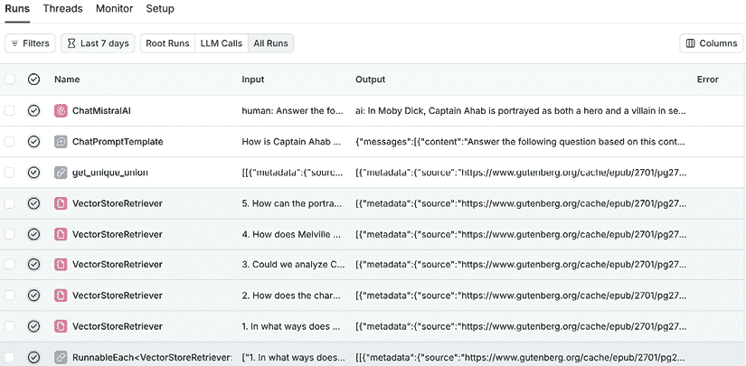

图 6.13: 本工作坊的所有运行

此高层总结允许跟踪跨越流水线的数据流，并识别在每一步生成的输出。

### VectorStoreRetriever

`图 6.14`中的截图放大了 LangSmith 流水线中的`VectorStoreRetriever`组件：

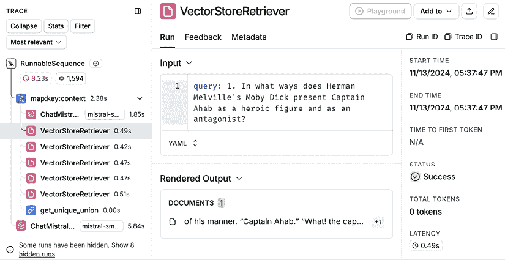

图 6.14: VectorStoreRetriever 运行详情

如你所见，此视图显示了关于输入查询（在这种情况下是原始问题的重写版本）和结果输出的细节，输出一个从向量存储中检索到的文档。该文档基于与查询的语义相似性，提供了与《白迪鲸》中哈哈船长问题相关的内容。屏幕还显示了检索延迟，确认了过程在特定时间范围内成功完成。

### ChatMistralAI

此视图提供了`ChatMistralAI`组件的详细视图，该组件负责生成用户问题的重写版本。

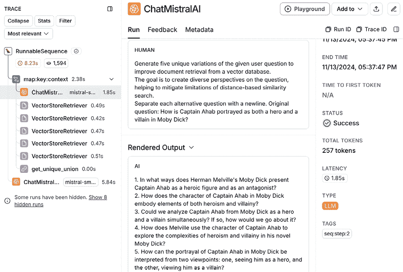

图 6.15: ChatMistralAI 运行详情

此视图包含了输入提示词（指示 AI 生成问题变体）和生成的输出（一个重写后的问题列表，每个问题都为原始查询提供了独特的视角）。还显示了延迟和 Token 计数，有助于评估此步骤的性能和效率。该组件在多样化查询以改进文档检索方面起着关键作用。

接下来，我们将探索`工作坊 3：深入原子化子查询`，我们将把复杂问题拆分为更小、更具针对性的子查询。这种方法确保了精确检索，并通过逐个解决每个子问题允许获得详细的响应。让我们学习这种技术如何完善我们的 RAG 流程！

# 工作坊 3：原子化子查询

在`工作坊 3`中，我们将基于`工作坊 2`中的技术继续完善我们的检索方法。然而，我们不再生成原始问题的重写变体，而是采取一条不同的路径，将主问题拆分为一系列更小的、原子化的子查询。这种方法允许我们针对复杂问题中的特定元素，逐条捕捉详细信息。

每个原子化问题都关注原始问题的不同方面，帮助我们检索出可能被遗漏的精确、细微的内容。通过组合这些较小的部分，我们将创建一个全面、完善的答案。我们将像摄影师使用相机一样，近距离观察主题的更细微之处，增强我们响应的深度。

在接下来的步骤中，我们将设置子查询，并探索这种关注性检索方法如何丰富我们的答案，允许我们从问题的每个侧面收集详细的见解。

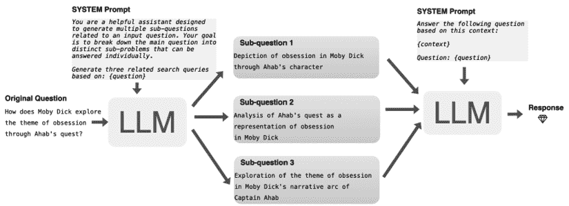

图 6.16: 方法概览

`图 6.16`说明了一种结构化方法，即通过系统提示词将原始问题拆分为子问题。这些子问题引导针对性的检索，它们的组合上下文被 LLM 用于生成详细且全面的响应。这种方法增强了复杂查询的精确性和深度。

**快速贴士**：需要查看此图像的高分辨率版本吗？请在下一代 Packt Reader 中打开此书，或在 PDF/ePub 副本中查看。

**下一代 Packt Reader**购买此书时免费赠送。扫描二维码，或访问[`packtpub.com/unlock`](https://packtpub.com/unlock)，然后使用搜索栏通过名称查找此书。双检显示的版本，以确保你获得的是正确的版本。


## 步骤 1：准备环境

本工作坊的环境准备与之前的设置相同。唯一的区别如下：

- 使用的 Colab 笔记本文件为`Chapter-6/Ch06_WS3_RAG_chain_of_thought_decomposition_*.ipynb`。
- 问题集已更新。
- RAG 的检索和生成部分已重新编写，并使用了思维链和分解方法。

在 GitHub 上访问练习所需的 Colab 笔记本：

- 对于 Pinecone：`Chapter-6/Ch06_WS3_RAG_chain_of_thought_decomposition_PINECONE.ipynb`
- 对于 Chroma DB：`Chapter-6/Ch06_WS3_RAG_chain_of_thought_decomposition_CHROMADB.ipynb`

其余设置保持不变。为了避免重复，省略了相关说明。

## 步骤 2：索引

整个`步骤 2：索引`部分与`工作坊 1`相同。为了避免冗余，省略了相关说明。让我们快进最有趣的部分——检索和生成，我们在那里将看到改进方法的应用！

## 步骤 3：检索

在此步骤中，我们遵循与之前设置类似的结构。我们首先初始化检索器并设置详细的钻取提示词。接下来，我们将原始问题拆分为更小、更有针对性的子查询，并从向量存储为每个查询检索相关信息。

一旦收集了这些详细查询的响应，我们将所有内容封装进最终的生成提示词中。提示词将来自向量存储的丰富且特定上下文的答案与原始用户问题相结合，允许 LLM 根据我们收集的所有相关内容生成全面、细致的响应。

这种方法确保了答案反映了广度和深度，将主题的多个方面综合成一个完善的结果。

### 初始化检索器

在此步骤中，我们设置了一个检索器，根据与每个详细子查询的相似性，从向量存储中提取相关文档。

```python
retriever = vectorstore.as_retriever(search_kwargs={"k": 1})
```

在`search_kwargs`中指定`"k"=1`，我们正在指示检索器为每个查询仅返回最相关的一份文档。这确保了我们关注最相关的信息，而不会包含可能稀释答案针对性的额外数据。

现在检索器已经配置完成，我们准备好初始化钻取式提示词（`drill-down prompt`）。该提示词将引导 LLM 根据为每个子问题检索到的聚焦且详细的上下文来构建回复，为我们的最终答案奠定丰富的基础。

### 初始化钻取式提示词模板

在这一步中，我们正在准备一个提示词，用于从原始查询生成详细的子问题。通过将问题拆解为更小、易于管理的部分，我们可以关注不同的方面，每个方面都需要特定的上下文。这种方法允许我们检索更具针对性和相关性的信息，从而增强最终回答的深度和准确性。

让我们运行这段代码，从以下块开始。我们导入了`ChatPromptTemplate`，将用它来构建生成子问题的提示词结构：

```python
from langchain.prompts import ChatPromptTemplate
```

接下来，我们定义提示词模板。它指示 LLM 创建三个与原始查询相关的特定子问题，每个子问题旨在关注主问题的不同维度。该模板对于生成多样化且相关的子问题至关重要：

```python
# Multi Query: Different Perspectives
template = """You are a helpful assistant designed to generate multiple sub-questions related to an input question.

Your goal is to break down the main question into distinct sub-problems that can be answered individually.

Generate three related search queries based on: {question} and output each query on a new line."""
```

提示词引导 LLM 将主问题拆解为三个不同的子问题，为更精确的检索提供独特的视角。每个子问题都关注原始查询的一个方面，帮助我们检索更广泛的信息来构建一个详尽的答案。

然后，我们创建了一个名为`prompt_perspectives`的`ChatPromptTemplate`实例，它允许我们在使用相同模板格式的同时输入不同的问题：

```python
prompt_perspectives = ChatPromptTemplate.from_template(template)
```

接下来的几行导入了`StrOutputParser`用于将模型的输出解析为字符串格式，以及`ChatMistralAI`，我们将用于生成回复的语言模型：

```python
from langchain_core.output_parsers import StrOutputParser
from langchain_mistralai import ChatMistralAI
```


`from langchain_core.output_parsers import StrOutputParser`

`from langchain_mistralai import ChatMistralAI`

我们随后定义了 `generate_queries` 流水线：

```python
generate_queries = (
    prompt_perspectives
    | ChatMistralAI(temperature=0)
    | StrOutputParser()
    | (lambda x: x.split("\n"))
)
```

- `prompt_perspectives` 是带有待重写问题的输入模板
- `ChatMistralAI(temperature=0)` 由于温度被设置为 0，它将以确定性的方法生成回复
- `StrOutputParser()` 将输出格式化为字符串
- `(lambda x: x.split("\n"))` 将输出分割为子问题列表，每个问题占新行

## 生成详细问题

在这一步中，我们正在使用生成的子问题提示词来为每个主问题创建多个子问题。通过将原始问题分解为聚焦且详细的子问题，我们可以检索查询中特定方面的信息，使我们的答案更加全面。这种结构化的方法允许我们以一种捕捉不同细微差别和视角的方式来处理复杂话题。

```python
for question in questions:
    print("-------------")
    print(question)
    sub_problems = generate_queries.invoke({"question": question})
    for sub_problem in sub_problems:
        print("\t" + sub_problem)
```

这段代码遍历每个主问题，为每个问题生成一组聚焦的子问题。对于每个问题，它首先打印分隔符和问题本身。然后，它调用 `generate_queries` 创建子问题，将原始问题分解为更小、更有针对性的组件。最后，它打印每个生成的子问题，便于识别主主题的不同方面，以便进行更精确的信息检索。

我们得到了以下输出片段：

```text
-------------
What does Moby Dick say about humanity's struggle against nature?
1. "Themes of Moby Dick related to human struggle with nature"
2. "Analysis of Moby Dick's portrayal of man versus nature"
3. "Interpretations of the novel Moby Dick on the conflict between humanity and nature"
```

输出由原始问题以及三个生成的子问题组成，每个子问题都关注查询的一个独特元素。例如，对于主问题 `What does Moby Dick say about humanity's struggle against nature?`，子问题如下：

- `"Themes of Moby Dick related to human struggle with nature"` – 关注宏观主题
- `"Analysis of Moby Dick's portrayal of man versus nature"` – 考察这种斗争是如何被描述的
- `"Interpretations of the novel Moby Dick on the conflict between humanity and nature"` – 寻求对人类与自然冲突的不同观点

## 准备唯一的并集

在这一步中，我们正在建立一个流程来检索并重与子问题相关的文档，确保只保留唯一的内容。这种方法与我们在工作坊 2 中实现的相似，在当时我们详细解释了每个部分。

```python
from langchain.load import dumps, loads

def get_unique_union(documents: list[list]):
    """ Unique union of retrieved docs """
    # 展平列表，并将每个 Document 转换为字符串
    flattened_docs = [dumps(doc) for sublist in documents for doc in sublist]
    # 获取唯一文档
    unique_docs = list(set(flattened_docs))
    # 返回
    return [loads(doc) for doc in unique_docs]

# 检索
retrieval_chain = generate_queries | map() | get_unique_union
docs = retrieval_chain.invoke({"question": question})
```

这段代码展平了检索到的文档，将每个转换为字符串以去重，然后返回唯一的文档。这种设置有助于我们避免冗余内容，为答案精简信息。

## 生成总结回复

在最后的生成步骤中，我们结合从子查询中收集的上下文，为原始问题生成全面的答案。这个过程与工作坊 2 类似，在那里我们创建了基于检索上下文生成答案的提示词。在这里，我们使用类似的方法整合详细且去重后的信息以获得细致的回复。

```python
from operator import itemgetter
from langchain_mistralai import ChatMistralAI
from langchain_core.runnables import RunnablePassthrough
from langchain.prompts import ChatPromptTemplate
from langchain_core.output_parsers import StrOutputParser

# RAG
template = """Answer the following question based on this context:

{context}

Question: {question}

"""

prompt = ChatPromptTemplate.from_template(template)
llm = ChatMistralAI(temperature=0)

final_rag_chain = (
    {
        "context": retrieval_chain,
        "question": itemgetter("question"),
    }
    | prompt
    | llm
    | StrOutputParser()
)

for question in questions:
    print("-------------")
    print(question)
    rephrased_questions = generate_queries.invoke({"question": question})
    for rephrased_question in rephrased_questions:
        print("\t" + rephrased_question)
        print("\nAnswer: ")
    print(final_rag_chain.invoke({"question": question}))
```

这应该带给我们如下输出：

```text
How does Moby Dick explore the theme of obsession through Ahab's quest?
1. "Depiction of obsession in Moby Dick through Ahab's character"
2. "对《白鲸》中哈哈追寻作为痴迷表现的分析"
3. "对《白鲸》中哈哈船长叙事弧中痴迷主题的探索"

## 回答

《白鲸》通过哈哈这一角色探索了痴迷这一主题……
这段文字描述了如何……
文章还注意到……
此外，文章强调了……
总的来说，《白鲸》通过哈哈对白色鲸鱼的痴迷，探索了复仇、权力以及执念这种全神贯注的本质等主题……
```

The actual response text was shortened, but the structure of the response persists.

针对问题`《白鲸》如何通过哈哈的追寻探索痴迷这一主题？`，输出包含以下内容：

- 主问题的几种变体，每种变体都关注《白鲸》中痴迷的特定方面。
- 一个全面的回答，从多个维度分析了哈哈的痴迷。它详细描述了哈哈对白鲸的执着如何演变成一种全神贯注的偏执，并如何影响了他的判断和行动。

随着最终答案的生成，我们完成了将复杂查询完善为详细子问题、检索相关信息并将其综合为全面回答的过程。本次工作坊演示了如何通过结构化查询和结合详细见解来实现答案的深度和清晰度。

在开始*工作坊 4：泛化方法（Generification approach）*之前，请先喝咖啡，我们将探索如何将特定问题转化为更广泛的回溯查询（step-back queries）。这种技术提供了更宽的视角，使系统能够对复杂话题生成更全面、更有洞察力的回答。让我们看看泛化如何增强我们的 RAG 工作流！

## 工作坊 4：泛化方法

在`工作坊 4` 中，我们通过创建`step-back questions`（回溯问题）采取了一种改进检索和生成过程的新方法。这些是原始用户问题的更广泛、更具通用性的版本。我们没有像之前使用钻取子问题那样缩小关注范围，回溯问题允许我们在更广泛的语境下探索该主题。

例如，如果原始问题是`"旅游对威尼斯的经济影响有哪些？"`，回溯问题可能是`"旅游如何影响热门城市的当地经济？"`。这种转变提供了更宽的视角，揭示了可能适用于威尼斯特定案例之外类似情况的模式和见解。

一旦生成了回溯问题，我们将原始问题和回溯问题都传递给 LLM。每个问题的回答都将被收集并总结，以创建一个更客观、更完善的回答。这种双查询方法将具体的见解与更广泛的视角相结合，提供了更丰富、更全面的答案。

类似于摄影中的`更广角的缩放`，这种方法捕捉了周围的景观，使对主题有更整体的理解。在本次工作坊中，我们将看到这种视角如何丰富我们的最终输出。

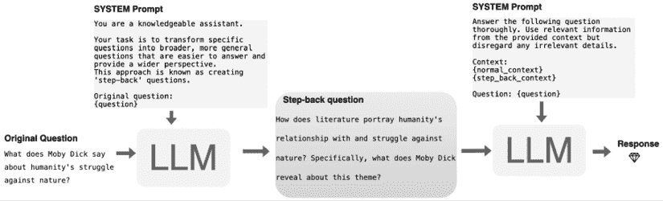

图 6.17：泛化方法的解释

`图 6.17` 解释了泛化方法，即将特定问题转换为更广泛的回溯问题，以获得更宽的视角。LLM 使用通用语境增强理解，并将其与特定语境相结合生成全面的回答，确保在处理复杂话题时具有深度和清晰度。

### 第一步：准备环境

本次工作坊的环境准备与之前的设置相同。不同之处如下：

- 使用的 Colab notebook 文件是 `Chapter-6/Ch06_WS4_RAG_step_back_generalization_*.ipynb`
- 问题集专门针对本次工作坊进行了更新
- RAG 的检索和生成部分已经过重构，并使用了回溯泛化方法

在 GitHub 上访问 Colab notebook 以进行练习：

- 对于 Pinecone DB：`Chapter-6/Ch06_WS4_RAG_step_back_generalization_PINECONE.ipynb`
- 对于 Chroma DB：`Chapter-6/Ch06_WS4_RAG_step_back_generalization_CHROMADB.ipynb`

其余设置保持不变。为了避免重复，此处省略了说明，因为与`工作坊 1`中的设置完全相同。

### 第二步：索引

整个`第二步：索引`部分与`工作坊 1`相同。为了避免冗余，省略了说明。让我们进入最有趣的部分——检索和生成，我们将在那里看到我们改进方法的实际应用！

### 第三步：检索

在这一步中，我们引导 LLM 生成`step-back questions`——原始用户问题的更广泛、更具通用性的版本。这些回溯问题有助于捕捉更大的上下文，并发现可能适用于更广泛场景的见解。

为了实现这一点，我们为 LLM 提供了清晰的指令和几个示例来演示转换过程。这些示例强调了具体的、详细的问题如何被重构为更通用的版本。例如，`"旅游对威尼斯的经济影响有哪些？"`可以变成`"旅游如何影响热门城市的当地经济？"`。

一旦 LLM 生成了回溯问题，我们将展示给读者，让他们一略这些广泛问题是如何表述的。这一过程展示了 LLM 在保持核心含义的同时重新解释查询的灵活性和创造力。

通过生成回溯问题，我们为检索更通用的信息奠定了基础，这些信息随后将与具体的见解综合，形成全面、平衡的答案。

#### 初始化检索器

在这一步中，我们按照惯例设置了检索器，它将根据与我们每个详细子问题的相似性，从向量存储器中提取相关文档。

```python
retriever = vectorstore.as_retriever(search_kwargs={"k": 1})
```

检索器配置完成后，我们准备初始化钻取提示词。该提示词将引导 LLM 根据每个子问题检索到的详细上下文来构建回答，为我们的最终答案提供丰富的基础。

#### 初始化回溯提示词

在这一步中，我们准备了一个结构化提示词，引导 LLM 生成`step-back questions`——用户问题的更广泛、通用的版本。通过样本学习（few-shot learning），我们提供了详细问题如何被重构为通用查询的示例。这种设置允许 LLM 从示例中学习并将相同的转换应用于新的用户查询。这些回溯问题允许我们在更广泛的语境下探索主题，提供超出查询范围的见解。

让我们运行这段代码。在开头几行，我们首先导入定义结构化提示词和提供样本示例所需的工具：

```python
from langchain_core.prompts import ChatPromptTemplate, FewShotChatMessageTemplate
```

然后我们定义了一个示例列表，将特定问题（`"input"`）与广泛的回溯版本（`"output"`）配对。这些示例教会 LLM 如何泛化特定查询：

```python
generification_play = [
    {
        "input": "What are the economic impacts of tourism in Venice?",
        "output": "How does tourism affect local economies in popular cities?",
    },
    {
        "input": "What are the main causes of air pollution in New Delhi?",
        "output": "What are the common causes of air pollution in large cities?",
    },
]
```

随后我们为样本示例创建了一个模板，将每个输入格式化为人类消息，并将输出格式化为 AI 响应：

```python
play_prompt_template = ChatPromptTemplate.from_messages(
    [
        ("human", "{input}"),
        ("ai", "{output}"),
    ]
)
```

接下来，我们将示例封装在 `FewShotChatMessagePromptTemplate` 中，准备将其作为训练数据包含在主 prompt 中：

```python
play_prompt = FewShotChatMessagePromptTemplate(
    example_prompt=play_prompt_template,
    examples=generification_play,
)
```

最后，我们构建最终的 prompt：

```python
stepback_prompt = ChatPromptTemplate.from_messages(
    [
        (
            "system",
            """
你是一个知识渊博的助手。
你的任务是将特定问题转化为更广泛、
更通用的问题，这些问题更容易回答并提供更广的视角。
这种方法被称为创建"后溯"（step-back）问题。
以下是一些例子：
"""
        ),
        # Play Prompt
        play_prompt,
        # Genuine user question
        ("user", "{question}"),
    ]
)
```


- `system message` 引入了生成后溯问题的任务，并在少样本学习的上下文中解释了该概念
- 使用 `play_prompt` 插入少样本示例，以展示如何将特定问题泛化
- `user` 消息接受一个新问题（`"{question}"`）进行转换，应用学习到的模式来创建后溯版本

此 prompt 为 LLM 分配了将特定问题转换为更广泛、更通用问题的任务，即后溯问题。目标是扩大查询范围，使其更容易回答并提供更广阔的视角。通过包含示例，prompt 引导 LLM 遵循清晰的输入-输出模式，确保转换的一致性。例如，诸如“威尼斯旅游对经济有哪些影响？”的问题被重构为“旅游如何影响热门城市的当地经济？”这种拓宽效应捕捉了宏观的主题和模式，能够产生超越狭窄上下文的更丰富、多通的答案。

准备好后溯 prompt 后，下一步是为每个原始查询生成一个后溯问题。我们将并输出原始问题和后溯问题，作为视觉辅助，以演示如何推导出更广泛的查询，这有助于说明 LLM 的泛化能力。

## 生成后溯问题

在这一步中，我们生成后溯问题以扩大原始查询的范围。使用预定义的 `stepback_prompt` 和 LLM，我们将每个详细问题转换为更通用、更多化的版本。这些更广泛的问题使我们能够从更广泛的上下文中检索见解，为创建完善的答案奠定基础。

```python
from langchain_mistralai import ChatMistralAI

stepback_chain = (
    stepback_prompt
    | ChatMistralAI(temperature=0)
    | StrOutputParser()
)

for question in questions:
    print("-------------")
    print("Original Question:\n\t" + question)
    stepback_question = stepback_chain.invoke({"question": question})
    print("Generic question:\n\t" + stepback_question)
```

`stepback_chain` 将 `stepback_prompt` 与 `ChatMistralAI` 相，配置为确定性响应（`temperature=0`），并将输出解析为字符串格式。循环遍历原始问题列表，同时打印原始和后溯版本以便对比。

输出将如下：

```
-------------
Original Question:
《白鲸记》关于人类与自然的斗争是如何说的？
Generic question:
文学是如何描绘人类与自然的关系及其斗争的？特别是，《白鲸记》这一主题揭示了什么？
-------------
Original Question:
《白鲸记》是如何通过哈卜的追求来探索痴迷主题的？
Generic question:
文学是如何使用痴迷的概念来驱动角色发展和叙事的？
```

对于每个原始问题，都会生成一个更广泛、更通用的问题。这种转换扩大了查询的范围，允许检索超越《白鲸记》特定上下文的主题见解。

准备好原始问题和后溯问题后，下一步是为每个问题检索相关内容。这种丰富、广泛的上下文将与原始查询相结合，使 LLM 能够通过整合详细和通用视角来合成客观、细致的答案。

## 第 4 步：生成摘要回复

在最后一步，我们结合原始问题和后溯问题的见解来创建一个丰富、全面的回答。使用结构化链，我们检索两个不同的上下文：一个是聚焦的（来自原始查询），另一个是广泛的（来自后溯查询）。这些上下文随原始问题传递给 LLM，使其能够生成详细且完善的答案。

```python
from langchain_core.runnables import RunnableLambda

response_prompt_template = """
你是一个世界知识专家。

彻底回答以下问题。

使用提供上下文中的相关信息，但忽略任何无关细节。

Context:
{normal_context}
{step_back_context}

Question: {question}

Answer:"""

response_prompt = ChatPromptTemplate.from_template(response_prompt_template)

chain = (
    {
        # 使用普通问题检索上下文
        "normal_context": RunnableLambda(lambda x: x["question"]) | retriever,
        # 使用后溯问题检索上下文
        "step_back_context": stepback_chain | retriever,
        # 传递问题
        "question": lambda x: x["question"],
    }
    | response_prompt
    | ChatMistralAI(temperature=0)
    | StrOutputParser()
)

chain.invoke({"question": question})
```

`response_prompt` 定义了 LLM 的指令，规定其必须基于提供的上下文做出回答并忽略无关细节。以下是链的步骤：

1. 使用检索器原始问题获取聚焦上下文
2. 通过将后溯问题通过 `stepback_chain` 和 `retriever` 获取更广泛的上下文
3. 将合并的上下文和原始问题传递给 LLM，由其生成详尽的回答

输出片段如下：

```
哈卜船长是赫曼·梅维尔《白鲸记》中冒鲸德号的船长，被描绘为一个融合了英雄和反派特质的复杂角色。
```

对于像“在《白鲸》中，哈卜船长是如何同时塑造为英雄和反派的”这样的问题，LLM 会综合来自两个上下文的信息，产生细致入微的回答。该输出探索了哈卜的双重人格，将其描述为既有英雄主义又有缺陷，反映了小说中痴迷与复杂性的主题。

在这一步中，我们成功地将聚焦型和广泛的上下文相结合，生成了详细且全面的答案。通过使用原始问题和回溯问题（step-back questions）检索内容，我们确保了回答能够捕捉特定的细节和更广泛的视角。这种方法让 LLM 能更有效地综合信息，从而产生平衡了深度和上下文的细致且全面的答案。

# 总结

本章探讨了作为概念框架和实操工作流的 RAG。我们首先将 RAG 架构拆解为三个核心支柱——索引、检索和生成——强调了每个阶段如何将原始数据转换为结构化的、富含上下文的答案。理论讲解为理解嵌入（embeddings）、相似性搜索和语言模型如何结合以产生精确且人类可读的输出奠定了坚实的基础。

在此基础之上，本章引导你完成了四个层层递进的工作坊。第一个工作坊建立了基础 RAG 流水线，而随后的工作坊引入了更复杂的检索策略：多查询扩展、原子子查询和回溯泛化（step-back generalization）。每个工作坊都展示了查询处理的细微变化如何丰富生成答案的深度、广度和客观性，使你具备了处理日益复杂的信息需求的实用技术。

到目前，你不仅理解了 RAG 的机制，还获得了使用 `Pinecone`、`LangChain`、`Mistral AI` 和 `LangSmith` 等工具的实战经验。这段旅程揭示了如何平衡效率、精确性和视角，确保 RAG 流水线提供可靠且感知上下文的响应。在稳固掌握 RAG 工作流后，是时候切换模式，探索使用 Mistral 进行编程（coding with Mistral）了。

在下一章中，我们将深入研究 Mistral 的独特特性，利用其能力构建创新解决方案。准备好释放尖端语言模型编程的真正潜力吧！旅程继续！

# 课外拓展

1. **使用 Make 构建拖放式 RAG 应用**：使用 [`www.make.com/`](https://www.make.com/) `Make`（Integromat）平台设计简单的工作流，将查询发送到检索器并返回响应，全部通过拖放组件完成。
2. **Prompt-Hub 探索与多提示检索**：探索 `LangSmith Hub`（[`smith.langchain.com/hub`](https://smith.langchain.com/hub)）并研究你感兴趣的模板（例如 RAG、QA、SQL）。尝试不同的提示（prompt）来重写查询，并比较变化如何影响检索覆盖和回答质量。

| 立即解锁此书的专属福利 | |
| :--- | :--- |
| 扫描此二维码或访问 [`packtpub.com/unlock`](https://packtpub.com/unlock)，然后按书名搜索此书。 |  |
| **注意**：在开始之前请准备好你的购买发票。 | |

# 7
