# 使用 Mistral 进行编程

> 代码就像幽默。当你不得不解释它时，它就不好了。
>
> — Cory House

想象一只机械手悬停在你的键盘上方，预判你的下一步动作，协助复杂的决策，并在错误出现时进行纠正。就像专家工匠的助手，这个“副驾驶”并没有取代你的技能，而是放大了你的技能，将枯燥的任务转化为清晰和创造的时刻。Mistral 结合 `LangChain` 和 `Tabby` 等工具，体现了这种未来的协作。它们共同将编程从孤独的斗争转变为人类智慧与 AI 精准之间的无缝伙伴，重新定义了软件开发中的可能性。

在本章中，你将探索 Mistral 模型如何通过分析代码、生成有用建议以及无缝集成到你的日常工作流来增强软件开发。你将获得相关技术的实战经验，这些技术将 AI 不仅视为助手，更是强大的编程协作伙伴，能够理解、解释并加速你的工作。

*工作坊 1* 重点关注使用 RAG 查询和理解真实世界的代码库。这项练习演示了 AI 如何将静态代码转换为交互式知识库，使导航和理解变得容易得多。*工作坊 2* 介绍了 `Codestral` 模型更广泛的能力。你将尝试各种代码生成技术，包括但不限于 `Fill-in-the-Middle`（`FiM`）。工作坊强调了生成有用的代码补全、封装函数以及自动化常见开发工作流的部分。你还将 Mistral 与 `VS Code` 集成，以构建一个轻量级的 AI 驱动助手。

简而言之，本章将涵盖以下主题：

* 问题描述
* 工作坊 1：与你的代码对话
* 工作坊 2：在 VS Code 中的 Codestral

# 技术要求

为了完成本章中的练习并充分探索 Codestral 的能力，你需要配置以下工具和资源：

* **Visual Studio Code**：整个工作坊使用的主要开发环境。
* **Python 3.10+**：运行 Flask 应用及相关脚本所需的。
* **Mistral AI API key**：允许通过 `Continue Dev` 和其他集成访问 `Codestral`。
* **Continue Dev 扩展**：此 AI 开发插件允许你直接在编辑器内部与 `Codestral` 交互。如果尚未安装，不要担心——我们将指导你逐步完成安装过程。
* **可选 – Mistral Code**：适用于 VS Code 和 JetBrains IDE 的商业级 AI 助手。

# 问题描述

现代开发者经常面临重复任务、分散的文档以及切换工具带来的心理负担。在本章中，我们将通过引入一个实用方案来解决这些问题：使用 Mistral 和 Codestral 构建助手。通过将这些模型集成到你的工作流中，你将学习如何加速开发、减少切换并增强代码理解。

让我们进入第一个轨迹，探索如何使用自然语言与代码交互。我们将使用 RAG 方法对代码仓库进行语义分析。

# 工作坊 1：与你的代码对话

在工作坊中，你将学习构建一个基于 RAG 的助手，让你能够使用自然语言与代码库交互。你无需手动翻阅文件，就可以问诸如“这个函数在哪里使用的？”或“我如何扩展这个类？”的问题。这项实操演示了 AI 如何将静态代码转换为可搜索的对话式知识库。让我们开始吧！

## 第 1 步：准备环境

开始之前，请确保配置了以下资源：

* 获取 GitHub 上的 `Chapter-7/Ch07_WS1_Talk_Your_Code.ipynb` Colab 笔记本，用于本工作坊：[`github.com/PacktPublishing/Learn-Mistral`](https://github.com/PacktPublishing/Learn-Mistral%20)
* 准备 Mistral AI API key：从 Mistral AI [`www.mistralai.com/`](https://www.mistralai.com/) 获取你的 API key 并为工作坊练习做好准备
* 确保你有 Google Colab 权限：在 Google Colab 中打开笔记本以便在云环境中运行代码

准备就绪并连接后，在 Jupyter notebook 中输入你的 API key 开始工作坊。

### 准备所需的库

为了开始工作坊，我们需要安装必要的依赖项。这些库包含了对语言模型、向量存储和仓库访问的支持，确保我们的练习运行顺畅。使用以下命令安装所需的库：

```python
!pip install openai tiktoken chromadb langchain langchain_mistralai langchain-community
```

此命令安装了语言模型交互、分词和数据库管理所需的库。此外，为了处理与 GitHub 仓库的交互，请安装 `GitPython`：

```bash
!pip install GitPython
```

这些安装确保了所有所需的工具在你的 Colab 环境中均就可用。

对于协作项目或版本控制，你还可以通过 `requirements.txt` 文件管理依赖项。上传文件并使用 `!pip install -r requirements.txt` 进行安装。使用 `requirements.txt` 可以确保跨环境的一致性，非常适合长期协作项目。

### 初始化 API 密钥

为了能够无缝访问 Mistral 的功能，我们需要在环境中初始化 API 密钥。此步骤确保了笔记本能够与 Mistral 服务进行身份验证，以生成嵌入（embeddings）并与语言模型进行交互。

将以下代码添加到你的笔记本中，并将占位符替换为真实的 Mistral API 密钥：

```python
import os
import sys

os.environ['MISTRAL_API_KEY'] = '<your Mistral API key goes here...>'
```

此设置步骤安全地配置了你的 API 密钥，允许笔记本在整个研讨期间与 Mistral 服务进行通信。在继续之前，请确保将占位符替换为你唯一的 API 密钥。

## 第二步：对 GitHub 源码进行索引

在本节中，我们将准备工作目录，使用 Python 程序化克隆 GitHub 仓库，将代码切分为递归块，从代码构建语义向量，并将这些向量存储在 ChromaDB 中以便进行高效查询和分析。让我们开始吧！

### 克隆远程仓库

在开始处理代码之前，我们首先创建一个目录并将 GitHub 仓库程序化克隆到其中。按照以下步骤操作：

1. 创建目录：

   ```bash
   !mkdir test_repo
   ```

2. 使用 Python 程序化克隆仓库：

   ```python
   from git import Repo

   repo_path = "/content/test_repo"
   repo = Repo.clone_from("https://github.com/langchain-ai/langchain", to_path=repo_path)
   ```

此步骤在本地建立了仓库，为后续步骤中的进一步处理做好准备。

### 重复操作

如果你需要在同一个 Colab 会话中重复此操作，必须通过取消注释并运行以下命令来清理已存在的目录：

```bash
!rm -rf test_repo
```

运行该命令以确保在重新克隆仓库之前清除目录。在笔记本的下一个单元格中，我们将从文件中加载数据，以便对其进行切分和索引。

### 从文件加载数据

我们将程序化地从克隆的仓库加载 Python 源代码文件。该代码使用 `LangChain` 工具来识别 `.py` 文件，将它们拆分为易于管理的块，并为语义处理做好准备。

`GenericLoader` 类在准备用于分析的代码库方面起着关键作用。它会递归扫描整个仓库，以识别所有带有 `.py` 扩展名的 Python 文件。一旦定位，每个文件将使用 `LanguageParser` 进行处理，解析器会将原始源代码转换为结构化的文档对象。

这些对象保留了重要的上下文（例如文件路径和代码内容），使其适用于语义搜索、语言模型输入以及深进一步的 AI 驱动探索：


# 7 使用 LangChain 和 Mistral AI 构建问答系统

## 引言

在本章中，我们将构建一个强大的问答系统，能够与代码库进行交互。我们将使用 `LangChain` 框架和 `Mistral AI` 模型来加载、切分、索引 Python 代码文件，并通过聊天界面回答关于代码的问题。

## 第 1 步：加载文档

首先，我们需要克隆仓库并加载 Python 文件。使用 `GenericLoader` 和 `LanguageParser` 来实现这一点。

```python
from langchain.text_splitter import Language
from langchain.document_loaders.generic import GenericLoader
from langchain.document_loaders.parsers import LanguageParser

loader = GenericLoader.from_filesystem(
    repo_path + '/libs/langchain/langchain', # 源目录
    glob="**/*",                    # 递归包含所有文件
    suffixes=[".py"],               # 仅目标 Python 文件
    parser=LanguageParser(
        language=Language.PYTHON,   # 使用 Python 特有的逻辑解析
        parser_threshold=500        # 拆分为最多 500 字符的块
    )
)
```

参数如下：

* `repo_path`: 指定克隆仓库的根路径
* `glob="**/*"`: 启用对所有子目录的递归遍历
* `suffixes=[".py"]`: 将加载器限制为 Python 文件
* `parser_threshold`: 决定从每个文件生成的代码块大小，使其便于后续处理

下一行代码将解析后的文档加载到变量中供后续使用：

```python
documents = loader.load()
```

接下来，我们检查文档数量，这非常重要：

```python
len(documents)
```

输出显示已处理了 1,530 个 Python 文件：

```
1530
```

接下来，我们检查数组中的第一个文档，并查看内容及其元数据：

```python
documents[0]
```

输出（仅显示结构部分）：

```python
Document(
  metadata={
    'source': '/content/test_repo/libs/langchain/langchain/cache.py',
    'language': <Language.PYTHON: 'python'>
  },
  page_content='from typing import TYPE_CHECKING, Any\n\n
                from langchain._api import create_importer\n\n...'
)
```

* `metadata`: 显示 `source`（文件在仓库中的路径）和 `language`（确认文件类型为 Python）
* `page_content`: 文件的实际内容，根据 `parser_threshold` 值被拆分为易于管理的块

我们已成功地将 1,500 多个 Python 源文件加载到易于管理的文档对象中，现在准备好将这些文档切分为更小的块并对其内容进行向量化。

## 第 2 步：切分文档

在这一步中，我们使用 `RecursiveTextSplitter` 将加载的文档划分为更小的、重叠的块。这为文档向量化做好准备，通过重叠确保上下文：

1. 我们首先初始化切分器：

```python
from langchain.text_splitter import RecursiveTextSplitter

documents_splitter = RecursiveTextSplitter.from_language(
    language=Language.PYTHON, # 源文档的语言
    chunk_size=2000,   # 每个块的最大字符数
    chunk_overlap=200  # 块之间的重叠字符数
)
```

上述代码中的参数如下：

* `language`: 标识文档的语言。在这里我们指定 `Language.PYTHON` 以优化 Python 代码的切分。
* `chunk_size`: 每个块的最大字符数。`2000` 的大小确保块足够小以便嵌入而不过大。
* `chunk_overlap`: 设置连续块之间的重叠字符数。`200` 个字符的重叠确保了块之间上下文的连续性。

2. 然后我们将切分器应用于加载的文档以生成块：

```python
texts = documents_splitter.split_documents(documents)
```

3. 接着，我们确认创建了多少块：

```python
len(texts)
```

4. 输出显示文档被划分为 2,411 个易于管理的块：

```
2411
```

这种分块策略确保了文档的每个部分的大小都适合嵌入，在保持计算效率的同时防止信息丢失。重叠分块有助于跨越边界维持上下文流，这对于准确的语义表示至关重要。

现在文档已拆分为 2,411 个易于管理的分块，我们准备好进入下一步：构建嵌入。在此阶段，我们将使用 `Mistral AI` 生成每个分块的向量表示，从而实现语义搜索和分析。

### 代码块的索引

接下来，我们通过创建嵌入并将其存储在向量数据库中，对分块后的文档进行索引。此过程允许我们对代码库执行高效的语义搜索：

1. 第一步是初始化来自 `Mistral AI` 的嵌入模型。该模型将文本块转换为高维向量表示，以捕捉它们的语义含义：

```python
from langchain_mistralai import MistralAIEmbeddings

embeddings = MistralAIEmbeddings()
```

`MistralAIEmbeddings()` 初始化了 `Mistral AI` 嵌入模型，它将用于为每个文档分块生成向量表示。这一步确保了与下游向量存储的兼容性。

2. 一旦准备好嵌入，我们就可以使用向量数据库 `Chroma` 来存储这些表示，以便查询和分析：

```python
from langchain.vectorstores import Chroma

vectordb = Chroma.from_documents(
    texts,                # 分块后的文本文档列表
    embedding=embeddings, # 用于向量化的模型
    persist_directory='./data' # 持久化数据库的目录
)

vectordb.persist()
```

参数如下：

* `texts`: 上一步生成的分块文档
* `embedding`: 初始化的 `Mistral` 嵌入模型，用于对分块进行向量化
* `persist_directory`: 指定数据库保存的目录，允许在不同会话之间复用

运行上述代码后，所有分块都将存储在 `ChromaDB` 中，并带有相应的嵌入。数据库已持久化到 `./data` 目录下。

### 为什么索引很重要

索引允许根据用户查询对相关分块进行高效的语义搜索和检索。通过在专用数据库中存储向量表示，我们确保了分析大型代码库时的扩展性和速度。


图 7.1：LangChain 如何处理问题和上下文

 **快速提示**：需要查看此图像的高分辨率版本？请在下一代 Packt Reader 中打开此书，或在 PDF/ePub 版本中查看。

 购买此书将免费赠送**下一代 Packt Reader**。扫描二维码，或访问 `https://packtpub.com/unlock`，然后使用搜索栏通过名称查找此书。双击显示的版本，以确保你获得的是正确的版本。


太棒，分块已经在 `ChromaDB` 中索引完成。现在我们准备好构建一个问答基础设施了。

## 第 3 步：与代码对话

在本节中，我们将使用 `LangChain` 和 `ChatMistralAI` 构建聊天基础设施，以释放我们索引代码库的全部潜力。系统将处理用户问题，在向量索引中搜索最相关的代码块，并使用这些分块作为上下文来生成精确且有意义的回答。这是练习的核心，我们将之前所有的步骤整合到一个连贯的框架中。完成后，你将拥有一个交互工具，允许你查询代码库并以对话格式接收具有洞察力的感知上下文的响应。

### 准备聊天

在这一步中，我们设置了 `ChatMistralAI` 模型，作为聊天基础设施的语言模型后端。该模型与我们的索引数据交互，生成有意义的感知上下文的响应：

1. 我们首先创建一个 `ChatMistralAI` 类的实例，并指定模型参数来控制语言模型的行为：

```python
from langchain_mistralai import ChatMistralAI

llm = ChatMistralAI(
    model_name="mistral-large-latest",  # 要使用的 Mistral 模型
    temperature=0 # 设置响应的随机性；0 表示确定性
)
```

参数如下：

* `model_name`: 定义要使用的模型版本。`"mistral-large-latest"` 确保你正在使用具有增强功能的最新版本。
* `temperature`: 控制输出的随机性。值为 `0` 确保响应是确定且一致的，使其成为技术场景的理想选择。

2. 准备就绪后，我们通过检查 `llm` 对象来获取详细信息：

```python
llm
```

输出将如下：

```python
ChatMistralAI(
    client=<httpx.Client at 0x7849b8fbc10>,
    async_client=<httpx.AsyncClient at 0x7849b8fb6a0>,
    mistral_api_key=SecretStr('**********'),
    endpoint='https://api.mistral.ai/v1',
    model='mistral-large-latest',
    temperature=0
)
```

* `client` 和 `async_client`: 用于发起请求的 HTTP 客户端
* `endpoint`: Mistral 的 API 端点
* `model`: 确认使用的模型，在此处为 `"mistral-large-latest"`
* `temperature`: 验证随机性参数设置为 `0.0`

此代码初始化了聊天模型，使其准备好与 `LangChain` 集成以处理用户查询。配置参数确保模型提供适用于技术领域的回答。

### 添加聊天对话能力

在这一步中，我们通过引入内存功能来增强聊天系统。这允许模型记住之前的交互，从而提供更自然、感知上下文的对话体验。我们还创建了一个对话检索链来有效处理用户查询：

1. 我们首先初始化对话内存。`ConversationSummaryMemory` 类允许系统维护对话历史的摘要，从而实现多次对话的连续：

```python
from langchain.memory import ConversationSummaryMemory

memory = ConversationSummaryMemory(
    llm=llm,                    # 初始化的 ChatMistralAI 模型
    memory_key="chat_history",  # 存储对话历史的键
    return_messages=True        # 确保响应中包含消息
)
```

2. 接着，我们创建对话检索链：

```python
qa = ConversationalRetrievalChain.from_llm(
    llm,               # 用于生成响应的语言模型
    retriever=vectordb.as_retriever( # 用于检索相关块的检索器
        search_type="mmr", # 最大边际相关 (MMR) 方法
        search_kwargs={"k": 8} # 检索前 8 个相关块
    ),
    memory=memory # 整合对话记忆以提供上下文
)
```

这些参数如下：

* `llm`: 指定用于生成响应的聊天模型。
* `retriever`: 将向量数据库转换为用于语义搜索的检索器。
* `search_type`: 定义搜索策略。`"mmr"` 确保结果的多样性且与上下文相关。
* `search_kwargs`: 额外的搜索参数，例如 `k`，它用于设置检索到的块的数量。
* `memory`: 整合对话记忆，实现跨交互的连续性。

`qa` 链将所有组件结合在一起，创建了一个交互式聊天系统，该系统可以检索相关的代码块并提供感知上下文的响应。

通过集成内存和检索，聊天系统变得动态且用户友好。它现在支持自然的多轮对话，并同时引用当前查询和过去的对话以获得更好的上下文。

下一步是测试系统。

### 最后，与你的代码对话

在最后一步中，我们将所有内容整合在一起并与聊天系统进行交互。我们对代码库提问，系统从向量数据库检索相关块，使用 `ChatMistralAI` 模型对其进行处理，并生成具有见解且感知上下文的答案：

1. 让我们询问系统如何初始化 ReAct 代理：

```python
question = "How I can initialize the ReAct Agent"
result = qa(question)
print(result['answer'])
```

以下是输出，为了清晰进行了收缩：

```
1. 导入必要的模块：确保你已导入必要的模块。
2. 定义工具：创建代理将使用的工具。
3. 初始化 LLM：设置代理将使用的语言模型。
4. 创建代理：使用 `create_react_agent` 函数初始化代理。
```

该输出提供了初始化 ReAct 代理的逐步说明，并附带示例代码段以供参考。

2. 然后让我们向系统查询关于特定代理的类层次结构：

```python
question = "What is the class hierarchy for ReActDocstoreAgent?"
result = qa(question)
print(result['answer'])
```

输出强调了 `ReActDocstoreAgent` 类的继承链，显示了它与父类的关系：

```
`ReActDocstoreAgent` 的类层次结构如下：
BaseSingleActionAgent --> Agent -> ReActDocstoreAgent
```

该层级结构表明 `ReActDocstoreAgent` 是 `Agent` 的子类，而 `Agent` 又是 `BaseSingleActionAgent` 的子类。

恭喜！你已经成功构建了一个强大的聊天系统，它能够利用 `LangChain`、`ChatMistralAI` 和向量索引回答关于你代码库的问题。这个交互式工具展示了 AI 如何将复杂的代码库转化为易于访问的对话式体验。

现在轮到你更进一步了——提更多问题，测试系统的能力，并探索不同的仓库以获取新的见解。无论你是在调试、学习还是计划，这个系统都会为你提供帮助。任务已经完成，但旅程才刚刚开始。继续实验，继续探索，让你的好奇心引导你吧！

# 研讨会 2：VS Code 中的 Codestral

准备好利用 `Codestral` 惊人的能力吧！在本节中，我们将通过使用 VS Code 的 `Continue` 开发扩展来深入探索它的威力。你将学习如何生成代码片段、在现有代码的基础上进行构建，甚至要求 `Codestral` 解释复杂的代码段。

这只是冰山一角；`Codestral` 设计旨在成为你的终极编码助手，一只引导你走过开发之旅的真正机器人手。结束时，你将渴望探索更多内容并体验这一突破性工具的全部潜力。让我们一起更智能地编程吧！

## 准备环境

在这一步中，我们将准备环境，以便在 VS Code 中利用 `Codestral` 的功能。首先访问 GitHub 上本研讨会的 `Chapter-7/learn_codestral`，地址为 [`github.com/PacktPublishing/Learn-Mistral`](https://github.com)。

### 安装 VS Code

**如果已安装 VS Code，请跳过**

如果你的系统中已经安装了 VS Code，可以跳过安装步骤，直接开始配置扩展并登录 GitHub。

按照以下步骤在 macOS 上安装 VS Code：

1. 访问 [macOS 版 Visual Studio Code 下载页面](https://code.visualstudio.com/download) 并下载 `.dmg` 文件。
2. 打开 `.dmg` 文件，将 VS Code 应用程序拖到 `Applications` 文件夹。
3. 从 `Applications` 打开 VS Code 并按照设置向导操作（如果提示的话）。

按照以下步骤在 Windows 上安装 VS Code：

1. 访问 [Windows 版 Visual Studio Code 下载页面](https://code.visualstudio.com/download) 并下载安装程序。
2. 运行安装程序，并按照向导操作。

**接下来，我们将学习如何配置 `Continue` 扩展并登录 GitHub。**


1. 访问 [Windows 版 Visual Studio Code 下载页面](https://code.visualstudio.com/download) 并下载 `.exe` 安装程序。

2. 运行安装程序并按照提示操作，选择如 `Add to PATH` 等选项以方便使用。

3. 从开始菜单或桌面快捷方式打开 VS Code。

安装完成后，继续配置扩展并登录 GitHub！

### 登录 GitHub

**如果已登录 GitHub，请跳过**

如果你已经在 VS Code 中登录了 GitHub，可以跳过此步骤，直接开始设置研讨会所需的扩展。

在 VS Code 中登录 GitHub 允许与你的代码仓库进行无缝集成，方便你直接从编辑器克隆、提交（`commit`）推送更改。操作方法如下：

1. 按下 `Ctrl` + `Shift` + `P` (Windows) 或 `Cmd` + `Shift` + `P` (macOS) 打开命令面板。

2. 输入 `GitHub: Sign In` 并从列表中选择该选项。

3. 将打开一个浏览器窗口，要求你登录 GitHub 账户。输入你的凭据并为 VS Code 授权访问。

4. 验证通过后，返回 VS Code，你将看到账户已连接的确认。

你现在可以在 VS Code 中访问仓库、同步更改并更高效地协作。此设置对于在研讨会中使用 GitHub 托管的项目至关重要。

### 安装 Continue 扩展

`Continue` 扩展解锁了高级的 AI 辅助功能，包括代码生成、增强和解释。按照以下步骤安装：

1. 按下 `Ctrl` + `Shift` + `X` (Windows) 或 `Cmd` + `Shift` + `X` (macOS) 打开 VS Code 中的 `Extensions` 侧边栏。

2. 在搜索栏中输入 `Continue`，寻找名为 `Continue: AI-Powered Code Assistance` 的扩展：

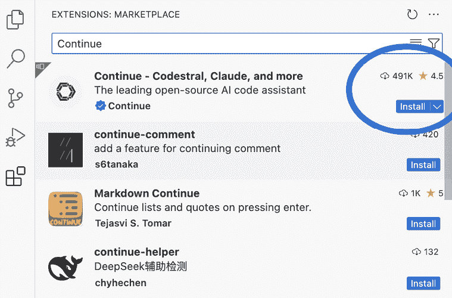

图 7.2：扩展扩展

3. 点击扩展详情页上的 `Install` 按钮。安装过程将自动完成。安装完成后，你可能需要重启 VS Code 或通过按下 `Ctrl` + `Shift` + `P`（或 `Cmd` + `Shift` + `P`）、输入 `Reload Window` 并选择该选项来重新加载窗口。请参考以下截图。

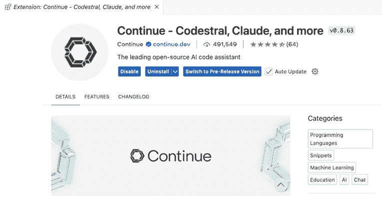

图 7.3：Continue 扩展欢迎页

最后，`Continue` 开发扩展准备就绪，允许你探索 `Codestral` 的强大功能。

### 安装 Python 扩展

VS Code 的 `Python` 扩展提供了对 Python 开发的支持，包括语法高亮、调试和静态检查（`linting`）。要安装它，请确保 VS Code 中已安装 Microsoft 提供的 Python 扩展（之前已介绍）。之后，在终端中运行 `python --version` 验证 Python 是否可用。如果没有安装，请从 [python.org](https://python.org) 下载。如果需要，通过打开命令面板（`Ctrl` + `Shift` + `P` 或 `Cmd` + `Shift` + `P`）并选择 `Reload Window` 来重新加载 VS Code。

Python 扩展现在已就绪，提供了 Python 开发所需的所有功能。

### 设置 Python 虚拟环境和 Flask

在研讨会中，我们将准备使用 Flask 框架。为了准备编写 Flask 代码，设置虚拟环境至关重要。虚拟环境可以隔离依赖项，确保项目拥有独立的包和版本，而不影响全局。

按照以下步骤在 VS Code **终端**中创建并配置 Flask 虚拟环境：

1. 在 VS Code **终端**中安装 `virtualenv` 库，它可以创建隔离环境：

```bash
pip install virtualenv
```

这将允许创建虚拟环境。

2. 使用 `virtualenv` 命令为你的 Flask 项目创建一个虚拟环境：

```bash
virtualenv flask
```

在这里，`flask` 是虚拟环境目录的名称。我们预计之后会有 Flask 相关的代码。

3. 进入虚拟环境文件夹内的 `Scripts` 目录并激活它：

```bash
cd flask/Scripts
activate
```

激活后，你将在终端提示符中看到虚拟环境名称，表示它现在处于激活状态。

4. 在激活状态下，使用以下命令安装 Flask：

```bash
python -m pip install flask
```

这会将 Flask 安装在隔离环境中，确保不会影响全局 Python 设置。

5. 通过列出环境中安装的包来检查 Flask 是否已安装：

```bash
python -m pip list
```

你应该能在已安装包列表中看到 `Flask` 及其版本号。

完成这些步骤后，你的虚拟环境已准备就绪，`Flask` 也已安装。这种隔离设置确保了为我们的项目定制的整洁且易于管理的开发环境。

### 调整 Continue 扩展

在这一步，我们将配置 VS Code 中的 `Continue` 开发扩展，以使用 `Codestral` 进行高级代码辅助。按照以下步骤为你的工作坊启用并设置 `Codestral`：

1. 首先，导航到 VS Code 窗口左侧的`六进制图标`（图 7.4）。


图 7.4：VS Code 工具菜单和底部的六进制图标

2. 接下来，点击该图标在右侧打开 `Continue 开发侧边面板`。打开后，你可以从该面板上的选择框选择要配置和操作的模型。

在此列表中，你将找到用于设置所需模型的预定义模型选项。

3. 在 `Continue 开发侧边面板`中，选择 `Codestral` 作为要操作的模型。你有三个选项配置 `Codestral`：

    * **选项 1：使用 Codestral 免费试用**

        * 从模型列表中选择 `Codestral` (Free Trial)

        * 免费试用提供 50 次免费请求，对于本次工作坊足够了

    如果你可以使用试用且尚未用完允许的 50 次提示，可以立即继续使用此选项。

    * **选项 2：使用 Codestral API key**

    如果你有 `Codestral` 的 API key，请按照以下步骤操作：

    1. 在浏览器中进入 `Mistral AI` 控制台。

    2. 打开 `Codestral` 标签页并生成 API key。将密钥复制到剪贴板。

    3. 返回 VS Code 中的 `Continue 开发侧边面板`，从列表中选择 `Codestral` 模型以配置 API key。

    4. 点击齿轮图标打开 `config.json` 文件。

    5. 找到 `Codestral` 的 JSON 条目并将你的 API key 粘贴到此处（如图 7.5 所示）。

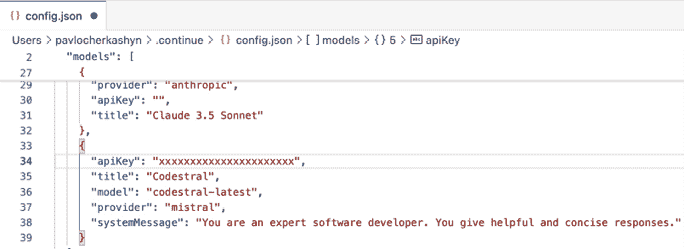

图 7.5：Codestral API key 的 config.json 代码段

如果 `Mistral` 没有立即提供 `Codestral` 的访问权限，你的请求可能会排队，并在几天后授予权限。在这种情况下，请退回到选项 1。

    * **选项 3：使用 Ollama 本地运行 Codestral**

    如果你倾向于在本地运行 `Codestral`，请拉取 `codestral` 模型。打开终端并运行以下命令：

```
ollama pull codestral
```

这将 `Codestral` 模型下载到你的本地系统。接下来，为 `Ollama` 配置 `Continue`：

* 打开 `Continue` 开发侧边面板

* 选择 `Ollama` 作为模型的后端

* 按照与选项 2 相同的步骤更新 `config.json` 文件中的配置，将扩展指向你的本地 `Ollama` 端口

配置好 `Codestral` 后，你就可以准备探索其在代码生成、解释和增强方面的强大功能了。如果某个选项没有立即生效，请尝试另一个以确保工作坊顺利进行。让我们开始使用 `Codestral` 吧！

### 准备新项目

在本节中，我们将在 VS Code 中创建一个名为 `learn_codestral` 的新项目文件夹，提供一个干净的工作空间来探索和练习 `Codestral` 的强大功能。按照以下 VS Code 步骤操作：

1. 打开 `Explorer`（资源管理器）面板。在 VS Code 中，点击左侧边栏上的 `Explorer` 图标（或按 `Ctrl` + `Shift` + `E` / `Cmd` + `Shift` + `E`）。

2. 右键点击 `Explorer` 面板并在工作区选择 **New Folder**（新建文件夹）。将文件夹命名为 `learn_codestral`。

3. 在 `Explorer` 面板中右键点击 `learn_codestral` 文件夹添加一个 Python 文件。然后选择 **New File**（新建文件）并将其命名为 `main.py`。

4. 接下来，转到 **File | Save Workspace As...**（文件 | 工作区另为...）。你可以使用描述性名称保存工作区，例如 `learn_codestral.code-workspace`。

你的项目环境已就绪！是时候使用 `Codestral` 实践代码生成了。你将体验到 `Codestral` 如何轻松地创建功能脚本、重构代码并解释复杂逻辑。

## 第 2 ：生成我们的第一段代码

准备好体验 `Codestral` AI 辅助编程的力量！在这一步中，我们将生成一个 Python 脚本来与 `ICNDB` 网络服务交互以获取 Chuck Norris 的笑话。这个动手练习将展示 `Codestral` 如何简化开发并轻松地让代码生起来。

请遵循以下分步骤说明生成我们的第一段代码：

1. 按 `Cmd` + `I` (macOS) 或 `Ctrl` + `I` (Windows/Linux) 调用 `Codestral` 以调出 `Continue` 开发面板。

2. 根据你的设置，从可用选项中选择模型：

    * **Codestral Free Trial**（Codestral 免费试用）

    * **Codestral (API Key)**（Codestral API Key）

    * **Ollama (Local Setup)**（Ollama 本地设置）

3. 然后，在输入字段中输入以下提示：

```
write a script to retrieve jokes from api.chucknor.io using http
```

`Codestral` 将生成一个如图 7.6 所示的响应。

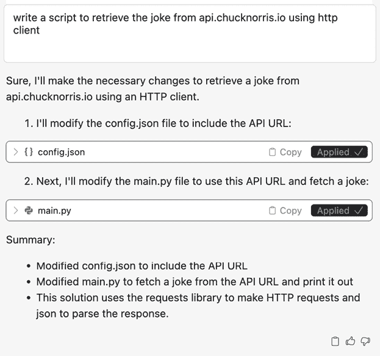

图 7.6：对提示的响应

让我们扩展每个部分：

* **config.json**: 确保设置正确（见下文）。

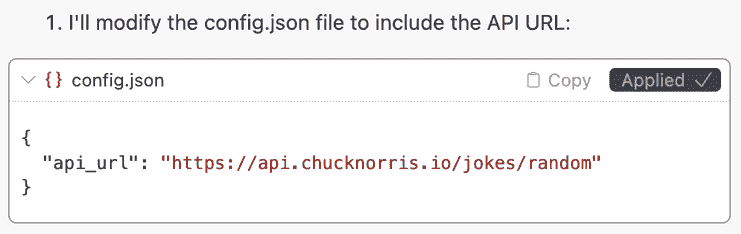

图 7.7：config.json 代码段

* **Main Script** (`main.py`）：一个从 API 获取笑话的功能性脚本（见下文）。

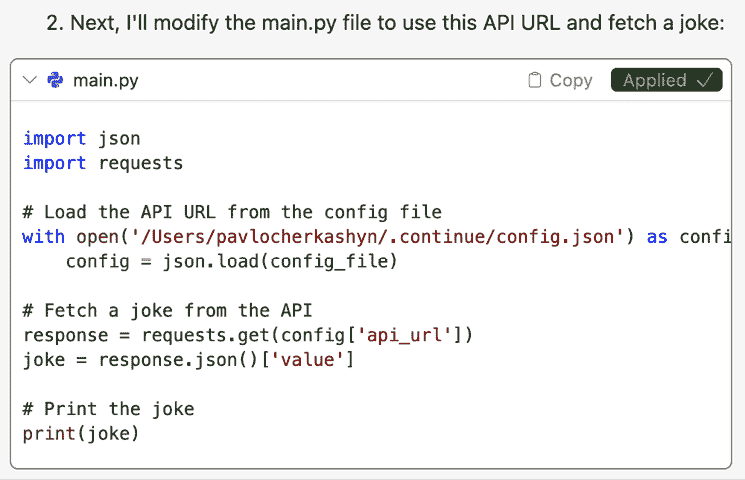

图 7.8：扩展的 main.py 代码段

查看这些内容后，我们将更改应用于工作区。

### 将更改应用于工作区

通常，只需点击 **Apply Changes**（应用更改）即可将文件集成到你的工作区。我们可以对 `main.py` 这样做，但要注意 `config.json`，因为它是空的；添加 `api_url` 条目及其值。

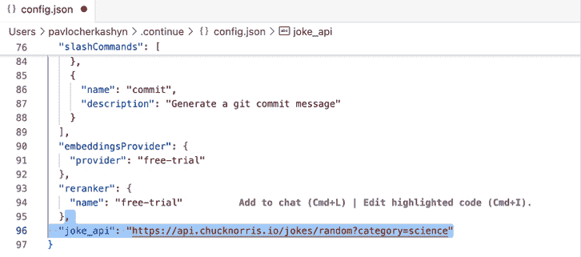

图 7.9：手动输入

工作区配置后，我们准备好运行应用程序了。

### 运行应用程序

在 VS Code 中打开终端并执行脚本：

```
python main.py
```

观察脚本获取并显示 Chuck Norris 笑话。

恭喜！你成功使用 `Codestral` 生成了第一个脚本。这一步展示了 AI 如何简化开发任务并提供可运行的代码。接下来，我们将通过更新脚本以作为网络服务来进一步完善。让我们继续吧！

提示词（Prompt）以及上下文代码片段应当如下：

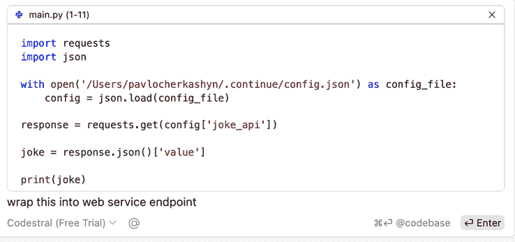

图 7.11：提示词以及相关的代码上下文

一旦将提示词及其上下文发送给 Codestral，它将返回建议和更改。让我们查看这些建议并将它们应用到代码库中。

Codestral 将生成一个响应，将你的代码封装进 `Flask` Web 服务中。

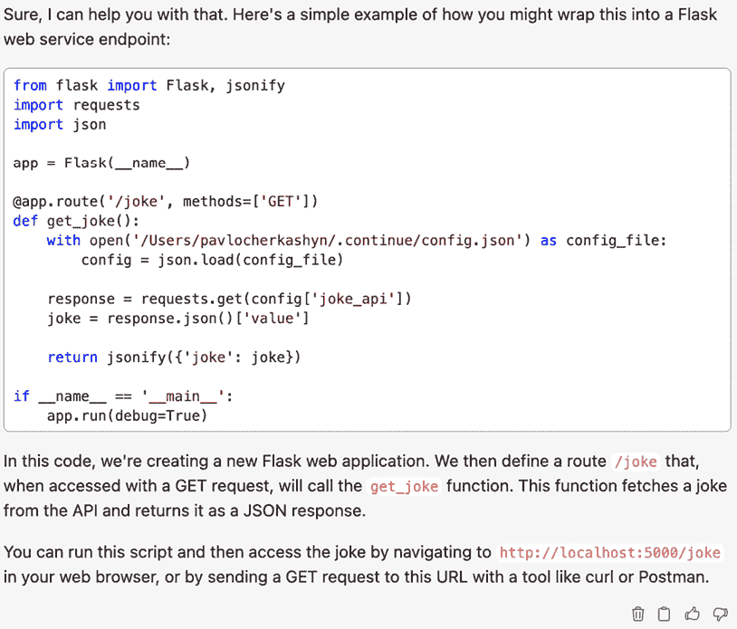

图 7.12：带有建议代码和解释的 Codestral 响应

`Figure 7.11` 展示了响应。显而易见的是包含了代码更改；同时，Codestral 还提供了解释。现在轮我们了；我们可以审查并应用建议的更改。

### 应用建议的更改

使用代码片段旁边的播放按钮应用更改，或者按下 `Option` + `A`。

更改将用颜色区分，如下所示：

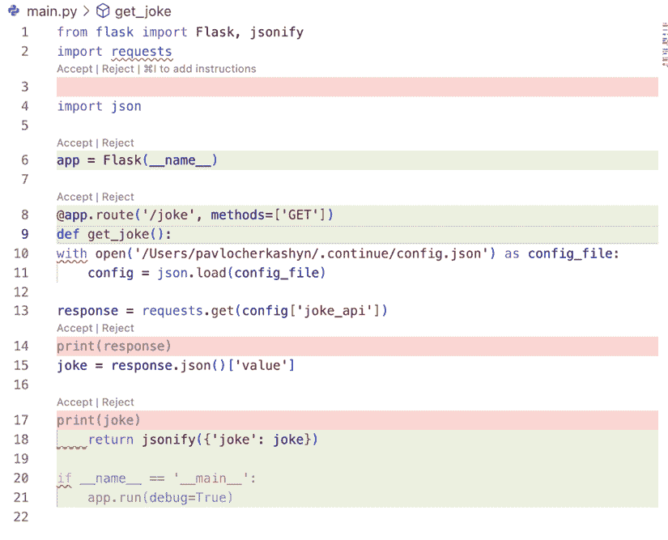

图 7.13：编辑器中高亮的代码更改

* **红色**：被删除的行

* **绿色**：新增或修改的行

你可以通过按下 `Shift` + `Cmd` + `Enter`（或 `Shift` + `Ctrl` + `Enter`）一次接受所有更改。

如有，检查并手动修正缩进。

### 审查最终代码

你的代码更新版本现在应该如下所示。虽然助手帮助生成和组织代码，但仍由你审查最终结果并确保其正确且安全运行。在环境中执行 AI 辅助代码之前，务必验证逻辑、依赖和潜在风险：

```python
from flask import Flask, jsonify

import requests
import json

app = Flask(__name__)

@app.route('/joke', methods=['GET'])
def get_joke():
    with open('~/.continue/config.json') as config_file:
        config = json.load(config_file)
        response = requests.get(config['joke_api'])
        joke = response.json()['value']
        return jsonify({'joke': joke})

if __name__ == '__main__':
    app.run(debug=True)
```

目前进展顺利！你的代码已经就绪，基础已经打好。在下一节中，我们将运行它并观察我们的 AI 驱动助手如何起来。这将是你所有努力开始获得回报的地方，因为你的项目将变得交互式并真正有用。让我们继续吧！

### 运行代码

运行以下命令启动你的 Flask 应用并让你的助手运行起来。这将启动服务器并允许通过浏览器访问项目：

```bash
python ./main.py
```

输出应该类似于以下典型输出：

```
* Serving Flask app 'main'
* Debug mode: on
WARNING: This is a development server. Do not use it in a production deployment. Use a production WSGI server instead.
* Running on http://127.0.0.1:5000
Press CTRL+C to quit
```

随着 Flask 应用现在运行，你的助手已经上线并准备就绪。在下一节中，我们将测试端点，看看它是如何响应真实输入和查询的。

### 测试端点

现在你的服务器已经启动运行，是时候看看你的助手的操作了。让我们测试端点并与它生成的响应进行交互。

打开浏览器并导航到以下地址：

```
http://127.0.0.1:5000/joke
```

你应该看到类似下面的响应：

```json
{
  "joke": "Nothing can escape the gravity of a black hole, except for Chuck Norris. Chuck Norris eats black holes. They taste like chicken."
}
```

恭喜你！你成功地将脚本转换为了由 Flask 驱动的 Web 服务端点。这一步突了 Codestral 如何协助适配和增强现有代码以满足新需求。


是时候更进一步了。在下一节中，我们将把 Web 服务与一个简单的网页集成。这一步将允许我们在用户友好的界面上动态地显示笑话，展示 Codestral 如何简化构建即使是全栈应用程序的过程。让我们用功能性的 Web 前端让我们的应用程序活跃起来！

## 第 4 步：封装到网页中

在这一步中，我们将通过创建一个简单的网页来显示 `/joke` GET 端点的结果，从而提升我们的应用程序。在 Codestral 的帮助下，我们将生成代码、排除任何问题并解决错误以实现功能性的 Web 界面。让我们转换我们的 Web 服务！

1. 在 Codestral 中输入以下后续提示词：

   ```
   now add a simple web page which shows the result of
   ```

Codestral 将为`main.py`提供建议更新以提供 HTML 页面，如下图所示。

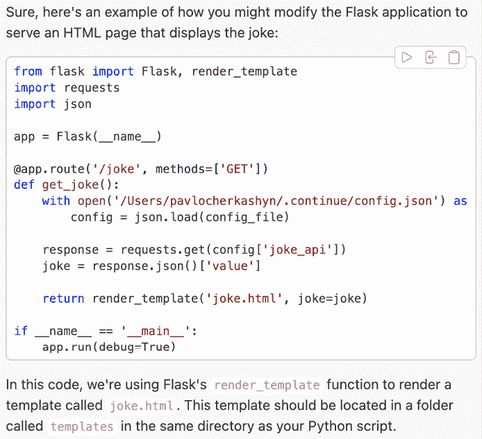

图 7.14：Codestral 提供 HTML 页面的建议

Codestral 建议的更新另一个部分是一个名为`joke.html`的新模板文件。见`Figure 7.15`。

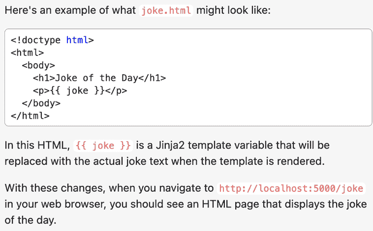

图 7.15：HTML 模板

1. 点击播放按钮或按下`Option`+`A`将更新应用到`main.py`。

2. 在项目中创建一个名为`joke.html`的新文件。将光标置于空文件中并点击建议片段上的播放按钮。

这将生成的代码填充文件。

### 测试网页

保存`main.py`文件。Flask 会自动获取更改。然后，打开浏览器并导航到以下行：

```
http://127.0.0.1:5000/joke
```

你应该能看到一个渲染后的 HTML 页面，显示来自数据库的随机 Chuck Norris 笑话。但在实践中，我们收到了如下所示的错误。

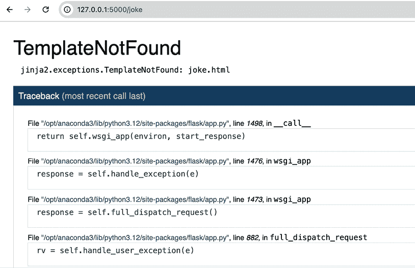

图 7.16：网页渲染错误

我们遇到了错误——这在灵感编程和手动开发中都是常见的。故障排除是任何开发者的至关技能，因此在下一步中，我们将在 Codestral 的帮助下解决它。

### 排除错误

如果页面未加载并显示错误，例如`TemplateNotFound jinja2.exceptions.TemplateNotFound: joke.html`，请将错误交给 Codestral。

通过复制消息并将其粘贴到下一个提示词中，与 Codestral 共享错误。这有助于助手理解问题并建议修复方案：

```
TemplateNotFound 
inja2.exceptions.TemplateNotFound: joke.html
```

让我们回顾 Codestral 提供的解决方案并分析它是如何处理该错误的。理解它的建议将有助于加强你的排错技巧，并增强对代码修正的信心。

Codestral 会解释说 Flask 期望 HTML 模板位于`templates`文件夹中。下图显示了带有建议的响应。

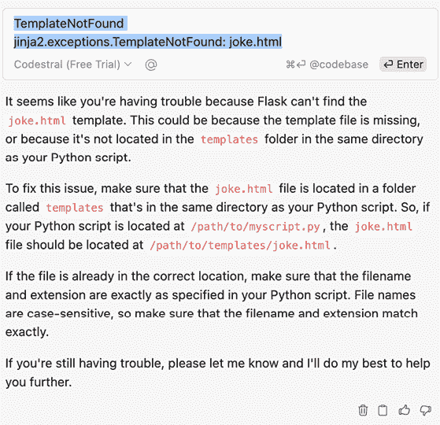

图 7.17：关于错误以及如何修复的响应

现在我们已经回顾了 Codestral 的建议，是时候付诸实践了。在下一步中，我们将应用建议的更改，向解决方案解决方案迈出一步。

将`joke.html`移动到项目目录下名为`templates`的新文件夹中。

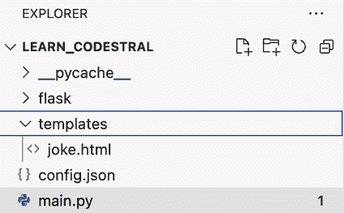

图 7.18：VS Code 资源管理器面板显示新文件夹及其其中的 joke.html

上幅图显示了 VS Code 资源管理器面板的相关区域。一旦应用了修复，我们将通过再次运行应用程序来确认修复。

### 验证修复

现在是重新加载浏览器页面了。你应该能看到渲染后的 HTML 页面，并成功显示了一个随机的查克·诺里斯笑话。

看到页面成功渲染是一个很棒时刻。这意味着一切都到位了。下图确认了你的进展，并显示你的助手现在已上线并按预期工作。


图 7.19：Codestral 建议修复后页面成功渲染

太棒了！成功了！至此你已将 Web 服务封装成功能性的网页，并使用 Codestral 成功解决了错误。这一步展示了 AI 辅助调试和开发的力量。

在此阶段，让我们将焦点转向逻辑生成。我们将探索 Codestral 的 FiM（填充补全）技术，通过智能代码建议来完成部分编写函数。

## 第 5 ：使用 FiM 技术

在这一步中，我们将探索 Codestral 的突出特性之一：FiM 代码生成。该技术允许模型通过从上下文中推断逻辑中间部分来完成部分代码块。你将提供一个方法骨架，Codestral 将智能地填充缺失的实现。这模拟了真实世界的开发人员工作流，并展示了 Codestral 如何作为一个高效的编程伙伴。

为了探索 Codestral 的 FiM 能力，我们将创建一个包含部分实现函数的文件，并让 AI 填充缺失的逻辑：

1. 首先创建一个名为`fim.py`的新文件。你可以通过复制现有的`fim_bare.py`文件来实现。这确保了我们有一个干净且一致的起点。`fim_bare.py`文件的内容如下：

```python
def fibonacci(n):
    # TODO: compute the nth Fibonacci number
pass
```

2. 在 VS Code 中打开`fim.py`并选择整个函数体，包括`def`行和`pass`占位符。添加到上下文。

3. 选中代码后，按`Cmd`+`L`（Windows/Linux 上按`Ctrl`+`L`）将代码引入 Continue 开发聊天面板。

4. 在提示词字段中输入以下内容：

```text
fill in the logic for this function
```

你会注意到 Codestral 仔细考虑了函数名和结构，并返回一个符合上下文的完整实现。

这种流畅且有目的的流程展示了 FiM 在实际开发工作中的力量。它不仅仅是在猜测，而是通过结构和意图推断含义，为你提供恰恰所需，而不会使过程变得复杂。

应用建议的代码后，你的`fim.py`文件现在应该像这样：

```python
def fibonacci(n):
    if n <= 0:
        return 0
    elif n == 1:
        return 1
else:
        return fibonacci(n - 1) + fibonacci(n - 2)
```

FiM 技术展示了 Codestral 如何弥合高层设计与实现之间的差距，使其成为逻辑上完成代码的智能助手。无论你是在构思想法、构建函数原型，还是在遗留项目中填充缺失代码，FiM 都能通过智能建议加速这一过程。现在让我们进入最后一步：从代码中学习，我们将要求 Codestral 解释并教导我们它刚刚帮助创建的内容。

## 第 6 ：从代码中学习

在这一步中，我们将利用 Codestral 的导师能力来深层对代码的理解。通过将 Codestral 视为专家导师，我们将获得对应用程序中关键函数的详尽、逐行解释。这不仅将澄清代码的功能，还将增强你的编程知识：

1. 打开你的`main.py`文件并选择以下代码行：

```python
@app.route('/joke', methods=['GET'])
def get_joke():
    with open('~/.continue/config.json') as config_file:
        config = json.load(config_file)
        response = requests.get(config['joke_api'])
        joke = response.json()['value']
    return render_template('joke.html', joke=joke)
```

2. 按`Cmd`+`L`（Windows/Linux 上按`Ctrl`+`L`）与 Codestral 开启新聊天，并将选中的片段添加到上下文。

3. 要与你的助手交互，在聊天框中输入以下提示词：

```text
please explain the code
```

4. 输入后，按`Enter`将其发送给 Codestral。这将触发模型分析代码并返回解释，帮助你更好地理解其结构和行为。

Codestral 将对所选代码片段生成详细的逐行解释。每一行代码都将被拆解，解释其目的以及它是如何融入整个函数中的。下图展示了其显示效果。

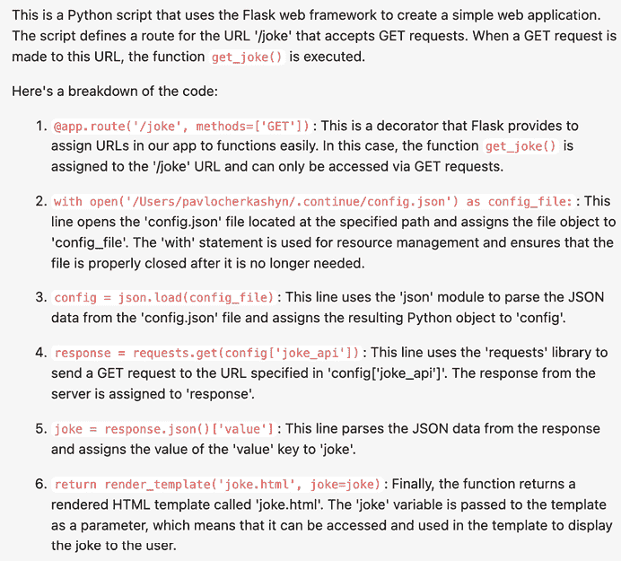

图 7.20：作为响应提供的详尽代码解释

好消息！Codestral 回复了详细的解释，清晰且细致地拆解了代码。它不仅描述了每个部分的作用，还对结构、逻辑和意图提供了见解。这种深思熟虑的回应将代码变成了可读、易学且不再令人生畏的东西。这是你构建 AI 驱动编程助手道路上的真正里程碑！

通过利用 Codestral 作为导师，你对代码的功能和设计有了深入的理解。这次练习证明了 Codestral 的专家知识如何作为宝贵的学习工具，丰富了你的编程体验。

# 总结

在多次实战研讨中，我们探索了 Codestral 如何作为一个强大的编程助手支持开发者。从在 VS Code 中配置环境到生成 Flask Web 服务、构建简单的 Web 界面以及与外部 API 集成，我们看到了 Codestral 如何简化常见的开发任务。

我们还处理了故障排除场景，例如解决模板错误，Codestral 的指导帮助理清了项目结构并提升了调试技能。除了代码生成之外，Codestral 还充当了导师的角色，提供了清晰的逐行解释，加深了我们对代码工作原理的理解。

总体而言，这些研讨会强调了 Codestral 在简化开发、加速学习以及轻松桥接后端和前端组件方面的价值。

有了 Codestral 作为伙伴，创新和学习的可能性是无尽的。让我们继续构建、探索和成长吧！

在下一章中，我们将探索 Mistral 模型如何支持实用的安全任务，包括分析 PCAP 文件、检查日志异常，以及检测源代码中的 SQL 注入和跨站脚本等漏洞。通过真实示例，你将看到这些模型如何通过加速检测、引导修复以及在日志分析和代码审查期间帮助明智决策来协助安全团队。

# 课外活动

此可选活动介绍了`Mistral Code Enterprise`，这是一个集成到代码编辑器中的强大 AI 助手。它旨在支持行内补全、重构、解释等功能。以下是在 VS Code 中快速设置它的方法：

## 许可

Mistral Code Enterprise 以商业许可运行，通常需要付费订阅。然而，某些类别的用户（如研究人员、教育者、学生、开源维护者和选定的企业评估员）可能符合申请免费访问。

你可以直接通过 Mistral Code 欢迎界面或 Mistral 官方网站申请访问或检查资格。

*   确保已安装 VS Code。这在`工作坊 2`中已经涵盖过。如果你按照了要求操作，就可以开始了了。
*   安装 Mistral Code 扩展。打开 VS Code 中的**扩展**面板板。搜索`Mistral Code Enterprise`或直接访问[`marketplace.visualstudio.com/items?itemName=mistralai.mistral-code`](https://marketplace.visualstudio.com/items?itemName=mistralai.mistral-code)。点击**安装**，并允许浏览器在 VS Code 中打开它：

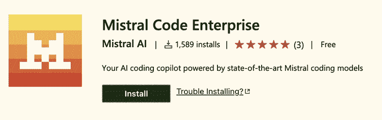

图 7.21：Mistral Code Enterprise

*   登录你的 Mistral 账户。点击 VS Code 左侧栏中的**M**图标。会出现一个欢迎界面，提示你登录。按照身份验证流程激活你的助手：

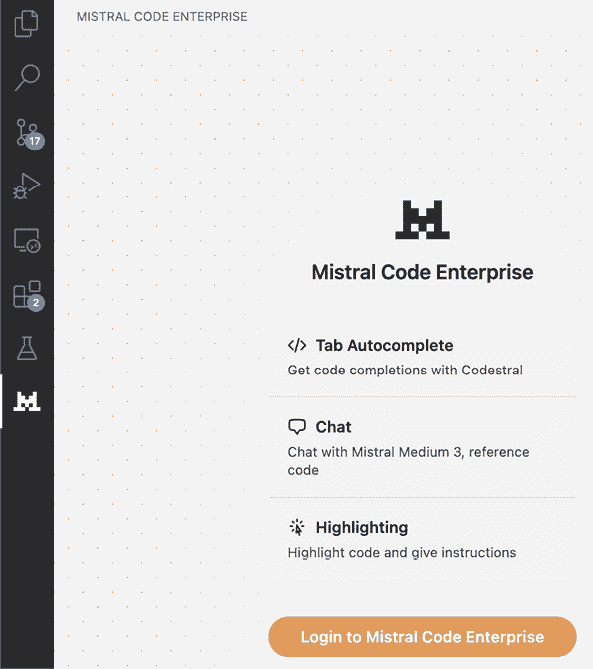

图 7.22：Mistral Code Enterprise 首页

*   **JetBrains 替代方案**：如果你在使用`IntelliJ`、`PyCharm`或其他 JetBrains IDE，可以从 JetBrains Marketplace 安装相同的插件：[`plugins.jetbrains.com/plugin/27493-mistral-code-enterprise`](https://plugins.jetbrains.com/plugin/27493-mistral-code-enterprise)。
*   关于功能和用例的更多详情，请参阅官方发布公告：[`mistral.ai/news/mistral-code`](https://mistral.ai/news/mistral-code)。
*   一旦安装并登录，你就可以使用自然语言提示通过 Mistral Code 补全代码、解释片段或直接在编辑器中构建。祝编程和实验愉快！

# 加入我们的 Discord 和 Reddit 空间

你并不是唯一一个在碎片化的工具、持续的更新和不明确的最佳实践中摸索的人。加入不断增长的专业社区，交流未记录在文档中的见解。

| 通过我们作者的更新、讨论和幕后见解保持信息畅。加入我们的 Discord：[`packt.link/z8ivB`](https://packt.link/z8ivB) 或扫描下方的二维码： | 与同行联系，分享想法并讨论真实的生成式 AI 挑战。在 Reddit 上关注我们：[`packt.link/0rExL`](https://packt.link/0rExL) 或扫描下方的二维码： |
|---|---|

```terraform
resource "aws_security_group" "example" {

  name        = "example-security-group"
  description = "Security group for example application"
  vpc_id      = aws_vpc.main.id

  # Allow SSH access
  ingress {
    from_port   = 22
    to_port     = 22
    protocol    = "tcp"
    cidr_blocks = ["0.0.0.0/0"]
  }

  # Allow HTTP access
  ingress {
    from_port   = 80
    to_port     = 80
    protocol    = "tcp"
    cidr_blocks = ["0.0.0.0/0"]
  }

  # Allow HTTPS access
  ingress {
    from_port   = 443
    to_port     = 443
    protocol    = "tcp"
    cidr_blocks = ["0.0.0.0/0"]
  }

  # Egress rule
  egress {
    from_port   = 0
    to_port     = 0
    protocol    = "-1"
    cidr_blocks = ["0.0.0.0/0"]
  }

  tags = {
     Name = "example-security-group"
  }
}
```

好的，正如我们看到的，`HTTP`和`HTTPS`协议均对整个互联网开放，并且还有一个不受限制的出站规则。

手动审查此类配置以发现潜在风险是枯燥且容易出错的，特别是在复杂的环境中。相反，你可以利用`Mistral LLM`来自动化这一过程。针对此任务定制的优化提示词（prompt）如下：

```
分析以下 Terraform 脚本并识别任何违反最小权限原则或过度宽松的配置。为改进提供具体的建议。
```

当由`Mistral`处理时，模型会识别出潜在的配置错误并提供可操作的建议：

```
潜在的配置错误：

- SSH 入站规则（端口 22）允许无限制访问。建议限制为受信任的 IP。
- HTTP 入站规则（端口 80）对整个互联网开放。建议根据应用需求限制访问。
- 开放的出站规则允许所有传出流量。建议将范围缩小到特定的目标和协议。

建议操作：更新入站规则以使用限制的 CIDR 范围，并优化出站规则以符合应用需求。
```

通过自动化这种分析，`Mistral`简化了合规审计，降低了疏忽的风险。它为安全配置提供了清晰的指导，让你的团队专注于实施必要的更改。这种方法确保你的防火墙规则既有效又符合安全最佳实践。

在本章的后半部分工作坊中，我们将深入分析 Terraform 脚本，以确保它们遵循最小权限原则。使用`Codestral`，我们将识别出过度宽松的配置（例如不受限制的入站或出站规则），并学习如何有效地保护它们，以符合云安全最佳实践。

## 防火墙日志分析

防火墙日志就像数据宝——只要你知道寻找什么。它们记录了你的网络与外部世界之间的每一次交互，但理解所有这些噪音可能会让人感到无从从。这就是`Mistral LLM`介入的地方，它可以帮助你快速识别模式并关注真正重要的事情。


在本节中，我们将深入探讨让防火墙日志为你提供服务的实用方法，学习如何识别可能信号 DDoS 攻击或未经授权访问尝试的异常流量，使用地理位置分析标记来自可疑区域或已知坏分子的流量，检查你的防火墙规则是否按规程办事，并保持你的设置安全。

我们还将向你展示如何将告警分类，以便你先处理大问题，并使用 AI 发现你可能根本不知道去寻找的新威胁。到结束时，你将知道如何将原始日志数据转换为有用的洞察并采取行动。

## 异常流量检测

每个网络都通过其流量讲述故事，但在稳定的数据流中，隐藏着可能预示着迫临威胁的异常模式。检测这些异常（例如 DDoS 攻击期间流量的突然激增或来自可疑 IP 的重复访问尝试）可能是保持安全与沦为攻击受区别。在 `Mistral LLM` 和 `Codestral` 的帮助下，这一过程可以变得更加高效，在片时间内将日志转化为可操作的洞察。

### 识别 DDoS 流量

DDoS 攻击通常会导致来自多个 IP 针对同一终点的请求洪水。这些攻击可能会阻塞你的网络，因此快速识别来源至关重要。例如，考虑以下示例日志条目：

```
2023-12-28T10:15:12Z SRC_IP=192.168.1.5 DEST_IP=10.0.0.8 DEST_PORT=443 PROTOCOL=TCP BYTES_SENT=0 BYTES_RECEIVED=124
2023-12-28T10:15:12Z SRC_IP=192.168.1.6 DEST_IP=10.0.0.8 DEST_PORT=443 PROTOCOL=TCP BYTES_SENT=0 BYTES_RECEIVED=124
2023-12-28T10:15:13Z SRC_IP=192.168.1.7 DEST_IP=10.0.0.8 DEST_PORT=443 PROTOCOL=TCP BYTES_SENT=0 BYTES_RECEIVED=124
```

手动分析这些日志以检测模式可能是枯燥且容易出错的。这是 `Mistral LLM` 擅长的地方。让我们带有如下提示词将日志输入 `Mistral`：

```
分析日志并识别潜在的 DDoS。
```

`Mistral` 处理数据并提供：

```
检测到潜在 DDoS：
- SRC_IP=192.168.1.5, 请求数：100
- SRC_IP=192.168.1.6, 请求数：98
- SRC_IP=192.168.1.7, 请求数：95

建议操作：临时屏蔽这些 IP。
```

### 识别端口扫描尝试

端口扫描是另一种常见的威胁，攻击者探测多个端口以寻找漏洞。检测这些扫描需要跟踪连接。例如，这里有一个示例日志：

```
2023-12-28T11:00:15Z SRC_IP=203.0.113.5 DEST_IP=10.0.0.8 DEST_PORT=22 PROTOCOL=TCP
2023-12-28T11:00:16Z SRC_IP=203.0.113.5 DEST_IP=10.0.0.8 DEST_PORT=80 PROTOCOL=TCP
2023-12-28T11:00:17Z SRC_IP=203.0.113.5 DEST_IP=10.0.0.8 DEST_PORT=443 PROTOCOL=TCP
```

手动分析用于指示端口扫描模式的日志可能是耗时且容易出错的，特别是在处理大型数据集时。通过利用语言模型（如 `Mistral 8B`），你可以自动化这一过程。模型可以通过处理日志条目并提供如下良好的提示词来快速识别可疑活动：

```
分析以下数据包并检测潜在的端口扫描活动。如果检测到，提供源 IP，列出目标端口并建议适当的操作。
```

模型处理数据并提供简洁且可操作的响应：

```
检测到端口扫描：
源 `IP: 203.0.113.5`
目标端口：22, 80, 443
建议操作：加入动态屏蔽列表。
```

### 处理未经授权的访问尝试

破解攻击是一个持续存在的问题，通常涉及针对特定系统或账户的重复失败登录尝试。从日志中手动识别这些尝试可能是耗力且容易出错的，特别是在高流量环境中。使用 `Mistral LLM` 进行自动化分析提供了一种更快、更可靠的方法，帮助检测模式并建议对措施。

例如，考虑以下日志条目：

```
2023-12-28T12:30:10Z SRC_IP=198.51.100.7 DEST_PORT=22 STATUS=FAILED
2023-12-28T12:30:11Z SRC_IP=198.51.100.7 DEST_PORT=22 STATUS=FAILED
2023-12-28T12:30:12Z SRC_IP=198.51.100.7 DEST_PORT=22 STATUS=FAILED
```

与其手动分析这些日志以查找重复尝试，不如利用如 `Mistral` 这样的语言模型。通过提供日志和精心设计的提示（prompt），模型可以高效处理数据并提供可操作的见解。一个合适的提示如下：

```
Analyze the logs for repeated failed login attempts. Identify the source IP, the number of attempts, and recommend appropriate mitigations.
```

模型处理日志并提供了清晰简洁的输出：

```
Repeated failed login attempts detected from SRC_IP: 198.51.100.7

Attempts: 50 within 5 minutes

Suggested action: Enforce IP blocking and review SSH access policies.
```

此输出不仅识别了违规源 IP，还建议了具体的缓解措施，例如强制 IP 阻塞和审查访问策略。通过自动化检测和响应过程，`Mistral` 简化了威胁管理，让安全团队能够迅速行动并降低未经访问的风险。

我们已经在日志中标记了可疑行为——DDoS 突发、端口扫描和暴力破解尝试。下一步是添加地理上下文，以便我们能够常规流量与风险更高的流量隔离开。基于地理位置的分析利用区域和威胁情报信号来丰富每个事件，使分拣处理更快。让我们来看下一个部分。

## 基于地理位置的分析

了解流量的源地是识别网络潜在威胁的关键组成。地理位置分析允许您检测到源自高风险区域或已知恶意 IP 的流量，这些流量通常是恶意活动的早期指标。

然而，手动分析日志以寻找此类模式不仅耗时耗力，而且容易人为错误。利用 `Mistral LLM` 可以自动化这一过程，实现对地理位置元数据快速、准确的分析。

例如，考虑以下包含地理位置信息的日志条目：

```
2023-12-28T14:05:22Z SRC_IP=45.67.89.101 DEST_IP=10.0.0.8 GEOLOCATION=Unknown REGION="Eastern Europe"
2023-12-28T14:05:23Z SRC_IP=203.0.113.88 DEST_IP=10.0.0.8 GEOLOCATION=Known Malicious REGION="Asia"
```

为了增强地理位置分析，您可以将 MaxMind 的 `GeoLite2` 等 IP 地理数据库集成到 `Wireshark` 等工具中。这允许将 IP 地址实时映射到其地理位置，为流量模式提供宝贵的上下文，并有助于识别高风险区域或恶意 IP。

手动识别和分类来自可疑区域的流量是一项艰巨的任务，特别是当日志量巨大时。为了简化这一过程，可以使用提示将这些日志提供给 `Mistral LLM`，引导模型突出显示任何高风险流量源。一个重构且重点突出的提示可能如下：

```
Review the logs and identify traffic from suspicious regions or known malicious IPs. Provide the source IP, the region or geolocation, and recommend appropriate actions.
```

处理后，`Mistral` 会生成如下见解：

```
Suspicious traffic detected:

- SRC_IP: 45.67.89.101 (Region: Eastern Europe, Geo: Unknown)
- SRC_IP: 203.0.113.88 (Region: Asia, Geo: Known Malicious)

Suggested action: Monitor or block these IPs.
```

此输出不仅指明了源 IP 及其关联区域，还建议了可操作的步骤，例如阻塞或监控识别出的流量。通过自动化地理位置分析，`Mistral` 不仅节省了宝的时间，还提高了准确性，使安全团队能够专注于主动措施。这种方法确保了针对演变威胁提供更稳健、更高效的防御。

现在我们已经可以检测异常并了解它们的来源，挑战变成了告警量。

## 告警优先级

管理网络安全面临的最大挑战之一是从现代系统产生的海量告警中筛选。并非所有告警的重要性都相同；某些可能指示需要立即采取的关键威胁，而另一些仅仅是常规通知。如果没有适当的优先级，安全团队面临在低优先级问题上浪费时间的风险，可能导致严重威胁得不到处理。自动化这些告警的分类有助于简化响应工作，让团队专注于最重要的事情。

考虑以下代表不同类型网络事件的日志条目：

```
2023-12-28T15:10:12Z SRC_IP=198.51.100.1 EVENT="Unauthorized access attempt"
2023-12-28T15:10:15Z SRC_IP=192.0.2.5 EVENT="Login failure"
2023-12-28T15:10:17Z SRC_IP=192.0.2.5 EVENT="Login failure"
2023-12-28T15:10:18Z SRC_IP=192.0.2.5 EVENT="Login failure"
2023-12-28T15:10:20Z SRC_IP=192.0.2.5 EVENT="Login failure"
2023-12-28T15:10:25Z SRC_IP=203.0.113.50="Routine connection"
```

手动分析这些日志以确定其紧急性是低效且易错的，特别是在高流量环境中。为了实现自动化，`Mistral LLM` 可以分析日志并分配严重级别。`Mistral` 处理这些日志并交付可操作的见解：

```
Critical: 198.51.100.1
Warning: 192.0.2.5
Informational: 203.0.113.50
```

通过自动化这种分析，`Mistral` 使安全团队能够识别并响应关键事件（如未经访问），同时监控低优先级警告。这种优先级排序不仅缩短了响应时间，还确保了安全资源的有效分配。

即使有更严格的规则和更敏锐的上下文，某些威胁仍会溜进来。那么，接下来是什么？我们转向发现异常。在下一节中，我们将探讨异常检测如何帮助捕捉零日威胁。

## 零日威胁检测

零日威胁是最挑战性的安全风险之一，它们利用未知漏洞暴露系统。`Mistral LLM` 擅长识别这些模式，提供能够快速响应和缓解的见解。让我们探讨两个可能指示零日威胁的异常流量示例。

### 示例 1：快速波动的流量量

流量异常波动是零日威胁的一个潜在指标。此类模式可能意味着数据外泄、流量整形或其他未经授权的操作。考虑以下日志条目：

```
2023-12-28T14:00:01Z SRC_IP=192.168.1.20 DEST_IP=10.0.0.8 BYTES_SENT=500KB PROTOCOL=TCP
2023-12-28T14:00:05Z SRC_IP=192.168.1.20 DEST_IP=10.0.0.8 BYTES_SENT=5MB PROTOCOL=TCP
2023-12-28T14:00:06Z SRC_IP=192.168.1.20 DEST_IP=10.0.0.8 BYTES_SENT=20KB PROTOCOL=TCP
2023-12-28T14:00:07Z SRC_IP=192.168.1.20 DEST_IP=10.0.0.8 BYTES_SENT=100MB PROTOCOL=TCP
2023-12-28T14:00:08Z SRC_IP=192.168.1.20 DEST_IP=10.0.0.8 BYTES_SENT=1KB PROTOCOL=TCP
```

手动识别这些不规则之处非常耗时且容易出错，特别是在监控大型数据集时。通过利用 `Mistral LLM`，你可以使用如下目标提示词（prompt）来自动化此过程：

```
分析以下日志，寻找可能指示新兴威胁的异常流量模式。突出异常情况并建议适当的措施以降低潜在风险。
```

处理后，`Mistral` 会提供以下可操作的洞察：

```
检测到新兴威胁：

- 流量大小从 SRC_IP: 192.168.1.20 出现异常波动。
- 数据外泄或流量整形尝试的潜在指标。

建议操作：密切监控系统，并检查日志以寻找未经授权数据传输的迹象。
```

这些洞察突出了不规则行为，允许安全团队采取采取行动，例如隔离源或加强数据监控。

### 示例 2：不规则的会话建立与终止

另一个可疑模式涉及异常的会话行为，即源 IP 在短时间内频繁建立和终止会话。这可能表明连接探测或试图利用会话漏洞。查看以下日志条目：

```
2023-12-28T14:05:10Z SRC_IP=203.0.113.25 DEST_IP=10.0.0.8 EVENT="Session start" PROTOCOL=TCP
2023-12-28T14:05:11Z SRC_IP=203.0.113.25 DEST_IP=10.0.0.8 EVENT="Session end" PROTOCOL=TCP
2023-12-28T14:05:12Z SRC_IP=203.0.113.25 DEST_IP=10.0.0.8 EVENT="Session start" PROTOCOL=TCP
2023-12-28T14:05:13Z SRC_IP=203.0.113.25 DEST_IP=10.0.0.8 EVENT="Session end" PROTOCOL=TCP
2023-12-28T14:05:14Z SRC_IP=203.0.113.25 DEST_IP=10.0.0.8 EVENT="Session start" PROTOCOL=TCP
```

这种频繁的会话变化在人工审核期间很容易被忽略，但 `Mistral` 的异常检测能力使其识别和确定优先级变得非常简单。让我们考虑与上一个示例相同的情况：

```
分析以下日志，寻找可能指示新兴威胁的异常流量模式。突出异常情况并建议适当的措施以降低潜在风险。
```

`Mistral` 的响应引起了异常异常，并提供了处理潜在威胁的清晰后续步骤，例如跟踪会话或进一步隔离源以进行深层分析：

```
检测到新兴威胁：

- 来自 SRC_IP: 203.0.113.25 的不规则会话建立与终止。
- 行为与潜在的连接探测或会话劫持尝试相符。

建议操作：调查源 IP 并实施会话跟踪机制以进一步监控。
```

通过自动检测异常流量模式，`Mistral LLM` 允许安全团队快速识别并响应零日威胁。无论是波动的流量大小还是反复无常的会话行为，这些洞察都能实现主动的威胁缓解，降低被利用的风险。通过 `Mistral` 和 `Codestral` 等工具，你在保护关键系统免受未知漏洞方面获得了显著优势。

从基于地理位置的过滤到零日异常检测，`Mistral LLM` 彻底了我们处理防火墙日志和安全工作流的方式。它自动化地理位置分析、审核防火墙规则、优先处理告警以及检测新兴威胁的能力简化了复杂任务并增强了决策。AI 无缝集成到安全操作中，确保组织领先于攻击者，对潜在风险做出更快、更智能的响应。通过将实用工具与 AI 驱动的洞察相结合，这些方法将原始数据转化为可操作的情报，实现了更稳健、更高效的防御策略。

分析以下日志，检查非标准端口上是否存在异常的协议使用。请提供源 IP、使用的协议、端口号并提供解决该问题的建议操作。

```
在处理时，Mistral 会提供清晰且可操作的响应：

检测到协议误用：

- SRC_IP: 192.0.2.5
- Protocol: 端口 8080 上的 SMTP
- Suggested action: 调查源 IP 并强制执行协议-端口映射规则，以防止未经授权的使用
```


此响应强调了误用行为，并提供了建议的行动方案。调查源 IP 可以揭示该行为是由于配置错误还是更严重的威胁。执行严格的协议-端口映射有助于防止未经授权的活动，并确保网络在预期边界内运行。

通过自动化检测协议误用，`Mistral` 使安全团队能够快速识别并处理异常。这不仅增强了网络管理的效率，还降低了潜在漏洞的风险，使您的基础设施保持安全可靠。

状态检测防火墙日志是网络行为洞察的金矿，允许您发现从不完全握手到协议误用的各种威胁。通过 `Mistral` LLM，分析这些日志变得简单且具有可操作性。通过识别问题、建议响应以及自动更新动态块列表等任务，`Mistral` 将复杂数据转化为简单的解决方案，确保您的网络保持安全和韧性。

## 关于实时日志处理

由于网络日志量巨大且复杂，实时日志处理并非总是可行的，这通常需要大量的计算资源。然而，随着如 `Mistral 8B` 和 `Mistral Nemo` 等本地部署选项可用，即使在有限的基础设施上也可以实现近实时的分析。在本地运行 `Mistral` 可以实现高效、低延迟的处理，使组织能够在不依赖昂贵的云解决方案或外部依赖的情况下监控并响应威胁。这种方法平衡了性能与资源可用性，对于希望在不超出运营预算的情况下增强安全态势的企业来说，是一个实用的选择。

# 其他安全应用

让我们现在探索 `Mistral` LLM 如何增强多个领域的网络安全。从检测终端威胁和异常用户行为，到监控文件完整性和云配置错误，`Mistral` 都能支持实时分析和自动化。让我们来看看它在加强身份验证、授权以及识别潜在数据泄露风险方面的作用：

- **终端安全、恶意软件行为预测**：预测恶意软件行为就像在野外中识别隐藏的捕食者：在攻击之前看起来无害。通过通过 `Mistral` 分析代码片段，您可以及早发现恶意模式，甚至识别零日威胁。一个真实案例是 `Stuxnet`，这是一种高度复杂的恶意软件，它通过隐藏在伪装代码中攻击工业系统（参考材料：[`www.codeproject.com/articles/246545/stuxnet-malware-analysis-paper`](https://www.codeproject.com/articles/246545/stuxnet-malware-analysis-paper)）。
- **文件完整性监控**：关键系统文件一旦被篡改就会损害整个系统。在 2017 年的 `NotPetya` 攻击中，未经授权的文件更改导致了广泛破坏。`Mistral` 可以实时监控文件完整性，提醒您任何未经授权的修改（参考材料：[`css.csail.mit.edu/6.566/2018/readings/stuxnet.pdf`](https://css.csail.mit.edu/6.566/2018/readings/stuxnet.pdf)）。
- **数据泄露检测（异常数据传输）**：大规模或重复的数据导出通常标志着泄露尝试。2014 年，索尼图片泄露事件涉及数周内盗取的数 GB 敏感数据。使用 `Mistral`，您可以通过分析网络日志并标记向未知目的地的传输来识别此类异常（参考材料：[`www.itgovernance.co.uk/blog/global-data-breaches-and-cyber-attacks-in-december-2023-22419675-breached`](https://www.itgovernance.co.uk/blog/global-data-breaches-and-cyber-attacks-in-december-2023-22419675-breached)）。
- **身份验证与授权（凭据滥用）**：凭据填充和暴力破解攻击持续构成重大威胁。2024 年，35%的组织报告了由于暴力破解导致的身份泄露，包括凭据填充和密码喷洒（参考材料：[https://www.beyondtrust.com/blog/the-state-of-identity-security-threats-breaches-security-practices](https://www.beyondtrust.com/blog/the-state-of-identity-security-threats-breaches-security-practices)）。此外，2023 年，凭据填充占泄露事件的约 10%（参考材料：[`jumpcloud.com/blog/password-statistics`](https://jumpcloud.com/blog/password-statistics)）。`Mistral` 可以实时分析登录尝试，检测并拦截滥用模式。
- **应用代码漏洞**：`OWASP` 前 10 名列出了如 `XSS` 和 `CSRF` 等关键 Web 漏洞。`Mistral` 通过扫描不安全模式识别您的应用程序代码中的这些缺陷，提供修复建议以加强您的代码（参考材料：[`github.com/x86byte/Stuxnet-Rootkit`](https://github.com/x86byte/Stuxnet-Rootkit)）。
- **用户行为分析 (UBA)（命令与控制）**：`C2` 服务器经常用于高级攻击，例如 2020 年的 `SolarWinds` 泄露事件。`Mistral` 可以从日志中识别已知的 `C2` 通信模式，从而早期检测并破坏这些通道（参考材料：[`css.csail.mit.edu/6.566/2018/readings/stuxnet.pdf`](https://css.csail.mit.edu/6.566/2018/readings/stuxnet.pdf)）。
- **云配置错误**：云配置错误导致了 73%的云安全问题，如 2018 年的 `Tesla` 泄露事件所示。`Mistral` 可以分析 `Terraform` 和 `CloudFormation` 等配置文件来检测开放端口、过度权限和不安全的设置（参考文章：[`www.cloudcomputing-news.net/news/misconfiguration-was-the-cause-of-security-incidents-in-2021/`](https://www.cloudcomputing-news.net/news/misconfiguration-was-the-cause-of-security-incidents-in-2021/)）。
- **存储安全**：公开暴露的存储桶导致了多次泄露，例如 2017 年的 `Verizon` 数据泄露。`Mistral` 可以分析桶策略，确保敏感数据得到适当保护（参考材料：[`www.osibeyond.com/blog/cloud-services-problem/`](https://www.osibeyond.com/blog/cloud-services-problem/)）。

我们已经浏览了现代网络安全的一些关键领域，从发现恶意软件到标记异常数据传输并锁定配置错误。这并不是深科学，但比起“只需点击此处”要复杂得多。坦率地说，`Mistral` 通过捕捉异常并提供可操作的见解，让繁重的工作变得更容易。

准备好大起袖子了吗？在接下来的实验中，我们将实操 SQL 注入分析并处理配置脚本。你将看到 `Mistral` 如何比你老板说“什么是 SQL 注入”更快发现漏洞。重点是将原始日志和脚本转化为支持更安全的清晰见解。

在本节结束时，你将看到 AI 辅助分析如何简化安全任务，并准备好将相同技术应用于其他高风险场景。

# 实战实验：使用 Mistral 进行代码和云安全防护

在本次实验中，我们将发现显而易见的漏洞，例如过度权限的云配置、SQL 注入以及 `XSS` 风险。通过 `Visual Studio Code`、`Continue` 扩展以及 `Mistral` 的强大分析，我们不仅能检测这些威胁，还能学习像专业人士一样修复它们。到结束时，你将掌握战胜潜在攻击者的技能！

## 第 1 步：环境设置

在准备的第一步中，我们将涵盖必要的设置任务，以确保实验顺利开始。我们将从安装 `Visual Studio Code` 开始，这是一个适合项目的强大编辑器。接下来，我们将访问 GitHub 仓库中的参考材料，其中包含所有必要的文件和脚本。我们将安装 `Continue` 开发扩展，通过 AI 驱动的辅助增强编码体验。随后，我们将通过免费试用或兼容的部署设置 `Codestral`，启用高级安全分析功能，如代码审查和漏洞检测。最后，我们将准备一个新的项目空间来有效组织和管理我们的工作。这些基础步骤将为动手探索安全应用奠定基础：

1. 为实验设置环境，你需要一个如 `Visual Studio Code` 的编辑器。它是一个轻量且强大的工具。虽然安装步骤可能因操作系统略有不同，但过程非常简单：下载、安装并启动编辑器。详细步骤请参阅第 7 章工作坊 2（Chapter 7, Workshop 2）。按照这些指令操作，你就准备绪了！

   **如果已安装 VS Code，请跳过**

   如果你已经安装了 `Visual Studio Code`，可以跳过安装步骤，直接配置扩展。

2. 为了进行实验设置，你需要访问 GitHub 仓库。访问主项目 [`github.com/PacktPublishing/Learn-Mistral`](https://github.com/PacktPublishing/Learn-Mistral) 并导航到第 8 章（Chapter-8）。这些文件包含了所需的脚本和数据。
3. 为了增强编码体验，你需要设置 `Continue` 扩展以获得 AI 辅助。它通过自动补全和上下文建议等功能简化编码。详细步骤请参阅第 7 章工作坊 2 第 1.3 节（Chapter 7, Workshop 2, Step 1.3）。按照这些操作，扩展就准备好了！
4. 为 `Visual Studio Code` 中的 `Continue` 扩展设置 `Codestral` 模型，你有多种选择。可以使用免费试用（这对本实验足够），或者选择配置了 API 密钥的付费版本。或者，如果你倾向于本地处理，可以在电脑上与 `Ollama` 集成。详细步骤请参阅第 7 章工作坊 2（Chapter 7, Workshop 2）。按照步骤操作确保无缝集成。
5. 最后，为了启动实验，我们将初始化一个名为 `security_usecases` 的新项目。你可以从仓库的第 8 文件夹中复制包含所有文件的整个文件夹，也可以在练习过程中创建自己的文件。只需将提供的代码片段复制到你的文件中，并结合它们来逐一探索实验步骤。

## 第 2 步：云安全分析

在这一步中，我们将分析一个权限过大的 Terraform 脚本，以揭示源于过度权限和开放端口的安全风险。此类配置违反了最小权限原则，可能会使您的基础设施暴露在不必要的漏洞之中。使用 `Codestral`，我们将识别并解决这些问题以加强您的云安全态势。

请遵循以下步骤：

1. 打开提供的 Terraform 脚本 (`too-permissive.terraform`)。关注定义入站和出站规则的安全组配置。
2. 然后通过查看以下行来识别漏洞代码：

```hcl
resource "aws_security_group" "example" {
  name        = "example-security-group"
  description = "Security group"
  vpc_id      = aws_vpc.main.id

  ingress {
    from_port   = 22
    to_port     = 22
    protocol    = "tcp"
    cidr_blocks = ["0.0.0.0/0"] # Open SSH access
  }

  ingress {
    from_port   = 80
    to_port     = 80
    protocol    = "tcp"
    cidr_blocks = ["0.0.0.0/0"] # Open HTTP access
  }

  egress {
    from_port   = 0
    to_port     = 0
    protocol    = "-1"
    cidr_blocks = ["0.0.0.0/0"] # Open all traffic
  }
}
```

这些配置允许对 SSH 和 HTTP 的无限制访问并开放了所有出站流量，使应用程序暴露在不必要的风险之中。此外，请识别以下几行：

```hcl
# 具有广泛权限的内联策略
inline_policy {
  name   = "example-inline-policy"
  policy = jsonencode({
    Version = "2012-10-17"
    Statement = [
      {
        Effect   = "Allow"
        Action   = "*"
        Resource = "*" # 权限过大的角色
      }
    ]
  })
}
```

如前面的 Terraform 配置所示，该内联 IAM 策略在没有任何限制的情况下授予了过于宽泛的权限。使用 `Codestral`，我们分析了这段代码将其标记为安全风险。这种无限制的访问可能导致权限提升或横向移动，这强调了在策略定义中应用最小权限原则的必要性。

3. 接下来，我们按下 `CMD` + `A` 选中所有行，然后按 `CMD` + `L` 将整个文件片段添加到新的 `Codestral` 对话上下。我们这样做的原因是因为文件的第一部分包含一个内联 IAM 策略，该策略授予了通用的 `"Action": "*"` 和 `"Resource": "*"` 访问，这种危险的宽松配置违反了最小权限原则，并构成了严重的安全风险。
4. 然后，使用以下提示词：

```text
你是一个专注于安全的 AI 专家。你的任务是审查以下 Terraform 脚本，以识别潜在的安全配置错误。逐步分析脚本，并识别任何与权限过宽的规则、不必要的开放端口以及违反最小权限原则相关的问题。

分析任务：
1. 识别并描述配置错误，重点关注权限过大的入站和出站规则。
2. 提出具体的改进建议，以执行最小权限原则。
3. 提供保障云基础设施安全的通用最佳实践。

请按以下结构组织你的分析：
1. 识别出的配置错误：
   - [问题的简要描述]
   - [代码行号或位置]
   - [影响或潜在的利用方式]
2. 缓解建议：
   - [建议的配置更改]
   - [最佳实践]
3. 安全配置建议：
   - [关于安全云配置的建议]

重点关注可操作的建议以及如何改进安全态势的具体示例。
```


提交提示词后，模型将生成一个结构化响应，突出显示配置错误、建议缓解措施并概述安全配置实践。为了理解这些结果，我们将逐部分分析每一个内容。首先，我们将回顾响应中识别出的发现漏洞配置错误部分：

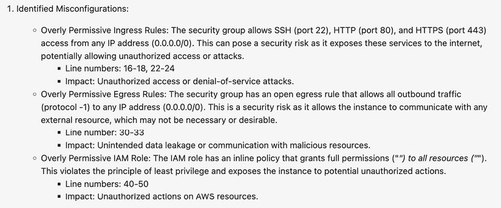

图 8.1: Terraform 脚本 – 识别出的配置错误

让我们仔细观察并对这些识别出的配置错误进行分析：

- **权限过大的入站规则**：如响应所示，允许从任何 IP 地址（`0.0.0.0/0`）访问 SSH、HTTP 和 HTTPS 会使应用程序无限制地暴露在互联网上。这为未经授权的访问或拒绝服务攻击创建了巨大的攻击面。将访问限制在受信任的 IP 范围内对于降低风险至关重要。
- **权限过大的出站规则**：如强调的，开放的出站规则允许所有出站流量访问任何 IP 地址，这带来了意外数据泄露或与恶意资源通信的风险。通过将出站流量限制为仅必要的 IP 和端口，你可以更好地控制和监控出站连接。
- **权限过大的 IAM 角色**：响应指出，对所有资源授予完全权限违反了最小权限原则。这为在 AWS 资源上进行未经授权的操作打开了大门，可能导致意外删除或权限提升等严重后果。将权限限制在仅必要的范围内有助于缓解这些风险。

现在，让我们调查缓解建议：

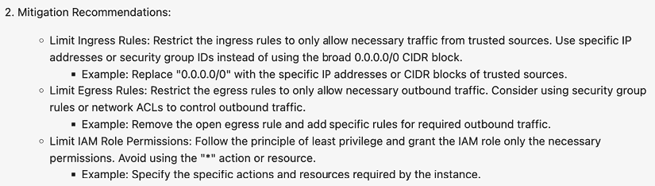

图 8.2: Terraform 脚本缓解建议

让我们仔细观察并对这些缓解建议进行分析：

- `限制入站规则` 涉及将访问缩小到仅限绝对必要且来自受信任源的流量。将 `0.0.0.0/0` CIDR 块替换为特定的 IP 地址或范围，可以确保您的系统在保持基本连接的同时，不会暴露在潜在入侵者的攻口之下。
- `限制出站规则` 的精髓在于精确控制出站流量。通过消除开放的出站规则并引入目标规则，你可以防止意外的通信和数据泄露，确保仅允许授权且必要的连接。
- `限制 IAM 角色权限` 的原理是为该角色执行其工作提供足够的访问权限。放弃过度宽泛的权限并指定具体的操作和资源，可以创建更严密的安全态势，减少未经授权操作和权限提升的风险。

接下来，让我们查看安全配置建议。以下建议概述了通过解决权限过大的配置来增强云安全的关键策略。这些步骤利用 AWS 最佳实践来控制访问、减少暴露面并有效监控网络活动。

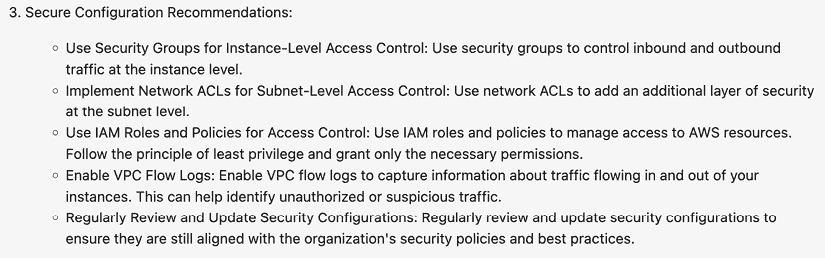

图 8.3: 安全配置建议

让我们仔细观察并对安全配置建议进行分析：

- 使用安全组进行实例级访问控制的精髓在于过滤流量并仅允许授权的连接，减少对威胁的暴露。
- 实施子网级访问控制的网络 ACL（访问控制列表）意味着是在到达实例之前添加另一层安全层来过滤流量。
- 使用 IAM 角色和策略进行访问控制的原理是仅授予必要的权限，最大限度地减少未经授权访问的风险。
- 启用 VPC 流日志的目标是跟踪流量并识别可疑活动，以进行更好的威胁监控。

此练习步骤强调了权限过大的云配置的风险，例如不受限制的 SSH 访问和开放的出站规则。通过使用 Codestral 定位这些漏洞，你可以实施更严密的安全措施，强化最小权限原则并最小化你的攻击面。在有了安全配置的情况下，你的云环境将受到针对潜在威胁的良好保护。

在对如何通过适当访问控制和流量监控来保护云环境有了充分理解后，是时候将注意力转移到应用程序级漏洞了。在下一步中，我们将深入 SQL 注入检测，探索处理不当的用户输入如何破坏您的数据库。让我们发现这些风险并学习如何保护您的数据！

## 步骤 3：SQL 注入检测

安全漏洞就像地基中的隐藏裂缝，可能会破坏整个系统。主动检测并解决它们可以确保稳固的防御。在此步中，我们将分析 Java Servlet 代码以发现 SQL 注入等常见问题，并学习如何利用 Codestral 提供的可行见解来加强应用程序。总的来说，这次练习将展示如何在真实代码中检测和缓解安全风险。

1. 我们首先打开 `JdbcServlet.java` 文件。关注第 14–66 行，这些行包含处理用户输入和数据库查询的逻辑。
2. 将第 14–66 行复制到剪贴板。特别注意第 39 行，用户输入被直接拼接到 SQL 查询语句中。

```
String sql = "SELECT * FROM users WHERE username = '" + param + "'";
```

这使得应用程序面临 SQL 注入风险，这是一个常见且危险的漏洞。例如，恶意用户可以注入 SQL 命令来删除表或提取敏感数据，从而绕过预定的功能。

3. 按下 `CMD` + `L` 将选定的代码段添加到 Continue 扩展中的新聊天上下文中。这将允许 Codestral 分析代码。

**提示词结构化技巧**

- 首先告诉 LLM 它是谁（例如，"你是一个安全专家"）。
- 列出你想要的任务（例如寻找漏洞、建议修复方案）。
- 最后，定义你期望的响应格式。
- 清晰的角色、清晰的目标和清晰的结构会带来更好的结果。

将以下提示词粘贴到 Codestral 聊天中：

```
你是一个专注于安全的 AI 专家。你的任务是审查以下 Java Servlet 代码的潜在漏洞。分步分析代码并识别与安全、代码质量或最佳实践相关的问题。

分析任务：

1. 识别并描述安全漏洞，关注 SQL 注入、硬编码凭据和处理不当等风险。

2. 针对每个识别出的漏洞提出缓解建议。

3. 针对处理用户输入、数据库查询和敏感信息推荐安全编码实践。

4. 如果适用，突出任何代码异味或对最佳实践的违反。

按以下结构提供你的分析：

1. 识别出的漏洞： - [问题的简要描述] - [代码中的行号] - [影响或潜在利用方式]

2. 缓解建议： - [建议的代码改进] - [最佳实践]

3. 安全编码建议： - [关于安全编码的通用建议]

关注可操作的建议和改进代码的具体示例。
```

Codestral 将分析代码并突出显示漏洞。以下是你可能会看到的示例：

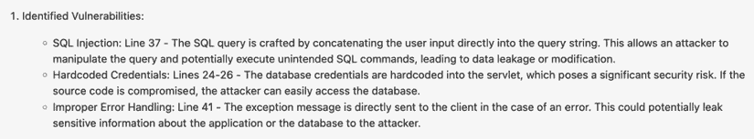

图 8.4: Java 代码中识别出的漏洞

图 `8.4` 展示了 Codestral 的响应，它标记了漏洞 JDBC 代码段中的关键安全问题，例如 SQL 注入、硬编码凭据和错误泄露。SQL 注入反映了对信任边界的广泛忽视。通过直接将用户输入嵌入查询中，代码为攻击者提供了重定义逻辑（redefine logic）、访问数据或提升权限的机会。这是缺乏验证以及数据与命令之间分离不良的典型标志。

同时，硬编码凭据和错误泄露表明缺乏秘密管理规范。以明文存储数据库凭据是一种捷径方法，如果仓库泄露，可能会产生毁灭性的影响。同样，将原始错误消息返回给客户端会让内部逻辑对外部可见，为攻击者提供利用漏洞的线索。这两者表明缺乏分层安全思维。

接下来，让我们调查缓解建议：

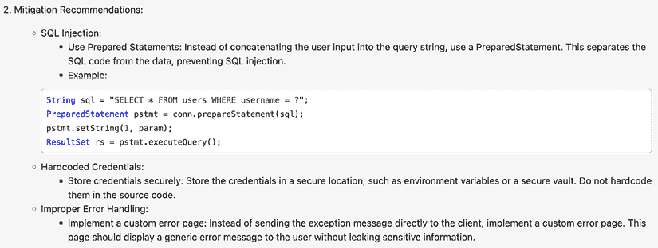

图 8.5: 漏洞 Java 代码的缓解建议

图 `8.5` 展示了使用预编译语句（prepared statements）构建 SQL 查询的安全方法。这种方法通过将 SQL 逻辑与用户输入分离，有助于消除 SQL 注入风险，确保恶意值不会更改预期的查询行为。

此外，图中强调应避免硬编码凭据。相反，鼓励开发者将敏感凭据存储在环境变量或安全箱（vaults）中，以减少在源代码泄露时的暴露风险。

最后，对于不当的错误处理，最佳实践是通过自定义错误页面提供通用错误消息。这可以防止技术细节泄露，这些细节可能会帮助攻击者探测系统弱性。

现在，让我们调查编码建议：

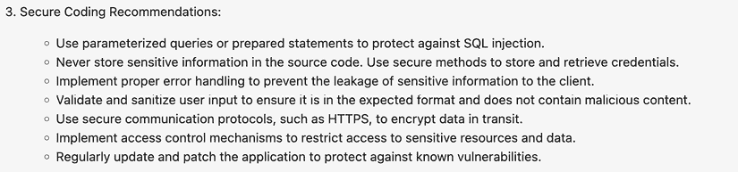

图 8.6: 漏洞 Java 代码的安全编码建议

图 `8.6` 提供了一组更广泛的安全配置实践，这些实践超越了单一漏洞，并涵盖了整体的应用程序卫生问题。指南包括使用参数化查询来防御注入、避免硬编码密钥以及清理输入以停止恶意负载。它还强调了适当的错误处理、使用 HTTPS 进行加密传输以及保持软件更新，共同构成了分层的、主动的安全态势。

Codestral 提供了全面的分析，详细说明了漏洞、潜在利用方式和可操作的解决方案。这些反馈不仅有助于修复当前问题，还为安全编码实践奠定了基础，确保应用程序对未来攻击的韧性。

通过这个过程，我们学习了如何识别和修复安全风险，这是构建安全软件的一项技能。我们对 SQL 注入漏洞及其处理方法有了清晰的理解。在 Codestral 的帮助下，我们解决了风险并采用了安全编码实践，使我们的应用程序更加安全。

接下来，我们将深入研究**跨站脚本**（Cross-Site Scripting, XSS），这是另一种常见且危险的漏洞。你将学习攻击者如何利用未清洗的用户输入来注入恶意脚本，以及如何通过有效的验证和清理技术来防御你的应用程序。让我们继续加强防御吧！

## 第 4 步：跨站脚本检测

在这一步中，我们将探索 PHP 脚本中的**跨站脚本**（**XSS**）漏洞，该脚本接收 URL 参数并在响应中未转义地包含。XSS 允许攻击者向 Web 应用程序注入恶意脚本，可能损害用户数据或获取控制权。

让我们开始：

1. 打开或创建 PHP 文件并将以下代码保存为 `vulnerable.php`：

```php
<?php

if (isset($_GET['input'])) {

    $input = $_GET['error'];

    echo "<div>Error: $input</div>";

} else {

    echo "<div>No input provided.</div>";

}

?>
```

2. 然后，识别漏洞代码。关注**第 3–4 行**：


图 8.7: 漏洞 PHP 代码段

- 第 `3` 行从错误 URL 参数获取用户输入，且没有进行任何验证或清理。
- 第 `4` 行将输入直接输出到 HTML 中，这可能允许攻击者注入恶意脚本，例如 `<script>alert('XSS');</script>`。

3. 使用 Continue 扩展分析代码。按 `CMD` + `L` 将代码段添加到新的聊天上下文中供 Codestral 处理。将此提示词粘贴到 Codestral：

```text
You are a security-focused AI expert. Your task is to review the following PHP script for potential vulnerabilities. 逐步分析代码并识别任何与安全、代码质量或最佳实践相关的问题。

    Analysis Tasks:

    1. 识别并描述安全漏洞，关注如 XSS、不当的输入处理和输出清理等风险。

    2. 建议改进措施以缓解每个已识别的漏洞。

    3. 为处理用户输入和防止 XSS 攻击推荐安全编码实践。

    请按照以下结构提供你的分析：

    1. Identified Vulnerabilities: - [问题的简要描述] - [代码中的行号或位置] - [影响或潜在的利用方式]

    2. Mitigation Recommendations: - [建议的改进代码] - [最佳实践]

    3. Secure Coding Recommendations: - [关于安全编码的通用建议]

    关注可操作的建议以及改进代码的特定示例。
```


Codestral 的响应应该类似于此：

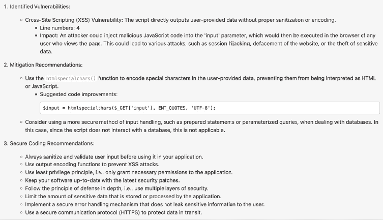

图 8.8：Codestral 对脆弱 PHP 代码段的响应

如我们所示，图 8.8 中的 LLM 响应彻底识别了 XSS 漏洞、其影响以及可操作的缓解措施，例如使用`htmlspecialchars()`对输出进行清理。它强调了安全编码实践，包括输入验证、输出编码和深层防御策略。这种清晰且可操作的反馈使开发者能够有效地解决漏洞并构建更安全的应用程序。

整个练习演示了 XSS 漏洞如何容易地从未经清理的用户输入产生。通过使用 Codestral，我们可以快速识别这些风险并实施适当的缓解措施，例如转义用户输入和验证 URL 参数。这些实践对于保护用户和确保 Web 应用程序的安全至关重要。

## 总结

在本章中，我们探索了现代网络安全的多方面世界，深入研究了关键安全应用和实际漏洞分析。我们首先通过检查防火墙日志来检测异常并确定威胁优先级，随后重点关注状态化防火墙日志，以发现不完整的会话和协议滥用。SQL 注入检测强调了不安全的数据库交互的风险以及参数化查询的重要性。端点安全强调了预测恶意软件、确保配置合规性以及监控关键文件，而数据外泄检测则揭示了异常传输、加密滥用和内部威胁的危险。

我们涵盖了身份验证与授权，识别了过度许可的访问控制并检测了凭据滥用。应用程序代码安全关注了 OWASP 漏洞、依赖风险和自定义威胁模式。用户行为分析帮助我们识别会话异常、命令与控制模式以及钓鱼尝试。云安全强调了误配置监控和存储安全的重要性，而通过 Mistral 实现自动化则展示了 LLM 在生成执行剧本（playbooks）和分析日志方面的强大能力。上手工作坊通过实际练习巩固了这些概念：保护 Terraform 脚本、识别 JDBC 代码中的 SQL 注入以及缓解 PHP 脚本中的 XSS 漏洞。这些技能合在一起为应对现实世界中的安全挑战提供了坚实的基础。

在下一章中，我们将进入更具开放性的领域，面对高级的课后式 RAG 挑战。你将为自己的检索增强生成（RAG）解决方案进行脑风暴、构建和评估，将所学应用于现实场景。别担心，第 10 章和第 11 章将回到更具引导性的格式，但会有有趣的可选的课外活动来进一步提升你的技能。

### 课外活动

1. **使用 Wireshark 分析可疑数据包**：深入真实数据包捕并使用 Wireshark 调查异常。然后，将选定的数据包摘要或日志粘贴到你的 Mistral LLM 设置中，让它标记异常模式、检测可疑 IP 或解释某些协议的意义，就像一个虚拟 SOC 分析师帮助你磨炼直觉一样。链接：
   * [`www.malware-traffic-analysis.net/`](https://www.malware-traffic-analysis.net/)
   * [`digitalcorpora.org/?s=pcap`](https://digitalcorpora.org/?s=pcap)
2. **在 CVE/CWE 数据库中探索真实世界的漏洞**：使用 CVE 和 CWE 数据库研究过去的安全误配置案例。将 CVE 摘要或 CWE 描述输入 Mistral 并请求解释、风险总结，甚至是针对 Terraform 的类比。这是将阅读与实操 AI 指南相结合的极佳方式，可以根据你的风格量身定制学习。链接：
   * [`www.cve.org/`](https://www.cve.org/)
   * [`cwe.mitre.org/`](https://cwe.mitre.org/)
   * [`nvd.nist.gov/`](https://nvd.nist.gov/)

| | |
| :--- | :--- |
| 现在解锁此书的专属福利。扫描此二维码 或访问 [`packtpub.com/unlock`](https://packtpub.com/unlock)，然后按名称搜索此书。 |  |
| **注意**：在开始之前请准备好你的购买发票。 | |
