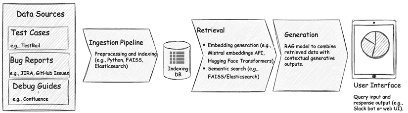
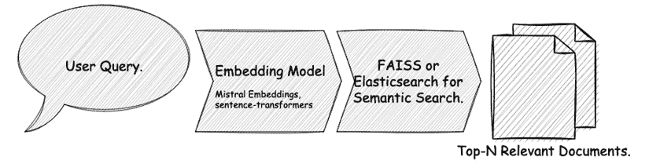
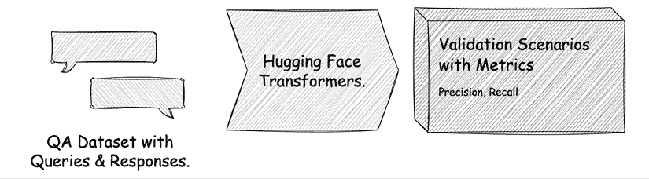
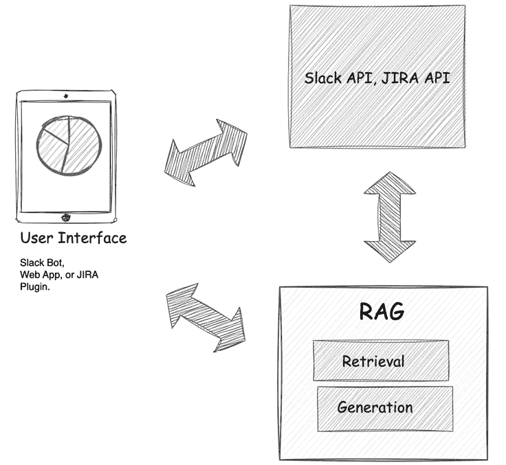
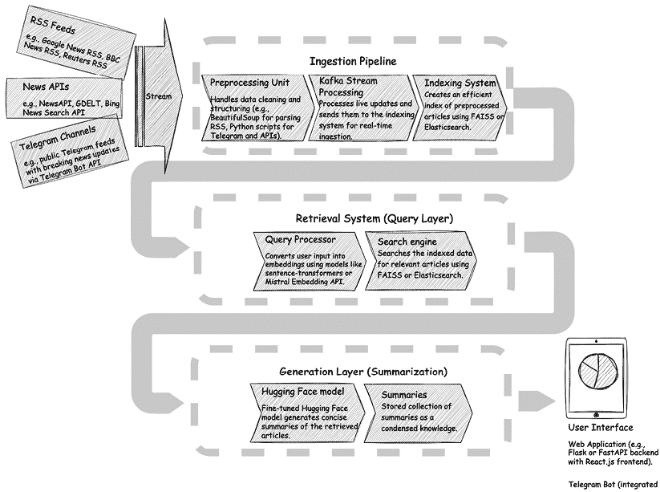
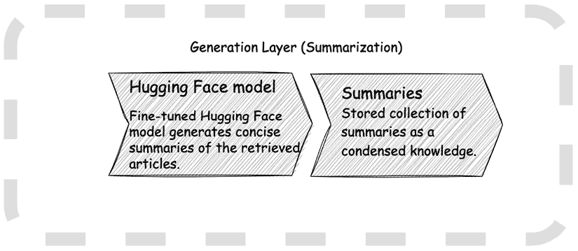

## 9 课后 RAG 挑战

> 预测未来的最好方法是发明它。
>
> —阿兰·凯 (Alan Kay)

RAG 通过无缝结合检索与生成为 AI 开启了新的可能性。然而，最令人兴奋的潜力在于尚未被探索的领域。将 RAG 应用于法律、医学和金融等专业领域需要精确、创意和技术深度。诸如优化嵌入、针对特定应用进行微调以及集成实时数据流等挑战推向了现有实现的极限。在多模态场景下，当文本与图像、代码甚至实时环境相遇时，复杂性进一步增加。

本章提供了一个高层次的挑战：将这些高级思想转化为可操作的项目。尝试新的检索机制，重新定义性能基准，并跨模态进行创新。想象新颖的应用，并构建能够动态适应不断变化的信息格局的系统。

你的任务非常明确：将这些挑战拆解为具体的步骤，大胆实验，并为塑造 RAG 的下一个前沿做出贡献。智能系统的未来不仅在于理解信息，更在于发现检索、生成和创建的新方法。

本章将涵盖以下主要主题：

* 有帮助的代码示例
* 问题陈述
* 挑战 1：用 RAG 彻底改变软件 QA
* 挑战 2：用 RAG 构建实时摘要器

### 有帮助的代码示例

为了强化本章中的概念，我们包含了几个装满实操、即插可用代码的 Jupyter 笔记本。你可以在`https://github.com/PacktPublishing/Learn-Mistral`仓库中找到所有示例：

* `Ch09_01_various_integrations.ipynb`：探索与外部服务的实时集成。此笔记本提供了用于 Jira 跟踪、Slack 机器人、RSS 馈以及 GDELT 新闻的工作代码。你将学习如何身份验证、调用 API、获取并解析数据，并在下游应用中使用。
* `Ch09_02_indexing.ipynb`：深入使用集成`Weaviate`和`Milvus`等向量数据库的向量索引。遵循端到端工作流来嵌入向量并使用余弦相似度执行高效搜索。
* `Ch09_03_custom_embedding.ipynb`：查看如何设计你自己的领域嵌入，例如时尚，并构建完整的管道来生成。对于预训练模型不符合需求的情况非常有用。
* `Ch09_04_data_parsing_and_organization.ipynb`：这是一个演示端到端文本处理的综合笔记本：解析 PDF 和 HTML，使用`Beautiful Soup`和`pandas`进行清理，使用`Transformers`进行总结，提取实体并进行标签标记。对于涉及非结构化文档摄取和语义增强的工作流非常理想。

这些笔记本作为构建和扩展 AI 管道的实用模板。

### 问题陈述

世界越来越重视能够独立思考、创造性工程化并清晰解决问题的人。在现实世界的 AI 应用中，没有分步的指南；只有高层次的目标和混乱的数据。本章邀请你学习最重要的技能：将复杂的挑战转化为结构化的解决方案。通过开放式的实操 RAG 项目，你将练习拆解、做出智能架构选择并构建适应和扩展的系统。如果可以在需要时快速找到正确的信息（测试步骤、日志或过去的修复方案）将会如何？这个挑战是你设计更智能、更快且响应迅速的 QA 工作流的机会。

### 挑战 1：用 RAG 彻底改变软件 QA

软件 QA 可能是枯燥的，充满了分散的文档和重复的调试。RAG 助手可以通过自动查找测试用例、总结错误历史并提供感知建议来简化这一点，从而将 QA 从被动任务转向主动过程。

例如，一个新入职 QA 实习生加入移动应用开发团队。为了理解测试方法，他们筛选了过时的 Excel 表格并阅读了 GitHub 和 Google Docs 上数百行的测试脚本。他们感到不知所措。通过使用 RAG 手，实习生可以询问 QA 助手：“登录模块常见的错误有哪些？”它总结了失败的测试场景，显示了最近的身份验证问题，甚至建议重新运行测试。学习曲线从几周缩到了几天。

让我们看另一个例子。金融科技公司的 QA 工程师正在测试流程。他们在模拟信用卡失败时遇到漏洞。为了调查，他们翻阅 Jira ，在 Confluence 中搜索测试脚本并扫描 Slack 获取提示，在清晰的情况下浪费了 45 分钟。现在，在 RAG 的帮助下，QA 工程师将错误信息输入 QA 助手。它立即返回上次类似错误的测试用例，链接到三个月前的匹配修复，并在几秒内建议可能的 API 头错误。

这些示例揭示了一个模式：重复的搜索、分散的文档和缺失的洞察减慢了 QA 工作。为了解决这个问题，该挑战提出了由 RAG 驱动的聚焦管道（摄取、检索和生成）。下面的插图概述了它的关键组件以及它们如何相互配合。



图 9.1：QA RAG 系统的高层架构

**快速提示**：需要查看此图像的高分辨率版本吗？在下一代 Packt Reader 中打开此书或在 PDF/ePub 副本中查看。

**购买此书免费赠送下一代 Packt Reader**。扫描此二维码或访问 [`packtpub.com/unlock`](https://packtpub.com/unlock)，然后使用搜索栏按名称找到此书。双检查显示的版本以确保获取的是正确的。


在后续步骤中，你将定义 QA 助手的范围，摄取并结构化真实的测试数据，设计检索管道，并微调系统使其在现实场景中运行。将其看作一次黑客松式的练习，创意和精确性同样重要。

#### 步骤 1：定义你的 RAG 系统范围

从明确你的 RAG 系统将实现什么开始。将其目的视为 QA 工程师的虚拟助手，能够获取测试用例或常见错误的总结。为了有效实现此目标，探索如 Atlassian REST API 等 API，以程序化的方式获取错误报告和测试用例。对于额外数据，考虑与 GitHub Issues 或 Jenkins 等工具集成。

在上手构建你的 RAG 助手之前，花时间收集洞察：

* 标记异常模式，
* 检测可疑 IP，
* 解释某些协议的意义，

就像一个虚拟 SOC 分析师帮助你磨炼直觉一样。

在没有模板的情况下，能够跨层进行推理并快速构建原型想法是一种竞争优势。让我们练习这种心态并享受其中吧。让我们从一个现实世界的挑战开始：使用 RAG 改进软件测试。QA 团队通常处理长测试用例、错误报告和重复任务。如果可以构建一个系统在需要时快速找到正确的信息（测试步骤、日志或过去的修复方案）将会如何？这个挑战是你设计更智能、更快且响应迅速的 QA 工作流的机会。

```json
{
  "prompt": "登录错误的测试用例是什么？",
  "system": "你是一个得力的 QA 助手。",
  "options": {}
}
```


## RAG 封装与流式输出

你可以编写一个轻量级的封装器（例如使用 `FastAPI`），来接收此请求并将提示词（prompt）路由到你自己的 RAG 流线。在后台执行检索、组合上下文并运行生成，然后以流式块的形式返回，就像 `Ollama` 一样。

这个技巧允许你完全复用 UI，包括语音转文本、流式输出和消息格式化，同时更换后端“大脑”。它简单、高效，并让你专注于改进助手的智能性，而不是重新构建已经运行良好的部分。



图 9.3：检索过程流程图

上图说明了检索过程，展示了用户查询如何转换为嵌入（embeddings），以便使用 `Elasticsearch` 或 `FAISS` 进行高效的语义搜索。

- **参考资料**：
- 使用 `Weaviate` 和 `Milvus` 通过 Mistral 嵌入进行向量索引和语义搜索的示例包含在 `Chapter-9/Ch09_02_indexing.ipynb` 中。
- 对于自定义嵌入工作流（例如为时尚品类设计并索引自己的向量），请参考 `Chapter-9/Ch09_03_custom_embedding.ipynb`。

这些笔记本共同提供了使用预训练嵌入和领域特定嵌入进行向量创建、存储和检索的端端解决方案。

你最终将获得一个运行的检索流线，它能为给查询返回最相关的文档。该流线应该使用嵌入来实现语义准确的结果，使其比基础的关键词搜索要有效得多。

### 进阶目标

通过集成**混合搜索方法**来扩展你的检索系统，该方法结合了语义搜索（使用嵌入）和传统的基于关键词的搜索。测试这种混合方法如何提高检索的相关性，特别是在语义模型可能会误解测试用例中特定技术术语或唯一标识的边缘情况下。

此外，实现一个**查询扩展模块**。使用同义词扩展或相关术语生成等技术（例如将“登录失败”扩展为“验证错误”或“凭据不匹配”）。测试查询扩展如何影响检索结果的多样性和准确性。你可以尝试 `NLTK` 或 `WordNet` 等库来构建你的扩展逻辑。

对于更高级的挑战，创建一个反馈循环，让 QA 工程师可以将检索结果标记为“相关”或“不相关”。使用此反馈来微调检索引擎，动态提高未来相似查询的相关性。

## 第 4 步：微调 RAG 系统

微调你的 RAG 系统可以确保它在软件测试场景下表现良好。从准备一个高质量数据集开始，其中应包含查询及其相应理想响应的标记示例。使用该数据集通过 `Hugging Face Transformers` 等框架微调你的系统。

例如，考虑诸如“调试内存泄漏问题的步骤”之类的查询。你微调后的 RAG 系统应该从调试指南中检索出一系列详细步骤，并用生成的提示来丰富它们。为了进一步提升你的系统，探索它如何处理模糊的查询，例如“后端服务的性能问题”。尝试使用提示工程来澄清模糊的用户输入，并生成更具上下文感知能力的输出。

### 高效且简便的微调

微调大模型听起来可能很重，但只要方法正确，它可以变得出乎意料地易于且高效。一个很好的起点是 DigitalOcean 的指南 *Fine-Tune Mistral-7B with LoRA: A Quickstart Guide*，它介绍了如何在 A6000 等适中硬件上使用 `QLoRA`（4 位量化 + LoRA）：`https://www.digitalocean.com/community/tutorials/mistral-7b-fine-tuning`。

你会在 Mistral-FineTune GitHub 仓库 (`https://github.com/mistralai/finetune`) 中找到生产级代码库，并在 `https://colab.research.google.com/github/mistralai/finetune/blob/main/tutorials/finetune_7b.ipynb` 中找到完全可执行的 Colab 教程。这些资源将引导你完成环境搭建、数据集格式化以及使用 `peft` 和 `trl` 的训练流。

将其适配你的 RAG 系统，使用真实的调试问题和结构化答案作为训练示例。模型将学习检索并生成上下文相关的精确输出，同时保持轻量化。从小数据集开始，跟踪性能并迭代。



图 9.4：微调流程图

上图概述了微调流程，展示了如何使用标记数据集进行训练和验证。

- **参考资料**：
- `Chapter-9/Ch09_04_data_parsing_and_organization.ipynb` 笔记本演示了如何解析 PDF 和 HTML，使用 `pandas` 和 `Beautiful Soup` 清理文本，应用 `sentence-transformers` 进行摘要，使用 `NER` 提取实体并通过标记丰富文档。

预期结果是一个微调后的 RAG 模型，它能够将检索的数据与 QA 任务的可执行输出相结合。

### 进阶目标

通过引入为软件工程定制的**领域特定嵌入**来进一步推进微调。在 `Stack Overflow` 或开源的 GitHub Issues 上进行训练，以创建检索和生成过程。将你的 RAG 系统性能与通用嵌入进行比较。

另一个有趣的挑战是实现**零样本**或**少样本学习**。不需要标记大型数据集，只需在微调期间提供几个高质量的示例，以观察系统对未见查询的泛化能力如何。对于高级挑战，通过调优系统以处理后续查询来实验**多轮查询理解**。例如，在查询“调试内存泄漏的步骤”后，下一个查询可能是“我可以使用哪些工具？”。

## 第 5 步：验证输出

测试并验证你的 RAG 系统以确保其有效性。从使用常见 bug 查询系统进行手动验证开始，将其与已知解决方案进行比较。衡量精确率、召回率和相关性等指标。

除了手动测试，通过编写符合预定义标准的用例来自动化验证过程。例如，创建一个 CI/CD 流线，每当录入新数据或更新组件时自动运行这些测试。通过集成 `Jenkins` 或 `GitLab` 等工具可以保持系统可靠性。

### 自动化反馈循环以实现扩展

测试你的 RAG 系统不仅是为了证明它在工作，更是为了构建在规模扩大时保持可靠的信心。从小开始：使用电子表格或 JSON 文件来跟踪查询和理想答案。一旦对基准有了信心，就转向自动化。使用 `pytest` 或 `unittest` 进行测试。使用 `sklearn` 或 `sentence-transformers` 等库计算参考与生成答案之间的语义相似度。

将这些测试接入 CI/CD 流线——`Jenkins`、`GitLab` 或 `GitHub Actions`。每当你更新数据、检索器或模型权重时，流线都应自动重新运行验证。这创建了一个反馈循环，让你比用户注意到质量下降更早发现问题。

到此步骤结束，你的 RAG 系统应该始终返回准确且相关的输出，并由健壮的验证过程支持。

### 扩展目标

通过引入**压力测试场景**来增强验证过程。使用 `Apache JMeter` 或 `Locust` 等工具模拟高查询负载，衡量系统在压力下保持准确性和响应时间的能力。评估并发对检索和生成组件的影响，识别瓶颈以进一步优化。

另一个微挑战是实现**真实测试套件**，直接从生产日志或团队对话（例如 `Slack` 或 `Jira`）中提取查询。这将为你提供一个评估 RAG 系统在真实场景中表现的实践基准。

## 第 6 步：优化与扩展

为了让你的系统做好真实部署准备，关注优化和可扩展性。从调优检索引擎以处理数据集开始。探索高级索引方法或缓存机制以降低延迟。例如，缓存高频查询可以显著提高响应速度。

扩展系统涉及使用 `S3` 等云存储解决方案管理数据量。考虑使用 `Milvus` 或 `Weaviate` 等工具进行分布式索引。对于优化，尝试预生成嵌入并将其存储为 `.npy` 或 `.parquet` 文件，而不是实时计算。

对于扩展性尝试，使用 `Docker Compose` 等工具运行多个节点以模拟分布式行为。如果你还没有配置云资源，*第 10 章* 将引导你设置账户、创建用于摄取和检索的第一个 S3 桶。

预期结果是一个针对性能优化的高效可扩展系统。

通过实现优先考虑高频查询的缓存层实验**动态缓存策略**。使用 `Redis` 或 `Memcached` 等工具缓存结果并比较对延迟的影响。

## 第 7 步：集成 QA 工作流

优化后，将你的 RAG 系统集成到现有的 QA 工作流中以实现无缝可用。一种方法是创建一个机器人界面，QA 工程师可以直接从 `Slack` 或 `Microsoft Teams` 等协作工具进行查询。另一个想法是将系统与 `Jira` 连接，以便它可以为新创建的问题自动解决方案。使用 `n8n` 作为你的 QA 助手的原型场。你可以模拟真实工作流并测试 RAG 在上下文中的响应。这种方法有助于及早发现用户体验差距。

接下来，通过设计直观的界面来关注用户体验。添加功能，如常见查询的自动补全建议或可视化复杂调试步骤的流程图。对于一个有趣的挑战，使用 `Slack API` 构建 Slack 机器人并测试 QA 团队如何与它交互。



图 9.5：集成 QA 工作流

该图说明了 QA RAG 系统如何与现有工作流集成，连接 `Jira`、`Slack` 和 CI/CD 流线等工具。

- **参考资料**：在 `Chapter-9/Ch09_01_various_integrations.ipynb` 中，你会找到集成外部数据源的操作示例，包括 `Jira`、`Slack`、RSS 馈、GDELT 项目和 News API。该笔记本帮助你从这些平台连接、身份验证并检索实时数据，用于下游处理或集成到更大的 AI 工作流中。

预期结果是拥有完全集成的系统，QA 工程师可以通过 `Slack` 或 `Jira` 等工具轻松访问，提供实时协助并提高整体测试生产力。

### 扩展目标

通过实现主动通知来进一步推进集成。配置你的 RAG 系统以监控 `Jira` 或 `Slack` 中的持续活动，当特定关键词或模式出现时自动建议解决方案。例如，如果 `Jira` 中创建一个关于“登录失败”的新问题，系统可以推荐相关的调试指南和用例。

下一级练习是开发多平台集成。扩展你的聊天机器人不仅工作于 `Slack`，也工作于 `Microsoft Teams` 或 `Discord`。

对于更高级的挑战，集成视觉化助手。允许 RAG 系统生成复杂问题的流程图或逐步调试指南。使用 `diagram-js` 或 `draw.io` 等库动态生成这些可视化内容。一旦你的 RAG 系统完成，就是时候将其分享给世界了。

## 结语

构建系统以重新思考软件测试可以通过高级 AI 工具的支持。从数据摄取到微调和集成，概述的每个步骤提供了创新机会，解决现实挑战并直接影响 QA 流程。

## 挑战 2：使用 RAG 构建实时新闻摘要器

新闻变化极快，信息的持续流也是如此。从头条新闻到详细分析，这个挑战探索了 RAG 如何通过获取最新故事并将其转换为简洁相关的摘要来过滤噪音。

### 第 1 步：集成新闻流和公共 API

第一步是从新闻来源和 API 收集数据。使用 Google News RSS 馈、`NewsAPI` 等公共 API 或 `GDELT` 等开源数据集。配置你的系统实时获取并预处理文章。构建一个简单的摄取流线来清理和结构化导入的数据。可以使用 Python 的 `pandas` 和 `Beautiful Soup` 进行预处理。


图 9.7：实时新闻摄取

上图演示了使用 Telegram、RSS 馈和 API 的实时新闻摄取。

参考资料：本章的所有代码示例组织在四个笔记本中以便探索和复用：

- **集成**：`Ch09_01_various_integrations.ipynb` 包含了 `Jira`、`Slack`、RSS、GDELT 和 News API Demo。
- **向量索引**：`Ch09_02_indexing.ipynb` 展示了使用 `Weaviate` 和 `Milvus` 通过 Mistral 嵌入进行向量索引。
- **自定义嵌入**：`Ch09_03_custom_embedding.ipynb` 介绍了如何创建和查询你自己的自定义嵌入。
- **数据解析和 NLP**：`Ch09_04_data_parsing_and_organization.ipynb` 引导你完成解析、清理、摘要、NER 和标记。

为了实验近实时摄取，使用 `n8n` 或 `Make.com` 构建无代码/低代码自动化工作流。使用 RSS 馈触发数据收集，然后通过预构建的 Python 函数或 HTTP 节点调用你的 `FastAPI` 服务进行清理步骤。通过完成此阶段，你应该拥有一个运行的摄取流线，能够持续收集和预处理实时新闻文章。输出应该是干净的、结构化的数据，准备在 RAG 系统中进行语义索引和检索。

### 扩展目标

通过集成实时数据流将你的摄取流线提升到新水平。使用 `Kafka` 持续处理文章，并在它们进入向量存储之前按区域、语言或主题进行过滤。这允许你保持数据集的新鲜、聚焦和高度相关，非常适合构建动态基于新闻的助手。流式处理也为时间敏感的触发器和警报打开了大门。

## 第 2 步：构建相关文章的检索系统

设计一个检索系统来获取匹配用户查询的文章。从使用可扩展搜索引擎 `Elasticsearch` 或 `FAISS` 索引你的预处理文章开始。使用通过 OpenAI API 或 `sentence-transformers` 生成嵌入来实现语义搜索。这种方法确保你的系统可以匹配查询的含义，而不是仅仅依赖关键词重叠。



图 9.6：新闻摘要器：设计稿

上图显示了该系统的概要设计。多个实时源（RSS 馈、公共 API 甚至 Telegram 频道）接入摄取流线，在实时索引之前进行清理和结构化。你的任务是设计并构建这个系统作为一个个人新闻聚合器，将检索速度与摘要准确性相结合，同时跟上更新。

为了支持你的实验，我们为每个主要集成包含了完全功能的 Jupyter 笔记本：

- `Chapter-9/Ch09_01_various_integrations.ipynb` 探索了 `Jira`、`Slack`、RSS、GDELT 和 News API 连接。
- `Ch09_02_indexing.ipynb` 展示了使用 `Weaviate` 和 `Milvus` 通过 Mistral 嵌入进行向量索引。
- `Ch09_03_custom_embedding.ipynb` 引导你创建和查询你自己的自定义嵌入。
- 最后，`Ch09_04_data_parsing_and_organization.ipynb` 专注于解析真实的 PDF 和 HTML，结构化数据。

```python
from sentence_transformers import SentenceTransformer

model = SentenceTransformer('all-MiniLM-L6-v2')
embedding = model.encode("What's the latest on semiconductor stocks?")
```

你将看到本地向量搜索变得多快且高效。

预期目标是，你的检索引擎应该根据用户查询准确地呈现最相关的新闻文章，并保持极低的延迟。它必须有效地处理实时输入，确保响应反映了最新且与上下文最对齐的内容。在实际使用中，系统应该感觉灵敏、准确且可靠。

### 扩展目标

升级你的检索流水线以支持混合搜索或流式搜索。将**语义向量搜索**与**关键词过滤**（例如使用 `BM25` 或在 `Elasticsearch` 中进行关键词预过滤）相结合以平衡精确性和性能。对于近实时应用，添加 `Kafka` 或 `Kinesis Streams` 在文章发布时进行摄取，实现持续索引并确保搜索的立即可用。这种架构为你的系统处理动态、大规模用例（如金融监控或危机警报）做好了准备。

## 第 3 步：微调生成式模型进行摘要

一旦检索到相关文章，你就需要对它们进行简洁的摘要。微调一个生成式模型（例如来自 `Hugging Face library` 的模型）来创建保留关键信息的摘要。通过将新闻文章与高质量摘要配对来准备训练数据，专注于保持事实的准确性。使用抽取式摘要等技术作为基准，并逐渐引入抽象式方法以获得更丰富的输出。



图 9.9: 摘要模块

图 9.9 展示了摘要模块，演示了检索到的文章如何通过微调后的生成式模型处理以产生简洁输出。

参考材料：所有与 PDF 和 HTML 解析、使用 `pandas` 和 `Beautiful Soup` 进行数据清洗、`NER` 以及标签标记相关的示例均可在 `Chapter-9/Ch09_04_data_parsing_and_organization.ipynb` 中找到。该笔记本提供了一个完整的、可运行的工作流，用于结构化和丰富非结构化文档。

要快速开始，可以使用开源摘要模型，如来自 Hugging Face 的 `facebook/bart-large-cnn` 或 `google/pegasus-xsum`。这些模型开箱即用的性能强大。对于实际应用，你可以在本地进行原型设计或通过 `Hugging Face Inference API` 进行部署。在迭代过程中，尝试提示词调优（prompt tuning）或 `LoRA` 微调以匹配你的领域语气。将摘要步骤集成到模块化工作流中，并在检索后触发。如果你使用 `n8n`，可以通过 `FastAPI` 服务或 Hugging Face 端点调用你的摘要器，让你无需深入深究编排代码即可构建并测试工作流：

```python
from transformers import pipeline

summarizer = pipeline("summarization", model="facebook/bart-large-cnn")
summary = summarizer("Long article text here", max_length=150,
```


### 摘要与查询引擎

配置摘要模型参数，设置最小生成长度为 `min_length=40`，并关闭采样以提高确定性：

```
min_length=40, do_sample=False

print(summary[0]['summary_text'])
```

保持快速运行，使用几个新闻示例进行测试，并逐渐完善输出风格。如果延迟很重要，在全规模上线之前探索量化或模型蒸馏以加速处理。

完成此步后，你的系统应该包含一个健壮的摘要模块，能够对检索到的新闻内容提供清晰、简洁且与查询相关的摘要。模型应该有效地将长文章压缩为信息量丰富的亮点，保留上下文和事实完整性。这使用户能够快速吸收关键见解，增强在快速变化的实时信息环境中的可用性和相关性。

### 扩展目标

使用模糊查询对系统进行测试，例如“气候更新”或“经济展望”。探索系统在检索和压缩复杂的多文章主题为有意义的摘要方面表现如何。

将你的摘要模块封装为可复用的 `CLI` 工具或轻量级 `Web` 服务。将流水线（检索、摘要和响应格式化）封装进单个接口。添加配置模型选择、摘要长度和查询过滤器的选项。这使得你的工具更容易集成到其他工作流或插入到聊天界面。加分项：对其进行容器化，以便跨环境快速部署。

## 第 4 步：通过动态索引流水线实现实时更新

动态新闻聚合需要一个能够在新信息可用时持续更新的系统。创建一个定期摄取新文章、即时索引并失效过时内容的流水线。为此，请使用云存储（如 `Amazon S3`）结合 `Apache Kafka`（用于流式传输）和 `Elasticsearch`（用于实时索引）。

使用`n8n`或 `Python` 脚本开始 `RSS` 摄取。以下是如何从 `RSS` 馈送中提取和清洗数据：

```python
import feedparser
from bs4 import BeautifulSoup
import pandas as pd

rss_url = "https://news.google.com/rss/search?q=semiconductors"
feed = feedparser.parse(rss_url)

cleaned_articles = []
for entry in feed.entries:
    soup = BeautifulSoup(entry.summary, "html.parser")
    content = soup.get_text()
    cleaned_articles.append({
        "title": entry.title,
        "link": entry.link,
        "summary": content,
        "published": entry.published
    })

df = pd.DataFrame(cleaned_articles)
df.to_csv("/tmp/cleaned_news.csv", index=False)
```

接下来，将清洗后的数据上传到 `Amazon S3`：

```python
import boto3
s3 = boto3.client('s3')
s3.upload_file('/tmp/cleaned_news.csv', 'your-bucket-name',
     'news/cleaned_news.csv')
```

之后，将元数据发送到 `Apache Kafka`：

```python
from kafka import KafkaProducer
import json

producer = KafkaProducer(bootstrap_servers='localhost:9092',
                         value_serializer=lambda v: json.dumps(v).encode('utf-8'))

for article in cleaned_articles:
    producer.send("news-stream", article)
```

使用 `Elasticsearch` 索引：

```python
from elasticsearch import Elasticsearch

es = Elasticsearch("http://localhost:9200")

for article in cleaned_articles:
    es.index(index="news", document=article)
```

预期结果是一个能够动态整合新文章、保持索引新鲜度并对突破新闻做出响应，同时保持高效检索和摘要的系统。

### 性能测试与优化

前面的命令使用 `Uvicorn` 启动一个 `FastAPI` 应用，它是一个极快的 `Python` 服务器。这默认将在端口 `8000` 上启动 `Web` 服务。

#### 在 `JMeter` 中创建测试计划

打开 `JMeter` GUI 界面，并添加一个具有 10–50 个并发用户的 `thread group`（线程组）。添加一个包含以下内容的 `HTTP request sampler` 采样器：

- 方法：`POST`
- URL：`localhost:8000/summarize`
- 请求数据：`{ "text": "Latest news about quantum computing from Google." }`

然后添加 `view results tree` 监听器并运行测试，测量平均延迟、错误和吞吐量。这可以让你量化性能瓶颈，并为缓存、负载均衡或异步处理策略制定计划。

想让你的系统性能更优吗？

`Quantify -> Diagnose -> Cache -> Scale -> Optimize`

预期的结果是一个响应迅速且优化的 `RAG` 系统，它能够持续检索最相关的新闻文章，并生成简洁、高质量的摘要，即使在处理频繁更新或处于用户需求高峰时也是如此。系统应表现出低延迟、极少错误，并在不同负载下保持吞吐量，确保流畅的用户体验和扩展可靠性。

### 进阶目标

为热门查询创建一个缓存层，并衡量它在多大程度上减少了高频用户请求的响应时间。尝试相同的 `perf` 测试，但使用 `Locust` 代替 `Apache JMeter`。

一旦你通过 `Apache JMeter` 和 `Locust` 完成了性能测试，请探索水平扩展策略。使用负载均衡器（例如 `NGINX` 或 `AWS ALB`）部署多个 `API` 实例，并测试并发用户负载下的系统行为。跟踪响应时间和吞吐量如何随系统规模而扩展。考虑启用异步处理（例如使用 `FastAPI` + `asyncio` 或任务队列如 `Celery`），以处理长时间耗时的摘要任务而不阻塞其他请求。

## 第 6 步：集成用户友好界面

设计一种完全通过聊天界面运行的简化用户体验。使用 `Flask` 或 `FastAPI` 处理后端逻辑，并使用官方 `API` 将你的系统集成到 `Slack` 或 `Microsoft Teams` 等平台。允许用户提交自然语言查询并直接在聊天中接收结构化结果。通过支持基于分类的过滤器（例如政治、体育和科技）以及启用线程对话进行更深层次的后续查询来增强体验。这种设置避免了对自定义前端的需求，同时支持实时对话式交互。

以下是一些实用的建议：

为你的自定义聊天前端暴露标准的 `/rag-query` 端点：

```python
from fastapi import FastAPI, Request
from pydantic import BaseModel

app = FastAPI()

class QueryRequest(BaseModel):
    query: str

@app.post("/rag-query")
async def rag_query(payload: QueryRequest):
    result = your_rag_pipeline(payload.query)
    return {"answer": result}
```

使用 `Telegram` 连接器将消息从聊天中继到 `RAG` 端点：

```python
import requests

BOT_TOKEN = ""
RAG_API = "http://localhost:8000/rag-query"
URL = f"https://api.telegram.org/bot{BOT_TOKEN}/"

def handle_updates():
    offset = None
    while True:
        res = requests.get(URL + "getUpdates", 
            params={"offset": offset}).json()
        for update in res.get("result", []):
            chat_id = update["message"]["chat"]["id"]
            text = update["message"]["text"]
            reply = requests.post(RAG_API,
                json={"query": text}).json()["answer"]
            requests.post(URL + "sendMessage",
                data={"chat_id": chat_id, "text": reply})
            offset = update["update_id"] + 1

handle_updates()
```

开发期间使用 `ngrok` 将你的本地服务暴露给 `Slack` 或 `Telegram` 等平台：

```bash
ngrok http 8000
```


到此步骤结束，你的系统应该提供一个无缝的对话式界面，用户可以使用自然语言与实时新闻进行交互。无论是集成到 Slack、Teams 还是自定义端点，这种体验都应该是响应迅速且毫不费力的，从而消除对传统前端的需求。

## 核心要点

使用 RAG 构建实时新闻聚合器不仅仅是一个酷炫的项目——它是你通往应用 AI 的跳板。在此过程中，你练习了集成实时数据、优化流水线，以及将嘈杂的数据流转化为有用的见解。核心收获是什么？你不需要一次性完成所有工作。从小处开始：也许是解析订阅、对标题进行嵌入，或者循序渐进地扩展。每一个部分都能提升你的技能并增加价值。你现在具备了将信息过载转化为清晰思路的能力。快速迭代，持续学习，让它属于你。

## 总结

本章的编写目的是激发你的好奇心，并启发你以创意且实用的方式尝试 RAG 系统。通过两个不同的挑战——构建一个问答助手和一个创建一个实时新闻摘要器，你已经接触了让 RAG 成为解决复杂问题游戏规则改变者的步骤、工具和方法。但这里的目标不仅仅是教学；而是让你对数据检索与生成式 AI 结合时产生的可能性感到兴奋。在`Challenge 1`中，我们探索了 QA 系统如何通过检索测试用例和调试步骤来协助工程师。在`Challenge 2`中，我们深入了实时新闻聚合的世界，处理实时数据摄取和摘要。本章的设计是为了激发你的想象力，而不是限制它。分步指南旨在帮助你开始，但真正的乐趣从你加入自己的点花、探索新工具并推向 RAG 能力的边界时开始。每一次实验，即使是混乱的实验，都是迈向创新的一步。所以，卷起袖子，启动你喜爱的 API，开始构建吧。谁知道呢？你的下一个想法可能会改变游戏。去吧——打破（安全地打破），学习并创造！接下来是探索 Amazon 上的 Mistral！是时候体验这种基础设施由他人代处理的愉快感觉了。在下一章中，我们将查看 Amazon Bedrock 上提供哪些 Mistral 模型。让我们接入云端，看看真正的“企业级”到底是什么样的。
