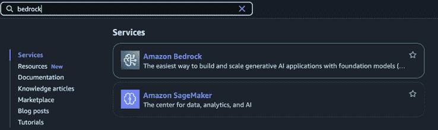
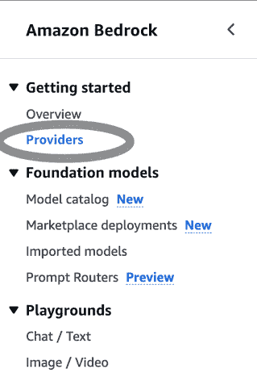
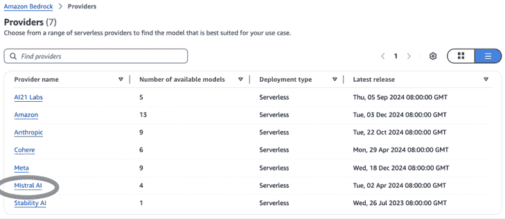
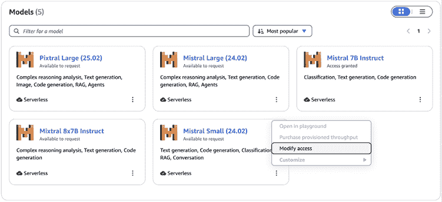
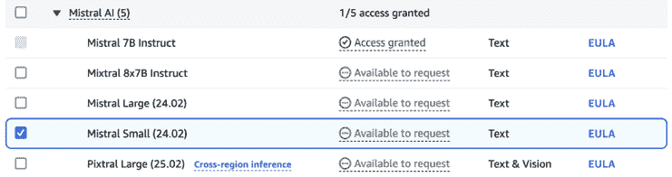
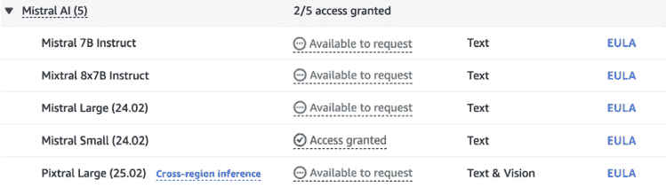
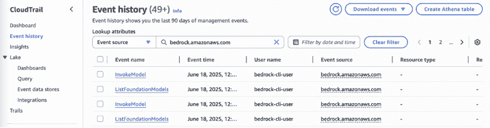

# AWS Bedrock 上的 10 Mistral

> 人多力量大。
> —Johnwood

到此为止，你已经熟悉了 LLM 的转型力量。本章的核心在于帮助你充分利用 AWS Bedrock 的价值，因为它通过提供对高级模型的托管访问，简化了其中的一些挑战。我们将介绍 Bedrock 工作原理原理，探索为什么 Mistral 是一个脱颖出的模型，并查看如何将它们结合使用。然后，我们将进入一个实战工作坊，涵盖从设置环境到将 Mistral 集成到真实世界应用的所有内容。到结束时，你将拥有所需的工具和信心，让 AWS Bedrock 和 Mistral 成为你 AI 旅程中无缝的一部分。简而言之，将涵盖以下主题：

*   基于云的 AI 模型以及 Bedrock 如何简化扩展
*   使用 IAM 角色和权限确保安全
*   使用`boto3`发送请求并运行推理
*   通过 CloudWatch 日志监控活动和趋势
*   将 Mistral 部署在 Bedrock 上的实战工作坊

## 技术要求

为了完成此工作坊，中途需要一些基础要素。你需要一个`AWS 账户`、`AWS CLI`以及 Python SDK`boto3`。如果你已经准备了其中任何内容，那太好了——你可以复用现有的设置。如果没有，不要担心——这些组件都将作为环境设置的一部分逐步配置。

*   `AWS 账户`：访问 Bedrock 服务所需的。如果你已经有一个个人账户，可以使用。创建一个账户是设置过程的一部分。
*   `AWS CLI`：此命令行工具允许你从本地机器与 AWS 服务进行交互。如果尚未安装，稍后将设置指南。
*   Python`boto3`SDK：适用于 Python 的官方 AWS SDK，采用 Apache 2.0 许可发布。它提供了对 Bedrock API 的程序化访问。我们将在干净的 Python 环境中安装它，但如果你已经有了，可以跳过安装步骤。

本章的所有代码和参考可以在 GitHub 仓库中找到：[`github.com/PacktPublishing/Learn-Mistral-7B`](https://github.com/PacktPublishing/Learn-Mistral-7B)，位于`Chapter-10`文件夹下。该仓库包含与工作坊一致的脚本，将作为你的实践参考。

## 问题描述

在与 LLM 工作时，很容易发现自己正穿梭于基础设施、扩展决策和模型优化的迷宫中。AWS Bedrock 旨在通过提供对 Mistral AI 等强大模型的托管访问来简化这一过程，但有效使用它仍然需要理解该平台及其细微差别。例如，你如何使用`IAM 角色`设置安全访问？如何微调工作流以在保持扩展性和成本控制的同时充分利用 Mistral 的性能？

让我们深入探讨这些问题及更多内容，为掌握 AWS Bedrock 和 Mistral AI 提供一条清晰的路线图。你将学习如何设置环境、将 Mistral 集成到你的项目中，并有信地扩展你的应用程序。目标是简化你与 LLM 的工作，让你专注于构建创新的、高性能的解决方案，而不会被技术障碍所困。

按顺序来看，接下来的章节形成了一个进展过程：我们从云端 AI 服务的*为什么*开始，然后移动到安全访问的机制、发布请求，最后是监控。这些内容为本后的实战工作坊奠定了基础。

## 基于云的 AI 模型：为什么 Bedrock 很重要

人工智能从复杂的基础设施密集型任务转变为易获取的云驱动解决方案。传统的部署 AI 需要管理计算资源、维护更新和扩展基础设施。这些挑战使得 AI 集成变得昂贵且耗时。AWS Bedrock 通过提供托管服务的预训练基础模型消除了这些障碍。开发者可以通过 API 访问可用即用的 AI，这允许更快的实现、自动更新和无缝安全。扩展性是另一个主要优势。AI 应用经常遇到波动的需求。通过 Bedrock，AI 会自动扩展以满足需求，无论你是处理几个查询还是数百万查询——都不需要手动干预。成本效率也是关键。运行自托管 AI 模型需要持续的硬件投资和维护。相比之下，Bedrock 以按需付费模式运行，你为你使用的部分付费。通过将 AI 视为服务而非基础设施，Bedrock 让开发者专注于创新而非维护。现在，在建立了*为什么*之后，下一步是理解如何安全连接——在与 Bedrock 交互之前，我们需要一种结构化的访问方式。包括 Bedrock 在内的每个 AWS 服务都依赖身份和访问管理 (`IAM`) 来定义谁或什么可以执行操作。为了启用访问，我们将配置`IAM 角色`、策略和访问密钥。这确保我们的 Bedrock 集成运行正常，同时考虑到安全实践。遵循最小权限原则确保只分配必要的权限。在这个阶段，`IAM`已正确配置，我们建立了系统的门禁层。而不是默认提供完全访问，我们将限制操作到所需的范围。现在，我们准备好进入下一个阶段：程序化交互。

## API 驱动的模型交互

基于云的 AI 服务依赖于客户端-服务器模型，应用程序（客户端）向 Bedrock（服务器）发送请求，后者处理并返回响应。这种方法实现了安全的 AI 交互，允许开发者无需管理复杂的基础设施即可集成模型。而不是手动处理 HTTP 请求和响应，AWS 提供了官方工具包 (`SDK`)。

`Boto3`是适用于 Python 的官方 AWS SDK，旨在实现与 AWS 服务的无缝交互。它在 Apache 2.0 下开源，意味着可以免费。使用`boto3`请求 Bedrock 的典型请求涉及指定模型 ID、提供结构化输入并定义`temperature`（影响随机性）和`max tokens`（限制输出长度）。Bedrock 处理这些请求并以`JSON`格式返回响应，应用程序很容易解析。由于 AWS 服务设计为可扩展，`boto3`让动态修改提示和微调响应成为可能。

## 使用 CloudWatch 进行观测性

为了可靠地运行 AI 应用，观测性是必不可少的。AWS Bedrock 默认与`CloudTrail`集成，自动记录如`InvokeModel`和`ListFoundationModels`等关键事件。`CloudTrail`在后台记录活动，而`CloudWatch`通过实时跟踪延迟、错误和使用趋势使这些信息有用。这些元素共同为随需求变化保持工作负载的可靠性提供了基础。

## 实战工作坊：使用 boto3 和 CLI 进行手动推理

人工智能正在改变我们构建和与技术交互的方式，AWS Bedrock 将尖端 AI 模型带到你的指尖。这个工作坊是你掌握 AI 驱动开发的大门，从设置环境到使用`boto3`进行实时请求。最后，你将拥有将强大模型集成到真实应用中的技能。无论你是 AI 爱好者还是想要扩展知识的开发者，这种实践经验都将赋予你创造未来的能力。

### 第一步：环境设置

在我们与 AWS Bedrock 交互并开始使用 Mistral Small 之前，我们需要确保环境已正确设置。这包括访问参考资料、创建一个`AWS 账户`以及设置具有相应权限的`IAM`用户。我们将生成访问密钥、配置`AWS CLI`并请求访问 Mistral 模型的权限。最后，我们将在`VSCode`中准备开发环境，确保一切就绪，以便与 AWS 服务无缝通信。

对于工作坊设置，你需要访问托管在 GitHub 上的项目文件。访问主项目仓库 https://github.com/PacktPublishing/Learn-Mistral。包含代码的相关文件夹是`/Chapter-10`。这些文件包含了我们在工作坊中编写的完整解决方案；在出现任何问题时可以作为参考材料。开始之前务必下载或克隆仓库！

#### 创建 AWS 账户

要配合 Mistral AI 使用 AWS Bedrock，你需要一个具有正确权限的 AWS 账户。如果你已经有一个个人 AWS 账户并熟悉操作 AWS 控制台，可以跳过这一步。但是，除非明确批准，否则避免使用公司 AWS 账户以防止账单或合规冲突。

1. 访问 [`aws.amazon.com/`](https://aws.amazon.com/) 并点击 **Create an AWS Account**（创建 AWS 账户）。
2. 输入你的电子邮件地址，选择账户名称并设置强密码。
3. 选择 **Basic Support**（基础支持计划）。
4. 提供账单详细信息（免费）。
5. 完成身份验证。

在 AWS 控制台中，可用区域可以在此处找到：https://docs.aws.amazon.com/general/latest/guide.html](https://docs.aws.amazon.com/general/latest/guide.html)。
6. 在 AWS 控制台中，选中的区域位于右上角——如有必要请调整。

一旦你的账户准备就绪，就可以进入设置`IAM`角色和 CLI 访问步骤。

#### 创建新的 IAM 用户并设置权限

为了从命令行与 AWS Bedrock 交互，我们需要一个具有权限的`IAM`用户。该用户`bedrock-cli-user`将用于通过`AWS CLI`进行安全访问。虽然本工作坊提供了完全管理员权限，但在实践中应遵循最小权限原则。

首先，让我们创建该用户：

1. 进入 AWS 控制台中的 **IAM** 服务。
2. 选择 **Users**（用户）并点击 **Create user**（创建用户）。
3. 输入用户名`bedrock-cli-user`并点击 **Next**。
4. 对于权限，选择 **Attach policies directly**（直接附加策略）。
5. 搜索并选择`AmazonBedrockFullAccess`。
6. 点击 **Next** 然后点击 **Create user**。

用户创建后，我们需要生成访问密钥：

1. 点击新创建的`bedrock-cli-user`用户。
2. 转到 **Security credentials**（安全凭证）选项卡。
3. 点击 **Create access key**（创建访问密钥）。
4. 选择 **Command CLI** 作为用例并按照提示操作。
5. 创建后，将显示你的 **Access Key ID** 和 **Secret Access Key**。妥善保存这些信息！

```
which aws
```

以下是预期输出：

```
/usr/local/bin/aws
```

1. 使用你的凭据配置 AWS CLI。在终端中运行以下命令：

```
aws configure
```

2. 在提示时输入凭据，如*图 10.9* 所示——使用你的凭据。


图 10.9：设置访问密钥的终端屏幕截图

此处是重复文本（密钥和密钥已用星号掩码）：

```
AWS Access Key ID [None]: AK**********44E
AWS Secret Access Key [None]: xdG*****************************3k
Default region name [None]: us-east-1
Default output format [None]: json
```

1. 现在运行以下命令检查 AWS CLI 是否配置正确：

```
aws s3 ls
```

如果你有任何 S3 桶，你将看到类似下方的输出：

```
2024-09-07 17:04:24 some_s3_bucket
```

1. 要测试 AWS Bedrock 访问，运行以下命令：

```
aws bedrock list-foundation-models
```

以下是预期的 JSON 输出：

```json
{
  "modelSummaries": [
    {
      "modelArn": "arn:aws:bedrock:us-east-1::foundation-model/amazon.titan-tg1-large",
      "modelId": "amazon.titan-tg1-large",
      "modelName": "Titan Text Large",
      "providerName": "Amazon",
      "inputModalities": ["TEXT"],
      "outputModalities": ["TEXT"]
    },
    ...
  ]
}
```

配置 AWS CLI V2 后，你能够向 AWS 服务（包括 Bedrock）发送身份验证后的请求。接下来，我们将请求 Bedrock 上 Mistral 模型的访问权限，确保我们有权限使用 Mistral Small。一旦获得授权，我们就可以开始对该模型进行 API 调用。

#### 请求 Bedrock 上的 Mistral 模型访问权限

在我们开始使用 Mistral Small 之前，我们需要通过 AWS Bedrock 请求访问权限。这一步骤确保了我们的 IAM 用户拥有与 Bedrock 上的 Mistral 模型交互的必要权限。一旦获得授权，我们将能够发送 API 请求并将 Mistral AI 集成到我们的应用程序中。请按照以下步骤获取访问权限：

1. 返回 AWS 控制台。
2. 在 AWS 搜索栏中输入`Bedrock`并在结果中选择`Amazon Bedrock`。

查看*图 10.10*以了解如何导航到 Amazon Bedrock 服务的描述。



图 10.10：导航到 Bedrock 服务

1. 在左侧面板中，点击`Providers`。*图 10.11* 展示了左侧菜单的布局。



图 10.11：导航到 Providers

1. 找到 Bedrock 上的 Mistral 模型，并从列表中选择`Mistral AI`提供商。*图 10.12* 展示了`Providers`列表的相关部分。



图 10.12：选择 Mistral AI 提供者

1. 找到`Mistral Small`，点击 Mistral 模型旁的三个点 (`⋮`) 菜单，并选择`Modify access`。*图 10.13* 可视化了模型的上下文菜单。



图 10.13：请求相关模型的修改访问权限

1. 勾选`Mistral Small`复选框以请求访问。查看*图 10.14*以获取要选择的候选模型列表的描述。



图 10.14：在列表中标记 Mistral Small

1. 等待片刻让 AWS 处理请求。然后确认访问已授予。该模型现在应该可以可以使用了。*图 10.15*提供了所需访问授予行的插图。



图 10.15：访问授予

现在我们已经成功请求并确认了对 Mistral Small 的访问权限，我们准备好开始使用它了。下一步是设置我们的 VSCode 项目。

#### 准备 VSCode 项目

现在我们已经获得了 Mistral Small 的访问权限，是时候设置开发环境了。在这一步骤中，我们将准备一个 VSCode 项目，创建一个 Python 虚拟环境并安装必要的依赖项。此设置将为处理 AWS Bedrock 提供一个整洁的工作空间。请按照以下步骤准备环境：

1. 打开 **VSCode** 并创建一个新文件夹。
2. 打开终端。
3. 运行以下命令创建虚拟环境：

```bash
python3 -m venv .venv
```

4. 激活虚拟环境：

```bash
source .venv/bin/activate
```


## 准备 AWS Bedrock 环境

在创建 Python 项目之前，我们需要设置好项目依赖和开发环境。

### 创建项目依赖文件

1. 在项目中创建`requirements.txt`文件。
2. 在`requirements.txt`中添加以下依赖：

```
boto3>=1.36
```

3. 运行以下命令安装依赖：

```
pip install -r requirements.txt
```

一旦 VSCode 项目设置完成，环境就完全准备好与 AWS Bedrock 交互。现在，我们可以开始使用`boto3`了！

## Step 2：使用 boto3 连接 AWS Bedrock

在这一步骤中，我们将首次从 Python 连接到 AWS Bedrock。这是一个里程碑——确认了我们的设置是正确的并且我们可以成功获取列表。

1. 打开你的 VSCode 项目并创建一个新的 Python 文件：`ws10_step01_list_models.py`。
2. 添加以下代码：

```python
import boto3

### 在指定区域创建 Bedrock 客户端
bedrock = boto3.client(service_name='bedrock', region_name='us-east-1')

### 请求基础模型列表
response = bedrock.list_foundation_models()
models = response['modelSummaries']

# 打印提供者、模型名称和模型 ID
for model in models:
    print(model['providerName'] + " - " + model['modelName'] + " - " + model['modelId'])
```

3. 运行脚本：

```
python ws10_step01_list_models.py
```

以下是预期输出：

```
...
Mistral AI - Mistral Large (24.02) - mistral.mistral-large-2402-v1:0
Mistral AI - Mistral Small (24.02) - mistral.mistral-small-2402-v1:0
Mistral AI - Pixtral Large (25.02) - mistral.pixtral-large-2502-v1:0
```

如果你遇到如`botocore.exceptions.NoCredentialsError: Unable to locate credentials`的错误，请返回 AWS CLI 配置并确保命令行验证步骤通过。

脚本列出了 AWS Bedrock 上可用的基础模型，包括它们的提供者、名称和模型 ID。此输出确认了我们的 Python 环境配置正确并能够与 AWS Bedrock 通信。

在可用模型中，我们将使用以下模型：

```
Mistral AI - Mistral Small (24.02) - mistral.mistral-small-2402-v1:0
```

此模型 ID（`mistral.mistral-small-2402-v1:0`）将在下一节用于与 Mistral Small 交互，发送提示（prompts）并处理响应。

现在我们已经成功连接到 AWS Bedrock 并获取了模型列表，准备好向 Mistral 发送第一个请求了。下一步将介绍如何与模型通信并获取 AI 生成的响应。

## 步骤 3：向 Bedrock 发送提示并获取流式响应

现在一切都准备就绪，是时候通过 AWS Bedrock 向 Mistral Small 发送第一个 API 请求了。在此步骤中，我们将初始化 Bedrock 运行时客户端，构建请求负载（payload），处理潜在错误并提取模型的响应。这将允许我们与 AI 交互、处理文本并验证环境配置是否正确。

请仔细遵循以下步骤，以确保 Python 与 AWS Bedrock 之间的顺畅通信：

1. 在运行时与 Bedrock 交互，我们使用`bedrock-runtime`而不是`bedrock`。`bedrock-runtime`客户端专门用于调用模型，而`bedrock`则用于管理模型。

```
client = boto3.client(service_name='bedrock-runtime',
     region_name='us-east-1')
```

### Bedrock 与 bedrock-runtime

AWS 提供了两个用于处理 Bedrock 的不同客户端，理解它们的区别非常重要。

`bedrock`客户端用于管理任务。它允许你列出可用的基础模型、管理访问权限并配置 Bedrock 相关的设置。简而言之，它可以帮助你了解有哪些可用模型并控制谁可以使用它们。

`bedrock-runtime`客户端专门用于推理。在这里你发送输入负载、执行模型调用并接收 AI 生成的响应。每当你想要实际对模型运行提示时，都将使用此运行时客户端。

由于我们正在向 Mistral Small 请求响应，因此我们必须在此操作中使用`bedrock-runtime`。

2. 随后，我们需要指定正确的模型 ID，以确保我们的请求被正确处理：

```python
model_id = ' mistral.mistral-small-2402-v1:0'
```

如果使用了错误的模型 ID，AWS 将返回错误消息：

```
Exception Type: ValidationException
Error Message: An error occurred (ValidationException) when calling the InvokeModel operation: The provided model identifier is invalid.
```

3. 下一步是构建负载。负载定义了我们希望模型生成的内容。它包含了提示、响应长度和随机性控制。

```python
payload = {
    "prompt": "Explain the concept of reinforcement learning in simple terms.",
    "temperature": 0.7,
    "max_tokens": 300
}
```

正如我们在第 3 章介绍过的，`"temperature"`控制响应的创造性，而`"max_tokens"`限制响应长度。确保这些值没有封装在`parameters`对象内部，并且`"max_tokens"`拼写正确。

4. 为了捕捉潜在问题，我们将 API 调用封装在`try-except`块中。该块有助于排查诸如无效输入、API 失败或权限问题等问题。接下来发送负载到模型。

```python
try:
    # client invocation happens here
except Exception as e:
    # Print detailed debug information
    print("Error occurred while invoking the model:")
    print(f"Exception Type: {type(e).__name__}")
    print(f"Error Message: {e}")
    if hasattr(e, 'response'):
        print("AWS Error Response:")
        print(json.dumps(e.response, indent=2))
```

5. 现在我们通过将负载传递给 Bedrock 运行时客户端来调用模型。这会将请求发送到 AWS Bedrock 并等待模型的响应。接下来，我们将从负载中检索响应体。

```python
response = client.invoke_model(
    modelId=model_id,
    body=json.dumps(payload),
    contentType="application/json",
    accept="application/json"
)
```

6. 然后我们将流式响应转换为字符串。AWS Bedrock 以流格式返回响应，这意味着数据是分块提供的而不是一次性提供的。在此步骤中，`response["body"].read()`一次性从流中读取所有可用字节。由于我们的负载很小，这将瞬时完成。

对于较大的响应，数据可能会分多次接收，因此我们需要通过按到达顺序读取响应块来增量地处理流。

`.decode("utf-8")`将字节数据转换为可读的字符串，而`json.loads(response_body)`将其解析为 Python 字典。

```python
response_body = response["body"].read().decode("utf-8")
result = json.loads(response_body)
```

接下来检索模型的响应文本。

7. 为了检索 AI 生成的文本，我们从 JSON 响应中提取`"text"`字段：

```python
output_text = result.get("outputs", [{}])[0].get(
        "text",
        "No response received.")
```

如果没有收到有效响应，脚本将默认返回`"No response received."`而不是抛出错误。这段代码结束了详细的代码说明，在下一节中，我们将获得完整的代码。

8. 以下是发送提示并检索模型响应的完整脚本。该脚本完全自动化了向 Mistral 发送请求并处理错误的过程。我们准备好运行部分工作并查看结果了。

```python
import boto3
import json

client = boto3.client(service_name='bedrock-runtime',
    region_name='us-east-1')

model_id = ' mistral.mistral-small-2402-v1:0'

### Payload for Bedrock
payload = {
    "prompt": "Explain the concept of reinforcement learning in simple terms.",
    "temperature": 0.7,
    "max_tokens": 300
}

try:
    # Call the Bedrock model
    response = client.invoke_model(
        modelId=model_id,
        body=json.dumps(payload),
        contentType="application/json",
        accept="application/json"
    )

    # Read the response body (convert StreamingBody to string)
    response_body = response["body"].read().decode("utf-8")
    result = json.loads(response_body)

    # Extract the model's output
    output_text = result.get("outputs", [{}])[0].get(
        "text",
        "No response received.")

    print(">>>", payload["prompt"])
    print("<<<", output_text)

except Exception as e:
    # Print detailed debug information
    print("Error occurred while invoking the model:")
    print(f"Exception Type: {type(e).__name__}")
    print(f"Error Message: {e}")
    if hasattr(e, 'response'):
        print("AWS Error Response:")
        print(json.dumps(e.response, indent=2))
```

9. 要测试脚本，请在终端中运行命令：

```
python3 ./src/ws10_step02_call_model.py
```


如果一切设置正确，响应将包含来自 Mistral Small AI 生成文本。

我们已成功向 AWS Bedrock 发送了第一个 API 请求，并从 Mistral Small 获取了响应。这证明我们的 AWS 环境运行正常，我们现在可以与模型进行通信了。

## 第 4 步：检查 Bedrock 的 CloudWatch 日志

要查看的 AWS Bedrock 活动，你可以直接在 CloudTrail 事件历史中访问日志。这有助于你验证请求是否成功，并在无需额外设置的情况下排除故障。请按照以下步骤查看 Bedrock 日志：

1. 进入 AWS 控制台中的`CloudTrail`。
2. 打开`Event history`标签。
3. 在`Lookup attributes`中，通过`Event source`过滤并输入：`bedrock.amazonaws.com`

请参考`图 10.16`查看 CloudTrail 控制台中显示的 Bedrock 日志的视觉示例。



图 10.16：Bedrock 事件

对于长期保留或高级查询，你可以配置 CloudTrail 将这些日志发布到 S3 存储桶，并在那里可以使用`Athena`或`AWS Glue`等服务进行存档或分析。

最后一步完成了本次工作坊，并演示了使用 Mistral Small 运行 AWS Bedrock 的实际操作。现在，让我们在继续之前回顾一下本章的核心要点。

# 总结

我们成功利用 AWS Bedrock 构建了一个功能完的 AI 开发环境，实现了与 Mistral Small 的无缝交互。从设置到执行第一个 API 请求，我们将一个抽象概念转变为一个具有安全 IAM 身份验证和使用`boto3`构建的功能 Python 工作流的 AI 驱动系统。

真正的成就不仅仅是连接到 Bedrock——更是你对 AI 集成所获得的信心和控制力。你构建了 API 调用结构，处理了错误，探索了`CloudWatch`，并获得了云基础设施的实战经验。这一基础使你能够开始将 AI 集成到真实世界的应用程序中。继续实验，继续完善，最重要的是，继续创造。

在下一章中，我们将探索如何使用`Vertex AI`和`Model Garden`在 Google Cloud 上运行大语言模型。你将学习如何在完全全托管的无服务器环境中与这些模型协作，我们将为对 GCP 上更深层部署策略感兴趣的人引入可选挑战。

# 课外拓展

- **扩展`boto3`推理之外**：通过将`boto3`连接到其他 AWS 服务超越简单的推理调用。将提示词和响应存储在`S3`中，触发`Lambda`函数实现自动化，或在`DynamoDB`中记录输出以构建轻量级检索分析工作流。
- **实验 Bedrock 参数**：调整`temperature`、`max tokens`和提示词设计，观察输出的变化。这种探索强调了微小的参数调整如何影响创造力、精确或详细程度，让你对模型行为和响应控制有深入的见解。
- **构建一个微项目**：将你的技能应用于小型项目，例如创建机器人、自动化`S3`文档的内容摘要或运行批量推理。这些练习将工作坊的知识转化为实用的现实问题解决经验。
- **使用 n8n 和 Bedrock 自动化工作流**：使用`n8n`的工作流自动化连接 Bedrock 与日常工具。创建流水线，从电子邮件或聊天应用将提示词发送到 Bedrock，然后自动将响应传回，让 AI 成为日常工作流的无缝部分。
- **立即解锁本书专属福利**：扫描此二维码或访问[`packtpub.com/unlock`](https://packtpub.com/unlock)，然后通过书名搜索此书
  - **注意**：在开始之前请准备好你的购买发票。

# 11
