# 通过 Google Cloud Vertex AI 挥洒 Mistral 的力量

> 如果你想一辈子幸福，就去种花园吧。
> 
> —中国谚语

在这一章中，我们将整合所有内容——云基础设施、模型 API 和真实世界的脚本——向你展示如何使用 Google Cloud 的`Vertex AI`平台运行和集成大语言模型（`LLMs`）。我们将从理论开始，涵盖构成`Vertex AI`生态系统的关键服务和组件。你将学习`Model Garden`是如何工作的、同步和流式推理在实践中意味着什么，以及身份验证、访问控制和配置如何融入工作流。`Vertex AI`中的`Model Garden`提供了精选的预训练机器学习模型和工具，帮助你简化 AI 解决方案的开发、测试和部署——无需从头训练模型。

一旦概念清晰，我们将开始一个实战工作坊，你将从零开始构建自己的设置。你将从`Google Colab Enterprise`开始快速实验，然后过渡到带有模块化`Python`环境的`VS Code`。你将配置项目，使用`gcloud`进行身份验证，并对托管的 Mistral 模型进行同步和流式调用。你还将应用脚本结构和环境管理的最佳实践。

到本章结束时，你不仅将理解`Vertex AI`上推理是如何工作的——你还将拥有一个功能且可复用的代码库，镜像了生产系统中使用的架构。这就是你的`LLM`集成变得真实的地方。

简之，本章将涵盖以下主题：

- 理解`Vertex AI`
- 实战工作坊

# 技术要求

这是一个高级别的工作坊，适用于熟悉`Python`脚本编写和在云环境中工作的开发者和工程师。虽然我们会提供指导，但请确保你拥有：

- **Google Cloud 账户**：你必须有一个有效的账户。
- **Google Cloud CLI**：必需（`gcloud`）。
- **Python 3.8+**：环境必需。
- **VS Code**：任何支持 Python 的编辑器。
- **Git**：工作流必需。

```
resp = client.chat.complete(
    model=MODEL,
    messages=[{"role": "user", "content": "Summarize today's news."}]
)
print(resp.choices[0].message.content)
```

另一方面，流式推理会在生成 token 的同时返回它们。这对于聊天机器人或实时应用非常有用，因为你可以在完整答案准备好之前就开始显示结果。接下来的代码段演示了流式推理，模型会增量返回 token，以便你可以实时显示部分结果：

```
stream = client.chat.stream(
    model=MODEL,
    messages=[{
        "role": "user",
        "content": "Tell me a story, one line at a time."}])
for chunk in stream:
    print(chunk.data.choices[0].delta.content, end="")
```

这两种选项在同一个 API 中都受支持，因此在它们之间切换只需更改方法调用。在工作坊期间，你将使用这两种方法，以感受它们在真实场景中的行为。

## 模型请求的结构

每个模型调用都围绕一个简单但灵活的结构构建，包含了模型名称、消息列表以及可选的生成参数。在 Vertex AI 的聊天界面中，消息是基于角色的——通常来自用户或助手——模型将它们处理为一段对话。

以下是你在本章工作坊中将使用的请求格式：

```
resp = client.chat.complete(
    model=f"{MODEL}",
    messages=[
        {
            "role": "user",
            "content": "Who is the best French painter? in one short sentence",
        }
    ],
)
```

在这个示例中，我们拥有以下内容：

- `model`指定要使用哪个模型（例如`mistral-small-2503`）
- `messages`包含实际提示提示，包括发送者角色（`user`）和消息内容
- 可选参数（如`max_tokens`或`temperature`）可以用来控制响应的长度和创造性

`response object`（`resp`）包含了生成的内容和元数据（如 token 使用情况），这有助于跟踪输出大小和潜在成本。在本章整个工作坊中，你将在每次调用中看到这种结构。

## GCP 中的身份验证与访问

身份验证是使用 Vertex AI 的核心部分，确保只有经过授权的用户和服务才能与你的模型和资源进行交互。Google Cloud 底层使用 OAuth 2.0，对于开发者来说，这通常意味着生成并使用访问令牌。这些令牌受限于你的 Google Cloud 项目，权限通过`Identity and Access Management`（`IAM`）`roles`强制执行。

对于交互式使用，最简单的方法是使用`gcloud` CLI。一旦你使用`gcloud auth login`登录，就可以如下所示获取访问令牌：

```
gcloud auth print-access-token
```

`gcloud`是 Google Cloud 的命令行工具。我们将在工作坊期间介绍安装和设置步骤。

该令牌随后会被包含在 HTTP 请求的`Authorization`头中，或者在 Python 脚本中使用。在工作坊中，我们通过以下代码程序化地检索了令牌：

```
import subprocess
def get_gcloud_access_token():
    process = subprocess.Popen(
        "gcloud auth print-access-token",
        stdout=subprocess.PIPE,
        stderr=subprocess.PIPE,
        shell=True
    )
    access_token_bytes, _ = process.communicate()
    return access_token_bytes.decode("utf-8").strip()
```

`IAM`角色决定了该令牌可以做什么；它是否被允许调用模型、从存储中读取或部署新的端点。在生产环境中，安全地处理令牌并知道何时刷新它们至关重要，特别是对于自动化和长时间运行的服务。

## 选择正确的开发流

Google Colab Enterprise 为在 Vertex AI 中工作提供了一个快速、无需配置的环境。由于它已经连接到你的 Google Cloud 项目，身份验证和 API 访问在后台处理，使其非常适合早期探索或原型设计。

尽管如此，对于更多的控制和长期开发，VS Code 等本地工具是必不可少的。它们让你对代码库拥有完全可见性、版本控制访问以及将工作流模块化的能力。你可以在虚拟环境中管理依赖，进行精确调试，并构建适用于自动化或生产环境的代码。

本工作坊支持这两种流。你将从方便的 Colab 开始，然后到本地 Python 脚本以构建可维护、可重用的真实代码。了解何时使用每种环境有助于你在项目增长时平衡速度与扩展性。

## AI 集成的开发最佳实践

构建语言模型应用不仅是为了获取响应，更是为了创建随项目扩展的可维护、可重用的代码。一个好的起点是将你的脚本模块化。将配置、身份验证和推理逻辑放在不同的 Python 文件中。这可以保持代码整洁、易于测试且便于修改。

例如，模型和项目设置应该位于配置模块中：

```
# config.py
MODEL = "mistral-small-2503"
PROJECT_ID = "learnmistral"
LOCATION = "us-central1"
```

身份验证逻辑应该隔离在辅助函数中：

```
# auth.py
def get_access_token():
    # subprocess 调用 gcloud 获取令牌
```

在你的主推理脚本中，你可以这样导入必要的常量和身份验证方法：

```
from config import MODEL, PROJECT_ID, LOCATION
from auth import get_access_token
```

我们强烈建议在工作坊中使用 Python`virtual environment`（`venv`）。这可以使你的依赖局限于项目，并避免污染全局 Python 环境：

```
python3 -m venv ./gcpenv
source ./gcpenv/bin/activate
```


我们将在研讨期间详细介绍`venv`。

通过遵循这些实践（模块化代码、项目范围环境和最少硬编码），你将构建出更易于调试、共享和随时间扩展的 AI 集成。

现在你已经掌握了理论知识，是时候让它们付诸实践了。在本次实战研讨会上，你将启动一个真实的`Vertex AI`工作流——从云端设置到`Colab`尝试，再到`Python`驱动的推理。每一步都为构建模块化、可维护的基础，让你能够在类生产环境中充满信心地处理托管的`Mistral`模型。

# 实战研讨会：使用 Vertex AI 快速启动 Mistral 应用

欢迎参加使用`Vertex AI`部署和交互`Mistral AI`模型的研讨会。将本次研讨会视为一次引导之旅，专为想要将强大的语言模型集成到应用程序中的开发者量身定制。我们将首先在`Google Cloud`中设置环境，确保所有配置均无误。接下来，我们将启用关键 API，允许应用程序与`Vertex AI`服务之间进行无缝通信。

一旦基础工作完成，你将直接从`Vertex AI Model Garden`部署`Mistral`模型，这是一个精选的前沿 AI 模型存储库。在你的模型上线后，研讨会将引导你通过在`Google Colab Enterprise`中进行实际练习，提供身份验证、区域选择和项目链接的实操经验。你将使用简单而稳健的方法运行推理请求并处理响应，直接与`Mistral`模型进行交互。

在后续阶段，研讨会将探索高级功能，例如流式请求和利用`Python`的`Vertex SDK`。我们将创建并激活`venv`，安装必要的依赖项，并使用 Google 的云命令行界面（`CLI`）对我们的请求进行身份验证。

此外，我们将学习如何通过程序化构建推理请求，以增强我们对将 AI 模型集成到现实软件应用程序中的理解。

在这段旅程结束时，你将清晰掌握部署`Mistral AI`模型、通过交互式笔记本和后端`Python`脚本与模型进行交互，以及在`Google Cloud`中管理模型生命周期的方法。关键成果包括一个运行的`Vertex AI`环境、API 集成的实用知识、推理请求的实战编码经验，以及对 AI 模型如何在你的开发工作流中运行的深入理解。

## 需要什么

在开始`第 1 步`之前，请确保你已准备好以下前提条件。你需要一个`Google Cloud`账户；如果你还没有，请在[`console.cloud.google.com`](https://console.cloud.google.com)创建。

请注意，设置结算账户需要一张有效的信用卡，这对于我们在练习期间启用某些云服务是必要的。

说到代码，你需要访问托管在`GitHub`上的项目文件。访问本章节的主项目仓库：[`github.com/PacktPublishing/Learn-Mistral-7B/tree/main/Chapter-11`](https://github.com/PacktPublishing/Learn-Mistral-7B/tree/main/Chapter-11)。

这些文件包含了我们将在研讨会上编写的完整解决方案。在出现任何问题时，它们可以作为参考材料。请确保在开始之前下载或克隆仓库。将`Chapter-11`文件夹添加到你现有的`VS Code`项目中。

## 第 1 步：设置与准备

在`第 1 步`中，我们将从准备`Google Cloud`环境开始，建立有效使用`Vertex AI`的基础设置。首先，让我们在`Google Cloud`账户创建一个专用项目，为我们的练习提供集中的工作空间。接下来，我们将激活关键 API，包括`Vertex AI API`、`Cloud Resource Manager API`和`IAM API`，这些都是与云服务无缝集成的关键组件。我们还将项目连接到结算账户，以便完全访问所有所需的`Google Cloud`资源。

完成这些初始设置任务对于确保你的环境完全准备好以部署和交互`Mistral`模型至关重要。

### 创建 Google Cloud 项目

在部署`Mistral`模型之前，你需要一个专用的`Google Cloud`项目。按照以下指令通过`Google Cloud`控制台创建一个名为`LearnMistral`的项目：

1. 转到`Google Cloud`控制台。
2. 点击项目选择器字段（顶部栏，搜索栏左侧）。参见`图 11.1`。

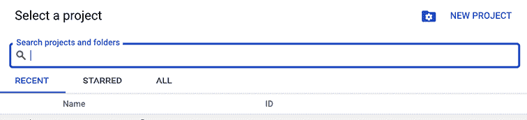

图 11.1: 项目选择器

1. 点击 **NEW PROJECT**（新建项目）。
2. 将你的项目命名为`LearnMistral`。参见`图 11.2`。

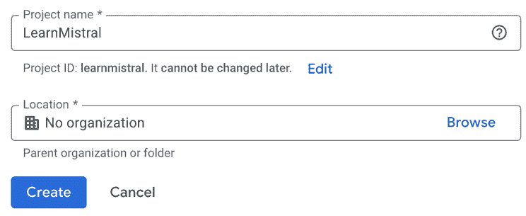

图 11.2: 新项目名称

1. 如果已配置了结算账户，请选择；如果没有，我们稍后会关联。
2. 点击 **Create**（创建）。
3. 创建完成后，点击 **Select Project**（选择项目）打开它。

在创建`Google Cloud`项目后，接下来我们可以启用所需的 API。

### 启用所需的 API

接下来，我们将配置`Google Cloud`项目与`Vertex AI`有效交互并管理资源所需的 API。激活这些 API 确保了我们的`Google Cloud`服务之间的无缝通信和集成，为部署和使用`Mistral`形成关键基础。

采取以下步骤：

1. 在左侧菜单中，转到 **APIs & Services** | **Library**。
2. 搜索并启用这些 API：
    * `Vertex AI API`
    * `Cloud Resource Manager API`
    * `IAM API`

你可以通过点击[`console.cloud.google.com/apis/dashboard?project=mistral`](https://console.cloud.google.com/apis/dashboard?project=mistral)仪表板上的 APIs 卡片定位定位。

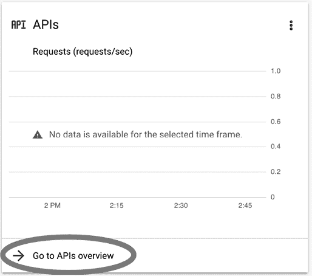

图 11.3: APIs 卡片

或者，可以通过访问[`console.cloud.google.com/welcome?project=mistral`](https://console.cloud.google.com/welcome?project=mistral)欢迎页并选择 **APIs & Services** 来实现。请查看`图 11.4`。

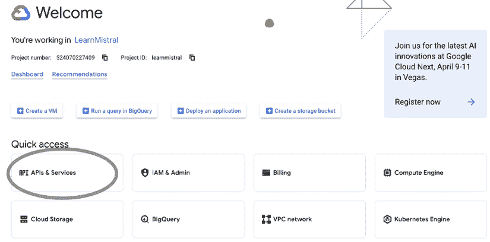

图 11.4: 欢迎页——快速访问

启用 API 后，你的项目设置几乎完成。接下来我们将链接结算账户，以确保所有必要的`Google Cloud`服务均可访问。

### 链接结算账户

此步骤的目的是将你的`Google Cloud`项目连接到结算账户。这确保你的云环境充分访问所有必要的服务，允许在整个研讨会期间顺畅部署和管理。直接访问[`console.cloud.google.com/billing`](https://console.cloud.google.com/billing)结算页，如`图 11.5`所示。

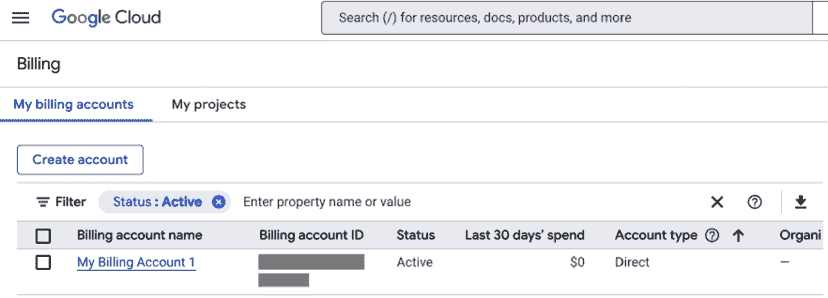

图 11.5: 我的结算账户

如果你还没有结算账户，点击 **Create account** 进行设置。输入新的结算账户名称并选择你的国家，如`图 11.6`所示。

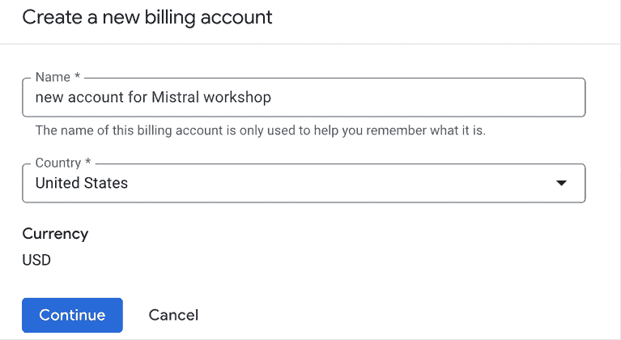

图 11.6: 创建结算账户

接下来，按 **Continue**（继续）提供你的支付方式详情，如`图 11.7`所示。

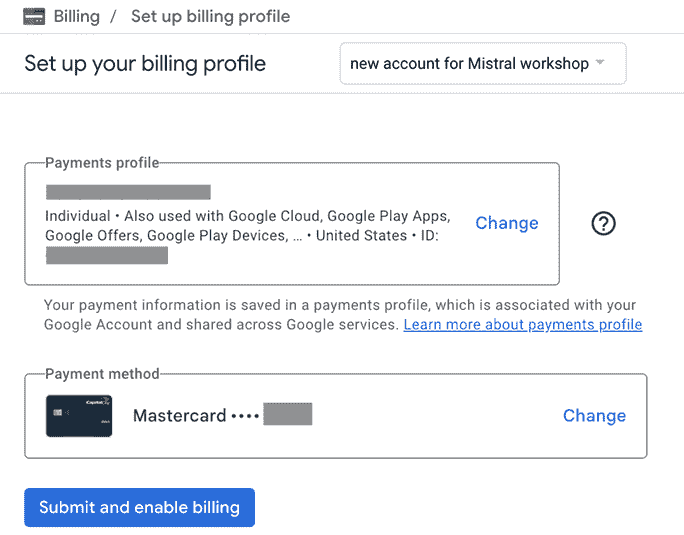

图 11.7: 结算摘要

一旦创建了结算账户并确认了支付方式，你就可以将此结算账户连接到你的特定项目。在下一步，我们将介绍如何将新创建的结算账户链接到`LearnMistral`项目，完成使用`Vertex AI`的结算配置。

### 将项目链接到结算账户

现在结算账户已激活，下一步是将其链接到你的项目。此连接允许你的`Google Cloud`项目访问所有付费服务，包括`Vertex AI`和`Mistral`模型部署所需的服务。通过以下 URL 导航到项目的欢迎页：[`console.cloud.google.com/welcome?inv=1&project=mistral`](https://console.cloud.google.com/welcome?inv=1&project=mistral)。请参考`图 11.8`定位 **Billing**（结算）部分。

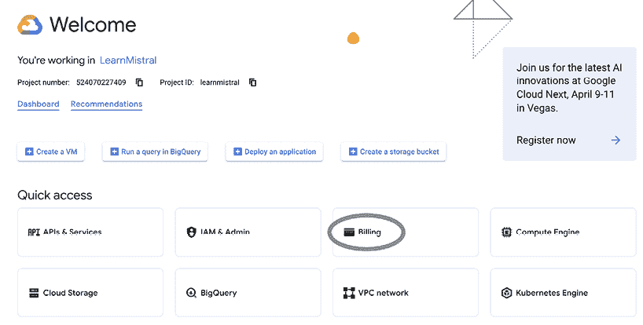

图 11.8: 欢迎页——快速访问

点击 **Billing** 或直接访问链接结算页[`console.cloud.google.com/billing/linkedaccount?project=mistral`](https://console.cloud.google.com/billing/linkedaccount?project=mistral)。查看`图 11.9`的链接账户视图：

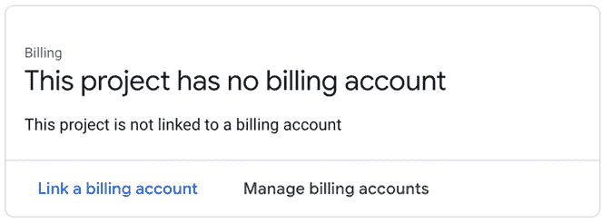

图 11.9: 项目未链接到结算账户

到达后，点击 **Link a billing account**（链接结算账户），你将进入下一个屏幕，如`图 11.10`所示：

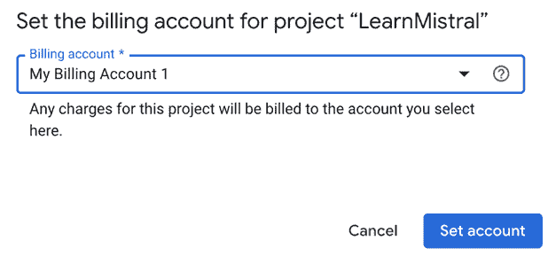

图 11.10: 为项目选择结算账户

从列表中选择你的结算账户并点击 **Set account**（设置账户）确认链接。这完成了你项目的结算配置。现在结算已正确链接，是时候继续并启用通过`Vertex AI`运行`Mistral`模型所需的 API 和服务了。

### 启用 API 和服务

链接结算账户后，你的项目已准备好激活驱动与`Vertex AI`交互的关键 API。这些 API 将允许你的应用程序运行模型、管理权限并访问云资源——这些都是`Mistral`工作流的核心组件。

让我们逐个启用它们：

1. 你可以直接通过[`console.cloud.google.com/apis/dashboard?project=mistral`](https://console.cloud.google.com/apis/dashboard?project=mistral)打开 **APIs & Services** 控制台。这会将你带到主面板，在其中可以管理 API 活动。或者，如果你在项目的欢迎页（[`console.cloud.google.com/welcome?inv=1&project=mistral`](https://console.cloud.google.com/welcome?inv=1&project=mistral)），只需从 **Quick access** 区域点击 **APIs & Services**。接下来，点击 **Enable APIs and services**（启用 API 和服务）按钮。这将打开 API 库，你可以在其中搜索并激活服务。请参考`图 11.11`。

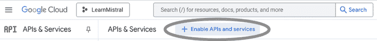

图 11.11: APIs & Services——启用服务

在搜索栏中输入`Vertex AI API`，然后打开其详情页。点击 **ENABLE** 为你的项目激活。此 API 允许你的环境访问并运行`Mistral`模型。请参考`图 11.12`。

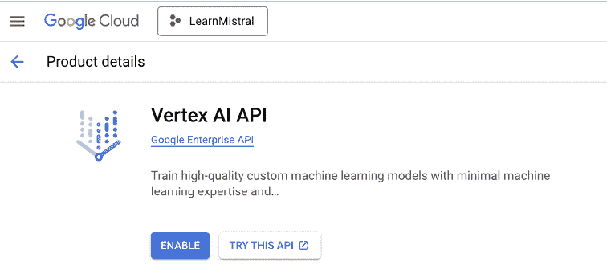

图 11.12: Vertex AI API

如果你还没有完成结算设置，可能会遇到提示启用结算的消息。查看`图 11.13`。


图 11.13: 需要结算

2. 现在在 API 库中搜索`Cloud Resource Manager API`。`Cloud Resource Manager API`是`Google Cloud`中的一项基础服务，允许你程序化地管理云资源的结构和访问控制。它允许你将项目组织到文件夹和组织中，应用`IAM`策略并维护治理。在 GCP 内部安全高效地工作至关重要。一旦页面打开，点击 **ENABLE**。参考`图 11.14`。`Cloud Resource Manager API`有助于组织你的资源。与`Identity and Access Management (IAM)`配合，它控制谁可以做什么。

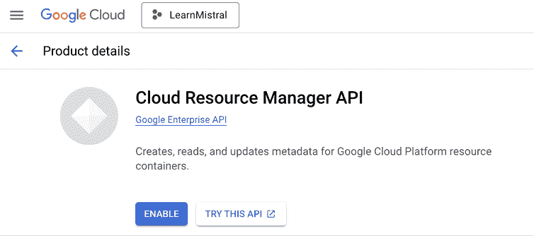

图 11.14: Cloud Resource Manager API

3. 最后，搜索`IAM API`。此服务对于管理角色、凭据以及对`Vertex AI`资源的访问至关重要。一旦找到，在其页面上也点击 **ENABLE**。

启用这些 API 后，你的项目已准备好安全高效地与`Vertex AI`交互。下一步进入`Model Garden`。

### 从 Model Garden 部署 Mistral

我们现在准备好将`Mistral`模型部署到`Google Cloud`环境中。下一步将可以使用`Vertex AI`进行测试和推理。我们将引导你在`Model Garden`中定位模型并为你的项目启用它。让我们开始：

1. 首先通过`Google Cloud`控制台中的[`console.cloud.google.com/vertex-ai?project=mistral`](https://console.cloud.google.com/vertex-ai?project=mistral)打开`Vertex AI`界面。从左侧菜单导航到 **Vertex AI** | **Model Garden**，或使用顶部的搜索栏搜索`Garden`或`Model Garden`。请参考`图 11.15`的导航布局。


图 11.15: 搜索栏中的“Garden”

2. 在`Model Garden`搜索栏内输入`Mistral`以定位可用模型。特别寻找`Mistral Small 3.1`。该模型针对轻量推理用例进行了优化，是实验的良好起点。查看`图 11.16`的搜索结果视图。

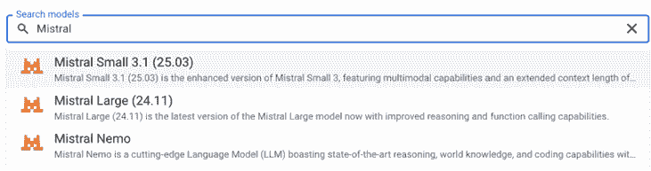

图 11.16: 搜索模型

点击模型卡片查看详情。模型卡片界面的布局如`图 11.17`中所示。

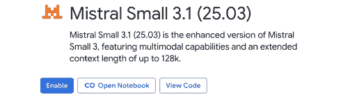

图 11.17: 模型卡片

3. 在模型详情页中，点击 **Enable** 按钮为你的项目激活模型。你将被提示查看并同意购买订单。查看`图 11.18`的购买确认屏幕。

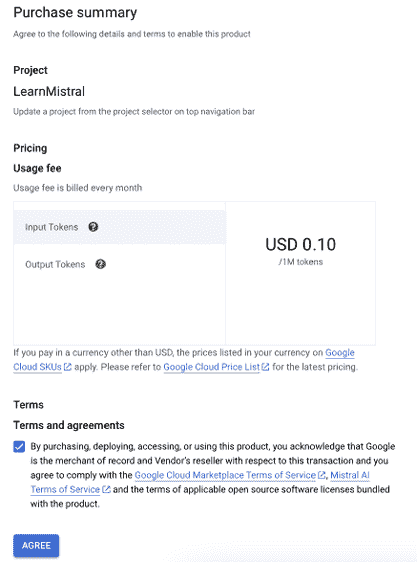

图 11.18: 购买摘要

接受条款后，你将看到模型服务已成功激活的确认。参考`图 11.19`的成功消息布局。

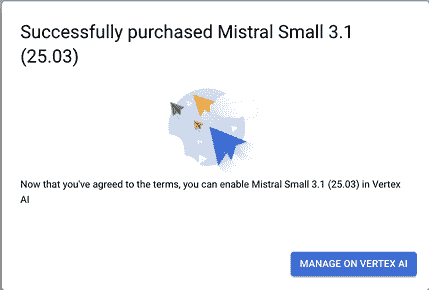

图 11.19: 成功屏幕

请注意使用此模型的成本是按使用计算的，并根据处理的标记数量计算。本次研讨会的总成本预计低于 5 美元。要获得最准确和更新的价格，请访问官方定价页面。

环境现在已就绪。

## 第 2 步：玩转 Mistral

（提供的文本在此处结束，以下为代码示例部分）

```
if "google.colab" in sys.modules:
    from google.colab import auth
```

如果满足此条件，将导入 Colab 的身份验证程序：

```
auth.authenticate_user()
```

在 Google Colab Enterprise 中，身份验证通常作为工作区上下文的一部分自动处理。运行此代码可能会触发警告，但不会中断任何操作。警告信息如下所示：

```
WARNING: google.colab.auth.authenticate_user() is not supported in Colab Enterprise.
```


你可以安全地忽略此消息。它仅意味着笔记本已经通过你的组织会话完成了身份验证，不需要手动登录。

运行身份验证代码块后，你的会话现在已获得完全授权访问后台的 `Vertex AI` 服务。即使出现警告，你的笔记本也已准备就绪并连接。此时不再需要额外的人工验证。

## 选择 Mistral 模型

在发送第一个提示词（prompt）之前，下一步是选择你想要使用的特定 `Mistral` 模型和版本。选择正确的模型可以确保你的请求被正确路由，并且你的实验与工作坊的流程保持一致。

按照以下步骤操作：

1. 滚动到笔记本的该部分，其中可用的 `Mistral` 模型以下拉菜单或变量赋值块的形式列出。你在此决定在会话中使用哪个模型。请参考*图 11.24*查看选择界面的概述。

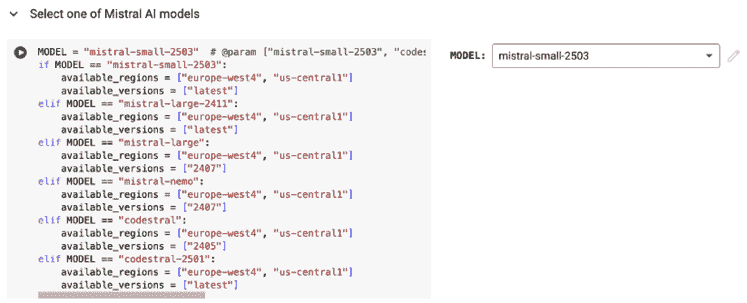

图 11.24：模型选择代码块和 UI

这段代码不包含任何用于推理的功能逻辑——它的主要作用是帮助初始化几个关键变量。你可以用如下简单的手动赋值来替换整个代码块：

```python
MODEL = "mistral-small-2503"
available_regions = ["europe-west4", "us-central1"]
available_versions = ["latest"]
```

然而，使用下拉菜单可以确保与你环境中当前支持的内容保持一致。

1. 在可用选项中，选择 `mistral-small-2503` 或笔记本中列出的最新等效模型。这是一个轻量、高性能的模型，适用于快速推理和实验。根据版本的更新，数字后缀可能会有所不同，但通常建议在工作坊中使用小型变体（small variant）。

2. 一旦选中，该模型将传递到笔记本后续逻辑中用于区域匹配和推理。你不需要手动修改任何代码——只需从提供的界面中选择即可设置激活模型。

你的环境现在已链接到特定的 `Mistral` 模型。此选择决定了在会话期间哪个版本的模型将响应你的提示词。这是一个关键步骤，因为根据你的用例，不同的模型在输出风格、速度或成本上存在差异。

## 运行区域选择组件

为了完成配置，你现在需要选择部署区域。下一步将引入一个组件，帮助你将模型匹配到可用的区域和版本，确保推理请求的正确路由。

按照以下步骤操作：

1. 继续滚动 `Colab` 笔记本，直到进入帮助选择部署区域和模型版本的部分。该部分使用交互式组件来引导你的选择。请参考*图 11.25*查看包含下拉 UI 的代码单元：

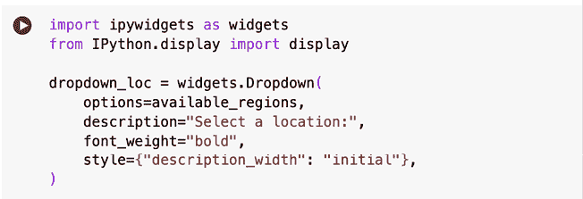

图 11.25：区域选择块

虽然这段代码提供了一个用户友好界面，但它并没有执行工作坊功能必需的任何逻辑。如果需要，你可以跳过组件并使用以下内容直接赋值：

```python
LOCATION = "us-central1"
MODEL_VERSION = "latest"
```

运行单元格将显示两个下拉菜单：一个用于选择模型托管的区域，另一个用于指定模型版本（如果适用）。这些选择确保了模型变体与可用基础设施之间的兼容性。组件输出显示在*图 11.26*中。

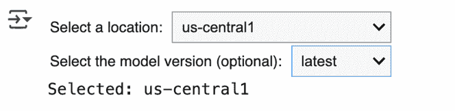

图 11.26：选择位置和版本的 UI 组件

下拉菜单中列出的任何区域或模型版本都应该可用。建议的区域通常是地理上离你最近的区域，以减少延迟。建议的版本是 `Model Garden` 中最新的版本，为了兼容性和性能，推荐使用。

1. 从下拉菜单中选择一个支持的区域——通常为 `us-central1` 或 `europe-west4`。对于大多数用户来说，选择 `latest` 作为版本足够了，除非为了兼容性或测试需要特定的发布版本。

此时，你已经选择了模型运行的位置以及要使用的版本。这些变量现在已准备好传递到你的 API 调用中，并将引导未来所有推理请求的路由。

## 运行项目选择组件

在下一步中，你将通过提供 ID 将笔记本链接到特定项目。这会将你的会话绑定到正确的计单和模型上下文，从而解锁对你的云托管 `Mistral` 部署的完全访问。

按照以下步骤操作：

1. 继续向下滚动 `Colab` 笔记本，直到进入指定 `Google Cloud` 项目 ID 的部分。这对于将所有 API 调用和计单路由到正确的云环境中是必须的。界面允许你通过表单输入进入项目 ID。请参考*图 11.27*查看包含下拉 UI 的代码单元：

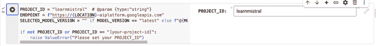

图 11.27：区域选择块

这段代码提供了一个用户友好界面，但它并没有执行工作坊功能必需的任何逻辑。如果需要，你可以跳过组件并使用以下内容直接赋值：

```python
PROJECT_ID = "learnmistral"
ENDPOINT = f"https://{LOCATION}-aiplatform.googleapis.com"
SELECTED_MODEL_VERSION=""
```

1. 默认值为 `learnmistral`。如果你使用的是不同的项目，请确保在输入表单中相应更新。此步骤确保你的 API 请求经过授权并限制在正确的环境中。

2. 单元格还包含基础检查：如果项目 ID 为空或仍设置为占位符值 `[your-project-id]`，将抛出 `ValueError`。这防止了在继续之前出现意外的配置错误。

你的笔记本现在已连接到正确的 `Google Cloud` 项目。这确保了对 `Vertex AI` 的所有后续调用都被正确路由、授权和计费。你的环境现在已完全定义并准备与 `Mistral` 模型进行交互。

由于配置已经完成，我们可以转向执行代码。在下一步中，你将导入所需的库，以便能够发送 HTTP 请求、处理身份验证令牌并管理模型响应。

## 导入所需的库

现在你的配置已完成，是时候导入支持与模型交互的关键 `Python` 库了。这些库处理 HTTP 通信、令牌检索和 JSON 处理——你通过代码与 `Vertex AI` 交互所需的所有工具：

```python
import json
import subprocess
import requests
```

这些导入虽然精简但强大。`json` 用于结构化发送到模型的负载。`subprocess` 帮助获取你的访问令牌。`requests` 是用于将这些负载发送到 `Vertex AI` 端点的客户端。

这段简短的代码块为你将执行的请求奠定了基础。没有这些导入，后续的推理代码将无法运行。所有必要的库现在已就绪。

## 运行推理

运行推理将从准备一个简单的 JSON 负载开始——一个模型可以理解的结构化问题。然后，你将使用 `cURL` 命令发送该负载，以查看 `Vertex AI` 如何实时响应。一旦运行，你将使用 `Python` 重新运行请求，以美化打印响应并使输出变得更容易。最后，我们将探索更高级的功能，例如流式传输（streaming），让你体验 `Mistral` 如何动态处理对话流并在生成时返回结果。

### 准备负载

在向模型发送请求之前，你需要定义想让它做什么。这是通过创建一个结构化字典实现的，该字典包含了模型名称、用户消息、输出长度以及流式传输偏好。一旦定义，字典将被序列化为 JSON 格式，这是 `Vertex AI` API 请求预期的结构：

```python
PAYLOAD = {
    "model": MODEL,
    "messages": [{
        "role": "user", "content": "who is the best French painter?"
    }],
    "max_tokens": 100,
    "stream": False,
}

request = json.dumps(PAYLOAD)
```

`"model"`键指向你部署的 `Mistral` 实例。`"messages"`字段是一个数组，其中每个条目模拟聊天消息；在这里我们模拟一个提问的用户。`"max_tokens"`定义了响应的最大长度，而`"stream"`设置为 `False` 意味着响应将一次性返回，而不是分块返回。

这段简短代码是至关重要的——它是查询封装的内容以及你期望模型响应的方式。

你现在创建了告诉 `Mistral` 模型要做什么的负载。它包含了你的问题和一些配置参数，并且格式正确，可以通过网络发送。

在下一步中，你将获取此负载，并使用 `cURL` 命令将其直接发送到 `Vertex AI` 端点。这将是你的第一次完整往返请求，`Mistral` 模型将返回实时响应。

### 运行到模型的 cURL 请求

滚动到 `Colab` 笔记本中的下一个代码单元格。此部分将你之前准备的 JSON 负载直接发送到托管在 `Vertex AI` 中的 `Mistral` 模型。该命令使用了 `cURL`——这是一个简单而强大的工具，用于从终端或笔记本环境发起 HTTP 请求：

```bash
!curl -X POST \
-H "Authorization: Bearer $(gcloud auth print-access-token)" \
-H "Content-Type: application/json" \
{ENDPOINT}/v1/projects/{PROJECT_ID}/locations/{LOCATION}/publishers/mistralai/models/{MODEL}{MODEL_VERSION}:rawPredict \
-d '{request}'
```

此命令构建了一个指向模型端点的 POST 请求。它包含了正确的授权头（通过 `gcloud` 获取你的访问令牌），将内容类型设置为 JSON，并传递了你的序列化请求负载。执行后，模型将处理你的输入并以 JSON 格式返回响应。

你应该收到一个没有错误的有效 JSON 响应。输出包含 `"content"`键下的生成消息，以及诸如令牌使用和响应结构等元数据。一个成功的响应可能如下示例所示：

```json
{"content":"Determining the \"best\" French painter can be subjective and depends on personal preferences, as well as the criteria one uses to define \"best\" (e.g., historical significance, technical skill, innovation, etc.). However, several French painters are frequently cited as among the greatest:\n\n1\. **Claude Monet** - Often considered the father of Impressionism, Monet's work is renowned for its use of light and color to capture the fleeting effects of the natural world.\n\n2\. **"},...}
```

响应已缩小为最小属性，显示了推理的成功。

你现在完成了通过 `Vertex AI` 与 `Mistral` 模型的首次实时交互。这种底层方法对于理解 HTTP 请求在后台的工作原理非常有帮助，并让你对数据的传递和返回拥有完全的控制权。

为了让结果更易读和处理，你现在将使用 `Python` 重新运行请求，以美化打印响应。比起依赖 `cURL` 进行推理，这种使用 `requests` 库的方法提供了更好的错误处理、更整洁的输出以及更容易集成。如果你计划扩展或嵌入模型调用，这种方法更具扩展性：

```python
# 获取访问令牌
process = subprocess.Popen(
    "gcloud auth print-access-token", stdout=subprocess.PIPE, shell=True)
(access_token_bytes, err) = process.communicate()
access_token = access_token_bytes.decode("utf-8")  # 去除换行

# 定义头
headers = {
    "Authorization": f"Bearer {access_token}",
    "Accept": "application/json",
}

# 替换为实际值
url = f"{ENDPOINT}/v1/projects/{PROJECT_ID}/locations/{LOCATION}/publishers/mistralai/models/{MODEL}{MODEL_VERSION}:rawPredict"

data = {
    "model": MODEL,
    "messages": [{"role": "user", 
        "content": "who is the best French painter?"}],
    "stream": False,
}

# 发起 POST 请求
response = requests.post(url, headers=headers, json=data)

# 检查状态码并尝试将响应解析为 JSON
if response.status_code == 200:
  try:
    response_dict = response.json()
    print(response_dict["choices"][0]["message"]["content"])
  except json.JSONDecodeError as e:
    print("JSON 解析错误:", e)
    print("原始响应:", response.text)

# 如果解析失败则打印原始响应
else:
    print(f"请求失败，状态码为：{response.status_code}")
```

该请求的输出将类似于早期的 `cURL` 响应，但在笔记本输出区域中格式更整洁。你应该能看到一段文字，根据你原始的提示词，可能会列出莫奈或塞尚等著名的法国画家。

4. **亨利·马蒂斯**：马蒂斯以其色彩的使用而闻名……
5. **帕罗·毕加索**：他的作品因共同创立立体主义而闻名遐迩。
6. **爱德华·马奈**：通常被认为是写实主义与印象主义之间的桥梁……

该响应在多处进行了收缩，主要用于展示消息的结构。

这一步将为你提供一种更健壮、更易读的方式来与模型进行交互。使用 `Python` 代码允许你超越基础提示词，开始从构建功能、测试变体或将响应集成到更复杂的工作流的角度思考。

接下来，我们将让你尝试更高级的交互方式——特别是流式请求（streaming requests）。你不需要等待整个响应生成并一次性返回，而是将看到模型实时流式输出，模拟更具对话性或动态的用户体验。

## 探索更多功能

笔记本并没有在此结束——你还有许多内容供你自行探索。花几分钟向下滚动，尝试演示中包含的其他功能。你将找到流式调用的工作示例（实时返回响应），以及涉及 `Codestral` 模型和 `Fill-in-the-Middle`（`FiM`）提示的用例。这是一个实验、调整参数并观察模型在不同上下文中表现的绝佳机会。不要犹豫尝试——你已经设置好了一切，现在这里是你的沙箱了。

既然你已经探索了笔记本界面并运行了标准和流式推理请求，现在是时候提升到下一个水平了。

## 步骤 3：使用 Mistral AI 的 Vertex SDK for Python

你已经体验过 `Colab Enterprise` 环境有多强大和方便——但现在是时候将这种力量带到自己的机器上了。在工作坊的这部分，我们将离开笔记本，转向使用 `VS Code` 和终端（terminal）的开发者原生设置。

你将从安装 `Google Cloud CLI` 并初始化环境开始——就像你之前可能对 `AWS CLI` 执行的那样。从那里，你创建一个干净的 `Python` `venv`，安装所需的包，并使用 `gcloud` 对会话进行身份验证。

设置完成后，我们将定义整个工作坊将使用的变量——例如 `MODEL`、`LOCATION` 和 `PROJECT_ID`——并直接从 `Python` 运行真实的推理请求。我们将首先发送一个同步请求并获得立即响应，然后跟一个`streaming request`（流式请求），它会实时逐令牌地交付结果。

这段旅程反映了真实生产系统如何通过 `Vertex AI` 与 `Mistral` 交互，为你提供了可以带回项目的实用工具和工作流。让我们从实验转向集成。

### 设置 gcloud CLI

在移动到本地 `Python` 脚本之前，你需要设置 `gcloud` CLI 以允许你的机器与 `Google Cloud` 服务进行安全交互。在这一步中，你根据需要安装 CLI 工具，验证你的 `Google` 账户，并运行 `gcloud init` 过程来配置环境。你还将选择之前创建的活动项目，确保未来所有的 API 调用和部署都能正确关联。此设置对于管理身份令牌、与 `Vertex AI` 交互以及在 `Colab` 之外的完全控制环境中运行推理请求至关重要。

#### gcloud CLI 的初始安装

**选项 1：根据操作系统选择安装方法**

在从终端与 `Google Cloud` 交互之前，你需要安装 `gcloud` CLI。该工具提供了一个命令行界面，用于初始化环境、管理项目和发送 API 请求。如果你使用的是 `Windows` 或 `Mac`，请访问官方安装指南并下载适用于你系统的版本：

* Windows：[`cloud.google.com/sdk/docs/install#windows`](https://cloud.google.com/sdk/docs/install#windows)


本节将介绍在 macOS 上安装 Google Cloud SDK 的两种方法。第一种是直接下载安装包，第二种是使用 Homebrew 快速安装（仅限 Mac）。

## 选项 1：直接下载安装包（macOS）

在 macOS 上安装 `gcloud` 的标准方法是直接下载安装包。请访问以下地址获取适用于 macOS 的安装包： [`cloud.google.com/sdk/docs/install#mac`](https://cloud.google.com/sdk/docs/install#mac%20)

#### 选项 2：使用 Homebrew 快速安装（仅限 Mac）

如果你使用的是 macOS 并安装了 Homebrew，安装 `gcloud` 的快方法是在终端中运行以下命令：

```
brew install --cask google-cloud-sdk
```

此方法会为你处理下载和设置。关于此方法的更多文档请访问：[`formulae.brew.sh/cask/gcloud-cli`](https://formulae.brew.sh/cask/gcloud-cli)。

安装完成后，重启你的终端 shell 以确保 `gcloud` CLI 正确加载到系统路径中。这允许你从以后在任何终端窗口运行 `gcloud` 命令。

`gcloud` CLI 已安装并在你的机器上准备就绪。该工具将成为你通过与 Google Cloud 进行身份验证、选择项目以及通过命令行管理 Mistral 模型交互的网关。

现在我们准备好验证会话并选择整个工作坊将使用的活动项目。这一步反映了我们之前在 Colab 笔记本中做的操作，但这次我们将通过终端在本地完成。让我们初始化 CLI 环境。

## 初始化、身份验证和选择活动项目

现在你已经进入了本地开发环境，是时候初始化 Google Cloud CLI 了。按照以下步骤操作：

1. 打开你的终端并运行以下命令：

```
gcloud init
```

这将启动一个交互式流程，引导你完成配置、身份验证和项目选择。参考 `图 11.28` 查看设置界面。

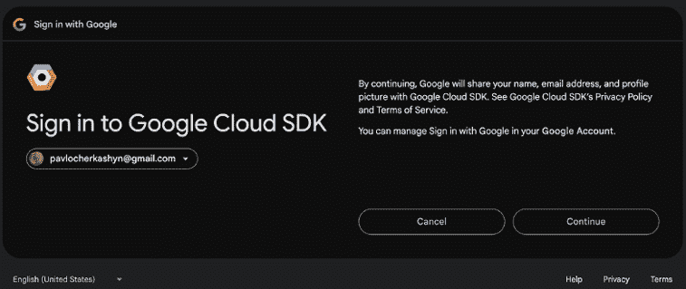

图 11.28：登录 Google Cloud SDK

2. 诊断检查完成后，系统会提示登录。Google 将打开一个浏览器窗口让你验证身份并允许访问账户。重定向后，点击“继续”，如 `图 11.28` 所示。

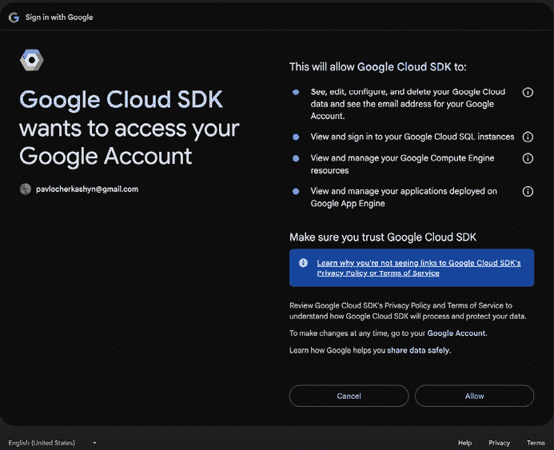

图 11.29：授权屏幕

3. 确认后，将要求允许 Google Cloud SDK 访问你的项目数据和凭据。此步完成了身份验证过程。参考 `图 11.29` 查看授权屏幕。

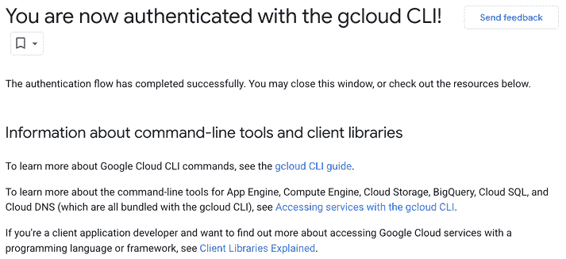

图 11.30：gcloud CLI 身份验证成功

4. 身份验证后，终端将显示与你的账户关联的项目列表。你可以选择现有项目——例如 `learnmistral`——或选择创建一个新项目。你的当前项目将根据你的选择进行设置。终端提示符所示：

```
选择要使用的云项目：

 [1] yourauth-1571888950021

 [2] coffe-cups-agent

 [3] learnmistral

 [4] plasma-creek-454

 [5] 输入项目 ID

 [6] 创建新项目
```

2. 输入相应的数字（例如，`3`）来选择你想要的项目。

根据你的账户历史，你的列表可能会有所不同，并且可能只包含一个项目。

你现在已经通过 Google Cloud 对本地 CLI 完成了身份验证，并选择了你的活动项目。此连接允许你的终端发布安全命令、管理资源，并直接从你的机器运行推理——完全在 Colab 界面之外。

## 准备虚拟环境和依赖项

在验证环境并配置项目后，下一步是创建一个干净的 Python `venv`。这会隔离你的依赖项，并确保基于 SDK 的代码以可预测的方式运行，不受全局安装的其他 Python 工具的影响。让我们准备好本地工作空间：

1. 首先在 VS Code 内部启动终端。确保你正处于之前检出的 Git 项目目录中——具体说是本章的文件夹。这确保了你所有的代码和依赖项都整齐地集中。正确的终端视图请参见图 11.31。

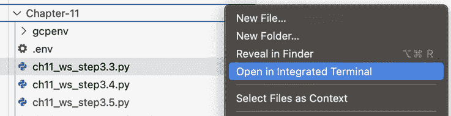

图 11.31: VS Code – 在 Chapter-11 文件夹上选择在集成终端中打开选项

2. 在终端中，运行以下命令在你的项目目录下创建一个新的 Python `venv`。该环境将此工作坊的包与系统上的其他 Python 项目隔离开：

```
python3 -m venv ./gcpenv
```

接下来，激活环境：

```
source ./gcpenv/bin/activate
```

1. 激活后，升级 `pip` 以确保你正在使用最新的包管理器：

```python
python3 -m pip install --upgrade pip
```

2. 然后，安装 `mistralai[gcp]` 包，它包含了在 Vertex AI 上使用 Mistral 所需的所有内容：

```
python3 -m pip install -U -q 'mistralai[gcp]>=1.2.4'
```

3. 最后，安装 `httpx`，这是一个现代的 Python 异步 HTTP 客户端：

```
python3 -m pip install -U -q httpx
```

你的环境现在已完全为安全且洁的开发准备就绪。所有必要的包已在隔离的工作空间内安装，确保了可复现性并最小化了系统冲突。你现在已经能够从本地机器直接与 Mistral 交互。

## 从 Python 进行会话验证

下一步是在 Python 内部进行身份验证。你将学习如何通过程序检索你的 Google Cloud 访问令牌，并使用它对 Mistral 模型发送安全的 API 请求，就像我们在 Colab 笔记本中做的那样——只不过这次完全通过代码实现。

执行以下步骤：

1. 身份验证现在从终端移动到你的 Python 代码。你将使用位于 `Chapter-11` 文件夹中的脚本，从 `gcloud` CLI 程序化地获取访问令牌。此令牌将授权你对 Vertex AI 的请求，并实现与 Mistral 模型的安全交互。

请参考 `./Chapter-11/ch11_ws_step3_3.py` 中的函数：

```python
import subprocess

def get_gcloud_access_token():
    process = subprocess.Popen(
        "gcloud auth print-access-token",
        stdout=subprocess.PIPE,
        stderr=subprocess.PIPE,
        shell=True
    )
    access_token_bytes, err = process.communicate()
    if process.returncode != 0:
        raise RuntimeError(f"Failed to get access token: {err.decode('utf-8').strip()}")
    return access_token_bytes.decode("utf-8").strip()

# 取消注释以测试并查看令牌
# print(get_gcloud_access_token())
```

1. 在脚本底部，你会看到一行被注释掉的代码：

```python
# print(get_gcloud_access_token())
```

2. 取消注释以打印令牌并确认身份验证正常工作。此令牌将用于未来所有的推理调用，以验证你的会话：

```python
print(get_gcloud_access_token())
```

3. 在准备好 venv 的 VS Code 内置终端中运行此命令：

```bash
python3 ./ch11_ws_step3_3.py
```

如果一切设置都正确，你应该应该在终端中看到打印出的令牌——这证明你的 Python 环境已安全连接到 Google Cloud 账户。

你现在已直接从 Python 完成了身份验证，完成了本地环境与 Vertex AI 之间的桥接。你的脚本现在可以与云端的 Mistral 模型交互，而无需依赖基于浏览器的工作流或笔记本环境。

## 初始化变量

现在是定义工作变量的时间。在这一步中，你将初始化模型设置，例如 `MODEL`、`PROJECT_ID` 和 `LOCATION`，确保你的脚本针对正确的资源进行推理。执行以下步骤：

1. 定义推理脚本将使用的关键变量。这些包括模型标识符、项目 ID、区域以及你发送请求的端点。打开位于 `./Chapter-11/ch11_ws_33_4.py` 的文件，所有的配置都在这里集中编辑：

```python
# 如果需要，请替换为你喜欢的模型
MODEL = "mistral-small-2503"

# 如果需要，请替换为你偏好的项目 ID
PROJECT_ID = "learnmistral"

# 请替换为你的位置
LOCATION = "us-central1"
ENDPOINT = f"https://{LOCATION}-aiplatform.googleapis.com"
```

2. 该脚本包含一个名为 `validate_configuration()` 的函数，检查 `MODEL` 和 `PROJECT_ID` 等变量是否已设置。如果缺失，它将抛出清晰且可操作的错误消息：

```python
def validate_configuration():
    if not PROJECT_ID:
        raise ValueError("Please set PROJECT_ID")
    if not MODEL:
        raise ValueError("Please set MODEL")
```

3. 取消脚本底部调用 `validate_configuration()` 的行的注释并运行文件。这将确认你的环境配置正确并准备好请求：

```python
validate_configuration()
```

4. 然后运行脚本：

```bash
python3 ./ch11_ws_step3_4.py
```

如果一切设置正确，将不会产生错误，你已准备好进行推理。

你现在已经定义并验证了脚本与 Mistral 模型交互的关键变量。

现在配置已经确定，是时候触发第一次模型调用了。在下一步中，你将构建推理请求并使用 `mistralai` SDK 将发送到 Vertex AI——获取 Mistral 模型的实时响应。

## 调用推理请求

现在所有准备工作已就绪，让我们使用 Python SDK 首次调用 Mistral 模型：

1. 打开 `./Chapter-11/ch11_ws_step3_5.py` 文件。以下是用于发送提示并打印模型响应的完整代码：

```python
from mistralai_gcp import MistralGoogleCloud
from ch11_ws_step3_3 import get_gcloud_access_token
from ch11_ws_step3_4 import MODEL, PROJECT_ID, LOCATION

access_token = get_gcloud_access_token()
client = MistralGoogleCloud(
    access_token=access_token,
    region=LOCATION,
    project_id=PROJECT_ID
)

try:
    resp = client.chat.complete(
        model=f"{MODEL}",
        messages=[
            {
                "role": "user",
                "content": "谁是最好的法国画家？用一个短句回答",
            }
        ],
    )
    print(resp.choices[0].message.content)
except Exception as e:
    print(f"发生了一个错误: {e}")
    print(f"[debug] access_token: {access_token}")
    print(f"[debug] MODEL: {MODEL}")
    print(f"[debug] PROJECT_ID: {PROJECT_ID}")
```

```python
print(f"[debug] LOCATION: {LOCATION}")
```

接下来，我们导入所需的模块。这些行导入了 SDK 客户端、你的访问令牌辅助函数以及你之前定义的环境变量：

```python
from mistralai_gcp import MistralGoogleCloud
from ch11_ws_step3_3 import get_gcloud_access_token
from ch11_ws_step3_4 import MODEL, PROJECT_ID, LOCATION
```

然后我们获取访问令牌。此行使用你的辅助函数从已身份验证的 Google Cloud 会话中获取访问令牌：

```python
access_token = get_gcloud_access_token()
```

1. 在，你使用令牌、区域和项目 ID 设置了 `MistralGoogleCloud` 客户端。该对象将用于与 Vertex AI API 通信：

```python
client = MistralGoogleCloud(
    access_token=access_token,
    region=LOCATION,
    project_id=PROJECT_ID
)
```

2. 在 `try` 块内部，此代码向模型发送了一个单一提示（prompt）并打印响应。消息格式反映了典型的基于系统的系统：

```python
resp = client.chat.complete(
    model=f"{MODEL}",
    messages=[
        "role": "user",
        "content": "Who is the best French painter? in one short sentence",
    }],
)
print(resp.choices[0].message.content)
```

3. 如果发生任何错误——例如令牌无效或模型配置错误——此 `except` 块将打印错误和所有关键变量以帮助你快速调试：

```python
except Exception as e:
    print(f"An error occurred: {e}")
    print(f"[debug] access_token: {access_token}")
    print(f"[debug] MODEL: {MODEL}")
    print(f"[debug] PROJECT_ID: {PROJECT_ID}")
    print(f"[debug] LOCATION: {LOCATION}")
```

4. 现在执行脚本查看模型的运行情况：

```bash
python3 ./ch11_ws_step3_5.py
```

如果配置正确，这将打印出 Mistral 模型对你问题给出的简洁回答。

你现在已仅使用 Python 代码成功对 Mistral 发起了同步推理调用。Vertex AI 返回的响应确认你的设置是正确且有效的。此工作流反映了大多数生产系统如何使用 Mistral 进行一次性查询或响应生成。

## 调用流式请求

接下来，你将探索流式响应——模型输出逐个标记（token）并实时交付。这对于对话式应用程序或你想为用户提供渐进反馈的情况非常理想。

让我们深入研究流式交互：

1. 为了结束工作研坊的这个实践部分，我们将测试流式推理。这允许模型在生成标记时立即返回标记，对于响应式界面和对话流非常理想。打开 `./Chapter-11/ch11_ws_step3_6.py` 文件开始。

2. 我们首先导入所需的工具——Mistral 客户端、访问令牌函数以及我们之前定义的配置值：

```python
from mistralai_gcp import MistralGoogleCloud 
from ch11_ws_step3_3 import get_gcloud_access_token 
from ch11_ws_step3_4 import MODEL, PROJECT_ID, LOCATION
```

3. 然后我们获取一个新的访问令牌，并使用它创建一个 `MistralGoogleCloud` 客户端实例，就像同步示例一样：

```python
access_token = get_gcloud_access_token()
client = MistralGoogleCloud(
    access_token=access_token,
    region=LOCATION,
    project_id=PROJECT_ID
)
```

4. 在 `try` 块内部，向模型发送了一个流式请求。提示与之前相同，但 `stream()` 方法逐部分返回结果。`for` 循环遍历每个标记块并将其立即打印到终端：


```python
stream = client.chat.stream(
    model=f"{MODEL}",
    max_tokens=1024,
    messages=[
        {
            "role": "user",
            "content": "Who is the best French painter? One short sentence.",
        }
    ],
)
for chunk in stream:
    print(chunk.data.choices[0].delta.content)
```

5. 如果出现问题——例如令牌过期或无法访问端点——异常将被捕获并打印错误：

```python
except Exception as e:
    print(f"An error occurred: {e}")
    print(f"[debug] access_token: {access_token}")
    print(f"[debug] MODEL: {MODEL}")
    print(f"[debug] PROJECT_ID: {PROJECT_ID}")
    print(f"[debug] LOCATION: {LOCATION}")
```

6. 为了看到流式响应的运行情况，在终端中运行脚本：

```bash
python3 ./ch11_ws_step3_6.py
```

你应该能看到响应逐渐出现，模拟来自模型的实时输出流。

```
..
许多人认为 Claude Monet 是最伟大的画家之一。
```

现在，你已经使用 Python 和`Vertex AI SDK`在你自己的环境中实现了同步和流式推理请求。从实用的角度来看，你的工作坊之旅到此画上了句号——并为你以后独立构建交互式、可扩展的 AI 驱动应用做好了准备。

# 总结

你刚刚完成了一段令人深刻的实战旅程——这段经历将 Mistral 从一个概念转变为你开发环境中的工作部分。从 Google Cloud 的设置和 API 配置开始，你构建了坚实的基础，然后自信地进入 Colab 进行了快速实验。

但这一章真正的亮点是你在`VS Code`中的工作。你搭建了专用的 Python 环境，通过`Google Cloud CLI`进行了身份验证，并编写了整洁、模块化的代码来运行同步和流式推理请求。你创建的每一个脚本都让你更接近真实生产系统中的工作流。你处理了凭据、结构化负载、管理了错误，并见证了 Mistral 按需生成响应——这一切都在你的终端中完成。

这不仅仅是一次引导式演示；它是一次构建自己工具箱的体验。你现在拥有了可重用的组件、经过测试的工作流，以及对如何有针对且精确地将语言模型引入项目的深层理解。

无论你是选择继续探索高级功能，还是直接将这些技能应用到自己的应用中，你都赢得了这种信心。你不仅能够使用 AI，你还准备好构建它、塑造它并扩展它。这是一个非常强大的起点。

# 课外活动

现在你已经完成了核心工作坊，正处于进一步探索的绝佳位置。无论你是对更强大的模型感到好奇，还是寻求具有完全控制权的自托管，以下课外活动都将挑战你的技能，并开启在 Vertex AI 及其他平台上使用 Mistral 的新可能：

## 1. 使用 Mistral Large 探索高级功能

如果你准备好尝试更强大的模型，请返回`Model Garden`并启用`Mistral Large`而不是小版本。启用后，滚动查看从模型卡片链接的自动生成的`Google Colab`笔记本。它包含了以下扩展功能，例如：

* 代码生成

* `FiM`提示词处理

* 具有结构化输入和模式感知输出的函数调用

这些章节展示了 Mistral 增强的推理和结构化能力，并让你有机会与更细致的提示词和场景进行交互。笔记本已绑定到你的项目，因此你可以直接开始实验。

## 2. 在 Text Generation Inference (TGI) 上部署 Mistral 7B 或 8B

对于寻求自托管设置的用户，尝试通过`Google Cloud`或`Hugging Face`的基础设施使用`Text Generation Inference`(`TGI`) 部署`Mistral 7B Instruct`或`Ministral 8B Instruct`。这是一个高级工作流，包括：

* 准备运行 TGI 器的`docker-compose.yml`文件（GitHub 上提供了示例）

* 模型上传到`Google Artifact Registry`或另一个可存储位置

* 为你的模型创建并暴露端点

* 在启用 GPU 的虚拟机上启动服务（你可能需要提前向`Google Cloud`申请 GPU 配额）

确保你的`Hugging Face`API 令牌激活状态，并且你的账户已获得使用所选 Mistral 许可。此令牌将允许`Google Cloud`在部署期间从 Hugging Face 拉取模型镜像。

这些可选挑战对于想要深入研究的开发者来说是理想的——无论是为了探索生产托管、性能基准测试，还是为了解锁仅留给更大模型的功能。每条路径都提供了关于 Mistral 如何在真实系统中使用的不同视角。将其视为你实验和成长的开放领域。

# 订阅获取免费电子书

新框架、演进的架构、研究发布、生产分析——`AI_Distilled`将噪音过滤掉，为亲手操作 LLM 和生成式 AI 系统的工程师和研究人员提供每周简报。现在订阅即可获得一本免费电子书，以及帮助你保持专注和掌握信息的每周见解。

访问[`packt.link/TRO5B`](https://packt.link/TRO5B)订阅或扫描下方的二维码。


[packtpub.com](https://packtpub.com)

订阅我们的在线数字图书馆，即可访问超过 7,000 本书和视频，并获得行业领先的工具，帮助你规划个人发展并提升职业。欲了解更多信息，请访问我们的网站。

# 为什么要订阅？

* 通过来自 4,000 多名行业专业人士实用电子书和视频，减少学习时间，增加编码时间

* 通过专为为你定制的技能计划提升你的学习效果

* 每月获得一本免费电子书或视频

* 全文搜索，方便访问关键信息

* 内容可以复制、粘贴、打印和添加书签

在 [www.packtpub.com](https://www.packtpub.com)，你还可以阅读免费技术文章合集，订阅一系列免费新闻邮件，并获得 Packt 书籍和电子书的独家折扣和优惠。

# 你可能喜欢的其他书籍

如果你喜欢这本书，你可能对 Packt 的其他书籍感兴趣：

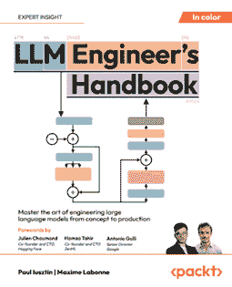

**LLM Engineer's Handbook**

Paul I muchin, Maxime Labonne

ISBN: 978-1-83620-007-9

* 实现健壮的数据管道并管理 LLM 训练周期

* 在实战示例的帮助下创建自己的 LLM 并进行精炼

* 通过深入核心 MLOps 原理（如编排器和提示词监控）开始 LLMOps

* 执行监督微调

* 使用`AWS`和其他工具部署端到端 LLM 解决方案

* 设计可扩展的模块化 LLM 系统

* 通过构建功能和推理管道学习`RAG`应用


**Building Agentic Systems**

Ananjan Biswas, Wrick Talukdar

ISBN: [未提供原文完整 ISBN]

* 掌握生成式 AI 和智能代理系统的核心原理

* 理解智能代理如何在动态环境中运行、推理和适应

* 使智能代理能够分析自己的操作并进行即兴处理

* 实现代理利用外部工具并规划任务的任务

* 应用增强 AI 透明度和可靠性的方法

* 探索智能代理跨行业的落地

# Packt 正在寻找像你这样的作者

如果你对成为 Packt 作者感兴趣，请访问 [authors.packtpub.com](https://authors.packtpub.com) 并立即申请。我们与数千像你这样的开发者合作，帮助他们向全球社区分享见解。你可以提交通用申请、申请我们正在招募特定主题，或提交自己的想法。

# 分享你的想法

现在你读完了`Mistral`，我们想听听你的想法！如果你是从亚马逊购买的这本书，请[点击此处直接进入该书亚马逊页面](https://packt.link/r/18358865)，并在购买网站上分享你的反馈。你的评论对我们和技术社区至关重要，并将帮助我们确保提供优质的内容。
