# 企业级 LLM

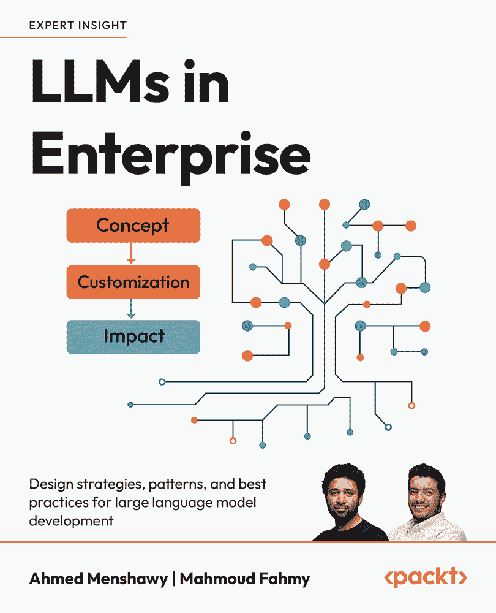


*献给我的父母、我的妻子 Sara 以及我们的孩子们 Soma、Dawud、Maryam 和 Reem，感谢你们的耐心与支持。*

*– Ahmed*

*献给我的妻子 Fatma，感谢她的爱、耐心与支持；感谢我的女儿 Amina，我生命的光。缅怀我的父亲，他一直激励着我。*

*– Mahmoud*

# 贡献者

# 关于作者

Ahmed Menshawy 是万事达（Mastercard）的 AI 工程副总裁。他领导 AI 工程团队，推动 AI 产品的开发和落地，并解决 ML 流水线部署中的广泛挑战和技术债务。他还领导一个专门团队创建多种 AI 加速器和能力，包括推理引擎和特征存储，旨在增强 AI 工程的各个方面。

Mahmoud Fahmy 是万事达（Mastercard）的首席机器学习工程师，专注于 AI 产品的开发和落地。他的主要重点是优化机器学习流水线，并解决为终端客户有效部署模型时的复杂挑战。

# 关于评审员

Advitya Gemawat 是微软的 ML 工程师，专注于可扩展机器学习系统和 `Responsible AI`（`RAI`）。他曾发表过著作，拥有专利，并获得过 VLDB、ACM SIGMOD 和 CIDR 等顶级会议的奖励。在微软，Advitya 曾过 `Azure Edge & Platform`、`Gray Systems Lab` 和 `Windows`，构建 ML 和 LLM 服务以提高开发者效率。他还为计算机视觉模型开发了 `Azure ML` 的 `RAI` 工具以及 `Azure OpenAI Evaluations`，这些均在 Microsoft Build（2023–2025）上发布。此前，在 VMware，他在 `Apache MADlib` 中扩展了深度学习功能。他曾是亚马逊畅销书 *Ace the Data Science Interview* 的技术评审，并被评为“25 岁以下顶级数据科学贡献者与思想领袖”。他也是技术研讨会和播客的主席演讲者。

# 订阅免费电子书

新框架、演进中的架构、研究发布、生产环境分析——`AI_Distilled` 将噪音过滤为实际操作 LLM 和生成式 AI 系统的工程师和研究人员提供的每周简报。现在订阅即可获得免费电子书，以及帮助你保持专注并掌握资讯的每周见解。

访问 [`packt.link/8Oz6Y`](https://packt.link/8Oz6Y) 订阅或扫描下方二维码。


# 前言

你好！

`Large language models`（`LLMs`）正在改变企业参与数据、自动化工作流以及交付智能服务的方式。这些模型在海量语料库上进行训练，能够生成、摘要、推理并以自然语言与人类交互，已迅速从研究的新奇事物演变为企业 AI 系统中的核心基础设施组件。

本书重点关注如何在企业环境中规模化地设计、实现和运营 LLM。它超越了理论理解和模型基准测试，提供了实用的设计模式和部署策略，帮助弥补实验与生产之间的差距。我们的目标是支持企业团队交付由 LLM 驱动的稳健、可扩展且负责任的生成式 AI 解决方案。

企业 LLM 成功的三个基石是：

*   战略规划与负责任治理
*   基于 LLM 的系统设计与工程
*   规模化 LLM 的运营、监控与优化

虽然许多资源涉及了模型架构和预训练，但很少有资源能针对企业环境中 LLM 系统的全生命周期提供定制化指导。本书旨在填补这一空白，为对 LLM 如何在真实业务应用中进行设计、集成、评估、部署和演进提供全面视角。

本书的内容参考了以下方面：

*   我们在构建和规模化企业级 ML 和 LLM 流水线方面的经验
*   与全球行业专家、研究人员和 LLM 实践者的访谈与讨论
*   对领先开源和私有 LLM 的实践实验

LLM 的采用正在各行业加速。随着这种加速，带来了性能调优、成本优化、上下文管理和治理方面的复杂性。本书提供了可行的策略和最佳实践，帮助 AI 工程师、技术主管和企业架构师应对这些复杂性。

本书分为三个部分：

*   `第一部分` `背景与基础概念`概述了 LLM 及其在现代企业中的战略作用。它为希望将 AI 集成到业务流程中的专业人士建立了理解核心技术、应用和基础设计模式的基础。通过探索 LLM 的演进及其独特挑战，部分为深入探讨企业 AI 奠定了基础。

*   `第二部分` `高级设计模式与技术`超越基础知识，探索用于定制、优化和集成 LLM 的高级设计模式和技术。它侧重于实战策略，用于微调模型、增强上下文并提升性能以满足复杂的企业需求。

*   `第三部分` `企业中的 GenAI`探索了 LLM 技术的前沿及其在生产环境中的实际应用。它涵盖了负责任的 AI 实践，让读者能够构建、部署和管理稳健、安全且面向未来的 GenAI 解决方案。

# 本书读者

本书为 AI 工程、企业系统和应用机器学习交叉领域工作的读者设计。无论你是在开发内部 AI 能力，还是将 LLM 集成到面向客户的应用程序，本书都提供了框架、蓝图和实践指导。

目标群体包括：

*   寻求将最先进的大语言模型（LLM）概念应用于实际业务问题的 AI/ML 研究人员和从业人员。
*   为生成式 AI、微调和 `retrieval-augmented generation`（`RAG`）构建可扩展流水线的机器学习工程师和数据科学家。
*   需要评估架构权衡并执行治理和可靠性标准的企业架构师和工程经理。
*   支持 LLM 系统部署、监控和持续交付的软件开发人员和平台工程师。

# 本书涵盖的内容

*   `第 1 章`，*大语言模型简介*，追溯了 LLM 从其历史根源到近期技术突破的演变过程。它介绍了基础概念、模型架构和常见的训练方案，同时解决并澄清了关于 LLM 的流行误解。

*   `第 2 章`，*企业中的 LLM：应用、挑战与设计模式*，探索了企业如何战略性地采用 LLM 来转型业务流程。它概述了它们在扩展和部署这些模型时面临的共同挑战，并引入了确保成功、健壮且可扩展解决方案的核心设计模式。

*   `第 3 章`，*大语言模型高级微调技术与策略*，深入探讨了定制和增强 LLM 性能的高级方法。它涵盖了关键技术，如参数高效微调、领域适应和持续学习，以针对特定的企业任务和需求优化模型。

*   `第 4 章`，*检索增强生成模式*，为 `retrieval-augmented generation`（`RAG`）模式提供了详细指南。它解释了如何通过将 LLM 连接到外部知识源来增强其能力，从而显著提高输出的准确性、相关性和事实依据性。

*   `第 5 章`，*自定义上下文感知 LLM*，侧重于让 LLM 根据动态的特定企业上下文做出智能响应。它探索了管理和利用外部信息的各种方法，以定制模型行为并确保响应与给定的业务环境高度相关。

*   `第 6 章`，*企业级 LLM 的提示工程艺术*，是一份掌握提示工程的全面指南。它介绍了一系列提示设计技术，从创建有效的模板到实施稳健的护栏，均旨在确保 LLM 在企业环境中产生一致且可预测的输出。

*   `第 7 章`，*评估 LLM 应用的企业挑战*，探讨了 LLM 评估这一关键课题。它研究了评估模型性能、检测偏差以及确保 LLM 应用满足特定业务和技术需求所需的指标、方法论和工具。

*   `第 8 章`，*数据蓝图：构建 LLM 开发的有效策略*，概述了数据战略方法。它涵盖了策划、准备和管理高质量训练及微调数据的最佳实践，这是构建有效且可靠的 LLM 驱动应用的基础。

*   `第 9 章`，*生产中的模型部署管理*，涵盖了将 LLM 从开发推向生产的要素。它详细介绍了各种部署模式，以及持续监控、日志记录和确保大规模运行稳定性的策略。

*   `第 10 章`，*加速与优化的推理模式*，探索了优化 LLM 推理的高级模式。它讨论了量化、缓存和硬件加速等关键技术，以显著降低延迟并提高生产环境中模型的吞吐量。

*   `第 11 章`，*连接 LLM 模式*，描述了 LLM 连接到外部工具和系统的架构。它探索了如何让 LLM 与 `APIs`、`databases` 和其他服务交互，将其转变为强大的主动代理体。

*   `第 12 章`，*生产中的 LLM 监控*，强调了规模化管理 LLM 的运维现实。它关注于监控性能的最佳实践、实施持续改进循环以及处理事件，以维护高可用性和可靠性。

*   `第 13 章`，*LLM 中的负责任 AI*，是一份负责任构建和部署 LLM 的指南。它讨论了公平性、安全性和透明性等关键概念，并概述了确保 AI 系统可审计性和维护用户信任的实用策略。

*   `第 14 章`，*新兴趋势与多模态*，对 AI 领域提供了前瞻性视角。它探索了能够处理文本、图像和音频的多模态系统的兴起，并讨论了企业如何为下一代生成式 AI 准备。

# 如何充分利用本书

如果你能记住以下几点，跟随学习将会变得更容易：

*   **示例**：从每章提供的动手示例开始，以确保你能有效使用所有工具，而不是仅仅关注于某一个。
*   **GenAI 方法**：在你自己的代码和示例上尝试每章中的不同技术，看看 `GenAI` 如何改变你的软件工程方法。
*   **超越性思考**：反思这些实践知识如何与 LLM 工作的基础原理相关，以及它们将如何增强你组织实践的多个方面。

以下是你需要需要的物品列表：

| 书中涵盖的软件/硬件 | 系统要求 |
| :--- | :--- |
| Python 3.8 或更高 | Windows, macOS 或 Linux |
| LLM 聊天和嵌入模型 | Windows, macOS 或 Linux |

读者可以自行决定利用他们所选择的 LLM。在本书中，我们将使用来自 `ChatGPT`、`OpenAI API` 和 `GitHub Copilot` 的各种 `GPT` 模型。

## 下载示例代码文件

本书的代码包托管在 GitHub 上：[`github.com/PacktPublishing/LLMs-in-Enterprise`](https://github.com/PacktPublishing/LLMs-in-Enterprise)。我们还从丰富的图书和视频目录中提供了其他代码包，地址为：[`github.com/PacktPublishing`](https://github.com/PacktPublishing)。请去看看吧！

## 图像免责声明

书中的某些图像仅用于上下文说明，图形的可读性对于讨论至关重要。请参考我们的免费图表包来下载图像。

## 下载彩色图像

我们还提供了一个 PDF 文件，包含书中使用的截图/图图的彩色图像。你可以在此处下载：[`packt.link/gbp/9781836203070`](https://packt.link/gbp/9781836203070)。

## 使用的约定

本书中使用了多种文本约定。

`CodeInText`：表示文本中的代码、数据库表名、文件夹名、文件名、文件扩展名、路径名、虚拟 URL、用户输入和 X Handle。例如，“通过应用带有 `DemographicParity` 约束的 `ExponentiatedGradient`，模型经过训练，以确保不同人口统计群体之间正向结果（例如贷款批准或职位录用）的概率大致相等，最大允许差异为 1%。”

代码块设置如下：

```
# Tokenize input
text = "This is a great movie!"
inputs = tokenizer(text, return_tensors='pt')
input_ids = inputs['input_ids']
attention_mask = inputs['attention_mask']
```

**粗体**：表示新术语、重要词汇或你在屏幕上看到的词汇，例如菜单或对话框中的内容。例如：“`人工智能`（`AI`）的到来了一个前所未有的技术进步时代，`大语言模型`（`LLMs`）处于这场革命的前沿。”

警告或重要备注显示如下所示。

提示和技巧如下所示。

## 关于 AI 使用的免责声明

作者承认使用了尖端 AI 技术，如 `ChatGPT`、`OpenAI API` 和 `Gemini`，唯一目的是增强书中的语言表达和清晰度，从而为读者提供顺畅的阅读体验。需要注意的是，内容本身由作者编写并由专业出版团队进行编辑。

# 与我们联系

我们随时欢迎读者的反馈！

**通用反馈**：请发送邮件至 `feedback@packtpub.com` 并在邮件主题中注明书名。如果您对本书的任何方面有疑问，请发送邮件至 `questions@packtpub.com` 联系我们。

**错误纠正**：尽管我们已尽一切努力确保内容的准确性，但错误在所难免。如果您在书中发现错误，如能向我们报告，我们将不胜感激。请访问 [`www.packtpub.com/submit-errata`](http://www.packtpub.com/submit-errata)，点击 `Submit Errata` 并填写表格。

**盗版**：如果您在互联网上发现任何形式的我们作品的非法副本，如能提供位置地址或网站名称，我们将不胜感激。请通过链接 `copyright@packtpub.com` 联系我们。

**如果您对成为作者感兴趣**：如果您在某个领域拥有专长，并兴趣编写或为书籍做出贡献，请访问 [`authors.packtpub.com/`](http://authors.packtpub.com/)。

# 分享您的想法

读完 `LLMs in Enterprise` 后，我们非常想听听您的想法！请[点击此处直接进入本书的亚马逊评论页面](https://packt.link/r/1836203071)并分享您的反馈。

您的评论对我们和技术社区至关重要，并将帮助我们确保交付高质量的内容。

# 加入我们的 Discord 和 Reddit 社区

您不是唯一一个在碎片化工具、不断更新和不明确的最佳实践中挣扎的人。加入不断壮大的专业人士社区，交流未记录在文档中的见解。

| 通过我们作者的更新、讨论和幕后见解保持信息畅。加入我们的 Discord 空间：[`packt.link/z8ivB`](https://packt.link/z8ivB) 或扫描下方二维码： | 与同行联系，分享想法并讨论现实世界的生成式 AI（GenAI）挑战。在 Reddit 上关注我们：[`packt.link/0rExL`](https://packt.link/0rExL) 或扫描下方二维码： |

# 您的书籍带有独家福利——解锁方法如下

| 立即解锁本书的独家福利。扫描此二维码或访问 [packtpub.com/unlock](https://packtpub.com/unlock)，然后按名称搜索本书。确保版本是正确的。 |   |
| **注意**：在开始之前请准备好您的购买发票。 |

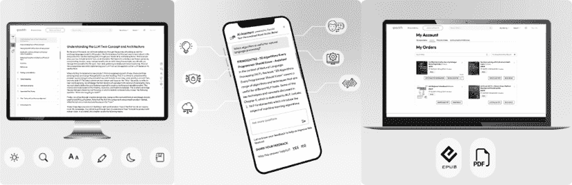

使用我们的下一代阅读器获得增强阅读体验：

 **多设备进度同步**：通过任何设备学习，并实现无缝进度同步。

 **高亮和笔记**：将您的阅读转化为持久的知识。

 **书签**：随时回顾您最重要的收获。

 **深色模式**：通过切换到深色或褐色模式，以减少眼睛疲劳保持专注。

使用我们的 AI 助手（测试版）更智能的学习：

 **总结**：总结关键章节或整个章节。

 **AI 代码解释**：在下一代 Packt Reader 中，点击每个代码块上方的 `Explain` 按钮获取 AI 驱动的代码解释。

**注意**：AI 助手是下一代 Packt Reader 的一部分，目前处于测试阶段。

随时随地学习：

  使用无 DRM 的 PDF 和 ePub 版本离线访问内容——兼容您喜欢的电子阅读器。

# 解锁您书籍的独家福利

您的书籍副本包含以下独家福利：

 下一代 Packt Reader

 AI 助手（测试版）

 无 DRM 的 PDF/ePub 下载

如果您尚未解锁，请按照以下指南进行解锁。该过程仅需几分钟，只需操作一次。

# 如何通过三个简单步骤解锁这些

## 第 1 步

扫描此二维码或访问 [packtpub.com/unlock](https://packtpub.com/unlock)，然后按名称搜索本书。确保版本是正确的。

| **注意**：在开始之前请准备好您的购买发票。 |

## 第 2 步

登录您的 Packt 账户或免费创建一个新账户。登录后，上传您的发票。可以是 PDF、PNG 或 JPG 格式，大小不得超过 10 MB。按照屏幕上的剩余说明操作。

## 第 3 步

如果您遇到困难并需要帮助，请访问 [`www.packtpub.com/unlock-benefits/help`](https://www.packtpub.com/unlock-benefits/help) 查看有关查找发票等问题的详细常见问题解答（FAQ）。以下二维码将直接带您进入帮助页面：


`Artificial intelligence`（`AI`）指的是旨在增强人类智能的计算机系统，通过自动化复杂任务、分析海量数据以及辅助决策过程来提供提高生产力的工具。`Large language models`（`LLMs`）是一种先进的 AI 应用，能够理解并生成类人类的文本。这些模型基于机器学习的原理运行，通过处理和转换海量数据集来学习人类语言的细微差别。`LLMs` 的一个关键特性是能够生成连贯、听起来自然的输出，这使其成为构建从自动化客户支持到内容生成等各种应用的重要工具。

`LLMs` 是 `natural language processing`（`NLP`）领域中模型的一个子集，而 `NLP` 本身是 `AI` 的一个关键领域。`NLP` 领域致力于弥合人类交互与计算机理解之间的差距，允许人机之间的无缝交互。`LLMs` 处于这一领域的前沿，因为它们能够处理大量需要深度理解语言的任务，例如回答问题、总结文档、翻译文本甚至创建原创内容。

与现代 `LLMs` 关联最紧密的架构是 transformer 架构，如图 2017 年发表的论文《Attention is All You Need》中的图 1.1 所示。该架构利用称为 `attention layers` 的机制对输入数据的所有部分的相关性进行不同的加权，这与以往按顺序处理输入的基于序列的模型有显著区别。

这使得 `LLMs` 在类对话场景中具有更强的上下文感知和响应能力。

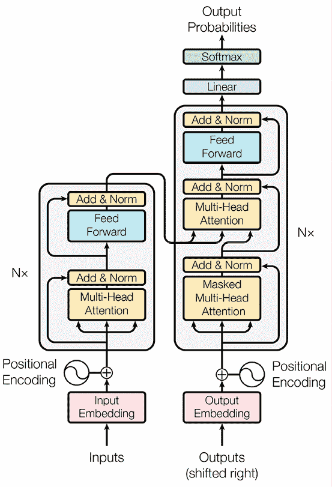

Figure 1.1: transformer 模型架构。图片致谢: 1706.03762（[arxiv.org](https://arxiv.org)）

本章的主要目的是深入研究快速变化的 `LLMs` 世界。我们将探索这些模型的历史演变，追溯它们从基础的统计方法到我们今天看到的复杂系统的起源。这段历程将重点介绍显著影响其演进的关键技术进展。从早期能够计算词频和识别文本中基本模式的简单算法开始，我们将看到这些方法如何为更复杂的方法奠定基础。

随着学习的进行，我们将讨论机器学习技术的引入，这些技术允许计算机从数据中学习并改进其文本预测。最后，我们将深入探讨导致现代 `LLMs` 产生的突破性时刻，例如神经网络的使用和 transformer 架构的发展。通过理解这段历史，我们可以更好地体会 `LLMs` 已经走了多远，以及它们对未来拥有的潜力。它也为你在本书其余部分将学习的所有内容奠定了基础。

在本章结束时，你应该对以下内容有的理解：

- `language models`（`LMs`）的历史背景和技术进展
- 训练像 ChatGPT 的 `LLM` 助手的通用方案及其不同阶段
- 这些模型目前的生成能力和局限性

让我们通过探索 `LMs` 的历史背景和演变开始本章，特别是解决一个常见的误解，即这些模型是 OpenAI 专门发明的近期创新。

# 语言模型的历史背景与演变

关于 `LMs` 有一些常见的误解，特别是认为它们是由 OpenAI 发明的观点。然而，`LMs` 的想法只有几年的历史；它已经有几十年的历史了。如图 1.2 所示，某些 `LMs` 背后的概念非常直观；给定一个输入序列，模型任务就是预测下一个 token：

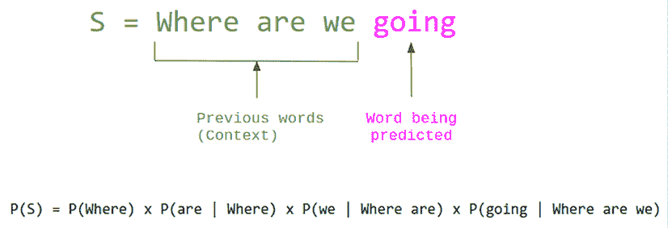

Figure 1.2: LMs 和给定前序词（上下文）的下一个 token 预测

要真正欣赏现代 `LMs` 的复杂性，探索其历史演变以及它们从中汲取灵感的各种学科，一直到我们目前正在见证的近期变革性发展是至关重要的。

## 早期发展

`LMs` 的起源可以追溯到几十年前，源于 `NLP` 统计模型的基础性工作。早期的 `LMs` 主要利用基础统计方法，例如 n-gram 模型。这些模型简单但具有开创性，为更复杂的系统提供了基础。

在 20 世纪 50 年代和 60 年代，重点是开发能够执行语言自动翻译和信息检索等任务的算法，这些任务本质上是基于语言处理和理解的。这些早期的努力为后续计算语言学的进展奠定了基础，导致了 20 世纪 70 年代和 80 年代第一波 `rule-based systems` 的出现。这些系统试图将语言的语法和逻辑规则编码到软件中，旨在实现更结构化的语言理解方法。

## 随时间的演变

随着互联网的诞生和数据收集的增加推动数据集的增长，基于规则系统的局限性变得显而易见。这些系统在可扩展性、泛化和灵活性方面面临困难，导致了 20 世纪 90 年代和 21 世纪初向基于机器学习的方法的关键转变。在此期间，如决策树和 `Hidden Markov Models`（`HMMs`）等机器学习模型开始主导该领域，因为它们能够从数据中学习语言模式，而无需显式地编写语法或句法规则。

尽管神经网络被认为是一种强大的工具，但它们的实际应用最初受到计算限制的限制。直到 21 世纪 00 代中后期，随着计算能力的显著提高，构建更大、更复杂的神经网络才变得可行。这种计算的进步，结合日益可用的大型数据集，使得多层神经网络的发展成为可能，从而催生了驱动今日 LLMs 的现代深度学习技术。这些模型在语言任务中提供了更强的适应性和准确性，改变了 `NLP` 的格局。

机器学习引入语言建模在 21 世纪 10 年代发展为深度学习技术，特别是 `Recurrent Neural Networks`（`RNNs`）、`Long Short-Term Memory` 网络（`LSTMs`）和 `Gated Recurrent Units`（`GRUs`）的出现。

这些架构更适合处理序列（如句子和段落），因为它们可以长时间记忆信息，这是理解文本上下文的关键要求。图 1.3 显示了这些序列模型及其架构演进：

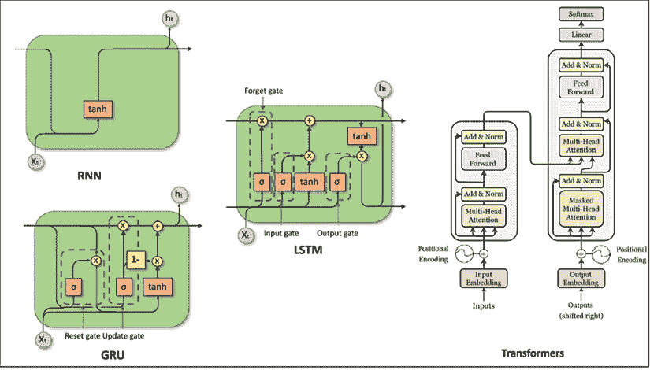

正如我们在之前的几个节中提到的，真正的突破出现在 2017 年 transformer 模型的出现，它通过使用自注意力机制彻底改变了语言模型（`LMs`）。与早期的模型（如 `RNNs` 和 `LSTMs`）不同，后者按顺序处理文本且在处理长距离依赖时经常遇到困难，而 transformers 可以同时处理句子中的所有单词。这种并行处理能力使得 transformers 能够评估并优先考虑句子或文档中各种单词的重要性，无论它们的位置如何。这种创新使得对文本的理解和生成更加细致，允许 transformers 能够更有效地捕捉上下文和单词之间的关系。自注意力机制还使得在大型数据集上进行训练以及利用并行计算资源变得更容易，从而显著提升了性能和可扩展性。这种架构是当今大语言模型（`LLMs`）的基础，包括 OpenAI 的生成式预训练转换器系列，代表了相比以往模型的重大进步。

虽然`生成式预训练转换器`（`GPTs`）是 LLM 的一种，也是生成式人工智能的一种突出框架，但 `LLM` 是一个更广泛的术语，涵盖了任何训练以理解和生成人类语言的大型神经网络；而 `GPTs` 特指基于 transformer 架构的模型。`GPTs` 在未标记文本的大型数据集上进行预训练，并能够生成新颖的人类内容。OpenAI 于 2018 年引入了 `GPT` 系列，通过顺序编号的模型不断演进，由于规模的增加和训练的加强，每个模型都显著优于前一个模型。这些模型是特定任务 GPT 系统的基础，包括用于遵循指令的微调模型，这些模型驱动了如 `ChatGPT` 等服务。

## 计算能力的进步与数据可用性的增加

当我们探索语言模型（`LMs`）的历史演变时，承认计算能力的进步和可用数据的扩展所起的重要作用是至关重要的。在过去的几十年里，这两个驱动因素在增强 `LMs` 的复杂性和能力方面起了关键性作用。让我们逐一查看。

### 计算能力的进步

计算能力的增加，特别是通过开发更强大的 `CPUs` 和 `GPUs`，让研究人员和开发人员能够训练具有数百万甚至数十亿参数的大型模型。这些高性能处理器可以在比以前短得多的时间内完成训练深度学习模型所需的海量计算。这对于实验深层神经网络和 transformers 等复杂架构至关重要，这些架构需要大量的计算资源才能有效训练。

### 大型数据集的可用性

与硬件改进并行的，数字时代见证了可用数据量的指数级增长。互联网已成为文本数据的宝库，从书籍、文章到博客和社交媒体帖子。这些海量数据为训练 `LMs` 提供了多样化且广泛的数据集。通过从广泛的语言使用和场景中学习，模型可以更好地预测和生成类人类的文本，捕捉语言中以前难以实现的细微差别和变化。

这些计算和数据资源共同推动了更先进的 `LMs` 的发展，这些模型不仅更准确，而且更有上下文感知能力。这种进步支持了广泛的应用程序，从简单的自动响应到能够在长时间交互中保持连贯且符合语境对话的复杂对话系统。

## LLMs 以及将用户界面转换为自然对话

在 `LLMs` 时代之前，用户与 `LMs` 的交互方式存在一个重大问题，主要是用户界面不够直观或用户友好。从前，人们与这些模型通信的方式是有限的。

`LLMs` 真正改变游戏规则的是用户界面和指令数据集的改进，如 `Figure 1.4` 所示（为了清晰起见，文本 `Instructions fine-tuned on many tasks` 下方的文本框是可能构成指令数据集的示例）。这种转换允许普通用户以一种自然的方式与 AI 驱动的助手进行交互，就像与另一个人类对话一样。

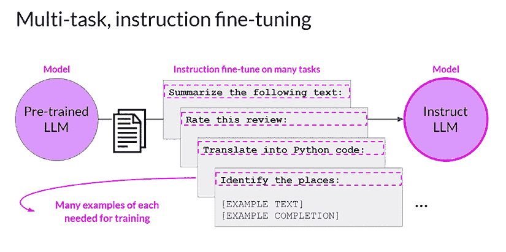

图 1.4：使用指令数据修复 LLM 界面

这是实现的：

- **直观的提示（Intuitive prompts）**：新方法涉及以特定的、类人类的方式提示模型。这意味着你可以用自然语言向模型提问或给它下命令，它会生成文本响应来回答用户的查询。这就像是教模型根据简单的线索或问题开始对话。

- **指令微调（Instruction fine-tuning）**：这一步涉及根据特定的指令或修正来调整模型。基本上，你通过提供你期望的示例来帮助模型更好地理解任务。这不需要技术知识；就像给正在学习新技能的人提供反馈一样。

- **简化对齐（Simplified alignment）**：使用了一种名为`来自人类反馈的强化学习`（`RLHF`）的方法来更好地使 `LLMs` 与人类预期对齐。通过使用 `RLHF`，直接从人类交互中收集输入。标注者提供理想响应的示例，并根据这些提示对 `LLMs` 生成的输出进行评分。这些反馈随后用于微调模型，增强其产生更有帮助内容的能力。

最初，`FastText`、`GloVe` 和 `Word2Vec` 等模型将词表示为高维空间中的向量，根据它们在大型文本语料库中的共现情况捕捉语义和语法相似性。这些嵌入提供了词的静态表示，成为许多早期 NLP 应用的骨干。

## transformers 的突破

2017 年 `transformer` 架构的引入标志着语言模型（`LM`）设计的重大转变。与前任模型不同，transformers 利用了一种名为自注意力（self-attention）的机制来衡量句子内不同单词的影响，无论其位置如何。这种架构允许模型捕捉复杂的词与关系和依赖关系，显著提升了它们理解上下文和含义的能力。

## 预训练模型的兴起

在 `transformer` 架构的基础上，OpenAI 的 `GPT` 系列和 Google 的 `BERT` 等预训练模型通过从海量文本中学习通用模式彻底改变了 `NLP`。这些模型随后可以针对特定任务进行微调，在摘要、问答和语言翻译等领域达到顶尖水平。

## 多模态及未来

`LLM` 架构的最新演进涉及多模态能力的整合，如 `Figure 1.6` 所示。模型不再限于处理文本；它们现在可以理解并生成各种形式的信息，如图像、音频和视频。例如，由 OpenAI 发明的 `DALL-E` 扩展了 `GPT-3` 架构以根据文本描述生成图像，展示了 `LLMs` 的创意潜力。

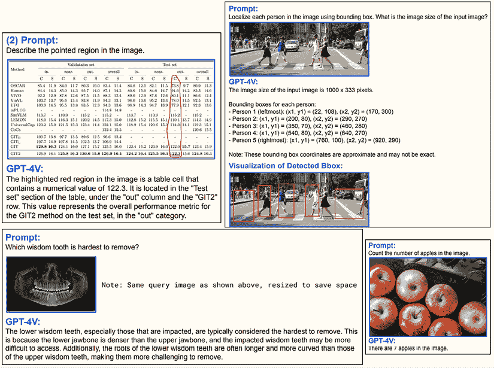

图 1.6：多模态

## 专家混合 – 语言模型的革命

专家混合（`Mixture of Experts`）的概念已成为 `LM` 架构领域的重大突破，其在 Mistral 的 `Mixtral8x7b` 等知名模型中的应用尤为突出。让我们来看看 `MoE` 是什么以及它是如何工作的。

### MoE 的核心概念

`MoEs` 通过引入稀疏性和专门化处理，代表了神经网络架构的范式转变。这种架构通过根据输入数据仅激活网络的相关部分（被称为“专家”）来优化计算资源。每个专家专门负责数据的不同片段，就像专攻特定学科的老师。

### MoE 的构建模块

`MoE` 的基本元素包括：

- `Sparse MoE layers`：这些层取代了传统的稠密前馈网络并包含一组专家。

- `Gate network or router`：它决定哪些输入 token 由哪些专家处理。这种结构增强了模型的效率，与具有相似参数的稠密模型相比，显著加快了训练和推理速度。

### 历史背景与发展

`MoEs` 的概念并不新，可以追溯到 Robert 等人 1991 年发表的论文《Adaptive Mixture of Experts》。多年来，该领域的发展已从简单的集成技术演变为能够处理海量且多样化数据集的复杂分层结构。

### 实际应用与未来方向

如今，`MoEs` 是一些最广泛使用的 `LLMs` 训练中不可或缺的一部分，提供了一种可以处理日益复杂任务的可扩展解决方案。它们还被探索用于 NLP 之外的领域，例如计算机视觉。`MoEs` 标志着向更动态、更高效、更强大的机器学习模型迈出的重要一步。随着我们不断突破 AI 所能实现的边界，`MoEs` 在让 AI 更易获取和更可持续方面发挥着关键作用，为可能改变社会每个部门的未来创新铺平了道路。

既然我们已经观察到 LLM 领域的快速进展和演变，以及在短时间内发布的大量 LLM（如 LLM 进化树所示），让我们探索用于训练大多数如 `ChatGPT` 等 GPT 助手的通用训练配方。我们将检查它们如何通过此训练配方的各个阶段，最终转变为具有增强交互界面的可部署助手。这种开发允许了自然的、无模板的交互，而不需要使用复杂的命令来让 LLM 执行特定任务。

# GPT 助手训练配方

在深入研究像 `ChatGPT` 的 GPT 助手是如何开发的具体细节之前，理解训练这些高级 LM 所涉及的基础元素和方法至关重要。这是因为这里涉及的许多步骤在随后的微调步骤中也有体现，因此理解这些步骤可以帮助你更清楚地了解如何更好地准备你的业务数据以集成到 LLM。该过程包括几个阶段，每个阶段都对模型理解和生成类人文本的能力做出贡献。

`Figure 1.7` 概述了用于开发 `ChatGPT` 等 GPT 助手的标准训练配方。该过程分为四个不同的阶段，将 transformer 神经网络演变为能够生成深层类人文本的高级 AI。理解训练此类模型的过程对于有效理解每个阶段使用的数据类型，以及使用你的领域特定数据微调此类模型可能需要什么至关重要。

最初，这些模型是从能够补全文本的基础模型开始的。但通过一系列额外的训练阶段，它们演变为能力极强的助手，可以生成有用且适当的类人文本。这种演变涉及几个关键阶段：

1. 使用互联网规模的数据创建基础模型。
2. 通过监督微调对其进行精炼。
3. 通过奖励模型进一步增强。
4. 通过强化学习进行最终优化。

每个阶段的设计旨在提高模型的性能及其对现实任务的适应性。

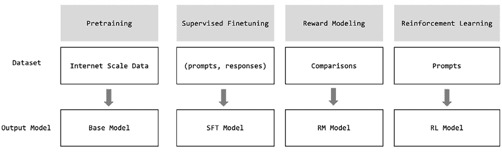

图 1.7：GPT 助手的训练阶段

让我们从第一个也是计算最密集的阶段开始，即从互联网规模数据构建基础模型。

## 构建基础模型

训练 `GPT` 等 LLM 的第一阶段是创建一个稳健的基础模型。这一基础阶段是模型开发过程中计算最密集、资源需求最高的部分。在这里，我们将该阶段分解为几个关键组件并进行详细讨论。

### 数据收集与组

旅程始于收集海量的文本数据。对于 `GPT-3` 及其后续版本以及 `Llama` 系列等 LLM，这通常涉及汇总来自各种来源的数据集，如 `CommonCrawl`、`Wikipedia`、书籍以及更专业的 GitHub 或交易所存档。这种多样化的数据集确保了模型接触到广泛的语言场景和领域。

`Figure 1.8` 显示了旨在开发具有全面语言理解的数据集的策略组成。通过在如此多样化的文本上训练，LLM 能够很好应对各种任务，从回答问题到生成创意内容以及解释技术文档。

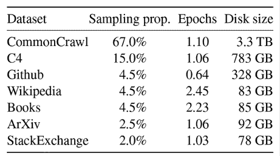

图 1.8：用于训练 Llama 模型的数据（来源: LLaMA: Open and Efficient Foundation Language Models）

分词（Tokenization）是将原始文本分割为较小单元（称为标记，tokens）的过程。这通常使用如 `Byte Pair Encoding`（`BPE`）之类的算法来实现，该算法通过迭代组合最常见的字符或子词对，直到达到特定的词汇表大小。这种方法确保了常用单词或短语保持完整，而较不常用的词汇则被分解为更小的单元，从而优化了模型处理和理解广泛文本的能力。

分词之后，每个标记都会被分配一个唯一的整数。这一步将文本数据转换为整数序列，使其适用于需要数值输入的神经网络模型进行处理。这种映射是直接的：每个不同的标记都对应预定义列表中的唯一数字，构成了模型的词汇表。

图 1.9 展示了这分两步的分词阶段：

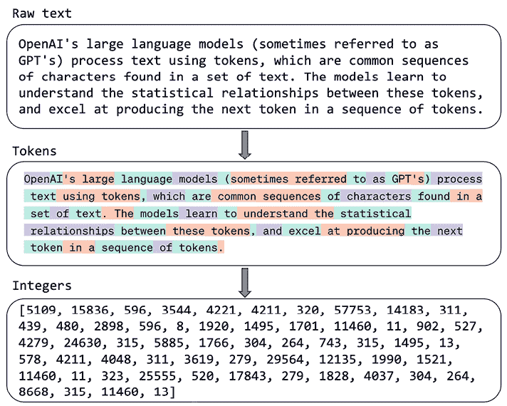


图 1.9：使用 OpenAI 分词工具分词

## 模型配置

设置正确的超参数对于训练成功的基础模型至关重要。超参数是用于控制模型训练过程的配置设置，并可以显著影响其性能。超参数包括：

- **词汇表大小：** 指模型能够识别的唯一标记（单词、子词或字符）的数量。通常，词汇表大小在几万个标记之间。较大的词汇表允许模型理解和生成更多样化的文本，但也增加了计算复杂性。
- **上下文长度：** 这是模型在进行预测时考虑的文本序列长度。现代大语言模型（LLMs）处理的序列从 2,000 到 1,000,000 个标记不等。例如，Google 的 Gemini 1.5 Pro 是第一个发布的具有 1,000,000 标记上下文窗口的大模型。更长的上下文长度允许模型捕捉文本中更多的上下文和依赖关系，从而提高输出的质量，但需要更多的内存和处理能力。

模型架构细节是另一个考虑因素。它们包含几个关键组件：

- **Transformer 层数：** 这决定了模型的深度。更多的层通常允许模型学习更复杂的模式，但也会增加训练时间和计算需求。
- **注意力头数：** 注意力头是自注意力机制的一部分，它使模型能够关注输入序列的不同部分。更多的注意力头可以提高模型理解数据中复杂关系的能力。
- **每层的大小：** 指每层中神经元的数量。较大的层可以捕捉更多信息，但需要更多的计算资源。

通过仔细细调这些超参数，企业可以针对特定任务和数据集优化模型的性能。合理选择超参数可以显著提高模型理解和生成类人文本的能力。

## 计算需求

训练像 `GPT-3` 或 `LLaMA` 这样的大语言模型需要大量的计算资源分配，通常涉及数千个 GPU 持续运行数周。这一阶段消耗了大部分计算预算，通常花费数百万美元。

### 训练过程

实际的训练过程涉及将分词后的文本分批输入模型，并根据其预测准确性调整模型参数。模型通过理解同一行中出现在其之前的标记所提供的上下文，学习生成序列中的下一个标记。这种训练是迭代的，随着模型处理更多数据，它的预测结果会变得越来越准确。

## 构建基础模型回顾

将预训练过程想象成通过向某人展示例句来教他们一种新语言。现在我们已经详细地了解了这一点，这里有一个简单的方法来记住在这个阶段发生了什么：

1. **将文本分解为碎片：** 首先，我们获取大量的书文本（如书籍、文章等），并将其分解为更小的碎片，我们称之为"标记"。这些标记就像单个单词或单词的一部分。
2. **词汇表大小：** 想象每个标记都是字典中的一个单词。在我们的模型训练中，我们可能有一个包含 50,257 个不同单词或词碎的字典（词汇表）。这个数字代表了模型用于理解和生成语言的所有可能的标记。
3. **组织这些碎片：** 然后我们将这些标记组织成批次（batches），就像将它们分成不同的托盘，每个托盘包含按特定顺序排列的特定数量的标记。我们不是逐个处理单个标记，而是分批地处理一组标记。如表 1.1 所示，我们决定一次处理 5 行，每行包含 10 个标记，这就是我们的上下文长度。这种分批过程允许在训练期间进行更高效的计算和更好的资源利用。

| | 1 | 2 | 3 | 4 | 5 | 6 | 7 | 8 | 9 | 10 |
|---|---|---|---|---|---|---|---|---|---|---|
| 1 | 20 | 305 | 45 | 100 | 856 | 34 | 2 | 901 | 99 | 1 |
| 2 | 5 | 421 | 32 | 900 | 401 | 310 | 2 | 702 | 98 | 1 |
| 3 | 80 | 209 | 76 | 11 | 31 | 64 | 2 | 52 | 55 | 1 |
| 4 | 90 | 55 | 7 | 2 | 801 | 305 | 201 | 450 | 901 | |
| 5 | 208 | 17 | 209 | 43 | 89 | 12 | 404 | 67 | 901 | |

表 1.1：构建基础模型的训练批次

4. **向模型输入：** 然后将这些批次输入神经网络 `transformer`，它设计用于学习语言模式。系统查看每个批次，并尝试根据它所观察到的内容预测下一个单词（或单词碎片）。

在训练过程中，模型通过监督学习的方式学习预测下一个单词。每个单元只能看到它所在行中的单元以及它之前的单元，这意味着它无法访问未来的单词。为了训练模型，我们对每行的末尾某些单词进行掩码处理，使其成为模型预测的目标输出。然后将模型的预测与这些掩码标记进行比较，计算预测与实际单词之间的差异（误差）。这种差异通常被称为 `loss`，在多次训练迭代中被最小化以提高模型的准确性。通过不断减少这种差异，模型学会生成更准确、连贯的文本。

一旦模型训练完成，可以向它展示单词序列，然后让它生成序列中的下一个单词，如图 1.10 所示。这个预测的单词随后被注入输入序列。输入移动一个单词，模型刚刚预测的单词现在变成了预测下一个单词的输入。此过程不断重复，直到生成结束标记或达到文本限制（例如 4096 个标记）。

这种标记生成类型——每个单词都是根据先前的语境（之前的单词）生成的——是自回归生成模型的特征。在这些模型中，每个新标记都是通过对已生成的标记序列产生的，这使得它们对于需要顺序预测的任务（如文本生成和语言建模）非常有效。

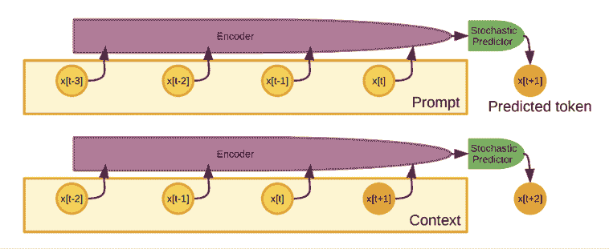

图 1.10：自回归生成模型

## 1. 预测下一个标记 (token)

在训练过程中，模型会根据其看到的上下文，在其词表大小范围内对下一个标记生成概率分布。例如，如果模型正在查看标记"dog"并试图预测接下来的内容是什么，它会计算每个可能的标记（来自其包含 50,257 个标记的词典）成为下一个单词的概率。

如表 1.2 所示，深灰色单元格突出了一个随机选取的单元格，而浅灰色单元格则是它用于预测序列中随机选取单元格之后的目标下一个标记的上下文。

| | 1 | 2 | 3 | 4 | 5 | 6 | 7 | 8 | 9 | 10 |
|---|---|---|---|---|---|---|---|---|---|---|
| 1 | 20 | 305 | 45 | 100 | 856 | 34 | 2 | 901 | 99 | 1 |
| 2 | 5 | 421 | 32 | 900 | 401 | 310 | 2 | 702 | 98 | 1 |
| 3 | 80 | 209 | 76 | 11 | 31 | 64 | 2 | 52 | 55 | 1 |
| 4 | 90 | 55 | 7 | 2 | 801 | 305 | 201 | 2 | 450 | 901 |
| 5 | 208 | 17 | 209 | 43 | 89 | 12 | 404 | 67 | 2 | 901 |

表 1.2: 高亮显示目标和上下文的训练批次

此批数据将被输入 Transformer 模型，模型将生成下一个标记，如图 1.11 所示：

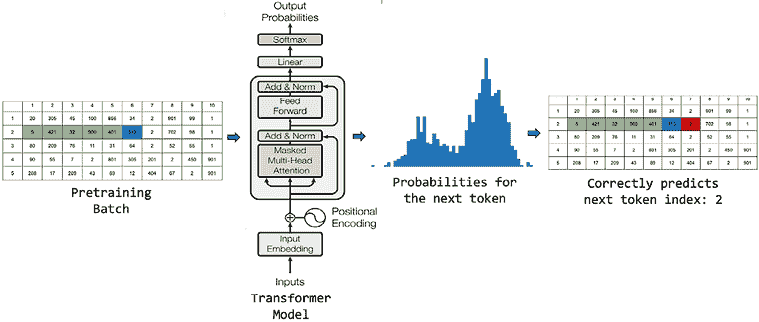

图 1.11: 基础模型的预训练步骤

## 2. 从错误中学习

当 Transformer 进行预测时，它会检查自己的猜测是正确还是错误。如果是错误的，它会调整自身以在下次更加准确。这种调整就像是一点点微调它的理解。

## 3. 重复这一过程

这个过程会在许多不同的标记批次中重复，逐渐帮助 Transformer 变得更擅长预测。这就像反复练习语言，从简单的短语开始到更复杂的句子。

## 4. 随着时间变得越来越聪明

随着时间的推移，在看到了数百万个示例之后，Transformer 学习到了一种稳健的使用语言的方法。它能够理解并生成有意义的文本，这一切都是通过学习它在训练阶段观察到的模式实现的。

### 结果——预训练基础模型

经过几个月的训练后，结果是一个能够稳健使用语言的模型。通过学习训练阶段观察到的模式，它变得能够理解并生成有意义的文本。

### 结果——一个训练过的奖励模型

奖励模型本身不生成响应，而是评估由主语言模型（LM）生成的响应质量。它充当裁判的角色，通过提供未来交互中哪些类型的响应更有可能，引导主模型的学习过程。

## 强化学习阶段

GPT 助手训练方案中的第四阶段是`reinforcement learning`（`RL`），它利用了之前阶段建立的基础：预训练、监督式微调和奖励建模。这一阶段对于完善模型至关重要，使其能够产生符合特定性能指标的高质量、符合上下文的响应。

强化学习阶段的主要目标是根据前一阶段开发的奖励系统，对语言模型的响应进行微调。这样做是为了最大化模型生成根据既定奖励标准被认为具有"高质量"的响应的概率。

### 奖励模型的整合

在上一个阶段中训练的奖励模型会评估语言模型生成的响应质量。这些评估被用于指导强化学习过程。

从本质上，奖励模型为每个响应提供一个"分数"或反馈，指示其与预期结果的对齐程度。

### 训练过程

在强化学习期间，语言模型针对同一个提示（prompt）生成多个响应。

每个响应都由奖励模型评估，奖励模型根据预设的标准（例如相关性、连贯性、安全性）分配分数。

然后更新语言模型，以增加未来生成获得更高分响应的概率。

### 优化技术

此阶段使用的常用技术涉及根据反馈调整模型的响应以提高质量。通过迭代完善模型，这些技术确保了模型在生成所需输出方面变得更加有效。

### 结果——一个强化学习模型

该阶段的结果是一个模型，它不仅理解语言的通用结构（来自预训练）并能够生成符合上下文的响应（来自监督式微调），而且擅长提供符合特定质量标准的响应。这种模型通常更加精炼，并且更符合用户预期和现实世界的应用。

现在我们已经讨论了用于训练 GPT 助手的常用训练方案，包括每个阶段所需的各种数据和计算需求，直到获得一个可用于用户交互的`instruct model`。此时，强调围绕大语言模型（LLMs）的一些现实情况和误区，并评估这种影响巨大的变革性技术是否真的代表了 AI 行业的"iPhone 时刻"至关重要。

# 解码大语言模型的现实与误区

像 OpenAI 的 GPT 系列等大语言模型已经在科技界及海外引发了广泛的兴趣和争论。虽然它们通常被视为突破性的进展，但关于它们的能力和起源，存在许多误解和夸大的言论。本节旨在通过解决常见的误区并检查其在现实世界的应用和局限性来澄清这些误解。

从早期的统计基础到我们今天看到的复杂的神经网络，正如你在本章前面的部分所看到的，语言模型的演变是一个协作且渐进的过程，这与"它们突然从某位创新者或机构中出现"的观点相反。

我们将开始讨论阿达·洛夫莱斯（Ada Lovelace）的深刻见解，这些见解在理解这些模型的本质属性方面仍然具有深远的意义，同时也伴随着其卓越能力而来的局限性。

## 阿达·洛夫莱斯的见解

阿达·洛夫莱斯（图 1.12）被誉为第一位计算机程序员，他对计算机器的本质提供了早期且深刻的见解，这些见解在今天关于人工智能（特别是大语言模型）的讨论中仍然具有意义。在她 1843 年对查尔斯·巴贝奇的分析机的笔记中，洛夫莱斯指出机器"没有发明任何东西的企图"，只能执行"我们知道如何命令它执行的一切"。这一观察强调了计算系统的一个根本局限性：它们的操作依赖于人类的输入，以及它们创造力的边界。

在检查当前大语言模型的能力和局限性时，洛夫莱斯的断言尤为贴切。尽管它们能够生成看似具有原创性和富有见解的文本，但这些模型从根本上限于对其训练数据中的现有信息进行操纵和重新组合。它们不具备在训练数据范围之外创造真正新颖想法或概念的能力。这一特征与洛夫莱斯的观点高度一致，强调了人类认知能力与机器操作之间的关键区别。


图 1.12：阿达·洛夫莱斯

## 简单任务中的失败

虽然 `GPT-4` 等大语言模型生成类人文本的能力令人印象深刻，但如图 1.13 所示，它们在看似简单的任务上的表现往往揭示了显著的局限性。这些失败支持了阿达·洛夫莱斯的观点，即机器不能自己发明事物，并说明了当前 AI 系统的内在局限性。

例如，大语言模型处理需要基本常识或人类通常认为轻而易见的现实世界知识的任务可能会遇到困难。一种常见的失败模式是对简单问题生成听起来合理但事实错误或荒谬的答案，例如误解对象的物理属性（例如，"老鼠能吃掉整辆汽车吗？"可能会得到一个不会立即否定这种不可能性的回答）。这些错误源于模型对数据模式的依赖，而不是对世界的真实理解。


图 1.13：大语言模型在简单任务中的失败

这些例子强调了开发像人类一样理解并与世界交互的 AI 系统的挑战，实现了实现真正的智能系统方面存在的差距。

## 与人类智能相比的局限性

语言模型（特别是许多 AI 系统使用的自回归类型）是强大的工具，可以预测文本序列中的下一个单词。然而，这些模型有几个重要的局限性，影响了它们的使用方式以及可以有效执行的任务类型。让我们现在来看其中的一些：

- 错误随时间增加：想象你正在尝试预测句子中的下一个单词，每当你尝试时，都有很小的概率会出错。当你继续预测更多单词时，这些微小的错误率就会累积，出错的概率就会增加。这意味着你想要生成的文本越长，错误渗透的可能性就越高。这就像蒙着眼睛尝试沿直线行走；走得越远，就越容易偏离路线。
- **固定的思维过程：** 当 AI 模型创建文本时，它们是逐个单词生成的，并且为每个单词使用固定数量的计算能力。这就像在对话中只有几秒钟来思考下一个该说哪个词，无论话题有多复杂。如果我们想让模型对下一个词进行更努力或更深层次的"思考"，我们不能简单地告诉它这样做；只能让它生成更多的单词，这是试图获取更深层思考的一种迂回方法。这种固定的过程限制了模型的规划或预判能力。
- **缺乏真正的规划：** 这些模型并不进行规划；它们根据训练期间见过的过去示例做出反应。如果它们看起来在制定一个计划，通常是因为它们以前见过非常相似的情况，并在模仿那种反应。


# 对世界的理解有限

语言模型（`LMs`）是在文本数据上进行训练的，这意味着它们只知道用文字可以表达的内容。然而，人类的大部分知识和日常经验并不能完全通过文字来捕捉。例如，知道如何骑自行车、游泳或识别朋友的面部涉及到感官和运动技能，这些技能是无法仅通过文本学习到的。这意味着虽然 AI 可以帮助写作和构思（如克服写作障碍），它在处理需要深层事实知识或对世界物理理解的任务时却力不从心。

# 高估 AI 的智能

这些模型可以产生流畅且语法正确的文本，这让人们很容易相信它们比实际要智能得多。然而，它们的智能能力是肤浅的。它们无法真正理解世界的运行方式，这意味着我们离在广义上能够媲人类智能的 AI 仍然很远。

# 目标驱动型 AI

由 AI 鼻驱 Yann LeCun 提出的目标驱动 AI 概念（如图 `Figure 1.14` 所示）代表了走向更高级的人工智能形式的潜在路径，可能通向`通用人工智能`（`AGI`）。这种方法专注于设计 AI 系统，使其能够在复杂环境中通过学习和规划来实现特定目标，从而超越仅仅的模式识别，整合推理、规划和决策的元素。

LeCun 认为，AI 若要达到通用智能水平，必须具备学习世界模型的能力，使其能够预测和操纵环境。这不仅涉及根据学习的数据对输入做出反应，还要主动寻求信息并学习因果关系，从而对其周围环境产生更深刻、更具可操作性的理解。

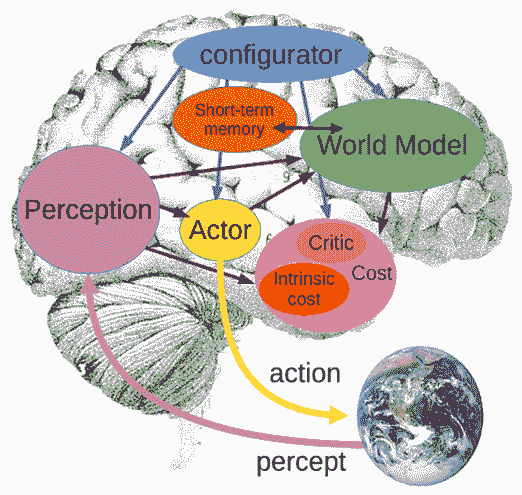

图 1.14: Yann LeCun 的目标驱动 AI

# 人机增强

从历史上看，技术的发展受到增强人类能力的愿望驱动（如图 `Figure 1.15` 所示）、减少劳动并解决复杂问题。从轮子的的发明到互联网的创造，技术进步旨在扩展人类的物理和认知范围。

在 AI 和大语言模型（`LLMs`）的背景下，许多开发者的主要目标是增强人类能力而非取代它们（无论媒体或政策制定者经常呈现的悲观情绪如何）。AI 系统越来越多地用于增强决策过程、自动化常规任务，并提供由于数据量或复杂性而超出人类能力范围的洞察。

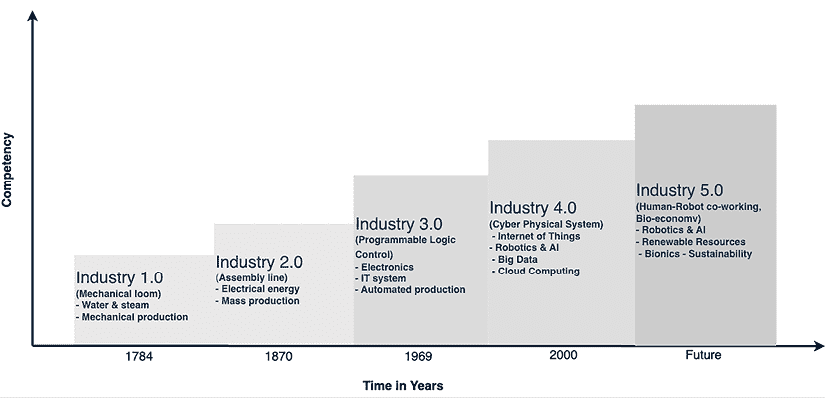

图 1.15: 人机增强

本节探讨了关于 `LLMs` 的常见误区和现实，特别是某些政策制定者如何利用所谓的 AI 生存风险和 AI 接管世界的观点作为政策制定者和决策者的注意力转移物。这些担忧在很大程度上是基于传言，因为我们目前缺乏实现 `AGI` 的理论和算法基础。

尽管 `LLMs` 具有变革性的应用并出现了许多实用的应用，但目前的 `LLMs` 由于其自回归本质，与人类智能相比仍然非常原始，并且在简单任务上失败。例如，当一个人说话并在句子中出错时，他们通常会识别出错误并纠正，因为他们理解言语背后的意图以及想要传的整体目标。相比之下，`LLMs` 可能会放大错误；如果生成的 token 是错误的，它会影响后续的 token，往往导致复合错误。

# 总结

在本章中，我们开启了对 `LLMs` 的探索，深入研究了它们的历史背景、当前能力以及围绕这些强大工具的常见误区。这段探索 `LLMs` 发展的历程不仅凸显了塑造这些模型的技术突破，还指明了未来的发展方向和面临的挑战。

`LLMs` 使用自回归方法，通过考虑之前的单词来预测序列中的下一个单词，但这种方法具有局限性。例如，随着序列的变长，错误的概率会增加，因为每次预测都带有随时间累积的错误概率。尽管它们具有令人印象深刻的流畅性，但 `LLMs` 无法像人类那样真正规划或理解上下文，产生的响应往往是学习数据的重新组合，而没有真正的洞察。这是由于它们的训练局限于现有文本，这阻止了它们生成新颖内容或完全掌握学习模式之外的上下文。

关于 `LMs` 也存在一些误区，例如认为 OpenAI 的 GPT 模型标志着 `LMs` 的发明，尽管 `LM` 的比比这些模型早了几十年。

展望未来，`LLMs` 的未来不仅在于增加它们的规模，还在于增强它们的效率和有效性。诸如模型压缩等技术预计将使 `LLMs` 更具易用性和可持续性。此外，向多模态能力的推动以及提高模型推理和常识理解的改进将扩展它们的适用性。

随着 `LLMs` 越来越整合到各种应用中，伦理考量至关重要。解决隐私、虚假信息和模型输出中的潜在偏差等问题是关键。部署这些技术时采取平衡且伦理的方法对于减轻潜在负面影响并确保负责任的使用是必要的。

在下一章中，我们将深入研究 `LLMs` 的企业级应用以及在大规模部署这些模型时面临的挑战。这一讨论是本书的核心，因为应对这些挑战以及部署 `LLMs` 相关的技术债对于希望有效利用这项技术的业务至关重要。

我们将探索 `LLMs` 如何在不同行业中被用于提高效率、增强客户互动和驱动创新。此外，我们将讨论在业务环境中实施 `LLMs` 时需要克服的技术和运营障碍，包括扩展性、集成和用户采用问题。我们还将涵盖管理部署大型模型所带来的复杂性和持续维护的策略。

通过理解这些方面，你将全面理解 `LLMs` 如何适应特定的业务需求，以及为了确保其成功实施和运行必须考虑的问题。

# References

Ashish Vaswani, Noam Shazeer, Niki Parmar, Jakob Uszkoreit, Llion Jones, Aidan N Gomez, Łukasz Kaiser, and Illia Polosukhin. Attention is all you need. Advances in neural information processing systems, 30, 2017: `1706.03762` ([`arxiv.org`](https://arxiv.org))

- n-gram 语言模型解释：[`en.wikipedia.org/wiki/Word_n-gram_language_model`](https://en.wikipedia.org/wiki/Word_n-gram_language_model)

- 大语言模型实用指南：[`github.com/Mooler0410/LLMsPracticalGuide`](https://github.com/Mooler0410/LLMsPracticalGuide)

- 自适应局部专家混合：[`ieeexplore.ieee.org/document/6797059`](https://ieeexplore.ieee.org/document/6797059)

- 当 AI 今日已构成风险时，不要再谈论未来的 AI 末日了：[`www.nature.com/articles/d41586-023-02094-7`](https://www.nature.com/articles/d41586-023-02094-7)
