# 企业中的 LLM：应用、挑战与设计模式

LLM 每天都在突破新领域，改变并重塑公司对 AI 的看法，并开发出变革性的应用程序来帮助他们更好地与客户互动、做出决策以及管理运营。这些先进的 AI 应用利用海量数据来理解和生成类人文本，增强了传统实践，并为创新开启了新的可能性。

尽管 LLM 具有巨大潜力，但将其集成到环境中仍面临着重大挑战。数据隐私、模型偏见以及对大量计算资源的需求等问题必须经过权衡和规划。成功实施 LLM 需要企业制定符合其特定需求的策略。这涉及选择正确的模型、确保数据质量以及建立稳健的框架以降低风险。IT 部门、数据科学团队与业务部门之间的协作对于充分发挥 LLM 的潜力并产生有意义的结果至关重要。在本章中，我们将讨论 LLM 如何可能改变我们的工作方式，探索其多种应用，并应对部署大模型以满足企业需求面临的挑战。

## 从非结构化数据到 LLM

根据 Gartner 的一项研究，估计企业内部约 80% 的数据是非结构化的，如图 2.1 所示。这一巨大的信息库蕴含着巨大的价值，因为它封装了业务的历史运行和决策过程。挑战在于如何通过将非结构化数据转换为能够做出明智决策并建议行动的自动化系统，来释放这些价值。


`LLM` 已成为利用非结构化数据检测模式和回答问题的强大工具。这些模型可以定制并解释海量数据，允许企业构建能够访问访问信息来源的 AI 系统。这些系统能够根据历史和实时数据制定响应并回答问题。

通过集成 `LLM`，企业可以显著提高运营效率，自动化复杂任务，并做出更明智的决策，最终推动创新和竞争优势。以下是 `LLM` 在非结构化数据方面的一些应用：

- 定制上下文 `LLM`：可以对 `LLM` 进行定制，以理解业务运营的特定上下文和细节，如图 2.2 所示。这种定制化允许模型通过利用组织的非结构化知识库或领域特定数据，提供更相关、更准确的输出。


- 处理非结构化数据：企业每天生成并处理大量的非结构化数据，例如电子邮件、报告、客户评论和社交媒体帖子。`LLM` 擅长处理这些数据，使其能够总结内容、提出生产力建议或执行有效的情感分析。

# LLM 的企业应用

`LLM` 正在多个行业引发革命，重塑传统的实践和工作流。这些先进的 AI 模型不仅增强了运营效率，还通过个性化服务改进了与客户和的互动。从金融服务、医疗保健到零售、电子商务和教育，`LLM` 在推动创新和业务转型方面发挥着关键作用。在本节中，我们将探索 `LLM` 在企业级的一些应用，突出其影响以及它们为每个行业带来的创新性变化。

## 金融服务

在金融服务行业，如图 2.3 所示，金融科技公司广泛使用 `LLM`。向使用 `LLM` 的转变正在改变个性化财务建议的交付方式，提升了客户的满意度和留存率。


让我们详细查看 `LLM` 在金融服务中的具体用法：

- 转型个性化财务建议：`LLM` 允许金融机构规模化地提供高度个性化的财务建议。这些模型可以分析大量的财务数据，包括客户投资组合、市场趋势和经济指标，以提供满足每个客户独特需求和目标的定制化建议。这种程度的个性化有助于建立更稳固的客户关系并培养更大的信任。

- 增强客户满意度和留存：通过提供及时且相关的建议，`LLM` 显著提升了客户满意度。客户获得更精确且可操作的见解，从而带来更好的财务结果。提供此类高质量、个性化服务有助于金融机构更有效地留住客户，减少流失并增加忠诚度。

此外，就像 GPT 驱动的 Stripe Docs，`LLM` 可以显著提高员工生产力，允许人员通过自然语言查询快速高效地访问信息。这减少了在文档中搜索答案花费，让员工能够更加关注创意和高价值的任务。

## 医疗保健

在医疗保健领域，如图 2.4 所示，`LLM` 在支持医疗系统的不同领域都有很好的表现。`LLM` 越来越被认为是显著增强患者护理和运营效率的必要工具。这些复杂的模型对于管理医疗文档和简化行政流程至关重要，而且对于提升患者互动和个性化治疗建议同样关键。这种双重应用展示了 `LLM` 在改进医疗服务和支持方面的变革潜力。


现在让我们探索 `LLM` 产生重大影响的关键领域：

### 增强患者护理

`LLMs` 通过为医疗专业人员快速获取广泛的医学知识，显著增强了患者护理。这些模型支持疾病诊断、建议适当的治疗计划并提供基于证据的建议。通过分析个人患者数据和病史，`LLMs` 能够实现个性化治疗，确保每位患者都能根据其独特的需求和健康状况获得定制护理。这种针对性的方法有助于提高医疗干预的有效性和患者的整体疗。

### 简化行政流程

医疗领域的行政负担沉重，往往会将宝贵的时间资源从直接患者护理中转移。`LLMs` 可以自动化各种行政任务，例如管理医疗文档、处理保险理赔和安排预约。这种自动化不仅减轻了医疗人员的工作量，还最大限度地减少了错误并加速了行政工作流。

### 改进医疗记录

准确且全面的医疗记录对于有效的患者护理和监管合规至关重要。`LLMs` 可以协助生成和管理临床笔记，确保记录始终详细且更新。通过转录和组织患者互动以及医疗数据，`LLMs` 有助于维持高标准的记录水平，这对于护理的连续性和法律目的至关重要。

### 提升患者互动

`LLMs` 通过实现更具响应性和信息丰富的交流来增强患者互动。由 `LLMs` 驱动的虚拟健康助手和机器人可以回答患者查询，提供症状和治疗信息，并为管理慢性疾病提供支持。这些工具确保患者能够获得及时、准确的信息，提高他们的整体体验和对医疗服务的参与度。

### 运营效率

除了患者护理之外，`LLMs` 还助于提高医疗运营的整体效率。通过优化资源配置、管理供应链和预测患者入院趋势，这些模型帮助医疗机构运行得更顺、更具效益。`LLMs` 生成的洞察可以为战略决策提供参考并改进资源分配。然而，重要的是，与简单模型相比，为了这些目的部署 `LLMs` 可能更加昂贵且复杂，并可能需要专业的 AI 人员。因此，尽管前景良好，但 `LLMs` 在这些领域的广泛应用可能仍尚在未来。

### 支持研究与创新

`LLMs` 还通过分析海量数据集来识别趋势、相关性和潜在突破，支持医学研究。这种能力加速了医学发现和创新的步伐，为整个医疗保健的进步做出贡献。

此外，`LLMs` 可以作为先进的患者互动机器人实施，利用其强大的自然语言处理能力。这些机器人旨在处理各种患者查询，提供通用的健康建议，并引导患者完成诊断前的流程。它们管理常规问题的能力使医护人员能够更多关注关键任务和复杂的患者护理需求，从而优化整体工作流。

在个性化护理方面，`LLMs` 分析大量数据（包括患者病史、当前医疗信息和正在进行的研究），以协助创建定制的治疗计划。

## 零售与电子商务

在零售和电子商务领域，如图 2.5 所示，`LLMs` 证明自己是关键工具，推动了客户体验的增强和运营效率的提升这些这些模型通过实现个性化购物体验、优化库存管理和改进客户反馈分析，正在改变企业与消费者互动的方式。`LLMs` 的战略性实施允许企业定制产品推荐、营销策略和支持服务，直接影响转化率和整体客户满意度。

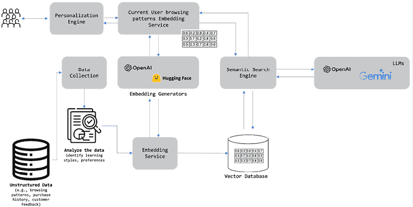

图 2.5：电子商务与零售架构

 **小贴士**：需要查看此图像的高分辨率版本吗？在下一代 Packt Reader 中打开此书，或在 PDF/ePub 副本中查看。

 您的购买包含了**下一代 Packt Reader**以及此书的**免费 PDF/ePub 副本**。扫描二维码，或访问 [packtpub.com/unlock](https://packtpub.com/unlock)，然后使用搜索栏通过名称查找此书。双检查显示的版本以确保您获得正确的版本。


`LLMs` 通过创建个性化互动并根据广泛的消费者行为和偏好进行预测分析在电子商务领域脱颖而出。它们通过处理和分析大量数据（包括浏览行为和模式以及购买历史）来实现，使其能够更有效地理解和预测客户需求。这使得零售商能够提供高度个性化的产品推荐和引起个人客户共鸣的针对性营销策略，增强购物体验并鼓励重复购买。

与传统的推荐系统（通常依赖于预定义的算法且范围有限）不同，`LLMs` 利用先进的自然语言处理能力来理解和生成类人文本。这允许它们以更自然、更有意义的方式与客户互动，例如通过对话界面或增强的搜索功能。虽然部署 `LLMs` 的成本可能更高，但它们提供更细致、动态互动的能力通常会导致更高的客户满意度和忠诚度。

`LLMs` 在零售领域的另一个显著优势是它们在分析客户反馈和评论方面的作用。通过处理这些信息，`LLMs` 可以识别可能影响客户满意度的常见问题、趋势和改进领域。这允许企业精炼产品供应并调整客户服务策略以解决任何疑虑，从而提高服务质量并增强客户忠诚。

为了说明 `LLMs` 在零售和电子商务领域的转型性影响，让我们探索一些领先公司利用这些先进模型来增强其运营和客户体验的真实示例：

- **亚马逊 (Amazon)**：亚马逊在其推荐引擎中使用 `LLMs` 提供个性化产品建议，显著提升了销售额和客户留存。

- **沃尔玛 (Walmart)**：沃尔玛采用 `LLMs` 进行库存管理和需求预测，优化供应链并减少缺货。

- **家乐福 (Carrefour)**：家乐福利用 `LLMs` 分析客户反馈，增强情感分析并快速适应消费者需求。这些示例展示了 `LLMs` 在电子商务中的实际应用，体现了它们如何驱动该行业的效率和个性化。

此外，由 `LLM` 驱动的聊天机器人通过提供全天候服务，重新定义了零售领域的客户支持。这些机器人处理广泛的客户查询，提供详细的产品信息并高效解决问题。当面对更复杂的问题时，这些机器人可以无缝将问题升级给人工代理，确保客户在任何时候都能获得全面的支持。

让我们探索 `LLMs` 产生重大影响的关键领域：

- **个性化客户互动：**

大语言模型（`LLMs`）通过创建个性化交互显著提升了客户体验。这些模型分析浏览行为和购买历史等海量数据，以更好地理解和预测客户需求。这使得企业能够提供定制化的产品推荐和营销信息，与个人消费者产生共鸣。通过利用自然语言处理，`LLMs` 提供了更有吸引力的购物体验，无论是通过对话界面还是改进的搜索功能。提供动态和个性化交互的能力带来了更高的客户满意度和忠诚度。

### 简化库存管理

高效的库存管理对于任何零售业务都至关重要。`LLMs` 通过优化库存水平、预测需求和降低缺货风险做出贡献。这些模型分析历史销售和消费者趋势等海量数据，以预测未来的库存需求。这种预测能力确保了企业维持足够的库存水平，避免积压或短缺，并帮助简化供应链。

### 改进客户反馈分析

`LLMs` 在处理客户反馈和评论方面也发挥着关键作用。通过分析这些数据，`LLMs` 可以识别趋势、常见问题以及影响整体客户满意度的改进领域。企业可以利用这些见解来完善产品供应并增强客户服务策略，确保反馈被有效地用于改进未来的互动和产品。

### 运营效率


除了增强客户体验外，`LLMs` 还提高了零售和电子商务运营的运营效率。从优化物流和供应链到预测需求和管理客户支持，这些模型简化了流程并有助于降低成本。`LLMs` 的高级功能为零售商提供了指导战略决策的见解，确保资源得到高效分配。尽管部署 `LLMs` 的成本可能比传统模型更高，但它们在效率和个性化方面的长期收益使其成为许多企业极具价值的投资。

### 使用 LLM 驱动的聊天机器人增强客户支持

`LLM` 驱动的聊天机器人通过提供 24/7 的支持正在彻底零售业的客户服务。这些机器人可以处理各种客户查询，从回答产品问题到解决基础问题。对于更复杂的查询，`LLMs` 会将问题无缝升级给人工代理，确保客户能够无延迟获得所需的支持。这不仅提高了客户满意度，还释放了人工代理，让他们专注于更复杂的任务，从而提高了整体运营效率。

## 教育与培训

`LLMs` 的整合通过提供可扩展和个性化的学习解决方案，从根本上改变着教育和培训。这些模型通过使学习更具适应性、互动性和高效性，增强了教育机构和企业培训计划的学习体验。`LLMs` 促进了个性化学习路径、自动化创建学习材料，并提供即时反馈，使学习过程既吸引人又符合学生和专业人士的特定需求。

在企业环境中，`LLMs` 简化了培训流程，调整内容以满足员工需求并实时跟踪学习进度。这允许培训师根据个人学习风格、偏好和表现定制教育内容并调整教学方法。例如，`LLMs` 可以修改内容的复杂程度呈现形式，以匹配学习者的理解水平，增强对知识的理解和留存。

`LLMs` 还根据学习者的反馈和表现动态调整学习材料，确保内容保持相关且有效。这种适应性通过将材料与学习者的当前知识和目标对齐，防止了无味并促进了持续参与。

此外，`LLMs` 生成广泛的教育材料，包括互动式测验和全面的教程，这些材料会不断更新以反映最新的信息和趋势。对作业和测验提供即时反馈的能力有助于学习者立即理解并纠正错误，促进有效的学习和进步。

在跨国公司中，`LLMs` 有潜力通过接纳多样化的劳动力并根据个人响应和进度实时调整内容来增强培训计划。虽然决策树或 `if-else` 逻辑等传统方法通常足够，但 `LLMs` 可以提供额外的灵活性和个性化，特别是在更复杂的培训场景中。

例如，由 `LLM` 驱动的平台可以根据不同的员工角色定制网络安全培训，动态调整难度并提供即时反馈以优化学习成果。这种方法在不同地区和角色的培训需求具有高度适应性和细微的情况下可能特别有用。

在教育和培训领域，`LLMs` 越来越被认为是变革性的工具，能够显著增强学习过程和运营效率。这些先进模型不仅对于个性化学习体验和自动化创建学习材料至关重要，对于提供即时反馈和在全球范围内扩展培训计划也同样关键。这种双重应用凸显了 `LLMs` 变革教育和企业培训的潜力。

以下，我们探讨 `LLMs` 在该领域产生重大影响的关键领域：

### 个性化学习路径

`LLMs` 通过根据每个学习者的需求定制教育内容来增强个性化学习。这些模型评估学生的表现、学习风格和偏好，动态调整材料的复杂呈现呈现。通过这种方式，`LLMs` 确保每位学习者都能收到与其理解水平相适应的内容，提高留存和理解。这种个性化方法有助于让学生和专业人士的学习都变得更有效、更有吸引力。

### 简化企业培训

在企业环境中，`LLMs` 通过实时调整内容以适应员工需求并跟踪他们的进度来简化培训。培训师可以根据个人表现调整教育材料，确保高效地实现学习目标。`LLMs` 还可以自动化培训材料、测验和作业的传递，减轻行政负担，让培训师能够专注于更复杂的任务。

### 生成自适应学习材料

`LLMs` 支持教育材料的持续开发，包括测验、教程和学习模块。通过分析学习者的反馈和表现数据，这些模型调整内容以保持相关性和有效。这种适应性通过与学习者的当前知识水平和目标对齐，防止了单调并让学习者投入。

### 提供即时反馈

`LLMs` 的另一个优势是能够对作业和测验提供即时反馈。这种能力帮助学习者立即理解自己的错误并当场纠正。即时反馈循环不仅加速了学习，还鼓励持续改进，从而带来更好的长期教育成果。

### 为跨国公司扩展培训规模

`LLM` 为全球员工提供了可扩展且一致的训练，并能够根据学习者的响应和表现实时调整内容。这种灵活性在大型企业中尤为宝，因为培训需求需要兼顾不同的地区、职位和技能水平。例如，由 `LLM` 驱动的平台可以根据不同员工职位的所需复杂度来定制网络安全培训，确保不同团队的学习内容既具有相关性又是高效的。

### 支持高级培训场景

虽然决策树或基于规则的系统等传统方法对于基础培训场景通常足够了，但 `LLM` 提供了更高级的个性化和灵活性，特别是在复杂的培训环境中。它们提供细粒、实时调整的能力，使其非常适合需要高度自适应内容的场景，例如合规性培训或跨地理和部门的专业技术教育。

`Figure 2.6` 中的教育和培训工作流让我们更清晰地理解 `LLM` 是如何集成到教育和培训系统中的。该图说明了涉及的各个阶段，从数据收集和分析到内容的动态调整，再到全面的报告和反馈机制。

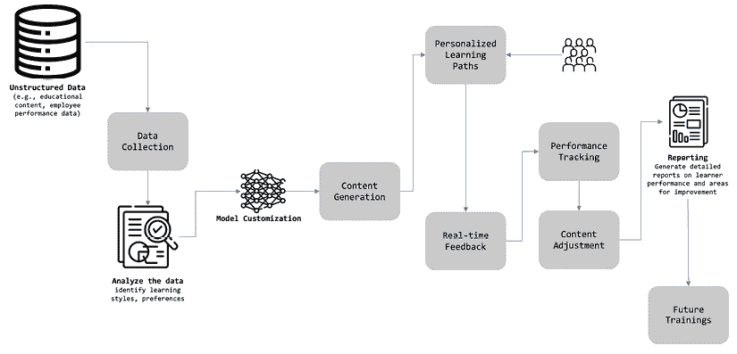

图 2.6: 教育与培训工作流中的 LLM 集成

# 扩展和部署 LLM 的挑战

虽然将 `LLM` 集成到企业运营具有变革潜力，但这些技术的部署和扩展面临着许多重大挑战，如 `Figure 2.7` 所示，它显示使用基础模型仅是构建可企业扩展的端到端生成式 AI 应用所需工作的一小部分。解决这些挑战至关重要，因为这不仅提供了 `LLM` 能力的平衡视角，还为企业有效实施这项先进技术所涉及的现实和复杂性做了准备。

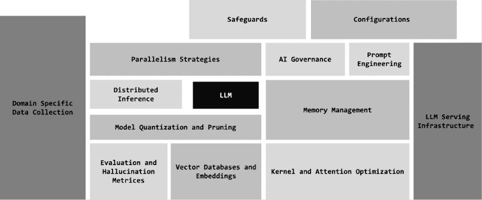

图 2.7: 部署 LLM 的挑战

在生产环境中部署 `LLM` 需要有效的数据预处理、偏见检测和缓解策略。此外，`LLM` 在微调和推理需要大量的计算资源，导致高昂的基础设施成本。无论通过云服务、专用硬件还是优化技术来管理这些费用，对于可持续部署至关重要。

从技术角度来看，内存管理和并行处理等挑战是需要解决以提高性能效率的关键领域。在伦理方面，确保 `LLM` 的可解释性和说明性至关重要，特别是在医疗和金融等敏感领域。改进这些方面有助于建立信任和问机制，允许利益相关者验证并理解模型决策，从而降低潜在风险。

在本节中，我们将应对许多组织面临的一些挑战和技术债，从技术限制到伦理考量，确保企业能够充分准备，为 `LLM` 的采用做出明智决策和战略计划。

## 技术挑战

在业务环境中部署 `LLM` 涉及复杂的考虑考虑，这会影响性能和运营效率。关键问题包括模型可靠性、维护、持续更新的需求以及支持这些系统所需的基础设施。这些元素中的每一个在企业系统中成功集成和扩展 `LLM` 中起着至关重要的作用。

在本节中，我们将概述企业在将 `LLM` 部署到生产环境时面临的关键挑战和技术债。我们将在后续章节中详细探讨并解决这些挑战，重点介绍实践和设计模式，为您的业务有效解决问题。

### 内存需求

为了理解运行具有 70 亿参数的 `Llama 2` 等 `LLM` 的 GPU 内存需求，我们可以将内存使用分为两个主要部分：`model weights` 和 `KV cache`。

`model weights` 是模型的参数，是在训练期间从数据中学习的。这些权重决定了模型的行为和预测。对于像 `Llama 2 7B` 这样的模型，每个权重都使用 16 位精度存储，这是在不丢失过多数据细节的情况下节省内存的方法。由于 16 位精度的每个参数占用 2 字节（`FP16` 或 `BF16` 格式），且有 70 亿个参数，仅模型权重所需的总内存约为：

`7 billion×2 bytes≈14 GB`

`KV cache`（如 `Figure 2.8` 所示）指的是模型自注意力机制中 `key` (`K`) 和 `value` (`V`) 矩阵的缓存。自注意力是模型检查句子中每个词（或标记）与其他所有词之间关系的过程。缓存这些关系（`K` 和 `V` 矩阵）可以节省时间，因为避免了冗余计算。

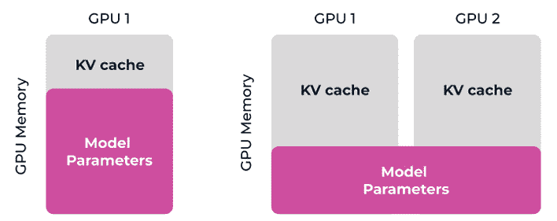

图 2.8: KV cache 和模型参数占据了几乎整个 GPU 内存

批处理中的每个请求都需要单独分配 `KV cache`，即使这些请求是一起处理的。序列中每个 token 的 `KV cache` 大小的计算公式如下：

`Size per token in bytes=2×(num_layers)×(num_heads×dim_head)×precision_in_bytes`

这里的 2 同时代表了 `K` 和 `V` 矩阵。通常，注意力头数（`num_heads`）、`num_layers`（transformer 模型中的层数）和每个头的维度（`dim_head`）的乘积等于模型的隐藏层，这是 transformer 模型中常见的配置。

为了简单起见，如果我们考虑批处理大小为 1，序列长度为 4,096 个 token，32 层，隐藏层为 4,096（假设为 16 位精度，即 2 字节），则该场景下的 `KV cache` 大小计算如下：

`Total size of KV cache in bytes=1×4096×2×32×4096×2 bytes≈2 GB`

序列长度指的是单批处理中处理的 token 数量，序列中的每个 token 是模型处理的数据单元（如一个单词或词的一部分）。

如上所示，70 亿参数 `LLM` 的内存需求是巨大的。现在，考虑万亿参数 `LLM` 的情况。模型权重所需的总内存将 1 万亿个参数 x 每个参数 2 字节，导致 2000 GB 的内存。

### 内存管理

在 `LLM` 分布式计算中解决内存优化挑战需要创新的解决方案。一个关键策略是开发和实现共享 `KV cache` 机制。这涉及创建一个灵活的系统，在请求内部以及请求之间高效地共享内存，从而显著减少内存消耗。

通过允许模型不同部分以及请求之间的内存共享，企业可以在不损害性能的情况下减少内存开销。这种方法在运行多个 GPU 或节点的环境中特别有效，因为有效利用内存资源至关重要。实施这样的系统可以实现 `LLM` 更具扩展性和更成本效益的部署，确保资源得到优化利用并控制运营成本。这不仅提升了模型的性能，还最大限度地提高了计算基础设施的投资回报。

在讨论了内存管理和共享 `KV cache` 机制的实现后，深入探讨大语言模型（`LLMs`）部署的具体内存需求至关重要。深入理解 GPU 内存对于有效管理这些需求并确保模型性能最优非常重要。

# 模型剪枝与量化

在讨论了部署 `LLM` 模型相关的内存挑战后，让我们探索两种最常见的解决方案：模型剪枝和量化。这两种技术旨在减少神经网络的计算复杂性和内存占用，使其部署时更加高效，特别是在资源有限的设备上。

这些压缩技术对于加速器数量有限且对低延迟高吞吐量有要求的行业至关重要。通过应用剪枝和量化，企业可以优化其 `LLM` 的性能，在保持高水平和效率的同时，使其更适用于现实应用。此外，这些技术可以通过减少所需的计算能力和存储显著降低运营成本，允许 AI 解决方案进行更具效益的扩展和部署。

## 模型剪枝

主要，模型剪枝是一种通过系统地消除对模型性能影响最小或没有影响的参数（权重），来减少神经网络计算复杂性和内存消耗的技术。

剪枝可以在多个层次上进行，每个层次针对神经网络的不同方面：

* **权重剪枝**：这涉及根据权重对整体性能的贡献移除单个权重。通过识别和消除不重要的权重——通常是那些值接近零或梯度较小的权重——模型变得更加紧凑，所需的更少的内存来存储和处理。这些不重要的权重可以通过阈值法等技术来识别，即剪掉低于特定幅度的权重，或者通过分析它们对损失函数的影响来识别。

* **神经元剪枝**：在这里，从网络中消除整个神经元或单元。对网络输出贡献极小的神经元可以通过计算神经元的激活强度或其相对于损失函数的梯度等方法来识别。激活值或梯度持续较低的神经元被认为不重要并可以移除，从而得到一个更精简的模型架构，同时保持其有效性。

* **层剪枝**：在这种方法中，移除了对模型功能不关键的整个层或块。这可以大幅减少模型的大小和复杂性，特别是对于具有许多层的深度网络。

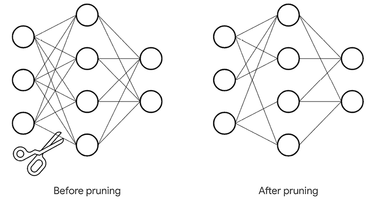

图 2.9：权重剪枝技术的演示

剪枝的处不仅限于减少内存。这对于实时应用以及在计算资源资源有限的边缘设备上部署尤为重要。

此外，剪枝可以促进以下目标：

* **提高推理速度**：有了更少的参数和简化的计算，剪枝后的模型可以更快地处理输入，在聊天机器人、推荐系统和实时分析等应用中提供更响应。

* **能源效率**：计算需求的减少意味着更低的能耗，这对节省成本和环境可持续性都有益。

* **可扩展性**：较小的模型可以更容易地在多个设备和平台之间进行扩展，允许更广泛、更灵活的部署选择。

* **增强模型的可维护性**：简化的模型更容易理解、维护和更新，可以简化持续的开发和优化工作。

通过将模型剪枝纳入 `LLM` 的部署策略中，企业可以在性能和资源利用之间取得平衡，使得在资源受限的环境中部署先进的 AI 能力也变得可行。

## 量化

量化是一种用于优化神经网络的技术，通过将模型权重和激活的精度从高精度（例如 32 位浮点）降低到低精度（例如 8 位或 4 位浮点），如图 2.10 所示。这种降低显著减少了内存需求并加快了计算，使模型在不大幅牺牲性能的情况下更具效率。从业务角度来看，量化提供了几个关键优势：

* **节省成本**：量化减少了运行 AI 模型所需的计算资源，这意味着企业的基础设施成本更低。就像优化生产流程可以节省运营费用一样，优化 AI 模型可以节省计算资源。

* **可扩展性**：将量化视为让你的产品适应更小的包装而不丢失价值。通过优化模型，你可以在从智能手机到 IoT 设备各种设备上部署 AI 解决方案，触及更多客户和市场。

* **速度和敏捷性**：更快的推理意味着对客户查询响应更快，就像缩短生产时间意味着产品更快上市。量化加速了 AI 计算，提高了运营的响应能力和敏捷性。

在实践中，`LLM` 的量化技术通常分为两类：

* **训练后量化 (PTQ)**：在训练后对模型进行量化，使其更快且更容易实现，但可能由于精度损失导致模型准确下降。

* **量化感知训练 (QAT)**：在训练期间整合量化过程，以增加计算需求为代价获得更优的模型性能。

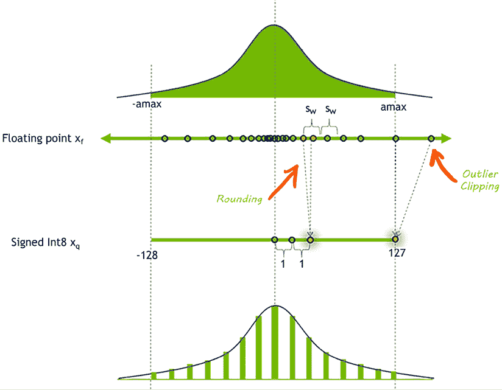

图 2.10：应用量化机制前后的值分布

在讨论了剪枝和量化作为优化 `LLM` 部署的有效策略后，另一种可以解决各种挑战的关键技术是并行化。并行化能够高效利用计算资源，特别是在处理规模庞大的 `LLM` 时。

# LLM 部署中的并行化策略

许多 `LLM` 的规模巨大，无法加载到单个加速器上，需要特定的并行策略来应对这一挑战。

* **张量并行**：该策略将单个层内的张量划分为较小的计算段，允许在多个设备上并行执行。这就像将一个复杂的项目拆分为更小的任务，并将它们分配给不同的团队同时完成，确保大型模型的高效扩展。

* **模型并行**：在这里，模型部分和层被划分在不同的设备或节点上，每个节点负责计算模型的一部分。高效的分区和同步是最小化通信开销的关键。然而，在多个 GPU 之间的同步推理可能会导致资源利用率低下，从而影响效率。在后续章节中，我们将探索解决此问题的方案，包括动态批处理机制，该机制通过组合多个请求来优化 GPU 利用率。

- **数据并行**：这种技术将模型权重复制到多个设备上，并将输入的全局批次大小（batch size）划分为微批（micro batches），分布在这些设备。这种方法通过并发处理更大的批量缩短了整体执行时间。然而，它主要是一种训练优化手段，在推理阶段的相关性较低。

- **流水线并行**：这种方法结合了模型并行和数据并行，将模型分为若干阶段并以流水线的方式分布在设备上。每个节点顺序处理特定阶段，优化了资源利用率并加速了计算。它就像流水线，每个工人处理特定的任务，确保了数据输入在模型各个阶段的高效处理。

- **序列并行**：该策略沿着输入序列的维度划分操作，解决了张量并行中的约束限制。它能高效地将 `LayerNorm` 和 `Dropout` 等操作分布在序列维度上，确保资源的最优利用。

实现这些并行策略从多个方面优化了大语言模型（`LLM`）的部署：

- **提高效率**：并行化加速了模型推理，确保更快的响应和更好的资源利用。

- **可扩展性**：高效的并行化实现了跨多个设备或节点的无缝扩展，适应不断增长的计算需求。

- **资源优化**：并行技术的有效利用减少了硬件需求和运营成本，实现了投资回报的最大化。

- **增强性能**：并行化确保了 AI 解决方案更快、更具扩展性，并能够处理更大的工作负载，为企业带来竞争优势。

通过理解并实施这些并行策略，企业可以克服部署挑战，确保高效且有效地利用其 `LLM`，从而获得更好的业务成果和客户满意度。现在你已经更了解了剪枝和量化作为优化 `LLM` 部署的有效策略，以及并行策略，但必须考虑另一个关键方面：`LLM` 模型的可靠性。即使有剪枝和量化等优化技术，确保 `LLM` 一致且可靠的性能仍然企业关注的重要问题。

### 模型可靠性

`LLM` 的可靠性是指其输出的一致性和准确性。虽然 `LLM` 非常强大，但其可靠性可能会受到多种因素的影响，例如训练数据中的偏差或学习过程中的异常。确保可靠性需要严谨的测试和验证阶段，以识别并缓解模型响应中的任何不准确或不一致。此外，必须在各种部署中维护可靠性，这需要稳健的版本控制和质量保证实践。

### 维护与持续更新

`LLM` 是复杂的系统，需要持续维护才能保持最佳运行。与可能不需要频繁更新即可有效运行的传统软件不同，`LLM` 需要不断关注以保持其相关性和效率。这涉及定期更新以整合新数据、反映当前趋势并适应不断演变的用例。这种维护确保了 `LLM` 能够有效处理新话题和不断变化的语言模式。

`LLM` 的动态特性允许它们从持续的数据输入中学习，增强了它们的适应性和性能。然而，这种持续学习也可能引入偏差或错误，因此需要警惕监控以及时识别并纠正任何偏差。定期的微调（fine-tuning）等技术对于使模型更贴特定应用或用户需求至关重要。这一过程涉及调整模型参数和训练数据集以获得更好的性能和相关性。

此外，维护 `LLM` 的安全性并确保符合数据隐私法规至关重要。由于这些模型处理海量数据，防止泄露和滥用至关重要。定期的安全审计和合规性检查有助于保护模型及其处理的数据，确保其部署符合法律和伦理标准。通过优先考虑定期更新、监控错误、针对特定用途进行微调以及确保稳健的安全与合规，组织可以使其 `LLM` 部署的有效性和寿命最大化。


### 对稳健基础设施的需求

部署 LLM 需要大量的计算资源。支持这些模型的基础设施不仅包括强大的硬件，还需要能够处理海量数据和高并发、高速处理的复杂软件架构。企业必须投资 GPUs 或专用硬件加速器、可扩展的存储解决方案以及高效的数据处理机制来管理工作负载。此外，基础设施必须是安全的并符合数据保护法规，这为其架构增加了额外的复杂性。

## 数据隐私与安全问题

在 LLM 的部署中，数据隐私和安全成为首要考虑，特别是当这些技术处理敏感信息时。企业必须在复杂的风险和监管要求环境中应对，以确保其对 LLM 的使用符合法律和伦理标准。理解这些问题对于保护敏感数据以及在高度监管的行业中维护信任和合规性至关重要。

### 数据隐私忧虑

### 安全风险

## 监管合规挑战

欧盟的《通用数据保护条例》（GDPR）等法规对数据隐私和个人信息处理提出了严格的准则。这些法规要求企业在收集数据时获得明确同意，确保数据仅用于其预期目的，并赋予个人访问、更正或删除其个人信息的权利。遵守 GDPR 和其他类似的法规需要投入大量精力，以设计大语言模型（LLMs）及其运营流程，使其符合这些法律要求。这可能包括制定透明的数据处理政策、进行影响评估，以及为履行数据主体权利建立的协议。

# 成本影响

将 LLM 集成到业务运营中涉及重大的财务考量。这些不仅包括技术方面的初始投资，还包括与训练、实施、维护和潜在扩展相关的持续费用。理解这些成本影响对于企业有效管理预算以及评估 LLM 提供的投资回报率（ROI）至关重要，如 Figure 2.11 所示。

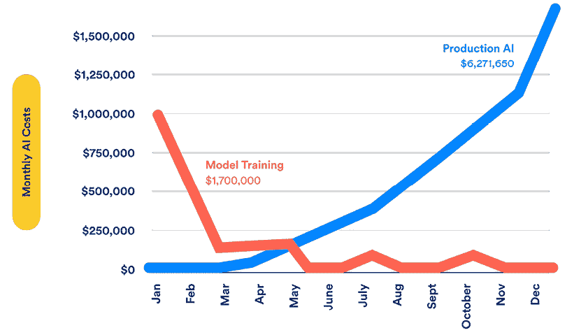

图 2.11：生产环境中模型推理每月成本与模型训练对比

## 技术初始投资

部署 LLM 需要大量的初始资金。这项投资包括获取必要硬件的成本，例如配备了高性能 GPU 的服务器，或能够处理 LLM 巨大计算需求的专用神经网络处理器。此外，还必须考虑软件采购或开发相关的费用、许可费（如果使用商业 LLM 平台）以及将这些模型集成到现有 IT 基础设施中的费用。部署的复杂性和规模会影响这些成本的程度。

## 持续成本

除了初始设置外，还有几项与 LLM 运行相关的经常性成本：

- 保持生成式 AI 应用的更新：为了保持其有效性和准确性（特别是在快速发展的行业中），生成式 AI 应用需要新数据进行持续更新。虽然对 LLM 进行定期微调是一种选择，但其他其他更具成本效益的方法。这些包括更新检索增强生成（RAG）数据库以及更新长上下文提示中的少样本（few-shot）示例。
- 维护与更新：定期维护对于确保 LLM 运行顺畅且安全至关重要。这包括软件更新、安全补丁和系统优化，这些工作可能消耗资源并需要专门的技术人员。
- 扩展成本：随着业务需求的增长，扩展 LLM 以处理增加的负载或部署到业务的新领域，可能涉及对额外基础设施的投资、模型的进一步训练以及集成工作。

## ROI 考量

为了证明与 LLM 相关的高昂支出的合理，企业需要仔细考虑预期的 ROI。部署 LLM 的收益可能是巨大的，包括提高效率、增强决策能力以及提供新服务或改进服务的能力。例如，LLM 可以自动处理例性任务，减少劳动力成本并释放员工从事更高价值的工作，这可以是 ROI 的直接贡献因素。

正如我们所见，LLM 可以通过自动化重复任务来简化运营，这不仅节省了时间，还降低了人工成本。此外，它们可以从海量数据中提供价值洞解，帮助做出更好的决策，并可能导致收入增加或成本节省。例如，LLM 可以分析客户反馈以改进产品或服务，从而提高客户满意度和留存率。

然而，量化这些收益可能是具有挑战性的。企业应该进行彻底分析以预测成本和节省。这确保了决策的明智并使技术价值最大化。分析的挑战又增加了一个维度。最终，企业需要进行全面的分析来准确预测 ROI。

# 伦理和社会影响

随着 LLM 越来越多地整合到各个领域，处理其伦理和社会影响至关重要。这些影响包括对偏见的担忧、对就业的影响、隐私问题以及可能被滥用的风险。解决这些挑战对于开发符合社会价值观的 AI 策略至关重要。Figure 2.12 强调了 Markula 应用伦理中心发布的《AI 时代的伦理》报告的调查结果。该报告概述了美国人对 AI 的伦理关注，并识别了他们最担心的技术。

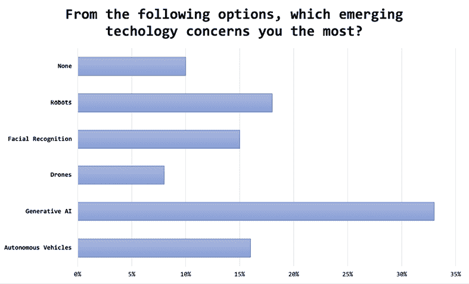

图 2.12：人们最担心哪些新兴技术？

如你所见，生成式 AI 在关注列表上遥遥领先。下面，我们将探讨一些与生成式 AI 特别地与 LLM 相关的主要关注领域。

### 模型中的偏见

LLM 最重大的伦理关注之一是延续现有偏见的风险。这些模型在海量数据集上进行训练，如果经过仔细筛选，这些数据可能包含偏见数据。这可能导致模型生成性别歧视、种族歧视或其他歧视性的输出。例如，曾出现 AI 系统在信用评分或工作申请筛选中表现出种族偏见的案例。

在部署 LLM 时关于偏见的挑战从数据的质量和代表性开始。这些模型是在从互联网、文献和各种数字来源获取的多样化数据集上进行训练的。如果这些来源包含偏见语言或观点，模型将无疑会学习并复制这些偏见。历史数据通常反映了社会不平等，导致模型可能会延续刻板印象和歧视。确保训练数据具有多样性并代表所有群体至关重要，但考虑到数据庞大的规模和变异性，这是一项复杂的任务。

识别并减轻 LLM 中的偏见是另一项复杂的任务。偏见可能是细微且无处不在的，使其难以检测。即使付出了巨大努力清理训练数据，某些偏见可能仍然根深蒂固。诸如偏见检测算法、公平感知机器学习和后处理修正等技术可以帮助，但它们并非万无一失，且可能非常耗资源。

部署偏见的 AI 模型带来的伦理和法律影响是严重的。偏见的信用评分算法可能会不公正地拒绝某些人口群贷款，而偏见的招聘算法可能会延续职场不平等。这些问题不仅损害个人，还可能导致法律后果并损害组织的声誉。

确保 AI 系统的透明度和问责制对于建立信任至关重要。然而，LLMs 的复杂性使得解释其决策和输出变得困难。AI 的这种"黑箱"性质可能会阻碍解决偏见的努力，因为利益相关者可能无法完全理解决策是如何做出的或者偏见源于何。

此外，LLMs 中的偏见并不是静态问题；它会随着社会规范和语言的变化随时间演变。必须对模型进行持续的监控和更新以确保它们保持公平且无偏。这需要对资源和基础设施进行持续投入。

为了降低这些风险，必须实施严格的数据清洗和模型训练流程，旨在识别并消除有偏的数据输入。此外，对模型进行持续的监控和更新也是必要的，以确保偏见在模型随新数据演进时不会渗入。

## 监管合规挑战

随着 LLMs 的全球部署，遵循如欧洲的 GDPR 或加加州的 CCPA 等多样化的监管框架变得日益复杂。这些法规对数据隐私、用户同意和被遗忘权规定了严格的准则，如果没有稳健的数据治理政策，很难遵守这些规定。

组织必须确保其对 LLMs 的使用符合所有适用的法律法规。这不仅涉及保护数据隐私的技术解决方案，还涉及与用户透明地沟通其数据如何被使用以及所采取的保护措施。

## 自动化对就业的影响

LLMs 的自动化能力可能会导致劳动力市场的重大转变。虽然自动化可以提高效率并降低成本，但也带来了岗位流失的风险，特别是对于那些涉及常规或重复任务的角色。除非采取积极措施，否则这种流失可能会加剧社会不平等并导致经济差异。

企业应该考虑部署 LLMs 的更广泛影响，并努力为可能受自动化影响的员工制定转型计划。这包括提供重新培训计划以提升受影响员工的技能，并在组织内部探索可以从人机协作受益的新机会。

# LLM 设计模式

将 LLMs 集成到业务运营中需要稳健的最佳实践和设计模式框架，以确保高效有效的部署。将这些最佳实践泛化并创建通用模板可以简化采用过程，允许企业在各种应用程序中更无缝地利用 LLMs。本节将定义关键的设计模式，包括推理的动态批处理、模型压缩技术以及评估与监控策略，以确保实用性和复杂性之间取得平衡，并将业务指标嵌入流程中。这些模式的深入细节和实现将在后续章节中讨论。目前，对每个模式包含的内容有一个大致的了解就足够了。

## 推理动态批处理

动态批处理是优化 LLMs 推理的关键设计模式。通过将多个请求分组为批次，动态批处理提高了 GPU 利用率并降低了延迟，从而增强了 LLMs 在实时应用中的效率。这种方法允许企业在不牺牲性能的情况下处理不断变化的负载和需求。实现动态批处理涉及复杂的队列管理和调度算法，以确保高效形成和处理批次，使系统具有响应性和可扩展性。

## 模型压缩与实用性与复杂性的权衡

模型压缩技术对于减少 LLMs 的计算复杂性和内存占用关重要。这些技术使得在资源有限的设备上部署 LLMs 同时保持高性能变得可行。裁剪涉及移除模型中不重要的权重、神经元或层，而量化则降低了模型权重和激活值的精度。必须仔细管理实用性与复杂性之间的权衡。虽然压缩提高了效率，但确保模型的实用性和准确性不受到显著损害至关重要。企业必须评估这些权衡，以达到满足特定特定特定平衡。在接下来的章节中，我们将根据企业的资源限制，提供设计模式和易用的流水线来应对这种权衡。

## 评估与监控

LLMs 的有效部署需要稳健的评估和监控框架，以确保模型交付预期的结果并随着时间的推移持续可靠运行。评估的设计模式应包含嵌入业务指标（如 ROI）以及模型性能指标（如准确率、延迟和资源利用率）的模板。此外，对模型幻觉（模型生成看似合理但错误或无意义的输出）进行监控至关重要。实施持续监控有助于及时检测和缓解问题，确保模型与业务目标保持一致。定期进行审计和性能审查，以保持模型的有效性并适应不断变化的业务需求。

# 总结

在本章中，我们探讨了 LLMs 已经产生的变革性影响，以及它们在各个企业部门可能引导的未来潜在转型，强调了它们巨大的潜力以及在集成和部署方面面临的重大挑战。我们首先了企业内部普遍存在的非结构化数据问题，超过 80% 的数据是非结构化的。LLMs 已证明在将这些数据转换为可操作的洞察方面至关重要，使企业能够开发上下文模型，分析这些信息以进行明智决策和模式检测。

我们展示了 LLMs 如何应用于金融服务、医疗保健、零售、电子商务和教育等领域。在金融服务领域，LLMs 自动化了客户互动并提供了个性化建议；而在医疗保健领域，它们支持诊断和治疗过程。在零售领域，这些模型增强了购物体验并优化了库存管理；在教育领域，它们促进了可扩展的个性化学习。

然而，这些高级模型的集成也带来了挑战，包括确保模型的可靠性、建立稳健的基础设施以及解决数据隐私和安全问题。我们还讨论了部署 LLMs 的成本影响以及评估投资回报率的重要性。

我们还考虑了伦理和社会问题，特别是 AI 模型中的偏见风险以及自动化对工作的影响。这些关注凸显了采用平衡、伦理的方法部署 LLMs 的必要性，以防止不平等并维护公众信任。

我们还探索了基本的 LLM 设计模式，这些模式为有效集成 LLMs 提供了结构化方法。关键模式包括优化推理效率的动态批处理、平衡实用性与复杂性的模型压缩技术，以及确保模型长期性能的稳健评估与监控框架。这些模式构成了可扩展、高效且符合业务的 LLM 实现的骨干，其详细应用将在后续章节中详细阐述。

在下一章中，我们将讨论在业务运营中采用大语言模型（LLM）能力的策略，包括使用诸如 OpenAI API 等付费 API 进行检索增强生成（RAG）、在领域特定数据上对模型进行微调，以及从零开始开发模型。这一探索将提供一份全面的指南，如何利用 LLM 增强业务运营并在数字化浪潮中保持竞争优势。

# 参考文献

- 关于"技术债"的解释：[`en.wikipedia.org/wiki/Technical_debt`](https://en.wikipedia.org/wiki/Technical_debt)
- 医学领域大语言模型的未来蓝图：`The future landscape of large language models in medicine | Communications Medicine` ([nature.com](https://nature.com))
- 亚马逊如何利用 AI 帮助客户信赖购物：[`technologymagazine.com/articles/how-amazon-uses-ai-to-help-customers-shop-with-confidence`](https://technologymagazine.com/articles/how-amazon-uses-ai-to-help-customers-shop-with-confidence)
- 数据填充货架：沃尔玛 AI 驱动的库存系统如何点亮假期：[`tech.walmart.com/content/walmart-global-tech/en_us/blog/post/walmarts-ai-powered-inventory-system-brightens-the-holidays.html`](https://tech.walmart.com/content/walmart-global-tech/en_us/blog/post/walmarts-ai-powered-inventory-system-brightens-the-holidays.html)
- 家家乐整合 OpenAI 技术并推出生成式 AI 驱动的购物体验：[`www.carrefour.com/en/news/2023/carrefour-integrates-openai-technologies-and-launches-generative-ai-powered-shopping`](https://www.carrefour.com/en/news/2023/carrefour-integrates-openai-technologies-and-launches-generative-ai-powered-shopping)
- 应对大语言模型部署中的挑战与技术债：[`dl.acm.org/doi/abs/10.1145/3642970.3655840`](https://dl.acm.org/doi/abs/10.1145/3642970.3655840)
- 张量简介：[`tensorflow.org/guide/tensor`](https://tensorflow.org/guide/tensor)
- AI 时代的伦理：[`tensorflow.org/guide/ethics-of-ai`](https://tensorflow.org/guide/ethics-of-ai)

接下来，我们将详细介绍这些阶段中的每一个阶段，讨论通常用于训练的数据规模和类型、算法和输出模型，以及对企业自行进行这些操作的可行性的洞察。值得注意的是，这些训练配方中的每个阶段都建立在前一个阶段的基础上，最终得到 GPT 模型。

## 预训练阶段

预训练阶段对于开发 LLM 至关重要。它包含两个主要部分：收集和处理通用数据集，以及构建和训练基础模型。该阶段的输出是一个健壮的基础模型，已为微调做好准备。

### 数据集收集

预训练阶段的数据集由大量的数据源组成，包括通用数据集和高质量的特定数据集。注意的是，收集包含了 `CommonCrawl`、`C4`（也来自 `CommonCrawl`）、`GitHub`、`Wikipedia`、`Books`、`Archives` 以及交易所数据等。你可以在 `Llama` 论文的图 4.2 中看到更多细节：

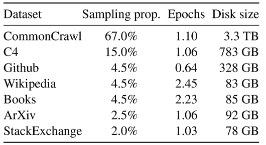

图 4.2：预训练过程中使用的不同类型的数据（构建基础模型）

这些数据集按照定义的比例进行混合和采样，形成训练集。正如第一章中详细介绍的，分词是一个重要的预处理步骤，将这些数据集的原始文本转换为整数序列，这是 GPT 模型处理数据所需的格式。

## 基础模型：用于文本生成的预训练和微调

训练过程使用基于 transformer 的模型架构。这一阶段计算密集型，涉及复杂的算法。transformer 模型使用这些标记来预测后续标记，从而有效地学习语言模式和结构。该基础模型随后可以微调以用于各种下游任务，例如情感分析或问答，利用其生成连贯且与上下文相关的文本的能力。

预训练阶段被描述为具有极高的计算密集性，消耗了总训练计算时间的 99%，并且需要数千个 GPUs，可能耗时数月。这种规模的资源意味着，只有少数装备良的组织在现实中能够承担这种基础模型的第一阶段训练。然而，微调对于更广泛的使用更具可行性，允许以较小的计算开销为特定任务定制模型。实际应用的示例包括创建可以生成类似于人类编写内容的模型，这些模型可以用于技术、客户服务等领域的各种 AI 应用。然而，像 GPT-3 和 Llama 这样的基础模型并没有以原始形式公开发布，这表明其重点在于受控访问和潜在的商业用例。

在完成基础模型的预训练过程后，下一阶段是对此基础模型进行监督微调（SFT），这依赖于专家承包人员提供的质量最好的提示-响应对来完善基础模型。

## 监督微调

监督微调是将大型语言模型与预期行为和性能目标对齐的关键阶段。它通过使用针对性的高质量数据来完善模型，建立在初始预训练阶段的基础上。

### 数据集收集

在监督微调阶段，使用的数据集从大规模、多样化的互联网文档转变为专门为微调构建的小型、高质量数据集。这些数据集由提示-响应对组成，由人工承包人员仔细收集和策划，以确保相关性和质量。数据量显著减小，但质量更高，承包人员的任务是根据详细的标记指南产生有帮助、真实且无害的数据。

### 训练阶段

算法保持与预训练阶段使用的语言建模方法相同，但训练集被替换为专门的提示-响应数据集。在这些定制数据上训练后，输出是一个 SFT 模型。该模型被专门设计用于聊天模型，能够理解并生成与其经过训练的结构化输入数据紧密一致的响应。

虽然计算密集性不如初始预训练阶段，但微调阶段仍然需要精确的数据处理、模型训练和人工成本。这种方法使得更广泛的公司能够触及，而不仅仅是拥有大量资源的公司。公司通常使用它们的领域特定数据微调预训练模型（例如基于 ChatGPT 的模型）。这种微调过程对模型进行定制，以提供与特定提示上下文相关的响应，这使得它对于客户服务和交互式系统等应用特别有效。基础模型已经通过包括强化学习在内的广泛阶段进行了训练，作为基础，而微调则增强了它们针对特定业务需求的相关性和性能。


现在我们已经有了`SFT`模型，可以转向基于人类反馈的强化学习（`RLHF`），它由奖励建模和强化学习两个阶段组成。

## 奖励建模和强化学习

`RLHF`流程的主要目标是使用奖励建模和强化学习阶段来优化响应，其中模型的行为经过精细调整，以便在实际应用中表现出色。

### 奖励建模

在`RLHF`流程的奖励建模阶段，重点从生成数据转向通过人类比较评估模型输出的质量。在这里，给出相同的提示，模型生成几个响应。人工承包人员然后根据质量对这些响应进行排名。这种排名告知奖励模型，该模型根据感知质量相对于其他项对每个完成项进行评分。这种评分几乎被视为一种分类任务，目标是训练模型做出与人类判断一致的准确奖励预测。

### 强化学习

在奖励建模之后，强化学习阶段利用开发的奖励模型来评估和影响新内容的生成。在这里，从`SFT`阶段初始的模型生成提示的响应，然后由奖励模型进行评分。这些评分被用于调整未来生成响应的概率分布。例如，如果一个响应获得了高分（例如`5`分中的`4`分），则模型将增加生成相似响应的概率。相反，如果一个响应得分较低（例如`5`分中的`2`分），则生成相似响应的概率将降低。这种调整通过修改模型的输出概率来实现，有效地引导其生成与排名分数所需的质量和相关性更一致的响应。

`RLHF`流程由于需要持续的人类反馈以及根据这些反馈调整模型输出的复杂性，是计算密集型的。然而，这种方法已被证明是非常有效的，因为使用`RLHF`训练的模型与其他方法相比，产生的输出更符合人类偏好。

将大语言模型（`LLMs`）集成到业务运营中，为寻求效率和创新的公司提供了一条转型路径。采用`LLM`策略取决于组织需求、技术能力和预算限制。

本节探索了集成`LLM`的三种主要方法：利用预构建的`API`、使用私有数据对预训练模型进行微调，以及实施如`RAG`等检索检索技术。这些方法为中小型企业提供了可扩展且定制的解决方案，解决了从零开始开发模型带来的成本和复杂性挑战。

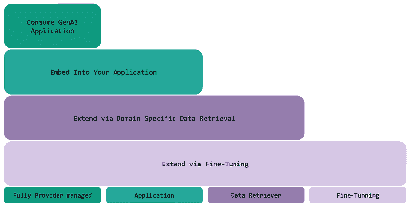

图 4.3：生成式 AI 采用方法并列出了每种方法的复杂度

`Figure 4.3`灵感来自 Gartner，展示了确定组织最佳 AI 部署方案的决策过程。企业必须权衡成本、能力和控制等各种因素，以决定购买还是构建 AI 解决方案（更具体说是生成式 AI 解决方案）更符合其战略目标。该图有助于澄清各种选项收益与风险之间的权衡，从而更清晰地理解影响这些决策的因素。

现在，让我们动手实践，探索大多数企业可以利用生成式 AI 技术的不同可行方案。

## 利用预构建的 API

在本节中，我们将探索技术上可能最简单的基础方案，尽管从安全和负责任 AI 开发的角度来看，它可能不是适应性最好的。在此阶段，企业可以利用第三方`API`来使用最强大的`LLM`，例如`GPT-4`或`Claude-3.5`等。

来自`OpenAI`等成熟 AI 供应商的预构建`API`为企业集成先进的 AI 能力提供了快速通道。这些`API`允许公司利用尖端`LLM`技术，而不需要深厚的 AI 知识或对基础设施进行巨额的前期投入。

**示例：**

客户服务部门可以使用`OpenAI`的`API`集成聊天机器人来处理查询和支持工单，缩短响应时间，并将人工坐解放出来处理更复杂的问题。

### 使用 OpenAI API 进行上下文学习

上下文学习（`In-context learning`），也称为少样本学习（`few-shot learning`），是自然语言处理中的一种强大技术。它利用预训练的基础模型来执行复杂任务，而不需要显式的重新训练或参数更新。该方法允许模型通过直接在提示词（`prompt`）中使用提供的少量数量输入-输出示例，快速适应新任务。这种方法有助于引导模型理解如何有效地处理和响应新类型的输入。

以下是提示词中如何构建上下文学习结构：

1. **前缀 (`Prefix`)（可选）**：这是介绍性文本或解释，为模型预期的操作设定基调。它提供了上下文或指令，可以帮助模型理解当前任务。

2. **类别标签列表 (`List of class labels`)**：这是`LLM`可以选择的可能输出或分类集合。提供这些标签有助于模型缩小可能的响应范围，并确保输出属于有效类别。

3. **示例 (`Examples`)（可选）**：你可以添加任意数量的示例，尽管在某些情况下存在上限：例如，如果使用`Banking-77`数据集（我们稍后会探讨），可以包含最多 50 个示例（即 50 类变体中的每个类一个）。这些示例直接在提示词中充当训练实例，允许模型“看到”每种类型输入预期的输出是什么。每个示例通常将样本输入与其对应的输出配对，向模型演示如何处理相似输入。

4. **分类目标文本 (`Target text for classification`)**：这是`LLM`需要分类或处理的实际输入文本。模型使用提供的示例以及来自前缀和类别标签的上下文为该目标文本生成适当响应。

5. **超参数调优 (`Hyperparameter tuning`)（可选）**：可以增强模型性能。例如，将`max_tokens`参数设置为`1`可确保输出一个单词，这对于是/否分类非常有用。此外，调整`top_p`值可以控制响应的多样性，较高的值鼓励产生更多化的输出。

为了说明上下文学习，我们将提供一个使用广泛使用的 50 类变体`Banking-77`数据集的示例，该数据集包含带有相应意图（如下所示）的在线银行查询。我们使用包含约 500 个短语的固定测试数据集来评估预测此类标签的模型。

假设有一种场景：我们有一个银行数据集，并希望`LLM`将客户投诉分类到特定类别，例如“贷款”、“账户”或“抵押贷款”。

以下是我们可能如何为此任务构建提示词：

```
Prefix (Optional): "根据提供的示例，将以下客户投诉归入正确的类别。"
List of Class Labels: "Categories: Loan, Account, Mortgage"
Examples (Optional):
Example 1: "我不对我的贷款申请的处理不满意。" -> Loan
Example 2: "为什么我因为账户没有保持最低余额而被收取费用？" -> Account
Example 3: "我需要调整我的抵押贷款条款。" -> Mortgage
Target Text for Classification: "我的贷款利率似乎是不正确的。"
```

在此设置中：

* 前缀引导模型对任务的理解。

* 类别标签明确了可能的分类。

* 示例向模型展示了输入映射到类别的真实实例。

* 目标文本是模型根据对上述组件的理解需要分类的内容。

让我们来看看`Banking-77`数据集 (`https://github.com/PolyAI-task-datasets`)，它包含了带有相应意图标注的在线银行查询：

```python
import pandas as pd
examples_pool = pd.read_csv(
    'https://s.cleanlab.ai/banking-intent-50/examples-pool.csv'
)
examples_pool[['text', 'label']].head()
```

输出：

| | Text | label |

| :--- | :--- | :--- |

| 0 | I moved to a new city and need to change my address | `edit_personal_details` |

| 1 | On my transfer there was a “decline” message | `declined_transfer` |

| 2 | Help! my wallet was stolen and someone is taking money out. I need this money! what can I do? | `card_payment_fee_charged` |

| 3 | While abroad I got cash, and a wrong exchange rate was applied. | `wrong_exchange_rate_for_cash_withdrawal` |

| 4 | Why can’t I get cash? | `getting_spare_card` |

### 构建少样本提示词

根据上述数据集，我们可以开始构建少样本提示词，告诉`LLM`有哪些类别使其能够一致输出类别。如果没有这些，`LLM`将不会选择有效类别并输出无法解析的内容。

在这里，我们还可以添加一个稍后使用的可选前缀：

```python
# 获取提示词前缀的辅助函数。这为 LLM 提供了所有标签以便其更准确地选择。
def get_prefix(examples_pool, prefix=""):
    s = ""
    if len(prefix) != 0:
        s += prefix
        s += '\n'
    s += "You can choose the label from: "
    classes = list(examples_pool.label.unique())
    s += ",".join(classes)
    return s
print(
    get_prefix(
        examples_pool, "请注意示例中的某些标签可能不准确。"
        )
    )
```

```
请注意，示例中的某些标签可能不准确。
你可以从以下选择标签：edit_personal_details,
Declined_transfer,
Card_payment_fee_charged,
wrong_exchange_rate_for_cash_withdrawal,
…
Cancel_transfer,
Pending_card_payment,
Change_pin,
Lost_or_stolen_phone,
Pending_cash_withdrawal,
top_up_reverted,exchange_charge
```

### 提供 K-Shot 示例

在这里，我们随机选择 50 个示例（每个类 1 个），为`LLM`构建一个 50-shot prompt：

```python
# Helper 方法：从每个类中获取一个示例用于 k-shot prompt。
import random
def get_examples(examples_pool):
    out = []
    unique_classes = examples_pool.label.unique()
    for i, cls in enumerate(unique_classes):
        temp_pool = examples_pool[examples_pool.label==cls]
        random.seed(i)
        idx = random.choice(list(range(len(temp_pool))))
        text = temp.iloc[idx].text
        label = temp.iloc[idx].label
        d = {'text':text, 'label':label}       
        out.append(d)
    return out
examples = get_examples(examples_pool)
examples[1:5]
```

输出：

```
[{'text': 'i just got married and i need to change my name',
  'label': 'edit_personal_details'},
 {'text': 'it declined my transfer.', 'label': 'declined_transfer'},
 {'text': "why am i being charged for atm cash withdrawals? the only reason i use it is because it's been free! now you expect me to pay for them, and how much is that going to cost me?",
  'label': 'card_payment_fee_charged'},
 {'text': 'i attempted to get money using a foreign currency at an atm but the rate was highly inaccurate!',
  'label': 'wrong_exchange_rate_for_cash_withdrawal'},
 {'text': 'tell me where i can find the auto top up feature and a little bit about it please.',
  'label': 'getting_spare_card'}]
```

### 生成整个 prompt

在深入代码之前，理解如何有效地生成整个 prompt 至关重要。这涉及构建一个完整且连贯的输入，模型可以处理它并产生所需的输出。以下代码演示了如何组合此类 prompt，确保它们的结构方式能够优化模型的响应：

```python
# Helper 方法：使用以下内容格式化 k-shot prompt：
# - 前缀
# - 每个类 1 个示例
# - 用于分类的目标文本
from langchain_core.prompts import PromptTemplate
from langchain_core.prompts.few_shot import FewShotPromptTemplate
def get_prompt_output(example_pool, txt, example, prefix=""):
    prompts_template = PromptTemplate(
        input_variables=["text", "label"],
        template="Text: {text}\nLabel: {label}",
    )
    p = FewShotPromptTemplate(
        example_prompt = prompt_template,
        examples = examples,
        prefix = get_prefix(examples_pool, prefix),
        suffix = "Text: {text}\nLabel:",
        input_variables = ['text'],
        )
    return p.format(text=text).strip()
print( get_prompt_output(examples_pool, "Classify this text!", examples, Please note that some labels in the examples may be inaccurate."))
```

 **小贴士**：通过 **AI Code Explainer** 和 **Quick Copy** 功能增强你的编码体验。在下一代 Packt Reader 中打开此书。点击 **Copy** 按钮 (**1**) 快速将代码复制到你的编码环境中，或点击 **Explain** 按钮 (**2**) 让 AI 助手向你解释一段代码。


 购买此书将免费赠送**下一代 Packt Reader**。扫描二维码 或访问 [packtpub.com/unlock](https://packtpub.com/unlock)，然后使用搜索栏通过名称找到此书。双检显示的版本，以确保你获得的是正确的版本。


输出：


注意示例中的某些标签可能存在噪声。你可以从以下内容选择标签：`edit_personal_details`，`declined_transfer`，`card_payment_fee_charged`，`wrong_exchange_rate_for_cash_withdrawal`，`getting_spare_card`，`lost_or_stolen_phone`，`pending_cash_withdrawal`，`top_up_reverted`，`exchange_charge`。

- Text: `i just got married and i need to change my name`
  Label: `edit_personal_details`

- Text: `it declined my transfer.`
  Label: `declined_transfer`

- Text: `why am i being charged for atm cash withdrawals? the only reason i use it is because it's been free! now you expect me to pay for them, and how much is that going to cost me?`
  Label: `card_payment_fee_charged`

- Text: `i attempted to get money using a foreign currency at an atm but the rate was highly inaccurate!`
  Label: `wrong_exchange_rate_for_cash_withdrawal`

- Text: `tell me where i can find the auto top up feature and a little bit about it please.`
  Label: `getting_spare_card`

- Text: `Classify this text!`
  Label:

## 查询 OpenAI API

现在我们已经生成了整个 prompt 并提供了一些示例，可以使用 OpenAI API 扩展后的 prompt 获取末尾测试示例的答案：

```python
import openai, os

# Helper 方法：提示 LLM 并获取响应。
def get_response(prompts):
    response = openai.Completion.create(
      model="text-davinci-003", # 指定使用的 LLM 模型（例如 "text-davinci-003"）。
      prompt=prompt, # 模型回答的输入文本或问题。
      temperature, # 控制响应的随机性；0 使其具有确定性。
      max_tokens, # 将响应限制为最多 50 个 token。
      top_p , # 使用核采样，1 意味着考虑所有标记（等同于贪婪采样）。
      frequency_penalty, # 防止响应中出现重复文本；0 表示无惩罚。
      presence_penalty, # 控制新话题的引入；0 表示无惩罚。
    )

    # 解析输出以获取标签。
    resp = response['choices'][0]['text'].split('\n')[0].split(',')[0]
        .strip().lower().rstrip(string.punctuation)

    # 如果万一响应不是完美匹配，我们就能知道。
    if resp not in examples_pool.label.unique():

raise ValueError(f"Unexpected response: {resp}")
    return resp

text = "\'How can I change my pin?'"
examples = get_examples(examples_pool)
prompt = get_prompt_output(examples_pool, text, examples)
response = get_response(prompt)
print("Model classified ", text, " as ", response)
```

输出：

```
Model classified  'How can I change my pin?'  as  change_pin
```

需要注意的是，这里讨论的技术不仅限于`Llama`；类似的方法也可以应用于其他模型，例如`GPT-3`或`BERT`。每个模型可能都有其独特的特性，但数据准备和微调的基础原理在不同架构之间是一致的。

首先，代码安装了几个对该过程至关重要的 Python 库。这些库有助于模型加速、高效计算、使用`transformers`以及训练模型：

```
!pip install -q accelerate==0.21.0 peft==0.4.0 bitsandbytes==0.40.2 transformers==4.31.0 trl==0.4.7
```

导入了来自`transformers`和其他包的必要 Python 库和模块。这些将帮助加载数据集、处理数据并定义模型架构：

```python
import os
import torch
from datasets import load_dataset
from transformers import (
    AutoModelForCausalLM,
    AutoTokenizer,
    BitsAndBytesConfig,
    HfArgumentParser,
    TrainingArguments,
    pipeline,
    logging,
)
from peft import LoraConfig, PeftModel
from trl import SFTTrainer
```

## 数据准备

在微调`LLaMA`模型之前，我们需要加载并准备将用于训练的数据集。以下代码段演示了如何加载特定的指令数据集，这对于引导模型的学习过程至关重要：

```python
# 要使用的指令数据集
dataset_name = "mlabonne/guanaco-llama2-1k"
dataset = load_dataset(dataset_name, split="train")
```

## 配置模型和分词器

使用`AutoTokenizer.from_pretrained`加载分词器。分词器通过将单词转换为模型可以理解的标记（数值表示）来为模型准备文本数据。

模型最初配置为使用特定的计算优化以提高效率。这包括使用 4 位量化版本，它减少了模型的内存占用：

```python
# 模型和分词器配置参数
# 参数: bnb_4bit_compute_dtype
# 目的：指定在使用 4 位精度时计算的数据类型
# 在这里，设置为使用 16 位浮点数 (float16)
bnb_4bit_compute_dtype = "float16"
# 参数: use_4bit
# 目的：指示是否应使用 4 位量化权重加载模型
# 使用 4 位权重可以显著减少模型的大小和内存占用
use_4bit = True
# 参数: bnb_4bit_quant_type
# 目的：指定量化类型，可以是 'fp4' 或 'nf4'
# 这里使用了 'nf4'，代表正态浮 4 位量化
bnb_4bit_quant_type = "nf4"
# 参数: use_nested_quant
# 目的：指示是否对 4 位模型使用嵌套量化
# 在此情况下，不使用嵌套量化
use_nested_quant = False
# 参数: model_name
# 目的：指定从 Hugging Face 模型枢纽加载的模型的标识符
# 这是预训练模型的名称
model_name = "NousResearch/Llama-2-7b-chat-hf"
# 参数: device_map
# 目的：将模型层映射到特定设备（如 GPU）
# 在这里，它将所有层映射到 GPU 0
device_map = {"": 0}
# 根据 bnb_4bit_compute_dtype 字符串为模型计算准备 dtype
# 这将字符串 'float16' 转换为实际 torch.float16 数据类型
compute_dtype = getattr(torch, bnb_4bit_compute_dtype)
compute_dtype = getattr(torch, bnb_4bit_compute_dtype)
bnb_config = BitsAndBytesConfig(
    load_in_4bit=use_4bit,
    bnb_4bit_quant_type=bnb_4bit_quant_type,
    bnb_4bit_compute_dtype=compute_dtype,
    bnb_4bit_use_double_quant=use_nested_quant,
)
model = AutoModelForCausalLM.from_pretrained(
    model_name,
    quantization_config=bnb_config,
    device_map=device_map
)
tokenizer = AutoTokenizer.from_pretrained(
    model_name, trust_remote_code=True)
tokenizer.pad_token = tokenizer.eos_token
tokenizer.padding_side = "right"
```

## 模型构建

在此阶段，你为模型配置必要的配置，特别关注允许模型有效地从你的特定数据集进行学习的调整。

LoRA 配置：`LoRA`（低秩自适应）是一种用极少额外参数来适配大模型的技术。在这里，设置了特定的 LoRA 配置以便在不大量重新训练的情况下调整模型：

```python
# LoRA (低秩自适应) 配置参数
# 参数: lora_alpha
# 目的：LoRA 层的缩放因子，有助于控制注意力机制更新的幅度。
# 在这里，它设置为 16，意味着低秩矩阵将通过此因子缩放。
# 最佳实践：较高的 lora_alpha 值会增加 LoRA 更新的影响力，# 这可以增强学习但可能导致过拟合。# 从适中的值（例如 16 或 32）开始，并根据验证性能进行调整。
lora_alpha = 16
# LoRA (低秩自适应) 配置参数
# 参数: lora_alpha
# 目的：LoRA 层的缩放因子，有助于控制注意力机制更新的幅度。
# 在这里，它设置为 16，意味着低秩矩阵将通过此因子缩放。
# 最佳实践：较高的 lora_alpha 值会增加 LoRA 更新的影响力，# 这可以增强学习但可能导致过拟合。# 从适中的值（例如 16 或 32）开始，并根据验证性能进行调整。
lora_alpha = 16
# LoRA (低秩自适应) 配置参数
# 参数: lora_alpha
# 目的：LoRA 层的缩放因子，有助于控制注意力机制更新的幅度。
# 在这里，它设置为 16，意味着低秩矩阵将通过此因子缩放。
# 最佳实践：较高的 lora_alpha 值会增加 LoRA 更新的影响力，# 这可以增强学习但可能导致过拟合。# 从适中的值（例如 16 或 32）开始，并根据验证性能进行调整。
lora_alpha = 16
# 参数: use_4bit
# 目的：指示是否应使用 4 位量化权重加载模型
# 使用 4 位权重可以显著减少模型的大小和内存占用
use_4bit = True
# 参数: bnb_4bit_quant_type
# 目的：指定量化类型，可以是 'fp4' 或 'nf4'
# 这里使用了 'nf4'，代表正态浮 4 位量化
bnb_4bit_quant_type = "nf4"
# 参数: use_nested_quant
# 目的：指示是否对 4 位模型使用嵌套量化
# 在此情况下，不使用嵌套量化
use_nested_quant = False
# 参数: model_name
# 目的：指定从 Hugging Face 模型枢纽加载的模型的标识符
# 这是预训练模型的名称
model_name = "NousResearch/Llama-2-7b-chat-hf"
# 参数: device_map
# 目的：将模型层映射到特定设备（如 GPU）
# 在这里，它将所有层映射到 GPU 0
device_map = {"": 0}
# 根据 bnb_4bit_compute_dtype 字符串为模型计算准备 dtype
# 这将字符串 'float16' 转换为实际 torch.float16 数据类型
compute_dtype = getattr(torch, bnb_4bit_compute_dtype)
compute_dtype = getattr(torch, bnb_4bit_compute_dtype)
bnb_config = BitsAndBytesConfig(
    load_in_4bit=use_4bit,
    bnb_4bit_quant_type=bnb_4bit_quant_type,
    bnb_4bit_compute_dtype=compute_dtype,
    bnb_4bit_use_double_quant=use_nested_quant,
)
model = AutoModelForCausalLM.from_pretrained(
    model_name,
    quantization_config=bnb_config,
    device_map=device_map
)
tokenizer = AutoTokenizer.from_pretrained(
    model_name, trust_remote_code=True)
tokenizer.pad_token = tokenizer.eos_token
tokenizer.padding_side = "right"
```

## 模型构建

在此阶段，你为模型配置了必要的设置，特别关注允许模型有效地从你的特定数据集中进行学习的调整。

`LoRA`配置：`LoRA`（低秩自适应）是一种用极少额外参数来适配大模型的技术。在这里，设置了特定的 `LoRA` 配置以便在不大量重新训练的情况下调整模型：


# LoRA (低秩自适应) 配置参数

以下代码展示了 LoRA 微调过程中的关键配置参数及其用途。

```python
# 参数: lora_alpha
# 目的：LoRA 层的缩放因子，有助于控制注意力机制更新的幅度。
# 在这里，它设置为 16，意味着低秩矩阵将通过此因子缩放。
# 最佳实践：较高的 lora_alpha 值会增加 LoRA 更新的影响力，
# 这可以增强学习但可能导致过拟合。
# 从适中的值（例如 16 或 32）开始，并根据验证性能进行调整。
lora_alpha = 16

# 参数: use_4bit
# 目的：指示是否应使用 4 位量化权重加载模型
# 使用 4 位权重可以显著减少模型的大小和内存占用
use_4bit = True

# 参数: bnb_4bit_quant_type
# 目的：指定量化类型，可以是 'fp4' 或 'nf4'
# 这里使用了 'nf4'，代表正态浮 4 位量化
bnb_4bit_quant_type = "nf4"

# 参数: use_nested_quant
# 目的：指示是否对 4 位模型使用嵌套量化
# 在此情况下，不使用嵌套量化
use_nested_quant = False

# 参数: model_name
# 目的：指定从 Hugging Face 模型枢纽加载的模型的标识符
# 这是预训练模型的名称
model_name = "NousResearch/Llama-2-7b-chat-hf"

# 参数: device_map
# 目的：将模型层映射到特定设备（如 GPU）
# 在这里，它将所有层映射到 GPU 0
device_map = {"": 0}

# 根据 bnb_4bit_compute_dtype 字符串为模型计算准备 dtype
# 这将字符串 'float16' 转换为实际 torch.float16 数据类型
compute_dtype = getattr(torch, bnb_4bit_compute_dtype)

bnb_config = BitsAndBytesConfig(
    load_in_4bit=use_4bit,
    bnb_4bit_quant_type=bnb_4bit_quant_type,
    bnb_4bit_compute_dtype=compute_dtype,
    bnb_4bit_use_double_quant=use_nested_quant,
)

model = AutoModelForCausalLM.from_pretrained(
    model_name,
    quantization_config=bnb_config,
    device_map=device_map
)

tokenizer = AutoTokenizer.from_pretrained(
    model_name, trust_remote_code=True)
tokenizer.pad_token = tokenizer.eos_token
tokenizer.padding_side = "right"
```

## 模型训练与测试

**初始化训练器**，使用 TRL 库中的 `SFTTrainer` 来处理模型的微调。它配置了模型、训练数据集、分词器以及之前设置的训练参数：

```python
trainer = SFTTrainer(
    model=model,
    train_dataset=dataset,
    peft_config=peft_config,
    dataset_text_field="text",
    max_seq_length=max_seq_length,
    tokenizer=tokenizer,
    args=training_arguments,
    packing=packing,
)
```

该模型通过 `SFTTrainer` 的 `train` 方法进行训练。该方法根据训练数据调整模型参数，以最小化预测误差：

```
trainer.train()
```

输出：

| Step | Training Loss |
| :--- | :--- |
| 1 | 1.3501 |
| 2 | 2.0158 |
| 3 | 1.0487 |
| 4 | 1.2877 |
| 5 | 1.4512 |
| 6 | 1.6599 |

训练完成后，模型将被保存以备日后使用或部署。训练后的模型可以根据提示生成文本，以便定性地评估其性能：

```
trainer.model.save_pretrained(new_model)
prompt = "What is a large language model?"
pipe = pipeline(task="text-generation", model=model, tokenizer=tokenizer,
    max_length=200)
# 这一行使用指定的 tokens 为 LLaMA 或类似模型处理提示。
# <s> 表示序列的开始，[INST] 标记指令的开始，
# [/INST] 标记指令的结束：
result = pipe(f"<s>[INST] {prompt} [/INST]")
print(result[0]['generated_text'])
```

输出：

```
<s>[INST] What is a large language model? [/INST] 大语言模型是一种人工智能 (AI) 模型，通过在大型文本数据集上进行训练，以生成类人类的语言输出。它设计用于以类似于人类语言的方式理解和生成文本，适用于聊天机器人、语言翻译和文本摘要等广泛应用。
大语言模型通常使用深度学习技术（如循环神经网络 (RNN) 或 transformer 模型）进行训练，并且通常基于 BERT 或 RoBERTa 等预训练模型。这些模型在书籍、文章或网站等大型文本数据集上进行训练，旨在学习语言的模式和结构。
大语言模型的示例包括：
* BERT (Bidirectional Encoder Representations from Transformers
```

### 增强性能的微调策略

对于寻求提高大语言模型（LLM）在特定业务场景下相关性和性能的企业来说，微调是一个关键步骤。本节探讨了微调 LLM 涉及的全面策略，从初始的数据选择和准备到模型优化以及对性能的持续监控。通过定制这些模型以适应不同的业务需求，组织可以显著提高其 AI 解决方案的有效性和适用性。

#### 数据选择与准备

微调 LLM 开始于对数据的精心选择和准备。用于训练的数据质量和相关性直接影响模型的性能：

* **数据收集**：收集反映 LLM 将遇到的真实世界场景的数据。这包括来自业务运营的内部数据和来自行业来源的外部数据。
* **数据清洗**：清洗数据以删除不准确或无关的信息。这包括纠错、去重和处理缺失值。
* **数据标注**：使用正确的标签或标记对数据进行标注。对于 LLM，这可能涉及为文本数据标记主题标签，或根据其与特定业务功能的相关性进行分类。
* **数据增强**：通过同义词替换、反向翻译或文本生成等技术人为增加数据的多样性和数量来扩展数据集，这有助于提高模型的鲁棒性。

#### 模型调优与优化

数据准备好后，下一步是调整 LLM 的参数以优化其在特定业务任务中的性能。这涉及技术调整以及关于模型配置的战略性决策：

* **超参数优化**：微调学习率、批量大小和轮数等超参数，以找到在特定数据集上训练模型的最优设置。
* **算法调整**：修改模型架构 (`LoRA`）或训练算法，以更好地适应数据的特定特征或任务需求。
* **迁移学习**：应用迁移学习技术将预训练模型适配到新的但相关的问题，这可以减少从头开始大量重新训练的需求。

**示例**

在领域特定数据上微调模型

*案例研究*：一家医疗保健提供者使用 LLM 将其客户服务中的患者交互自动化。通过在实际患者交互的转录（包括特定的医学术语和常见问题）上对模型进行微调，模型能够更好地理解和响应患者查询，从而提高了响应的准确性和客户满意度。

#### 结果监控

有效的监控系统对于确保微调后的模型继续按预期运行并与业务保持相关至关重要：

* **性能指标**：建立清晰的指标来衡量模型性能，如准确率、响应时间和用户满意度。
* **定期审查**：定期进行评估，将模型输出与预期结果进行比较。这有助于识别任何偏差或改进领域。
* **反馈循环**：实施反馈机制，让终端用户报告问题或提供有关模型性能的见解。这些实时数据对于持续改进至关重要。

## 实现 RAG

RAG 将 LLM 的生成能力与信息检索系统的精确性相结合。这种方法对于实时准确性至关重要的应用，例如动态内容创建或复杂的决策支持系统。RAG 极其有用的示例包括：

* **学术研究**：学术研究小组可以实现 RAG 系统来简化文献综述，模型检索并整合最新的研究发现，帮助快速吸收新知识。
* **Bing chat (Copilot)**：微软的 Bing Chat 使用 RAG 通过网络检索最新信息并提供相关的答案来增强用户交互，使其成为研究和日常查询的强大工具。
* **客户支持**：Salesforce 等公司利用 RAG 系统改进客户支持。通过从大量的客户交互和产品文档中检索相关信息，系统为代理人员提供综合见解，从而对客户查询做出更快、更准确的响应。

### 探索 RAG

RAG 代表了 LLM 应用的一个重大进展，它将这些模型的生成能力与复杂的检索技术相结合。下图展示了该过程的结构：

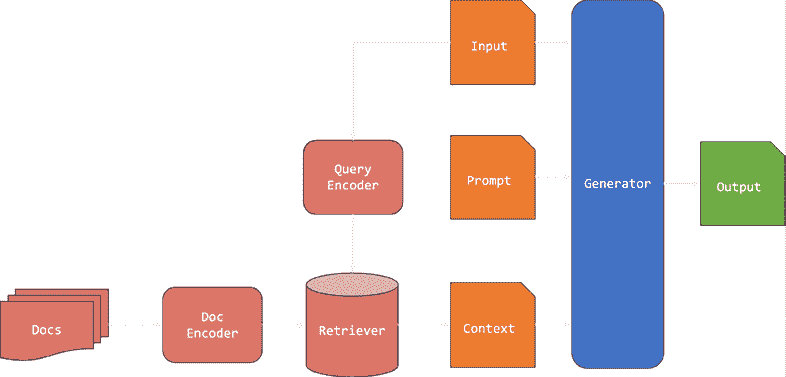

图 4.4: RAG 架构的高层框图

### 概念介绍

RAG 将传统的 LLM 与能够实时访问海量数据库的检索系统相结合。这种集成允许模型通过从数据库中提取的精确、上下文相关的数据来增强其生成输出，从而提高其响应的准确性和针对性。

检索能力的加入解决了标准大语言模型（LLM）的主要局限之一：对固定训练数据的依赖。RAG 允许 LLM 整合最新信息，使其处理需要最新知识或特定专业知识的任务时非常高效。

## 实现与用例

RAG 可以适用于各种行业，增强对信息准确性和及时性至关重要的应用。从客户服务到研发，RAG 扩展了 LLM 在传统生成任务之外的效用。

在医疗、金融和法律服务等领域，RAG 可以为专业人士提供实时、准确的信息，极大地辅助决策过程。例如，在医疗领域，RAG 可用于获取最新的临床指南或研究结果，以协助患者诊断和治疗计划。

### 示例：RAG 实现

*案例研究*：一家律所实施了 RAG 来增强其文档自动化工具，如图 `Figure 4.5` 所示。系统在起草法律文件时动态检索相关的案例法和法规，确保所有引用和法律先例都是最新的，并准确地整合到文档中。这种实现不仅加快了起草过程，还提高了生成的法律文档的准确性和合规性。

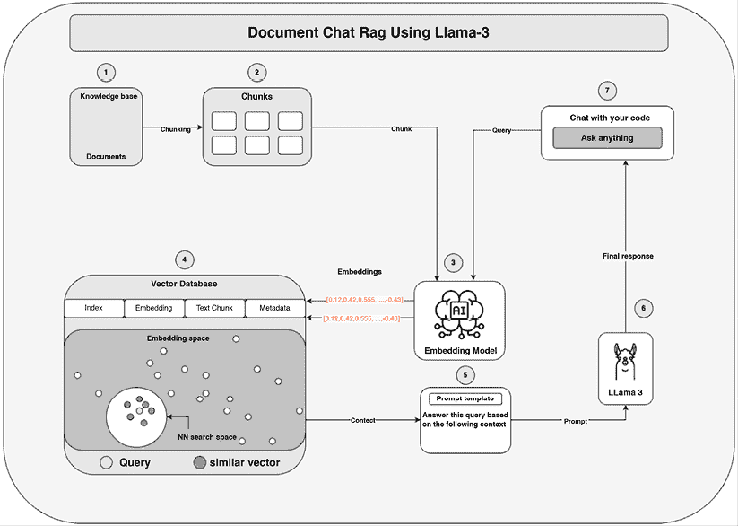

图 4.5：为与文档聊天任务构建 RAG 解决方案的示例

接下来，我们将深入探讨具体的用例，说明结构良好的知识库如何增强 RAG 的性能。这一进展将帮助你理解每个组件的实际应用和相关性，并与上一节讨论的实现和用例相联系。

### 自定义知识库

这是一组相关且最新的信息集合，作为 RAG 的基础。它可以是一个数据库、一组文档或两者的结合。在这种情况下，它是由你提供的 PDF，将作为“事实来源”（source of truth）来回答用户的查询。

以下代码将使用 LlamaIndex 的 `SimpleDirectoryReader` 从用户指定的目录加载 PDF 文档：

```python
from llama_index.core import SimpleDirectoryReader  # 如果不同，替换为实际导入路径

# 定义包含 PDF 的目录路径
input_dir_path = "./pdfs"
data_file = ['./pdfs/dummy.pdf', './pdfs/EJ1245288.pdf' ]

# 初始化 SimpleDirectoryReader
# 从目录加载数据
documents = SimpleDirectoryReader(input_files=data_file).load_data()

# 打印加载的文档以验证
if documents:
    print("Loaded the following documents:")
    for doc in documents:
        print(doc)
else:
    print("No documents loaded.")
```

### 嵌入模型 (Embeddings model)

这是一种将文本数据表示为数值向量的技术，向量可以输入机器学习模型。嵌入模型负责将文本转换为向量。

```python
from llama_index.embeddings.huggingface import HuggingFaceEmbedding
embed_model = HuggingFaceEmbedding(
    model_name="BAAI/bge-large-en-v1.5", trust_remote_code=True
)
```

### 向量数据库

这些是文本数据的数值向量表示集合，用于快速检索和相似性搜索，具备 CRUD 操作、元数据过滤和水平扩展等功能。默认情况下，LlamaIndex 使用简单的内存向量存储器，非常适合快速实验。

```python
from llama_index.core import Settings
from llama_index.core import VectorStoreIndex

# ====== 创建向量存储并上传索引数据 ======
Settings.embed_model = embed_model # 我们指定要使用的嵌入模型
index = VectorStoreIndex.from_documents(documents
)
```

### 检索器模块 (Retriever module)

检索器接收查询字符串以获取相关上下文，然后将它们都作为 prompt 发给 LLM 以生成最终的自然语言响应。这里使用的 LLM 是 Llama 3，它得益于 `Ollama` 在本地运行，Ollama 是一个允许本地模型执行并提供 OpenAI API 兼容性的平台。Ollama 支持运行 Llama 3 和 Llama 2 等模型，允许用户有效地将这些模型集成到应用程序中。最终响应显示在用户界面中。

```python
from llama_index.llms.ollama import Ollama
from llama_index.core import Settings
from langchain_core.prompts import PromptTemplate

# 设置 llm
llm = Ollama(model="llama3", request_timeout=120.0)

# ====== 在之前创建的索引上设置查询引擎 ======
Settings.llm = llm # 指定要使用的 llm
query_engine = index.as_query_engine(streaming=True, similarity_top_k=4)
```

**注意**

在代码中将 `streaming` 参数设置为 `True` 允许查询引擎在结果可用时流式输出结果，而不是等待整个响应生成完毕后再进行显示。这可以通过提供更快的反馈来增强用户体验，允许用户在模型继续处理查询时看到部分结果或中间响应。

### 提示词模板 (Prompt template)

使用自定义提示词模板来完善 LLM 的响应并包含上下文：


```python
examples = [
    [
        {
            "question": "Between Muhammad Ali and Alan Turing, who lived longer?",
            "answer": """
需要分析：是。
Step 1: 确定穆哈默德·阿里去世时的年龄。
Result: 穆哈默德·阿里在 74 岁时去世。
Step 2: 确定艾兰·图灵去世时的年龄。
Result: 艾兰·图灵在 41 岁时去世。
Conclusion: 穆哈默德·阿里活得更长。
"""
        },
        {
            "question": "What is the birthdate of the person who founded Craigslist?",
            "answer": """
需要分析：是。
Step 1: 识别 Craigslist 的创始人。
Result: Craigslist 的创始人是 Craig Newmark。
Step 2: 查找 Craig Newmark 的生日。
Result: Craig Newmark 出于 1952 年 4 月 6 日。
Conclusion: Craig Newmark 出于 1952 年 4 月 6 日。
"""
        },
        {
            "question": "Who was George Washington's maternal grandfather?",
            "answer": """
需要分析：是。
Step 1: 识别乔治·华盛顿的母亲。
Result: 乔治·华盛顿的母亲是玛丽·巴·华盛顿。
Step 2: 识别玛丽·巴·华盛顿的父亲。
Result: 玛丽·巴·华盛顿的父亲是约瑟·波登。

Conclusion: 乔治·华盛顿的外公是约瑟·波登。
"""
        },
        {
            "question": "Are the directors of Jaws and Casino Royale from the same country?",
            "answer": """
需要分析：是。
Step 1: 识别《大鲨》的导演及其国籍。
Result: 《大鲨》的导演是斯蒂文·斯尔伯格，他是美国人。
Step 2: 识别《赌场皇家风云》的导演及其国籍。
Result: 《赌场皇家风云》的导演是马丁·坎坎贝尔，他是新西兰人。
Conclusion: 不，《大鲨》和《赌场皇家风云》的导演不是同一个国家的。
"""
        }
    ]
]

example_prompt = PromptTemplate(
    input_variables=["question", "answer"],
    template="Question: {question}\n{answer}"
)
print(example_prompt.format(**examples[0][0]))
```

- 运营效率：分析对运营效率的更广泛的影响，包括决策过程的速度和质量，以及在动态环境中维持高准确标准的能力。

# 总结

本章探索了大语言模型（LLMs）与业务流程的集成。首先概述了用于训练大多数 GPT 系统的通用训练配方，并对企业利用生成式 AI 技术的不同策略提供了见解。本章涵盖了 API 的使用、预训练模型的微调，以及 RAG（检索增强生成）的创新应用，以定制出与现有 IT 基础设施无缝集成的解决方案。

本章详细介绍了 LLM 集成的两种主要方法：使用领域特定数据对预训练模型进行微调以实现定制解决方案，以及通过实施 RAG 将生成模型与信息检索系统相结合来提高准确性。例如，客服部门可以使用`OpenAI's API`集成聊天机器人来缩短响应时间，而财务分析公司可能可以在特定数据上对 LLM 进行微调，以生成个性化的客户报告。

对 RAG 的探索强调了它在解决传统 LLM 依赖固定训练数据局限性方面的作用。通过允许对大规模数据库进行实时访问，RAG 增强了 LLM 输出的准确性和特定性，同时显著减少了幻觉的发生，使其对于需要最新知识或专业知识的应用更具成效。这在医疗保健和法律服务等领域特别有用，因为 RAG 可以获取最新的指南或判例法来协助专业人士。

在下一章中，我们将从理论转向实践，使用`LangChain`和`FAISS`等工具在现实世界的应用中实现 RAG 流水线。

# 参考文献

- Hugo et al. 2023. Llama: Open and efficient foundation language models. arXiv preprint arXiv:2302.13971 (2023).

- 优化可以将 AI 训练的碳足迹减少高达 75%：[`news.umich.edu/optimization-could-cut-the-carbon-footprint-of-ai-training-by-up-to-75/`](https://news.umich.edu/optimization-could-cut-the-carbon-footprint-of-ai-training-by-up-to-75/)

- Azure AI Search 中的检索增强生成 (RAG)：[`learn.microsoft.com/en-us/azure/search/retrieval-augmented-generation-overview`](https://learn.microsoft.com/en-us/azure/search/retrieval-augmented-generation-overview)

- RAG、AI 与 Salesforce：深度解析：[`gptfy.ai/blog/rag-ai-and-salesforce-explained/#:~:text=RAG%20is%20an%20AI%20technology,positions%20companies%20for%20future%20success`](https://shorturl.at/yBIIn)

- Ollama：[`ollama.com/`](https://ollama.com/)

- PolyAI. (2020). 特定任务数据集。GitHub 仓库。检索自 [`github.com/PolyAI-LDN/task-specific-datasets`](https://github.com/PolyAI-LDN/task-specific-datasets)

- Touvron, H., Lavril, T., Izacard, G., Martinet, X., Lachaux, M.-A., Lacroix, T., Rozière, B., Goyal, N., Hambro, E., Azhar, F., Rodriguez, A., Joulin, A., Grave, E., & Lample, G. (2023). LLaMA: Open and Efficient Foundation Language Models. arXiv. [`arxiv.org/abs/2302.13971`](https://arxiv.org/abs/2302.13971)

## 立即解锁本书的专属福利

扫描此二维码或访问 [packtpub.com/unlock](https://packtpub.com/unlock)，然后按名称搜索此书。

|  |  |

注意：在开始之前请准备好您的购买发票。
