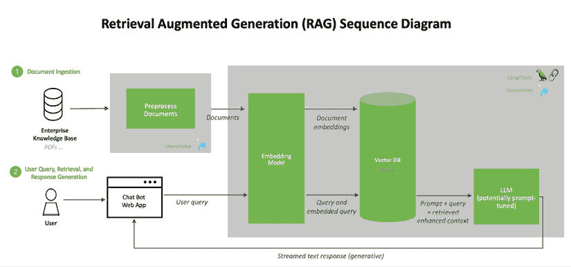
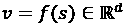
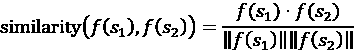
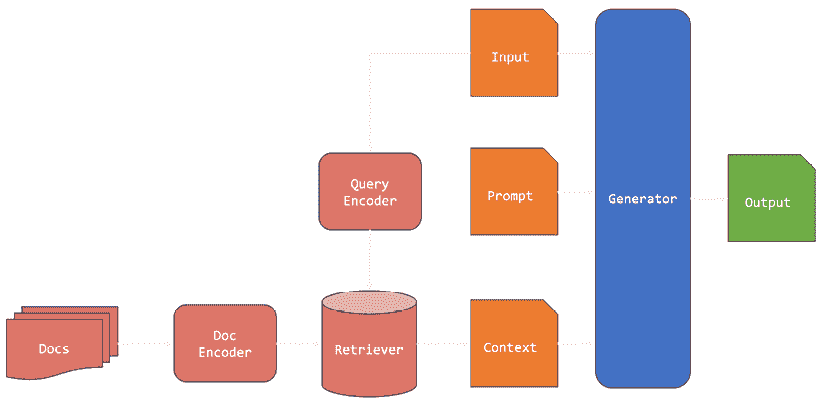
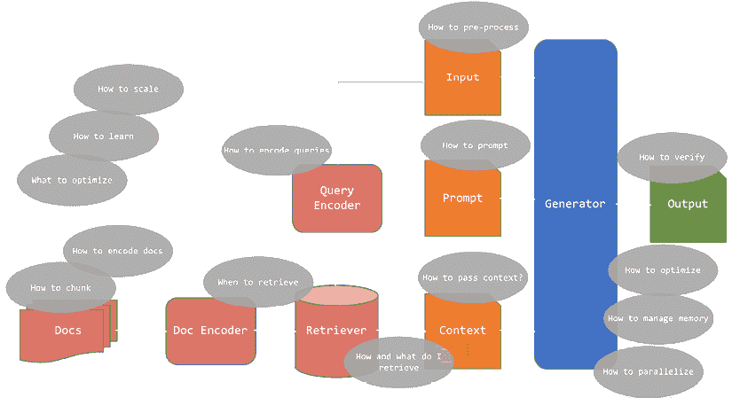
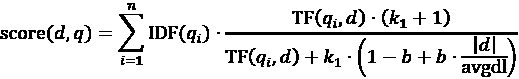

# 检索增强生成模式

在本章中，我们将探索检索增强生成（RAG），这是一种通过从外部数据源集成实时检索来增强模型的技术。虽然生成模型可以产生流畅的文本，但它们往往受限于知识局限、过时信息和幻觉。RAG 通过在生成响应之前检索最相关的外部信息来缓解这些问题，确保动态环境中的准确性、透明度和适应性。

我们将涵盖以下关键主题：

- 检索增强生成简介

- 检索机制的基础

- 常见的检索算法和数据结构

- 用于增强检索的嵌入（Embeddings）

- 确保归因、减少幻觉并促进修订

# 技术要求

在深入实现 RAG 之前，请确保已准备好所需的硬件和软件。

以下是硬件要求。您可以在以下设备上运行本章示例：

- Google Colab（推荐用于便于访问 GPU）

- 本地机器（如果您有所需的硬件）

对于在本地运行的用户，推荐规格如下：

- CPU：Intel i7/AMD Ryzen 7（或等型号）

- RAM：至少 16 GB（大规模检索建议 32 GB）

- GPU：可选，但推荐用于深度学习：
    - Google Colab 根据可用情况提供免费 T4、P100 或 A100
    - 本地使用：NVIDIA RTX 3090 或更高版本

以下是软件要求：

- 操作系统：Ubuntu 20.04+/Windows 11/macOS 12

- Python 版本：3.8 或更高

- 关键库和依赖：
    - `transformers`（用于 LLM）
    - `faiss`（用于向量搜索）
    - `langchain`（用于流水线）
    - `sentence-transformers`（用于嵌入）
    - `chromadb`/`pinecone`（用于向量存储）
    - `pypdf`（用于文档处理）
    - `bm25`（用于稀疏检索）

您可以在此处找到本章的完整代码：https://github.com/PacktPublishing/LLMs-in-Enterprise](https://github.com/PacktPublishing/LLMs-in-Enterprise)。

# 检索增强生成简介

现代智能生成系统旨在产生高质量且相关的输出。虽然高级生成模型可以构建流畅的文本，但仍面临一个关键挑战：这些系统本质上依赖于从训练数据中学习的模式，由于知识截止日期（模型无法感知该点之后的数据），无法按需访问更新或特定领域的信息。

因此，它们可能会提供过时的事实、忽略重要的企业知识资产，或在处理专业术语和用例时遇到困难。RAG 的出现为这一问题提供了解决方案，弥补了生成能力与企业所处的动态不断变化的信息环境之间的差距。

RAG 系统在生成流水线集成了检索机制。RAG 系统不再仅仅依赖生成模型的固定参数，而是查询数据库、文档库或知识图谱等外部数据源，在生成最终输出之前获取最相关的上下文。通过这种方式，RAG 确保 LLM 的响应不仅流畅，而且基于最新的、可验证且有来源的信息。检索步骤有效地充当了信息过滤器，缩小了最支持用户查询的外部语料库子集。生成步骤随后利用检索到的上下文产生更准确、更符合上下文的答案。

RAG 范式已迅速普及，特别是当企业寻求方法来管理大型内部知识库，并提供及时、一致且有事实依据的内容时。接下来的章节将分析 RAG 背后的动机，强调外部上下文的重要性，探索检索如何克服生成模型固有的局限性，讨论如何通过归因来源减少幻觉，并强调 RAG 系统如何与现代企业知识管理策略保持。

## 理解对外部信息源的需求

从核心上说，生成模型受限于其训练数据。无论其训练语料库有多详尽，生成模型都无法包含特定领域中的每一个事实、政策更新或新进展。当回答查询所需的信息在训练时不可用，或者具有深度领域特定性并存储在私有文档中，这种局限性就会变得显而易见。无法访问外部数据，系统将完全依赖内部的、预学的表示，这可能导致部分、过时或完全错误的响应。

下方的`Figure 4.1`展示了 RAG 系统中的操作顺序。当用户提交查询时，系统首先从外部知识源检索相关文档，然后将查询和检索到的上下文一起传递给生成模型。随后，模型根据这些增强的上下文生成响应，以确保事实准确性并减少幻觉。这一过程增强了模型提供信息充分且最新的答案的能力。



图 4.1: RAG 系统的序列图，展示了外部数据如何被检索并集成到生成过程中以提高准确性并减少幻觉

例如，考虑一个为旨在帮助大型制造企业员工而设计的技术支持工具。该工具可能需要参考最近的维护日志、更新的安全法规或新发布的产品手册。这些细节频繁变化，无法在每次更新时都可行地将其编码到模型的内部内存中。同样，法律研究助手可能需要参考最新的法庭判决或法规代码的变化。如果没有外部数据，系统将无法整合这些新信息。

除了时效性，领域特定性是另一个关键因素。组织通常维护着海量的文档库、内部 wiki、白皮书、存档电子邮件或标准操作程序。将所有此类内容直接存储在模型的权重中既不实际也没有必要。通过 RAG，模型不需要记忆所有内容。相反，它可以根据需要查找，仅检索相关的片段信息。这种模块化方法不仅提高了准确性，还确保了系统能够动态适应新数据和不断演变的知识库。

因此，访问外部信息只是等式中的一部分。另一个关键挑战是有效管理上下文。生成模型通常具有有限的上下文长度，限制了它们一次能处理的信息量。由于 token 和计算成本的大幅增加（这在一定是由注意力机制随上下文长度呈平方级增长驱动的），简单增加上下文窗口并不总是可行的。

这就是检索发挥作用的地方。检索不是用不必要的数据让模型过载，而是只拉取最相关的细节。这保持了响应的精确、高效和聚焦，确保模型在不浪费计算的情况下生成准确的答案。

## 通过检索克服上下文局限性

生成模型的基本限制之一是上下文窗口或`attention spans`（注意力跨度）的概念。即使是最先进的语言模型也受到固定上下文窗口的限制，这意味着它们只能处理有限数量的 token。如果用户查询复杂且需要大量的背景，简单地将更多文本塞进模型的上下文窗口可能并不可行，无法有效帮助模型正确回答。这就是检索大放异彩之处。

在 RAG 工作流中，当用户提交查询时，检索引擎会在大型语料库中搜索并仅返回最相关的文档或段落。这些检索到的片段作为精简且高度相关的文档块，聚焦了生成注意力。因此，RAG 并不是让生成阶段淹没在海量的无关数据海洋中，而是确保 LLM 根据一个精选的、与用户请求精确匹配的“知识片段”工作。

例如，想象这样一个场景：一位财务专业人士询问“我们欧洲分部去年第二季度的营收增长是多少？”如果没有检索，系统要么尝试记忆它是否“知道”该信息（如果该信息从未包含在训练中，很可能无法正确回答），要么返回一个通泛的答案。然而，通过检索，系统会查询财务数据库或一组季度报告，找到相关的电子表格或性能摘要，并能够输出必要的数字和注释。这部分经过仔细挑选的源内容（通常只有几句话）为模型生成精确且有据的响应提供了必要的上下文。

此外，通过限制给予 LLM 的数据量，检索有助于保持成本效益。由于从大量输入中生成文本在计算上可能是昂贵的，关注最相关的上下文可以减少延迟和资源消耗。结果是一个提供准确、上下文丰富的答案的更具效益的系统。

检索不仅提高了准确性，还增强了企业客户的信任。即使是最好的生成模型也会产生幻觉，产生听起来合理但错误的陈述。在高风险环境中，错误信息不仅是不方便的，可能会给终端用户带来高昂代价，导致误导性决策并影响公司的声誉。

通过仅从外部源检索最相关的信息，RAG 克服了上下文窗口的限制。它减少了将整个文档加载到提示中的需求，减少了 token 使用并缩短了响应时间，同时将模型的答案建立在可验证的数据之上。

## 减少幻觉并确保可归因信息

生成模型一个为人知的缺点是它们倾向于`hallucinate`（幻觉），产生听起来合理但事实错误的陈述。幻觉可能像混淆日期那样无害，也可能像提供危险的不准确的技术指导那样有害。在错误信息成本高昂的企业语境下，控制幻觉至关重要。

幻觉输出不仅损害用户信任，还可能让组织面临声誉损害、法律风险和运营失败。例如，2023 年，一位律师提交了一份由 ChatGPT 生成的法律诉状，其中引用了不存在的法院案件，这凸显了 AI 错误如何导致严重的职业和法律后果。

RAG 通过将生成过程建立在检索到的数据上解决了这一问题。系统不再仅仅依赖学习模式，而是基于具体的、可验证的来源生成输出。当 RAG 系统产生陈述时，它可以引用告知该陈述的检索文档。这一证据链具有两个关键功能：

1. **可验证性**：用户或审计人员可以将声明追溯到其源文档，确保输出是基于可识别且可靠的数据。这种验证声明的能力支持了数据溯源和治理实践，这对于合规性、可审计性和维护组织问责制至关重要。如果某个主张看起来可疑，可以对照原始仓库进行检查，从而增强信任和透明度。

2. **问责制**：通过确保生成的每条信息都有对应的引用，系统鼓励产生高质量输出。检索机制像一个过滤器一样，只将相关且准确的数据引入生成步骤。如果文档本身是可靠的，最终答案更有可能是正确的。

但即使发生错误，可追溯的输入也确保了问责制：更容易识别问题是源于缺陷文档、不清晰的提示、弱示例还是模型的误读。这种可见性使能够采取纠正措施，例如改进数据质量、优化提示、调整少样本（few-shot）示例或整合用户反馈，以增强`RAG`系统的整体性能。

这种归属机制在金融、医疗或法律等受监管行业中无价之，在这些行业中，决策通常必须有可靠的证据支持。“检索层”的存在赋予了组织采用生成式 AI 模型的能力，而无需放弃此类专业环境所要求的严谨性和合规性。

此外，减少幻觉可以提高用户信任。当终端用户看到答案引用了公司网站链接、官方报告或认可行业标准时，他们对系统可靠性的信心就会增加。随着时间的推移，这种信任可以导致更广泛的采用，为企业或终端用户简化更复杂的流程，从而强化`RAG`的价值主张。

企业经常面临信息扩散的难题。文档以多种格式存在：PDF、电子表格、知识库文章、内网页面等，并分散在不同的系统中。员工难以找到最新的流程、产品细节或合规性规则，导致了效率低下和潜在的错误。传统的搜索引擎虽然有帮助，但存在局限性：它们可以返回文档列表，但无法对其内容进行综合或情境化。

`RAG`有效地增强了传统企业搜索的能力。`RAG`系统不再仅仅提供链接或文档标题，而是利用检索到的信息生成一个综合且连贯的回答。这种方法将`信息检索`（`IR`）从被动的文件目录转变为主动的顾问，能够清晰、准确地回答问题、提供解释并概述流程。


在实践中，这意味着员工可以问诸如“我们内部安全协议的最新更新是什么？”`RAG` 系统会检索相关的内部指南或备忘录，然后生成摘要。员工不再需要手动筛选冗长的文档；`RAG` 流水线完成了繁重的工作，以直接可消费的格式呈现核心事实。

此外，`RAG` 还可以帮助维护机构记忆。随着员工职位的变动或离开公司，他们拥有的知识可能会被埋没在档案中。`RAG` 系统可以梳理这些档案，并向新团队成员展示相关的历史见解。这确保了连续性并减少了知识流失，使企业能够更充分地利用其信息资产。

最后，随着监管格局和市场环境的变化，企业需要敏捷的工具。`RAG` 系统可以毫不费力地更新：每当添加新文档时，就可以刷新检索索引，确保生成步骤始终利用最新的标准或产品变化。这无需从头重新训练整个 `LLM`。这种将通用语言能力与专业领域内容的解耦产生了更灵活、更易于维护的架构。

为了让 `RAG` 高效运行，它需要强大的检索骨干。企业产生了海量数据，但呈现正确的信息是一项复杂的挑战。传统的搜索方法往往不从心，返回没有上下文的文档列表。

`RAG` 通过利用先进的检索技术改变了这一点。在生成模型产生知情回答之前，它必须定位最相关的内容。下一节将深入探讨检索系统的工作原理，从经典搜索算法到现代 AI 驱动的方法，确保 `RAG` 驱动的解决方案利用企业数据中最相关且高效的内容。

要构建一个可靠的 `RAG` 系统，检索过程必须既高效又精确，确保只呈现最相关的信息。下一节将探索检索机制的基础，追溯其从传统搜索算法到驱动现代 `RAG` 流水线的先进 AI 驱动型检索方法的演变过程。

## 检索机制的基础

现代企业高度依赖于其信息资产：文档、数据库、维基、电子邮件、报告、技术规范等。然而，在正确的时间获取正确的信息仍然是一项非易的挑战。`IR` 是专门解决这一问题的领域：我们如何根据用户查询，从大型仓库中找到并展示相关项目？

本节将探讨检索的基础概念，从其历史根到尖端算法，并展示这些原则如何提高 `RAG` 流水线的准确性、效率透明度。

### 信息检索的历史背景

`IR` 作为一门正式学科比 `LLMs` 时代早了几十年。早期的 `IR` 系统开发于 20 世纪 50 年代和 60 年代，基于图书馆科学并依赖于文档的手动索引。随着文本数据量的爆炸（首先是数字档案，然后是万维网），`IR` 技术变得更加自动化和复杂。

到 20 世纪 90 年代初，AltaVista 以及后来 Google 等网页搜索引擎的出现将 `IR` 推向了主流。具有里程碑意义的技术，如词频-逆文档频率 (`TF-IDF`) 权重计算和向量空间模型指导了多年检索系统的设计。评估通过`文本检索会议` (`TREC`) 的研究人员小组/社区进行，这帮助建立了延续至今的最佳实践和衡量标准。

随着时间的推移，`IR` 系统从简单的关键词匹配演变为更细致的方法，能够考虑同义词、语义、用户意图和上下文。今天，检索方法汲取了自然语言处理和机器学习，最终形成了可以捕捉细微语义的密集嵌入检索。这些发展——基于关键词的搜索、统计权重和语义嵌入——为 `RAG` 系统使用的现代检索机制奠定了基础。

### IR 中的核心概念

在 `IR` 的核心有几个基本概念：

1. **文档表示**：集合中的每个项目（文档、片段和段落）都必须以可搜索的方式表示。这种表示可以是词袋模型、标记频率向量，或稠密嵌入。

2. **查询处理**：用户的查询（例如“我们欧洲分机构的年收入”）必须被转换为与文档表示兼容的形式。在基于关键词的 `IR` 中，查询仅仅是一组术语。在基于嵌入的 `IR` 中，查询被嵌入词向量矩阵中。

3. **排序**：给定一个查询，检索系统会为每个文档分配相关性评分，然后将排名靠前的项返回给用户（或 RAG 流水线的生成组件）。排序算法可能会考虑词频、语义相似性或其他相关性信号。

4. **评估**：IR 系统的优劣取决于其排序列表与用户信息需求的匹配程度。如 `precision`（精确率）、`recall`（召回率）和 `discounted cumulative gain`（折现累计增益，评估检索结果的相关性，排名越高权重越高）等指标衡量了系统满足查询的有效性。这些概念适用于稀疏或稠密、词法或语义等检索范式。

### 稀疏检索与稠密检索策略

**稀疏检索**（也称为**基于词的检索**）依赖于性的词法特征。例如，考虑一种字典形式的表示，每个文档根据其包含的单词进行索引。通过计算重叠词将查询与文档进行匹配。由倒排索引和 `TF-IDF` 驱动的经典引擎是稀疏检索的典型示例。

**稠密检索**使用连续向量表示（嵌入）。它不是通过离散词来索引文档，而是将每个文档表示为高维空间中的一个向量。查询同样被转换为向量，通过 `Euclidean`（欧式距离）或 `cosine similarity`（余弦相似度）等距离指标检索嵌入最近的文档。稠密检索捕捉的是语义相似性，而不仅仅是词法重叠。例如，“第二季度收入是多少？”之类的查询可以匹配提到“季度营收”的文档，即使单词并不完全相同。

### 常见的检索算法和数据结构

性能取决于选择合适的算法和数据结构。在大规模下，搜索数百万文档需要高效的索引和查询方法。让我们一些常见的检索算法和数据结构。

#### 倒排索引

**倒排索引**是稀疏检索的基础数据结构。它将词表中的每个词映射到包含该词的文档排序列表。例如，考虑包含三个文档的小型语料库：

- `d1`: “annual revenue growth in europe”
- `d2`: “europe sales stable last quarter”
- `d3`: “quarterly report on growth and revenue”

倒排索引可能如下：

- “annual” -> `[d1]`
- “revenue” -> `[d1,d3]`
- “growth” -> `[d1,d3]`
- “europe” -> `[d1,d2]`
- “sales” -> `[d2]`
- “quarter” -> `[d2]`
- “quarterly” -> `[d3]`
- “report” -> `[d3]`
- “and” -> `[d3]`

类似“europe revenue”的查询通过取交集列表来检索文档：“europe” -> `[d1,d2]`；“revenue” -> `[d1,d3]`；以此类推。交集结果显示 `d1` 最相关，`d2` 和 `d3` 也获得了高分，但略低于 `d1`。

倒排索引实现了快速的布尔过滤和排序，构成了经典搜索引擎的核心。以下是一个代码示例：

```python
# Example: 构建一个简单的倒排索引并进行查询
documents = {
   1: "annual revenue growth in europe",
   2: "europe sales stable last quarter",
   3: "quarterly report on growth and revenue"
}

def tokenize(text):
   return text.lower().split()

# 构建倒排索引: term -> doc_ids 排序后的列表
inverted_index = {}
for doc_id, text in documents.items():
   terms = tokenize(text)
   for term in terms:
       if term not in inverted_index:
           inverted_index[term] = []
       inverted_index[term].append(doc_id)

# 查询倒排索引: 一个简单的 AND 查询
query = "europe revenue"
query_terms = tokenize(query)
# 获取每个词的后列表
posting_lists = [set(inverted_index.get(term, []))
    for term in query_terms if term in inverted_index]

if posting_lists:
   candidate_docs = set.intersection(*posting_lists)
else:
   candidate_docs = set()

print("Query:", query)
print("Candidate documents:", candidate_docs)
```

这是输出结果：

```
Query: europe revenue
Candidate documents: {1}
```

由于 `doc_id 1` 同时包含“europe”和“revenue”，根据倒排索引结构，它是最相关的匹配。虽然 `doc_id 3` 也包含“revenue”，`doc_id 2` 包含“europe”，但只有 `doc_id 1` 包含了这两个词，使其成为检索的最强候选者。因此，基于此，`doc_id 1` 是我们查询的强有力候选。

#### 近似最近邻搜索

在稠密检索中，我们必须找到距离查询向量最近的向量。原生方法是将查询向量与每个文档向量进行比较，这在大规模下是一项昂贵的操作。**近似最近邻**（**ANN**）算法通过牺牲精确性来换取速度。它们将向量组织成树、图或量化簇等数据结构，以便我们可以跳过数据集的大部分。

例如，诸如**分层导航小世界**（**HNSW**）和 FAISS 的 `IVF-PQ` 索引会对向量空间进行聚类，允许亚线性的搜索时间。给定查询向量，ANN 搜索通过识别一个可能接近的候选子集，在进行更精确的比较之前，根据相似性评分快速过滤向量。然后在子集内精细搜索。以下是示例代码：

```python
import numpy as np
import faiss

# 创建随机数据集
np.random.seed(42)
dimension = 8
num_docs = 10
data = np.random.random((num_docs, dimension)).astype('float32')

# 构建 FAISS 索引（精确 L2）
index = faiss.IndexFlatL2(dimension)
index.add(data)

# 查询向量
query_vec = np.random.random((1, dimension)).astype('float32')

# 执行 ANN 搜索：找到前 3 个最近邻
k = 3
distances, indices = index.search(query_vec, k)
print("Query Vector:\n", query_vec)
print("Indices of nearest neighbors:", indices)
print("Distances:", distances)
```

以下是预期输出：

```
Query Vector:
[[0.86310345 0.6232981  0.33089802 0.06355835 0.31098232 0.32518333 0.72960615 0.63755745]]
Indices of nearest neighbors: [[2 3 7]]
Distances: [[0.7740041 0.8021247 1.0303653]]
```

示例演示了 FAISS 如何根据 L2 距离高效地识别最近的三个向量。即使在简单的设置中，我们也看到了 ANN 搜索显著减少了所需的比较，从而在稠密向量空间实现了快速检索。

与倒排索引等稀疏检索方法相结合，ANN 算法是现代 RAG 系统的关键构建模块，在不同类型的数据之间平衡精确性和性能。

#### 混合方法（基于词和基于嵌入）

单一技术并非总是最优。混合检索结合了稀疏和稠密方法，融合了两者的优点。混合方法可能会首先运行嵌入搜索以捕捉语义匹配，然后使用稀疏方法对结果进行过滤或重新排序以确保关键词精确性，反之亦然。这种分层策略与在整个语料库运行稠密搜索相比，降低了计算成本，因为它尽早缩小了候选文档范围并避免了昂贵的全局相似性比较。通过融合这些策略，我们获得了既能处理精确匹配又能处理细微同词的稳健检索。

以下是示例代码：

```python
# Example: Combining sparse and dense retrieval results
# Install required libraries if needed
# !pip install rank_bm25 sentence-transformers
from rank_bm25 import BM25Okapi
from sentence_transformers import SentenceTransformer, util
import numpy as np

corpus = [
   "annual revenue growth in europe",
   "europe sales stable last quarter",
   "quarterly report on growth and revenue"
]

# Sparse retrieval with BM25
tokenized_corpus = [doc.lower().split() for doc in corpus]
bm25 = BM25Okapi(tokenized_corpus)

# Dense retrieval with sentence-transformers
model = SentenceTransformer('all-MiniLM-L6-v2')
doc_embeddings = model.encode(corpus, convert_to_tensor=True)

query = "european quarterly revenue"
query_embedding = model.encode(query, convert_to_tensor=True)

# Dense retrieval scores
dense_scores = util.cos_sim(query_embedding, doc_embeddings
    )[0].cpu().numpy()

# Sparse retrieval scores
sparse_scores = bm25.get_scores(query.lower().split())

# Combine scores (simple linear combination)
combined_scores = dense_scores + sparse_scores

# Sort documents by combined score
ranked_indices = np.argsort(-combined_scores)  # descending order

print("Query:", query)
print("Sparse Scores:", sparse_scores)
print("Dense Scores:", dense_scores)
print("Combined Scores:", combined_scores)
print("\nRanked Documents by combined score:")
for idx in ranked_indices:
   print(f"Doc {idx}: {corpus[idx]}")
```

以下是预期输出：

```
Query: european quarterly revenue
Sparse Scores: [0.07075497 0\.         0.54872484]
Dense Scores: [0.7896244 0.6044986 0.6067592]
Combined Scores: [0.86037936 0.60449862 1.15548403]
Ranked Documents by combined score:
Doc 2: quarterly report on growth and revenue
Doc 0: annual revenue growth in europe
Doc 1: europe sales stable last quarter
```

该脚本通过结合 `BM25`（稀疏检索）和 `sentence-transformers`（稠密检索）演示了混合检索方法。合并这两种方法的得分可以确保结果能够捕获精确的关键词匹配和语义相似的内容。这种方法在精确术语至关重要但同时也需要更广泛上下文理解的场景中特别有效。通过平衡这些检索策略，混合方法提供了更稳健、准确且灵活的搜索能力，使其非常适用于真实的企业级应用。

### 评估检索质量

为了衡量我们的检索系统的工作效果，我们必须在代表性的查询上对其进行评估。适当的评估可以确保我们构建的系统真正帮助用户并有效支持下游的 RAG 任务。

检索可以说是 RAG 流水线中最关键的组件。现代大语言模型（`LLMs`）擅长对小型、结构良好的输入进行推理，但它们的有效性完全取决于检索上下文的质量和相关性。正确的检索和分块策略可以确保模型在正确的时间看到正确的信息。

#### 文本嵌入的概念概述

随着企业知识库的扩大，涵盖了从内部维基、产品手册到客户沟通和法律文件的所有内容，快速准确地检索正确信息变成了一项艰巨的任务。传统的基于关键词的搜索方法在查询和文档没有共享精确术语，或者当用户的意图比简单的关键词匹配更广泛时，往往力不从心。此时 `embeddings`（嵌入）出现了：它是文本的数值表示，能够在语义层面捕捉其含义，而不仅仅是表面形式。

嵌入通过启用语义搜索彻底改变了信息检索。不再通过查找精确关键词重叠来搜索文档，而是将查询和文档转换为向量，然后在高维空间中比较这些向量。与查询相关的文档在该空间中聚集，允许系统根据意义相似性而非仅仅是词汇来检索它们。从词汇检索到语义检索的转变是 RAG 的核心构建模块，因为 `RAG` 系统通常依赖检索语义最相关的文档来为其生成响应提供依据。

`text embedding`（文本嵌入）是一个通常具有数百或数千维的向量，用于表示一段文本的内容和含义。其神奇在于这些向量如何将相似的文本在向量空间中彼此靠近，而将不同的文本彼此远离。

从数学角度考虑，假设有一个句子 `s`。嵌入模型 `f` 将 `s` 映射为一个向量：




其中`d`是嵌入维度。如果两个句子`s1`和`s2`具有相似的含义，那么`f(s1)`和`f(s2)`在余弦相似度等相似性度量下是接近的：



高相似度（接近 1）意味着句子具有相关的含义。

这种从文本到向量空间的转换使得检索系统能够通过邻近性而非精确的关键词匹配来查找相关文档。因此，如果用户查询“欧洲季度收入”，系统也可以检索到提到“欧洲第二季度收入”的文档，即使它们之间没有精确的词汇重叠。

## 语义相似性与词汇相似性

`Lexical similarity`（词汇相似性）衡量的是字面上的重叠。例如，如果“automobile”从未出现在文本中，关键词搜索可能会将“car”和它视为无关的术语。相比之下，`semantic similarity`（语义相似性）关注的是含义。在大规模语料库上训练的嵌入学习到“car”和“automobile”占据向量空间中相似的区域。

在处理术语可能变化的企业数据时，这种差异至关重要。可能某些文档提到“client”（客户），另一些提到“customer”，还有一些提到“account holder”（账户持有者）。语义嵌入统一这些变体，允许更稳健的检索。

## 嵌入模型及其属性

嵌入模型随时间经历了显著的演变。早期方法如`GloVe`和`word2vec`通过对词共现统计进行无监督训练来学习嵌入。这些模型产生的静态词向量缺乏上下文感知能力。

然而，现代嵌入模型通常源自大型预训练语言模型，如`BERT`、`RoBERTa`或`Sentence-BERT`。这些模型生成的上下文嵌入能够捕捉到短语或句子层面的细微语义。关键属性包括：

1. **上下文性 (Contextuality)**：现代嵌入考虑句子的整个上下文，而不仅仅是单个单词。因此，“river bank”中的“bank”和“financial bank”中的“bank”会产生针对各自含义的差异嵌入。

2. **可迁移性 (Transferability)**：在通用网络文本上训练的嵌入模型通常在各种领域都表现良好。然而，对于高度技术性或特定领域的语料库（例如法律或医学），可以通过领域自适应（如微调嵌入模型）来增强性能。

3. **维度与复杂度 (Dimension and complexity)**：常见的嵌入维度从几百到几千不等。较高的维度可以捕捉更多细微差别，但计算开销可能更大。

这个上手示例让你看到嵌入实际上是如何运行的。例如，一个句子和它的改写句应该产生高余弦相似度的嵌入，而一个句子与另一个无关句子之间的相似度得分应该低得多。以下是示例代码：

```python
from sentence_transformers import SentenceTransformer, util
# 加载预训练嵌入模型
model = SentenceTransformer('all-MiniLM-L6-v2')
# 定义一些示例句子
sentences = [
   "The car is parked in the garage.",
   "A vehicle is inside the building where cars are kept.",
   "The weather is sunny and bright today."
]
# 将句子编码为嵌入
embeddings = model.encode(sentences, convert_to_tensor=True)
# 计算第一个句子与其他句子之间的余弦相似度
similarities = util.cos_sim(embeddings[0], embeddings[1:])
sim_with_sentence2 = similarities[0,0].item()
sim_with_sentence3 = similarities[0,1].item()
print("Similarity with sentence 2:", sim_with_sentence2)
print("Similarity with sentence 3:", sim_with_sentence3)
```

以下是预期输出：

```
Similarity with sentence 2: 0.5113641619682312
Similarity with sentence 3: 0.0436665304005146
```

在上述代码中：

* `similarities[0,0]`指后续句子中第一个句子的相似度得分。

* `similarities[0,1]`指后续句子中第二个句子的相似度得分。

虽然嵌入模型提供了语义表示文本的强大方式，但其有效性取决于维度和向量空间表示。下一节将探讨嵌入维度如何影响检索性能，以及降低维度如何提高效率和可解释性。

## 维度与向量空间表示

嵌入的维度`d`是一个设计选择。向量空间可能是，意味着每个句子被映射为一个 512 维的向量。虽然人类无法可视化这种高维空间，但我们可以使用相似性度量（如余弦相似度）来计算向量之间的距离。

降低维度（例如通过`PCA`或投影方法）有助于提高效率，有时还能提高可解释性。然而，原始维度通常在表示复杂的语言现象和计算的可行性之间取得平衡。

## 嵌入的领域自适应

在通用英语文本上训练的嵌入模型可能无法完全捕捉企业内部文档中的专业术语或缩写（例如“SKU breakdown”、“compliance protocol C-201”或“fintech API endpoints”）。领域自适应涉及在领域内文本上微调这些嵌入。

例如，如果您的组织有数千份支持工单和技术手册，您可以在这些文档上微调通用嵌入模型。得到的嵌入能理解领域术语，提高使用内部术语查询的检索准确性。

这种自适应可以通过以下方式实现：

* 收集领域文本并微调嵌入模型，使领域内相关的词映射到相似的向量

* 使用对比学习等技术，将领域句子对作为正样本

通过对领域数据进行嵌入自适应，组织可以显著提高检索准确性，并确保 AI 系统理解行业特定术语。

## 向量数据库中的索引、搜索和存储

一旦我们有了文档的嵌入，一旦我们有了所有文档的嵌入，我们必须以支持高效搜索的方式存储它们。向量数据库或向量索引正是为此设计的。与基于词的传统倒索引不同，向量数据库存储每个文档的嵌入，允许我们快速找到查询嵌入的最近邻。

为了高效检索相关信息，我们遵循以下步骤对向量数据库进行索引和搜索：

1. **嵌入语料库**：为每个文档计算嵌入。

2. **存储嵌入**：将嵌入插入向量数据库（如`Pinecone`、`Weaviate`或自托管的`FAISS`索引）。

3. **按嵌入相似性搜索**：对于查询计算其嵌入并执行最近邻搜索以找到前 k 个相似文档。这是一个简单的 Python 代码段，使用`sentence-transformers`嵌入文档，然后使用`FAISS`进行向量搜索：

```python
from sentence_transformers import SentenceTransformer
import faiss
import numpy as np
corpus = [
    "annual revenue growth in europe",
    "europe sales stable last quarter",
    "quarterly report on growth and revenue"
]
model = SentenceTransformer('all-MiniLM-L6-v2')
doc_embeddings = model.encode(corpus, convert_to_tensor=False)
# Convert to float32 for FAISS
doc_embeddings = np.array(doc_embeddings, dtype='float32')
dimension = doc_embeddings.shape[1]
index = faiss.IndexFlatL2(dimension)
index.add(doc_embeddings)
query = "european quarterly revenue"
query_embedding = model.encode([query], convert_to_tensor=False)
query_embedding = np.array(query_embedding, dtype='float32')
k = 2
distances, indices = index.search(query_embedding, k)
print("Query:", query)
for i, idx in enumerate(indices[0]):
    print(f"Rank {i+1}: {corpus[idx]} (distance: {distances[0][i]:.4f})")
```

以下是预期输出：

```
Query: european quarterly revenue
Rank 1: annual revenue growth in europe (distance: 0.4208)
Rank 2: quarterly report on growth and revenue (distance: 0.7865)
```

上面的代码演示了如何将文档和查询编码为嵌入；之后，它使用`FAISS`寻找最近邻，并展示了嵌入如何将文本转换为向量搜索问题。

## 向量量化与 HNSW 图

对于大规模检索（数百万级文档），精确的最近邻搜索速度太慢了。以下近似方法可以加速搜索：

* **向量量化 (VQ)**：将嵌入压缩为更小的`量化表示`（通常称为`codes`），用以近似它们在空间中的位置。可以更高效地搜索嵌入聚类。

* **HNSW 图**：我们不是对每个向量进行暴力破解的相似度计算，而是构建嵌入之间构建一个分层的连接图。该图按层组织，上层提供粗粒度导航，下层提供细粒度连接。搜索邻居涉及遍历此图。`HNSW`在保持高精度的同时极大加速了搜索。

通过在向量数据库中对嵌入建立索引，我们可以实现扩展到大型数据集的高效相似性搜索。这种方法允许快速准确的检索，使其成为 RAG 系统和其他 AI 驱动搜索应用的关键组件。

## 针对领域相关性微调嵌入

为了最大限度地提高检索质量，特别是在 RAG 语境下，可以对嵌入进行微调，使与企业任务相关的文档排名靠前。

**为什么微调有帮助：**

* 它将嵌入空间与领域的特定细节对齐，确保内部概念和词汇得到恰当的表示。

* 它确保 RAG 中的检索步骤能够如一致地返回真正有助于语言模型生成准确、内容丰富的答案的文档。

下面的代码段演示了微调嵌入以提高其领域相关性的过程。通过在领域特定数据上进行训练，我们可以确保相似的概念在向量空间中映射得更近，从而实现更准确的检索。此示例演示了加载数据集、在微调前后评估嵌入模型，并使用 Spearman 相关性衡量改进情况：

```python
import math
import numpy as np
from scipy.stats import spearmanr
from sentence_transformers import (
    SentenceTransformer, InputExample, losses, util
)
from torch.utils.data import DataLoader
from datasets import load_dataset
# 1\. 加载 STS-B 数据集（英语子集）
# stsb_multi_mt 包含多语言的 STS-B 数据；我们选择 'en'
sts = load_dataset('stsb_multi_mt', 'en')
train_data = sts['train']
test_data = sts['test']
# STS-B 相似评分范围从 0 到 5，我们将其缩放到 [0,1] 以用于 CosineSimilarityLoss
def scale_score(score, min_val=0.0, max_val=5.0):
    return (score - min_val) / (max_val - min_val)
def to_input_examples(dataset_split):
    examples = []
    for item in dataset_split:
        # similarity_score 在 [0,5] 
        score = float(item['similarity_score'])
        scaled_score = scale_score(score)  # 缩放到 [0,1]
        examples.append(
            InputExample(
                texts=[item['sentence1'], item['sentence2']],
                label=scaled_score
            )
        )
    return examples
train_examples = to_input_examples(train_data)
test_examples = to_input_examples(test_data)
# 2\. 加载预训练模型
model_name = "sentence-transformers/all-MiniLM-L6-v2"
model = SentenceTransformer(model_name)
def evaluate_model(model, examples):
    # 评估模型 cos_sim 与金分之间的 Spearman 相关性
    s1 = [ex.texts[0] for ex in examples]
    s2 = [ex.texts[1] for ex in examples]
    gold_scores = [ex.label for ex in examples]  # 这些在 [0,1] 中
    emb1 = model.encode(s1, convert_to_tensor=True)
    emb2 = model.encode(s2, convert_to_tensor=True)
    cos_scores = util.cos_sim(emb1, emb2).cpu().numpy()
    # 提取对角线
    diagonal_scores = np.array([cos_scores[i][i] for i in range(len(gold_scores))])
    # 计算 Spearman 相关性
    spearman_corr = spearmanr(gold_scores, diagonal_scores).correlation
    return spearman_corr
# 微调前的评估
before_corr = evaluate_model(model, test_examples)
print("微调前的 STS-B Spearman 相关性:", before_corr)
# 3\. 微调模型
train_dataloader = DataLoader(train_examples, shuffle=True, batch_size=32)
train_loss = losses.CosineSimilarityLoss(model=model)
epochs = 1
warmup_steps = math.ceil(len(train_dataloader)*0.1)
model.fit(
    train_objectives=[(train_dataloader, train_loss)],
    epochs=epochs,
    warmup_steps=warmup_steps,
    show_progress_bar=True
)
# 4\. 微调后的评估
after_corr = evaluate_model(model, test_examples)
print("微调后的 STS-B Spearman 相关性:", after_corr)
```

以下是预期输出：

```
微调前的 STS-B Spearman 相关性: 0.820324673123565
微调后的 STS-B Spearman 相关性: 0.848956151617583
```

显示微调后 Spearman 相关性明显提高，这表明模型更好地学习了领域特定的关系。这一过程确保了嵌入更符合企业需求，从而在下游任务中实现更相关的检索。

# 构建 RAG 流水线

RAG 流水线不是单一算法，而是一种系统架构，它将检索组件（例如向量数据库、知识图谱和搜索 API）与生成组件（LLM 本身）相结合，并加上连接它们的编排逻辑。像`LangChain`工具通过提供检索、模型交互和提示词格式化的组件，简化了流水线的构建，让开发者能够快速构建稳健的 RAG 应用程序。

## 系统架构概述

RAG 流水线由几个关键构建块组成：

1. **用户界面/输入**：用户提出问题或提供指令。

2. **检索器**：系统使用检索机制找到有助于回答查询的相关外部文档（块）。这些文档可以来自各种数据源，包括企业知识库、维基、产品手册或研究论文。

3. **步骤合并与提示词构建**：将选定的相关文档合并并整合到 LLM 的提示词中。

4. **LLM 生成**：LLM 读取提示词（查询 + 检索到的文档）并生成基于依据的准确的回答。

## 5. 后处理与归因

最终答案通常会连同引用或所用文档的参考文献一起返回给用户，从而增强了信任度和透明度。

RAG 流水线可以集成额外的步骤，例如查询重写、分块重排序、多跳检索或分层索引。对于复杂查询，你可能将问题拆分为多个子查询，并在合并它们之前为每个部分检索文档。

## 检索组件的集成


# 检索组件

检索组件是 RAG 的核心。没有可靠的检索，大语言模型（LLM）可能无法获得必要的实事实支持。可以通过以下方式进行检索：

- **基于术的搜索（`BM25` 或 `Elasticsearch`）**：一种简单但快速的方法，返回包含用户查询中关键词的文档。
- **基于嵌入（向量）的搜索**：将文档和查询转换为嵌入（embeddings），并使用相似性搜索查找语义上相关的文档。
- **混合检索**：结合词法和语义搜索，以利用两者的优势。

`LangChain` 提供了多种检索器，例如 `VectorstoreRetriever` 或 `BM25Retriever`。你可以加载向量数据库（如 `FAISS` 或 `Pinecone`）并将其连接到 `LangChain` 的检索器接口。以下是示例代码：

```
# 欧盟 AI 法案（EU AI Act）PDF 分析的逐步说明和脚本
# 安装所需的依赖项
# 在终端中运行这些命令，或取消注释以通过脚本直接安装：
# !pip install -qU langchain-ollama langchain-community pypdf faiss-cpu numpy
from langchain.document_loaders import PyPDFLoader
from langchain.text_splitter import RecursiveCharacterTextSplitter
from langchain.embeddings import OllamaEmbeddings
from langchain_core.vectorstores import InMemoryVectorStore
from langchain_core.runnables import chain
from typing import List
from langchain_core.documents import Document

# 步骤 1: 加载欧盟 AI 法案 PDF
# 使用 PyPDFLoader 将 PDF 加载到原始文档对象中。
pdf_path = "eu_ai_act.pdf"  # 替换为你的 PDF 文件路径
loader = PyPDFLoader(pdf_path)
raw_docs = loader.load()

# 步骤 2: 将加载的文档拆分为可管理的分块
# 使用 RecursiveCharacterTextSplitter 将内容划分为较小部分以便高效处理。
text_splitter = RecursiveCharacterTextSplitter(
    chunk_size=1500,
    chunk_overlap=200,
    separators=["\n\n", "."],
    add_start_index=True
)
docs = text_splitter.split_documents(raw_docs)
print(f"Number of chunks created from PDF: {len(docs)}")

# 步骤 3: 使用 OllamaEmbeddings
# 注意：确保 Ollama 正在运行 (`ollama serve`)）并且本地可用 `llama3` 等模型。
# 使用 Ollama 嵌入模型生成嵌入。
embeddings = OllamaEmbeddings(model="llama3")

# 步骤 4: 初始化 InMemoryVectorStore
# 在内存向量存储中存储和管理嵌入。
vector_store = InMemoryVectorStore(embeddings)
ids = vector_store.add_documents(documents=docs)
print(f"Documents added to vector store. Total IDs: {len(ids)}")

# 步骤 5: 执行相似性搜索
# 查询向量存储以根据给定的问题找到最相关的分块。
query = ("According to the EU AI Act, what transparency obligations must providers of high-risk AI systems "
        "comply with, and how do these differ from obligations for general-purpose AI systems?")
results = vector_store.similarity_search(query, k=1)  #  `k` 以获取更多结果
print("\n--- Top Matching Document ---")
print(results[0].page_content if results else "No relevant document found.")

# 步骤 6: 为批量查询定义检索器函数
# 在一次调用检索器中处理多个查询。
@chain
def retriever(query: str) -> List[Document]:
    return vector_store.similarity_search(query, k=1)

# 批量查询示例
batch_queries = [
    "What are the transparency obligations in the EU AI Act?",
    "How does the EU AI Act define high-risk AI systems?"
]
batch_results = retriever.batch(batch_queries)
print("\n--- Batch Query Results ---")
for idx, result in enumerate(batch_results):
    print(f"Query {idx + 1}: {batch_queries[idx]}")
    print(
        f"Answer: {result[0].page_content if result else 'No relevant document found.'}"
    )
    print("-----------")
```

以下是预期输出：

```
Number of chunks created from PDF: 270
Documents added to vector store. Total IDs: 270
--- Top Matching Document ---
. That guida nce shall be issued 12 months after the entry into force of
this Regulation, at the latest.
3\. For high-risk AI systems referred to in point 5(b) of Annex III which are placed on
the market or put into service by providers that are credit institutions regu lated by
Directive 2013/36/EU and for high -risk AI systems which are safety components of
devices, or are themselves devices, covered by Regulation (EU) 2017/745 and
Regulation (EU) 2017/746, the notification of serious incidents or malfunctioning
shall be limited to those that that constitute a breach of obligations under Union law
intended to protect fundamental rights.
--- Batch Query Results ---
Query 1: What are the transparency obligations in the EU AI Act?
Answer: ...
-----------
Query 2: How does the EU AI Act define high-risk AI systems?
Answer: ...
-----------
```

通过将检索组件集成到 RAG 流水线，我们确保模型能够访问相关信息。然而，仅有检索是不够的；一旦找到了文档，必须将其有效地整合到生成过程中。

## 基于检索内容的响应生成

一旦你检索了文档，必须将它们输入 LLM。这通常涉及构建一个包含用户查询和检索到的文档的提示词（prompt）。提示词可能如下：

```
[上下文文档 1]
[上下文文档 2]
...
用户查询：{User' question}
根据上述文档回答：
```

LLM 将产生更准确且有据的答案，因为相关上下文直接位于其输入中。这种方法对于处理模型训练时间之外或领域的查询至关重要。`LangChain` 的 `RetrievalQA` 链简化了这一工作流。你可以指定 LLM、检索器，以及可能的提示词模板。该链会自动：

1. 获取用户查询
2. 使用检索器找到前 k 个文档
3. 构建一个包含这些文档的提示词
4. 调用 LLM 生成最终答案

有效地组织检索到的上下文允许模型生成更准确的响应。然而，在处理长文档时，检索效率取决于如何分割文本。

## 长文档的分块策略

长文档是一个棘手问题，因为将它们作为一个整体进行嵌入或索引会丢失细节。相反，我们将其拆分为分块（chunks）。每个分块代表一段连续的文本部分（例如一段）。分块的大小很重要：

- **较小的分块**提供更细粒度的检索，但可能缺乏上下文。
- **较大的分块**确保了更多上下文，但可能会稀释相关性并降低检索精度。
- **重叠分块**确保重要的边界信息被捕获。

**方法**：从等等分块开始（例如约 512 个 token）。如果文档是有结构的（如 Markdown 或 HTML），可以按标题分块。对于非结构化文本，考虑按句子拆分并加上重叠。尝试不同的大小以获得最佳性能。

`LangChain` 提供了 `TextSplitter` 类。例如，`CharacterTextSplitter` 或 `RecursiveCharacterTextSplitter` 可以自动将大型文档拆分为较小的块，以便为嵌入做好准备。

## 结合多种检索方法

没有任何一种检索方法是完美的。混合检索可以将语义嵌入与基于关键词的过滤器相结合。例如：

- 首先，运行 `BM25` 搜索，通过关键词快速缩小候选范围。
- 然后，对这些候选文档运行向量相似性搜索，以选择最终文档。

或者，你可以并行运行这两种方法，并使用倒数排名融合（`RRF`）合并它们的结果。这通过利用词汇的精确性和语义的召回率提升了检索质量。

以下是一个混合方法的示例：

1. 关键词搜索（`BM25`）检索出前 100 个候选结果。
2. 嵌入搜索对这些结果进行重新排序或缩小到最佳 10 个。
3. 重排序模型（可选）将前 10 个精炼为最终的前 5 个。

**LangChain 集成：** `LangChain` 的 `MultiQueryRetriever` 可以从原始用户查询中生成多个语义查询并合并结果。你也可以链联两个检索器：首先使用 `BM25Retriever` 获取候选结果，然后使用 `VectorstoreRetriever` 进行最终的语义过滤。

# 确保归属、减少幻觉并便于修订

在 RAG 系统中确保适当的归属对于维护信力和透明度至关重要。通过将生成的响应与其原始源相关联，我们可以减少模型可能引入的幻觉以及错误或虚假的信息。

为了有效支持这些目标，RAG 系统应该包含以下关键实践：

- **源头追溯**：每个检索到的文档都应该包含作者、日期和源 URL 等元数据，以便于验证。
- **上下文化响应**：`LLM` 生成的响应不仅要回答查询，还要引用信息的源处。
- **可编辑输出**：系统应提供机制，允许用户在保持出处的同时修改或精炼响应。

在下方的 `provenance tracking script` 中，实现了这些方面，以确保检索到的信息保持可追溯和可验证性：

- 使用 `retriever` 获取相关的文档块。
- 增强 `rag_chain_with_source` 以同时返回生成的答案和相关的源。
- 为索引文档分配如 `source` 和 `author` 等元数据，以便于更好地追踪。

通过纳入这些归属机制，RAG 系统确保了 AI 生成的响应保持透明度。这不仅增强了用户的信心，还使 AI 应用符合监管要求，使其更适用于企业和合规驱动的环境。

## 源头追溯与文档溯源

追踪检索文档的溯源可以确保用户能够追溯所呈现信息的源头。溯源元数据包括：

- **文档源头识别**：每个索引文档都应该存储原始报告、研究论文或法律文件。
- **时间戳**：在文档元数据中嵌入时间戳，允许用户区分过时信息和当前信息。
- **审计日志**：记录检索和修改操作增加透明度，并符合 `EU AI Act` 等监管框架的性。

下方的脚本目前通过以下方式实现溯源追溯：

- 在索引新文档时存储元数据（`source`、`author`、`date`）。
- 在生成响应之前，将检索到的文本与其原始文档相关联。

```python
# 带有文档嵌入和检索的 EU AI Act 分析脚本
# ---------------------------------------------------
# 安装所需的依赖项
# 确保通过 pip 安装了以下包
```

- 通过关注高置信度检索来提高准确性
- 在对精确响应至关重要的企业应用中减少噪声

```python
# Description: Configure the retriever for similarity-based search with a score threshold.
retriever = vectorstore.as_retriever(
                         search_type="similarity_score_threshold",
                         search_kwargs={"score_threshold": 0.75})
```

通过应用置信度阈值，RAG 系统可以提供更精确、可靠的响应，同时尽可能减少无关或误导性的输出。这确保了只使用最相关且高置信度的信息，提高了用户信任度和系统性能。

## 审计和更新检索索引

定期更新检索索引可以确保纳入新信息，同时对旧内容进行存档或删除：

- **新文档摄入**：脚本使用 `vectorstore.add_documents(new_docs)` 动态向向量数据库添加文档。
- **重索引策略**：
  - 定期在更新的文档上重新训练嵌入模型
  - 移除过时的嵌入以防止检索到旧信息

```python
# Step 10: Adding New Documents to the Index
# Description: Dynamically add new documents to the existing vectorstore.
new_docs = [
    Document(page_content="Solar panels improve energy independence.",
             metadata={"source": "Report_C", "author": "EnergyWorld",
                       "date": "2023-06-20"})
]
vectorstore.add_documents(new_docs)
retriever = vectorstore.as_retriever()
```

此代码段演示了如何向向量存储添加新文档来动态更新检索索引。通过调用 `vectorstore.add_documents(new_docs)`，系统确保了新可用信息的纳入，提高了检索准确性。这种方法保持了知识库的新性和相关性，使检索器能够访问最新的内容。

### 处理过期或陈时信息

为了防止过期信息影响检索，系统应该利用：

- **时间戳验证**：在检索文档之前，系统检查其元数据以优先考虑最新的条目。
- **重排序机制**：在初始检索后，重排序模型不仅可以根据与查询的相关性，还可以根据发布日期等元数据对文档进行评分。通过在重排序期间引入基于时间的衰减函数或给予近期文档更高的权重，系统确保了较新的、更相关的来源优于旧来源。
- **用户反馈循环**：允许用户标记过时的响应以进行人工审核。

### 企业环境的修订工作流

企业需要结构化的工作流，在发布之前审查和修订 AI 生成的响应。一个健壮的修订框架包括：

- **人工参与评审**：允许人类专家验证和完善 AI 生成的响应
- **版本控制**：维护编辑历史和源引用以供审计
- **审批机制**：在响应发布之前实施审批流程

未来的增强可能包括集成反馈机制，用户可以在最终确定之前对生成的响应进行编辑和注释。

### 可信 RAG 输出的政策与治理

对于实施基于 RAG 的 AI 系统的组织，遵守治理政策至关重要。最佳实践包括：

- **监管合规性**：确保符合如《欧盟 AI 法案》和 GDPR 等 AI 法规的要求
- **偏差缓解**：定期审计模型和检索器，以最大限地减少响应中的偏差
- **安全与访问控制**：将数据访问限制给授权用户，并确保敏感信息受到保护

通过将治理框架嵌入到检索和响应生成过程中，企业可以增强 AI 驱动工作流中的信任和问责制。

# 总结


# RAG 概览

RAG 通过集成实时外部数据检索增强了生成式 AI，通过可验证、有来源的来源解决了知识过时和幻觉等局限性。它结合了稀疏（基于关键词）和密集（嵌入驱动）检索方法，利用语义理解和高效索引（例如 `ANN` 和 `HNSW`）来提高相关性。RAG 管道通过分块、混合检索和上下文感知生成动态合成企业知识，同时确保了追溯性和治理。通过将输出建立在领域适应嵌入和可更新索引之上，RAG 能够提供针对技术支持或合规等特殊用例的可扩展、准确的响应。这种方法将生成的流畅性与企业对透明度、新鲜和审计性的需求联系起来。

本章探讨了 RAG 及其通过集成外部数据检索增强生成式 AI 的作用。我们研究了稀疏和密集检索方法、索引技术以及微调嵌入以提高准确性和相关性的策略。通过将响应建立在实时信息上，RAG 减少了幻觉并确保了透明度，对于技术支持和合规等企业应用来说特别有价值。这些技术使 AI 模型能够在无需不断重新训练的情况下提供最新的、事实支持的答案。

在下一章中，书籍将深入探讨如何使用 RAG 定制上下文 LLM。它将关注这种方法如何减少对话中的幻觉，进一步提高业务应用中 LLM 输出的相关性和可靠性。这将涉及更详细的决策讨论和实际示例，用以说明这些模型在各个行业中的扩展功能。

## 参考文献

Weiser, B. (2023, June 22). *Here’s what happens when your lawyer uses ChatGPT*. The New York Times: [`www.nytimes.com/2023/05/27/nyregion/avianca-airline-lawsuit-chatgpt.html`](https://www.nytimes.com/2023/05/27/nyregion/avianca-airline-lawsuit-chatgpt.html)

## 订阅免费电子书

新框架、演进的架构、研究发布、生产分析——AI_Distilled 将噪声过滤为为手工操作 LLM 和 GenAI 系统的工程师和研究人员提供的每周简报。现在订阅即可获得免费电子书，以及帮助您保持专注并掌握信息的每周见解。

大语言模型（LLMs）在现实应用中的有效性往往取决于它们基于对上下文丰富理解来识别和生成响应的能力，由于其通用的训练过程，标准模型有时难以应对这一挑战。为了解决这个问题，如`检索增强生成`（`RAG`）等创新解决方案开始在不同业务中广泛应用。RAG 解决方案增强了 LLM 的上下文感知，使其不仅能够产生相关且准确的输出，还能动态地适应新信息和复杂的用户需求。虽然上一章介绍了 RAG 后的后的概念，但本章将深入探讨其实际应用。

除了 RAG 之外，提示词工程（prompt engineering）也是一项能够影响 LLM 性能的关键技术。通过仔细设计和精炼提供给模型的提示词，用户可以引导 LLM 生成更准确且与上下文相关的响应。这一过程涉及理解如何有效地构建问题和指令，以确保模型的能力得到充分发挥。RAG 和提示词工程共同作用，为在各种应用中优化 LLM 构建了一个更具健壮的框架。

## 技术要求

为了跟随本章中的示例和代码，读者应具备以下技术配置：

* `Python (3.8 或更高版本)`：许多示例使用基于 Python 的库进行 LLM 交互和数据检索。

* `Jupyter Notebook 或 VS Code`：推荐用于运行和修改代码段。

* `LangChain (最新版本)`：实现基于 RAG 的检索方法所需的。使用以下命令安装：

* `FAISS 或 ChromaDB`：高效向量搜索和嵌入检索的必要工具。使用以下命令安装：

* `Hugging Face 模型`：某些示例使用了来自 Hugging Face 的开源模型。确保你拥有 API 访问权限或本地 LLM 环境。

你可以在书籍配套的 GitHub 仓库中找到本章的代码示例：[`github.com/PacktPublishing/LLMs-in-Enterprise`](https://github.com/PacktPublishing/LLMs-in-Enterprise)

## 上下文定制重要性

对 LLM 进行定制以纳入上下文理解不仅是一项技术增强；它代表了我们构想 AI 在工业和社会中所角角色的范式转变。通过这些进步，LLM 可以经过微调以识别特定领域内语言和信息的细微差别，从而产生更智能的模型，这些模型能够识别模式并制定更具事实依据的响应。

对于企业而言，定制 LLM 意味着在需要深度理解专业数据或操作的任务中，具有极大提高效率和准确性的潜力。对于消费者而言，这意味着与能更深理解其查询的 AI 系统交互，提供更准确且符合上下文的响应。在医学或法律等对精确性和相关性至关重要的任务领域，这些改进可能是革命性的，可以将海量数据转化为可操作的洞察，为人们提供基本服务并减轻公共基础设施的负担。

### 利用外部内存进行上下文管理

随着对 LLM 的需求增加，特别是在需要复杂决策或随时间与领域特定知识持续交互的任务中，集成外部内存系统（特别是向量数据库）已变得至关重要。这些系统作为 LLM 的外部内存，通过高效存储和检索领域特定数据的嵌入，增强其管理上下文的能力。本节探索了将向量存储解决方案战略性地整合到 LLM 框架中，讨论了这种方法的优点和操作化挑战。

#### 优点

如`图 5.1` 所示，用外部内存扩展 LLM 可以显著增强它们的上下文感知能力。这些系统允许 LLM 保留并访问超出其即时处理能力的海量详细信息。例如，在客户服务应用中，LLM 可以跨越多次交互保持连贯且信息丰富的对话，显著提升用户体验。具体来说，考虑客户查询特定产品 SKU 的场景。通过利用集成到 LLM 模型中的向量存储，应用程序可以从领域特定数据立即检索详细的产品信息和价格。



图 5.1：参与 RAG 设置的不同组件的高级框图

此外，外部内存系统为 LLM 创建了动态知识库。与静态模型不同，配备外部向量存储的 LLM 可以动态更新知识库，而无需完全重新训练。这种能力在法律、医疗或金融服务等快速发展的领域至关重要，因为保持最新信息是必须的。通过不断整合新数据，这些模型可以提供准确且实时的响应，确保它们在实时应用中的相关性和可靠性。

此外，通过将嵌入的存储卸载到专门的外部系统，LLM 的可扩展性和效率得到了大幅提高。向量存储设计用于高效处理大规模数据，有助于更快速地检索信息并减轻核心模型的计算负载。这种存储与生成功能的分离允许 LLM 运行更高效，使其能够大规模处理更大容量的数据和更复杂的查询。总体，将外部内存与 LLM 集成不仅提升了它们的上下文和动态生成能力，还增强了它们的运行效率和可扩展性。

# 企业中的 RAG

在具有严格准确性限制的企业中使用微调后的 LLM 或基础模型面临着巨大挑战。非 RAG 方法通常面临高得得多的幻觉问题，在没有明确归因的情况下生成错误信息，使得组织难以符合要求透明度和可解释性的 AI 法规。此外，这些模型会随着时间的推移而变得过时，在出现新数据时对其进行重新训练既挑战性又昂贵。处理修订（例如移除退出特定服务的个人并确保其数据被删除）进一步增加了重新训练过程的复杂性。使用领域数据定制非 RAG 模型面临着若干挑战。首先，这些模型经常遇到上下文窗口限制，限制了它们能够有效处理的信息量。结果是关键上下文可能会丢失，导致输出准确性降低。

此外，将大量的领域数据倾入提示词可能会产生“大海捞针”问题，使模型难以在无关数据中识别出相关信息。这凸显了对 RAG 这种结构化方法的需求，它能更好地管理领域特定信息。

RAG 模型通过将 LLM 的输出建立在可检索、准确的数据源上，缓解了许多此类问题。观察发现它们可以减少幻觉、提高事实召回率，并允许企业追溯到用于生成的源数据或上下文，从而增强了理解和合规性。

此外，RAG 模型有效地解决了数据过时、修订和定制化等挑战。通过将检索框架与生成过程解耦，可以对底层数据进行更新，而无需更改 LLM 本身。这种灵活性允许企业在利用 LLM 生成能力的同时，保持准确且实时的信息。

## 企业案例

本节提供了一些真实世界的示例，在这些示例中，RAG 通过利用组织的非结构化数据来识别模式并根据领域知识制定答案，从而提供巨大的价值。

### 法律行业

对于法律专业人士而言，一个能够包含法律文档嵌入（embeddings）的向量存储的 LLM 可以显著简化研究和文档审查流程。当律师查询特定的案例法或先例时，LLM 可以立即从外部内存中提取相关文档。这缩短了手动搜索的时间，提高了法律研究的准确性，使过程变得更加高效且详尽。一些真实世界的示例包括：

* `CaseText’s CoCounsel`: 提供 AI 驱动的法律研究和文档起草辅助。

* `Harvey.ai’s Legal Copilot`: 协助法律研究、起草和工作流自动化。

### 医疗行业

在医疗环境中，配备外部内存的 LLM 可以访问存储在向量存储中嵌入的患者完整医疗历史。当患者与虚拟健康助手交互时，LLM 可以快速检索患者的过去医疗记录、当前药物和之前的交互记录。这种能力允许 LLM 提供个性化的建议和提醒，增强患者护理并确保交互过程的一致性。一些真实世界的示例包括：

* `IBM Watson Health`: 使用 AI 协助医疗研究、诊断和患者护理。

* `PathAI`: 利用 AI 进行病理图像分析，协助诊断和治疗计划。

### 金融行业

在金融领域，AI 驱动的解决方案正在改变市场分析、风险评估和投资策略。具有外部内存能力的大模型使金融机构能够访问大量的历史和实时数据，增强了决策和预测分析。这些技术简化了金融研究，实现了洞察自动化，并提高了市场情报效率。一些真实世界的示例包括：

* `Kensho Technologies`: 为金融市场和投资策略提供 AI 驱动的分析和洞察。

* `AlphaSense`: 使用 AI 进行金融研究和市场情报，利用 RAG 技术获得更深层次洞察。

### 客户服务行业

AI 驱动的虚拟助手和聊天机器人通过对用户提问提供即时智能响应正在重新定义客户服务。凭借检索相关过去交互和上下文信息的能力，LLM 提高了响应准确性并缩短了等待时间，从而提升了客户满意度和运营效率。一些真实世界的示例包括：

* `Zendesk’s Answer Bot`: 采用 AI 提供自动回复并提高客户服务效率。Zendesk Answer Bot。

* `Ada`: 使用 AI 进行自动客户支持和查询解决。

### 教育行业

AI 通过使学习体验适应每个学生的需求，在个性化教育方面发挥着至关重要的作用。LLM 可以检索知识、生成实时解释并提供交互式辅导，使教育更易获得且有效。一些真实世界的示例包括：

* `Socratic by Google`: 一款教育应用，使用 AI 通过提供解释和相关资源帮助学生完成作业。

* `Khan Academy’s Khanmigo`: 一个 AI 驱动的导师，提供个性化的学习体验和支持。

### 房地产行业

AI 驱动的洞察通过提供准确的物业估值、预测性市场趋势和数据驱动的投资分析，正在彻底房地产行业。LLM 通过检索全面的物业数据和市场洞察增强了决策能力。一些真实世界的示例包括：

* `Zillow’s Zestimate`: 使用 AI 提供房地产估值估计和洞察。

* `Reonomy`: 采用 AI 为商业房地产提供数据驱动的洞察和物业分析。

## 企业使用 RAG 的挑战

将 RAG 集成到企业应用中面临着一系列独特的挑战和局限性，其中一些显示在 `图 5.2` 中。虽然 RAG 模型通过访问海量外部知识库可以显著增强 LLM 的能力，但它们的实现和维护需要仔细的考虑。从集成复杂性和延迟问题到涉及的高昂成本以及持续的事实性不准确问题，企业必须克服重重障碍才能有效利用 RAG。



`图 5.2`: 参与 RAG 设置的不同组件的高级框图及其各自的运营化挑战

接下来的小节中，我们将更详细地介绍这些挑战，为在生产环境中部署 RAG 系统的技术和运营方面提供见解。

### 集成复杂性

将外部内存与 LLM 集成为 AI 系统架构增加了复杂性，需要仔细的规划和健壮的工程，以确保模型与内存系统之间的无缝交互。这一过程涉及管理依赖关系、确保兼容性和维护系统稳定性。

### 延迟问题

虽然向量存储通常很高效，但检索信息可能会引入延迟，如果数据量巨大或网络基础设施未优化，这种延迟可能是显著的。这些延迟问题会影响需要实时处理的应用的响应。

### 成本考虑

实施和维护外部内存系统可能会产生巨大的成本，因为支持大规模向量存储解决方案的基础设施（包括硬件和软件）可能是巨大的。此外，持续成本还包括存储、维护以及可能更高的处理能力需求。

### 事实性错误和幻觉

尽管取得了进步，先进的 LLM 经常面临事实性不准确和知识幻觉的问题。RAG 方法减少了幻觉，但需要仔细的实现和调优才能生效。确保模型检索并使用准确信息而不引入错误仍然是一个重大挑战。

### 技术和优化挑战

实现带有 RAG 或外部内存的 AI 系统涉及多个影响性能、效率和准确性的技术挑战。以下是优化文档编码和检索机制必须解决的关键因素：

* **文档编码**: 决定如何编码文档至关重要；这涉及选择合适的嵌入模型以捕捉领域知识的细微差别。在编码步骤，必须对文档进行有效的分块，以确保嵌入能够准确代表内容。

* **检索机制**: 选择何时以及如何检索文档对于效率和准确性至关重要。查询编码器必须能够将用户查询转换为与存储文档匹配的嵌入。

查询编码器必须能够将用户查询转换为嵌入（embeddings），以便与存储的文档进行匹配。然而，在此阶段，更关键的是确保强大的检索质量，这依赖于针对特定用用例选择合适的搜索算法和相似性函数。这些元素对于将查询准确匹配到最相关的文档至关重要，从而优化系统的整体性能。

* **输入预处理**：输入预处理对于确保输入到模型的数据是干净且格式正确的至关重要。这一步骤包括分词、归一化，并可能对数据进行增强以提升模型的理解能力。

* **Prompt 设计**：设计能够有效引导大语言模型（LLM）的 Prompt 对于生成准确且相关的响应至关重要。Prompt 需要提供足够的上下文和方向，而不会让模型过载或引入歧义。

* **上下文管理**：有效地传递上下文涉及到在整个交互过程中保持连贯性和相关性。上下文管理技术确保 LLM 在多轮对话中保留重要信息。

* **输出后处理**：后处理涉及对生成的输出进行精炼，以满足质量标准。这一步骤包括验证事实的准确性、纠正错误，并确保响应对于给定上下文是恰当且安全的。

* **扩展与优化**：将系统扩展到高效处理海量数据和查询是一项重大挑战。需要持续的训练和优化来保持系统更新新数据并提高性能。

* **动态数据集成**：向外部内存动态添加新数据需要一个健健的流程来嵌入和整合新信息。系统必须支持增量更新，以确保在领域特定数据演进时保持时性和准确性。

## 理解 RAG 的“检索”方面

一个常见的误区是，AI 通过 RAG 会自动理解并获取任何查询的最相关信息。然而，检索过程仍然面临经典的信息检索挑战，例如根据相关性、权威性、新时性以及特定关键词对结果进行排名。

考虑这样一个场景：用户查询肯尼亚今年第一季度的咖啡生产情况。简单的基于相似性的检索可能会返回不同年份的埃塞俄比亚咖啡生产信息，因为非洲产咖啡国家的向量表示是相似的。当检索到的埃塞俄比亚报告与更相关的更新肯尼亚数据相比过时时，就会出现问题，导致不准确或误导性的结果。为了解决这个问题及类似的挑战，我们可以探索混合搜索方法，以增强检索的准确性和相关性。

### 混合搜索

解决这一挑战的方法之一是使用混合搜索。混合搜索的概念代表了信息检索领域的重大进展。它将传统的基于关键词的搜索与现代语义搜索技术相结合，提供更准确且与上下文相关的结果。在这个框架下，`BM25` 通过处理基于关键词的部分起着至关重要的作用，而语义搜索技术则管理上下文和基于含义的。这种方法在处理复杂查询时特别有效，此时显式关键词和底层含义对于寻找正确信息都起着至关重要的作用。

#### BM25：关键词匹配组件

BM25 代表 Best Matching 25（最佳匹配 25），它是传统搜索引擎中一种排名函数，根据每个文档中出现的查询词对文档进行排名。以下是 BM25 工作原理的简要分解：

* **词频 (TF)**：衡量一个术语在文档中出现的频率。术语在文档中出现的次数越多，其词频越高。

* **逆文档频率 (IDF)**：衡量一个术语的重要性。像“the”之类的常用词汇出现在许多文档中，信息量很小，因此获得较低的 IDF 分。相反，稀有术语对文档的独特性贡献更大，获得较高的 IDF 分。

* **归一化**：对不同长度的文档进行处理，防止长文档主导相关性评分。BM25 对文档长度进行调整，使得短文档和长文档得到公平对待。

* **相关性评分计算**：BM25 结合这些元素来计算一个评分，表示文档与给定搜索查询的相关性。公式为：

```

```

其中：

* `` 是 `` 查询词

* `` 是一个文档

* `` 是文档的长度

* `` 是文本集中平均文档长度

* `` 和 `` 是自由参数，通常分别设置为 1.2 和 0.75

#### 使用向量搜索进行语义搜索

向量搜索利用语义含义来增强搜索过程。与关键词搜索不同，向量搜索将查询和文档都转换为高维空间中的向量。词之间的语义关系被捕获在这个空间中，因此即使词不完全匹配，也可以检索到与查询上下文相关的文档。让我们进一步拆解一下。


**工作原理**：使用`BERT`或`GPT`等模型将词转换为向量，这些模型捕获了词的上下文含义，而不仅仅是它们的字面定义。这允许搜索系统以感知感知的方式理解查询，使其即使在不包含确切查询词的情况下，也能获取到语义相似的文档。例如，如果用户搜索“如何修理自行车”，系统可能还会检索与“自行车维修说明”相关的文档，因为这些短语的语义含义是密切相关的。

**重要性**：这种方法对于处理搜索意图与搜索词同样重要的微妙查询至关重要。通过理解查询的底层含义，系统可以提供更准确、相关的结果，确保用户即使在查询方式与文档内容不同时也能找到他们的信息。

### 实现混合搜索

将 BM25 和向量搜索相结合允许我们利用这两种方法的优点：关键词搜索的精确性和语义搜索的上下文感知能力。以下是你可以实现基础混合搜索的方法：

1. **使用 BM25 检索初始结果**：...结果。这一步骤确保结果至少与查询相关。

2. **应用向量搜索精炼结果**：从 BM25 结果中提取前``个文档，然后使用向量搜索对其重新排名。通过这种方式，你根据语义相似性精炼了结果，提高了整体相关性。

3. **合并并重新排名**：最后，结合 BM25 和向量搜索的评分以重新排名。可以通过为每个评分分配权重并求和来获得每个文档的最终评分。作为超参数，可以根据每种方法的重要性调整权重；例如，如果精确关键词匹配更关键，则可能给 BM25 赋予更高的权重，如果优先考虑相关性，则给向量搜索赋予更高的权重。通过尝试不同的权重，你可以找到最适合你检索需求的平衡点。

下面的示例演示了如何整合基于关键词和语义搜索的技术，使用 LangChain 和 LanceDB 从 PDF 中检索文档。

在深入研究示例之前，我们将提供关于 LangChain 和 LanceDB 的简要介绍。

### LangChain

LangChain 是一个帮助开发者构建集成大模型（LLMs）应用程序的框架。它简化了自然语言处理（NLP）任务，如提示词工程、上下文管理和内容生成。LangChain 允许将不同的任务无缝地连接到模型中，从而构建复杂的流水线，支持聊天机器人等多种用例。

### LanceDB

LanceDB 是一个专门的向量数据库，旨在高效存储、索引和检索高维向量。它在需要执行相似性搜索的场景中非常有用，例如在依赖 LLM 的应用程序中。

### 示例

示例涉及设置 BM25 检索器和 LanceDB 向量存储，这种混合搜索方法确保检索到的文档不仅符合关键词匹配，而且符合查询意图，从而提高检索准确性和用户体验。

**注意**

以下代码的安装需求可以在 GitHub 中找到。

示例查询用于增强骨骼和牙齿的信息：

```python
from langchain.vectorstores import LanceDB
import lancedb
from langchain.retrievers import BM25Retriever
from langchain.schema import Document
from langchain.embeddings.openai import OpenAIEmbeddings
from langchain.document_loaders import PyPDFLoader
# 初始化语义搜索的嵌入
embedding = OpenAIEmbeddings()
```

- 使用`PyPDFLoader`加载并分割 PDF：

```python
from langchain.document_loaders import PyPDFLoader
# 加载文档
loader = PyPDFLoader("Food_and_Nutrition.pdf")
pages = loader.load_and_split()
```

- 初始化 BM25 检索器并获取结果：

```python
from langchain.retrievers import BM25Retriever
# 初始化 BM25 检索器
bm25_retriever = BM25Retriever.from_documents(pages)
# 使用 BM25 获取前 2 个结果
```

- 连接 LanceDB 并创建用于存储嵌入的表（语义搜索）：

```python
import lancedb
# 为语义搜索创建 lancedb 向量存储
db = lancedb.connect('/tmp/lancedb')
table = db.create_table("pandas_docs", data=[
    {"vector": embedding.embed_query("Hello World"),
        "text": "Hello World", "id": "1"}
], mode="overwrite")
```

- 设置语义搜索的 LanceDB 检索器：

```python
from langchain.vectorstores import LanceDB
from lancedb.db import LanceDBConnection
from langchain.embeddings.openai import OpenAIEmbeddings
from langchain.document_loaders import PyPDFLoader
# 初始化语义搜索的嵌入
# 建立与 LanceDB 数据库的连接 # 将 'your_database_path' 替换为实际路径
connection = LanceDBConnection('lancedb') # 假设 `pages` 是之前加载的 Document 对象列表 # 初始化 LanceDB 检索器
docsearch = LanceDB.from_documents(
    pages, embedding, connection=connection
) # 使用 LanceDB 向量存储创建检索器
retriever_lancedb = docsearch.as_retriever(search_kwargs={"k": 2})
```

- 带有指定权重的 BM25 和 LanceDB 检索器：

```python
from langchain.retrievers import EnsembleRetriever
# 使用权重初始化集成检索器
ensemble_retriever = EnsembleRetriever(
    retrievers=[bm25_retriever, retriever_lancedb],
     weights=[0.4, 0.6]
)
```

- 使用集成检索器查询并检索相关文档：

```python
# 示例查询
query = "which food needed for building strong bones and teeth?"
# 相关文档
docs = ensemble_retriever.get_relevant_documents(query)
# 打印检索到的文档
print(doc.page_content)
```

提示工程是设计提示词（prompts）以提高大语言模型（LLMs）性能和准确性的方法。其目标是设计能够生成相关且准确响应的提示词。为了解决有效实现 RAG 系统中的提示工程挑战，特别是在对特定性和可靠性要求至关重要的企业环境中，我将详细介绍该过程的每个步骤，并将提供的笔记本转换为使用 LangChain 进行提示设计的实用指南。

下面，我们将逐步深入探讨使用 LangChain 库进行提示工程的最佳实践：

### 从 transformers 库导入所需的类和函数

- `AutoModelForCausalLM`：该类根据模型名称自动识别并加载适用于因果语言建模任务的相应架构。

- `AutoTokenizer`：该类自动为指定的模型加载适当的分词器（tokenizer），将输入文本转换为模型可以理解的数值标记（tokens）。

```python
from transformers import AutoModelForCausalLM, AutoTokenizer
```

### 加载预训练的 DeepSeek 模型和分词器

- `model_name = 'deepseek-ai/deepseek-coder-6.7b-base'`：指定 DeepSeek Coder 6.7B 基础模型。你可以根据对模型大小和能力的需求将其替换为其他 DeepSeek 变体，如`'deepseek-ai/deepseek-coder-1.3b-base'`或`'deepseek-ai/deepseek-llm-7b-base'`。

- `tokenizer = AutoTokenizer.from_pretrained(model_name)`：初始化与所选 DeepSeek 模型变体对应的分词器。

- `generation_model = AutoModelForCausalLM.from_pretrained(model_name)`：加载用于生成文本的 DeepSeek 模型。

```python
model_name = 'deepseek-ai/deepseek-coder-6.7b-base'
tokenizer = AutoTokenizer.from_pretrained(model_name)
generation_model = AutoModelForCausalLM.from_pretrained(
    model_name)
```

### 创建提示词字典

定义一个字典，其中每个键代表一类提示词（例如“详细”、“简洁”、“通用”、“特定”和“多项”），每个值是该类别对应的提示词列表。

此字典将帮助你根据问题或输入的性质组织并轻松访问不同类型的提示词：

```python
prompts = {
    "verbose": "一家专门经营干花布置和花束商店可以叫什么有创意的名字？",
    "concise": "为干花精品店建议一个名字",
    "generic": "描述地球",
    "specific": "列出地球与其他行星相比的独特特征",
    "multi": "烧开水的最好方法是什么？为什么夕阳是红色的？",
    "boiling_water": "烧水最高效的方法是什么？",
    "sunset_color": "为什么夕阳看起来是红色的？",
    "zero_shot": """判断这条消息的情绪：积极、中性或消极。\n\n 消息：你最新的视频太棒了！\n 情感""",
    "one_shot": """判断这条消息的情绪：积极、中性或消极。\n\n 消息：你最新的视频太棒了！\n 情感：积极\n\n 消息：令人失望且无味 \n 情感:""",
    "few_shot": """判断这条消息的情绪：积极、中性或消极。\n\n 消息：你最新的视频太棒了！\n 情感：积极\n\n 消息：令人失望且无味 \n 情感：消极\n\n 消息：这个视频让我很惊讶；它真的很有见地且独特。我建议去一看。\n 情感""",
}
```

### 生成响应

此阶段将包含以下内容：

- 遍历`prompts`字典中的每个提示词，并使用 DeepSeek 模型生成响应。

- **分词（Tokenization）**：使用分词器将每个提示词转换为数值标记（`input_ids`）。

- **模型生成**：调用`generation_model.generate()`根据编码后的`input_ids`生成文本。

- 模型参数如`max_new_tokens`（要生成的新标记的最大数量）、`num_return_sequences`（要生成的不同序列数量）等，控制着生成过程。

- **解码与打印**：使用分词器的`decode()`方法将生成的输出（`output`）解码为可读的文本（`generated_text`）。打印每个提示词的生成响应及其标签（详细、简洁等）。

**注意**：

DeepSeek 模型可能需要特定的生成参数来产生最佳结果。`temperature`（温度）、`top_p`和`repetition_penalty`（重复惩罚）等参数会显著影响输出质量和创造性。根据你的特定用例和需求调整这些参数。

你可以在此处查看书籍配套 GitHub 仓库的完整输出：[`github.com/PacktPublishing/LLMs-in-Enterprise`](https://github.com/PacktPublishing/LLMs-in-Enterprise)

为了构建能够处理复杂查询并增强模型交互的健壮系统，我们需要利用一系列专业工具。通过利用 LangChain 库的关键模块以及其他基本库，我们可以扩展项目的功能，并简化高效数据处理、模型控制和用户交互所需的步骤。

让我们从导入支持这些高级能力的基础模块开始。

- **导入必要的模块**：为了扩展我们的能力并将额外功能集成到项目中，我们将从`LangChain`库中导入一些基本模块，以及其他相关库。这些模块将在后续步骤中使用，以增强我们处理复杂查询的能力并更有效地管理与模型的交互。

以下是导入这些模块的方法：

```python
from langchain.language_models import TextGenerationModel
from langchain.language_models import ChatModel
from langchain.llms import HuggingFacePipeline
```

- **使用 LangChain 加载预训练的 DeepSeek 模型**。根据你的特定用例和计算资源调整路径：

```python
from transformers import (
    AutoModelForCausalLM, AutoTokenizer, pipeline
)
import torch
# 加载预训练的 DeepSeek 模型
model_name = "deepseek-ai/deepseek-llm-7b-base"
tokenizer = AutoTokenizer.from_pretrained(model_name)
model = AutoModelForCausalLM.from_pretrained(
    model_name,
    torch_dtype=torch.float16, # 使用半精度提高效率
    device_map="auto" # 自动分布到可用设备
)
# 创建流水
pipe = pipeline(
    "text-generation",
    model=model,
    tokenizer=tokenizer,
    max_new_tokens=256,
    temperature=0.7,
    top_p=0.9,
    repetition_penalty=1.1
)
# 为模型创建 LangChain 封装
generation_model = HuggingFacePipeline(pipeline=pipe)
```

- **处理幻觉**：注意模型幻觉，并考虑使用如**反思性探索**（**DARE**）和离题提示（off-topic prompting）等方法，这些方法在回答问题之前关注安全性和合规性。接下来我们将查看一个 DARE 方法的示例，以说明如何在实践中应用这些原则。

- `text_generator`：使用 DeepSeek 模型初始化文本生成流水线。此设置允许流水线根据提示词（prompt）生成文本：

```python
from transformers import pipeline
# 使用预训练模型加载文本生成流水线
text_generator = pipeline("text-generation", model="gpt2")
from transformers import (
    AutoModelForCausalLM, AutoTokenizer, pipeline
)
import torch
# 使用预训练的 DeepSeek 模型加载文本生成流水线
text_generator = pipeline(
    "text-generation",
    model="deepseek-ai/deepseek-llm-7b-base",
    torch_dtype=torch.float16,
    device_map="auto"
)
```

- **定义提示词常量**：在生成和处理文本之前，我们需要建立一些常量，将其作为文本生成模型的提示词。这些常量代表了不同类型的提示词，用于引导模型的行为并确保其符合指南或恰当地处理某些场景。

- **定义 dare_prompt**：该提示词强调了在回答问题之前检查安全性和遵守任务的重要性。它用于引导模型提供具有反思性并遵循某些标准或约束的响应。

- **定义 off_topic_prompt**：该提示词用于处理离题或无关的问题。它帮助引导模型识别问题何时不符合预设范围，并做出相应的响应。

```python
# 定义你的 DARE 提示词
dare_prompt = """记住在回答问题之前，你必须检查它是否符合你的任务。\n 如果不符合，你可以说：对不起，我无法回答那个问题。"""
off_topic_prompt = "第一只访问月球的大象是（哪是）谁？"
```


# 创建安全文本生成函数

现在，我们来创建一个函数。该函数将 `dare_prompt` 与提供的提示词拼接，确保在生成的文本中包含安全考量。然后，它利用 `text_generator` 流水线根据组合后的提示词生成文本，并将生成的文本作为字典列表返回。调整此步骤涉及修改 `augmented_prompt` 的构建方式，或者更改生成文本的处理或返回方式：

```python
def generate_safe_text(prompt, dare_prompt, num_return_sequences=1):
    """
    根据提示词生成文本，并使用 DARE 提示词进行安全考量。

    参数:
    - prompt (str): 用于文本生成的提示词。
    - dare_prompt (str): 用于确保安全响应的 DARE 提示词。
    - num_return_sequences (int): 要生成的序列数量（默认为 1）。

    返回:
    - generated_text (字典列表): 根据提示词生成的文本。
    """
    # 将 DARE 提示词与实际提示词拼接
    augmented_prompt = dare_prompt + "\n" + prompt

    # 根据增强后的提示词生成文本
    generated_text = text_generator(
        augmented_prompt, num_return_sequences=num_return_sequences
    )

    return generated_text
```

使用 `generate_safe_text` 函数，我们现在应该看到可以停止幻觉了：

```python
# 示例用法
generated_text = generate_safe_text(off_topic_prompt, dare_prompt)
print(generated_text)
```

在我们看到模型的输出（可能会产生幻觉）之后，让我们控制这一点，并尝试防止模型生成无意义的数据。

# 模拟安全消息处理

我们通过 `send_message` 函数来实现这一点，该函数模拟了根据预定义的 `dare_prompt` 的特定安全指南对给定消息（提示词）进行处理。

它首先检查提示词中是否存在 `dare_prompt`。如果存在，函数将返回一个"对不起，我无法回答那个问题。"的响应。这表示该消息不符合安全指南，无法直接回答。

如果未在提示词中检测到 `dare_prompt`，函数将通过在提示词前添加"正在生成针对：:"来模拟生成响应。这表明消息正在被处理，并且正在准备响应。

总而言之，`send_message` 函数确保消息按照 `dare_prompt` 定义的安全协议进行处理，方法是拒绝回答不合规的消息，或者对合规消息指示正在积极处理和生成响应：

```python
def send_message(text, dare_prompt):
    """
    模拟根据预定义的 DARE（进行反思性探索）提示词 (dare_prompt)
    使用特定的安全指南对给定消息 (text) 进行处理。
    参数:
    text (str): 来自用户的输入消息。
    dare_prompt (str): 定义安全指南的预定义 DARE 提示词。
    返回:
    str: 表明消息是否符合安全指南的响应或模拟的响应生成消息。
    """
    # 检查输入文本中是否存在 dare_prompt
    if dare_prompt in text:
        # 如果检测到 dare_prompt，返回与安全相关的响应
        return "Sorry, I can't answer that question."
    # 如果未找到 dare_prompt，模拟生成响应
    return f"Generating a response to: {text}"
```

现在，让我们使用一个问题来付诸行动，该问题被称为 `dare_prompt`：

```python
# 示例用法
generated_text = generate_safe_text(off_topic_prompt, dare_prompt)
print(generated_text)
dare_prompt = """记住在回答问题之前，你必须检查它是否符合你的任务。
如果不符合，你可以说：对不起，我无法回答那个问题。"""
off_topic_prompt = "第一只访问月球的大象是（哪是）谁？"
# 模拟输入文本中**包含** dare_prompt 的情况
combined_input = dare_prompt + "\n" + off_topic_prompt
# 获取响应
response = send_message(combined_input, dare_prompt)
print("带 DARE 的响应:", response)  # 输出：对不起：对不起，我无法回答那个问题。
# 模拟输入文本中**不包含** dare_prompt 的情况
response = send_message(off_topic_prompt, dare_prompt)
print("不带 DARE 的响应:", response)
```

为了演示 DARE 方法的结果，让我们看看模型对提示词的响应：

```
对不起，我无法回答那个问题。
```

# 用例案例——使用 RAG 增强信息检索

在本节中，我们将探索如何使用 RAG 来增强检索能力，以及在实现 RAG 系统时可能遇到的常见挑战。我们将提供运营方面的高级概述，以便让你更清楚地了解潜在问题以及它们如何影响你的 RAG 部署。

## 文档编码

第一个挑战之一是文档编码，以及如何对文档进行编码。编码将原始文本转换为向量，从而实现高效的检索。文档编码器（通常由 Transformer 等神经网络驱动）将每个文档转换为高维向量空间中的固定大小表示。这种表示捕捉了文档的语义核心，有助于准确的相似性搜索。编码糟糕会导致检索无效和响应无关。

当我们编码文档时，我们为后续步骤——文档分块（chunking）奠定了基础。编码向量对于理解文档如何分割和准备检索至关重要，因此编码质量对于整个过程都至关重要。

要编码文档，通常会使用生成嵌入的预训练语言模型。让我们来看一个示例。我们将使用 `sentence-transformers` 库，该库提供了预训练模型，可以将句子或文档编码为密集向量。代码的重要部分如下：

- `SentenceTransformer`：来自 `sentence-transformers` 库的这个类用于加载预训练模型。
- `Model`：我们加载了 `all-MiniLM-L6-v2` 模型，它非常高效且适用于各种 NLP 任务。
- `Documents`：一个将被转换为嵌入（embeddings）的文档列表。
- `Embeddings`：模型将文档编码为稠密向量，捕捉它们的语义含义。这些嵌入现在可以用于相似性比较：

```python
from sentence_transformers import SentenceTransformer
# 加载预训练模型
model = SentenceTransformer('all-MiniLM-L6-v2')
# 示例文档
docs = [
    "Document 1 content goes here.",
    "Document 2 content goes here.",
    "Document 3 content goes here."
]
# 编码文档
doc_embeddings = model.encode(docs)
print(doc_embeddings)
```

## 文档分块

另一个挑战是文档分块（chunking），以及如何对文档进行适当的分块。文档分块是将大型文档分解为更小、更易管理的段或块。这一步至关重要，因为它确保了检索系统能够高效地处理和在文档内部搜索，特别是对于长文档。分块不当会导致丢失关键信息或检索到无关的块，从而降低系统的有效性。

由于分块的效果取决于文档编码的质量，这两个过程是紧密相连的。文档编码越好，生成的块对于检索目的就越有意义且有用。

与词级或标记级分块相比，段落级或句子级分块特别有益，因为它保留了更具意义的信息单元和上下文，模型更容易解释并生成相关结果。

考虑块与块之间的重叠（overlap）。重叠是一个超参数，设定了每个块与相邻块共享的内容量。这对于跨边界保留上下文至关重要，因为它允许模型访问可能跨越多个块的关键信息，减少碎片化或不完整理解的可能性。在选择重叠值时，需要考虑内容的长度和所需的上下文连续性程度。较高的重叠可以提高上下文召回率，但也会增加处理时间和内存占用。

让我们分解代码的一些重要部分：

- `nltk.tokenize`：NLTK 库提供了各种文本处理工具，包括分词（tokenization）。
- `sent_tokenize()`：此函数将文本拆分为句子。
- `chunks`：长文档被划分为句子，使得在 RAG 过程中更容易处理和检索相关部分：

```python
from nltk.tokenize import sent_tokenize
# 示例长文档
long_doc = "Long document content. This is a second sentence. And another one."
# 拆分为句子
chunks = sent_tokenize(long_doc)
print(chunks)
```

## 文档检索

下一个挑战是检索文档，以及如何准确地检索文档。检索过程涉及搜索编码后的文档向量，以找到与给定查询匹配的最相关的块。检索模型（通常使用余弦相似度等相似性度量或先进的神经检索器）会识别这些相关的文档块。检索低效可能导致获取无关或不完整的信息，影响最终的输出质量。

检索过程本质上依赖于文档编码和分块的质量。高效的检索确保系统能够精确定并利用最相关的信息，为准确的查询响应奠定基础。

为了检索文档，我们将使用相似性搜索技术。我们将采用 `FAISS` 库来进行高效的相似性搜索。让我们来看细节：

- `FAISS`：一个用于稠密向量高效相似性搜索和聚类的库。
- `Index`：使用 `L2` 距离创建 `FAISS` 索引用于相似性测量。
- `Query Embedding`：查询使用与文档编码相同的模型编码为嵌入。
- `Retrieve Documents()`：该函数搜索索引以找到与查询嵌入相似相似文档嵌入，返回前 k 个相似文档的索引。

```python
import faiss
import numpy as np
# 将嵌入转换为 numpy 数组
doc_embeddings_np = np.array(doc_embeddings)
# 创建索引并添加文档嵌入
index = faiss.IndexFlatL2(doc_embeddings_np.shape[1])
index.add(doc_embeddings_np)
# 为给定查询检索最相似的文档
def retrieve_documents(query_embedding, k=2):
    D, I = index.search(np.array([query_embedding]), k)
    return I[0]
# 示例查询
query = "Content related to Document 1."
query_embedding = model.encode([query])[0]
# 检索前 2 个文档
retrieved_doc_indices = retrieve_documents(query_embedding)
print(retrieved_doc_indices)
```

## 查询编码

正如文档被编码为向量一样有效地编码查询是另一个挑战。查询编码涉及使用查询编码器（通常是另一个神经网络）将输入查询转换为向量表示。糟糕的查询编码可能导致检索到无关的文档块，从而降低响应质量。

查询编码与文档检索之间的关系是直接且显著的。有效的查询编码确保检索系统能够准确识别相关的文档块，从而提高 LLM 生成的最终响应质量。

编码查询与编码文档类似。你使用相同的模型将查询转换为嵌入。要做到此点，请使用以下内容：

- `Query`：我们想要用于文档检索的输入查询。
- `Query Embedding`：查询使用预训练模型编码为稠密向量，捕捉其语义含义。该嵌入被用于与文档嵌入进行相似性搜索：

```python
# 编码查询
query = "Content related to Document 1."
query_embedding = model.encode(query)
print(query_embedding)
```

## 检索时机

确定何时检索信息也是一个挑战。理想情况下，检索应该在需要外部信息来补充生成过程的过程中进行。这通常发生在 LLM 遇到知识空白，或者查询涉及模型训练数据中未包含的特定事实信息时。检索时机错误会导致不必要的处理或错过提供准确信息的机会。

策略性地安排检索可以确保生成模型获取最相关和最新的信息，从而优化系统性能。通过仅在需要时检索信息，系统不仅提高了响应的相关性，还减少了不计算开销，实现了成本优化。这种对检索时机的仔细管理有助于平衡高质量输出与资源利用。

检索通常发生在生成过程的开始，目标是找到有助于生成连贯且准确响应的相关文档。

为了实现这一点，必须考虑检索的两个关键方面——检索何时发生以及检索到的文档如何在生成过程中被利用：

- **Timing**：检索在查询之后、生成步骤之前执行。这种时机确保了响应生成模型获取文档中最相关的信息，优化了生成输出的质量。
- **利用检索到的文档**：根据索引获取检索文档的实际内容，并将其作为生成模型的输入。这确保了生成的响应是基于可用的最相关且最新的信息。

```
# Assume query is encoded as shown above
# Retrieve documents
retrieved_doc_indices = retrieve_documents(query_embedding)
retrieved_docs = [docs[idx] for idx in retrieved_doc_indices]
print(retrieved_docs)
```

## 检索内容与方式

最后，决定如何检索以及检索什么是另一个挑战。"如何检索"涉及选择检索机制，无论是基于精确匹配、语义相似性，还是更复杂的神经检索方法。"检索什么"则与与查询相关的特定的文档块或段落有关。选择不当会导致检索到无关或冗余的信息。

检索机制必须经过精细调优以平衡精确率（precision）和召回率（recall），确保检索到的信息既相关又全面。这一步依赖于之前的所有步骤——编码、分块和时机选择——凸显了整个 RAG（检索增强生成）系统的互连性。

检索过程涉及根据相似性评分获取前 k 个最相似的文档。你将获取实际的文档内容或相关的文档块：

- **检索内容**：此函数将检索到的索引映射到实际文档内容。它确保从数据库或存储器中准确提取与所选索引对应的信息。
- **识别相关块**：根据你的应用程序需求，你可以选择检索整个文档或特定的内容块。关注相关块可以提高效率和相关性，特别是在处理大型文档时。
- **利用检索到的文档**：最后一步是在你的应用程序中使用检索到的文档。这可能包括打印文档以供审查，或者将它们输入到后续的文本生成过程中，以产生连贯且上下文准确的输出：

```
# Retrieve the actual document content
def retrieve_document_content(indices, docs):
    return [docs[idx] for idx in indices]
# Retrieve documents
retrieved_docs = retrieve_document_content(
    retrieved_doc_indices, docs)
print(retrieved_docs)
```

# 总结

在本章中，我们涵盖了增强大语言模型（LLMs）处理上下文能力的关键技术，使其在医疗、金融和客户服务等行业中变得更有用。我们探讨了为什么让模型适应特定上下文对于提供相关、精确的响应至关重要。关键方法包括使用外部内存系统将重要数据存储为嵌入（embeddings），并允许模型按需访问相关信息。

我们还探索了检索增强生成（RAG）和混合搜索技术，将传统搜索与语义搜索相结合以提高准确性。我们讨论了提示词工程技巧，以帮助设计有效的提示词，从而减少歧义或无关响应等问题。

在下一章中，重点将转向评估生产环境下的 LLM 并建立反馈循环。这将包括用于衡量这些模型在真实世界条件下性能的方法，以及如何整合反馈机制以随着时间的推移完善和增强模型的准确性和相关性，确保 LLM 能够持续有效地满足不断变化的用户需求和操作要求。

# 参考文献

- Harvey AI: [`harvey.ai/`](https://harvey.ai/)
- Path AI: [`www.pathai.com`](https://www.pathai.com)
- Kensho: [`kensho.com/`](https://kensho.com/)
- AlphaSense: [`www.alpha-sense.com`](https://www.alpha-sense.com)
- Ada: [`ada.support`](https://ada.support)
- Socratic: [`socratic.org`](https://socratic.org)
- Khan Academy: [`www.khanmigo.ai/`](https://www.khanmigo.ai/) and [`www.khanacademy.org/`](https://www.khanacademy.org/)
- Reonomy: [`www.reonomy.com`](https://www.reonomy.com)


| 立即解锁此书的专属福利：扫描此条码或访问 [packtpub.com/unlock](https://packtpub.com/unlock)，然后按名称搜索此书。 |  |

| **注意**：在开始之前准备好您的购买发票。 |
