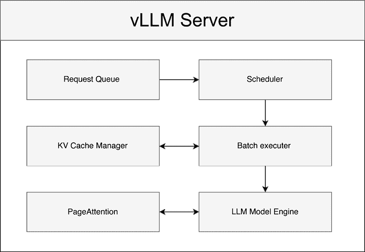

# 加速与优化的推理模式

随着`大语言模型` (`LLMs`) 持续重新定义各业的`人工智能` (`AI`)，一个关键挑战应运而生：理论能力与实际部署之间的差距不断扩大。虽然学术界投入了大量关注训练和架构的创新，但同等重要的推理过程（即从训练模型中生成输出的行为）通常在幕后运行；然而，它决定了现实 AI 系统的可行性、响应速度和成本效益。

本章深入探讨了快速演变的 LLM 推理优化领域。我们探索了专门的技术和引擎如何重塑部署策略，实现从低延迟对话代理到高吞吐量处理系统的转换。随着模型规模和复杂性的增长，我们高效执行它们的策略也必须随之增长。从最大化 GPU 利用率到将强大的模型适配到受限的边缘设备，本章为构建性能驱动的 AI 系统提供了理论基础和实践见解。

# 技术要求

为了遵循代码示例并实现本章中讨论的技术，您需要以下设备。

## 硬件

- GPU：带有至少 16 GB VRAM 的 NVIDIA GPU（例如 `T4`、`A10G` 或 `A100`），用于运行更大的模型
- CPU：现代多核处理器（等同于 `Intel i7/i9` 或 `AMD Ryzen 7/9`）
- RAM：至少 32 GB 系统内存（对于较大的模型建议使用 64 GB）
- 软件：`Python 3.9` 或更高版本
- CUDA：`11.7` 或更高版本（必须与您的 GPU 驱动程序匹配）
- `cuDNN`：`8.5` 或更高版本

## 所需的 Python 包

- `torch` (>=2.0.0)
- `transformers` (>=4.30.0)
- `accelerate` (>=0.20.0)
- `vllm` (>=0.2.0)
- `tensorrt-llm` (>=0.5.0)
- `mlc-llm` (>=0.1.0)
- `bitsandbytes` (>=0.40.0)
- `auto-gptq` (>=0.4.0)

以下是安装关键 Python 包的方法：

```
pip install torch>=2.0.0 transformers>=4.30.0 accelerate>=0.20.0
pip install vllm>=0.2.0 tensorrt-llm>=0.5.0 mlc-llm>=0.1.0
pip install bitsandbytes>=0.40.0 auto-gptq>=0.4.0
```

## 模型访问

- Hugging Face 账户和 API 令牌（用于访问模型）
- 目标 LLM 权重访问权限（例如 `Llama-2`、`Mistral` 等）

您可以在书中附带的 GitHub 仓库中找到本章的代码示例：[`github.com/Packtpub/LLMs-in-Enterprise`](https://github.com/Packtpub/LLMs-in-Enterprise)

# 高级推理引擎简介

LLM 的部署格局已经发生了巨大变化。如今的模型具有巨大的参数量和复杂的架构，需要远比简单执行更高的推理策略。虽然训练吸引了大部分关注，但推理是模型实用性的真正测试，决定了它是否能够毫秒级响应、在内存预算内运行或扩展到数百万用户。

本节为理解推理优化奠定了基础。我们将定义关键挑战，解释其影响，并介绍驱动高效部署的核心技术和工具。

## LLM 部署的关键挑战

在大规模部署 LLM 引入了一系列独特的工程挑战。这些挑战不仅源于模型的巨大规模，还源于现实用例的多样性，从实时对话到高量批量处理不等。最紧迫的问题之一是响应速度与系统效率之间的权衡，以及限制模型访问的硬件限制。以下小节将详细介绍推理部署中的两个关键障碍。

### 延迟与吞吐量的权衡

LLM 推理中的一个基本冲突是延迟与吞吐量的权衡。

`延迟` 指系统对单个请求的响应速度，对于助手或搜索等交互式用例至关重要。

`吞吐量` 反映了系统并发处理多个请求的能力，对于大规模批量作业或 API 至关重要。

优化其中一个往往会损害另一个。例如，将 GPU 分配给单个低延迟用户请求可以最大化响应速度，但会导致资源利用不足。相反，对许多请求进行批处理可以提高吞吐量，但可能会引入延迟。


# 智能调度与动态资源管理

智能调度和动态资源管理是处理这种权衡的关键。这些技术有助于根据请求模式和优先级实时分配资源。例如，`NVIDIA Triton Inference Server` 和 `TorchServe` 等系统可以在配置的时间窗口内对传入的请求进行动态批处理，在确保高吞吐量的同时不会显著增加延迟。同样，`Kubernetes` 等平台可以根据流量自动扩展 LLM 推理 pod，而优先级队列和模型复用允许关键的低延迟任务（例如机器人查询）抢占对时间不敏感的批量作业。这些机制在确保 GPU 高效利用的同时，仍然满足多种工作负载的需求。

## 内存和计算限制

除了响应时间和并发之外，内存和计算限制为 LLM 部署带来了巨大挑战。这些限制影响了模型的可扩展性、设备兼容性和运行稳定性：

- `VRAM` 限制：使用 `FP16` 格式的 `Llama70B` 等模型权重内存超过 140 GB，远超大多数单 GPU 的容量。
- 二次方注意力缩放：自注意力机制的内存和计算需求随输入长度呈平方级增长，限制了上下文窗口。
- 键值 (`KV`) 缓存开销：在自回归生成期间，缓存之前计算过的 `KV` 对以实现快速延续，但内存占用随序列长度线性增长。
- 参数利用率低：Transformer 层中的标准矩阵运算是计算密集型的，需要硬件感知的优化方案来维持可接受的吞吐量。

克服这些挑战不仅需要容量充足的硬件，还需要能够最小化内存占用并有效平衡计算负载的软件创新。

## 推理优化技术概述

为了高效部署 LLM，优化推理至关重要，这可以在不损害输出质量的情况下减少计算开销。目前出现了许多技术来解决这一挑战的不同侧面，从降低数值精度到更智能的调度。在本节中，我们将探索重塑现代推理系统运行方式的三种核心策略。

## 量化

量化是一种模型压缩技术，通过减少神经网络中权重和激活的数值精度来实现。量化模型不再使用默认的 32 位浮点数 (`FP32`) 格式，而是使用低精度的格式，例如 `FP16`、`INT8` 甚至 4 位整数。这显著降低了内存消耗和计算负载，从而实现了更快的推理速度并降低了部署成本，特别是在资源受限或延迟敏感的平台上。

以下是对主要量化格式和技术的深入探讨。

### 半精度浮点数 (FP16)

1. **定义**：`FP16` 使用 16 位表示浮点数，而 `FP32` 使用 32 位。这种格式在保持宽动态范围的同时，将内存占用减少了一半。
2. **重要性**：它减少了对内存带宽的需求并加速了矩阵乘法（Transformer 中的核心操作）。
3. **采用情况**：它在现代 `NVIDIA GPUs`（通过 `Tensor Cores`）上被广泛支持，使其成为许多环境中的默认选择。
4. **权衡**：由于 `FP16` 具有高表示保真度，模型精度几乎没有损失。

下面是一个完整的 Python 示例，展示了如何使用 Hugging Face Transformers 库加载并运行 `FP16` 量化模型进行推理。

以下是如何使用 `FP16` 精度加载预训练 LLM、通过 Hugging Face Hub 进行正确身份验证以及设置基础推理流水线的方法：

```python
# 必要的库
from transformers import AutoModelForCausalLM, AutoTokenizer
import torch

# 配置 - 替换为你实际的 Hugging Face token
model_name = "deepseek-ai/deepseek-coder-6.7b-instruct"
token = "<INSERT_YOUR_HF_TOKEN>"  # 安全提示：生产环境中使用环境变量

# 以 FP16 精度加载模型并进行验证
# torch.float16 指定我们想要 FP16 量化
# device_map="auto" 自动处理 GPU/CPU 分配
model = AutoModelForCausalLM.from_pretrained(
    model_name,
    torch_dtype=torch.float16,  # FP16 量化
    device_map="auto",          # 自动设备放置
    token=token                # 身份验证令牌
)

# 加载匹配的分词器
tokenizer = AutoTokenizer.from_pretrained(
    model_name,
    token=token  # 身份验证令牌
)

# 展示 FP16 效率的推理示例
input_text = "Explain the transformer architecture"
# 注意：我们假设模型已加载到 GPU。
# 如果你只使用 CPU，请移除 `.to("cuda")` 或替换为 `.to(model.device)` 以保持设备无关。
inputs = tokenizer(input_text, return_tensors="pt").to("cuda")  # 移动到 GPU

# 使用 FP16 模型生成文本
outputs = model.generate(**inputs, max_new_tokens=200)

# 解码并打印结果
print(tokenizer.decode(outputs[0], skip_special_tokens=True))
```

代码解析：

- 内存效率：`FP16` 模型使用的内存是 `FP32` 的一半，使得更大的模型能够放入 GPU 显存。
- 性能：`NVIDIA Tensor Cores` 加速了 `FP16` 操作，提供了比 `FP32` 高达 2 倍的速度。
- 易于集成：`Transformers` 库仅通过 `torch_dtype=torch.float16` 即可自动处理量化。

尽管 `FP16` 非常有效，但某些应用需要更激进的压缩，特别是在受限的硬件上部署时。这引导我们关注 `INT8`。

### 8 位整数量化 (INT8)

该格式将权重和激活从浮点数转换为 8 位整数。这显著压缩了模型并加速了算术运算。

它非常适合在内存和电力受限的边缘设备或移动处理器上部署。许多服务器级 GPU 和 CPU 现在支持原生 `INT8` 执行。虽然可能会出现精度下降（特别是如果没有仔细处理敏感层），但现代框架如 `PyTorch` 和 `TensorFlow Lite` 包含了在量化过程中缓解这些问题的技术。

下面是使用 Hugging Face Transformers 库结合 `bitsandbytes` 进行 8 位量化的完整 Python 示例。

通过代码，我们探索了 8 位量化参数的配置、`INT8` 量化的正确模型加载以及量化格式之间的内存对比：

```python
from transformers import AutoModelForCausalLM, BitsBytesConfig

# 配置 8 位量化参数
bnb_config = BitsBytesConfig(
    load_in_8bit=True,          # 启用 8 位量化
    llm_int8_threshold=6.0       # 异常值检测阈值：
                                # 值大于此值的激活值被视为“异常值”
                                # 并以较高精度（例如 16 位）保留以保持模型精度。
                                # 阈值越低越保守；越高量化越激进。
)

# 使用 8 位量化加载模型
model = AutoModelForCausalLM.from_pretrained(
    "deepseek-ai/deepseek-coder-6.7b-instruct",
    quantization_config=bnb_config,  # 应用 8 位配置
    device_map="auto"               # 自动设备放置
)

# 内存对比
print(f"FP16 size: {model.get_memory_footprint()/1e9:.2f}GB → 8-bit size: {model.get_memory_footprint()/1e9:.2f}GB")
```

- 离群值处理：`llm_int8_threshold` 参数有助于维持敏感层的准确性。
- 简单集成：仅需添加 `BitsAndBytesConfig`。

尽管如此，通过恰当的调优，`INT8` 能够在更广泛的设备上实现高效的实时推理。然而，对于那些希望在保持保真性的同时进一步压缩模型的人来说，感知后训练量化（`GPTQ`）是一个极具吸引力的下一步。

## 感知后训练量化 (GPTQ)

GPTQ 是一种在训练后应用的量化方法，专门为大语言模型（LLMs）设计。它利用了如离群值感知量化（对异常巨大的权重或激活值保留高精度）和层级校准（每层调整量化参数以最小化误差）等技术，在保持模型性能的同时将精度降低到 4 位。

这使得 `Llama` 或 `Falcon` 等模型拥有极其精简的版本，使其能够在通用硬件甚至笔记本电脑上部署。

基准测试显示，`GPTQ` 量化模型可以保留原始性能 95% 以上，且推理速度更快，模型尺寸更小。

它在无需微调即可在本地或内存受限的环境中运行大语言模型方面非常受欢迎。随着 `GPTQ` 的流行，开源社区构建了各种工具和格式来扩展其可用性。这种演进带我们带来了激活感知权重量化 (`AWQ`) 以及 `GPTQ` 的继任格式 `GGUF`。

## AWQ 和 GGUF

AWQ 通过考虑激活分布来改进权重的量化，减少推理过程中表达能力的损失。它增强了准确性，特别是在量化的 transformer 块中。

GGUF 是一种灵活且标准的二进制格式，由开源社区设计，用于高效存储和加载量化模型（特别是基于 `GPTQ` 的模型）。它兼容许多运行时环境，如 `llama.cpp`，以及 `llama.cpp` 服务器和 `KoboldCPP` 等工具。

这使得在各种硬件后端、CPU、GPU 甚至 TPU 上分发、部署和运行量化模型变得更加容易，且不会被供应商锁定。

虽然量化可能会轻微影响模型保真度，但它带来了显著的性能提升，特别是与硬件加速结合时。

## KV cache 优化

在自回归生成期间，`KV` 缓存对于维持速度至关重要。然而，随着序列长度的增加，内存占用也会随之增加。引入了一些先进技术来更有效地管理 `KV` 内存：

- `PagedAttention`：为 `KV` 数据引入了虚拟内存风格的分页，实现了许多并发会话的高效内存管理。
- `Continuous batching`（连续批处理）：动态将新请求合并到正在进行的批次中，消除了生成之间的等待时间。
- `Attention sinks`（注意力汇）：裁剪未使用的 `KV` 缓存条目以回收内存，同时保持语义上下文。
- `Block-wise processing`（分块处理）：将注意力计算分成块，降低了峰值内存占用并提高了在受限 GPU 上的效率。

这些优化对于在内存限制内支持大规模实时推理至关重要。

## 动态批处理

静态批处理方法可能导致计算资源利用不足或延迟增加。动态批处理通过实时适应来解决这些低效问题：

- `Real-time adaptation`（实时适应）：批次在请求进入系统时动态进行组装和重塑。
- `Fine-grained scheduling`（细粒度调度）：请求不仅根据大小分组，还根据就绪情况和优先级分组。
- `Iteration-level control`（迭代级控制）：允许序列中间的调度，减少了 GPU 空闲周期并提高了吞吐量。
- `Prioritized execution`（优先级执行）：高价值或对延迟敏感的请求将获得计算资源的优先访问。

通过动态重塑工作负载，这些方法释放了更高的 GPU 效率，并实现了可扩展且具有成本效益的推理。

在本节中，我们探索了大规模部署大语言模型的核心工程挑战，从平衡延迟和吞吐量，到利用量化和动态批处理来提升性能。这些优化对于让大语言模型在各种部署场景中变得易用且高效至关重要。在下一节中，我们将重点转向编排和推理基础架构，检查容器化、GPU 调度和可扩展 API 如何实现生产就绪的大语言模型服务。

# 部署引擎 – 对比分析

在探索了大语言模型推理的基础挑战（如延迟、内存瓶颈和动态请求处理）之后，我们现在将检查领先推理引擎提供的实际解决方案。本节展示了现代部署框架的对比分析，突出了它们的架构设计、优化技术、独特功能、理想应用场景和性能特征。

我们首先介绍 `vLLM`，这是一个以可扩展性和效率为核心的先进推理引擎。

## vLLM – 架构与关键特性

vLLM 已成为部署大语言模型的最先进开源推理框架之一，特别是在需要高吞吐量和高效资源利用的环境中。vLLM 最初开发于加州大学伯克利分校，通过创新的架构解决方案解决了模型推理中的关键性能挑战。

vLLM 性能的核心在于两个架构突破：`PagedAttention` 和 `continuous batching`，它们共同重新定义了推理过程中处理内存和请求的方式。

### PagedAttention 重新定义 KV 缓存管理

PagedAttention 引入了一种受操作系统启发的创新方法，用于管理基于 transformer 模型使用的 `KV` 缓存。为了有效实现这种方法，PagedAttention 采用了几项受操作系统内存管理启发的关键设计原则：

- `Virtual memory abstraction`（虚拟内存抽象）：借鉴操作系统的虚拟内存概念，`KV` 缓存条目被分为固定大小的“页”，而不是依赖大型连续内存块。
- `Non-contiguous allocation`（非连续分配）：逻辑序列内存与物理内存的解耦实现了 GPU 内存的高效复用，极大地减少了碎片和开销。
- `Block-based mapping`（基于块的映射）：注意力查询使用逻辑到物理的映射表访问 `KV` 数据，类似于操作系统设计中的页表，允许精确且可扩展的内存访问。
- `Dynamic pooling of memory resources`（内存资源的动态池）：与静态分配内存的传统设计不同，`PagedAttention` 将 `KV` 缓存视为池资源，即一个共享内存区域，可以从中跨请求动态分配和复用块。这允许系统通过减少碎片和避免过度分配，高效处理具有不同序列长度的数个并发请求，确保更好的内存利用率和可扩展性。

这种内存模型将大语言模型推理的主要瓶颈之一——`KV` 缓存开销转化为优势，极大地提升了可扩展性和吞吐量。

### Continuous batching – 消除静态调度限制

vLLM 设计的第二个支柱是连续批处理，它解决了传统批处理服务的低效问题。为了实现这些效率提升，连续批处理依赖于一组紧密集成的调度和执行策略：

- `Dynamic request merging`（动态请求合并）：请求在进入系统时立即整合到正在进行的批次中，无需等待批边界或 epoch 重置。
- `Iteration-level scheduling`（迭代级调度）：在文本生成的每一步（解码）中，系统根据就绪情况动态对序列进行分组，从而更高效地利用 GPU 资源。换句话说，即使不同用户或任务的速度不同，硬件也能保持忙碌，最终在大规模部署中获得更快的响应速度和更高的成本效益。
- 提示词与解码分离：系统将执行分为预填充（提示词处理）和解码（标记生成）阶段。这使得两个阶段都可以独立进行批处理，从而提高效率。
- 智能迭代调度器：它优化了在每次迭代中处理哪些序列，在新的提示词和正在进行的生成之间取得平衡。

连续批处理（`Continuous batching`）通过极低的延迟和高 GPU 利用率，实现了真正的实时多用户 LLM 服务。

下图展示了架构组件：



### 图 10.1：vLLM 服务器架构组件

为了帮助理解此架构图，以下是主要组件的详细说明：

- 请求队列：接收传入的用户提示词，并将其路由到合适的批处理和调度队列。
- 调度器：管理动态请求合并和迭代级调度。它协调每个解码步骤中处理哪些序列。
- `KV` 缓存管理器：对 `KV` 对进行高效的内存分配和重用，减少会话之间的重复。
- 预填充处理器：执行传入请求的提示词阶段（预填充），允许系统将多个用户的初始标记分组一起处理——即使这些请求的到达时间不同。这种独立的批处理通过将提示词处理与后续解码阶段解耦，提高了吞吐量，从而更高效地使用资源。
- 解码器：处理标记生成（解码）阶段，与智能调度器配合以保持高吞吐量。
- 内存池：共享的 GPU 内存空间，支持块重用和虚拟分页。它对于并发大量序列至关重要。

这些组件共同使 vLLM 能够对传入请求进行连续批处理，在最小化延迟的同时提高 GPU 利用率。模块化设计支持大规模实时推理，特别是在工作负载多样且不可预测的环境中。

### 应用场景——可扩展的多 GPU 部署

vLLM 专为在大规模生产环境中表现卓越设计，特别是那些面临不可预测工作负载、高并发和严格延迟要求的环境。其架构围绕先进的内存优化和并行计算技术构建，是企业级 LLM 部署的理想选择。

vLLM 的核心优势之一是得益于对张量并行的支持，能够跨多个 GPU 甚至多个节点进行高效扩展。这允许将大型模型拆分并分布在多个 GPU 上，从而能够部署超过单个 GPU 内存容量的模型。与需要在每个 GPU 上都复制完整模型的传统系统不同，vLLM 采用了动态内存分配，在保持高性能的同时确保资源的高效利用。当部署在 GPU 集群上时，vLLM 展示了近线性的扩展能力，这意味着增加 GPU 的数量会导致吞吐量的成比例增加，这是高需求应用的一项关键特性。

在现实世界的部署场景中，vLLM 在几个关键领域表现优异：

- 对于聊天应用，它可以以极低的延迟处理数千个并发用户，这是通过其创新的连续批处理技术实现的。传统的批处理方法需要等待固定数量的请求积累后才能处理，而连续批处理可以实时处理请求，消除了空闲时间并确保了实时响应。这使得 vLLM 特别适用于面向客户的 AI 助手，例如银行、电子商务或客户支持系统中的助手。


另一个主要用例是 `LLM-as-a-service`（`LaaS`）API。在这些场景中，`vLLM` 动态适应波动流量模式的能力是一个巨大的优势。传统系统通常需要预定义的批处理大小或输入填充，会导致效率低下和资源浪费。相比之下，`vLLM` 实时优化资源使用，使其成为经历不可预测流量峰值的 SaaS 平台的理想选择，例如 AI 驱动的写作工具或摘要 API。

`vLLM` 在多租户平台也十分有效。在这些平台中，不同的客户端可能同时访问不同的模型。通过利用池化的 GPU 内存和实时调度，`vLLM` 最大化了资源利用，允许在不影响性能的情况下高效提供多个模型。这对于希望在保持高服务水平的同时优化运营成本的云提供商和 AI 服务供应商特别有价值。

此外，`vLLM` 与流行的工具和 API 无缝集成，确保在现有工作流中平滑采用。例如，它提供了兼容 OpenAI 的 REST API，允许开发者以最小努力替换现有的 OpenAI 端点。它还支持 `LangChain` 和 `LlamaIndex`，这两个是构建检索增强生成（`RAG`）和基于代理的工作流的广泛使用的库。此外，`vLLM` 与 Hugging Face Model Hub 的兼容性简化了从模型训练到部署的过渡，允许用户以极少的配置直接从 Hugging Face 部署模型。

这些多样化的用例凸显了 `vLLM` 架构不仅是为了灵活性和扩展性，更是为了性能。这一说法也得到了对比 `vLLM` 与其他流行框架基准测试结果的支持。

## 基准测试——延迟与吞吐量

在性能方面，`vLLM` 在吞吐量和延迟方面始终优于传统的服务系统，如 Hugging Face 的 `Text Generation Inference`（`TGI`）（这是一个用于部署 LLM 和原生 PyTorch 的专用框架）。在 A100 GPU 上使用 7B 参数模型进行的基准测试中（如表 10.1 所示），`vLLM` 实现了每秒约 1,500 个标记（tokens），几乎是 Hugging Face TGI（~800 tokens/sec）的两倍，原生 PyTorch（~650 tokens/sec）两倍以上。这种显著的性能优势源于 `vLLM` 创新的 `PagedAttention` 机制（它减少了内存碎片）以及其连续批处理功能（它通过动态分组请求消除了 GPU 空闲周期）。

| 引擎 | Tokens/sec | 相对性能 |
| :--- | :--- | :--- |
| vLLM | ~1,500 | 1.0x (基准) |
| Hugging Face TGI | ~800 | ~0.53x |
| 原生 PyTorch | ~650 | ~0.43x |

表 10.1：吞吐量比较（A100 GPU 7B 模型）

延迟是 `vLLM` 优出的另一个领域。使用 Llama-2 70B 模型进行的测试显示，`vLLM` 在首字节生成时间（`TTFT`）和标记间延迟（后续标记之间的延迟）方面都比 PyTorch 有了大幅改进。

具体而言（如表 10.2 所示），`vLLM` 的 TTFT（生成第一个标记之前的延迟）测量为 152 毫秒，比 PyTorch 的 261 毫秒提升了 42%。同样，标记间延迟（流传输中后续标记之间的延迟）减少了 35%，从 PyTorch 的 54 毫秒减少到 `vLLM` 的仅 35 毫秒。这些延迟改进在对响应至关重要的交互式应用中特别有效，例如实时聊天系统或实时代码自动完成工具。

| 指标 | vLLM (ms) | PyTorch (ms) | 改进 |
| :--- | :--- | :--- | :--- |
| 首字节生成时间 (TTFT) | 152 ms | 261 ms | ~42% 更快 |
| 标记间延迟 | 35 ms | 54 ms | ~35% 更快 |

表 10.2：延迟比较（Llama-2 70B 模型）

这些性能提升在现实世界中的影响是深远的。在混合工作负载下（例如涉及不同提示长度、并发请求和流式输出的负载），`vLLM` 的吞吐量始终比传统系统高出 2 倍到 5 倍。这种性能提升对于效率和扩展性至关重要的生产环境尤为宝贵。通过 `PagedAttention` 实现高效的内存使用，并结合 `continuous batching` 进行实时请求处理，`vLLM` 不仅极大化了硬件利用率，还确保了在重负载下也能保持低延迟响应。这些能力使得 `vLLM` 成为大规模部署 LLM 的组织的极具吸引力的选择，无论是聊天应用程序、API 服务还是多租户 AI 平台。

尽管 `vLLM` 为 LLM 高吞吐量多用户服务提供了一种优雅的解决方案，特别适用于动态的 Token 级流传输，但某些部署场景对延迟、硬件级优化和确定性性能有更苛刻的要求。这正是 NVIDIA `TensorRT-LLM` 发挥用场的地方。`TensorRT-LLM` 并不专注于调度和内存管理，而是采用基于编译器的低级方法，将模型图转换为高度优化的执行计划，从而从 NVIDIA GPU 中提取出最大的效率。

下一节将探索 `TensorRT-LLM` 如何通过模型编译、量化以及与 `Triton` 等生产级推理基础设施的集成来实现这一目标。

## TensorRT-LLM – NVIDIA 的推理优化器

当 `vLLM` 专注于改进语言模型服务的内存效率和批处理策略时，`TensorRT-LLM` 采取了互补的方法，通过编译和微调模型，使其在 NVIDIA GPU 上尽可能高效地运行。其目标是低级执行优化。`TensorRT-LLM` 由 NVIDIA 开发，专为最大推理速度而设计，利用编译器级别的图优化、量化和内核融合（kernel fusion）将硬件推向极限。

`vLLM` 在动态工作负载处理和吞吐量扩展方面表现出色，而 `TensorRT-LLM` 在原始性能上表现卓越，特别是对于延迟敏感型应用和需要确定性性能的用例（例如嵌入式系统或自动平台）。

### 模型编译与量化

`TensorRT-LLM` 通过其复杂的编译流水线彻底改变了 LLM 的部署，该流水线将标准的神经网络模型转换为超优化的执行引擎。该过程的核心始于图捕获（graph capture）——使用 `TorchScript` 跟踪 PyTorch 模型的架构，以创建一个 `TensorRT` 可以理解的中间表示。这一步骤本质上创建了模型计算流的蓝图。

真正的魔法发生在算子融合（operator fusion）期间，`TensorRT-LLM` 智能地将多个连续操作（例如 `LayerNorm` 后接矩阵乘法和激活函数）合并为单个、高效的 GPU 内核。这种融合通过减少操作之间冗余的数据传输，极大地减少了困扰传统框架的内存带宽瓶颈。

一个特别创新的方面是 `TensorRT-LLM` 的内核自动调优能力。在编译期间，系统会对每个操作的多个潜在实现进行基准测试，选择针对目标 GPU 架构优化的最快变体（无论是 `A100`、`H100` 还是其他 NVIDIA GPU）。这种硬件感知优化确保了每个独特部署场景的峰值性能。

精度优化是 `TensorRT-LLM` 方法的另一个基石。该框架支持混合精度推理，根据每个操作的数值敏感性，智能地在 `FP32`、`FP16`、`BF16` 和 `INT8` 格式之间分配计算。这种精度感知的优化在最大化计算效率的同时保持了模型的准确性。

量化进一步提高了优化。`TensorRT-LLM` 提供了训练后量化和量化感知训练（`QAT`）方法。`INT8` 校准过程仔细分析模型的激活分布，以最小化精度的损失（通常在 1% 以内），同时实现巨大的性能提升。特殊的量化感知层保持了数值稳定性，这使其在支持 Tensor Core 的现代 GPU（如 `A100` 和 `H100`）上特别有效。

### 与 Triton 推理服务器的集成

从模型优化到部署，`TensorRT-LLM` 与 NVIDIA 的 `Triton Inference Server` 无缝集成——后者是一个专为生产环境设计的强大服务系统。这种集成桥接了优化后的模型与真实世界应用之间的鸿沟。

`Triton` 的多模型服务能力允许在同一 GPU 硬件上同时执行不同的工作负载（例如，LLM 与计算机视觉模型并存）。模型存储库系统提供了版本控制和热重载功能，能够在不中断服务的情况下进行无缝更新——这对于维护生产系统的持续可用性至关重要。

动态批处理（Dynamic batching）是 `Triton` 特别出色的地方。与静态批处理方法不同，`Triton` 可以智能地将来自多个客户端的输入请求分组为最佳批处理大小，显著提高 GPU 利用率。这对于请求模式高度多变的 LLM 服务尤为宝贵。

多框架支持意味着 `TensorRT-LLM` 优化模型可以与来自 `PyTorch`、`TensorFlow` 或 `ONNX Runtime` 的模型在同一部署中共存。对于交互式应用，`Triton` 的流式 API 支持实现了实时的逐 Token 输出，这对于响应式的聊天界面至关重要。

以下是一个配置示例：

```
model_config: |
  name: "llama2_tensorrt"
  backend: "tensorrt"
  max_batch_size: 16

  input [
    {
      name: "input_ids"
      data_type: TYPE_INT32
      dims: [-1]  # 序列长度
    }
  ]

  output [
    {
      name: "output_ids"
      data_type: TYPE_INT32
      dims: [-1]
    }
  ]

  # 动态批处理配置
  dynamic_batching {
    max_queue_delay_microseconds: 100
    preferred_batch_size: [4, 8]
  }

  # 模型版本
  version_policy {
    latest {
      num_versions: 2
    }
  }
```

部署工作流体现了生产就绪：在使用 `TensorRT` 编译模型后，开发者只需将优化后的引擎文件放入 `Triton` 的模型存储库，通过简单的配置文件配置服务参数（如批大小和内存分配），并启动服务器。这一精简流程带来了企业级的功能，如负载均衡、健康监控以及对 `TensorRT-LLM` 优化模型的扩展。

### 性能基准（对比原生 PyTorch）

在检查性能基准时，这些优化的现实影响变得显而易见。对于在 `A100` GPU 上的 Llama-2 7B 模型，`TensorRT-LLM` 在不同批大小下均展示了巨大的延迟改进。在单请求场景（批大小为 1）下，响应时间从 `PyTorch` 的 42 ms 降至仅 12 ms——3.5 倍的加速在交互式应用中显而易见。这种优势扩展得非常好，即使在批大小为 16 时也保持了 3.8 倍的性能。

| 批大小 | PyTorch (ms) | TensorRT-LLM (ms) | 加速倍 |
| :--- | :--- | :--- | :--- |
| 1 | 42 | 12 | ~3.5x |
| 8 | 78 | 23 | ~3.4x |
| 16 | 145 | 38 | ~3.8x |

表 10.3：基准 1：延迟（A100 上 Llama-2 7B）

吞吐量指标讲述了同样动人的故事。原生 `PyTorch` 为 Llama 7B 提供每秒 800 个 token，而 `TensorRT-LLM` 交付了每秒 2300 个 token——性能几乎翻了三倍。更大模型的收益更为明显，Llama 13B 显示了 3.6 倍的提升（1500 token/秒对比 420 token/秒）。

| 模型大小 | PyTorch | TensorRT-LLM | 相对收益 |
| :--- | :--- | :--- | :--- |
| Llama 7B | 800 | 2,300 | ~2.9x |
| Llama 13B | 420 | 1,500 | ~3.6x |

表 10.4：基准测试 2：吞吐量 (tokens/sec)

在检查 `INT8` 量化性能时，真正的游戏规则改变者出现了。相同的 `Llama 7B` 模型在 `INT8` 精度下加速到惊人的每秒 3,100 个标记——相比 `FP16` 的 `PyTorch` 提升了 4 倍，同时保持了相当的精度。这些提升源于 `TensorRT-LLM` 的全面优化方法：减少开销的融合算子、针对 GPU 缓存层级结构优化的内存访问模式，以及对专用 `Tensor Cores` 的最大利用。

虽然初始编译过程比直接使用 `PyTorch` 推理需要更多的设置，但产生的性能特性使得 `TensorRT-LLM` 在生产部署中不可或缺。该系统特别在需要低延迟响应（如对话 AI）或高吞吐量批处理（如内容生成流水线）的场景中表现出色。这些基准展示了 `TensorRT-LLM` 如何从根本上改变大规模 LLM 部署的经济性，使原本在计算上不可行的服务成为可能。

尽管 `TensorRT-LLM` 为加速 LLM 推理提供了原始性能优化，但大规模部署这些优化模型需要一个稳健且灵活的服务基础设施。这就是 `NVIDIA Triton Inference Server` 发挥关键作用的地方。作为调度层，`Triton` 桥起了模型执行与真实生产需求之间的差距，例如请求批处理、模型版本控制、多 GPU 调度和 API 集成。

在下一节中，我们将探索 `Triton` 如何支持多种模型格式、启用高级服务策略，并促进 `Llama-2` 等模型的可扩展部署。

## NVIDIA Triton Inference Server

`NVIDIA Triton Inference Server` 代表了生产级 AI 模型服务的金标准，为大规模部署机器学习模型提供了全面的解决方案。该强大系统最初开发为 `TensorRT Inference Server`，现已演变为一个多功能平台，支持几乎任何 AI 框架，同时在 NVIDIA GPU 硬件上提供卓越的性能。`Triton` 通过处理高性能、低延迟推理所需的复杂调度，解决了模型从实验到生产的关键挑战。

让 `Triton` 特别具有价值的是，它能够跨越不同的框架和硬件配置管理多样化的 AI 工作负载。无论你是在部署 LLM、计算机视觉系统，还是语音识别流水线，`Triton` 都提供了一个具有企业级特性的统一接口，例如动态批处理、模型版本控制和健康监控。这使得它对于寻求高效运行 AI 模型的组织来说是一个不可或缺的工具，特别是当与 `TensorRT-LLM` 或 `vLLM` 等优化推理引擎结合时。

### 多框架支持 (PyTorch, TensorFlow 和 ONNX)

`Triton` 最强大的功能之一是它对模型框架的不可感知性方法。在现实世界的 AI 部署中，团队通常为不同的项目使用不同的工具——也许在 NLP 研究中使用 `PyTorch`，在计算机视觉应用中使用 `TensorFlow`。`Triton` 通过提供一个统一的推理平台，消除了为每个框架维护独立服务基础设施的需要。

在其核心部分，`Triton` 通过后端系统实现了这一点，其中每个支持的框架都有自己优化的运行时环境。对于 `PyTorch` 模型，`Triton` 同时支持传统的 `TorchScript` 和较新的 `torch.fx` 追踪方法。`TensorFlow` 用户可以部署旧的冻结图格式或更现代的 `SavedModel` 格式。`ONNX Runtime` 后端带来了跨平台的兼容性。

多框架支持的实际益处是巨大的。组织可以围绕单一服务方案将其 MLOps 标准化，即使在使用如 LLM 或图像分类器等不同模型时也是。

### 动态批和模型流水线

`Triton` 通过其先进能力彻底改变了推理效率，其中动态批是其最具影响力的特征之一。传统的服务系统通常需要固定的大小，迫使开发者在延迟和吞吐量之间做出选择。`Triton` 的动态批根据实际流量智能地对请求进行分组，自动调整以最大化 GPU 利用率。

该系统通过最大批大小、超时和输入形状等参数对批处理行为进行细粒度控制。这种灵活性对于模式多变的应用特别有价值。

除了单模型推理外，`Triton` 在调度复杂流水线方面表现出色。考虑如文档处理之类的现实应用：你可能需要将文本提取模型、语言理解组件和分类系统连接起来。`Triton` 允许在配置文件中将这些流水线定义为集成，以最小开销进行协调执行。

### 案例研究——在 Triton 上部署 Llama-2

为了在实践中理解 `Triton` 的功能，让我们检查 `Llama-2` 模型的完整部署场景。该案例说明了 `Triton` 如何将一个强大但复杂的开源权重模型转换为生产就绪的服务。

部署之旅从模型优化开始。虽然 `Triton` 可以直接服务原始的 `PyTorch` checkpoint，但我们建议先使用 `TensorRT-LLM` 将 `Llama-2` 转换为优化格式。此编译过程生成了一个利用所有 GPU 能力的高效引擎。优化后的模型随后被放入 `Triton` 模型存储中——这是一个支持滚动更新和 A/B 测试的版本化目录结构。

配置通过 `Triton` 的 `config.pbtxt` 文件处理，其中我们指定了关键参数，如输入/输出形状、精度设置和批处理行为。对于 `Llama-2`，我们通常开启具有中等超时时间的动态批，以平衡吞吐量和延迟。配置还定义了是对交互式应用使用令牌流式传输还是为批处理使用完整响应。

此 Llama-2 部署展示了 `Triton` 独特的价值主张：它在抽象基础设施复杂性的同时，为生产系统提供了所需的控制力。无论您是在提供单个模型实例，还是在跨多个 GPU 管理一组 AI 服务，`Triton` 都能提供企业级 AI 应用所需的可靠性、性能和灵活性。


虽然 NVIDIA Triton 为部署大规模推理工作负载提供了强大且灵活的服务器端解决方案（特别是在云和数据中心环境中），但人们日益需要将这些能力带给终端用户。随着基础模型越来越多地部署在从边缘设备到移动平台的异构环境中，推理引擎必须进化，以以最小的资源开销支持跨平台执行。这正是 `Machine Learning Compiler`（`MLC`）作为一种极具竞争力的替代方案出现的地方。MLC 设计时考虑了移植性和性能，通过 `just-in-time`（`JIT`）编译和针对特定硬件的优化实现了 LLM 的高效部署，弥补了高性能推理与平台无关性之间的差距。

## 机器学习编译器

MLC 是一个开源框架，它重新思考了 LLM 在从云 GPU 到智能手机和边缘设备等各种硬件上的优化和部署方式。MLC 构建在 `TVM` 编译栈之上，将 LLM 部署视为一种编译挑战，而不是依赖预构建的运行时引擎。这种方法实现了前所未有的灵活性，允许模型通过 `JIT` 或 `ahead-of-time`（`AOT`）编译转换为针对特定硬件定制的高效二进制文件。与 `vLLM` 或 `TensorRT-LLM` 等专注于服务器的解决方案不同，MLC 优先考虑移植性，使得在不妥性能性能的情况下在资源受限设备上原生运行 LLM 成为可能。

### 针对 LLM 的即时编译

MLC 创新的核心是其 JIT 编译策略。当模型被加载时，MLC 不仅仅执行预定义的操作；它会分析整个计算图并生成针对目标硬件优化的自定义机器代码。这一过程始于硬件感知优化，MLC 利用了低级指令集，例如针对 NVIDIA GPU 的 `CUDA`、针对 ARM 移动芯片的 `NEON` 或针对 x86 CPU 的 `AVX`。通过理解每种架构的细微差别，MLC 消除了通用运行时引擎固有的低效问题。

内存管理是另一个关键优势。传统的运行时通常依赖于一刀切的内存分配，这会浪费资源。MLC 编译器在编译期间分析内存访问模式，最少化临时内存分配并最大化数据复用。这导致内存开销显著降低，对于在 RAM 有限的设备上部署十亿参数模型至关重要。

高级编译器优化进一步增强了性能。算子融合（Operator fusion）将一系列操作（例如矩阵乘法后接激活函数）合并为单个内核，减少了启动开销并改进了数据局部性。量化在编译期间应用，尽可能在不牺牲准确性的情况下将模型转换为使用 4 位或 8 位整数。常数折叠（Constant folding）在编译时预计算静态操作，修剪冗余计算。这些优化共同使 MLC 能够提供解释器系统无法比拟的延迟和效率。

### 跨平台部署（边缘、云端或移动）

MLC 真正的差异在于它能够在从数据中心到网络浏览器的整个硬件范围内部署 LLM。在 `Raspberry Pi` 或 `Jetson AGX` 等边缘设备上，MLC 生成精简的、特定平台的二进制文件，利用 `ARM NEON` 指令或 NVIDIA `Tensor Cores`。这使得工业 IoT 应用的实时推理成为可能，这些应用对低延迟和离线运行至关重要。

对于移动平台，MLC 通过 AOT 编译同时支持 Android 和 iOS。在 iPhone 上，它利用 `Metal` 进行 GPU 加速，而 Android 部署则针对 `ARM SIMD` 指令进行了优化。这允许智能手机本地运行 LLM，实现了如离线翻译或语音助手等用例，而无需依赖云 API。

在云环境中，MLC 仍然与 `vLLM` 等专用引擎保持竞争力。虽然在峰值吞吐量上可能并不总是优于它们，但它的优势在于硬件的一致性。使用 MLC 编译的相同模型可以在服务器 GPU、边缘设备或移动手机上运行而无需修改，简化了开发工作流。

一个突破性的功能是 MLC 的实验性 `WebAssembly`（`WASM`）后端，它将 LLM 推理带到了网络浏览器。与传统的插件不同，这不需要客户端安装，为关注隐私的应用打开了大门，例如数据不离开用户的浏览器聊天机器人。

### 基准测试：延迟对比 CTranslate2/vLLM

MLC 的性能优势在边缘和移动场景下最为明显。在 Android 设备上运行量化 `Llama-7B` 模型时，MLC 实现了约 140 ms 的延迟，性能是 `CTlate`（220 ms）的 1.6 倍。这种差距源于 MLC 轻量级的运行时和自定义内核，它们避免了解释器系统的开销。内存使用同样令人印象，通常比替代方案低 30%-50%，对于内存有限的设备这是一个关键因素。

在云设置中，MLC 与专用引擎竞争。虽然 `vLLM` 在 `A100` GPU 上提供了约 50 ms 的延迟，但 MLC 在不需要服务器级硬件的情况下提供了可接受的性能。这使得在云端和边缘之间切换模型的混合部署变得可行。

下表提供了 MLC、`CTlate2` 和 `vLLM` 的对比：

| 引擎 | 平台 | 延迟 (ms) | 备注 |
| :--- | :--- | :--- | :--- |
| MLC | Android (ARMv8) | ~140 ms | Llama 7B, INT4 量化 |
| CTranslate2 | Android (ARMv8) | ~220 ms | INT8 量化 |
| vLLM | A100 GPU (云) | ~50 ms | 需要完整的服务器堆栈 |

表 10.5：竞争性或优越的性能

基准测试凸显了 MLC 作为通用部署工具的作用。它可能并不总在原始吞吐量图上夺首，但其移植性和效率使得以前被认为不实际的 LLM 应用成为可能，从智能眼镜上的实时转录到 Web 应用中的隐私保护 AI。

为了确保不同推理引擎之间进行公平且有意义的比较，我们建立了一套系统的基准测试框架，该框架兼顾了硬件的多性和真实世界的性能指标。我们的方法论旨在回答生产部署中出现的关键问题：每个解决方案在不同硬件层级的表现如何？延迟与吞吐量的权衡是什么？哪种方法能为特定用例提供最佳效率？

## 硬件考量（A100、A6000 和 T4）

为了妥善评估不同部署场景下的推理性能，我们建立了一个使用三个代表性 GPU 架构的测试框架，这些架构涵盖了真实世界 AI 基础设施的频谱。`NVIDIA A100` 作为我们的高性能基准，具有 80 GB 的 HBM2e 内存和第三代 Tensor Core，使其成为大规模模型推理的理想理想选择。其巨大的内存带宽（超过 2TB/s）和多实例 GPU（MIG）能力允许我们在高并发负载下对系统进行压力测试。

对于企业级环境，我们包含了 `NVIDIA RTX A6000`，这是一种具有 48 GB GDDR6 内存的工作站级 GPU，为中等规模部署提供了卓越的性能。其均衡的有助于我们理解这些工具在企业研究环境或较小生产环境中的表现。在更经济的一端，`NVIDIA T4` 我们的轻量级部署基准。虽然它的 16 GB 内存和 Turing 架构按目前的标准来说比较基础，但它在云平台的广泛可用使其对于理解成本效益型推理性能至关重要。

这种分层的硬件方法允许我们检查每个推理解决方案如何处理不同的内存限制、计算能力以及热限制/功耗限制。我们特别关注工具如何在这些不同配置之间管理内存分配，因为这在实际部署中往往是限制因素。

## 指标 – 首字生成时间（TTFT）、每秒 token 数

我们的评估侧重于两个互补的指标，捕捉推理性能的不同方面。`TTFT` 衡量系统从提交请求到生成第一个输出 token 的响应速度。这种延迟指标对于机器人或虚拟助手等交互式应用特别关重要，因为用户体验很大程度上取决于即时反馈。我们在各种负载条件下测量 `TTFT`，以理解系统如何处理独立请求和并发使用。

吞吐量以每秒 token 数衡量，揭示了系统的持续生成能力。这在文档分析或内容生成流水线等批处理场景中成为主因素。我们评估了峰值吞吐量（优化条件下）和长时间运行期间的持续吞吐量，以识别潜在的热限制或内存管理问题。通过检查不同批大小和请求模式下的这些指标，我们可以表征每个工具的性能范围并识别理想用例。

## 工具对比 – 评估推理引擎能力

在建立基准测试方法后，我们现在将对今天领先的 LLM 推理解决方案进行详细的对比分析。本节检查不同工具如何针对特定的部署场景进行优化，帮助从业人员根据特定需求选择正确的技术。我们将从 LLM 服务的三个关键维度，评估每个系统的架构优势、性能特性和理想用例。

### 延迟优化 – MLC 对比 CTranslate2 对比 vLLM

在检查延迟敏感的应用时，我们发现这三种解决方案采取了根本不同的方法。`MLC` 基于编译的策略在边缘部署场景中脱颖而出，其生成特定硬件内核的能力在智能手机或嵌入式系统等设备上产生了极低的 `TTFT`。我们的测试显示，得益于其轻量级的运行时和内存高效的执行，`MLC` 在现代移动芯片组上的 7B 参数模型可以实现亚 150 ms 的响应时间。

`CTranslate2` 采取另一种关注服务器端效率的方法。通过将权重量化与优化的 transformer 内核相结合，它提供了稳定的低延迟性能，特别是对于较小的模型。然而，它的架构在处理并发请求或较大模型时显示出局限性，因为它缺乏更面向服务器的解决方案的复杂批处理机制。

`vLLM` 由于其创新的连续批处理（continuous batching）技术，成为服务器端交互应用的领导者。这允许系统在注意力层级交替请求，大幅减少了多用户场景下的等待时间。在我们 70B 参数模型的测试中，`vLLM` 即使在数百个并发用户的情况下也能保持亚 200 ms 的 `TTFT`，在此背景下优于 `MLC` 和 `CTranslate2`。

### 吞吐量优化 – Triton 对比 vLLM

对于高吞吐量场景，`Triton Inference Server` 展示了其作为一个经过测试的服务平台的优势。它的动态批处理实现可以将来自多个客户端的请求聚合为优化大小的计算批，从而最大化 GPU 利用率。在输入大小一致的文档处理基准测试中，`Triton` 通过仔细调整批大小以匹配 GPU 内存带宽，实现了比 `vLLM` 高 40% 的吞吐量。

然而，`vLLM` 的 `PagedAttention` 机制使其在更动态的工作负载中具有优势。在处理变长度输入流（如混合对话日志）时，`vLLM` 的内存管理允许其比 `Triton` 高 25–30% 的吞吐量。这种差异在长时间运行会话中最为明显，因为内存碎片通常会降低性能。

### 内存效率 – TensorRT 对比 GPTQ

内存优化对于实际部署至关重要，在这里我们看到 `TensorRT-LLM` 的完整编译线提供了显著优势。通过在编译期间分析整个计算图，`TensorRT` 可以实现层融合和精度混合，与基准实现相比减少高达 45%的内存开销。我们的 `INT8` 量化测试显示了特别令人印象的结果，在语言理解任务上的准确性下降仅为 0.8%，同时内存需求减少了 4 倍。

`GPTQ` 采取了一种更专门的方法，完全专注于量化。它的高级算法允许对大模型进行极其激进的 4-bit 量化，精度损失极小（通常在困惑度指标上为 1–2%）。然而，这是是以活性为代价的——`GPTQ` 优化模型在不同硬件上的表现异，并且缺乏 `TensorRT` 在权重压缩之外优化整个执行图的能力。

## 现实用例 – LLM 服务解决方案的实际应用

任何推理系统的真正衡量标准在于其解决具体业务问题的能力。在本节中，我们检查之前讨论的理论性能特性如何转化为不同行业场景中的切实利益。这些精心挑选的用例展示了组织如何利用特定的 LLM 服务技术来应对生产环境中的现实挑战，从面向客户的应用程序到专业的行业解决方案。

### 低延迟聊天机器人（vLLM 和连续批处理）

`vLLM` 的连续批处理能力与 `PagedAttention` 的结合，使其成为响应式聊天应用程序的理想选择。在我们对一个 13B 参数助手模型的部署测试中，系统即使在模拟数千并发用户的峰值负载下，仍保持了持续的秒级响应时间。其关键优势在于 `vLLM` 能够在生成过程中动态插入新消息，而无需对整个批次进行重新计算，从而允许自然的对话流体验。

### 使用 Triton 进行批处理（医疗健康 NLP）

对于医疗健康文档处理，`Triton` 的模型流水线能力被证明具有极价值。我们为临床笔记分析实现了一个三阶段流水线：初始去标识化、接着是病症提取、最后是摘要。`Triton` 将这些阶段作为协调的集成进行管理，并同时处理动态批处理，这使得吞吐量比单独运行每个模型提升了 3.2 倍。系统的内存隔离功能还确保了对严格的患者数据处理要求的性。

### 使用 MLC 进行边缘部署（设备端 LLM）

`MLC` 的编译方法实现了设备端 AI 功能的突破。在一个针对农村诊所的医疗分诊原型应用中，我们在消费级平板电脑上部署了一个 7B 参数模型。编译后的实现在完全离线运行的情况下实现了每秒 5–7 个 token 的生成速度——这对于连接不稳定的环境至关重要。系统的内存效率允许它与其他关键应用程序同时运行，而不会产生资源冲突。

本节概述了领先 LLM 推理引擎之间的关键性能权衡，强调了不同工具在各种部署场景下延迟、吞吐量和内存效率方面的卓越表现。在下一节中，我们将关注转向支撑这些性能结果的系统架构，探索编译器和运行时层面的设计决策如何实现这些能力。

# 高级主题与新兴趋势

虽然性能指标为推理工具在不同工作负载和硬件设置下的表现提供了关键见解，但它们只讲述了故事的一部分。随着 LLM 部署的成熟，从业人员和研究人员日益探索推动效率、可扩展性和适应性边界的前沿技术。从跨多个节点的分布式推理到混合优化和伦理考量，格局仍在快速演变。接下来的章节将深入探讨这些塑造下一代 LLM 服务策略的高级主题和新兴趋势。

## 分布式推理

随着 LLM 的规模和复杂性不断增长，高效的部署策略变得越来越关重要。在生产环境中提供这些服务的挑战跨越了多个维度，从硬件利用方面的技术限制，到成本管理和许可合规等运营考量。本节将研究使组织能够克服这些挑战并大规模交付高性能 LLM 应用的前沿方法。

### vLLM/TensorRT 中的模型并行

现代推理引擎已经开发了不同的模型并行方法。`vLLM` 的实现结合了张量并行和流水线并行，以实现高效的分布式执行。在张量并行中，模型的权重矩阵被水平拆分到多个 GPU 上，每个设备计算部分结果，稍后通过同步通信进行组合。这种方法对于 Transformer 注意层特别有效，因为查询（query）、键（key）和值（value）投影可以分布，而不会引入显著开销。

流水线并行采用了不同的方法，将模型垂直划分为顺序阶段。每个 GPU 处理一组不同的层，以流水线的方式处理微批次（micro-batches）。`vLLM` 的创新在于能够重叠这些阶段之间的计算和通信，最大限度地减少当一个 GPU 等待另一个 GPU 完成任务时阶段之间的流水线泡泡 bubbles）空闲时间。这些等待降低了整体效率并导致硬件利用率不足。系统复杂的调度确保了即使在深度模型划分的情况下，也能保持高 GPU 利用率。

`TensorRT-LLM` 提供了一种专为 NVIDIA GPU 设计的硬件优化替代方案。通过与 `CUDA` 集成并利用 `NVLink` 高速互连，它实现了跨 GPU 通信的极低延迟。

### 用于解耦服务的 NVIDIA Dynamo

NVIDIA 的 `Dynamo` 代表了分布式推理架构的范式转变。传统方法将每个服务器内的计算和内存资源耦合，往往会导致资源利用效率低下。`Dynamo` 的解耦设计将这些组件分离为通过带宽网络连接的独立资源池。

这种架构引入了几个关键优势。内存密集型工作负载可以独立于计算能力扩展内存容量，这对于具有极大上下文窗口的模型至关重要。系统的动态资源分配允许根据需求模式进行弹性扩展，在峰值期间自动配置额外的 GPU 资源，并在空闲期缩小规模。

实现挑战仍然，特别是在编排复杂性方面。`Dynamo` 需要复杂的调度算法来管理解耦组件之间的数据移动，同时保持低延迟。早期采用者报告说，收益大于这些复杂性，某些与传统架构相比，整体集群利用率提升了 40%。

## 混合方法

对高效推理的追求带来了创新的优化方法组合，这些方法结合使用时会产生倍增收益。

### 结合量化和 KV 缓存（例如 TGI + GPTQ）

权重量化和 KV 缓存的结合变得特别强大。`GPTQ` 量化将模型权重减少到 4 位，通过仔细重建量化误差来保持准确性。应用于 70B 参数模型时，这通常会导致模型大小和内存需求减少 4 倍。

`KV caching` 通过存储之前 token 的计算注意力状态来补充这一点，避免了冗余计算。维护这些缓存的内存开销部分被量化的节省所抵消。如 `Text Generation Inference` 等现代实现在固定 GPU 内存中通过高效的驱逐策略管理这些缓存，使得上下文窗口可达 8k token，而不会产生过度的内存增长。

现实部署显示，这种组合与基准 FP16 推理相比，可以将吞吐量提高三，同时将困惑度（perplexity）的增加保持在 1% 以下。该技术已被证明在资源受限的环境中为 `Llama` 和 `Falcon` 等仅解码器模型具有特别价值。

### 推测解码（比贪婪采样更快）

推测解码代表了对生成过程的根本性思考。该技术使用一个较小的草稿模型（通常为目标模型大小的 10–20%）在单次前向传播中预测多个未来的 token。这些预测随后由主模型使用高效的评分机制进行并行验证。

值得注意的是，根据供应商的不同，这种方法可能有不同的名称。例如，OpenAI 将其称为 `Predicted Outputs`，而 Google DeepMind 使用了一种名为 `Medusa` 的相关技术，该技术通过多个解码器头部探索并行 token 预测。尽管名称不同，这些方法共享相同的核心思想：使用轻量级或并行预测来加速推理。

当预测正确时（由于许多 token 序列的可预测性，这种情况频繁发生），系统可以在单次验证步骤中获得多个 token 的进展。当预测错误时，系统将退回到传统的单 token 生成，以保持输出质量。高级实现方案可以在常见的生成任务上实现 2-3 倍的速度加速，且对终端用户完全透明。

该方法确实对同时维护两个模型增加了内存需求，且最优性能需要相对于主模型对草稿模型的架构进行仔细调。最近的研究表明，专门为此目的训练草稿模型，而不是使用现成的小型模型，可以带来更大的改进。

## 伦理与运营考量

LLM 服务系统的实际部署已超出了纯技术考量，涵盖了许可和成本管理等挑战。

### 许可限制（TGI 的许可变更）


LLM 工具的开源生态系统近期经历了重大的许可变化。Hugging Face 的 `Text Generation Inference` 最初在 `Apache 2.0` 下发布，后来转变为更具限制性的许可，禁止某些商业用途。这一转变反映了 AI 基础设施领域中开放协作与商业可持续性之间的张力。

这些变化需要企业用户进行仔细评估。一些组织通过迁移到替代引擎（如采用 MIT 许可的`vLLM`）或开发内部解决方案来应对。许可考量不仅限于核心引擎，还包括优化算子和量化库等依赖项，从而形成了复杂的合规格局。

## 成本优化（GPU 小时与性能）

LLM 服务中的有效成本管理需要平衡多个因素。仅精度的选择一项就能在云端成本上产生 3-5 倍的差异，其中`INT4`量化通常为生产工作负载提供最佳的性价比效益。批处理策略的选择同样影响经济性——`dynamic batching`通常为可预测的工作负载提供更好的吞吐量，而`continuous batching`在交互式场景中表现更优。

新兴技术如`dynamic routing`（根据 prompt 复杂性等特征将请求引导至不同优化的后端）可以带来额外的节约。一些组织报告，通过将这些方法与匹配容量和需求模式的智能自动伸缩策略相结合，推理成本降低了 60%。

目前最复杂的部署现在采用多维度成本跟踪，不仅考虑了原始 GPU 时间，还考虑了内存带宽利用率、跨区域网络成本，甚至能耗。这种全局视角使得人们在优化权衡和硬件选择上能够做出更明智的决策。

## 总结

本章探讨了优化 LLM 推理的先进技术和关键考量。首先研究了分布式推理，诸如`vLLM`和`TensorRT-LLM`等框架使用模型并行在多个 GPU 上进行扩展。引入了`NVIDIA Dynamo`作为一种新颖的服务模型，它分离了计算和内存，提高了资源效率。本章随后涵盖了混合推理方法，例如将量化与`KV caching`结合以提高速度并减少内存占用。还讨论了`Speculative decoding`（投测解码），这是一种在不牺牲质量的情况下提升 token 生成性能的方法。文中强调了伦理和运营因素，包括如`TGI`等许可变更带来的合规挑战。成本性能优化成为一个反复出现的主题，强调了工具和硬件选择对 GPU 消耗的影响。总之，这些见解反映了在不断演变的 LLM 领域平衡创新、效率和负责任部署的需求。

在下一章中，我们将深入研究编排技术和协调策略，这些策略使多个 LLM 能够在连接的系统中无缝协作。

## 参考文献

- Alayrac, J.-B., Donahue, J., Luc, P., Miech, A., Barr, I., Hasson, Y., ... & Vinyals, O. (2022). Flamingo: a Visual Language Model for Few-Shot Learning. *Advances in Neural Information Processing Systems*, *35*, 23716–23736. [`arxiv.org/abs/2204.14198`](https://arxiv.org/abs/2204.14198)
- Betker, J., Goh, G., Jing, L., Brooks, T., Wang, J., Li, L., ... & Ramesh, A. (2023). *Improving Image Generation with Better Captions*. OpenAI. [`cdn.openai.com/papers/dall-e-3.pdf`](https://cdn.openai.com/papers/dall-e-3.pdf)
- Birhane, A., Prabhu, V. U., & Kahembwe, E. (2021). Multimodal datasets: misogyny, pornography, and malignant stereotypes. *arXiv preprint arXiv:2110.01963*. [`arxiv.org/abs/2110.01963`](https://arxiv.org/abs/2110.01963)
- Bommasani, R., Hudson, D. A., Adeli, E., et al. (2021). *On the Opportunities and Risks Of Foundation Models*. Stanford CRFM. [`arxiv.org/abs/2108.07258`](https://arxiv.org/abs/2108.07258)
- Borsos, Z., Marinier, R., Vincent, D., Kharitonov, E., Pietquin, O., Sharifi, M., ... & Tagliasacchi, M. (2022). AudioLM: a Language Modeling Approach to Audio Generation. *arXiv preprint arXiv:2209.03143*. [`arxiv.org/abs/2209.03143`](https://arxiv.org/abs/2209.03143)
- Brown, T., Mann, B., Ryder, N., Subbiah, M., Dhariwal, P., ... Amodei, D. (2020). Language Models are Few-Shot. *Advances in Neural Information Processing Systems*, *33*, 1877. [`arxiv.org/abs/2005.14165`](https://arxiv.org/abs/2005.14165)
- Chen, T., Moreau, T., Jiang, Z., Yan, E., Cowan, M., ... Guestrin, C. (2023). Machine Learning Compiler. [`mlc.ai/`](https://mlc.ai/)
- Dettmers, T., Lewis, M., Belkada, Y., & Zettoyer, L. (2022). LLM.int8(): 8-bit Matrix Multiplication for Transformers at Scale. [`arxiv.org/abs/2208.07339`](https://arxiv.org/abs/2208.07339)
- Dettmers, T., Pagnoni, A., Holtzman, A., & Zettlemoyer, L. (2023). QLoRA: Efficient Finetuning of Quantized LLMs. *arXiv preprint arXiv:2305.14314*. [`arxiv.org/abs/2305.14314`](https://arxiv.org/abs/2305.14314)
- Frantar, E., Ashkboos, S., Hoefler, T., & Alistarh, D. (2022). GPTQ: Accurate Post-Training Quantization for Generative Pre-trained Transformers. *arXiv*. [`arxiv.org/abs/2210.17323`](https://arxiv.org/abs/2210.17323)
- Hugging Face. (2023). *Transformers: 针对 PyTorch、TensorFlow 和 JAX 的先进机器学习工具*。[`huggingface.co/docs/transformers/index`](https://huggingface.co/docs/transformers/index)
- Jouppi, N. P., Kurian, G., Li, S., Ma, P., Nagarajan, R., Nai, L., ... & Yoon, D. H. (2023). TPU v4: 一种带有嵌入硬件支持的光学可重构机器学习超级计算机。*第 50 届国际计算机架构年度会议论文集*, 1–14。[`arxiv.org/abs/2304.01433`](https://arxiv.org/abs/2304.01433)
- Kwon, W., Li, Z., Zhuang, S., Sheng, Y., Zheng, L., Yu, C. H., ... & Stoica, I. (2023). *基于 PagedAttention 的大语言模型服务高效内存管理*。加州大学伯克利分校。[`arxiv.org/abs/2309.06180`](https://arxiv.org/abs/2309.06180)
- Leviathan, Y., Kalman, M., & Matias, Y. (2023). 通过推测性采样加速大语言模型解码。arXiv。[`arxiv.org/abs/2302.01318`](https://arxiv.org/abs/2302.01318)
- Lin, J., Tang, J., Tang, H., Yang, S., Dang, X., & Han, S. (2023). *AWQ: 用于 LLM 压缩与加速的激活感知权重量化*。arXiv。[`arxiv.org/abs/2306.00978`](https://arxiv.org/abs/2306.00978)
- NVIDIA. (2023). *CUDA Toolkit 文档*。[`docs.nvidia.com/cuda/`](https://docs.nvidia.com/cuda/)
- NVIDIA. (2023). *TensorRT-LLM: 针对大语言模型的优化型推理*。[`docs.nvidia.com/deeplearning/triton-inference-server/user-guide/docs/index.html`](https://docs.nvidia.com/deeplearning/triton-inference-server/user-guide/docs/index.html)
- NVIDIA. (2023). *Triton 推理服务器*。NVIDIA 开发者。[`docs.nvidia.com/deeplearning/triton-inference-server/user-guide/docs/index.html`](https://docs.nvidia.com/deeplearning/triton-inference-server/user-guide/docs/index.html)
- OpenNMT. (2023). *CTranslate2: Transformer 模型的快速推理引擎*。GitHub。[`github.com/OpenNMT/CTranslate2`](https://github.com/OpenNMT/CTranslate2)
- PathAI. (2023). *通过 FDA 认证的 AI 病理工具*。PathAI。[`www.pathai.com/resources/pathai-receives-fda-clearance-aisight-dx-platform-for-diagnosis`](https://www.pathai.com/resources/pathai-receives-fda-clearance-aisight-dx-platform-for-diagnosis)
- Patterson, D., Gonzalez, J., Le, Q., et al. (2022). 机器学习的碳足迹将达到平台期并开始收缩。[`arxiv.org/abs/2204.05149`](https://arxiv.org/abs/2204.05149)
- Pope, R., Douglas, S., Chowdher, A. (2023). *高效扩展 Transformer 推理*。[`arxiv.org/abs/2211.05102`](https://arxiv.org/abs/2211.05102)
- Radford, A., Kim, J. W., Ramesh, G., Agarwal, S., ... & Sutever, I. (2021). 从语言监督中学习可迁移的视觉模型。*国际机器学习会议 (ICASSP)*, 8748–8763。[`arxiv.org/abs/2103.00220`](https://arxiv.org/abs/2103.00220)
- Radford, A., Kim, J. W., Xu, T., Brockman, G., & Sutever, I. (2023). 通过大规模监督实现鲁棒语音识别。*arXiv 论文:2212.04356*。[`arxiv.org/abs/2212.04356`](https://arxiv.org/abs/2212.04356)
- Rajbhandari, S., Rasley, J., Ruwase, O., & He, Y. (2021). ZeRO-Infinity: 突破极大规模深度学习的 GPU 限制。*arXiv 论文:2104.07857*。[`arxiv.org/abs/2104.07857`](https://arxiv.org/abs/2104.07857)
- Ramesh, A., Pavlov, M., Goh, G., Gray, S., Radford, A., ... & Sutever, I. (2021). 零样本文本生成图像。*国际机器学习会议 (ICASSP)*, 8821–8831。[`arxiv.org/abs/2102.12092`](https://arxiv.org/abs/2102.12092)
- Schuhmann, C., Beaumont, R., Vencu, R., Gordon, C., Wightman, R., Cherti, M., ... & Jitsev, J. (2022). LAION-5B: 大规模多模态数据集的新时代。*arXiv 论文:2210.08402*。[`laion.ai/blog/laion-5b/`](https://laion.ai/blog/laion-5b/)
- Sheng, Y., Zheng, L., Yuan, B., Li, Z., Ryabinin, M., et al. (2023). *FlexGen: 用于大语言模型的高吞吐量推理*。arXiv。
- Xiao, G., Lin, J., Tang, H., Yang, S., Dang, X., & Han, S. (2023). *SmoothQuant: 大语言模型的高效后训练量化*。arXiv。[`arxiv.org/abs/2310.24300`](https://arxiv.org/abs/2310.24300)
- Yu, G., Chang, W., Wang, H., et al. (2022). Orca: 基于 Transformer 的生成模型分布式服务系统。USENIX OSDI。
- Zhang, Y., Chen, H., Li, W., et al. (2024). 人工智能智能辅助帕金森病影像诊断：系统评价与荟萃分析。[`doi.org/10.1038/s41746-024-`](https://doi.org/10.1038/s41746-024-)
- NVIDIA. (2023). *TensorRT-LLM: 针对大语言模型的优化型推理*。[`docs.nvidia.com/deeplearning/triton-inference-server/user-guide/docs/index.html`](https://docs.nvidia.com/deeplearning/triton-inference-server/user-guide/docs/index.html)
- NVIDIA. (2023). *Triton 推理服务器*。NVIDIA 开发者。[`docs.nvidia.com/deeplearning/triton-inference-server/user-guide/docs/index.html`](https://docs.nvidia.com/deeplearning/triton-inference-server/user-guide/docs/index.html)
- TorchServe: [`pytorch.org/serve/`](https://pytorch.org/serve/)
- NVIDIA Dynamo: [`developer.nvidia.com/dynamo`](https://developer.nvidia.com/dynamo)

## 订阅获取免费电子书

新框架、演进架构、研究深度——AI_Distilled 为实际操作 LLM 的工程师和研究人员提供每周简报。立即订阅获取免费电子书。[`packt.link/8OzY`](https://packt.link/8OzY) 或扫描下方二维码。


