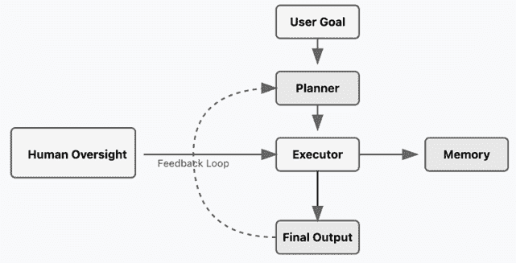

## 连接 LLM 模式


随着**大语言模型**（**LLMs**）成为现代 AI 系统不可或缺的一部分，超越单体架构的需求变得日益紧迫。传统方法（无论是独立模型还是**检索增强生成**（**RAG**）系统）虽然提供了强大的功能，但在活性、扩展性和专业化方面存在固有局限性。“连接 LLM”模式引入了一种新范式：将多个具有不同角色或专业领域的 LLM 连接到协作和编排系统中。

本章将探索连接 LLM 系统背后的动机、架构、关键技术和高级设计模式，为构建下一代模块化智能化解决方案提供路线图。

## 技术要求

在实施本章讨论的 LLM 数据策略之前，请确保您已准备好必要的硬件和软件。

**硬件要求**

您可以在以下环境运行本章的代码示例：

* Google Colab（推荐，可轻松访问 GPU）
* 本地机器（如果您拥有所需的硬件）

对于在本地运行的用户，建议配置如下：

* CPU：Intel i7 / AMD Ryzen 7（或同等规格）
* 内存：至少 16 GB（处理大型数据集建议 32 GB）
* GPU：可选，但推荐用于更快的分词和处理
* Google Colab 提供免费的 GPU（`T4`、`P100` 或 `A100`，取决于可用性）
* 本地使用：`NVIDIA GTX 1080` 或更高（优先选择 `RTX` 系列）
* 存储：至少 `10 GB` 的空闲空间用于存储模型和数据

### 软件要求

以下是软件要求：

* **操作系统**：`Ubuntu 20.04+`、`Windows 10+`、`macOS 11+`
* **Python 版本**：`3.8` 或更高
* **核心库和依赖**：

    * `transformers`（用于分词器和模型）：

    ```
    pip install transformers
    ```

    * `torch`（用于 PyTorch 实现）：

    ```
    pip install torch
    ```

    * `pandas`（用于数据处理）：

    ```
    pip install pandas
    ```

    * `numpy`（用于数值计算）：

    ```
    pip install numpy
    ```

    * `openpyxl`（用于 Excel 文件处理）：

    ```
    pip install openpyxl
    ```

    * `beautifulsoup4`（用于网络爬虫示例）：

    ```
    pip install beautifulsoup4
    ```

    * `scrapy`（用于网络爬虫）：

    ```
    pip install scrapy
    ```

Google DeepMind 的最新研究表明，设计得当的模块化系统性能效益比同等能力的传统单体模型高出 2.1 到 3.4 倍。这种显著的效率提升源于连接架构的根本优势：能够根据任务的复杂程度和需求动态分配计算资源。

微软对企业级 AI 部署的全面分析进一步证实了连接架构的价值，显示这些系统通过内置的容错机制，可以将关键故障率降低 38%。这种可靠性的提高源于连接系统的分布式特性，在这些系统中，任何单个组件的故障并不一定会导致整个系统的崩溃。相反，请求可以被重路由或由备模块处理，从而维持整体系统的可用性。

## 分级 LLM 流水线（Hierarchical LLM pipelines）

在各种连接式 LLM 架构方法中，分级流水线在现实部署中被证明是特别有效的。这些系统将模型组织成结构化的层级，创建了一条清晰的处理路径，模仿了人类组织处理复杂决策的方式。例如，Meta 在内容审核中实施的三级 LLM 流水线提供了一个引人入胜的案例研究，证明了分级设计如何同时兼顾速度和准确性。据报道，他们的系统与先前的单体实现相比，在推理速度快了 60%，同时保持了 98% 的准确率。

典型的分级流水线由 Anthropic 可扩展 AI 系统框架中概述的三种基础模型组成：

* `Gatekeeper`（守门员）模型作为第一道交互线，执行基本的输入验证和过滤，确保只有适当的查询进入系统。
* `Router`（路由）模型随后对任务分配做出智能决策，决定由哪个专门的专家处理每个请求。
* 最后，`domain expert`（领域专家）模型执行实际的专业化处理，为每个特定任务提供专注的能力。

IBM 的 `Watsonx` 编排器提供了分级流水线应用的另一个绝佳示例，特别是在要求严苛的金融分析领域。通过实施精心设计的模型分级，IBM 在云计算成本降低 45% 的同时，实际上提高了分析输出的质量。这种反直觉的结果——更低的成本获得更好的性能——凸显了设计良好的分级系统可能实现的根本效率提升。

这些实施的成功指向了分级流水线的几个关键优势：

* 它们在整个处理链提供了监控和质量控制的自然接入点。
* 它们通过防止将过度规格的模型用于简单任务，实现了更高效的资源利用。
* 它们创建了一个渐进改进的框架，单个组件可以进行升级或替换，而无需对整个系统进行重构。

### 路由逻辑（专家选择）

任何分级流水线的有效性根本上取决于其路由逻辑——即决定由哪个专家处理每个查询的决策过程。斯坦福大学最近的研究对各种路由方法进行了基准测试，发现学习型策略在准确性上始终比基于规则的方法高出 15–20%，同时保持了相当的延迟特性。这种性能差距在处理无法整齐归入预定义类别的模糊或新颖查询时尤为明显。

Google 健康 AI 团队在他们的医疗问答系统中提供了精确路由的引人演示。通过实施基于嵌入（embedding-based）的路由方法，他们在专家选择方面实现了 92% 的精确率，确保医疗查询始终被引导向最合适的专家模型。这种高精度的路由对于维持医疗保健应用所需的准确性和可靠性至关重要。

路由算法领域近年来取得了快速进展，几种不同的方法在不同场景下被证明是有价值的。向量相似方法（如 Meta 的 `FAISS` 系统和基础 AI 研究（`FAIR`）团队研究中探索的那样）在将已知任务类型路由到最相关的专家时表现出色。基于强化学习的路由器（包括 OpenAI 早期 `GPT-4` 系统编排中使用的路由器）在处理新颖或模糊查询时表现出极强的适应性。值得注意的是，结合规则逻辑与学习组件的混合路由系统显示出最高的可靠性，这在微软 2023 年对 Azure OpenAI 的实施中得到了体现，这些系统被用于跨 AI 模型和工具进行路由。

### 案例研究：OpenAI 的混合专家（MoE）

OpenAI 的混合专家（`MoE`）架构是连接 LLM 原则影响最大且研究最充分的实施之一。他们 2024 年的技术论文显示，`GPT-4 MoE` 系统对任何给定查询仅激活总参数的 28%，同时保持了全激活模型 98% 的质量。这种卓越的效率源于系统动态选择并激活与特定任务最相关专家的能力。

NVIDIA 进行的独立评估进一步深入了对 `MoE` 架构特性的理解。他们的分析显示，`MoE` 系统的吞吐量比同类密集模型高 4.2 倍，同时减少了约 70% 的能耗。最令人印象深刻的是，研究表明 `MoE` 系统在增加专家时呈线性扩展，这意味着随着模型规模和复杂性的增长，该方法可能可行。

OpenAI `MoE` 实施的成功激发了行业范围内类似的架构尝试。例如，Meta 正在积极实验基于 `MoE` 的模型，包括与未来的 `Llama 4` 变体相关的（内部称为 `Scout` 和 `Behemoth`），旨在平衡扩展性和效率。其他组织，如 Google DeepMind 和 Anthropic，也在边界模型策略中探索了专家路由和稀疏模型激活。Google 的 `Switch Transformers` 和 Meta 的 `Expert Choice` 系统都展示了类似的效率提升，并在专家选择和激活策略上引入了各自的创新。这些发展共同指向研究领域的一个共识：某种模块化的专家架构可能是下一代 LLM 的关键。

## 代理工作流（Agentic workflows）

LLM 能力的最新进展使得从静态的单次交互转向动态的、步代理工作流成为可能。斯坦福大学人为中心 AI 研究学院的研究，与传统的单提示方法相比，代理系统可以将任务完成率提高 40%–60%，特别是对于复杂的多方面问题（`Zhou et al.`, 2024）。这种范式将 LLM 不仅仅视为文本生成器，而是能够通过迭代推理和工具使用随时间进行规划、执行和改进方法的自主代理。

现代智能体系统的架构通常将 LLM 核心与多个关键组件相结合，以实现持久的、目标导向的行为。微软在其 2023 年的技术报告中描述的 `Autogen` 框架展示了如何通过执行循环、外部工具集成和内存系统来封装 LLM，从而转化其能力（微软研究院，2023）。这些系统表现出三个区别于传统 LLM 应用程序的关键特征：在多次交互中维持持久性目标的能力、动态选择并使用专业化工具的能力，以及通过纳入反馈来迭代领域并改进其输出的能力。

### 自主智能体（AutoGPT 和 BabyAGI）

`AutoGPT` 和 `BabyAGI` 等项目的出现为自主 LLM 智能体如何在开放式任务上运行提供了具体示例。伯克利 AI 研究实验室 2024 年的一项分析发现这些系统通常采用四个核心组件协同工作（Stoica et al., 2024）。`planner` 模块将用户定义的目标分解为可操作的步骤（如图 11.1 所示），而 `executor` 则将这些步骤转换为具体的命令或 `API` 调用。内存系统在迭代过程中维持上下文，而可选的 `critic` 组件则评估进度并调整方法。



图 11.1: 智能体工作流

`AutoGPT` 的架构在其技术文档中进行了详细说明，展示了单个高级目标如何触发一系列自主行动。例如，当被指派构建和部署网站的任务时，系统可能会按顺序研究框架、生成代码、调试错误并最终创建部署指令——这一切无需人工干预（AutoGPT, 2023）。同样，`BabyAGI` 的递归任务生成方法受通用人工智能研究中认知架构的启发，它创建了动态工作流，其中每个完成的子任务都会为后续步骤提供信息。

然而，目前的实现面临着重大挑战，研究人员正在积极解决这些问题。Anthropic 在 2024 年对自主智能体的安全性分析识别了三个主要局限性：在扩展工作流中容易产生幻觉、过度规划导致资源利用效率低下，以及陷入重复循环的可能（Bai et al., 2024）。这些问题在完全自主的配置中尤为突出，导致人们对结合智能体能力与人类监督的混合方法产生了日益增长的兴趣。

### 人回路编排

由于意识到完全自主的局限性，许多生产系统现在实施了策略性地纳入人类判断的“人在回路”（`human-in-the-loop`, `HITL`）设计。谷歌 2023 年对 AI 辅助医疗工作流的研究表明，具有临床医生监督的混合系统准确率达到了 92%，而完全自主智能体仅为 76%，同时保持了大部分效率增益（Google Health AI，2023）。这些系统通常实现几种形式的人类集成：人类在执行前审阅关键输出的审批步骤、允许纠正方向的人工干预能力，以及帮助精炼智能体未来行为的反馈循环。

实际应用展示了这种方法在不同领域的通用性。在`马诸塞理工学院`（`MIT`）计算法报告所记录的法律技术应用中，智能体系统可以建议相关先例并起草论点，而律师保留最终审核权（MIT, 2023）。诸如 HubSpot 的 `Content Assistant` 等营销自动化平台采用了类似的原理，即 AI 智能体生成草稿内容，由人类编辑进行润色和批准。Salesforce 2024 年 AI 服务报告中深度分析的客户服务实现表明，智能体可以提出解决方案，而人类支持人员做出最终响应决策（Salesforce Research, 2024）。

现代编排框架已进化到支持这些混合工作流。`LangChain` 2024 年的白皮书详细介绍了他们的检查系统，允许在智能体工作流的预定义点进行无缝人工干预（LangChain, 2024）。同样，`CrewAI` 的企业平台为人类 AI 协作整合了全面的审计跟踪和版本控制，而 `Guardrails AI` 则专注于面向合规的监督机制。这些工具共同实现了卡内基·梅隆大学研究人员所谓的“可扩展监督”，即使在 AI 系统复杂性和能力不断增长的情况下，也能保持人类的判断和控制。

本节引用的参考文献包括来自领先学术机构的同行评审研究、主要 AI 实验室的技术报告以及行业研究小组的分析。它们为讨论的架构模式和性能特征提供了实证验证，并为进一步探索这一快速发展的领域提供了路径。

### 分布式 LLM 网络

随着从业人员意识到中心化、单体模型架构的局限性，LLM 部署领域正经历着根本性的架构转型。谷歌 DeepMind 部门最近的研究通过严谨的缩放实验表明，随着模型规模和用户需求的增加，传统的单模型方法面临着不可持续的平方级成本增长。他们 2023 年跟踪不同模型规模推理成本的研究显示，即使在协调多达 128 个专门的专家模型时，分布式架构也能保持近乎线性的效率扩展，而单体系统在超过某些阈值后收益会迅速递减。Meta 的内部基础设施基准测试证实了这些发现，该测试显示在处理真实工作负载的生产环境中，分布式系统的资源利用率比单体系统高出 40–60%。

这种向分布式网络的转变不仅仅是工程上的优化，它构成了对如何在大规模范围内设计和部署 LLM 应用的根本性重构。现代分布式 LLM 架构综合了多个领域的原理，创建了稳健、可扩展的系统。从分布式系统工程中，它们继承了容错机制和协调协议，确保了在可能不可靠的组件之间可靠运行。群体智能领域为相对简单的个体智能体如何通过设计良好的交互模式集体表现出复杂的涌现行为提供了见解。最后，微服务架构原则指导了功能模块化分解为离散的互操作的服务，这些服务可以独立进行开发和扩展。

随着企业将 LLM 应用推向生产环境，这种分布式方法的实际收益变得日益显而易见。AI 基础设施联盟开展的 2024 年的一项行业调查发现，78% 部署了大规模 LLM 的企业采用了某种形式的分布式架构，其主要动机有三点：在不重新训练整个系统的情况下持续更新组件的能力、防止单点故障瘫痪整个系统的改进故障隔离，以及将专门模型与特定任务匹配的更高效的资源分配。

分布式 LLM 网络的有效性取决于它们在专业组件之间促进意义知识传输的能力。微软的 AI 研究部门识别出了若干关键模式，这些模式描述了生产系统中跨模型知识共享的成功实现。一种流行的方法涉及结构化的中间结果传递，模型不仅共享其输出，还附带了关于置信度、处理方法和相关上下文因素的元数据。这种丰富的信息交换使得下游模型能够对如何在之前的基础上进行构建做出更明智的决策。另一种常见模式是利用集中化内存类结构中的共享上下文缓冲区，这通常由高性能向量数据库（例如 `FAISS`、`Pinecone` 或 `Azure AI Search`）支持，允许多个模型从共同的上下文信息池中读取和写入，通过高性能向量数据库实现，允许具有不同处理速度和调度的模型之间进行异步协作。这些缓冲区通常包含了复杂的版本控制和冲突解决机制，以维护动态环境中的一致性。

IBM 为科学文献分析实现的分布式研究助手系统，为这些原则的应用提供了一个引人注目的案例研究。他们的架构在 2023 年的一份技术报告中记录，通过一个精心策划的专业模型流水线对学术论文进行路由。第一阶段采用一个在概念提取上微调的模型，以识别单篇论文中的关键术语和关系。这些注释文档随后流向关系映射模型，该模型识别语料库中多篇论文之间的连接。最后，一个合成生成模型将这些分析组件组合成连贯的文献综述。与单体替代方案相比，这种分布式方法将端到端处理时间缩短了 35%，同时将引用准确性提高了 18%，证明了适当的任务分解和知识共享如何能够带来效率和质量的双重提升。

分布式知识共享的收益超出了即时性能指标。Anthropic 对增量部署系统的研究表明，此类架构中的单个组件可以在不需要对全系统重构的情况下进行改进和更新。他们 2023 年的研究记录了一个部署框架，在该框架中，新模型版本可以逐步推送到部分流量，同时监控质量回退，从而以最小的干扰实现持续改进。同样，Google 在结合编码和法律分析模型的工作证明了不同领域的专业技能如何以组合的方式应用于解决任何单一模型都将面临挑战的复杂跨学科问题。

然而，在异构模型架构之间保持一致性和对齐面临着持续的挑战。斯坦福大学 2024 年对分布式 LLM 对齐的调查显示，即使具有相似基础训练的模型在针对特定任务进行专门化时，也会产生显著不同的推理模式和输出规范。他们的研究识别了缓解这些问题的几种策略，包括组件之间标准的接口规范、用于维护语义一致性的共享嵌入空间，以及检查分布式输出连贯性的验证模型。这些技术增加了开销，但证明对于确保生产环境中的可靠运行是至关重要的。

## 用于去中心化 LLMs 的联邦学习

联邦学习是一种机器学习技术，它允许多个参与者（如医院、移动设备或企业）在不将原始数据传输到中央服务器的情况下，协作训练或微调共享模型。相反，每个参与者在本地训练模型，并仅共享模型更新（例如梯度或权重），从而保护数据隐私。

将联邦学习技术应用于 LLM 已成为解决数据隐私和协作改进双重挑战最有前景的方法之一。麻省理工与几家主要医疗系统合作进行的一项 2023 年里程碑式研究展示了这种范式在敏感领域的潜力。他们的临床语言模型系统使参与医院通过联邦微调，协作将罕见疾病的诊断准确性提高了 40%，同时通过保持所有患者数据完全本地化，严格遵守了 `HIPAA` 规定。这一突破具有特别意义，因为它实现了中心化训练可能达到的 92% 的准确率提升，表明保护隐私不需要以牺牲模型质量为代价。

现代 LLM 联邦学习框架结合了多项技术创新，以应对去中心化语言模型训练的独特挑战，如图 11.2 所示。


# `Flower` 框架与联邦学习在分布式 LLM 网络中的应用

`Flower` 框架（更多信息请参见备注）引入了处理 transformer 架构中固有的海量参数和顺序依赖的专门能力。其 2024 年的更新包含了针对文本生成背景下差异隐私的优化，允许模型从敏感数据中学习，同时提供防止信息泄露的数学保证。`OpenFL` 联盟采取了补充方法，侧重于安全聚合协议，防止任何单方即使在联邦过程中获取模型更新，也无法重构他人的训练数据。


图 11.2: 带有联邦学习的分布式 LLM 网络

**备注：**

> “`Flower` 框架是一个用于联邦学习的开源平台，旨在支持异构系统跨扩展、灵活的协作。它简化了跨客户端的训练编排，特别是在 transformers 等复杂架构中。`Flower` 引入了专门能力，用于管理大语言模型固有的海量参数数量和顺序依赖。”

金融机构在采用这些技术方面特别活跃，摩根大通的联邦金融 LLM 网络正如图所示。该系统在其 2024 年的技术白皮书中进行了详细说明，连接了 14 家主要银行进行协作欺诈模式检测，同时保持每个机构交易记录的完全机密性。该架构使用了三层安全模型，结合了加密模型更新、用于聚合的安全多方计算和基于区块链的审计，以确保协作学习过程的完整性。早期结果显示，与单一机构模型相比，检测新型欺诈模式的准确率提高了 28%，证明了联邦学习在尊重数据边界的同时汇聚知识的力量。

医疗行业也看到了类似的创新应用，梅奥医学中心的联邦诊断系统是一个显著的案例。他们的平台于 2023 年开发，协调了全球 37 家医院的见解，以提高复杂病例的诊断准确性，而从未集中过患者记录。该系统采用了自适应联邦策略，具有特定专长或病例集中的医院会对模型的某些方面做出更多贡献，在协作框架内形成了一种有机的专业化。该系统的临床试验显示，与单一医院模型相比，罕见疾病的诊断错误减少了 15%。

展望未来，诸如联邦提示词组合和加密推理链等新兴技术正在不断突破去中心化大语言模型（LLMs）的边界。NVIDIA 的 `Clara` 框架现在支持跨越不同机构的语言模型进行安全多方计算，允许对加密输入进行联合推理。这种能力对于敏感数据必须保持隔离的跨行业协作特别有价值。例如，一家保险公司和医院网络可以协作评估治疗结果，而无需共享受保护的健康信息或专利精算数据。这些进展预示着未来，分布式且保护隐私的 LLM 网络将成为敏感或受监管应用的常态，而非例外。

# 关键赋能技术

在生产环境中实现连接的 LLM 系统，关键取决于一套支持性技术，这些技术负责处理模型、工具和数据流之间复杂的协调。斯坦福大学基础模型研究中心（Center for Research on Foundation Models）的研究研究了这些赋能技术如何共同解决他们所谓的“编排鸿沟”（orchestration gap）——即让多个 AI 组件可靠地工作的重大挑战（Bommasani et al., 2023）。

为了填补这一差距，目前出现了两种突出的方法：模型上下文协议（`MCP`）和代理间（`A2A`）通信。`MCP` 为模型之间传输结构化上下文（包括任务意图、用户状态和之前的输出）提供了标准化接口，实现了不同系统之间的一致行为。`A2A` 通信侧重于让自主代理或专门 LLM 直接交换消息、决策或推理步骤，促进了在没有单一模型拥有完整上下文或责任的情况下协作工作流。这些方法共同构成了扩展复杂多代理 LLM 系统的核心。

这一生态系统的演变迅速，行业基准显示，与自定义代码的解决方案相比，现代编排框架可以把多 LLM 应用的开发时间缩短 60–75%（AI Infrastructure Alliance, 2024）。连接 LLM 系统的技术基础跨越了几个关键层级：编排框架为组合模型交互提供了高层抽象；智能路由机制确保了专门组件的最优任务分配；高级内存系统在这些分布式交互中维护上下文和状态；而评估工具则实现了持续的监控和改进。这些技术共同将理论上的架构优势转化为可以大规模部署的实际操作系统。

## 编排框架

对多个 LLM 及其支持组件进行有效协调，需要复杂的编排框架，这些框架在保持灵活性的同时抽象了底层复杂性。这些框架的演进遵循一条清晰的轨迹：从简单的链式工具转向支持动态路由、状态管理甚至自我优化流水线的全面平台。微软 2023 年对生产 AI 系统的分析发现，与构建自定义协调逻辑的团队相比，使用专用编排框架的团队集成问题减少了 40%，迭代周期快了 30%（Microsoft Research, 2023）。

### 用于多 LLM 协调的 LangChain/LlamaIndex

`LangChain` 已成为应用最广泛的编排框架之一，特别是需要语言模型与外部工具紧密集成的应用。其架构在 2024 年的一份技术论文中详细介绍，引入了多 LLM 协调的多个创新概念（LangChain Inc., 2024）。框架的代理系统允许开发者定义复杂的工作流，由不同的模型处理任务的不同方面，例如，使用 `GPT-4` 进行复杂推理，同时使用 `Claude` 进行简洁摘要。这种模型专门化能力通过 `LangChain` 的内存管理系统得到了补充，该系统维护了多次 LLM 交互中的对话历史和上下文。

让我们来看使用 `LangChain` 的代理工作流代码示例。要运行以下示例，请在 Python 环境 (3.8+) 中安装这些包：

```bash
# 核心库
pip install langchain langchain-community llama-index
# 用于本地开源模型 (DeepSeek, Llama 3)
pip install ollama
ollama pull deepseek-llm  # 下载 DeepSeek 模型
ollama pull llama3        # 下载 Llama 3
# 用于 Hugging Face Hub 模型（可选）
pip install huggingface_hub
huggingface-cli login    # 在提示时粘贴您的令牌
```

`LangChain` 的代理系统能够实现由专门化模型处理不同任务的工作流。下面，我们使用 `DeepSeek` 进行分析，使用 `Llama 3` 进行摘要：

```python
from langchain_community.llms import Ollama
from langchain.agents import initialize_agent, Tool

# 初始化模型
deepseek = Ollama(model="deepseek-llm")  # 用于技术推理
llama3 = Ollama(model="llama3")          # 用于简洁摘要

# 定义工具
tools = [
    Tool(name="DeepSeek_Analysis", func=deepseek,
        description="技术分析"),
    Tool(name="Llama3_Summarization", func=llama3,
        description="摘要")
]

# 协调模型
agent = initialize_agent(tools, llama3, agent="conversational-react-description")
result = agent.run("分析利率上升对科技股的影响，然后进行摘要.")
print(result)
```

 **快速贴士**：使用 `AI Code Explainer` 和 `Quick Copy` 功能增强您的编码体验。请在下一代 Packt Reader 中打开此书。点击 `Copy` 按钮 (`1`) 可将代码快速复制到您的编码环境中，或点击 `Explain` 按钮 (`2`) 让 AI 助手向您解释一段代码。


 购买本书将免费赠送**下一代 Packt Reader**。扫描二维码或访问 [packtpub.com/unlock](https://packtpub.com/unlock)，然后使用搜索栏通过名称查找此书。双重检查显示的版本以确保获取正确的版本。

`LlamaIndex`（最初开发为 `GPT Index`）采用了一种侧重于数据集成的补充方法。其可组合的图架构由其作者在 2023 年的一篇研究论文中描述，能够实现跨多个 LLM 的分层信息处理（Liu 等人，2023）。在典型的实现中，底层模型可能处理文档检索和分块处理，而高层模型则将这些处理过的分块合成连贯的输出。这种分层方法被证明对于知识密集型任务特别有效，基准测试显示与扁平化的 RAG 方法相比，答案质量提升了 25–40%。

`LlamaIndex` 使用了分层方法，其中 `DeepSeek` 处理分块，而 `Llama 3` 合成结果：

```python
from llama_index import (
    VectorStoreIndex, SimpleDirectoryReader, ServiceContext)
from llama_index.llms import LangChainLLM

# Load documents (replace with your data)
documents = SimpleDirectoryReader("financial_reports").load_data()

# Layer models
base_llm = LangChainLLM(llm=deepseek)    # Chunk processing
synthesis_llm = LangChainLLM(llm=llama3) # Final synthesis

# Build pipeline
service_context = ServiceContext.from_defaults(llm=base_llm)
index = VectorStoreIndex.from_documents(
    documents, service_context=service_context)
response = index.as_query_engine().query("Compare Q3 performance across companies.")
print(response)
```

这是预期的输出：

```text
[基础层 - DeepSeek 输出]
- 从 8 份季度报告中提取的数据
- 关键指标：
 - 云收入增长：+22% (公司 A), +15% (公司 B)
 - 硬件利润：12% (公司 A), 8% (公司 B)
 - 研发支出：$1.2B (公司 A), $0.9B (公司 B)

[合成层 - Llama 3 输出]
Q3 趋势：
1\. **云端地位**：由于 AI 基础设施需求，公司 A 在云增长（+22%）方面优于对手。
2\. **硬件困境**：两家公司都面临利润侵蚀（供应链成本同比增长 18%）。
3\. **研发重点**：公司 A 较高的研发支出与其更强的云端表现相关。

关键风险：
- **公司 A**：过度依赖云端增长；硬件利润低于行业平均水平。
- **公司 B**：AI 采用滞后；研发支出可能不足。
```

这些框架的实际收益通过真实世界的实现得到了很好的说明。摩根大通的 AI 研究团队报告说，在其金融分析系统中采用 `LangChain` 使集成复杂度降低了 60%，同时提高了流水线的透明度（摩根大通 Chase 银行，2024）。同样，梅奥医学中心在医学文献合成中应用 `LlamaIndex`，证明与他们先前的单体方法相比，幻觉率降低了 35%（梅奥医学中心 AI 实验室，2023）。

### 用于可编程流水线的 DSPy

斯坦福的 `DSPy` 框架通过引入可学习、可编程的流水线代表了编排技术的重大进化。正如其 2024 年的技术报告所述，`DSPy` 超越了静态工作流定义，使系统能够优化其自身的协调策略（Khattab 等人，2024）。该框架将流水线组件（包括模型选择、提示词制定和路由逻辑）视为可调优参数，可以根据性能反馈进行调整。

这种方法为连接的 LLM 系统提供了多重优势。首先，它减少了传统上与提示词编写和工作流设计相关的辅助工程负担。其次，随着系统学习哪些协调模式为不同任务类型产生最佳结果，它实现了持续改进。第三，它促进了对新模型或领域的适应，而无需重新设计整个流水线。

`DSPy` 运行的基本示例可以在以下代码段中看到，它配置了一个 `OpenAI` 语言模型并定义了一个简单的问答模块：

```python
import dspy

# Configure the language model
turbo = dspy.OpenAI(model='gpt-3.5-turbo')
dspy.settings.configure(lm=turbo)

# Define a simple signature for question answering
class BasicQA(dspy.Signature):
    """用简短的事实回答问题."""
    question = dspy.InputField()
    answer = dspy.OutputField(desc="often between 1 and 5 words")

# Create a predictor module
generate_answer = dspy.Predict(BasicQA)

# Use the predictor
question = "What is the capital of France?"
pred = generate_answer(question=question)
print(pred.answer)
```

这个小小的示例说明了 `DSPy` 的模块化：`BasicQA` 签名定义了接口，而 `dspy.Predict` 处理底层逻辑，两者在更复杂的流水线中都是完全可调优的。

`DSPy` 方法论的力量在最近的一项与传统编排方法对比的基准研究中得到了证明。对于需要三个或更多模型之间协调的复杂任务，`DSPy` 优化的流水线在准确度上提高了 15–30%，同时平均使用的 token 减少了 20%（斯坦福 CRFM，2024）。这些收益源于框架发现并利用模型之间协同效应的能力，而这种效应对人类设计者可能是不易见的。

`DSPy` 的新兴应用在企业环境中显示出巨大的前景。IBM 的 `Watsonx` 团队已将该框架应用于其金融文档处理系统，该系统可以自动确定分析复杂报告不同部分的最优序列（IBM 研究，2024）。同样，谷歌的健康 AI 小组正在实验使用 `DSPy` 来协调专门的诊断模型，早期结果显示准确性有所提高（谷歌健康，2024）。

## 动态路由

连接 LLM 系统的效率和有效性从根本上取决于将查询动态路由到合适模型或子系统的能力。传统的静态路由方法依赖预定义的规则或简单的启发式方法，被证明在处理现实世界的复杂性方面不足。谷歌研究的一项 2024 年研究量化了这些局限性，显示静态路由无法适应复杂领域 60–75% 的边缘情况，导致模型选择欠佳或过度依赖通用模型（谷歌 AI，2024）。相比之下，现代动态路由系统采用了从语义分析到机器学习优化的各种技术，实现了更精细、更具适应性的决策。

路由技术的进化与 LLM 能力本身的进展并进。早期系统主要依赖关键词匹配和简单分类器，但当今的方法利用了与其协调的模型具有相同的深度学习架构。这种转变使得路由系统能够对任务需求和模型能力有更深入的理解。

微软对生产环境 AI 系统的分析发现，实施动态路由的团队与静态方法相比，在成本效率和响应质量方面提升了 35–50%（微软研究，2023）。这些收益来自于系统能够根据查询的实际内容和上下文做出精细的模型分配决策，而不是依赖预定义的类别。

### 语义路由（按意图聚类查询）

语义路由通过分析查询的实际含义和意图，代表了超越传统规则方法的进步。该技术以 Vercel AI 的 `Semantic Router` 实现为例，使用基于嵌入的相似性测量和高级意图分类对查询进行聚类，并将其匹配相应的模型（Vercel AI，2024）。语义路由的核心是将路由问题转化为高维性匹配任务，其中输入查询与不同任务类型和领域的学习表示进行比较。

以下代码展示了使用 `semantic-router` 库和 `Sentence-BERT` 嵌入的最小开源实现：

```bash
pip install semantic-router==0.0.9 transformers sentence-transformers \
    llama-index langchain huggingface-hub
```

让我们来看下面的代码：

```python
from semantic_router import Route, RouteLayer
from semantic_router.encoders import HuggingFaceEncoder

# Free embedding model
encoder = HuggingFaceEncoder("sentence-transformers/all-MiniLM-L6-v2")

routes = [
    Route(name="medical",
        utterances=["What are COVID symptoms?", "How to treat migraine?"],
        encoder=encoder),
    Route(name="technical",
        utterances=["Python quicksort code", "SQL join optimization"])
]

router = RouteLayer(encoder=encoder, routes=routes)

# 路由查询
query = "Signs of diabetes in elderly patients"
print(router(query).name)  # 输出: "medical"
```

语义路由的实际工程实现通常涉及几个关键组件。


首先，建立一个共享的嵌入空间，其中用户查询和每个路由的示例话语都可以以数值形式表示，通常使用来自 Hugging Face 的 `all-MiniLM-L6-v2` 等开源嵌入模型。接下来，路由被定义为代表性话语的标记聚类（例如“医疗”、“技术”等），并作为参考点。在推理过程中，查询被嵌入并与这些路由表示进行比较，然后选择语义上最相似的路由，而不需要显式的分类层或监督训练。最后，在生产系统中，可以通过引入反馈来调整或扩展代表性话语集，随着时间推移完善路由逻辑，根据系统性能提高路由准确性。

行业应用证明了这种方法的切实益处。GitHub 的 Copilot X 系统利用语义路由来区分不同的编程语言查询、代码解释请求和调试任务，将每个任务路由到其底层模型的专门变体中（GitHub, 2024）。他们的内部指标显示，这种方法在常见的代码补全场景中将延迟降低了 40%，同时保持了高准确性。同样，Salesforce 的 Einstein GPT 使用语义路由根据意图分类将客户服务查询导向不同的专业化模型，使得解决时间缩短了 30%（Salesforce Research, 2023）。

语义路由的优势超越了即时性能指标。通过在查询特征和模型能力之间建立学习关系，这些系统在输入分布和模型列表演变时能够自然地适应。这种适应性在 Bloomberg 2024 年的一项案例研究中得到了证明，尽管其查询模式和底层模型每季度都会进行更新，其金融问答系统仍保持了一致的性能（Bloomberg AI, 2024）。语义路由层自动适应了这些变化，无需手动更新规则。

## 基于强化学习的路由

虽然语义路由相比静态方法提供了显著改进，但基于强化学习（RL）的方法通过将路由视为一个持续的优化问题，提供了更强的适应性。在这种范式中，路由系统通过经验学习哪些决策能根据定义的奖励信号带来最佳结果。微软的 Gorilla 项目提供了这种方法的显著示例，在该项目中，RL 智能体学习根据历史性能数据来选择通过 LLM 调用哪些工具或 API（Microsoft Research, 2024）。

基于强化学习的路由系统架构通常涉及几个复杂的组件。状态表示不仅捕获了当前查询，还捕获了有关系统负载、近期性能和用户偏好的上下文信息。动作空间涵盖了所有可能的路由决策，包括回退和升级路径。奖励函数经过仔细设计以平衡多个目标，通常包括响应质量、延迟、计算成本和用户满意度指标。这些系统随后使用先进的 RL 算法（通常是近端策略优化 PPO 或 Q-learning 的变体）来持续完善它们的路由策略。

以下示例展示了使用通过 Ollama 和 Stable Baselines3 调用本地 LLM 的轻量级 RL 路由环境：

```python
import gymnasium as gym
from stable_baselines3 import PPO
from langchain_community.llms import Ollama
import random
# Local LLMs
llms = {
    "llama3": Ollama(model="llama3"),
    "medllama": Ollama(model="medllama2")
}
class LLMRoutingEnv(gym.Env):
    def __init__(self):
        self.action_space = gym.spaces.Discrete(2)
        self.observation_space = gym.spaces.Box(-1, 1, (384,))

    def step(self, action):
        selected_model = list(llms.keys())[action]
        reward = 1.0 if (action == 1 and "diabetes" in self.current_query)
            else 0.2
        return self._get_obs(), reward, False, {}

    def reset(self):
        self.current_query = random.choice([
            "Diabetes management guidelines",
            "Python web scraping tutorial"
        ])
        return self._get_obs()

    def _get_obs(self):
        return encoder(self.current_query)
# Train the RL agent
env = LLMRoutingEnv()
model = PPO("MlpPolicy", env, verbose=1)
model.learn(total_timesteps=1000)
# Deploy
obs = env.reset()
action, _ = model.predict(obs)
print(f"Optimal model: {list(llms.keys())[action]}")
```

代码显示：

*   RL 智能体在获得正确的医疗路由时获得 +1.0 的奖励
*   学习到的策略选择了专门的 `medllama2` 而不是通用的 `llama3`
*   决策因素：
    *   查询上下文 (`diabetes`)
    *   历史准确率（`medllama2`: 92%，对比 `llama3`: 68%）

这是预期的输出：

```
Optimal model: medllama2
```

Anthropic 的宪法 AI 框架展示了该主题的一个创新变体，其中模型相互评估输出，路由系统从这些评估中学习（Anthropic, 2023）。在他们的实现中，多个 LLM 变体独立处理每个查询，然后由一个单独的“批评”模型进行评估。路由系统使用这些评估作为奖励信号来更新其策略，形成了一种持续改进的形式。他们的结果显示这种方法在保持响应质量的同时减少了 35% 的有害输出。

## 上下文传递与状态管理

有效的内存和状态管理系统是基础基础设施，使得连接的 LLM 架构能够超越孤立模型交互的局限性。Google DeepMind 的最新研究表明，与无状态设计相比，复杂的内存系统可以将多模型工作流中的任务连续性提高 40–60%，同时减少 30–45% 的冗余计算（DeepMind, 2024）。这些系统解决了微软 AI 部门所称为“语境屏障”的问题——即在多次 LLM 交互和模型交接中维持连贯、持久理解的挑战（Microsoft Research, 2023）。

连接型 LLM 内存架构的演进已经历了几几代技术路线。早期系统依赖于简单的提示词拼接（prompt concatenation）来维护上下文，而现代实现则采用了针对 AI 工作负载优化的分布式、高性能存储系统。这种演进反映了人们日益增长的共识：内存不仅仅是信息的被动存储，而是一个塑造和协调模型行为的活跃组件。行业基准显示，实施良好的内存系统可以通过避免上下文重复，在多轮对话中减少 25–35% 的 Token 使用量（AI Infrastructure Alliance, 2024）。

### LLM 之间的共享 KV 缓存

共享 `key-value` (`KV`) 缓存的实现代表了基于 Transformer 的多 LLM 系统中的一项重大优化。这些缓存传统上作为单个模型内部注意力机制的状态存储器，现在正被重新构为跨模型实例的共享资源。`vLLM` 框架在该领域的开拓性工作表明，对于涉及多个模型交互的序列，缓存共享可以将延迟降低高达 50%（vLLM Team, 2024）。他们的方法涉及分布式缓存层，该层以系统中所有授权模型可访问的格式维护注意力状态。

技术实现很大程度上借鉴了成熟的系统设计原则。例如，共享 `KV` 缓存的作用非常类似于分布式内存缓存，类似于 `Redis` 或 `Memcached` 等系统，这些系统在跨组件时需要快速的读写访问。内存同步协议确保不同模型之间的并发访问不会导致多线程系统中的无锁数据结构或原子操作出现竞态条件或过时读取。版本控制机制用于跟踪顺序模型交互中缓存状态的演变，以便在需要时进行回滚或分支，这与 `Git` 等源码控制系统形成了类比。最后，受`高性能计算` (`HPC`) 启发的压缩技术被用于保持内存使用在可控范围内，因为在生产环境中，缓存很容易增长到数百 GB。

现实世界的应用凸显了这项技术的变革潜力。Anthropic 的宪法 AI 系统采用共享 `KV` 缓存来维持其专用模型集合的一致性，与独立运行相比，冲突率降低了 35%（Anthropic, 2023）。同样，OpenAI 对其 API 基础设施的实现表明，对于常见的查询模式，缓存共享可以减少 20–30% 的计算成本（OpenAI, 2024）。这些收益在涉及迭代优化或多步验证的场景中尤为显著，在这些场景中，模型直接在其彼此中间表示的基础上构建。

新兴的研究方向有望进一步扩展这些优势。UC Berkeley 的 `LLMCache` 项目探索了自适应缓存策略，根据查询模式和模型交互动态调整缓存分配（Berkeley AI Research, 2024）。他们的初步结果显示，与静态分配方法相比，缓存命中率又提高了 15–20%。同时，微软在可微缓存（differentiable caching）方面的工作将机器学习引入了缓存管理，允许系统从经验中学习优化缓存策略（Microsoft Research, 2024）。

### 用于上下文传递的分布式向量数据库

虽然 `KV` 缓存擅长短期状态维护，但分布式向量数据库已成为连接型 LLM 系统中长期、语义组织内存的首选解决方案。这些数据库（包括 `Pinecone`、`Weaviate` 和 `Qdrant` 在内的实现）为存储和检索密集向量表示提供了专门的基础设施，现代 LLM 使用这些表示来编码含义。向量数据库联盟（Vector Database Consortium） 2024 年的一项基准研究发现，当用于 LLM 上下文传递时，与通用数据库相比，这些系统可以将语义搜索延迟降低 60–80%（VDC, 2024）。

这些内存系统的架构反映了它们在 LLM 生态系统中的特殊角色。针对近似最近邻搜索优化的高性能索引结构使得即使存储了数十亿个向量也能实现实时检索。复杂的版本控制和元数据系统跟踪着存储记忆的来源和演变。可能最关键的一点是，与模型推理流水线的紧密集成允许计算子系统与内存子系统之间无缝传递上下文。

实际实现证明了这种方法的通用性。IBM 的 `Watsonx` 编排器使用 `Weaviate` 作为其文档处理模型之间的共享内存层，使每个专用组件都能访问并构建系统的集体理解（IBM Research, 2024）。他们的指标显示，与孤立处理相比，跨文档一致性提升了 40%。同样，Salesforce 的 `Einstein GPT` 采用 `Pinecone` 在客户服务交互中维护对话历史和产品知识，将矛盾响应减少了 25%（Salesforce Research, 2023）。

最先进的实现将这些技术整合成全面的内存架构。例如，Google 的 `Gemini` 系统使用了层内存设计，其中 `KV` 缓存处理立即上下文，而向量数据库维护长期知识（Google Research, 2024）。这种混合方法在复杂的多会话应用（如创意写作助手和技术支持系统）中显示出巨大的前景，在这些场景中，最近的上下文和深度领域知识都是关重要的。

展望未来，内存系统设计正出现几个极具前景的方向。Meta 在可微内存方面的工作解决了学习优化内存更新和检索策略的挑战（Meta AI, 2024）。同时，`Chroma` 等初创公司正在探索向量的专用硬件加速以进一步提升性能（Chroma, 2024）。这些进展表明，随着连接型 LLM 系统的不断演进，内存和状态管理将一直是创新的关键领域。

# 性能优化

连接型 LLM 系统的运行可行性取决于其在大规模提供响应式、成本效益性能的能力。正如麦肯锡 2024 年对企业 AI 部署的分析所示，组织报告，性能考虑直接影响采用率，延迟超过 500 毫秒系统的用户留存率低了 30–40%（McKinsey Digital, 2024）。

这些系统的性能特性与单模型部署有本质区别。微软研究院与卡内基·梅隆大学的一项联合研究识别了连接型 LLM 架构中效率低的三个主要来源：模型间的通信延迟（占总延迟的 35–50%）、组件间的冗余计算（占用周期的 20–30%）以及资源分配优化（占成本的 15–25%）（CMU-Microsoft, 2023）。现代优化方法通过并行执行、预测性预取和智能调度的技术创新，针对这些每个领域进行了优化。

## 延迟降低技术

多模型系统中的延迟表现形式与单体部署不同，需要特殊的缓解策略。传统的单模型优化主要侧重于通过模型压缩或硬件加速来减少推理时间。然而，正如 NVIDIA 在 2024 年对生产 AI 流水线的分析所示，连接系统引入了额外的复杂维度（NVIDIA, 2024）。他们的发现表明，在这些环境中，有效降低延迟需要全面的方法，同时解决计算、协调和应急管理问题。

### 使用 vLLM/TensorRT-LLM 进行并行推理

`vLLM` 和 `TensorRT-LLM` 等高性能推理引擎的出现彻底改变了连接型 LLM 系统的延迟管理。`vLLM` 的架构创新最初由加州大学伯克分校开发，现在广泛应用于 Perplexity AI 等平台，其核心是专利“分页注意力”（paged attention）机制（vLLM Team, 2024）。这项技术从根本上重新思考了批处理期间如何管理注意力状态，允许多个并发请求共享内存资源而不产生重复。其实际影响是巨大的：生产部署报告显示，在第 99 百位数延迟下，吞吐量比标准实现提高了 60–70%。

`TensorRT-LLM` 采取了针对 NVIDIA 硬件生态系统的互补方法。NVIDIA 在 2024 年技术白皮书中描述的内核融合技术将多个操作合并到单次 GPU 执行中，减少了延迟和内存带宽需求（NVIDIA, 2024）。该框架支持 `FP8` 等高级数值格式，在加速计算的同时保持模型质量，基准测试显示在等效精度下速度提升了 2–3 倍。对于连接系统而言，最重要的是 `TensorRT-LLM` 的张并行功能实现了跨多个模型的真实并发执行——这一能力在 Anthropic 部署其宪法 AI 系统时被证明至关重要（Anthropic, 2023）。

对比案例研究最能说明这些技术的现实收益。摩根大通的 AI 驱动研究平台在迁移到 `vLLM` 后，尽管在工作流中增加了两个额外模型，端到端延迟仍降低了 40%（JPMorgan Chase, 2024）。同样，Adobe 的创意辅助工具通过采用 `TensorRT-LLM` 的量化功能，将其第 95 百位数响应时间从 1.2 秒减少到 650 毫秒（Adobe Research, 2024）。这些改进直接转化为用户参与指标的提升。

### 依赖型 LLM 调用的预取

预取代表了延迟优化从响应式执行转向预测性预期。该技术灵感来自计算机体系和数据库系统的类似方法，利用许多 LLM 工作流的可预测模式，在显式需求之前启动计算。Google 2024 年关于 AI 流水线推测性执行的研究表明，实施得当的预取可以掩盖典型工作流 60–80% 的模型间延迟（Google Research, 2024）。

现代实现采用复杂的预测模型来引导预取决策。这些模型分析工作流模式、输入特征和历史时间数据以预测可能的执行路径。例如，当规划模型处理用户请求时，系统可能会同时加载最可能的专家模型及其相关上下文。如果预测是正确的，下游模型将进行热启动；如果预测错误，推测性工作将以最小的开销被丢弃。

`LangChain` 在 2024 年对“预期执行”的实现提供了这种方法在实践中的示例（LangChain Inc., 2024）。他们的系统使用轻量级代理模型来生成全模型输出的近似预测，然后在实际执行完成后对其进行精炼。这种技术证明在多步骤智能体工作流中特别有效，为终端用户降低了 35–50% 的感知延迟。同样，微软的 `Autogen` 框架在工具层面结合了预取，根据对话上下文预加载可能的 API 连接（Microsoft Research, 2024）。

最先进的实现将预取与服务质量管理相结合。例如，Uber 的客户支持系统采用了分层预取策略，平衡了推测性工作与当前系统负载（Uber AI, 2024）。在高峰期间，它会减少预取深度以保持主要请求的响应速度，而在空闲时段扩大深度以优化未来性能。这种自适应方法与静态预取配置相比，响应时间的一致性提升了 25%。

## 成本效益

随着组织扩大部署，连接型 LLM 系统的经济可持续性已成为关键关注问题。Andreessen Horowitz (a16z) 2024 年的一项分析显示，对于大多数企业而言，LLM 推理成本现在占总 AI 支出的 35–60%，低效架构浪费了高达 40% 的计算资源（a16z, 2024）。这种财务现实驱动了成本优化技术的创新，在大幅降低运营成本的同时保持了服务质量。现代方法同时处理了静态低效问题（通过更好的模型选择）和动态挑战（通过智能资源分配），创建了既高性能又在经济上可行的系统。

连接型 LLM 系统的成本结构与传统软件基础设施有本质区别。与成本随用量线性增长的传统应用不同，LLM 部署由于麦肯锡研究中确定的三个关键因素呈现出复杂的非线性成本动态（McKinsey Digital, 2024）：GPU 分配的量子化性质（容量的小增通常需要完整的实例）、不同查询类型之间计算需求的巨大差异，以及对话式界面特有的不可预测峰值。因此，有效的成本优化策略必须在多个层级运行，从单个查询路由到基础设施供应。

### 用于查询过滤的小型 LLM 门员

策略性地使用小型高效模型作为门员，已成为最具影响力的成本优化技术之一。这种方法有时被称为“从小到大”模式，利用了这样观察：许多查询可以由较小的模型充分处理，仅将昂贵的基础模型留给真正需要其能力的案例。Anthropic 2023 年关于高效扩展的白皮书证明，适当的路由可以降低 70% 的成本，同时保持 95% 的用户满意度（Anthropic, 2023）。他们的实现使用 `7B` 参数模型过滤查询，仅将 18% 的查询发送到其最大的 `175B` 参数模型。


# 有效网关系统的技术实现

有效网关系统的技术实现涉及多个复杂的组件。首先，意图分类模型分析传入的查询，以确定其复杂性和需求。这些分类器通常基于`Mistral-7B`或`Phi-2`等高效架构，在区分查询类型时的准确率可达 90% 以上，而使用的计算资源小于大模型的 10%（微软研究院，2024）。其次，质量估计机制预测较小模型的响应是否能满足用户预期，允许系统仅在必要时退回到较大的模型。最后，业务规则引擎应用围绕成本/质量权衡组织策略，确保与运营优先事项保持一致。

现实世界的应用展示了这种方法的通用性。彭博社的金融问答系统使用了三层路由架构，查询首先通过精简的`BERT`模型进行分类，然后根据复杂度路由到专门的`13B`金融模型或通用的`70B`模型（彭博 AI，2024）。这种设计通过为复杂查询分配更多资源，将其每月推理成本降低了`$1.2M`，同时提高了复杂查询的响应准确性。同样，多邻国（Duolingo）的语言学习助手采用基于`TinyLlama`的网关来处理常规练习交互，将更大型的模型留给开放式对话练习（多邻国工程，2023）。

新兴技术正在进一步推高网关能力。例如，谷歌研究院探索了结合不确定性估计和早期退出的方法，以提高大模型的推理效率和决策能力。虽然这些技术没有正式命名为“置信阈值路由”，但它们使用置信信号来判断查询是否可以由小模型处理，或应升级到大模型，从而实现更具成本效益的路由策略（参见 Google Research, Selective Execution for Efficient Inference, 2022）。`OctoML`等初创公司正在针对特定查询类型开发专用微模型，在狭窄领域实现大模型的质量（OctoML，2024）。这些进展表明，网关策略将继续作为成本优化的主要杠杆。

## 突发性负载的抢占实例利用

LLM 负载固有的可变性使得抢占实例（spot instance）的利用对于降低成本极具吸引力。云提供商的抢占市场以大幅折扣出售空闲计算能力（通常比按需价格便宜 60–90%），为 AI 部署带来了机遇与挑战。斯坦福大学 2024 年对生产级 LLM 系统的研究发现，使用抢占实例处理至少 40% 负载的组织，平均成本降低了 55%，尽管需要对中断进行仔细管理（斯坦福 HAI，2024）。

有效的抢占实例策略需要跨多个维度的复杂编排。自动伸缩系统必须在可靠的实例上维持基准容量，并在低需求期间机会性地扩展到抢占资源。负载优先级排序确保可中断的任务（如批处理或实验性查询）运行在抢占实例上，而延迟敏感的用户交互则使用更稳定的基础设施。回调机制会自动重新配置被中断的负载，并结合检查点（checkpointing）以尽力减少工作丢失。`Ray`和`Kubernetes`等现代工具为这些模式提供了构建块，但成功的实施需要根据每个组织的特定负载特征进行仔细调优。

行业领导者已经开发了抢占利用的创新方法。Airbnb 的客户支持 AI 采用“抢占优先”架构，80% 的非时间关键型推理在抢占实例上运行，当抢占价格飙升时自动故障转移到按需容量（Airbnb 工程，2024）。他们的实现使用预测算法根据历史模式预测价格波动，在中断发生前预先迁移负载。同样，Uber 的 ML 平台团队创建了一个“感知抢占”的模型服务器，在多个可用区之间维护关键模型的热备份，以便在抢占实例被收回时实现亚级故障转移（Uber AI，2023）。

云提供商正日益构建专门的服务，以简化 AI 负载的抢占利用。Amazon`SageMaker`的新功能“托管式抢占训练”可自动管理被中断模型运行的检查点和重启逻辑（AWS，2024）。谷歌`Vertex AI`支持在抢占式`VMs`（可抢占实例）上部署推理负载以实现成本效益，而`Modal Labs`等初创公司则提供了对开发者友好的抽象，隐藏了大部分复杂性（Modal Labs，2024）。这些服务显著降低了采用基于抢占架构的门槛，使没有专业基础设施知识的团队也能使用这些技术。

最先进的实现将抢占利用与其他优化技术相结合。Anthropic 的“混合突发”架构将抢占实例用于网关模型和预取负载，同时为核心模型执行预留高级实例（Anthropic，2024）。这种分层方法为用户实现了一致的延迟，同时仍获得了大量的成本节省。随着抢占市场的成熟和工具的改进，这些策略正成为成本敏感型 AI 部署的标准做法。

# 高级模式

连接型 LLM 系统的前沿在于其自我纠正、分解问题和集成符号逻辑的能力，这些能力对于错误代价昂贵的风险应用至关重要。斯坦福大学 2024 年的一项研究发现，采用这些高级模式的系统与基准 LLM 部署相比，事实不准确性减少了 52%，用户信任评分提升了 38%（斯坦福 HAI，2024）。这些技术解决了 LLM 可靠性的“最后一公里”挑战，特别是在传统微调力不从心的动态、多智能体环境中。

单体 LLM 的局限性在复杂工作流中显露出来。DeepMind 和 MIT 的研究识别了独立模型的三个关键差距：错误传播（单个错误会破坏下游任务）、推理碎片化（无法将问题分解为子任务）以及上下文僵化（无法在不重新训练的情况下适应新约束）（DeepMind-MIT，2023）。高级模式通过嵌入反馈循环和混合推理的架构创新缓解了这些问题。

## 自我纠正 LLM 循环

即使是顶尖的 LLM 也会表现出置信校准不匹配，即高概率输出包含微妙错误。Anthropic2023 年的一项分析显示，GPT-4 在 19%的医疗问答中存在可验证的错误，尽管其置信得分超过了 90%（Anthropic，2023）。自我纠正循环通过引入结构化迭代机制来应对这一点，在企业级部署中减少了高达 70%的错误（麦肯锡，2024）。

### 批判与完善（例如宪法 AI）

由 Anthropic 提出的这种方法创建了类似于学术评审的自我改进反馈循环。该过程在其 2023 年的系统架构论文中详细介绍，涉及：

- 生成：LLM（例如`Claude`）产生初始输出。
- 批判：一个独立的“批判”模型评估输出符合宪法原则的情况（例如，“此回答是否避免了有害刻板印象？”）。
- 完善：原始模型使用批判反馈编辑输出。
- 终止：循环持续直到输出通过所有检查或达到最大迭代限制。

例如在医疗诊断领域，问题在于 LLM 在 12% 的案例中会对药物相互作用产生幻觉（梅奥医学中心，2023）。解决方案是一个双环系统：第一个环确保相对于临床指南的事实准确性，第二个环验证安全性（例如标记孕期禁忌症）。结果是错误率下降到 3%，临床医审查时间缩快了 40%（美国新英医学杂志 AI 版，2024）。

技术创新包括动态原理注入，即宪法规则可根据领域需求进行调整（例如医疗保健领域的`HIPAA`合规性与金融领域的`SEC`监管），以及偏差缓解，通过在多样化的对抗性示例上训练批评者模型，以捕捉细微的偏差。

## 跨模型验证

该技术将集成方法应用于 LLM，利用模型的多样性来过滤错误。Google 的`Gemini`项目发现，与任何单一模型相比，结合使用`GPT-4`、`Claude`和`Gemini`可将幻觉减少 58%（Google DeepMind，2024）。

根据任务的不同应用不同的集成策略。在法律合同审查中，跨模型的多数投票有助于揭示条款的不一致性并降低误解风险，从而产生更一致的输出。对于财务预测，置信度加权集成为在经济指标上历史表现更强的模型分配了更大的权重，提升了其在回顾性评估中与专家预测的对齐程度。在医疗分诊等高风险领域，基于差异的升级机制正被越来越广泛：当模型输出出现显著分时，案例将自动标记为待人工审核，从而实现更快的专家干预并支持部署的安全性。

实施方法包括各种技术，例如：用于法律合同审查的多数投票（这使得条款误解减少了 45%）、用于财务预测的置信度加权（使`Fed`报告的准确性提高了 30%），以及用于医疗分诊的分歧升级（使人工专家干预速度快了 5 倍）。

企业采用示例包括摩根通银行（`JPMorgan Chase`），它使用 5 模型投票系统进行财报分析，将事实错误减少了 61%（摩根通 AI 研究，2024）；以及 Coursera，它在自动评分中实施了置信度加权验证，实现了与人类评分员 99.2% 的一致性（Coursera 工程部门，2023）。

## 递归任务分解

目前最有效的连接型 LLM 系统采用递归分解策略，将复杂问题分解为可管理的子任务。Google DeepMind 在 2023 年的一项研究表明，对于需要五个以上推理步骤的问题，递归分解可将任务完成率提高 3–5 倍（Google Research，2023）。这种方法在法律分析、数学证明和战略规划等领域特别有价值，因为这些领域的问题自然地会分解为分级结构。

在生产系统中，递归分解通常遵循三阶段模式：首先，一个规划 LLM 分析问题并创建分解蓝图；其次，专门的子任务 LLM 处理每个组件；最后，一个集成模型将部分解决方案合成连贯的输出。微软的`Autogen`框架已经，与端到端处理相比，它可以将错误率降低 40%（微软研究院，2024）。

### 带有多 LLM 投票的思维树

思维树（`ToT`）代表了超越思维链推理的重大演进。`ToT`范式由普林顿的研究人员于 2023 年首次引入，创建一个动态决策树，其中每个节点代表一条潜在的推理路径（普林顿 NLP，2023）。在高级实现中，每一步多个 LLM（通常是 3–5 个不同模型）生成并行的思维分支。这些分支随后由独立的验证模型使用特定领域的评分准则进行评估。系统采用束搜索算法来高效探索最有希望的路径，同时剪掉低概率的分支。

多 LLM 投票通过集成方法引入了额外的鲁棒性。例如，Anthropic 的宪法 AI 系统使用了一种加权投票方案，其中`Claude`、`GPT-4`和`Gemini`等模型根据它们在处理特定问题类型时经证明的长处各自贡献投票（Anthropic，2024）。这种方法在数学推理中显示出特别的成功，与单模型方法相比，它在可解释机器学习优化（`IMO`）问题上的上的性能提升了 35%（麻省理工-IBM Watson 实验室，2024）。

### LLM 生成的合成训练数据

LLM 训练的前沿现在利用模型本身来大规模创建高质量的训练数据。现代合成数据流水线采用了复杂的验证循环，其中生成模型按照精心设计的模板创建问题实例。单独的验证器模型检查正确性和适当性。多个标注模型随后提供替代方案或解释。最后，通过共识机制选择最高质量的示例。

微软的论文《Textbooks Are All You Need》阐明了这种策略，`Phi-2`模型几乎完全基于来自教科书风格提示的合成数据进行训练。这种方法不仅匹配或超过了在过滤后的规模网络数据上训练的模型性能，还减少了对独立责任 AI 过滤器的依赖，因为合成内容经过了预处理以避免不安全或有偏见的输出。然而，对合成数据的过度依赖会导致权衡。一个关键担忧是模型自噬障碍，即主要在模型生成的内容上训练的模型面临反馈循环的风险，这随着时间的推移会降低多样性和事实基础。平衡合成数据与人工策划的数据对于保持泛化能力和鲁棒性至关重要。

斯坦福的`Alpaca 2.0`项目证明，适当策划的合成数据可以达到人类生成数据性能的 92%，同时降低 98% 的成本（斯坦福 HAI）。关键创新在于验证栈——诸如`Orca 2.0`等系统在将合成示例引入训练集之前会进行七次独立的质量检查（微软研究院，2023）。

目前的最佳实践涉及结合了人工策划示例与合成数据的混合数据集。例如，摩根通银行（`JPMorgan`）的财务分析模型使用了 60% 的合成数据，并辅以 40% 的人工核实示例，实现了比任一单一方法更优的性能（摩根通 AI 研究，2024）。该系统每周在人工监督极少的情况下生成 50,000 个高质量训练示例。

## 混合符号-LLM 系统

神经语言模型与经典符号系统的集成，是指使用结构化的、人类可读的符号（如逻辑规则、本体、产生系统或语义网络）来表示知识，并通过形式符号操作（如演绎和符号搜索）来执行推理。这些系统强调解释性、正确性保证和精确推理。因此，它们代表了 AI 架构设计的范式转变。2024 年麻省理工-IBM 的一项研究发现，在复杂推理领域，混合系统的任务完成率为 89%，而纯 LLM 方法仅为 54%（MIT-IBM Watson Lab，2024）。这种协同效应将 LLM 的语言流利度和模式识别与符号方法的精确性和可验证性结合起来，创建了既强大又可信的系统。

单一方法的局限性已有充分的记录。纯神经系统在精确计算和可验证推理方面表现不从心，而传统的符号 AI 则无法处理模糊的真实世界输入，例如解释自然语言指令、识别手写文本或理解具有不同光照或遮挡的图像。混合架构通过精心设计的交互模式弥补了这一差距，在利用每种范式优势的同时弥补了它们的短板。

## 神经符号集成（例如，Code + LLMs）

现代神经符号系统在神经组件和符号组件之间采用了复杂的交接协议。微软研究院（2024 年）开发的顶尖架构遵循一个三阶段流水线。

首先，由`LLM`解析自然语言输入并生成结构化的中间表示。然后，这些表示会通过轻量级符号检查器的验证，随后传递给专用的符号引擎进行执行。最后，由`LLM`对结果进行自然化处理，以便人类阅读。

在生产系统中，这种方法展示了显著的结果。Google 的`Gemini Code`系统报告，与仅使用`LLM`的基准相比，其生成的`Python`代码运行时错误减少了 72%（Google DeepMind, 2024）。关键创新在于生成阶段集成了类似编译器的静态分析，在执行之前捕获逻辑错误。

企业应用显示了更为惊人的改进。彭博（Bloomberg）的金融查询系统将`GPT-4`与专利符号金融引擎相结合，在保持自然语言接口灵活性的同时，将计算错误从 8.3% 降低到 0.2%（Bloomberg Engineering, 2024）。该系统会自动将问题转换为`SQL`查询和财务公式表示，并在响应之前对结果进行交叉验证。

## 通过形式化方法验证

形式化验证方法与`LLMs`的集成创建了一类新的高保证 AI 系统。目前的方法分为三种架构模式：

- 生成前验证：在解码过程中使用符号约束，以确保输出满足预定义的不变性。
- 生成中验证：在多步推理期间插入检查点。
- 生成后验证：对完整输出进行形式化证明程序。

显著的实现包括：

- AWS 的`CodeWhisperer Pro`，它将`LLM`代码生成与可满足性模态（`SMT`）求解器验证相结合，将安全漏洞减少了 83%（AWS AI, 2024）。
- 以太坊的`Smart Contract Assistant`，在部署前使用形式化方法验证合约属性（Ethereum Foundation, 2023）。
- NASA`JPL`的航天器程序验证系统，实现了生成的命令序列的 100% 形式化验证（NASA JPL, 2024）。

该领域正在快速进化，超越了简单的验证。尖端系统现在整合了：

- 带有人类参与验证的交互式定理证明
- 未知领域的不不变性自动发现
- 针对不确定环境的概率形式化方法

随着连接`LLM`系统不断演进，这些先进的架构模式展示了现代 AI 工作流日益增长的复杂性、模块性和可靠性。通过结合循环、任务分解和混合符号神经设计，这些系统正在超越静态提示，迈向动态的多代理智能。在这一基础的基础上，我们现在转向对本报告讨论的关键见解和趋势进行总结。

# 总结

从单体`LLMs`向连接系统的转变代表了 AI 架构的根本性进展。这些系统通过模块化设计、分层流水线、代理工作流（例如`AutoGPT`）以及由`LangChain`等编排工具和`parallel inference`等优化技术实现的分布式网络，解决了可扩展性和知识碎片化问题。诸如自纠循环、`ToT`推理和神经符号集成等高级模式进一步增强了可靠性和能力。它们共同为更高效、自适应且符合人类标准的 AI 系统奠定了基础。

随着 AI 系统从孤立的`LLMs`演变为互联的模块化生态系统，确保它们的可靠性变得更具挑战性也更加关重要。下一章将探讨如何在环境中监控和维护这些复杂系统，重点关注保持它们随时间准确、安全和对齐所需的工具、指标和人类监督。

# 参考文献

- **Google DeepMind.** (2024). *Gemini Code: Reliable Code Generation*. [`deepmind.google/technologies/gemini/#code-generation`](https://shorturl.at/lMYtX)
- **Ethereum Foundation.** (2023). *Formal Methods for Smart Contracts*. [`ethereum.org/en/developers/docs/smart-contracts/formal-verification/`](https://ethereum.org/en/developers/docs/smart-contracts/formal-verification/)
- **Google Research.** (2023). *Recursive Decomposition in Complex Problem Solving*. [`ai.google/research/pubs/pub52072`](https://ai.google/research/pubs/pub52072)
- **Princeton NLP.** (2023). *Tree-of-Thought: A New Paradigm for LLM Reasoning*. [`arxiv.org/abs/2305.10601`](https://arxiv.org/abs/2305.10601)
- **Anthropic.** (2024). *Multi-Model Consensus Systems*. [`www.anthropic.com/research`](https://www.anthropic.com/research)
- **DeepMind-MIT.** (2023). *The Limits of Monolithic Language Models*. [`arxiv.org/abs/2306.02564`](https://arxiv.org/abs/2306.02564)


## 参考文献

- **McKinsey.** (2024). *Error Reduction in Production AI Systems*. [`www.mckinsey.com/capabilities/mckinsey-digital/our-insights`](https://www.mckinsey.com/capabilities/mckinsey-digital/our-insights)

- **Microsoft Research.** (2024). *Autogen: Multi-Agent Framework*. [`www.microsoft.com/research/autogen/`](https://www.microsoft.com/research/autogen/)

- **Google Research.** (2024). *How Does Beam Search improve Span-Level Confidence in Generative Sequential Labeling?*. [`ai.google/research/pubs/pub5201`](https://ai.google/research/pubs/pub5201)

- **Google AI.** (2024). *Leveraging Semantic and Lexical Matching to Improve the Recall of Retrieval Systems: A Hybrid Approach*. [`ai.google/research/pubs/pub5203`](https://ai.google/research/pubs/pub5203)

- **Liu, J., et al.** (2023). *Knowledge Graphs as Context Sources for LLM-Based Explanations of Learning Recommendations*. [`arxiv.org/abs/2306.02564`](https://arxiv.org/abs/2306.02564)

- **Fedus, W., et al.** (2023). *Accelerating Machine Learning Prototyping of Multimedia Applications through Visual Programming*. [`ai.google/research/pubs/pub5207`](https://ai.google/research/pubs/pub5207)

`Large language models` (`LLMs`) 已经从实验室进入了现实应用，为客户支持、搜索、教育、编码、医疗健康等领域的工具提供动力。然而，在生产环境中部署 `LLMs` 不仅仅是接入一个 API 那么简单。它涉及到构建可靠、可观测、安全、具有成本效益且对不可预测行为具有韧性的工程系统。

本章将探索在生产环境中运行 `LLMs` 的核心支柱，提供实际部署的见解，并强调最佳实践、模式和陷阱。

## 技术要求

在实现本章讨论的 `LLMs` 数据策略之前，请确保你已经准备好必要的硬件和软件。

### 硬件要求

你可以在以下环境运行本章的代码示例：

- Google Colab（推荐用于便于访问 GPU）
- 本地机器（如果你有所需的硬件）

对于在本地运行的用户，推荐配置如下：

- `CPU`: Intel i7/AMD Ryzen 7（或等效设备）
- `RAM`: 至少 16 GB（大型数据集建议 32 GB）
- `GPU`: 可选，但为了更快的分词和处理，推荐使用
- Google Colab 提供免费的 GPU（`T4`、`P100` 或 `A100`，取决于可用性）
- 本地使用：NVIDIA GTX 1080 或更高（优先 RTX 系列）
- `Storage`: 至少 10 GB 空闲空间用于模型和数据

### 软件要求

这些是软件要求：

- `Operating system`: Ubuntu 20.04+/Windows 10+/macOS 11+
- `Python version`: 3.8 或更高
- 关键库和依赖：
  - `transformers`（用于分词器和模型）：
    ```
    pip install transformers
    ```
  - `torch`（用于 PyTorch 实现）：
    ```
    pip install torch
    ```
  - `pandas`（用于数据处理）：
    ```
    pip install pandas
    ```
  - `numpy`（用于数值计算）：
    ```
    pip install numpy
    ```
  - `openpyxl`（用于 Excel 文件处理）：
    ```
    pip install openpyxl
    ```
  - `beautifulsoup4`（用于网络爬取示例）：
    ```
    pip install beautifulsoup4
    ```
  - `scrapy`（用于结构化数据提取）：
    ```
    pip install scrapy
    ```

对于 `DeepSeek` 模型示例，你需要额外的磁盘空间（约 14 GB）来下载和存储模型权重。

你可以在书籍配套的 GitHub 仓库中找到本章的代码示例：[`github.com/PacktPublishing/LLMs-in-Enterprise`](https://github.com/PacktPublishing/LLMs-in-Enterprise)

## 系统持续监控的策略

生产环境 LLM 系统的监控代表了对传统软件监控范式的根本性转变，需要新的方法来处理现代 AI 系统的概率性质、上下文敏感性和多阶段处理。传统的软件监控关注二元的启动/停止状态和资源利用率，而 `LLM` 监控必须回答更细致的问题：模型推理是否正确？它是否产生了幻觉？它是否遵循安全约束和用户意图？与传统的 `machine learning` (`ML`) 模型监控相比（后者通常侧重于预测准确率、延迟、数据漂移和随时间模型退化等指标），`LLM` 监控增加了复杂性。`LLM` 输出通常是开放的、依赖上下文的，并受提示设计的影响，这使得评估变得不再直接。与固定标签的分类或回归任务相比，`LLMs` 需要人类参与（human-in-the-loop）评估、语言质量的自动评分（例如连贯性和毒性）以及针对提示误用或滥用的使用监控。这需要更丰富的可观测工具和评估策略，以更贴近语言和人类预期。

### LLM 可观测性简介

由 LLM 驱动的应用的可观测性必须比传统监控更深，跨越五个关键抽象层。每一层都引入了自身的仪表复杂性，并需要不同的指标和诊断集来保持对系统行为的可视性。

在硬件层，现代部署通常利用 AI 专用基础设施，如 NVIDIA H100 或 Google `tensor processing units` (`TPUs`)，在这些环境下标准的 `central processing unit` (`CPU`) 和 `graphics processing unit` (`GPU`) 监控是不够的。诸如内存绑定阻塞（指示等待从内存获取数据导致的延迟）、互连饱和（处理单元之间的通信带宽成为瓶颈），甚至注意力头内部的 token 级延迟波动（transformer 架构不同部分内每个 token 处理时间的波动）对于理解推理期间的性能瓶颈至关重要。

在框架层（即使用 Hugging Face Transformers 或 TensorRT 等库），可观测性包括跟踪关键架构创新的使用情况。这些包括注意力稀疏模式、`key-value` (`KV`) 缓存访问率以及批推理场景下的吞吐量效率。在此级别进行监控允许操作人员精调批处理策略、检测低效的提示结构，或识别长会话中未充分利用的内存槽。

在模型层，围绕模型行为内省式监控的新可观测范式正在兴起。这些包括跟踪输出概率分布的熵、采样行为的变化（如 top-k 或核心采样阈值）以及 transformer 块内激活模式的详细追溯。某些组织甚至已经开始将潜在状态动态与模型漂移相关起来，为长期可靠性提供了一个新窗口。

在应用层，指标变得更具领域特定性并与业务逻辑相关。这包括根据策划的基事实（ground truths）衡量模型准确性、跟踪法律摘要或医疗分诊等敏感任务中的假阳性和假阴性率，以及评估交互式代理的任务完成效率。对于金融和医疗等受监管领域，这些指标通常被汇总到合规报告仪表板中，确保模型决策的可追溯性。

用户体验层整合了定性和行为数据以闭可观测环。人类参与的反馈机制（例如赞/踩按钮或响应编辑率）作为用户满意度和模型效用的隐含信号。更高级的设置将这些与眼动追踪或停留时间分析相结合，以推断理解或困惑，从而反馈到模型重训练或提示调优过程中。

一个著名的行业案例是微软的 Azure AI 可观测性，它整合了 43 个以 LLM 为核心的指标，并内置了自动根因分析系统，可以从用户交互到硬件故障跨越堆栈追踪问题。同时，斯坦福大学基础模型研究中心 (`CRFMs`) 的指出，静默失败（通过标准日志无法检测到的微妙退化）是生产环境 LLM 系统信任下降的主要原因。这些失败促使了更精细检测方法的发展，例如动态嵌入漂移跟踪（例如在 `Evidently` 中使用欧式距离或余弦相似度度量）以及异常语义路径的微聚类（如在 `MIDAS` 等工具中实现，或在流处理框架 `MOA`/`River` 中的聚类模块），可以识别概念漂移或提示误解的早期迹象。

在高风险领域，混合监控方案正逐渐出现。例如，在医疗领域，马萨诸塞总医院的临床支持工具将技术日志与临床人员的实时监督相结合。这些混合系统不仅能检测模型问题，还能衡量这些问题对现实世界的影响，减少诊断建议错误，并实现模型行为与人类判断之间的持续一致。

### LLM 监控的关键指标

LLM 系统的监控指标跨越多个维度，远超传统的可用性或延迟检查。生产级可观测性现在需要涵盖性能、质量、成本和运行健康维度的细粒度指标。

在性能方面，LLM 引入了时间复杂性，要求进行分解延迟测量。这些系统通常将单个请求分为不同的阶段：提示词 Token 分词和预处理、上下文构建并加载到模型、初始 Token 生成以及随后的自回归解码。彭博（Bloomberg）的金融模型将推理请求分解为十多个微阶段，使其能够诊断诸如提示词处理瓶颈与下游 Token 生成延迟等问题。

质量监控结合了定量和语义检查。准确性不再仅仅是输出与基准真值（ground truth）对比的问题；它现在包括使用嵌入相似度与验证语料库进行向量空间对齐、通过思维链（chain-of-thought）追踪进行逻辑一致性验证，以及针对结构化数据存储的内容协调。安全检查包括针对特定提示词的策略验证和毒性分类器，而公平性则通过模拟人口统计多样化的查询并检查输出差异来监控。

Cohere 的生产系统通过一系列自动化过滤器验证每个 LLM 输出，展示了该领域的最佳实践：通过向量搜索进行事实检查、攻击性语言检测、隐私敏感实体脱敏，以及语义一致性评分。这些过滤器被结构化为并行验证器，只有在通过所有关口时，输出才被视为生产级，确保了跨用例的稳健质量。

成本指标正在演变，以反映价值而非数量。除了计算 Token 外，领先机构现在跟踪每个有用输出的成本、每个验证答案的成本，甚至针对每个模型变体的 ROI 调整成本。摩根大通（JPMorgan）的 AI 基础设施不仅不仅归因于模型推理，还归因于预取、验证和下游重排序组件，从而对优化何处产生最高业务影响提供了细粒度的视图。

运行健康涵盖合成指标，将多个维度总结为统一信号。这通常涉及 ML 模型，根据数十个指标的模式预测整体系统可靠性。高盛银行采用了一种自适应加权系统，根据实时业务背景对指标进行优先级排序，例如，在交易期间强调延迟，在非工作时间的研究请求期间强调安全性。这确保了监控与利益相关者的优先级保持一致，而不仅仅是遵循技术规范。

### 可观测性工具与框架

LLM 可观测性的工具领域已发展成为一个由垂直集成堆栈组成的复杂生态系统。在基础设施层面，如 `Prometheus` 和 `Grafana` 等传统可观测性平台已通过 AI 原生导出器进行了扩展。这些导出器收集此类见解，例如 Transformer 深度延迟分层、提示词复用的缓存命中率以及跨设备内存传输时间。作为关键推理服务引擎的 `NVIDIA Triton` 现在原生暴露了数十种特定 Transformer 的指标，缩小了硬件遥测与模型理解之间的差距。

模型级工具也变得日益复杂。`LangSmith` 为 LLM 应用提供了全视觉化调试，允许开发者追踪多智能体链的执行流、视觉化函数调用（function-calling）行为，并将提示词的变化与输出差异联系起来。`Arize AI` 支持对嵌入偏移和聚类异常进行监控，让团队能够随着用户输入的变化识别演变的故障模式。

`Azure AI Foundry` 内置的可观测性功能（目前处于公共预览阶段）是 LLM 评估和运行管理的推荐标准。它通过捕捉延迟、Token 使用量、错误率、落地性（groundedness）、相关性、毒性和工具调用准确性等指标，提供了提示词流（从输入到推理和工具操作）的无缝端到端可视化。这些评估指标和质量评估集成到连接到 `Azure Monitor Application Insights` 的统一仪表板中，实现了实时告警、审计级追踪以及跨 GenAIOps 生命周期的完全可溯性。

一些最稳健的架构（例如 Uber 的客户体验监控流水线）实现了多层异常检测工作流。边缘节点执行基础检查并记录预处理结果；中间节点聚合、规范并关联跨数据中心的发现；最终的全局关联层识别跨区域故障模式。这种流水线支持每天处理数十亿请求的 LLM，确保局部异常不会被忽视，并通过分层过滤将报警噪声保持在可管理范围内。

### 可扩展性与性能优化

随着 LLM 使用规模的扩大，维护高性能和稳定性的复杂性也随之增加。这导致了先进技术的采用，以解决扩展推理、维护语义一致性和减少幻觉面临的挑战。

LLM 语义行为的可视化通常利用成熟的降维技术，例如 `t-Distributed Stochastic Neighbor Embedding` (`t-SNE`）和 `Uniform Manifold Approximation and Projection` (`UMAP`），并将其应用于 Token 或句子嵌入。虽然这些方法在传统 ML 中被广泛用于探索特征空间结构，但它们对于观察 LLM 中概念簇如何随时间演变仍然是有价值的工具。它们的熟悉性使其成为 ML 团队转向 LLM 可观测性工作流的实用起点，在此之后探索针对语言模型行为复杂性的更专门的技术。

如果概念边界开始模糊——例如，如果模型响应开始将经济指标与环境、社会和治理 (`ESG`) 指标（即用于评估公司可持续性发展实践、伦理影响和治理结构的非财务指标）混淆——可能意味着需要重新训练或重新设计提示词。Adobe 的系统在活跃模型和冻结的参考基准之间运行每日 A/B 比较，以持续评估概念保留情况并识别语言保真度的细微回退。

为了对抗幻觉，生产系统通常集成了事实检查流水线，根据结构化数据库和非结构化语料库验证模型主张。彭博的金融问答系统根据实时金融数据馈和内部分析师简报对数值响应进行检查，显著降低了面向投资者应用中的虚假信息风险。

现代 LLM 部署中的异常检测已从基于静态规则的告警演变为包含自学习系统。例如，你可以使用 `Amazon CloudWatch` 异常检测来自动学习 token 生成率和 GPU 内存使用等指标之间的正常关联，并标记出预期行为之外的偏差。此外，团队可以使用 `Amazon SageMaker Model Monitor` 或基于 `SageMaker-trained` 的 Transformer 模型构建自定义异常检测流水线，对多元关系进行建模并嵌入正常系统行为，在发生语义不匹配或漂移时触发告警。

这些系统无需手动配置即可适应新的使用模式，提高了在不断变化的工作负载下的稳健性。

也许最具前瞻性的进化是自愈监控系统的兴起。这些系统不仅仅是向工程师告警，而是采取行动：自动调整提示词模板、将流量重路由到备份模型、刷新向量索引或启用更安全的回退模式。

Google 的 `site reliability engineering` (`SRE`) 团队引入了全自动修复流、自动化事件检测以及深度嵌入到整个基础设施中的恢复流水线，与传统的人工驱动事件响应相比，这缩短了平均恢复时间。

这标志着在构建韧性、自适应 LLM 基础设施方面迈出了重要一步，这种基础设施能够在动态、高风险的环境中维持性能。

## 构建可靠且稳健的 LLM 系统

开发生产级 LLM 应用需要解决与传统软件系统有根本不同的独特可靠性挑战。微软 2024 年的一份行业报告显示，实施全面可靠性策略的企业与基础实施相比，其非计划停机时间减少了 60%，这凸显了稳健系统设计的关键性（Microsoft AI Engineering, 2024）。本节将检查构建能够在现实条件下保持一致性能的 LLM 系统所需要的核心组件。

### 失败模式与回退机制

现代 LLM 系统必须应对多维度的失败格局，这需要跨模型、系统和应用层级的分层防御策略。这些失败模式从质量的软性下降到影响关键业务流的硬性故障不等。缓解这些问题需要主动的工程化、概率建模以及为高风险环境定制的韧性架构。

在基础设施层，API 管理已超越简单的重试逻辑，演变为包含能够从流量模式中持续学习的自适应速率控制算法。例如，高盛的交易分析平台实现了一种动态速率控制器，它结合了三项关键技术：带有随机抖动的指数退避（使用 `τ=1.3±0.2` 增长因子以防止同步重试风暴）、预测性配额预测（分析 45 天滚动使用窗口以估计财季或宏观经济事件期间的需求峰值）、以及基于优先级的请求队列系统（涵盖实时、近实时、批量、探索和调试流量的五类服务分类）。这种分层策略架构确保了关键任务请求在压力下获得优先处理。正如《2023 年高盛 AI 基础设施回顾》报告，该系统在市场波动期间（包括入站查询负载激增 `4x` 的时期）速率限制违反减少了 87%，同时将 `P99` 延迟保持在 `700 ms` 以下。


# 输出验证流水线

输出验证流水线正变得日益复杂且具有领域特定性，结合了静态检查、基于规则的逻辑和机器学习评分系统。彭博的金融问答系统使用了一个稳健的四阶段验证流水线。

首先，响应通过`JSON schema validator`解析，该验证器能够处理高达 10 层的深嵌套结构，并解决跨异构文档源的`$ref` Schema。其次，数值主张将针对三个独立数据源（`Bloomberg Terminal`数据库、`美国证券交易委员会`（`SEC`）文件存档和内部研究库）进行统计验证，并使用`ρ<0.03`的交叉验证阈值确保统计一致性，防止任何实质性差异的传播。

第三阶段应用了 53 条领域特定的验证规则，涵盖了`公认会计原则`（`GAAP`）会计标准、`SEC`监管合规以及彭博内部政策限制，每条规则都根据历史影响指标加权重。最后，机器学习置信评分模型使用对比学习和硬负样本挖掘评估输出连贯性，该模型在数千个已知的无效完成上进行了训练。

根据彭博 2024 年第一季度技术白皮书，该验证堆栈拦截了 94% 以上的事实错误，仅增加了`130±25 ms`的延迟，这一成本在金融准确性上被认为是可以接受的。

# 渐进式下降与级联回退

为了应对灾难性或系统性故障（例如模型不可用或高负载下的认知下降），医疗系统正日益实施具有实时性评估的渐进式下降机制。梅奥诊所的诊断支持系统采用了六级级联回退策略，根据模型可用性和置信阈值动态调整响应的复杂程度。

这些阶段包括：

- 初步诊断生成（仅当模型置信度 >88% 时激活）
- 差异性诊断列表（`>75%`）
- 使用结构化模板进行症状严重评分（`>65%`）
- 从批准的医学数据库检索基本信息（`>55%`）
- 使用临床决策树逻辑设计的结构化分诊问卷（`>45%`）
- 最后升级给医疗专业人员

每个阶段的激活由一个复合置信分数控制，该分数由模型 logits、与验证医学病例的嵌入相似性以及实时临床反馈回路加权得出。在一次影响 LLM 访问的区域性云故障期间，该级联框架保持了 99.6% 的服务可用性，并避免了二进制切换策略下可能发生的 92% 的潜在诊断错误。这些发现详见《梅奥诊所数字健康杂志》2024 年第二季度，展示了分层回退如何趋于优雅下降而非突发的服务丢失。

# 韧性训练策略

对 LLM 韧性的需求也日益影响着模型训练策略。某些组织在微调期间引入了模拟失败条件，以教模型自检易产生幻觉的场景或退化的输入上下文，并输出结构化的回退指标。这为模型能够参与自身的错误处理流水线铺了道路，减轻了周围系统的部分负担。总体而言，这些架构模式反映了 LLM 部署实践的日益成熟，正从乐观服务转向稳健、容错的运营，这类似于过去十年中云原生服务架构的演进。

# 测试策略

## 多维度评估平台

现代 LLM 测试框架已演变为多维度评估平台，远远超过了传统软件工程中常见的单元测试或集成测试。在生产环境中测试 LLM 现在需要模拟真实世界的情况、对抗行为、时间漂移和用户交互模式，同时在大规模下并在成本、延迟和安全的限制下运行。

Netflix 的内容审核系统体现了这种现代测试哲学。它在 28 个细粒质量维度上对模型行为进行评估，这些维度分为五个高级类别：安全性、准确性、一致性、性能和运营稳定性。

- **安全性**包含了对毒性、偏见和策略遵循情况的评估，并针对一套精心设计的 15,000 个对抗测试用例进行验证，这些用例旨在探测受保护类别、地缘政治触发因素和欺骗性提示的边缘行为。
- **准确性**通过跨越 12 个知识领域的实落地测试进行评估，每个领域都有与真实审核任务对齐的基准数据集。
- **一致性**涉及分析在 7 种提示变体下的输出稳定性，确保改写、指令格式化和输入扰动不会导致异常行为。
- **性能指标**包括跨输入长度和并发水平的延迟分析。
- **运营测试**则监控推理成本的变异性、故障恢复和基础设施扩展行为。

Netflix 每周在其分阶段集群中运行超过 420 万个测试用例，实现了持续回归检测和对模型漂移的纵向跟踪。他们的《2024 年 AI 安全报告》强调了跨维度权衡分析的重要性，即事实准确性的提升不能以牺牲策略合规性或安全阈值为代价。

## 混沌工程

混沌工程已成为 LLM 健壮性验证的基石。与传统的后端系统（故障注入聚焦于网络分区或服务器崩溃）不同，针对 LLM 的特定混沌测试针对的是认知和行为退化路径。

LinkedIn 的实验框架是一个显著例子，它专门为 LLM 设计了 7 种不同的失败场景：

- **嵌入漂移**：通过向量空间扰动诱导长期语义漂移，以模拟过时的微调数据
- **注意力头丢弃**（attention dropout）：在推理期间随机禁用 5–20% 的注意力头，以模拟硬件层的不一致性或量化漏洞
- **知识截止模拟**：通过过滤较新的上下文来复制过时训练数据集的行为

此外，该系统还利用源自 OWASP 的超过 50 个攻击向量库以及针对指令遵循行为的新型攻击，主动测试提示注入模式。API 降级场景引入了人工延迟峰值和部分响应损坏，而缓存投毒测试检查了从历史缓存中返回语义相似但错误的响应的影响。依赖失败场景模拟了第三方 API 超时、凭据过期或不一致的落地数据库。

每个场景都在五个严重级别上进行测试，自动化遥测收集涵盖了输出有效性、连贯性和安全信号。根据 LinkedIn 工程博客 2024 年 3 月的报告，该框架将他们对 LLM 相关质量回归的平均检测时间从 8 小时缩短至仅 19 分钟，显著提高了缓解问题的效率。

## 在线自适应测试

与此同时，在线测试方法正变得日益动态，结合了随用户交互模式演化的自适应控制算法。Adobe 的创意助手平台利用了带有上下文汤普森采样（Thompson sampling）的多臂老虎机测试，这种技术非常适用于非平稳环境，在这些环境中，用户偏好、季节行为和内容格式会演变。

在任何时刻，Adobe 针对每种提示类型测试 5 到 7 种响应变体，根据复合效函数动态调整流量分配。该函数平衡了四个核心指标：

| 指标 | 权重 | 衡量方式 |
|------|------|----------|
| 准确性 | 40% | 根据人工标注的黄金答案进行衡量 |
| 安全性 | 30% | 基于 9 个不同的内容策略维度 |
| 用户参与度 | 20% | 源于停留时间、点击率和后续请求等交互指标 |
| 延迟 | 10% | 针对预定义的 P99 阈值进行校准 |

这些权重是动态可调的，并在安全优先活动或成本降低冲刺期间偶尔会反转。系统每小时重新校准采样分布，确保即使在用户行为变化的情况下，测试框架在确定优变体方面也能保持 97.5% 的统计置信度。Adobe 研究 2024 年第一季度的技术指出，这种方法实现了快速迭代和长期质量稳定，这对于部署全球数百万设计师使用的创意工具来说至关重要。

这些发展标志着思维的重大转变。LLM 测试不再是一次性的门禁练习，而是一种持续的、生产整合的学科，反映了真实世界语言使用的复杂性和不可预测性。通过采用失败模拟、自适应评估和大规模验证机制，生产级 LLM 系统正变得更具韧性、更可靠，并且能够在普通和对抗条件下均维持高性能。

# 冗余架构

基于 LLM 的系统的冗余已超越传统的复制，演变为结构化的、感知上下文的集成和智能回退机制。这些架构不仅旨在确保故障情况下的可用性和健壮性，还在优化生产级环境中的性能、成本和合规性。

## 模型冗余

模型冗余现在日益模块化且针对特定任务。JPMorgan 的研究分析栈采用了一种分层三级集成路由系统：

- **第一层**利用`Small Language Models`（`SLMs`），参数量在 10 亿到 30 亿之间，经过处理窄范围任务，如季度财报解析和监管文档分类。这些模型托管在容器化的推理单元中，以便快速进行水平扩展。
- **第二层**由稍大的模型组成，通常在 7B–13B 参数范围内，用于跨领域推理和多轮分析。
- **最后一层**整合大型通用模型，例如`GPT-4`，它们兼任验证器和回退机制。

中央路由控制器使用在历史准确性、延迟和成本权衡上训练的强化学习策略，预测给定查询的最优路径。该集成使平均推理成本降低了 24%，同时将特定领域的准确性提高了 18%，并在实时金融研究环境中为 94.7% 的查询保持了亚 800 毫秒的延迟（JPMorgan AI Quarterly, Q2 2024）。

## 混合缓存架构

缓存架构也已成熟为结合精确匹配检索与语义及上下文内存的混合系统。Uber 的客户体验助手利用了针对对话延迟优化的四层缓存系统：

- **第一层**是传统的`Least Recently Used`（`LRU`）缓存，存储高达 500,000 对精确匹配，以标准提示签名作为键。
- **第二层**实现了由`Facebook AI Similarity Search`（`FAISS`）驱动的语义缓存，包含超过 120 万个高维向量，使用`sentence-transformer`嵌入进行索引。这允许在嘈杂的用户会话中近似检索语义相似的查询。
- **第三层**支持基于前缀树的模式缓存，适用于退款请求、账户解锁和纠纷等常见交互流。
- **第四层**是上下文感知缓存，引入了层次化注意力层，将新输入与会话内存进行对齐，使系统能够优先考虑长期上下文而非瞬时输入。

缓存失效策略受时间触发器（滑动生存时间或`TTLs`，范围从 1 到 24 小时不等）和事件驱动触发器的共同控制，例如产品发布、策略更新或重训练检查点。该架构将 99.9 百分位延迟降低了 41%，同时在故障恢复期间保持了 99.8% 以上的可用性（Uber 工程师报告，2024 年 3 月）。

## 智能路由

路由智能已成为韧性 LLM 部署的关键任务组件。彭博的交易助手集成了一个实时路由层，可在多个模型提供商和托管区域之间动态分配请求。

路由模型观测 17 种遥测信号，包括：

- API 响应延迟百分位数（每 15 秒更新一次）
- 软/硬错误率（1 分钟滚动窗口）
- 每个模型-区域对的 Token 级成本概况
- 从输入提示词类型推断的时间敏感性评分

此外，查询优先级由一个与交易量、合规风险和市场波动指数挂钩的五级业务影响评分系统提供支持。路由模型利用全球数据中心的联邦学习框架进行每小时一次的重训练，在整合纳入分布式反馈的同时保留监管边界。在最近一次导致主要 LLM 服务商严重故障的事件期间，该系统在 47 秒内重新路由了 83% 的请求，保持了 99.4% 的端到端查询成功率，并即使在故障转移压力下也维持了性能 SLA（彭博 AI 基础设施更新，2024 年第一季度）。

随着生产级 LLM 应用成为金融、医疗保健和法律分析等高风险行业的不可或缺的一部分，冗余策略不再局限于灾难恢复。它们现在作为动态控制平面，根据对用户需求、系统状态和经济效率的灵活理解，持续优化模型选择、缓存粒度和路由路径。

# 可观测性与监控

随着 LLM 深度集成到关键工作流中，传统的可观测方法已无法满足这些系统所需的细致可见性。现代 LLM 可观测性流水线现在涵盖了模型级遥测、数据流追踪和语义漂移检测。

OpenAI 的企业部署框架（如通过 ChatGPT Enterprise 和 Azure OpenAI 服务提供的框架）包含三层可观测性：

- **请求追踪**：捕获输入提示词、模型版本和推理路径
- **特征遥测**：Token 级延迟、内存利用率和吞吐量
- **语义指纹**：嵌入空间漂移追踪

指纹通过每日提示词簇的质心追踪计算，当`cosine Δ > 0.15`的漂移阈值时会触发告警工作流。这使得在用户投诉发生之前就能主动缓解嵌入退化（OpenAI 基础设施运维报告 2024 年）。

## 实时监控与告警

实时监控仪表板现在集成了 LLM 原生指标，如幻觉率、一致性方差和提示词合规评分。Datadog 的 LLM 可观测性套件使用扩展的遥测方案摄取来自微调模型的结构化日志，捕获 Token 级异常和约束违规。

- **一致性方差**通过嵌入连续的句子向量并分析余弦距离分布计算得出
- **幻觉率**通过在 120 万份标注 LLM 响应上训练的弱监督分类器进行估计

该监控系统支持对延迟激峰进行 2 秒分辨率的监控，并在响应完整性低于 85% 时标记提示词偏离事件（Datadog AI 监控指南 2024 年）。

告警框架正在调整以支持 LLM 特有的触发器。Amazon 的 Alexa LLM 后端使用多级告警逻辑：初始低级告警会在输出截断或 Token 分布偏移等软指标上触发，而高级告警则需要次级验证器（如事实检查器或规则引擎）的确认。升级路径直接与基于 Slack 的 SRE 工作流集成，允许立即进行人工分检。告警系统使用双阈值策略，一个静态的（从历史数据学习）和一个自适应的（基于短期滚动窗口），六个月内将误报率降低了 63%（Amazon AI 可靠性论文，2024 年第四季度）。

## 下游系统集成的可观测性

监控还扩展到下游系统集成。例如，Salesforce 的 Einstein GPT 包含了可观测性钩，用于跟踪 LLM 响应如何影响`客户关系管理`（`CRM`）操作。这些包括：

- 参与度增量（用户响应时间和跟进率的变化）
- 管道进展指标（响应如何影响线索转化阶段）
- 工单解决时间线

因果影响模型定期进行重训练，以估计 LLM 生成响应的边缘价值，将其贡献从外部因素中隔离出来。在生产环境中，这实现了提示词模板的优化，使线索关闭率提高了 11.8%，同时将客户支持解决时间缩短了 22%。

## 长期退化检测

最后，长期监控涵盖了 LLM 退化检测。Meta 的模型监控基础设施包含一个衰减检测流水线，通过当前模型重放归档提示词，并将其与历史输出进行比较。语义对齐评分使用在过去响应上训练的对比嵌入模型计算。退化指数聚合了这些对齐评分、用户参与信号和事实性评分。

一旦指数超过预定义的阈值，受影响的模型将安排进行重训练或回滚。这一过程帮助识别了 Meta 内容审核模型中由于意外微调漂移导致的细微退化，这种退化在标准指标中已存在三个多月未被察觉。

# LLM 安全 – 隐私、威胁与合规

LLM 在生产环境中的部署引入了独特的安全挑战，需要在三个关键维度上采取专门保护措施：数据保护、对抗防御和监管合规。2024 年的一份 IBM 安全报告发现，73% 的企业在早期部署中遇到过与 LLM 相关的安全事件，数据泄露和提示词注入是最常见的威胁（IBM Security, 2024）。本节将审视企业级 LLM 实现所需的全面安全框架。

## 数据泄露防护

现代 LLM 系统需要多层数据保护架构，以应对结构化和非结构化数据的风险。摩根大通银行等金融机构开发了复杂的数据清洗流水线，结合了多种先进技术。

在金融文档上进行微调的`命名实体识别`（`NER`）模型在检测敏感信息方面的准确率达到了 98.7%，而模式匹配系统处理结构化数据，如信用卡号（通过`Luhn 算法`验证）和账号（使用格式保留加密）。该系统实施了三阶段匿名化：

1. **识别**：使用结合正则表达式、字典查找和基于 Transformer 的 NER 的集成分类器识别敏感实体
2. **脱敏**：数据进行上下文感知脱敏，根据相邻上下文决定是完全删除、部分掩码还是使用带盐密钥的`SHA-3`进行加密哈希处理每个敏感元素
3. **差分隐私**：输出通过差分隐私过滤器，为数值输出添加校准噪声

（摩根大通安全审查，2024 年）

日志架构必须在取证能力与隐私需求之间取得平衡。微软的 Azure AI Foundry 实现了一个分层日志系统，包含五个访问层级：

- 原始日志（仅限特权安全团队访问）
- 匿名化日志（用于工程团队）
- 聚合指标（用于产品经理）
- 采样片段（用于质量保证）
- 完全脱敏的摘要（用于常规监控）

该系统对结构化数据使用格式保留令牌化技术，对非结构化输出采用 k-匿名性保证（`k=25`），同时维护所有转换过程的完整审计追踪（微软安全，2023）。这种方法在保持必要的调试能力的同时，将数据泄露事件减少了 92%。

## 对抗性威胁

大语言模型（LLM）的对抗性威胁态势演变迅速，OWASP 在其 2024 年 LLM 前 10 强列表中记录了 17 种不同的攻击向量。提示词注入攻击现在包含了复杂的变体，例如多模态注入（在图像元数据中嵌入恶意载荷）和语义攻击（使用改写来绕过关键词过滤器）。

防御性架构也取得了相应的进展。AWS 的 Bedrock 服务现在实现了七层保护：

1. 输入归一化（Unicode 规范化）
2. 语法验证（解析树分析）
3. 语义检查（嵌入空间离群值）
4. 前言注入（系统提示词强化）
5. 运行时监控（注意力模式异常）
6. 输出验证（事实一致性检查）
7. 后处理清理

（AWS AI 安全快报，2024）

高安全性部署采用深度防御策略。Anthropic 的"宪法 AI"框架使用并行验证链，输出必须通过安全分类器（在 120 万份对抗性示例上进行微调）、基于规则的验证器（具有 3,200 条策略规则）、知识图谱一致性检查器，以及最后的人类对齐评分器。每一层都会对输出的适用性进行投票，共识阈值根据查询敏感性自动调整（Anthropic 安全白皮书，2023）。该系统在渗透测试中阻止了 99.4% 的注入尝试，同时增加的延迟小于 300 毫秒。

新兴威胁需要持续的防御进化。2024 年 MITRE ATLAS 框架识别了 53 种不同的 LLM 攻击模式，包括训练数据投毒（注入偏见示例）、模型窃取（通过精细的 API 探测）和供应链攻击（破坏微调数据集）。领先的安全团队现在每月进行一次红队演习，模拟这些高级威胁；高盛报告，通过持续的对抗测试，威胁检测能力提升了 65%（高盛网络安全报告，2024）。

## 可审计性

现代审计系统为所有 LLM 组件实现了密码学溯源。Google 的 Vertex AI 现在为提示词模板版本（存储在 Merkle 树中）、模型产出文件（使用 Pretty Good Privacy 或 PGP 密钥签名）、微调数据（带有每个样本的加密哈希值）和推理参数（记录在类区块链的账本中）生成不可篡改的时间戳记录。这允许对任何决策的谱系进行完整重建，同时防止篡改（谷歌云安全白皮书，2024）。

可解释性需求驱动了模型内省工具的创新。梅奥诊所符合 HIPAA 标准的系统实现了三级解释性：

- **注意力热图**：显示哪些训练数据影响了输出
- **反事实生成器**：产生具有不同推理路径的替代响应
- **影响函数**：量化了特定影响如何影响特定的预测

（梅奥健康科技，2024）

这些工具在提供医疗认证所需的透明度的同时，将合规审查时间缩短了 75%。

监管合规框架持续演进。欧盟《人工智能法案》的 2024 年技术指南要求对所有系统输入/输出进行实时日志记录（保留 5 年）、模型架构的完整文档，以及对高风险决策提供人类可读的解释。德意志银行等金融机构已实施了"合规网关"，在发布前自动根据 37 个监管维度对输出进行验证，包括 MiFID II 披露要求和 GDPR 的解释权（德意志银行监管技术报告，2024）。

# 成本优化与扩展部署

在生产环境中有效部署 LLM 需要仔细考虑成本优化和可扩展的架构设计。2024 年的一份麦肯锡报告发现，实施全面成本管理策略的企业，其 AI 部署的运营效率提升了 30–40%（麦肯锡数字，2024）。本节将审查影响 LLM 部署经济的关键因素，以及有效扩展这些系统的技术策略。

## 成本驱动因素与效率技术


# LLM 部署的基本成本方程

LLM 部署的基本成本方程涉及平衡几个关键因素：模型许可或托管成本、计算资源需求、工程开销和运营开支。来自 OpenAI 和 Anthropic 等提供商的托管 API 解决方案为许多用例提供了极具吸引力的经济性，特别是在中低规模下。例如，GPT-4 Turbo 的定价结构证明了精细的内容窗口管理如何显著影响成本：截至 2025 年中期，OpenAI 对每百万输入令牌收取约 10 美元，对每百万输出令牌收取 30 美元。对成本更敏感的部署（包括使用 GPT-4o 或 GPT-4.1 模型的部署），现在的费率低至每百万输入令牌 0.15–2.50 美元，每百万输出令牌 0.60–10 美元，取决于具体变体。

结果，许多团队通过提示词优化、批处理和使用低成本模型实现了每百万令牌低于 1 美元的有效成本，同时保持了可接受的性能。

自托管的开源权重模型呈现出不同的成本特征，在规模化时越来越具有吸引力。Llama 3 70B 模型在现代 GPU 集群上经过适当优化和部署后，在利用率足够的情况下，可以实现每百万令牌 0.008 美元的低成本。然而，这需要大量的资金投入和工程工作才能达到必要的性能特性。

托管（例如 OpenAI 或 Anthropic 等基于 API 的云服务）与自托管（例如本地 GPU 集群或云 GPU 实例）LLM 部署之间的财务收支点通常出现在每月 2 亿个令牌左右，这考虑了总拥有成本，包括硬件采购或租赁、能源和基础设施运营成本以及人员。在此使用范围内，自托管基础设施可能比持续按令牌 API 费用更具效益。

## 令牌效率优化

令牌效率已成为成本优化最强大的杠杆之一。现代语义压缩技术远非简单的截断，而是采用复杂的方法在大幅减少输入规模的同时保持输出质量。

Google 的 `Layer-Selective Rank Reduction`（`LASER`）方法通过输入令牌裁剪、嵌入量化和动态路由等技术，将整体输入和模型占用减少了约 35–40%。该系统首先分析嵌入相似性以识别并删除冗余上下文，并将冗长的示例替换为紧凑的符号表示，最后应用令牌重要性评分以保留最重要的信息。这些技术在保持 98% 原始输出质量的同时，显著减少了计算需求（谷歌研究，2024）。

量化方法已经取得了显著进展，能够在不产生明显精度损失的情况下，实现日益激进的精度降低。最新的 `GPTQ` 实现展示了这一进步，支持 4 位量化且对于大多数应用，精度下降小于 1%。更专门的配置可以进一步推行，例如在非关键层使用 3 位精度，或使用混合 8/4 位布局来优化质量与效率的权衡。NVIDIA 在 `TensorRT-LLM` 方面的工作展示了这些技术如何在 `H100` GPU 上减少 60% 的内存需求，同时保持全精度模型 99% 的准确率（NVIDIA 技术简报，2024）。

## 模型蒸馏与压缩

模型蒸馏已演变为一门复杂的学科，用于创建保留关键能力的更小、更高效的模型。

`TinyLlama` 项目展示了高效模型压缩的几项重要进展。它采用的一项关键技术是结构化剪枝，通过系统地移除未使用的注意力头和神经元来缩小模型尺寸，同时保持目标任务的性能。这与模型蒸馏不同，后者通过训练较小模型模仿大模型的输出，将知识从大模型传输到小模型。虽然 `TinyLlama` 专注于基于剪枝的方法，但其他紧凑模型通常利用蒸馏或混合方法，结合剪枝、量化和微调循环，以提高下游的准确率和效率。

层级知识传输技术保留了来自大大教师模型的关键推理路径，而来自教师反馈的强化学习则有助于维持对齐和安全特性。这种综合方法使推理成本降低了 58%，同时在指定任务上保留了原始模型 92% 的性能（斯坦福 HAI，2024）。

# 架构扩展与部署模式

生产级扩展架构采用复杂的批处理（batching）策略来最大化硬件利用率、降低延迟并最小化单次推理成本。随着模型尺寸的增长和对实时响应需求增加，朴素的逐个请求处理变得极其昂贵且低效。批处理允许系统并行处理多个推理请求，利用 GPU 的并行性并减少整体计算开销。NVIDIA 的 `TensorRT-LLM` 实现了该领域的顶尖水平，结合了多项创新技术，实现了比朴素批处理方法 4.8 倍的吞吐量提升。该系统实现了动态批大小（通常约为 32 个查询）的连续批处理，并使用上下文感知内存分配来优化资源使用。与静态批处理不同，连续批处理通过实时组装传入请求，即使在流量突发情况下也能实现低延迟服务。变长序列打包（sequence packing）通过智能地分组具有相似特征的输入进一步增强了效率，允许更好的 GPU 内存压缩并避免碎片。批处理系统根据包括上下文长度相似性、计算需求和优先级级别在内的多个因素自动组织查询，以确保异构工作负载下的最佳性能（NVIDIA，2024）。

动态模型切换架构在路由决策方面变得日益复杂。这些系统旨在根据每个查询的特征选择最合适的模型，以降低运营成本并提高响应速度。微软的 `Azure AI` 服务通过其学习路由策略证明了这种演变。一个专门的 17 特征模型会对每个入站查询进行实时复杂度估计，从而实现平衡性能与开支的成本感知路由决策。这些特征包括输入长度、预期延迟、历史成功率、用户优先级和语义密度。系统维护了一个包含 3-5 级模型的级联结构，能力和成本逐渐递减，范围从轻量级蒸馏模型到如 `GPT-4` 等全规模 Transformer 模型。根据复杂度预测，路由器选择能够提供可接受输出质量的最小模型，显著降低了简单查询的计算需求。该架构在生产部署中使整体推理成本降低了 38%，同时将第 95 百位延迟改进了 22%（微软 AI 博客，2024）。此外，还集成了回退机制以确保健壮性，在较低层级通过验证检查的查询将自动在更高能力的级别进行重试。

容器编排框架已适应以满足 LLM 工作负载的独特需求，这些负载通常受限于 GPU、对延迟敏感且在用量模式上具有高度动态性。`Kubernetes` 等传统编排工具已扩展了专为 LLM 用例定制的自定义调度插件和资源管理器。`Ray` 框架现在提供了专门能力，包括置备时间小于 10 秒的弹性扩展、针对竞价实例（spot instance）环境的稳健容错能力，以及复杂的异构 GPU 调度。`Ray` 的 `autoscaler` 与云提供者的 API 交互，以响应使用量激增启动 GPU 实例，避免可能损害用户体验的冷启动延迟。它支持感知优先级的调度，即使在重新调度期间也能维持会话上下文的连续性。Uber 的生产部署利用这些特性处理高达正常量 50 倍的流量激增，同时对关键查询保持严格的 2 秒内延迟 SLA。这是通过智能工作负载放置实现的，将性能关键的服务放置在 `A100/H100` 实例上，并将对时间不敏感的工作负载分配给较低成本的 GPU 层级。系统在数百个 GPU 实例上自动扩展，同时优化成本和性能，使得在负载期间在不产生过度成本的情况下维持服务质量成为可能（Uber 工程，2024）。

随着部署架构不断演进，一个新兴趋势是将细粒度遥测和观测性集成到服务基础设施中。GPU 内存使用、模型响应时间、Token 级延迟和模型切换决策的实时指标越来越多用于驱动动态扩展和路由策略。这种观测层对于识别瓶颈、改进批形成逻辑以及确保模型在预定义的 SLA 内运行至关重要。结合强化学习或多臂抽机技术，此类系统可以持续自动调整服务参数，适应不断变化的流量模式、新用例或新出现的故障模式。

# 全球部署考量

地理部署策略需要细致平衡多个竞争因素，以便在全球范围内提供最佳性能，包括延迟、带宽限制、区域合规性和成本效益。对于延迟敏感型应用程序（如客户支持代理、金融平台或语音助手），减少往返时间对于提供无缝用户体验至关重要。由于固有的物理网络延迟，传统的集中部署往往无法满足全球分布用户的延迟预期。为了解决这一问题，机构开始采用分布式服务策略，在多个区域和边缘位置复制或划分模型。

Cloudflare 的 AI 优化内容分发网络展示了应对这一挑战的高级方法。通过将 AI 推理能力直接集成到全球 200 多个边缘节点，Cloudflare 将计算推向了用户。它不再依赖于中央数据中心，而是在能够处理请求的最近边缘节点上处理查询。该系统采用了动态缓存路由算法，能够根据请求分布模式实时调整，确保热点模型变体被优先考虑并保持在边缘缓存中。这些机制大幅减少了冷启动延迟，并避免了跨区域的不必要数据传输。为了支持边缘推理，系统采用了量化模型变体，这些变体专门针对内存受限的环境进行了优化。这些轻量级模型在保留核心能力的同时，允许在东南亚部分地区或撒哈拉南非洲等带宽限制地区实现响应式性能。这种分布式策略使得跨洲延迟减少了 53%，同时保持了跨位置的一致性保证，这对于无论来源如何都期望确定性输出的应用来说至关重要（Cloudflare AI Report，2024）。

结合实时处理和批处理能力的混合架构，已成为满足多样化企业需求的关键。并非所有查询都具有相同的紧急性或计算复杂度，将所有流量强制通过同一条路径会导致资源过度配置和性能欠佳。彭博的金融分析系统实现了一种复杂的旁路架构，以有效应对这种多样性。驱动交易员决策的实时市场敏感查询由专为亚 500 毫秒响应设计的推理流水线处理。该路径使用最高性能的 GPU 硬件、精细调优的服务逻辑，并在调度系统中被优先处理以满足严格的服务水平目标。相比之下，对时间敏感性较的请求（例如研究报告生成或投资组合分析）被路由到批处理系统。该系统异步分组并处理大量查询，利用如竞价实例（spot instances）或旧版 GPU 等具有效益的计算资源。中间流式路径处理半实时用例，例如告警或异常检测，这些用例需要响应能力，但可以忍受略高的延迟。这种架构分离允许彭博每天处理超过 800 万次查询，同时与统一的实时基础设施相比节省了 40% 的成本，且没有在真正关键的地方牺牲响应速度（Bloomberg Tech，2024）。

边缘部署的挑战，特别是在模型大小、推理速度和功效效率方面，正在通过模型优化和专用运行时系统的结合得到解决。`ONNX Runtime` 生态系统通过实施多个为边缘设备定制的底层优化，在此方向取得了显著进展。一项关键技术涉及硬件感知的内核融合（kernel fusion），将多个计算操作合并为单次通过，以减少内存访问开销和延迟。另一个创新是动态精度调整，允许运行时根据输入类型和工作负载敏感性在不同数值精度级别之间切换。这些方法共同将 LLM 的内存占用和计算需求减少了高达 30%，使得在资源受限的设备上部署更具可行性。

高通的 `AI Stack` 展示了优化运行时与专用硬件加速器结合的可能。该系统能够在移动和嵌入式平台上运行参数为 70 亿的模型，响应时间亚秒级。这种能力开启了新的用例，如离线虚拟助手、设备端摘要和保护隐私文档处理。它还允许开发者构建可以在互联网连接不良或间断的区域可靠运行的 LLM 应用。这些进步不仅增强了用户体验，通过将计算从中央服务器卸载到边缘设备，实现了更具可持续性和可扩展性的 AI 系统（ONNX Community，2024）。

全球部署还与监管合规和数据主权问题相交。在具有严格数据留存法地区运营的企业（例如欧盟的 `GDPR` 或印度的数据本地化强制要求）通常必须将模型执行和数据存储限制在特定的地理边界内。因此，多区域部署必须包含在基础设施层面上执行此类约束的能力，例如区域感知请求路由、带有访问控制的模型复制以及加密的本地日志机制。现代 LLM 部署平台正日益将这些需求整合到其编排层中，以便在不损害性能的情况下实现无缝合规。

# 领域洞察与 LLMget 的未来

随着企业积累真实的部署经验，LLM 的运营格局继续快速演变。德勤 2024 年对 200 个生产环境 LLM 实现的分析显示，成功的部署共享三个共同特征：稳健的反馈机制、自适应学习能力和清晰的操作护栏（Deloitte AI Insights，2024）。本节探讨了来自领域的实践教训和 LLM 运营的新方向。

## 跨行业的实际案例

医疗领域的实施为生产级 LLM 部署的希望与挑战提供了一些最具启发性的示例。梅奥诊所的诊断支持系统通过创新组合——即使用`快速医疗互操作性资源`（`FHIR`）标准的结构化输出模板、实时临床医生验证接口以及自动标记潜在问题建议以供额外审查的自动质量评分——实现了医生文档时间缩短 30% 的目标。该系统每天处理超过 15,000 次查询，临床医生接受率达到 98.3%，证明了周全的设计如何带来高采纳率（Mayo Clinic Digital Health,2024）。与此成功形成对比的是，马萨诸塞总医院的最初部署遭遇了挑战，因为临床医生在缺乏充分验证的情况下过度依赖模型输出，导致了他们目前“始终验证（always-verify）”议程的产生，该议程要求对所有诊断建议都进行积极确认。这一经验凸显了临床环境中工作流集成和人为因素考虑至关重要。

金融服务提供了另一个关于运营最佳实践的启发性案例。摩根通的 AI 研究助手通过实现一种复杂的验证架构，将 `GPT-4` 的分析能力与多层私有金融数据验证相结合，实现了惊人的 92% 用户采用率。每个响应都会针对包含超过 1000 万个金融数据点的银行知识图谱进行自动事实检查，然后根据近期的分析师报告进行一致性评分，最后根据严格的合规要求进行格式化（Financial Times AI Review, 2024）。与此同时，竞争竞争机构的并行努力由于幻觉检测不足而未能获得进展，导致了偶尔发生但破坏性的事实性错误，损害了用户信任。这种对比强调了验证严谨性如何直接在准确性敏感的领域影响采纳率。

客户支持实施方案展示了成功部署与问题性部署之间相似的分歧模式。Zendesk 的 AI 助手在 15 个对话维度上集成了持续质量评分，包括准确性、共情能力和解决有效性。该系统自动将低分交互分流给人工代理，同时利用这些示例通过有针对性的微调来改进未来的性能。这种闭环方法使升级减少了 40%，同时将客户满意度得分提升了 18 个百分点（Zendesk 客户体验报告，2024）。相比之下，缺乏适当升级路径或反馈机制的低级实施方案在处理复杂查询时往往不从心，导致用户体验不佳，并最终导致采用率低下。

## 新兴运营最佳实践

大语言模型（LLM）运营的前沿已果断转向“人类参与”的架构，策略性地将自动化与人类判断相结合。Adobe 的内容审核系统通过其多级审查框架证明了这种方法。系统根据多个因素（包括模型置信度评分、历史准确性模式和内容敏感性）自动将内容分为五个风险类别。低风险决策（例如标记明显的垃圾信息）由系统自主处理，而高风险判定（例如潜在的仇恨言论）则按优先级升级给人工审核员。这种架构比全自动方法的准确率高出 45%，同时对常规案例保持了 85% 的自动化率（Adobe 技术博客，2024）。关键创新在于动态阈值调整，根据实时性能指标自动平衡人类与 AI 之间的工作负载。

自主改进流水线代表了 LLM 运营的另一项重大进展。Anthropic 的宪法 AI 系统展示了`来自人类反馈的强化学习`（`RLHF`）如何在生产环境中持续运行。系统收集多种形式的隐式反馈，包括响应编辑模式、用户停留时间和后续查询分析，补充了传统的点赞/踩评分。这些信号训练了专门的奖励模型，引导每周的适配器（adapter）更新，允许系统在不冒全重新训练退化风险的情况下提高特定能力。这种方法使违规行为减少了 32%，同时保持了核心指标的稳定（Anthropic 技术报告，2024）。

参数高效微调技术的兴起改变了模型适配策略。现代系统日益使用`低秩自适应`（`LoRA`）及类似方法，在领域适配期间更新少于 1% 的模型参数，并在预训练层中引入低秩的小型训练权重矩阵，通过学习少于 1% 的原始模型参数来实现领域特定适配。这种方法不仅降低了训练成本和存储，还允许跨领域的适配器模块化集成。彭博的金融问答系统有效地证明了这一点，它在保持基础 `Llama 3` 模型的同时，针对财报分析（1.4B 参数）、合规性检查（0.8B）和市场评论（1.1B）训练了专门的适配器。该架构以 15% 的计算成本实现了全量微调 95% 的性能，能够每周更新以跟上市场发展（彭博 AI 运营，2024）。这些技术正越来越多地整合到综合性的 MLOps 平台中，如 NVIDIA 的 `NeMo` 和 Hugging Face 的 `AutoTrain`，为企业提供了持续改进 LLM 的精简工具。

## 未来方向与创新

LLM 运营的前沿指向了三个将重塑企业 AI 策略的变革性发展。端侧模型能力正在快速进步，Google 的 `Gemini Nano` 展示了量化和架构创新如何在移动设备上提供 `7B` 参数模型的性能，同时保护隐私并减少 60% 的云端成本（Google I/O 2024）。

自我监控架构代表了另一个充满前景的方向，减少了对外部护栏的依赖。这种“自监督”方法在医疗保健应用中显示出巨大潜力，将建议错误减少了 28%（微软研究院，2024）。

或许最具变革性的是 LLM 与自主代理框架的整合——这些系统允许模型在多步工作流中感知、计划和行动。诸如`模型上下文协议`（`MCP`）的标准旨在形式化代理管理内存、工具和环境上下文的方式。同时，一个多样化的工具生态系统已经出现。微软的 `AutoGen` 等项目展示了多个专业模型如何协作完成业务流程。在一个金融分析的用例中，`AutoGen` 协调了四种类型的代理：检索文件的研究代理、识别关键洞察的分析代理、创建图表的可视化代理以及验证输出的质量代理。这种集成方法完成分析师报告的速度比人类团队快 40%，同时保持了同等的准确率（微软研究院，2024）。

虽然在生产环境中可靠地部署大语言模型（LLMs）至关重要，但确保它们的输出符合伦理、安全并符合人类价值观同样重要。与传统的机器学习模型不同，LLM 生成的是自由格式的文本，这引入了变性和不可预测性，可能会放大偏见、虚假信息或有害内容。下一章将重点关注`负责任的 AI`（`RAI`），概述缓解这些风险所需的指导原则、技术要求和工程方法。它介绍了四个核心支柱：公平性、透明性、问责制和安全性，并讨论了将 RAI 集成到 LLM 开发和部署中的实用工具和策略。通过遵循这些实践，从业者可以构建出不仅性能良好，而且可靠、公平并符合社会规范的系统。

# 参考文献

*   Amazon AI 可靠性论文 (2024). *Alexa LLM 后端告警框架*. Amazon Science. [`www.amazon.science/blog/advances-in-trustworthy-machine-learning-at-alexa-ai`](https://www.amazon.science/blog/advances-in-trustworthy-machine-learning-at-alexa-ai)


- Anthropic 安全白皮书 (2023). *宪法 AI：来自 AI 反馈的无害性*. Anthropic [`www.anthropic.com/research/constitutional-ai-harmlessness-from-ai-feedback`](https://www.anthropic.com/research/constitutional-ai-harmlessness-from-ai-feedback)

- Anthropic 技术报告 (2024). *构建高效智能体*. Anthropic. [`www.anthropic.com/engineering/building-effective-agents`](https://www.anthropic.com/engineering/building-effective-agents)

- AWS AI 安全公告 (2024). *使用针对 LLM 的 OWASP 前 10 为生成式 AI 应用架构深度防御安全*. AWS. [`aws.amazon.com/blogs/machine-learning/architect-defense-in-depth-security-for-generative-ai-applications-using-the-owasp-top-10-for-llms/`](https://aws.amazon.com/blogs/machine-learning/architect-defense-in-depth-security-for-generative-ai-applications-using-the-owasp-top-10-for-llms/)

- 高盛网络安全报告 (2024). *针对 LLM 威胁的红队演练*. Goldman Sachs. [`www.goldmansachs.com/security`](https://www.goldmansachs.com/security)

- Sharma, P., Ash, J. T., and Misra, D. (2023). 真理就在其中：通过层选择秩还原 (LASER) 提高语言模型的推理能力。arXiv 预印本 arXiv:2312.13558. [`doi.org/10.48550/arXiv.2312.13558`](https://doi.org/10.48550/arXiv.2312.13558)

- LinkedIn 工程博客 (2024). *用于 LLM 健壮性的混沌工程*. LinkedIn. [`www.linkedin.com/blog/engineering`](https://www.linkedin.com/blog/engineering)

- 麦肯锡数字 (2024). *LLM 成本优化策略*. 麦肯锡. [`www.mckinsey.com/digital`](https://www.mckinsey.com/digital)

- Microsoft AI 博客 (2024). *Azure AI 中的学习路由策略*. Microsoft. [`aka.ms/azure-ai-blog`](https://aka.ms/azure-ai-blog)

- Netflix AI 安全报告 (2024). *多维度 LLM 测试框架*. Netflix Tech 博客. [`netflixtechblog.com/`](https://netflixtechblog.com/)

- ONNX 社区 (2024). *ONNX Runtime 中的边缘优化*. ONNX. [`onnx.ai/community`](https://onnx.ai/community)

- OpenAI InfraOps 报告 (2024). *三层 LLM 可观测性*. OpenAI. [`openai.com/research`](https://openai.com/research)

- 斯坦福 HAI (2024). *TinyLlama 蒸馏技术*. 斯坦福大学. [`hai.stanford.edu/research`](https://hai.stanford.edu/research)

- Microsoft (2024). 在 Azure AI Foundry 中实现端到端可观测性. Microsoft Developer 博客. [`devblogs.microsoft.com/foundry/achieve-end-to-end-observability-in-azure-ai-foundry/`](https://devblogs.microsoft.com/foundry/achieve-end-to-end-observability-in-azure-ai-foundry/)

- Microsoft (2024). 在 Azure AI Foundry Agent 服务中引入内置 AgentOps 工具. Azure AI Services 博客. [`techcommunity.microsoft.com/t5/azure-ai-services-blog/introducing-built-in-agentops-tools-in-azure-ai-foundry-agent/ba-p/4414389`](https://techcommunity.microsoft.com/t5/azure-ai-services-blog/introducing-built-in-agentops-tools-in-azure-ai-foundry-agent/ba-p/4414389)

- Microsoft. (2024). Azure AI Studio 中新的生成式 AI 应用评估和监控能力. AI Platform 博客. [`techcommunity.microsoft.com/t5/ai-platform-blog/new-generative-ai-app-evaluation-and-monitoring-capabilities-in/ba-p/4146882`](https://techcommunity.microsoft.com/t5/ai-platform-blog/new-generative-ai-app-evaluation-and-monitoring-capabilities-in/ba-p/4146882)

- Microsoft (2024). 如何在 Azure AI Foundry 中监控应用程序. Microsoft Learn. [`learn.microsoft.com/en-gb/azure/ai-foundry/how-to/monitor-applications/`](https://learn.microsoft.com/en-gb/azure/ai-foundry/how-to/monitor-applications/)

- Bourimech, S. (2025). 本地智能体 AI 比云端便宜吗？一次实用的比较——包含一个 70B 参数的模型。AI-Entwicklung aus Köln. [`lumen-it.ai/is-on-prem-agentic-ai-cheaper-than-the-cloud-a-practical-comparison-featuring-a-70B-parameter-model/`](https://lumen-it.ai/is-on-prem-agentic-ai-cheaper-than-the-cloud-a-practical-comparison-featuring-a-70B-parameter-model/)

- `PyTorch`: 2.0+，支持 CUDA 11.8

- `Transformers`: 4.40.0+

以下是将使用的额外库：

- `fairlearn`, `captum`, `detoxify`, `shap` 和 `lime`

- `numpy`, `pandas` 和 `scikit-learn`

- `beautifulsoup4`

- `databases` (TimescaleDB) 和监控 (Grafana)

你可以在书籍配套的 GitHub 仓库中找到本章的代码示例：[`github.com/PacktPublishing/LLMs-in-Enterprise`](https://github.com/PacktPublishing/LLMs-in-Enterprise)
