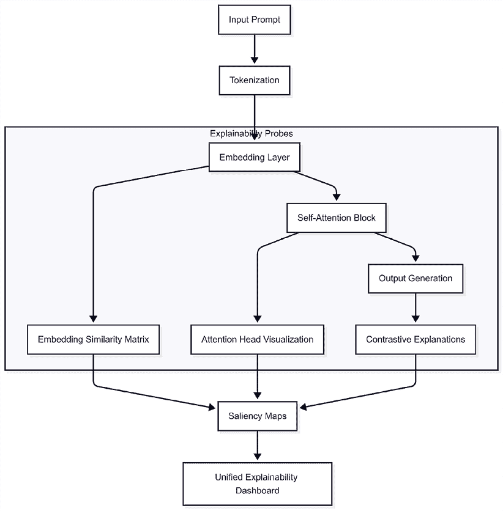
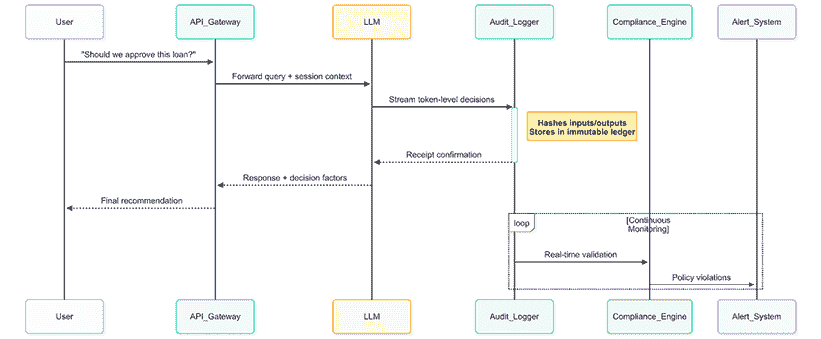

# 实现透明度和职责

基于`Transformer`的`LLM`具有内在复杂性，它们通过动态的多层注意力路径处理信息，这使得它们的决策过程本质上是不透明的。与传统的基于规则的系统不同，`LLM`的决策源自数十亿参数和复杂令牌关系之间复杂的非线性交互。这种不透明性为可解释性带来了巨大挑战。

## 模型透明度

由于以下架构特征，传统的解释性方法在应用于`LLM`时往往不尽如人意：

- **注意力头表现出分布式表示**：`LLM`内部的知识并非局限于单个神经元或层，而是碎片化并分布在许多注意力头、层和参数中。这使得准确定位特定的决策因素变得困难。

- **上下文嵌入创建非线性特征交互**：`LLM`嵌入的上下文性质意味着令牌的含义和表示会根据周围的单词而改变。这种动态交互导致了难以分离的高度非线性特征交互。

- **提示词工程可以劫持注意力权重**：复杂的提示词工程技术可以微妙地操纵大模型的注意力机制，导致模型以意想不到的方式关注输入的特定方面，进一步增加了事后分析的复杂性。

为了克服这些挑战，集成的解释性栈至关重要，它可以在`transformer`架构中提供实时实例化。



图 13.8：跨 transformer 架构的实时解释性实例化

`Figure 13.8`展示了`LLM`解释性的全面方法。核心`LLM`流水线（从输入提示词到输出生成）在各个阶段增强了专用的“解释性探针”：

- **嵌入相似性矩阵（F）**：探测嵌入层（`C`），以显示不同的输入标记或概念在模型潜空间中的表示相似性，指示潜在的聚类或偏差。

- **注意力头可视化（G）**：直接可视化自注意力块（`D`）内部的注意力模式，揭示模型在生成特定输出时正在“关注”输入的哪些部分。这有助于理解输入和输出标记之间的因果关系。

- **对比解释（H）**：通过将当前输出与输入或特定内部状态略有不同时的输出进行比较，来检查输出生成（`E`）。这有助于识别导致决策或结果翻转的最小变化。

这些探针输入到一个统一系统中，该系统生成热力图（`I`），突出显示影响最大的输入标记或特征，并最终在统一的解释性仪表板（`J`）上展示这些见解。该仪表板提供了模型决策原理的全局视图，使开发者和利益相关者能够理解复杂的`LLM`行为。

## 解释性工具

`SHAP`和`LIME`等技术已适用于`LLM`，为单个预测提供局部解释，识别哪些输入组件的影响最大。

如果尚未安装所需的包，请执行：

```bash
pip install shap transformers torch
```

以下代码演示了如何使用`SHAP`分析输入标记对语言模型行为的重要性：

```python
import shap
from transformers import AutoTokenizer, AutoModel
import torch
hf_token="<INSERT_HF_TOKEN>"
# 加载 Qwen1.5 分器和模型
model_name = "Qwen/Qwen1.5-7B"
tokenizer = AutoTokenizer.from_pretrained(
    model_name, use_auth_token=hf_token)
model = AutoModel.from_pretrained(model_name, use_auth_token=hf_token)
model.eval()
def explain_prediction(prompt):
    # 定义一个伪预测函数（你可以用此替换为真实的评分逻辑）
    def predict(texts):
        return [len(t) / 100.0 for t in texts]
    # 使用带有文本掩器的 SHAP（注意：这是针对生成模型的变通方案）
    explainer = shap.Explainer(predict,
        shap.maskers.Text(tokenizer.mask_token or ""))
    shap_values = explainer([prompt])
    # 打印标记 SHAP 分
    print("Token importances:")
    for token, score in zip(tokenizer.tokenize(prompt),
        shap_values.values[0]):
        print(f"Token: '{token}', Score: {score:.2f}")
    # 识别影响性标记
    critical = [
        token for token, score in zip(
            tokenizer.tokenize(prompt), shap_values.values[0])
        if abs(score) > 0.2
    ]
    return {"critical_factors": critical}
# 使用示例
result = explain_prediction("Patient presents with fever and rash. Differential diagnosis:")
print(f"Important tokens: {result['critical_factors']}")
```

前面的代码示例说明了如何将`SHAP`适配`LLM`。虽然`shap.Explainer(model, tokenizer)`可以直接用于为分类或问答任务设计的 Hugging Face 模型，但在文本生成任务中应用`SHAP`需要一个自定义的预测函数。该函数必须输出一个标量值（例如，特定标记的对数概率或代理评分），`SHAP`用此来评估特征重要性。


在示例中，通过对提示词“Patient presents with fever and rash. Differential diagnosis:”进行分析，以确定哪些标记对目标输出贡献最大。`SHAP`为单个标记（如“fever”和“rash”）分配重要性评分，反映了它们对模型内部表示或下游预测的影响。这种方法突出了塑造模型推理的“关键因素”，即使在生成式语言模型中也是如此。简化的输出演示了标记层级的贡献如何被可视化，较高的`SHAP`值表示更大的影响。

### 记录模型行为

除了运行时的解释性之外，标准化的文档对于确保 LLM 全生命周期的透明度至关重要。用于此目的两个关键框架是模型卡片（model cards）和数据集数据表（datasheets for datasets）。

由 Mitchell 等引入的模型卡片提供了结构化、简洁的文档，概述了训练 AI 模型的关键属性、预期应用和伦理影响。这些文档通常包含模型架构、训练数据来源、资源使用和性能指标——包括公平性和稳健性指标。

例如，一个自定义微调的`Qwen2-7B`衍生模型卡片可能如下所示：

```json
{
 "model_details": {
   "name": "Qwen2-7B",
   "version": "1.0.0",
   "architecture": "Qwen2 Transformer (32-layer, 4096 hidden size, 7B parameters)",
   "training_data": [
     "RefinedWeb (2023)",
     "Wikipedia (2023)",
     "Chinese Crawl",
     "Code datasets (StarCoder)",
     "Multilingual corpora"
   ],
   "compute_resources": "128 A100 GPUs",
   "frameworks": ["PyTorch", "Transformers (v4.41)", "FlashAttention 2"]
 },
 "performance_characteristics": {
   "primary_task": "Multilingual Text Generation and Instruction Following",
   "zero-shot_accuracy_on_MT-Bench": 7.4,
   "fairness_metrics": {
     "gender_bias_score": 0.12,
     "representation_bias_rate": 0.08
   },
   "robustness_metrics": {
     "jailbreak_resistance": "92.6%",
     "data_poisoning_tolerance": "Medium"
   },
   "limitations": "可能会幻觉事实；对低资源语言支持较差；原生不支持医疗/法律推理。"
 },
 "ethical_considerations": {
   "known_biases": [
     "语言偏于英语和中文",
     "残留的性别刻板印象生成"
   ],
   "mitigation_strategies_applied": [
     "指令微调",
     "基于提示词的过滤",
     "毒性感知训练"
   ],
   "recommended_uses": [
     "Conversational AI",
     "Multilingual assistants",
     "Code generation",
     "Educational exploration"
   ],
   "prohibited_uses": [
     "医疗/金融/法律领域的自主决策",
     "生成错误信息或虚假信息",
     "在未经审核的开放聊天环境中部署"
   ]
 },
 "owners_and_contacts": {
   "development_team": "Qwen Research Lab, Alibaba",
   "responsible_ai_lead": "Dr. Yujing Wang",
   "contact_email": "opensource@qwen.org"
 }
}
```

数据集的数据表（Datasheets）是模型卡的重要补充，它们记录了模型训练中使用的数据集。一份准备良好的数据表包含了详细的来源溯源（provenance lineage），虽然基于区块链的验证很大程度上处于实验阶段，但早期框架（例如`IBM's Trustworthy AI initiatives`和`Ocean Protocol`）正在探索将其用于数据来源、转换和许可的不可篡改且可审计记录。这在涉及版权、数据隐私和监管合规的背景下尤为重要。

此外，数据集数据表应该展示人口统计分布可视化（例如热图），以揭示不同群体中潜在的代表性不足或过度。此类分析有助于利益相关者在部署前评估公平性风险。伦理劳动实践也是考虑因素之一；数据表应披露标注者的补偿政策，以确保公平对待并避免在人在回路（human-in-the-loop）管道中出现剥削性的标记行为。模型卡和数据表共同构建文档生态系统，促进了大规模 AI 问责、可重复性和公平性。

## 可审计性与治理

除了透明之外，建立稳健的可审计性和治理机制对于确保 LLM 整个生命周期内的问责制至关重要。

### 决策溯源架构

端到端的审计追踪对于重建 LLM 决策、实现根因分析以及证明符合监管要求具有基础意义。



图 13.9: 具有加密不可否认性的端到端审计追踪

`Figure 13.9`中的序列图展示了一个全面的决策溯源架构。当用户通过`API gateway`与 LLM 交互时，LLM 会将其令牌级的输入、输出和关键内部决策因素流传输到审计记录器。审计记录器执行多项关键功能：

*   **对输入/输出进行哈希处理**：确保日志数据的完整性和不可否认性
*   **加密**：通过掩码、注入噪声或对提示词或输入中的数据加密来保护敏感信息，确保机密内容在处理或存储期间不会暴露
*   **不可篡改账本存储**：哈希和加密后的审计条目被批量处理并提交到不可篡改的账本（例如`blockchain`或`tamper-proof database`），为决策来源提供可验证的证明
*   **实时验证**：审计记录器持续向合规引擎提供数据，该引擎根据预定义的策略（例如`fairness thresholds`、`privacy rules`和`safety protocols`）验证 LLM 的行为
*   **告警**：如果检测到违反策略的行为，合规引擎将通过告警系统触发报警，实现快速干预

该架构确保了每一个 LLM 决策都经过记录、可验证并持续监控，为问责制和监管合规提供了基础。

### 第三方审计框架

独立的第三方审计对于建立外部信任以及证明客观符合 RAI（负责任的人工智能）实践至关重要。与`ISO/IEC 42001:2023`等 AI 管理系统标准一致的认证过程提供了一种结构化且可信的途径。

典型的审计框架从范围定义开始，清晰地阐述 LLM 的预期用例，以及其部署背景和相关的风险类别。这些范围涵盖从高风险场景（如医疗诊断）到低风险应用（如客服聊天机器人）。

接下来，证据收集阶段涉及汇编详尽的文档和数据。这包括训练数据集的样本和详细的来源记录；在预训练、训练中和后训练不同阶段进行的偏差测试报告；针对已识别风险的失效模式与效应分析（`FMEA`）；以及支持透明性的产物，如模型卡、数据表和符合审计要求的报告。

技术评估阶段包含几项关键评估。审计员使用如`OWASP LLM Top 10`框架等工具进行对抗测试，以识别漏洞，包括提示词注入、数据泄露和拒绝服务攻击向量。他们还会运行漂移检测基准，测试模型在分布偏移下的稳定性和公平性，确保性能随时间推移保持一致。此外，还会进行可解释性审查，以评估是否可以通过现有的可解释性方法有效地解释和论证模型的决策。

最后，根据审计结果由独立机构颁发认证。这种认证通常使用分级信任方案（例如铜、银、金级），表示模型在 RAI 实践中的合规水平和成熟度。认证有定义的有效期，并需要持续监控和定期的重新审计以维持状态。

这种结构化的审计方法确保了问责制，促进了透明度，并帮助组织构建符合社会和监管预期的 AI 系统。
