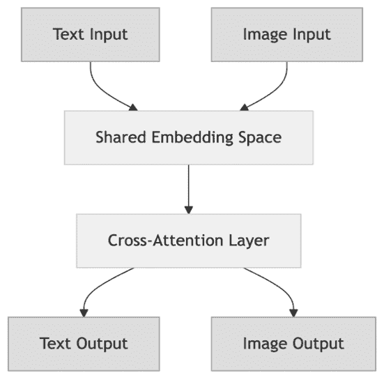
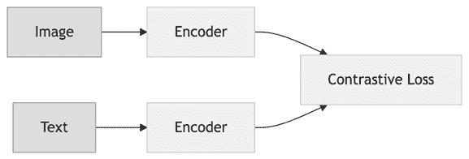

# 14. 新兴趋势与多模态性

**人工智能**（**AI**）领域正处于其演进的关键时刻。最初是在狭窄领域内表现出色的专门系统——无论是处理文本、识别图像还是转录语音——现在已让位于一种革命性的范式（多模态 AI）。这些先进系统打破了数据类型之间的传统屏障，在统一的框架内无缝地整合并解释文本、图像、音频、视频及等内容。这种转变反映了人类认的本质，即我们自然地结合视觉、听觉、语言和语境来理解并与世界进行交互。

这一转变的影响是深远的。AI 系统不再局限于孤立的任务，现在可以以整体的方式处理信息，例如：在分析医学影像的同时交叉引用患者病史；生成能够适应口头和视觉提示的教育内容；或创建融合了叙述、图像和音乐的丰富媒体体验。这种多模态方法不仅代表了渐进的进步；它重新定义了 AI 所能成就，让我们比以往任何时候都更接近那些能够以人类般的灵活性进行推理、创造和通信的系统。

然而，这场革命也带来了巨大的可能性和严峻的挑战。随着这些系统变得越来越强大，它们引发了关于伦理、偏见以及日益强大的 AI 开发负责任的关键问题。从单一用途算法到多模态大脑的转变标志着当今科技领域最令人兴奋的前沿之一，它有望改变行业，重新定义人机交互，并可能重塑我们对智能的理解。

在本章中，我们将探索驱动这一转型的技术突破，研究已经改变我们工作和创作方式的现实应用，并考虑构建能够真正看到、听见并理解世界的 AI 系统所带来的巨大潜力和重要责任。

# 技术要求

为了跟上本章中的概念和示例，请确保你已准备好以下硬件和软件配置：

## 硬件要求

- CPU：至少 4 核处理器（Intel i5/AMD Ryzen 5 或更高配置）
- 内存：至少 8 GB（运行较大模型时建议使用 16 GB）
- GPU（可选，但推荐）：支持 CUDA 的 NVIDIA GPU（RTX 3060 或更高版本），用于本地运行大语言模型（LLMs）
- 存储：至少 10 GB 空闲磁盘空间，用于存储模型权重和数据集

## 软件要求

- `Python 3.8`或更高版本：用于运行提示词工程脚本
- `Jupyter Notebook`或`VS Code`：推荐用于交互式开发
- `Hugging Face Transformers`：用于执行 LLM 提示词
- `LangChain`（最新版本）：结构化提示词工程工作流的关键

## 评估数据集（可选）

访问如`SQuAD`、`TriviaQA`或自定义企业数据集等基准数据集

本章完整的代码示例和实操练习可以在书籍的 GitHub 仓库中找到：[`github.com/PacktPublishing/LLMs-in-Enterprise`](https://github.com/PacktPublishing/LLMs-in-Enterprise)

# AI 的新兴趋势

AI 正在进入一个转型阶段，从单一用途系统演变为多功能的多模态模型，能够同时处理文本、图像、音频和视频。这种转变反映了人类认知，使 AI 能够理解跨数据类型的上下文和含义。

在神经架构和训练技术的突破下，`GPT-4`和`Gemini`等模型展示了前所未有的能力——分析带有报告的医学扫描、生成同步视频叙事，或解释对话中的情感信号。

尽管这些技术在医疗、教育和创意产业中具有革命性的应用前景，但这种进展也带来了关于 AI 局限性、伦理使用和社会影响的重要问题。随着数据模态之间边界的模糊，我们见证的不仅仅是进步，更是机器智能的根本重新定义。

本探索将探讨多模态系统如何工作、它们的现实世界应用，以及我们在迈向类人 AI 的途中所面临的挑战。

## 超越文本的转变——为什么多模态至关重要

AI 领域正在经历自深度学习出现以来最重大的转型，果断地超越了纯文本系统，拥抱真正的多模态理解。这种演变远不仅仅是一个技术奇点；它标志着向创建能够以人类灵活性和上下文感知与世界交互的 AI 系统迈出了基础一步。人类自然地整合视觉、听觉、触觉和语言形成形成贯的理解，而 AI 系统一直运行在孤立的感官孤文中。多模态 AI 的突破在于其能够处理和关联这些传统上相互独立领域的信息，从而实现了从医学诊断到创意内容生成的前所未有的应用。

当检查现实用例时，这种转变的重要性变得显而易见。例如，在医疗领域，放射科医生不仅依赖医学图像或转录；他们还将视觉数据与病史、实验室结果甚至问诊期间细微的听觉信号结合起来。传统的单模态 AI 系统只能解决这一诊断谜题碎片。现代多模态系统（如`Google`的`Gemini`或`OpenAI`的`GPT-4V`）展示了结合这些数据流如何带来更准确、全面的分析。发表在《自然数字医学》（Nature Digital Medicine）上的一项 2024 年的研究显示，在分析复杂的肿瘤病例时，多模态 AI 系统相比单模态方法将诊断错误减少了 37%（Zhang et al., 2024）。

### 从 GPT 到 Gemini——AI 能力的演进

迈向多模态 AI 的旅遵循了清晰的技术路线。第一代现代 AI 系统以`GPT-2`和`GPT-3`等模型为代表，展示了卓越的语言能力，但在严格的文本边界内运行（Brown et al., 2020）。这些基于 Transformer 的架构可以生成类人文本、回答问题并甚至编写基础代码，但它们的理解从根本上仍然是一维的，局限于解释和生成文本，没有处理图像、音频或其他感官数据的能力。当这些系统尝试需要视觉或听觉上下文的任务时，关键的局限性就显而易见了；它们可以用诗意的语言描述日落，但无法解释一张真实的日落图像。

突破出现在 2021 年的`对比语言-图像预训练`（`CLIP`）等模型，它引入了连接视觉和文本信息的新颖方法（Radford et al., 2021）。通过在数亿对图像-文本对上进行训练，`CLIP`学习了创建一个共享嵌入空间，其中无论模态如何，相似的概念都会聚类在一起。这使得了革命性的能力，例如零样本图像分类，模型可以识别它从未被显式训练过识别的物体。随后`DALL-E`的发布展示了这些嵌入如何反向工作，在保持语义一致性的同时，从文本描述生成原始图像（Ramesh et al., 2021）。


# 多模态生成式 AI 领先模型技术报告

目前的顶尖水平由`Gemini 1.5`等模型代表，它们采用复杂的专家混合（mixture-of-experts）架构来原生处理多种模态（Google DeepMind, 2024）。与早期需要为不同数据类型使用单独模型并带有复杂集成层的方法不同，这些系统在统一框架和共享嵌入空间内处理文本、图像、音频和视频，实现了无缝的跨模态理解和交互。

`Google DeepMind`的技术报告（例如 DeepMind, 2024）指出，`Gemini`的多模态注意力机制在`ScienceQA`和`MMMU`等复杂的跨模态基准任务上，其问答准确率比之前的`PaLM-E`和`Flamingo`等顶级多模态模型高出 58%。

例如，当面对一个包含图表和口头问题的物理问题时，`Gemini`可以在推导出解决方案的同时用多种语言进行解释，这种能力开始接近类人的上下文理解。

## 关键驱动因素（数据可用性、硬件进步和用户需求）

几个关键的技术和社会因素汇汇聚在一起，使得这场多模态革命成为可能。可用训练数据的指数级增长可能是最根本的推动因素。诸如`LAION-5B`等项目已经收集了数十亿对精心策划的图像-文本对（Schuhmann et al., 2022），而如`AudioSet`等专门数据集提供了跨越数百个类别的数百万标记音频样本（Gemmeke et al., 2017）。然而，这种数据的丰富也伴随着重重挑战。`Abeba Birhane`等研究人员已经证明，大规模的网络爬取数据集通常包含有害偏见，需要复杂的过滤和平衡技术（Birhane et al., 2021）。

硬件的进步在实现多模态 AI 方面同样关重要。专用 AI 加速器的开发，如 Google 的`TPU v4 pods`和 NVIDIA 的`H100 GPUs`，极大地降低了训练大规模多模态模型的计算障碍（Jouppi et al., 2023）。训练`GPT-3`需要在数千个 GPU 上运行数月，而较新的分布式训练技术，如`完全分片数据并行`（`FSDP`）——它将模型参数、梯度和优化器状态划分到各个设备上以减少内存占用——以及流水线并行，允许更高效的资源利用（Rajbhandari et al., 2021）。或许重要的是，模型量化的突破，例如由 Tim Dettmers 团队开发的`QLoRA`技术，现在让复杂的多模态模型能够在消费级硬件上运行，极大地扩展了它们的潜在应用（Dettmers et al., 2023）。

然而，最引注目的驱动力来自各业行业的现实需求。在医疗领域，`PathAI`等公司的诊断系统已获得 FDA 批准，这些系统结合了医学影像和电子健康记录（PathAI, 2023）。`Duolingo`等教育平台现在整合了多模态 AI 导师，可以通过书面答案和口头回答来评估学生（Duolingo, 2024）。即使是创意领域也在发生变革。Adobe 的`Firefly`系统展示了多模态理解如何实现基于自然语言专业级图像和视频编辑（Adobe, 2023）。这些应用指向了这样一个未来：AI 系统将作为真正的多模态协作者，而不仅仅是单一用途的工具。

## 多模态格局

AI 中的多模态是指在单一系统中整合多种输入类型，如文本、图像、音频和视频。本节综述了多模态研究的现状，重点介绍了能够跨越这些模态以解锁新能力的突破性模型。

### 文本与图像（CLIP 和 Flamingo）

文本与图像处理的整合可能可能是多模态 AI 最成熟的分支，其中`CLIP`充当基础架构（Radford et al., 2021）。`CLIP`的核心创新在于其对比学习方法，该方法训练模型在嵌入空间中拉近匹配的图像-文本对，同时推开不匹配的对。这创建了一个共享语义表示，使得"狗"或"日落"等概念无论是以视觉还是文本形式表达，都占据相似的区域。其实际意义是深远的；由`CLIP`驱动的系统可以通过与文本描述进行比较，在不需要显式训练的情况下将图像分类为新类别。

在此基础之上，DeepMind 的`Flamingo`等模型引入了复杂的交叉注意力机制，允许视觉和文本信息之间进行更动态的交互（Alayrac et al., 2022）。在`Flamingo`的架构中，交错的图像和文本输入通过交替注意力层进行处理，这些层是专门的 transformer 块，可以在主要关注视觉特征和关注语言上下文之间切换，并学习何时关注视觉特征而非语言上下文。这使得诸如近人类水平的视觉问答成为可能。模型可以检查复杂场景并回答关于特定元素的问题，同时忽略无关的细节。性能基准显示，`Flamingo`在极具挑战性的`VQA-v2`数据集上无需特定任务微调即可达到 82.0% 的准确率，展现了卓越的泛化能力。

这些文本-图像系统的现实应用已经在改变各个行业。在电子商务领域，多模态搜索引擎允许客户使用描述性文本或上传的图像来寻找产品（Amazon, 2023）。数字资产管理系统可以根据语义内容自动对百万图像进行标记和组织。最令人印象的是，像 OpenAI 的`DALL-E 3`等系统展示了这些架构如何实现创意生成，从文本提示产生原始、连贯的图像，同时保持惊人的构图理解力（Betker et al., 2023）。当被要求生成"一只戴着维多利亚帽子、在壁炉旁读报的猫"时，模型能够可靠地将这些不同的元素组合成合理的图像，展示了真正的跨模态理解。

### 文本与音频（Whisper 和 AudioLM）

音频处理与语言理解的整合开启了同样具有变革性的可能性。OpenAI 的`Whisper`系统代表了语音技术的量子飞跃，它在以前所未有的 680,000 小多语言音频数据上进行了训练（Radford et al., 2023）。`Whisper`在架构上的独特之处在于其统一的语音识别方法；同一个模型通过多任务 transformer 架构处理转录、翻译和语言识别。这与传统的每个功能都需要独立组件的传统语音系统形成了鲜明对比。`Whisper`的编码器将音频处理为压缩表示，而其解码器即使在嘈杂环境或稀有口音的情况下也能以惊人的精度生成文本输出。

Google 的`AudioLM`将转录扩展到了生成式音频领域（Borsos et al., 2022）。该系统采用名为`SoundStream`的新型神经音频编码器，将连续的音频波离散化为紧凑的 token 序列。这些 token 然后可以使用类似于文本的语言模型架构进行处理，实现长时间连贯音频生成。在实际测试中，`AudioLM`可以以相同的风格延续旋律，或在生成的语音中保持说话者的音色特征。这对创意产业的影响是重大的；`Spotify`等早期采用者正在尝试 AI 生成的播客声音和 Google `NotebookLM`，后者在保留主持人个性的同时允许对内容进行动态修改（Spotify, 2023）。

音频与语言理解的结合还实现了强大的无障碍应用。实时字幕系统现在可以处理带有专业术语的技术讲座，同时识别多个说话者。更高级的实现可以分析语调和韵律以检测情感或强调，在原始词汇之外又增加了一层理解。随着这些系统的改进，它们有望为听障用户打破沟通障碍，同时开启基于音频的新型人机交互形式。

### 文本与视频（Phenaki 和 VideoPoet）

语言与视频的整合可能是计算要求最高但最具变革潜力的多模态应用。Google 的`Phenaki`系统通过其`C-ViViT`架构解决了视频生成的巨大复杂性，该架构将视频帧压缩为紧凑的潜空间表示（Villegas et al., 2023）。这些 token 捕捉了空间和时间关系，允许模型从文本提示生成连贯的扩展视频序列。之前的系统很难在几秒钟之后保持一致性，而`Phenaki`可以生成数分钟的 1280x720 视频，在遵循叙事结构的同时保持物体的持久性和真实的运动效果。

`VideoPoet`的方法更令人印象深刻，它将视频视为"另一种语言"，可以由`large language model`（`LLM`）架构进行处理（Google Research, 2023）。通过将视觉和听觉信息标记化为统一的表示空间，`VideoPoet`能够执行惊人的跨模态任务。例如，它可以通过"预测"中间帧从普通素材中生成慢动作视频效果，或根据音频输入创建口型同步的说话数字人。该系统在长序列中保持时间一致性的能力，确保物体运动真实且光照保持一致，这预示着 AI 未来将成为电影制作和内容创作中真正的合作伙伴。

这些应用已扩展到创意之外。在工业环境中，多模态视频系统可以在分析安全录像的同时，处理相应的音频告警或书面报告。教育平台可以针对学生的问题生成动态的视觉解释。可能最重要的是，这些系统正在培养理解视觉序列中因果关系的能力，这是向对物理世界进行更复杂的 AI 推理迈的关键一步。

# 理解 LLM 中的多模态性

从纯文本的`LLMs`到多模态系统的跨越，不仅仅是增加了新的输入类型；它要求重新思考关于 AI 处理信息的根本假设。传统的`LLMs`擅长处理单模态（文本）内的符号，而多模态系统必须掌握远为复杂的任务，即在根本不同的数据形式之间寻找有意义的联系。本节将详细介绍让这种跨模态理解成为可能的架构创新和训练突破。

## 架构基础

每个成功的多模态系统的核心都是一种专门设计的处理跨模态处理独特挑战的架构。受益于同质数据结构的单模态模型不同，多模态系统必须协调根本不同的信息形式——从文本的离散序列化本质到视觉和听觉输入的连续高维空间。这种协调通过几项关键架构创新实现，不仅实现了不同模态的并行处理，还实现了它们之间有意义的交互。



图 14.1：简化的多模态 AI 架构图

`Figure 14.1`显示，最有效的架构在模态特定处理和跨模态整合之间实现了微妙的平衡，允许每种输入类型根据其独特特征进行处理，同时对统一理解做出贡献。

### 统一嵌入空间

统一嵌入空间的概念代表了多模态 AI 研究中最重要的突破之一。这些共享的潜在空间充当了某种模态间的"罗塔石"，提供了一个通用的表示框架，无论原始模态如何，都可以在其中表达并关联联系。该过程始于模态特定的编码器，它们将原始输入（无论是像素、声波还是文本标记）转换为高维向量表示。通过精心设计的训练目标，这些最初分离的表示被逐渐对齐，并保留了跨模态的语义关系。例如，在一个训练良好的多模态嵌入空间中，尽管语言和视觉表示之间存在根本差异，单词"狗"的向量表示将更接近于狗的图像，而不是其他无关对象的图像。

正如之前讨论的那样，`CLIP`表明在图像-文本对上进行大规模训练可以在共享嵌入空间中对齐视觉和文本概念。这种对齐使得零样本图像分类等能力成为，模型通过将视觉嵌入与文本描述进行比较，识别以前未见过的物体。

其影响超了简单的检索任务；统一嵌入构成了更复杂的跨模态交互的基础，允许模型根据文本描述生成图像、为视觉内容创建相关的说明，甚至生成与给定视觉场景匹配的音频。

下面的实现展示了文本和图像模态统一嵌入空间的简化版本。受`CLIP`架构的启发，它将文本和图像特征投影到共享语义空间，对嵌入进行归一化，并使用缩放余弦相似度函数计算它们的相似性。在此之前，我们必须安装所需的包：

```
pip install torch numpy
```

现在我们来写下面的代码：

```python
import torch
import torch.nn as nn
import torch.nn.functional as F
import numpy as np
class UnifiedEmbeddingSpace(nn.Module):
    """
    文本和图像模态统一嵌入空间的实现。
    类似于 CLIP 创建共享语义表示的方法。
    """
    def __init__(self, text_dim=512, image_dim=2048, embedding_dim=256):
        super().__init__()
        self.text_projection = nn.Linear(text_dim, embedding_dim)
        self.image_projection = nn.Linear(image_dim, embedding_dim)
        self.temperature = nn.Parameter(torch.ones([]) * np.log(1 / 0.07))  # 可学习缩放因子

    def forward(self, text_features, image_features):
        # 投影到共享嵌入空间
        text_embeddings = F.normalize(
            self.text_projection(text_features), dim=-1)
        image_embeddings = F.normalize(
            self.image_projection(image_features), dim=-1)
        return text_embeddings, image_embeddings

    def compute_similarity(self, text_embeddings, image_embeddings):
        """在统一空间中计算余弦相似度"""
        return torch.matmul(
            text_embeddings, image_embeddings.T
        ) * torch.exp(self.temperature)
# 示例用法
embedding_model = UnifiedEmbeddingSpace()
text_features = torch.randn(32, 512)  # 文本特征批
image_features = torch.randn(32, 2048)  # 图像特征批
text_emb, image_emb = embedding_model(text_features, image_features)
similarity_matrix = embedding_model.compute_similarity(
    text_emb, image_emb)
print(f"Unified embeddings shape: Text {text_emb.shape}, Image {image_emb.shape}")
```

虽然统一嵌入提供了模态之间的静态映射，但现实世界的理解需要不同信息形式之间进行动态的、对上下文敏感的交互。这正是跨模态注意力机制证明其不可或缺之处。这些专门的神经网络组件允许模型选择性地关注跨模态的相关信息，模拟了人类的能力，例如将句子中的特定单词与伴随图像中的特定区域连接起来。注意力机制通过学习到的查询（queries）、键（keys）和值（values）来运行，使得一种模态能够"关注"或影响另一种模态的处理。

在实际实现中，跨模态注意力通常以适配了处理异构输入的 Transformer 层的形式存在。例如，在处理医学报告和 X 光射线图像时，多模态模型可以使用源自文本的查询来关注视觉扫描的相关区域，有效地提问："此图像的哪些部分与文本描述的症状相对应？"。这种信息的动态路由允许模型进行复杂的推理，而这对于单独处理每个模态是无法实现的。`Flamingo`架构为这种方法提供了一个引人注目的示例，它采用了门控交叉层，根据特定任务学习调节视觉和文本表示之间的信息流。

跨模态注意力的力量在需要整合多个源信息的复杂推理任务中变得尤为明显。例如，在回答关于图像和伴随文本共同描述场景的问题时，模型可以使用注意力来决定优先考虑视觉细节（如颜色和空间关系）还是语言信息（如命名实体和时间引用），取决于每个问题强调的重点。这种自适应集成代表了相比于依赖固定、手工工程规则组合模态的早期多模态系统的重大进步。

在实际实现中，跨模态注意力通常通过基于 Transformer 的注意力块来实现，这些注意力块可以处理异构输入源。一个引人注目的例子是`Flamingo`模型，它使用门控交叉注意力根据任务调节视觉和文本信息的流。让我们来安装所需的包：

```
pip install torch numpy
```

现在我们来看实现代码，如下：


```python
import torch
import torch.nn as nn
import torch.nn.functional as F
import numpy as np
class CrossModalAttention(nn.Module):
    """
    用于不同模态之间动态信息路由的跨模态注意力机制
    （例如，文本关注图像区域）
    """
    def __init__(self, embed_dim=256, num_heads=8):
        super().__init__()
        self.embed_dim = embed_dim
        self.num_heads = num_heads
        self.head_dim = embed_dim // num_heads
        # 针对 Q (文本), K 和 V (图像) 的线性投影
        self.text_query = nn.Linear(embed_dim, embed_dim)
        self.image_key = nn.Linear(embed_dim, embed_dim)
        self.image_value = nn.Linear(embed_dim, embed_dim)
        self.output_proj = nn.Linear(embed_dim, embed_dim)
        self.dropout = nn.Dropout(0.1)
    def forward(self, text_features, image_features, attention_mask=None):
        batch_size, text_len, _ = text_features.shape
        _, image_len, _ = image_features.shape
        # 线性投影
        Q = self.text_query(text_features)      # 来自文本的查询
        K = self.image_key(image_features)      # 来自图像的键
        V = self.image_value(image_features)    # 来自图像的值
        # 为多头注意力重塑
        Q = Q.view(
            batch_size, text_len, self.num_heads, self.head_dim
        ).transpose(1, 2)
        K = K.view(
            batch_size, image_len, self.num_heads, 
            self.head_dim).transpose(1, 2)
        V = V.view(
            batch_size, image_len, self.num_heads, 
            self.head_dim).transpose(1, 2)
        # 缩放点积积注意力
        scores = torch.matmul(
            Q, K.transpose(-2, -1)) / np.sqrt(self.head_dim)
        if attention_mask is not None:
            scores = scores.masked_fill(attention_mask == 0, -1e9)
        attention_weights = F.softmax(scores, dim=-1)
        attention_weights = self.dropout(attention_weights)
        # 值的加权和
        context = torch.matmul(attention_weights, V)
        context = context.transpose(1, 2).contiguous().view(
            batch_size, text_len, self.embed_dim)
        output = self.output_proj(context)
        return output, attention_weights
```

此代码实现了一种跨模态注意力机制，其中文本特征（例如来自句子的）被用于关注图像特征（例如来自 CNN）。模型学习根据文本上下文动态地关注相关的视觉区域。以下是代码中涉及的步骤：

*   文本标记（tokens）被投影为查询。
*   图像块（patches）被投影为键和值。
*   注意力机制计算查询和键之间的相似性以生成注意力权重。
*   这些权重随后用于聚合图像值，允许文本中的每个单词都关注图像中最相关的部分。

这种机制实现了模态之间的上下文感知融合，就像人类可以将报告中的短语与图像中的区域对齐一样。因此，让我们使用以下示例尝试代码：

```python
# 创建模型
cross_attention = CrossModalAttention(embed_dim=256, num_heads=8)
# 模拟输入数据
text_features = torch.randn(4, 20, 256)    # 4 个样本，20 个文本标记
image_features = torch.randn(4, 196, 256)  # 4 个样本，196 个图像块 (14x14)
# 前向传播
attended_features, attention_weights = cross_attention(text_features, image_features)
# 检查输出
print(f"跨模态注意力输出形状: {attended_features.shape}")
print(f"注意力权重形状: {attention_weights.shape}")
```

预期输出如下：

```
跨模态注意力输出形状: torch.Size([4, 20, 256])
注意力权重形状: torch.Size([4, 8, 20, 196])
```

基于这些动态集成方法，下一个架构元素关注在模态特定的编码器和解码器进入共享推理空间之前如何准备每个模态。

## 模态特定的编码器/解码器

架构的最后一块拼图涉及在跨模态集成发生之前处理每个单独模态的专门组件。这种模块方法承认不同类型的数据需要截然不同的处理策略。具有空间层次和局部相关性的视觉数据受益于卷积神经网络或视觉 Transformer，它们可以捕捉这些结构规律。文本数据是序列的且离散的，更有效地通过基于标记的 Transformer 处理，这些 Transformer 能够建模语言的长程依赖关系。音频信号具有时间频率特性，在输入到大模型之前通常需要专门的频谱处理。

如 OpenAI 的 Whisper 等系统在音频领域体现了这一原则：在这些领域，原始声波首先由专用编码器处理以提取有意义的声学特征，然后这些表示才与语言组件进行交互。同样，在 DALL-E 等模型中，图像生成过程始于一个特殊的解码器，它能够理解如何将潜在表示转换为连贯的视觉输出。这种模块化提供了几个实际优势：它允许组件在标记示例更丰富的单模态数据上进行预训练；使能够在不重新训练整个系统的情况下，对单个模态进行更高效的更新；并为模型适应不同的输入和输出模态组合提供了灵活性。

这些专用的编码器/解码器与架构的共享组件之间的相互作用，为多模态理解创建了一个强大的框架。早期处理发生在特定模态的路径中，这些路径尊重每种输入类型的独特特性；而后期阶段则将这些表示整合到一个共享空间中，在那里可以进行跨模态推理。这种专业化与整合之间的平衡，对于在处理多种形式信息时实现类人类的灵活性，同时保持发现它们之间意义连接的能力至关重要。

## 训练范式

现代多模态系统的卓越能力不仅源于它们的架构，还源于创新的训练方法，这些方法教会这些模型去发现并利用不同模态之间的连接。这些训练策略必须解决一个根本性挑战，即跨越原始形式中没有内在、显式对应关系的模态之间对齐表示。目前出现的解决方案将大规模数据与巧妙的学习目标相结合，鼓励模型在没有详尽的人类监督的情况下找到有意义的跨模态模式。

### 对比学习

对比学习已成为训练多模态系统最强大的范式之一，如图 14.2 所示，特别是在模型开发的早期阶段。这种方法将学习问题表述为区分匹配的和不匹配的多模态数据对。模型会接收包含正确配对（一张图像及其真实说明）和错误配对（同一张图像配以随机不匹配的文本）的大批量数据，并学习最大化真实配对之间的相似性，同时最小化不匹配对的相似性。

对比学习的妙之处在于其自监督性。它不需要手动标记数据来指定模态之间如何关联；相反，它从自然产生的多模态数据中的统计规律中自动学习这些关系。`CLIP` 提供了一个经典示例。通过在数亿对从网络爬取的图像-文本对上进行训练，模型学会了识别语言中的哪些概念对应哪些视觉特征，即使对于那些从未被显式标记过的物体和场景。这种方法被证明具有极佳的可扩展性，随着更多数据和更大模型的应用，性能会如预期地提高。



图 14.2: 对比学习 (CLIP-style) 训练

除了简单的检索任务之外，对比预训练为更复杂的多模态能力提供了坚实的基础。在此阶段学习到的语义对齐使得下游应用成为，例如零样本迁移学习，在这种学习中，模型只需通过比较视觉输入与文本描述，即可执行新任务（例如将图像分类为以前未见过的类别）。该范式的近期扩展在音视频和视频-文本领域显示出潜力，表明它可能代表了跨多种数据类型训练多模态系统的通用原则。这种方法被证明具有极佳的可扩展性，随着更多数据和更大模型的应用，性能会如预期地提高。

要运行以下代码，请确保已安装 PyTorch（根据你的 CUDA 设置，可选地在`https://pytorch.org/get-started/locally/`安装 PyTorch 的 GPU 版本）：

```
pip install torch torchvision
```

现在让我们开始实现：

```
import torch
import torch.nn as nn
import torch.nn.functional as F
# 示例用法
text_encoder = SimpleTextEncoder()
image_encoder = SimpleImageEncoder()
contrastive_model = ContrastiveLearning(text_encoder, image_encoder)
# 伪批量文本和图像输入
text_inputs = torch.randint(0, 10000, (16, 20))   # 16 个文本样本，每个 20 个 token
image_inputs = torch.randn(16, 2048)              # 16 个图像样本， 2048 维特征
logits_text, logits_image = contrastive_model(text_inputs, image_inputs)
loss = contrastive_model.contrastive_loss(logits_text, logits_image)
print(f"Contrastive loss: {loss.item():.4f}")
```

前面的代码展示了以下：

*   `ContrastiveLearning`: 使用点积相似度对齐文本和图像特征的主模块，在实践中，当点积通过向量量级进行归一化并结合交叉熵时，通常被称为余弦相似度。
*   `SimpleTextEncoder`: 使用嵌入 + Transformer + 池化，将分词后的文本编码为 256 维的嵌入。
*   `SimpleImageEncoder`: 将图像特征（例如来自 CNN 或 vision transformer）投影到相同的 256 维空间中。
*   `Logits_per_text`: 文本嵌入与所有图像嵌入之间的相似性评分。
*   `contrastive_loss`: 交叉熵损失，鼓励文本-图像对具有高相似性。

以下是预期的输出：

```
Contrastive loss: 2.7691
```

较低的损失意味着模型在对齐正样本对方面做得更好。随着训练的进行，预计该值将会下降。

### 联合预训练 vs 模块化微调

多模态系统的训练过程在两种方法之间呈现出根本性的张力：从随机初始化开始对所有模态进行联合预训练，与对单独的预训练单模态模型进行微调。每种方法都提供了独特的优势，使其适用于不同的场景，而在这它们之间进行选择通常代表了系统开发中最具影响的决策之一。

联合预训练以 Google 的 `Gemini` 等模型为代表，涉及从开始在多模态数据上端到端地训练整个系统。这种方法允许模态之间的紧密整合，因为所有组件共同学习以优化一个统一的目标。生成的模型通常展示出更无缝的跨模态能力，例如生成引用视觉细节的文本，或生成忠实反映文本描述的图像。然而，这需要巨大的计算成本，需要包含感兴趣模态的大型数据集以及同时处理这些数据的设施。

模块化微调采取了相反的方法，从在单模态数据上预训练的独立模型（例如图像分类器和语言模型）开始，然后通过额外的训练将它们结合起来以学习跨模态交互。这种策略出现在如 `Flamingo` 等系统中，在高质量单模态模型已存在或计算资源有限的情况下具有实际优势。它还允许更灵活的系统组合——可以在不从头重新训练整个的情况下添加新的模态。然而，模态之间的整合可能不如联合训练系统那样深，有时会导致在需要复杂的跨模态推理的任务上表现较弱。

在实践中，许多先进系统采用了混合方法，即对某些组件进行联合预训练，同时对其他组件进行微调。例如，一个模型可能会使用预训练的视觉编码器（以受益于成熟的计算机视觉架构），同时从零开始训练跨模态注意力机制。这种平衡的方法试图捕捉两种策略的优点，同时减轻它们各自的局限性。

## 多模态模型的涌现属性

多模态训练最迷迷的方面之一是能力的涌现，这些能力既不是显式编程的，也不是直接训练到系统中的。这些涌现行为提供了强有力的证据，证明模型已经发展了真正的逻辑形成能力，而非简单的模式匹配。例如，主要在图像-文本对上训练的模型，在视觉类比求解、组合式图像生成，甚至对描绘场景进行基础物理推理等任务中，经常表现出惊讶的熟练——而这一切都无需针对这些特定能力进行显式训练。

这种现象似乎源于模型学习了超越任何单一模态的基础概念关系。在足够多样化的数据上进行训练时，系统会开发出内部表示，捕捉抽象属性，如空间关系、时间序列或因果连接，这些属性在不同表达形式中表现出相似性。例如，"包含"的概念可能通过看到容器内物体的图像、阅读关于包含的描述，甚至可能听到与将物品放入箱子里相关的声音来学习——从而产生一种泛化到任何这些特定实例之外的表示。

近期大型多模态模型的工作记录了日益复杂的涌现行为。诸如 `GPT-4V` 等系统展示了解释图表和图纸等抽象视觉表示的能力、遵循图像中的指向手势，甚至解释视觉笑话的能力——这些能力需要视觉和语言理解的深度整合。同样，如 `Phenaki` 等视频生成模型在从文本提示生成连贯的多场景叙事时，显示出对基础物理和物体永存性的涌现理解。

这些涌现能力表明，多模态训练可能正在比单模态方法实现更通用的智能形式。通过强制模型在不同的信息表示方式之间建立联系，我们可能正在促进更灵活的、类人的理解的发展。然而，这仍然是一个活跃的研究领域，关于这些涌现能力延伸到多远以及何种训练方法最能促进其发展，仍存在许多问题。

# 多模态 AI 的技术进展

在多个技术领域协同进步的推动下，多模态 AI 领域近年来经历了巨大的变革。早期的多模态系统在不同数据类型的脆弱集成方面十分挣扎，而当代架构展示了流畅的跨模态理解，在某些情况下可以媲美人类能力。这种进展并非源于任何单一突破，而是来自神经架构设计、训练方法和计算基础设施创新的汇聚。这些进步共同使系统不仅能够处理多种模态，还能发现并利用它们之间丰富的关系——这种能力正在重塑从医疗保健到创意艺术的各个行业。

多模态 AI 能力的加速遵循了类似于 `LLMs` 早期革命的指数轨迹，但由于需要协调根本上不同的数据类型而增加了复杂性。现代系统现在可以处理几年前还不可想象的任务，例如从文本提示生成连贯的视频序列、通过关联影像学研究与患者病史来诊断医疗状况，或为视觉场景提供实时多语言音频描述。这些能力源于几个并行成熟的关键技术支柱，每个支柱都解决多模态挑战的不同方面。

## 突破性模型

多模态格局是由一系列里程碑式的系统塑造的，这些系统逐渐重新定义了跨模态理解的可能。这些模型既是技术里程碑，也是发现新应用和能力的平台。每种模型都代表了解决多数据模态集成这一基本挑战的不同方法，同时针对性能、通用性或效率等不同优先事项进行了优化。

### GPT-4V – 视觉-语言整合

OpenAI 的 `GPT-4V`（视觉）代表了 `LLM` 范式的重大演进，将其闻名的文本推理能力扩展到视觉领域。与之前将图像视为辅助输入的视觉-语言整合尝试不同，`GPT-4V` 在视觉和语言处理流之间实现了深层双向连接。该架构通过专门的视觉编码器处理图像，将输入分解为视觉标记（visual tokens）网格，每个标记代表图像的局部区域并带有相关的特征。这些标记随后通过 Transformer 层中的交叉注意力机制与文本标记相互作用，允许视觉和语言信息在多个层次上影响彼此的处理。

`GPT-4V` 的能力远超简单的图像描述。该系统在解释复杂的视觉材料方面表现出卓越的熟练度，包括科学图表、建筑蓝图甚至抽象艺术。在医学应用中，它可以将放射学图像与临床记录关联起来以建议潜在诊断。对于技术文档，它可以从原理图中提取工作流并生成适当的过程性文本。可能最令人印象的是，`GPT-4V` 在视觉推理方面显示出涌现能力；它可以解决以图形形式呈现的问题，解释视觉笑话，甚至根据 UI 原型生成代码。这些能力源于对海量交错图像-文本对数据集的训练，并结合了人类反馈的强化学习，强化了其跨模态对齐。

### Gemini 1.5 – 原生多模态


# Gemini 1.5 的原生多模态架构

Google 的 `Gemini 1.5` 代表了根本不同的架构哲学，从底层开始设计为多模态系统，而不是以文本为中心的模型的扩展。这种原生多模态体现在几个关键设计选择中。该模型采用统一的标记方案，从最早的处理阶段开始就在共享的嵌入空间中表示文本、图像、音频和视频。它的混合专家（mixture-of-experts）架构动态地将不同的模态和任务路由到专门的子网络中，同时保持用于跨模态整合的共享组件。

`Gemini` 的性能优势在需要长上下文内跨模态之间进行紧密协作的任务中变得尤为明显。例如，模型可以在观看视频讲座的同时处理配套的幻灯片，然后回答需要综合这两个数据源信息的问题。在创意应用中，它展示了强大的构图理解能力；当被要求生成具有特定视觉元素和配套旁白的视频场景时，它能够保持显示内容与描述之间的一致性。该系统还引入了诸新的功能，例如跨模态检索，其中一种模态中的查询（例如，“找到演讲者讨论神经架构的时刻”）可以定位另一种模态中的相关片段（相应的视频片段）。

这些能力的基础是 `Gemini` 使用了新型注意力机制，这些机制可以学习与模态无关的关系。模型没有为不同数据类型设置独立的注意力头，而是采用统一的注意力机制，可以识别出现在语音波形、图像块或文本标记（`tokens`）中的相似模式。这种方法使得能够更有效地学习跨模态表现的抽象概念，从时间序列到分层结构无不包。

## 开源替代方案 (LlaVA 和 OpenFlamingo)

多模态 AI 的民主化因开源倡议而加速，这些倡议为专有系统提供了可获取的替代方案。`Large Language and Vision Assistant` (`LLaVA`) 代表了最强大的开源实现之一，它通过高效的投影层将预训练的视觉编码器与大语言模型（`LLM`）相结合。这种架构在视觉问答和图像描述任务上实现了惊人的强大性能，同时可以在消费级硬件上进行微调。

`OpenFlamingo` 构建于 DeepMind 的 `Flamingo` 架构，为研究人员探索少样本多模态学习提供了一个透明框架。该系统的关键创新是其交叉注意力机制，该机制实现了上下文学习（in-context learning）；在仅提供少量示例的情况下，它可以快速适应新的多模态任务，类似于人类通过从少量演示中学习的方式。这对于标记训练数据稀缺的应用特别有价值，例如专业的医学成像或稀有语言翻译。

这些开源项目不仅降低了多模态研究的入门门槛，还作为重复性研究和伦理审计的重要平台。通过提供模型架构和训练数据的完全可见性，它们能够对偏见缓解、安全协议和效率改进进行关键研究，这些研究将造福整个领域。

## 核心创新

现代多模态系统的成功背后是一系列技术创新，它们解决了跨模态 AI 的独特挑战。这些进展跨越了系统栈的所有层面，从低层数据表示到高层架构决策，每一项都贡献了近年来观察到的能力和效率的巨大提升。

### 跨模态的标记化 (Tokenization)

自然语言处理中的标记化革命通过创新的编码方案成功扩展到其他模态。`Vision transformers` (`ViTs`) 证明了图像可以分解为不重叠的块（`patches`），每个块被视为带有位置编码的标记（`token`）。这一突破允许 `transformer` 架构直接应用于视觉数据，而无需依赖卷积神经网络作为预处理步骤。

音频领域也开发了类似的方法，声波被转换为频谱图，然后划分为时间频率桶，用作标记。视频引入了额外的复杂性，需要联合时空标记化，每个标记代表一个体素块（$t$ 帧上的 $x,y$ 像素）。统一这些方法的关键洞察是：无论原始信号类型如何，细致的离散化都能产生捕捉音频/频率结构的标记序列，同时便于基于 `transformer` 的处理。

最近的工作通过统一标记化方案进一步推动了这一发展，该方案在共享标记空间中表示不同的模态。例如，某些系统现在将图像、文本和音频都表示为提取自公共词表的整数序列，实现了真正的跨模态同质处理。这种方法减少了对特定模态架构组件的需求，并允许知识在数据类型之间更自由地传输。

### 高效融合技术 (Q-Former 和 Perceiver Resampler)

将图像或视频等高维模态的信息与文本数据融合的挑战，促进了高效跨模态注意力机制的创新。`BLIP-2` 的 `Q-Former`（查询 `Transformer`）引入了两阶段过程：视觉特征首先由轻量级 `transformer` 压缩，该模型学习哪些视觉元素与潜在文本查询最相关。这种“感知问题”的压缩大大减少了后续视觉语言融合的计算开销，同时保留了最显著的跨模态连接。

`Perceiver Resampler` 采用了不同的方法，使用交叉注意力将大型特定模态输入（如像素数组或音频频谱图）逐步蒸馏为固定数量的潜在标记。这种方法对于处理变长度输入特别有价值，并能够高效处理特征电影或一小时讲座等长序列。这两种技术的共同目标是在减少原生交叉注意力的二次复杂度负担的同时，保持模型发现和利用细粒度跨模态交互关系的能力。

这些融合创新使模型能够处理比以前多更多的多模态上下文。早期系统在处理超过几个图像-文本对时就很困难，而现代架构可以在数百页带插图文本或数小时同步音频轨的视频之间保持连贯的跨模态理解。这种扩展的上下文窗口对于相关信息可能分布在长多模态序列中的现实应用至关重要。

为了更好地理解其工作原理，请考虑以下 `Q-Former` 的简化实现。要运行下面的代码，请安装所需的 Python 包：

```bash
pip install torch
```

如果 `CrossModalAttention` 未预定义，你可以如下对其进行 mock 以测试：

```python
class CrossModalAttention(nn.Module):
    def __init__(self, embed_dim):
        super().__init__()
        self.attn = nn.MultiheadAttention(embed_dim, num_heads=8,
            batch_first=True)

    def forward(self, query, context):
        output, weights = self.attn(query, context, context)
        return output, weights
```

现在让我们来看一个 PyTorch 中 `Q-Former` 实现的代码示例：

```python
import torch
import torch.nn as nn

class CrossModalAttention(nn.Module):
    def __init__(self, embed_dim):
        super().__init__()
        self.attn = nn.MultiheadAttention(embed_dim, num_heads=8,
            batch_first=True)

    def forward(self, query, context):
        output, weights = self.attn(query, context, context)
        return output, weights

class QFormer(nn.Module):
    """
    Q-Former implementation for efficient multimodal fusion
    Compresses visual features using learnable queries
    """
    def __init__(self, num_queries=32, embed_dim=256, num_layers=6):
        super().__init__()
        self.num_queries = num_queries
        self.query_tokens = nn.Parameter(torch.randn(num_queries,
            embed_dim))

        # Self-attention for queries and cross-attention with image
        encoder_layer = nn.TransformerEncoderLayer(
            embed_dim, nhead=8, batch_first=True)
        self.transformer = nn.TransformerEncoder(encoder_layer,
            num_layers)

        self.cross_attention = CrossModalAttention(embed_dim)

    def forward(self, image_features):
        batch_size = image_features.shape[0]

        # Expand queries for each item in the batch
        queries = self.query_tokens.unsqueeze(0).expand(
            batch_size, -1, -1)

        # Use cross-attention to pull relevant features from image
        attended_queries, _ = self.cross_attention(queries,
            image_features)

        # Use self-attention to process the queries further
        compressed_features = self.transformer(attended_queries)

        return compressed_features

# Example usage
qformer = QFormer(num_queries=32, embed_dim=256)
image_patches = torch.randn(8, 196, 256)  # Batch of 8 images, each with 196 patches (e.g., 14x14)
compressed = qformer(image_patches)
print(f"Compressed visual features: {compressed.shape}")
```

让我们解释一下前面的代码：

- `query_tokens`：这些可学习参数像智能问题一样，向图像“提问”最相关的特征。
- `CrossModalAttention`：它使用注意力机制根据查询从图像中提取信息。
- `TransformerEncoder`：通过自注意力机制进一步精炼查询之间的选定信息。

以下是预期输出：

```
Compressed visual features: torch.Size([8, 32, 256])
```

与原始的 196 个 `patch` 的图像表示相比，此输出要小得多，且与文本融合的效率更高。它是图像的一种为多模态任务（例如图像描述、VQA 和检索）定制的`压缩且语义丰富的表示`(`compressed, semantically rich representation`)。

### 可扩展性挑战（计算与内存）

多模态模型的扩展引入了超出单模态系统所面临的独特计算挑战。多个高维输入的并行处理会产生内存带宽瓶颈，而对长程跨模态依赖的需求也增加了传统注意力机制的压力。该领域通过几项关键创新，以保持训练和部署不断扩大的多模态系统的可行性。

稀疏注意力模式（Sparse attention patterns）允许 `token` 根据学习或启发式规则仅关注其他 `token` 子集，被证明在多模态扩展中特别有效。这些模式可以根据跨模态交互的特定结构进行定制——例如，让图像 `patch` 主要关注相关的文本段而不是整个输入序列。专家混合（Mixture-of-experts）架构提供了另一种扩展解决方案，根据输入模态和任务需求动态地激活不同的模型组件。

量化技术已显著进展，以减少多模态模型的内存占用。`量化低秩自适应` (`Quantized Low-Rank Adaptation`, `QLoRA`) 通过在保持大部分权重为 4 位精度的同时，通过仔细的误差纠正实现了大规模模型的高效微调。对于推理，像 `GPTQ` 等技术通过选择最小化输出误差的最佳舍入值对训练后的模型权重进行量化，允许多模态模型在消费级硬件上运行而不会出现毁灭性的质量下降。

分布式训练框架也在演进，以处理多模态负载的独特需求。`FSDP` 将模型参数、梯度和优化器状态划分到不同设备上，能够训练超出单设备内存容量的模型。专门针对多模态流优化的流水线并行（Pipeline parallelism）策略允许在最终融合之前，在专用硬件上处理不同的模态（例如，在张量核心上处理视觉，在 DSP 上处理音频）。

这些可扩展性创新共同使得几年前无法实现的训练任务成为可能。如今最大的多模态系统在拥有数千个加速器的集群上训练，处理 PB 级的多样化数据，但得益于效率和压缩技术，可以在更基础的硬件上进行微调和部署。这种访问的民主化对于实现跨行业和应用的多模态 AI 的全部潜力至关重要。
