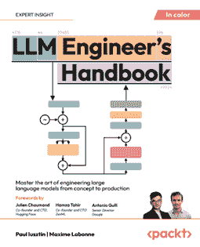

# References

- Adobe (2023). *Adobe Firefly*. Adobe Inc. [`www.adobe.com/sensei/generative-ai/firefly.html`](https://www.adobe.com/sensei/generative-ai/firefly.html)

# 参考文献

* Alayrac, J.-B., Donahue, J., Luc, P., Miech, et al. (2022). Flamingo: A visual language model for few-shot learning. *Advances in Neural Information Processing Systems*, *35*, 23716–23736. [`arxiv.org/abs/2204.14198`](https://arxiv.org/abs/2204.14198)
* Betker, J., Goh, G., Jing, L., et al. (2023). *Improving image generation with better captions*. OpenAI. [`cdn.openai.com/papers/dall-e-3.pdf`](https://cdn.openai.com/papers/dall-e-3.pdf)
* Birhane, A., Prabhu, V. U., & Kahembwe, E. (2021). Multimodal datasets: Misogyny, pornography, and malignant stereotypes. *arXiv preprint arXiv:2110.01963*. [`arxiv.org/abs/2110.01963`](https://arxiv.org/abs/2110.01963)
* Borsos, Z., Marinier, R., Vincent, D., et al. (2022). AudioLM: A language modeling approach to audio generation. *arXiv preprint arXiv:2209.03143*. [`arxiv.org/abs/2209.03143`](https://arxiv.org/abs/2209.03143)
* Brown, T., Mann, B., Ryder, N., et al. (2020). Language models are few-shot learners. *Advances in Neural Information Processing Systems*, *33*, 1877–1901. [`arxiv.org/abs/2005.14165`](https://arxiv.org/abs/2005.14165)
* Dettmers, T., Pagnoni, A., Holtzman, A., & Zettlemoyer, L. (2023). Zero-infinity: Breaking GPU memory barriers for training trillion parameter models.
* Dettmers. (2023). QLoRA: Efficient finetuning of quantizedMs. *arXiv preprint arXiv:2305.4198*. [`arxiv.org/abs/2305.4198`](https://arxiv.org/abs/2305.4198)
* Duolingo (2024). AI-powered language. [`blog.duolingo.com/max/`](https://blog.duolingo.com/max/)
* Gemmeke, J. F., Ellis, D., Freedman, D., et al. (2017). AudioSet: An ontology and human-labeled dataset for audio events. *IEEE International Conference on Acoustics, Speech and Processing (ICASSP)*, 776–780. [`research.google.com/audset/`](https://research.google.com/audset/)
* Google DeepMind. (2024). Gemini 1.5 technical report. Google. [`storage.googleapis.com/deepmind-media/gemini_1_5.pdf`](https://storage.googleapis.com/deepmind-media/gemini_1_5)
* Ramesh, A., Pavlov, M., Goh, G., et al. (2021). Zero-shot text-to-image generation. *International Conference on Machine Learning (ICASSP)*, 8821–8831. [`arxiv.org/abs/2102.12092`](https://arxiv.org/abs/2102.12092)
* Schuhmann, C., Beaumont, R., Vencu, R., et al. (2022). LAION-5B: An open large-scale dataset for training next generation image-text models. *arXiv preprint arXiv:2210.08402*. [`laion.ai/blog/laion-5b/`](https://laion.ai/blog/laion-5b/)

# 订阅免费电子书

新框架、演进架构、研究发布、生产环境分析——`AI_Distilled` 将噪音过滤，为实际操作 LLM 和生成式 AI 系统的工程师和研究人员提供每周简报。现在订阅即可获取一本免费电子书，以及帮助你保持专注并掌握信息的每周见解。

访问 [`packt.link/8Oz6Y`](https://packt.link/8Oz6Y) 订阅，或扫描下方二维码。

[www.packtpub.com](https://www.packtpub.com)

订阅我们的在线数字图书馆，即可完整访问 7,000 多本书籍和视频，以及行业领先的工具，帮助你规划个人发展并规划职业。如需更多信息，请访问我们的网站。

# 为什么要订阅？

* 通过来自 4,000 多名行业专业人士的实用电子书和视频，减少学习时间，增加编码时间
* 通过专为你定制的技能计划（Skill Plans）提升学习效果
* 每月获得一本免费电子书或视频
* 支持全文搜索，方便获取关键信息
* 内容可复制粘贴、打印和书签

你知道吗？Packt 出版的每本书都提供电子书版本，并提供 PDF 和 ePub 文件。你可以在 [`packtpub.com`](https://packtpub.com) 升级到电子书版本，作为纸质书客户，你有权享受电子版折扣。请通过 [`customercare@packtpub.com`](https://customercare@packtpub.com) 与我们联系获取详情。

在 [`www.packtpub.com`](https://www.packtpub.com)，你还可以阅读免费技术文章、订阅一系列免费通讯，并接收 Packt 书籍和电子书的专属优惠。

# 你可能喜欢的其他书籍

如果你喜欢这本书，可能对 Packt 的其他书籍感兴趣：

## 使用 LLM、RAG 和知识图谱构建 AI Agent

Salvatore Raieli, Gabriele Luculano

ISBN: 978-1-83508-706-0

* 设计 RAG 流水线以连接 LLM 与外部数据
* 构建并查询知识图谱，以实现结构化上下文和事实依据
* 开发能够规划、推理并使用工具完成任务的 AI Agent
* 将 LLM 与外部 API 和数据库集成以引入实时数据
* 应用技术最大限度地减少幻觉并确保输出准确
* 编排多个 Agent 以解决复杂的多步骤问题
* 针对长运行任务优化提示词（prompts）、内存和上下文处理
* 在生产环境中部署和监控 AI Agent

## LLM 工程师手册

Paul Iusztin, Maxime Labonne

ISBN: 978-1-83620-007-9

* 实现稳健的数据流水线并管理 LLM 训练周期
* 通过实战示例帮助创建自己的 LLM 并进行完善
* 通过深入核心 MLOps 原则（如编排器和提示监控）开始 LLMOps
* 执行监督微调和 LLM 评估
* 使用 AWS 和其他工具部署端到端 LLM 解决方案
* 设计可扩展且模块化的 LLM 系统
* 通过构建功能和推理流水线来学习 RAG 应用

# Packt 正在寻找像你这样的作者

如果你有兴趣成为 Packt 作者，请访问 [`authors.packtpub.com`](https://authors.packtpub.com) 并于今日申请。我们已经与数千名像你这样的开发者和技术专业人士合作，帮助他们向全球技术社区分享见解。你可以提交通用申请、申请我们正在招的特定热门话题，或提交自己的想法。

# 分享你的想法

现在你已经完成了《企业级 LLM》（LLMs in Enterprise），我们想听听你的想法！如果你是从亚马逊购买的这本书，请[点击此处直接跳转到亚马逊评论页](https://packt.link/r/1836203)。
