# Midjourney：释放创造未来

提示词（`Prompt`）是一个简短的文本表达式，用于触发 Midjourney 机器人创建**图像**。

Midjourney 机器人会解构提示词中的单词和短语，将其拆分为被称为**标记（`tokens`）**的单元。这些标记随后会与其训练数据进行匹配，使机器人能够生成图像。

巧妙地组合提示词可以产生独特且引人胜目的图像。

## 01 提示词的构造

### 基础提示词

基础提示词可以简单为一个单词、短语或表情符号。

```
prompt The prompt to imagine /imagine prompt description of what to imagine Text Prompt
```

> 提示：为了获得最佳效果，在描述你想让 Midjourney 机器人创建的内容时，请使用简洁直接的句子。这样，机器人可以更好地理解你的视觉愿景，并更准确地生成所需的图像。

> **不要** 给我看一张有很多盛开的加州罂粟花的照片，让它们呈现明亮、鲜艳的橙色，并用彩色铅笔以插画风格画出来。

> **要** 用彩色铅笔画的亮橙色加州罂粟花。

### 高级提示词

高级提示词可以包含一个或多个图像 URL、多个文本短语、参数。

```
prompt The prompt to imagine
/imagine prompt http://imageURL1.png http://imageURL1.jpg description of what to imagine --parameter 1 --parameter 2
Image Prompts Text Prompt Parameters
```

## 02 图像提示词

可以添加到提示词中以影响最终结果的风格和内容。它们始终位于提示词的前面。

## 02 文本提示词

是对你想要生成的图像的文本描述。表达良好的提示词有助于生成惊艳的图片。

## 02 参数

改变图像生成的方式。它们位于提示词的末尾。

## 01 提示词的构造

### 提示词注意事项

### 提示词长度

使用非常短的提示词将严重依赖 Midjourney 的默认样式。然而，过长的提示词并不总是能带来更好的结果。关键在于集中你想有效传达的核心概念上。

> 不要遮盖。

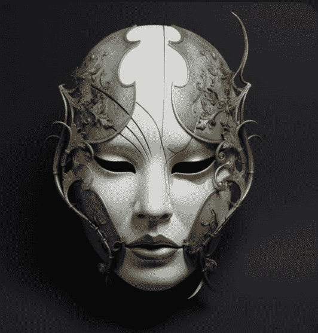

提示词可以非常简单。单个单词就会生成图像，你甚至可以只用表情符号！

神秘的威尼斯狂欢面具。


专注于你想创建的内容的核心概念。

### 语法

Midjourney 机器人并不像人类那样理解语法。你选择的单词也非常重要。尽可能删除单词，因为这会赋予你选择的单词更大的影响力。如果你愿意，可以使用标点符号来帮助组织思路，但机器人不会可靠地解释它们。此外，Midjourney 机器人不考虑大小写。

```
不要
请画一只非常大的章鱼，带着愤怒的脸。另外，我想要紫色的。
```

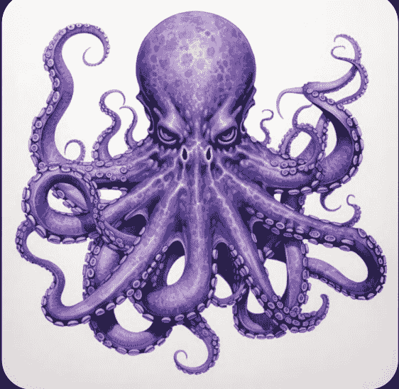

了太多对最终结果没有实际帮助的单词。

巨大的愤怒的紫色章鱼。

更好的词汇选择，每一个词对最终结果都有影响。

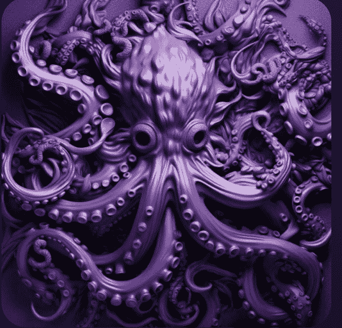

### 关注你想要的

不要输入你不想要的内容。如果你想从最终图像中排除某些内容，请尝试使用`--no`参数的高级提示词。

```
不要
没有奶士的汉堡
```

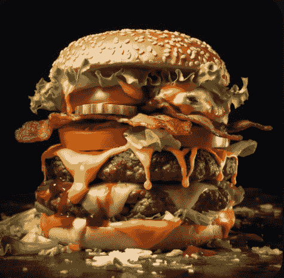

如果你输入带 "no cheese" 的汉堡，你可能会得到一张带奶士的图像。

```
要
完整的汉堡 --no cheese
```

如果你希望特定内容不包含在图像中，请尝试使用高级提示词参数。

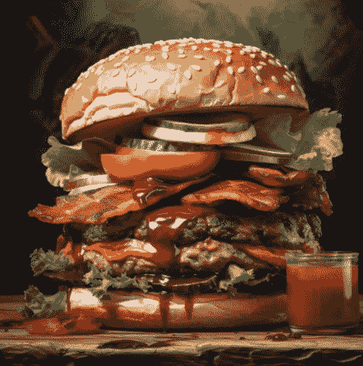

### 思考哪些细节很重要

如果你想要特定的细节，请描述清晰。模糊是获得多样性的极佳选择，这完全取决于你在寻找什么。

> 不要

低多形房屋

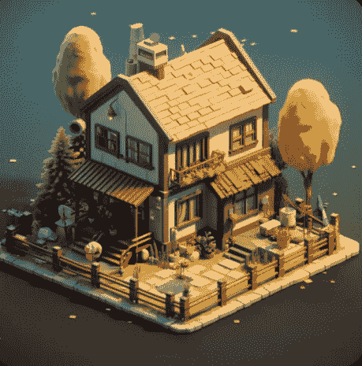

如果你在寻找特定的细节，不要太模糊。

> 要

低多形温馨的木屋，烟囱冒着烟，秋日午后

思考主体、环境、氛围、颜色等。尝试对你来说重要的细节做到清晰明确。


### 使用集合名词

复数形式会让很多因素取决于运气。如果你想要更详细的结果，请尝试具体的数字和集合名词。

> 不要

玩球的黑色小狗

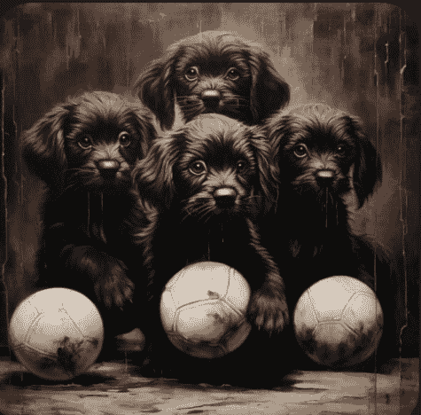

> 要

玩球的黑色小狗

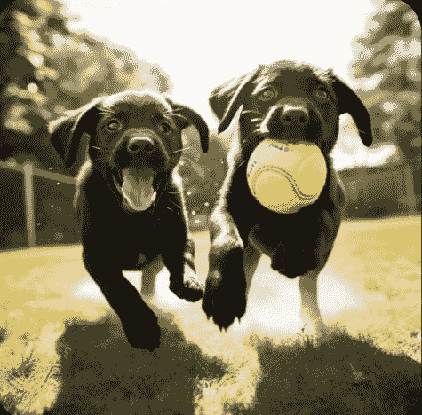

## 03 理解 Midjourney 命令

### 提示词 (Prompt)

待描述的图像

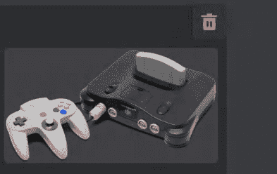

nintendo.png

```
/describe image nintendo.png
```

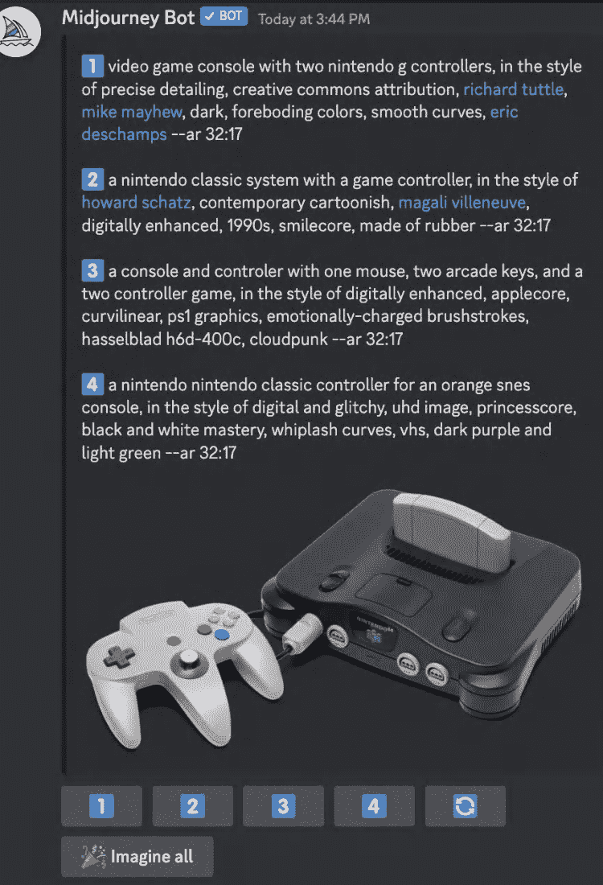

一旦我们向 Midjourney 发送`/describe`指令，我们将获得 4 个不同的提示词，尝试为上传的图像创建相似的变体。

如果我们对提示词不满意，可以通过按钮让 Midjourney 重新生成所有提示。

点击其中一个选项，可以让 Midjourney 运行特定的提示词。我们也可以通过 `Imagine all` 按钮让 Midjourney 运行所有提示。

我们还可以手动编辑其中一个提示词并使用`/image`命令。这就是仅仅操作的结果：

> 提示词

> 带有两个任天堂控制器的游戏主机，复古游戏风格，带有鲜艳的强调色。


## 03 理解 Midjourney 命令

```
/blend
```

在输入`/blend`命令后，会被要求上传 2–5 张图像，Midjourney 然后会查看每张图像的概念和审美，并将它们合并成一张全新的图像。

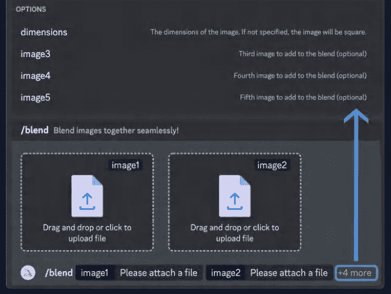

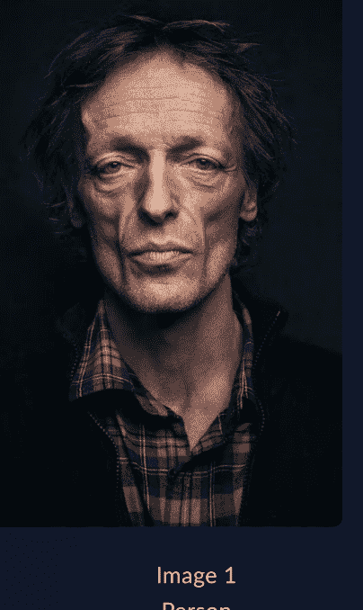

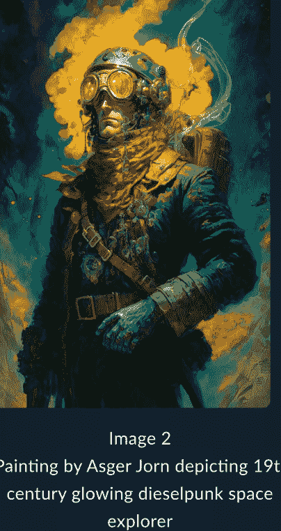

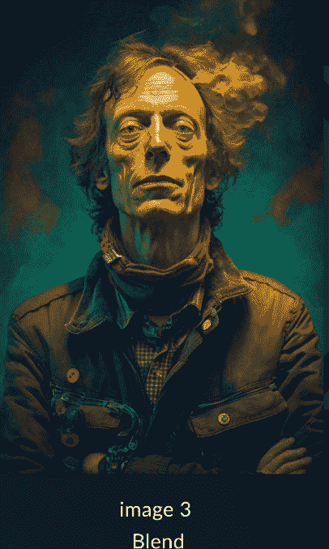

> 提示

> 为了获得最佳效果，请上传与预期结果相同宽高比例的图像

合并后的图像默认具有 1:1 的宽高比，但您可以使用可选的尺寸字段选择正方形比例 (1:1)、纵屏比例 (2:3) 或横屏比例 (3:2)。

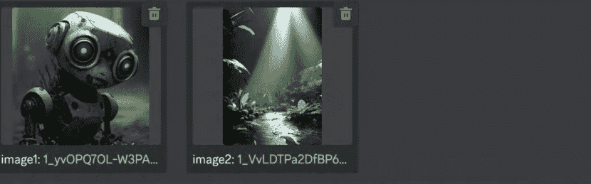

- `blend 1_yVOQPTOL-W3PAv84gYiwg.webp image2 1_VvLDTPa2DFBP62HeddBb45g.webp`
  
  `dim Landscape +3 more`


## 04 熟悉参数列表

参数是集成在提示词中的选项，会改变图像形成的方式。参数具有改变图像宽高比、在不同的 Midjourney 模型版本之间切换、修改放大器选择以及许多其他功能。

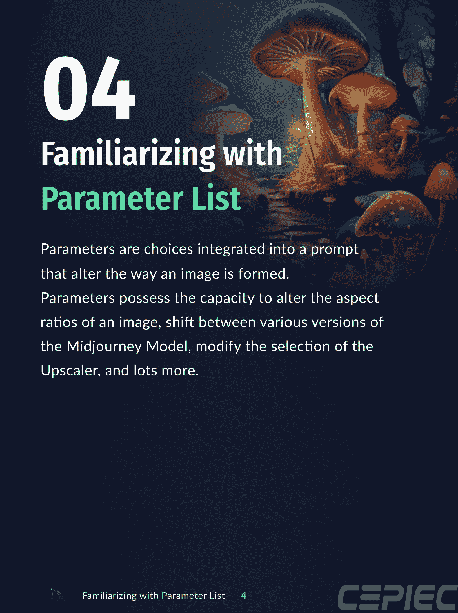

参数必须添加在提示词的末尾，您可以为每个提示词添加多个参数。

```
/imagine a vibrant california poppy --aspect 2:3 --stop 95 --no sky
```

> 提示

> 您可能会注意到，如果您使用的是 Apple 设备，双连字符 (--) 会自动转换为破折号 (—)。别担心，Midjourney 两种都接受！

### 基础参数

### 宽高比

`--aspect` 或 `--ar` 改变生成图像的宽高比。

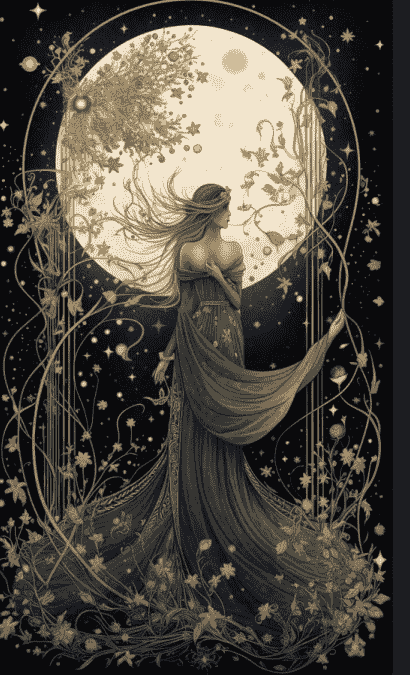

> 提示词

> 奇幻的塔罗牌审美，月亮 --ar 4:7

> 提示词

> 奇幻的塔罗牌审美，月亮

> --aspect 139:100

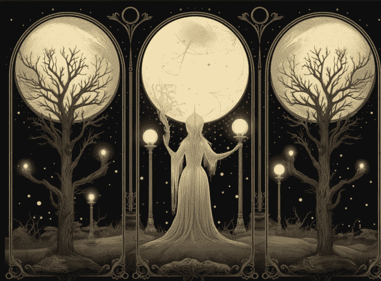

### 混沌值 (Chaos)

`--chaos <number 0-100>` 改变初始图像网格的变异程度。数值越高，产生的意外图像越多。

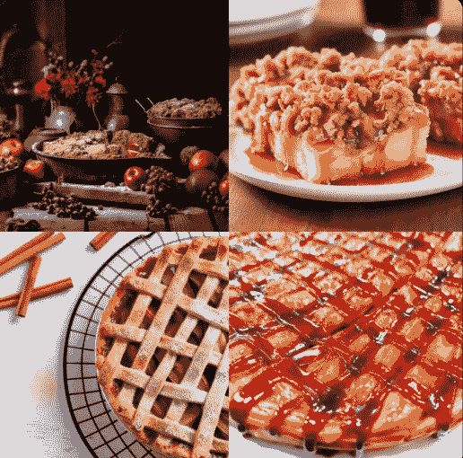

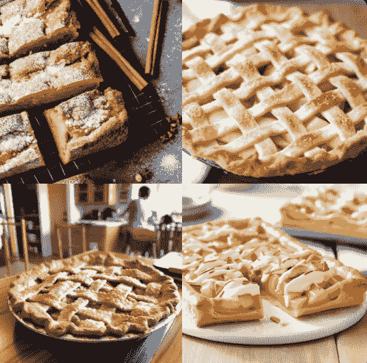

```
warm apple pie --chaos 100
```

### 图像权重 (Image Weight)

`--iw <0-2>` 设置图像相对于文本的重要性。数值越高，图像对最终结果的影响越大。

> 提示词

> house --iw 2

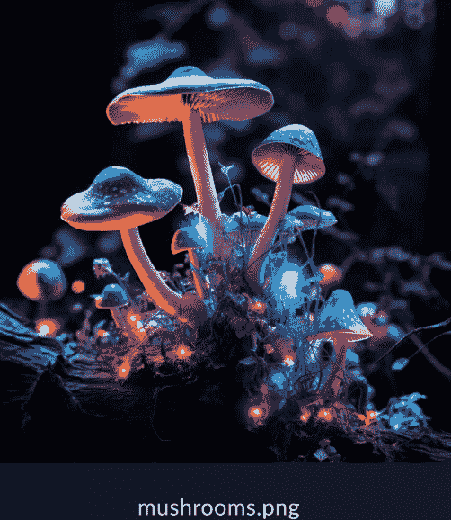

> 提示词

> mushrooms --iw 0.5

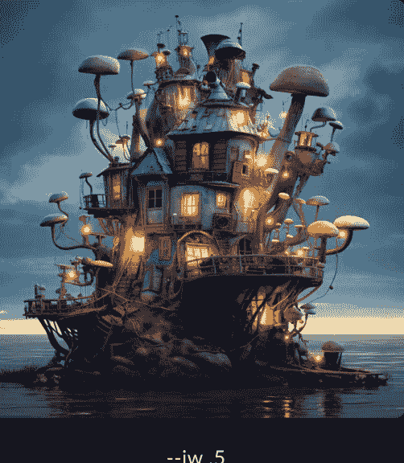

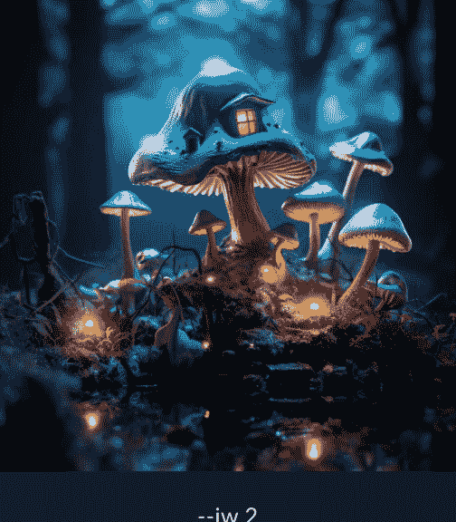

### 排除 (No)

`--no` 可用于移除提示词中不想要元素。

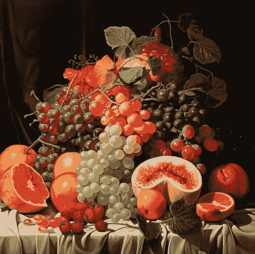

```
fruit painting --no grapes
```

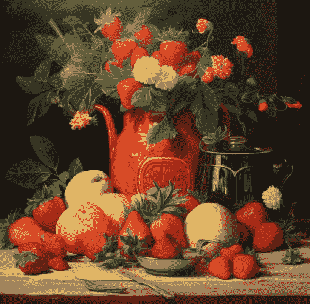

### 质量 (Quality)

`--q <0.25-1>` 改变您在生成图像上花费的时间。默认为 1。

> 提示词

> fruit painting --q 0.5

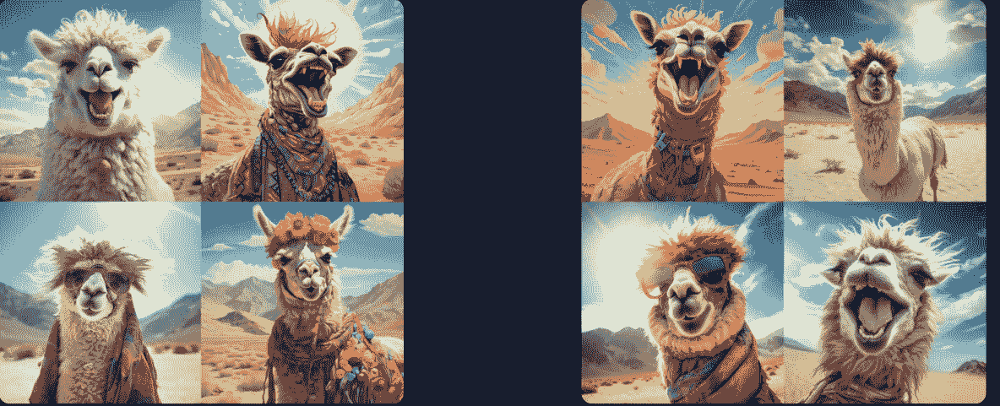

### 重复 (Repeat)

`--repeat` 多次运行任务。

> 提示词

> llama --repeat 2

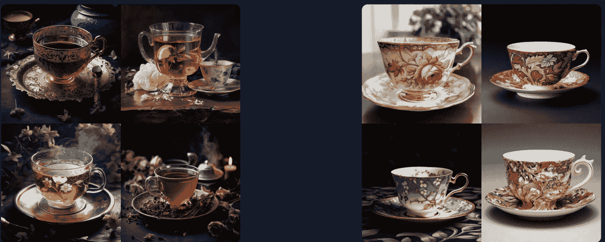

### 种子 (Seed)

Midjourney 使用种子值来创建初始图像网格。默认情况下这是一个随机数，但您可以使用`--seed`参数指定它。相似的种子将产生相似的图像。

> 提示词

> classic tea --seed 42

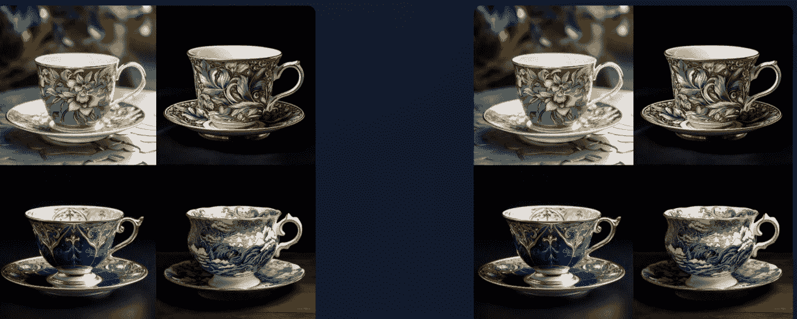

### 停止 (Stop)

`--stop` 在更早的百分比停止生成。您可以获得细节较少的结果。

> 提示词

> underwater --stop 30

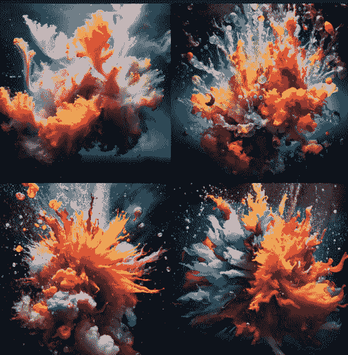

### 风格 (Style)

`--style` 自定义某些 Midjourney 模型的审美。它改变了生成期间的艺术影响。

> 提示词

> dark academia --style raw

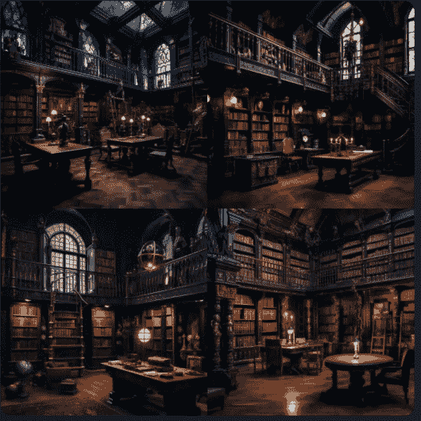

### 版本 (Version)

`--version` 使用不同版本的 Midjourney 算法。

```
--version <1, 2, 3, 4, 5, 5.1 or 5.2> 或 --v <1, 2, 3, 4, 5, 5.1 or 5.2>
```

## 05 高级提示词

高级提示词可以包含一个或多个图像 URL、多个文本短语、参数。

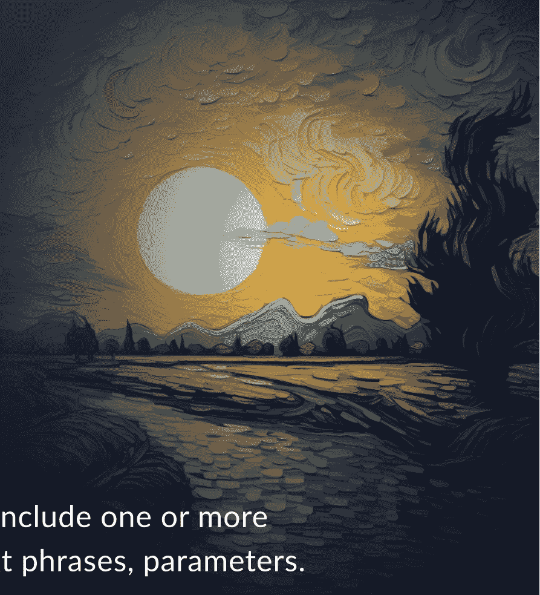

### 图片提示词

你可以使用图片提示词来决定内容的组成。图片提示词可以单独使用，也可以与文本提示词结合，你还可以组合不同的图片。

> 提示

> 图片位于提示词的开头，你需要两张图片或图片与文本的才能生效。

> 提示

> URL 必须是在线图片的直接链接，并且应该以 `.png`、`.gif`、`.webp`、`.jpg` 或 `.jpeg` 结尾。

如果图片在手机中，你可以将其作为消息发送给 Midjourney Bot 以生成链接。

### 将图片上传到 Discord

1. 将图片链接粘贴到与 Midjourney Bot 的聊天框中并按回车发送。

2. 要获取图片链接，请根据你使用的平台遵循以下步骤：

   - 桌面端应用：右键点击图片并选择“复制链接”（不是“复制消息链接”）
   - Web 端应用：点击展开图片，然后右键点击并选择“复制图像地址”
   - 移动端应用：长按图片，然后选择“复制媒体链接”
   - 如果这些方法均无效，你可以展开图片并选择“在浏览器中打开”。最后，你可以复制并粘贴图片的 URL。

### 向提示词添加图片

1. 输入 `/imagine`
2. 将图片文件拖入提示词框以添加 URL，或在提示词框内粘贴链接。

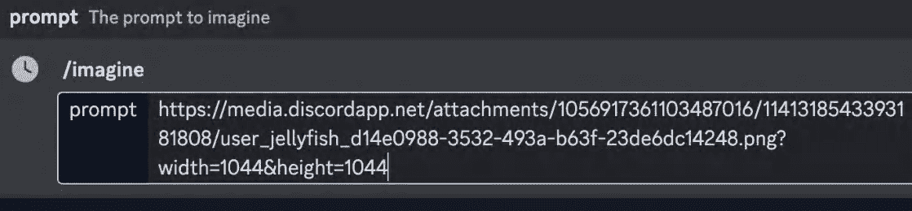

> 提示：在 Midjourney Bot 的私信中上传图片，可以防止其他服务器的用户看到图片。如果用户没有开启隐身模式（`Stealth Mode`），图片提示词在 Midjourney 网站上是公开的。

### 示例

图片 + 图片

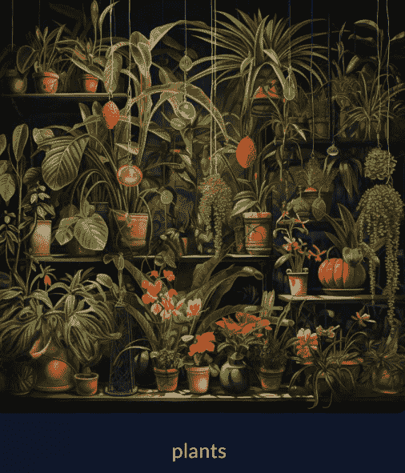

+

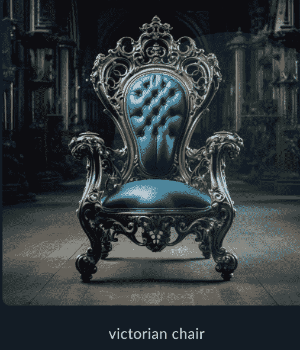

> 提示

> 使用相同宽高比例的图片可获得最佳效果。

### 示例

图片 + 文本

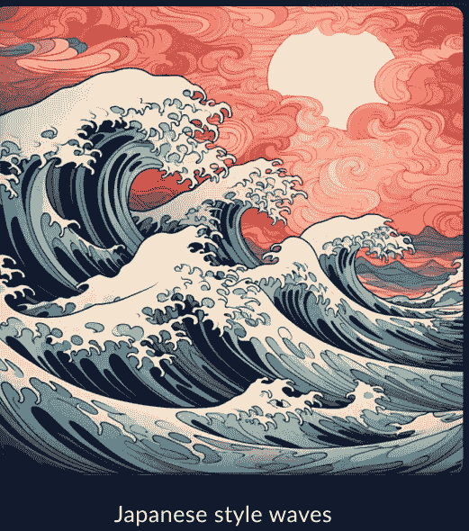

+ 花瓶


> 提示：使用权重参数（`Image Weight`）来调整图片与文本的重要性

## 06 Remix 模式

你可以使用 `Remix` 模式在变体之间更改提示词、参数、模型版本或宽高比例。`Remix` 将取你初始图片的整体构图，并将其作为新任务的一部分。

> **提示** `Remix` 是一个实验性功能，这意味着它可以随时更改或移除。

### 使用 Remix

通过`/prefer remix`命令或使用`/settings`命令并切换 `Remix` 按钮来激活 `Remix` 模式。`Remix` 会改变变体按钮（V1, V2, V3, V4）的行为，并允许你在每次变体时编辑提示词。

要对放大（`upscale`）图片进行 `Remix`，请选择 `Vary`。

> 提示

> 完成 `Remix` 后，使用 `/settings` 或 `/prefer remix` 命令将其关闭。

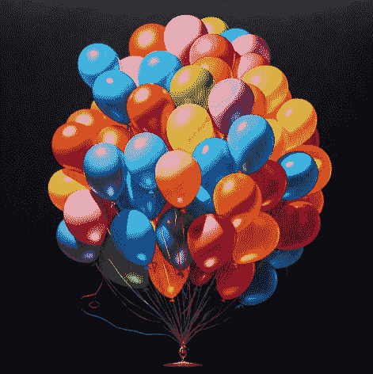

提示词

一大束气球

修改或输入新提示词

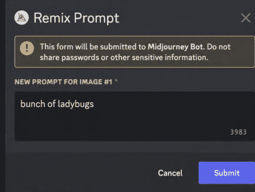

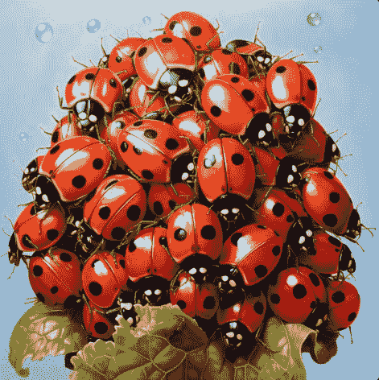

结果

## 07 多提示词 (Multi Prompts)

多提示词允许你为不同的部分分配重要性。要实现这一点，你可以使用`::`作为分隔符。

### 多提示词基础

当你使用双冒号时，机器人会分别处理这些部分。例如，如果你使用提示词 `"apple::cake"`，机器人将相应地考虑该提示词。

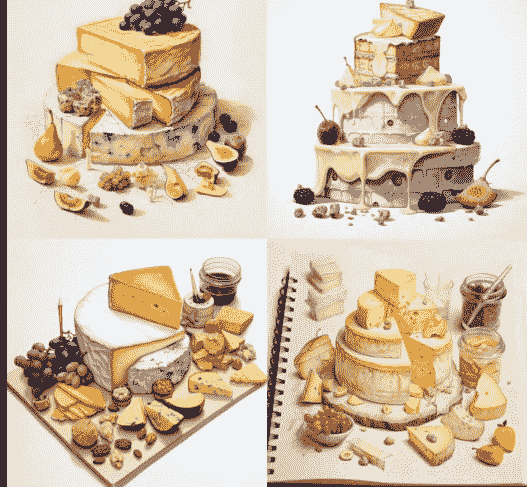

### 权重 (Weights)

| 提示词 | 权重 |
| :--- | :--- |
| cup | 2 |
| cake | 1 |

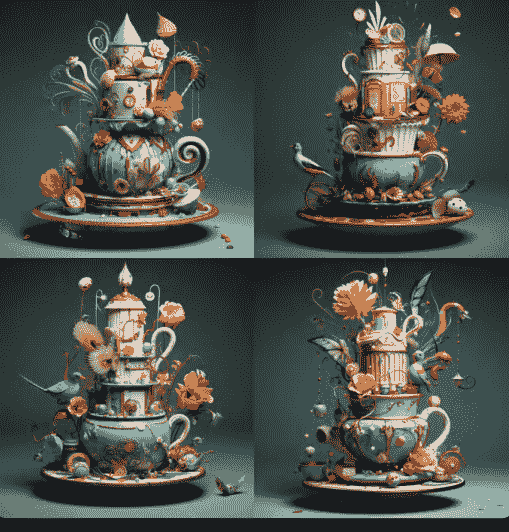

## 08 Pan（平移）选项

`Pan` 功能允许你在特定方向上拉伸图片，同时保持原始内容完整。

### 平移图片

`Pan` 按钮在放大图片后出现。在平移过程中，图片的新部分由提示词和最近的 512 像素决定。

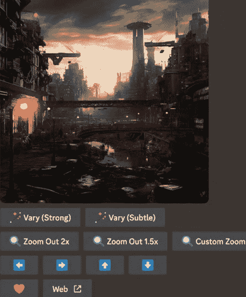

提示词

末日后的城市

起始图片

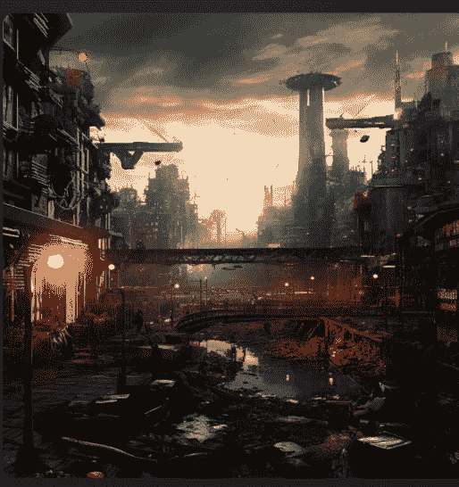


# 平移 ↔

# 平移 ↕

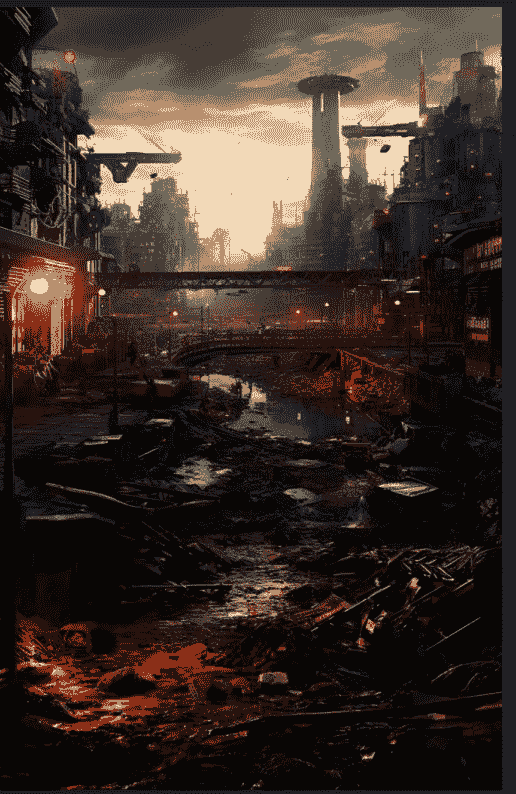

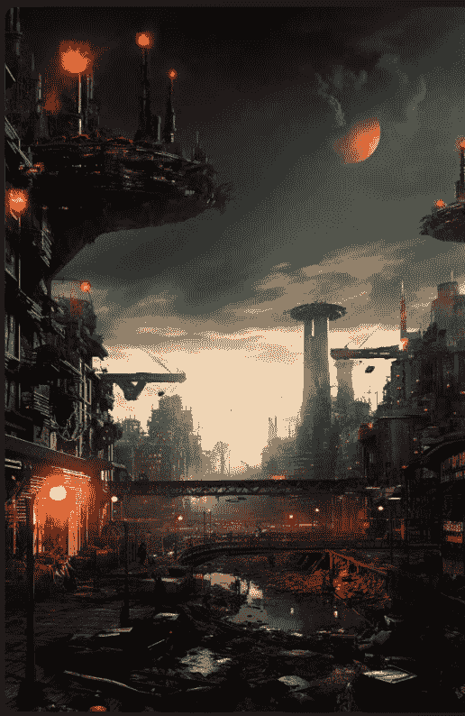

# 平移 ↘

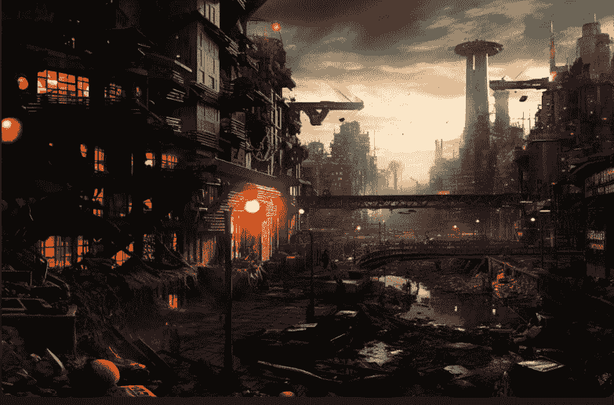

# 平移 ➡

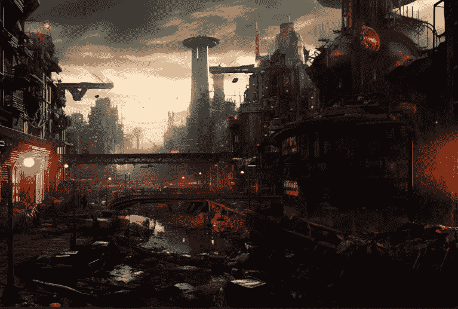

> **提示**

> 一旦你在特定方向上平移了图片，你就被限制只能在相同方向（水平/垂直）上继续平移。你可以自由执行多次连续平移。然而，如果你执行多次且图片尺寸大到无法直接在 Discord 上分享，将为你提供图片的链接。

## Remix 模式下的 Pan

在 Remix 模式下 Pan 允许你在平移时更改提示词。

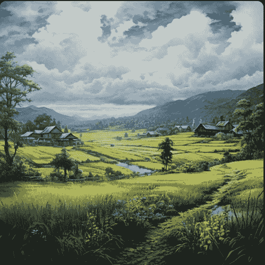

| 提示词 | |
| :--- | :--- |
| 乡村风景 | |

```
向右移动
此表单将提交给 Midjourney Bot。不要共享密码或其他敏感信息。
带新提示词的平移 *
乡村河流
3983
取消 提交
```

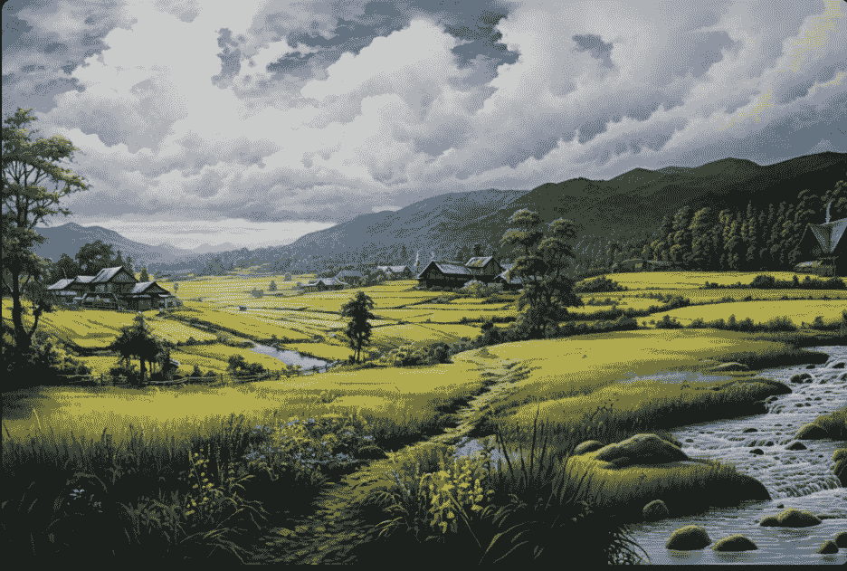
