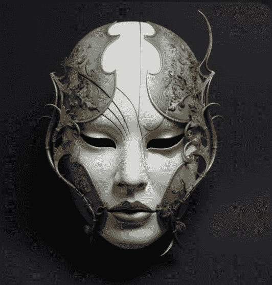
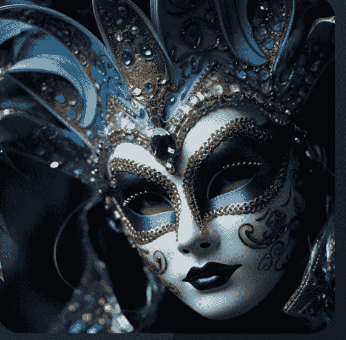
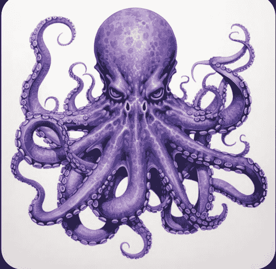
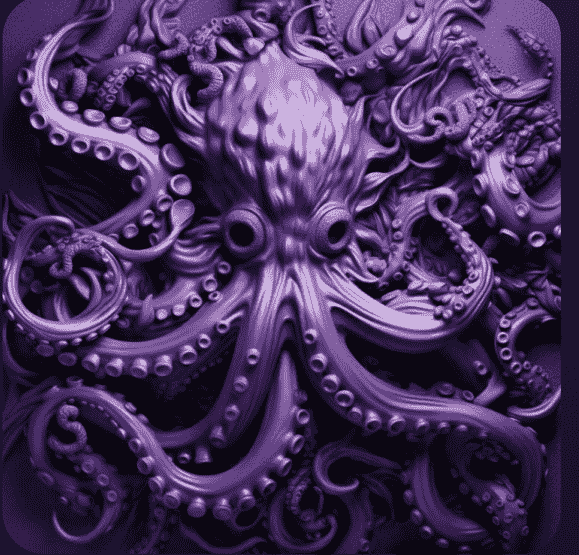
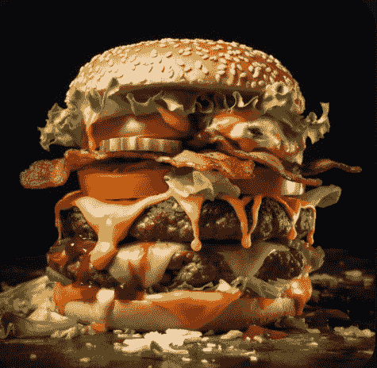
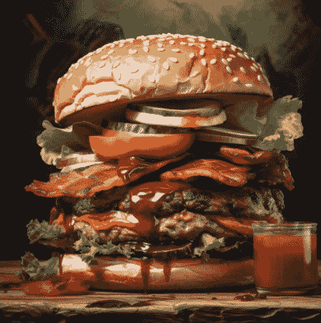
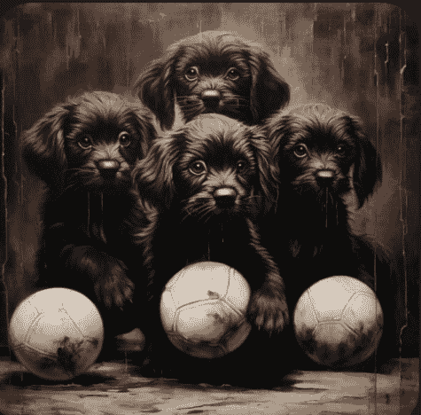
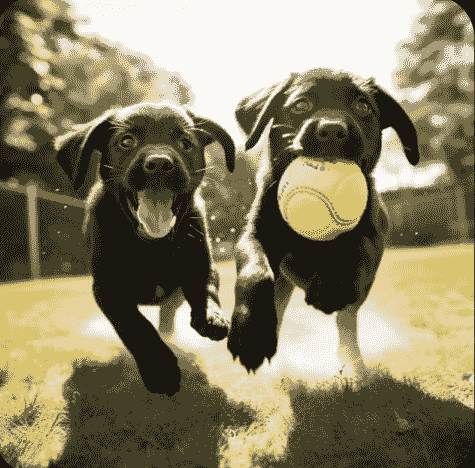

## 01 提示词的构造

### 基础提示词

基础提示词可以简单为一个单词、短语或表情符号。

```
prompt The prompt to imagine /imagine prompt description of what to imagine Text Prompt
```

> 提示：为了获得最佳效果，在描述你想让 Midjourney 机器人创建的内容时，请使用简洁直接的句子。这样，机器人可以更好地理解你的视觉愿景，并更准确地生成所需的图像。

> **不要** 给我看一张有很多盛开的加州罂粟花的照片，让它们呈现明亮、鲜艳的橙色，并用彩色铅笔以插画风格画出来。

> **要** 用彩色铅笔画的亮橙色加州罂粟花。

### 高级提示词

高级提示词可以包含一个或多个图像 URL、多个文本短语、参数。

```
prompt The prompt to imagine
/imagine prompt http://imageURL1.png http://imageURL1.jpg description of what to imagine --parameter 1 --parameter 2
Image Prompts Text Prompt Parameters
```

## 02 图像提示词

可以添加到提示词中以影响最终结果的风格和内容。它们始终位于提示词的前面。

## 02 文本提示词

是对你想要生成的图像的文本描述。表达良好的提示词有助于生成惊艳的图片。

## 02 参数

改变图像生成的方式。它们位于提示词的末尾。

## 01 提示词的构造

### 提示词注意事项

### 提示词长度

使用非常短的提示词将严重依赖 Midjourney 的默认样式。然而，过长的提示词并不总是能带来更好的结果。关键在于集中你想有效传达的核心概念上。

> 不要遮盖。



提示词可以非常简单。单个单词就会生成图像，你甚至可以只用表情符号！

神秘的威尼斯狂欢面具。



专注于你想创建的内容的核心概念。

### 语法

Midjourney 机器人并不像人类那样理解语法。你选择的单词也非常重要。尽可能删除单词，因为这会赋予你选择的单词更大的影响力。如果你愿意，可以使用标点符号来帮助组织思路，但机器人不会可靠地解释它们。此外，Midjourney 机器人不考虑大小写。

```
不要
请画一只非常大的章鱼，带着愤怒的脸。另外，我想要紫色的。
```



了太多对最终结果没有实际帮助的单词。

巨大的愤怒的紫色章鱼。

更好的词汇选择，每一个词对最终结果都有影响。



### 关注你想要的

不要输入你不想要的内容。如果你想从最终图像中排除某些内容，请尝试使用`--no`参数的高级提示词。

```
不要
没有奶士的汉堡
```



如果你输入带 "no cheese" 的汉堡，你可能会得到一张带奶士的图像。

```
要
完整的汉堡 --no cheese
```

如果你希望特定内容不包含在图像中，请尝试使用高级提示词参数。



### 思考哪些细节很重要

如果你想要特定的细节，请描述清晰。模糊是获得多样性的极佳选择，这完全取决于你在寻找什么。

> 不要

低多形房屋


如果你在寻找特定的细节，不要太模糊。

> 要

低多形温馨的木屋，烟囱冒着烟，秋日午后

思考主体、环境、氛围、颜色等。尝试对你来说重要的细节做到清晰明确。


### 使用集合名词

复数形式会让很多因素取决于运气。如果你想要更详细的结果，请尝试具体的数字和集合名词。

> 不要

玩球的黑色小狗



> 要

玩球的黑色小狗


