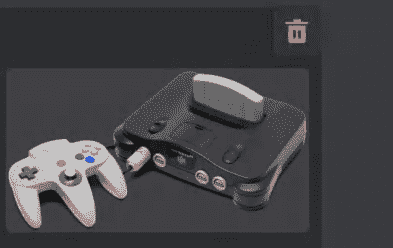
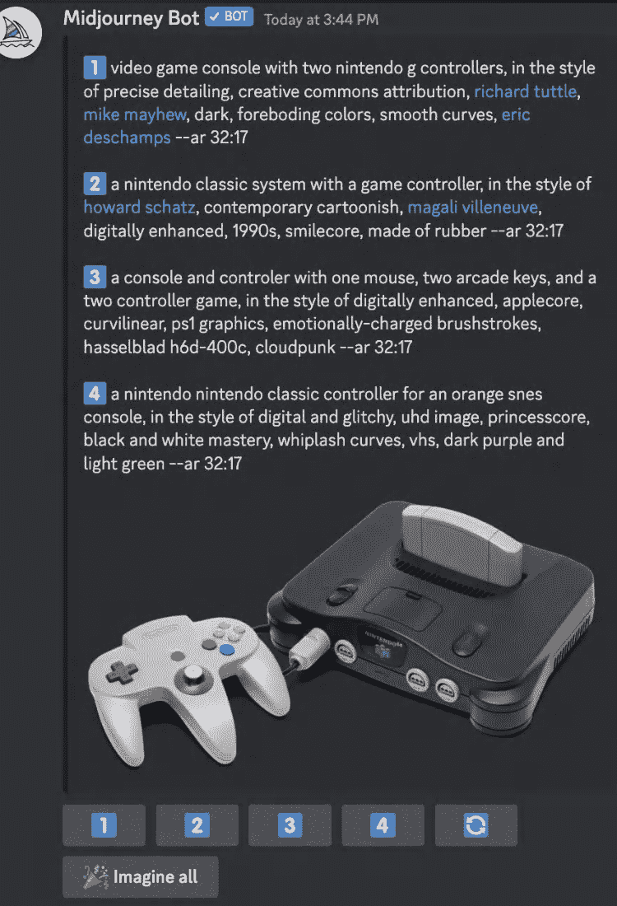
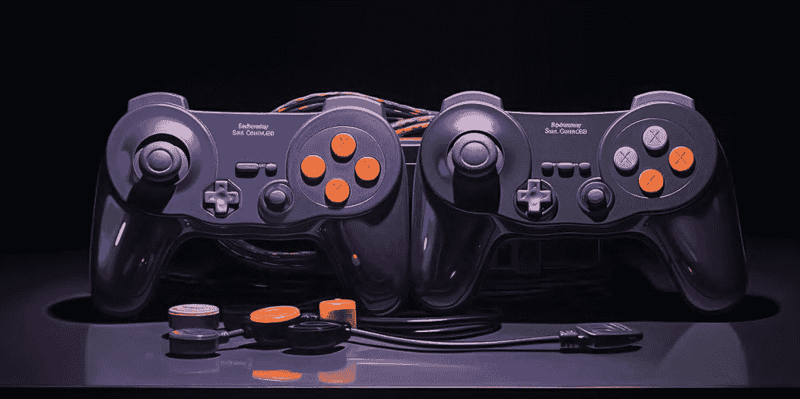
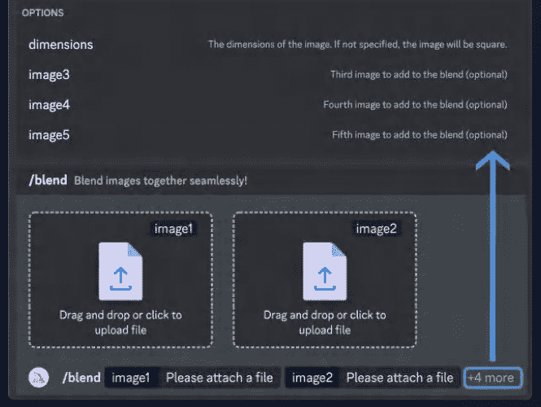
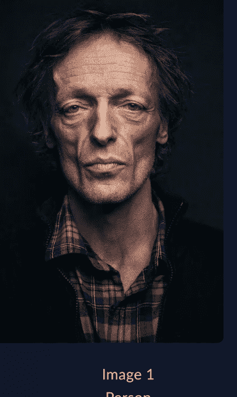
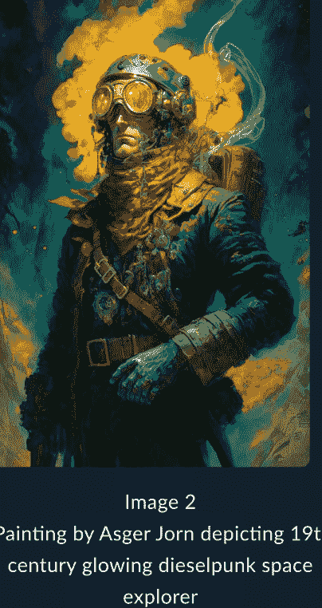
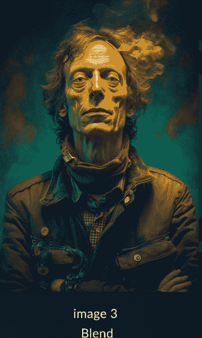
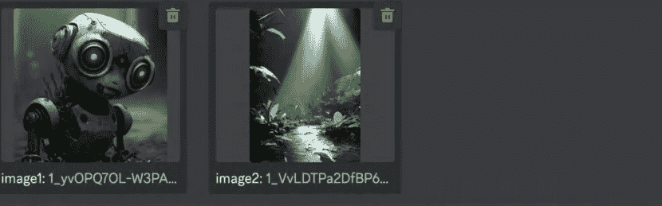
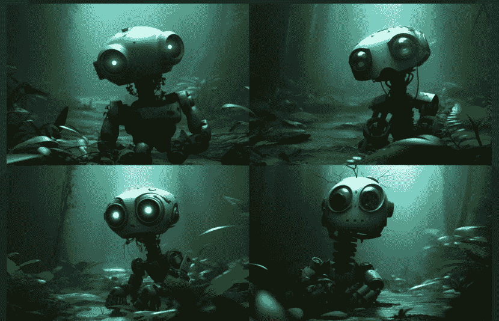

## 03 理解 Midjourney 命令

### 提示词 (Prompt)

待描述的图像



nintendo.png

```
/describe image nintendo.png
```



一旦我们向 Midjourney 发送`/describe`指令，我们将获得 4 个不同的提示词，尝试为上传的图像创建相似的变体。

如果我们对提示词不满意，可以通过按钮让 Midjourney 重新生成所有提示。

点击其中一个选项，可以让 Midjourney 运行特定的提示词。我们也可以通过 `Imagine all` 按钮让 Midjourney 运行所有提示。

我们还可以手动编辑其中一个提示词并使用`/image`命令。这就是仅仅操作的结果：

> 提示词

> 带有两个任天堂控制器的游戏主机，复古游戏风格，带有鲜艳的强调色。



## 03 理解 Midjourney 命令

```
/blend
```

在输入`/blend`命令后，会被要求上传 2–5 张图像，Midjourney 然后会查看每张图像的概念和审美，并将它们合并成一张全新的图像。









> 提示

> 为了获得最佳效果，请上传与预期结果相同宽高比例的图像

合并后的图像默认具有 1:1 的宽高比，但您可以使用可选的尺寸字段选择正方形比例 (1:1)、纵屏比例 (2:3) 或横屏比例 (3:2)。



- `blend 1_yVOQPTOL-W3PAv84gYiwg.webp image2 1_VvLDTPa2DFBP62HeddBb45g.webp`
  
  `dim Landscape +3 more`


