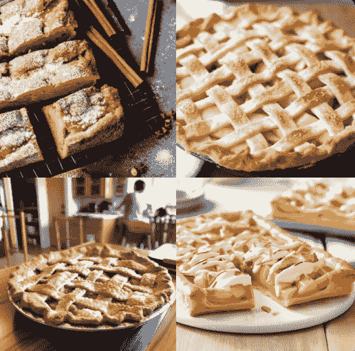
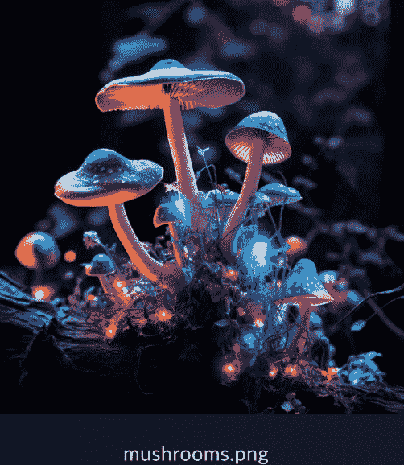
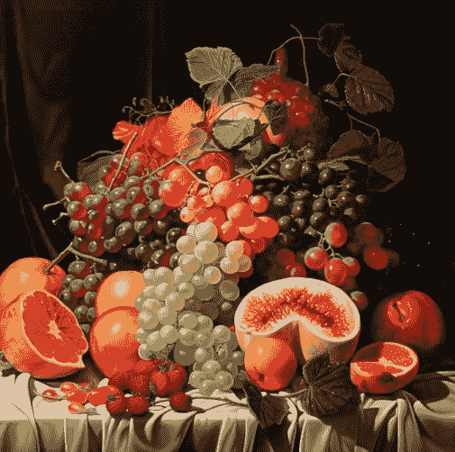
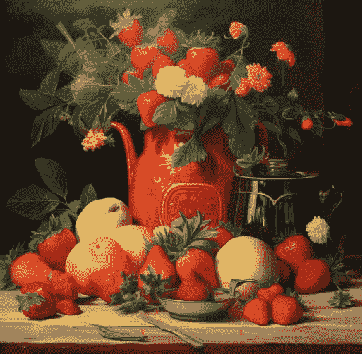
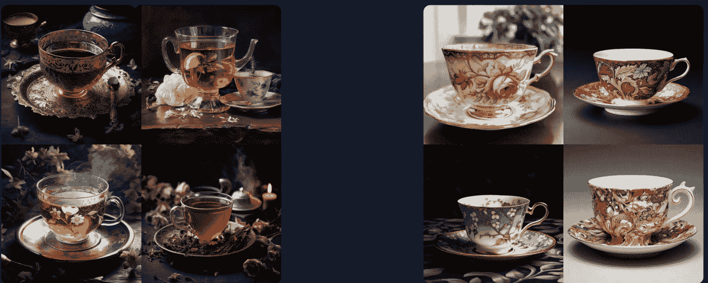
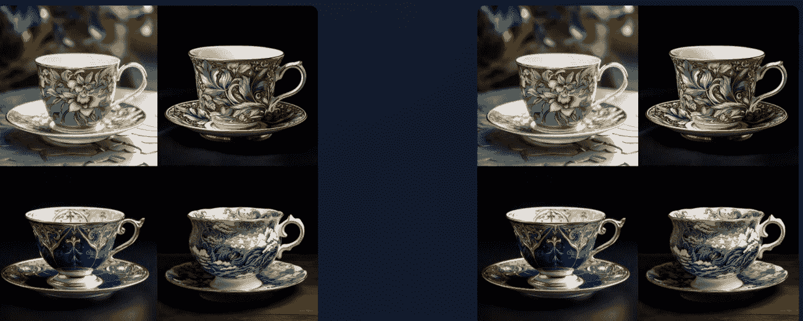
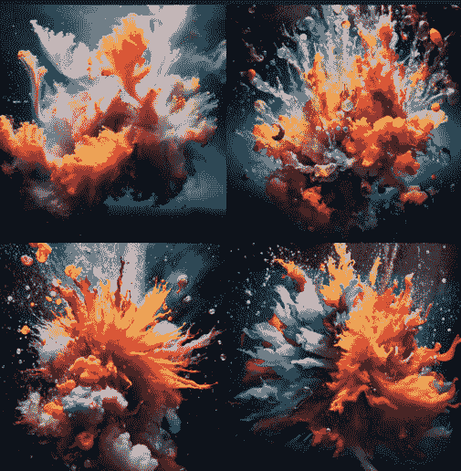

## 04 熟悉参数列表

参数是集成在提示词中的选项，会改变图像形成的方式。参数具有改变图像宽高比、在不同的 Midjourney 模型版本之间切换、修改放大器选择以及许多其他功能。


参数必须添加在提示词的末尾，您可以为每个提示词添加多个参数。

```
/imagine a vibrant california poppy --aspect 2:3 --stop 95 --no sky
```

> 提示

> 您可能会注意到，如果您使用的是 Apple 设备，双连字符 (--) 会自动转换为破折号 (—)。别担心，Midjourney 两种都接受！

### 基础参数

### 宽高比

`--aspect` 或 `--ar` 改变生成图像的宽高比。


> 提示词

> 奇幻的塔罗牌审美，月亮 --ar 4:7

> 提示词

> 奇幻的塔罗牌审美，月亮

> --aspect 139:100


### 混沌值 (Chaos)

`--chaos <number 0-100>` 改变初始图像网格的变异程度。数值越高，产生的意外图像越多。




```
warm apple pie --chaos 100
```

### 图像权重 (Image Weight)

`--iw <0-2>` 设置图像相对于文本的重要性。数值越高，图像对最终结果的影响越大。

> 提示词

> house --iw 2



> 提示词

> mushrooms --iw 0.5


### 排除 (No)

`--no` 可用于移除提示词中不想要元素。



```
fruit painting --no grapes
```



### 质量 (Quality)

`--q <0.25-1>` 改变您在生成图像上花费的时间。默认为 1。

> 提示词

> fruit painting --q 0.5


### 重复 (Repeat)

`--repeat` 多次运行任务。

> 提示词

> llama --repeat 2



### 种子 (Seed)

Midjourney 使用种子值来创建初始图像网格。默认情况下这是一个随机数，但您可以使用`--seed`参数指定它。相似的种子将产生相似的图像。

> 提示词

> classic tea --seed 42



### 停止 (Stop)

`--stop` 在更早的百分比停止生成。您可以获得细节较少的结果。

> 提示词

> underwater --stop 30



### 风格 (Style)

`--style` 自定义某些 Midjourney 模型的审美。它改变了生成期间的艺术影响。

> 提示词

> dark academia --style raw


### 版本 (Version)

`--version` 使用不同版本的 Midjourney 算法。

```
--version <1, 2, 3, 4, 5, 5.1 or 5.2> 或 --v <1, 2, 3, 4, 5, 5.1 or 5.2>
```
