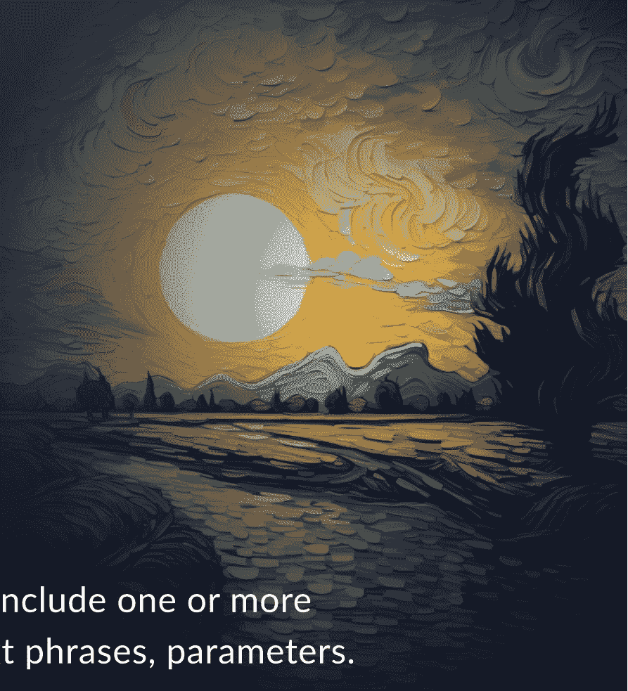
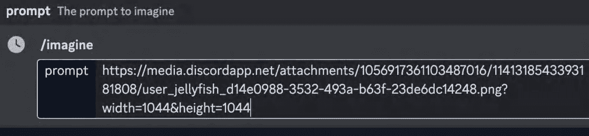
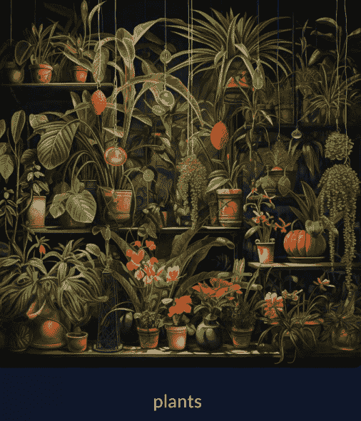
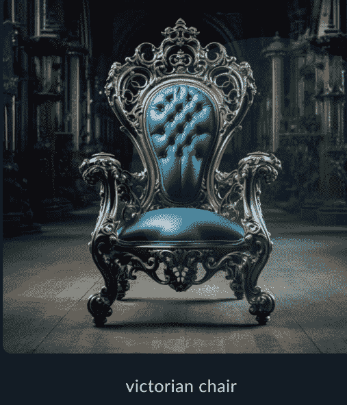
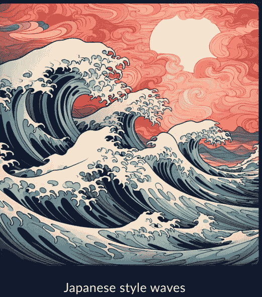

## 05 高级提示词

高级提示词可以包含一个或多个图像 URL、多个文本短语、参数。

### 图片提示词

你可以使用图片提示词来决定内容的组成。图片提示词可以单独使用，也可以与文本提示词结合，你还可以组合不同的图片。

> 提示

> 图片位于提示词的开头，你需要两张图片或图片与文本的才能生效。

> 提示

> URL 必须是在线图片的直接链接，并且应该以 `.png`、`.gif`、`.webp`、`.jpg` 或 `.jpeg` 结尾。

如果图片在手机中，你可以将其作为消息发送给 Midjourney Bot 以生成链接。

### 将图片上传到 Discord

1. 将图片链接粘贴到与 Midjourney Bot 的聊天框中并按回车发送。

2. 要获取图片链接，请根据你使用的平台遵循以下步骤：

   - 桌面端应用：右键点击图片并选择“复制链接”（不是“复制消息链接”）
   - Web 端应用：点击展开图片，然后右键点击并选择“复制图像地址”
   - 移动端应用：长按图片，然后选择“复制媒体链接”
   - 如果这些方法均无效，你可以展开图片并选择“在浏览器中打开”。最后，你可以复制并粘贴图片的 URL。

### 向提示词添加图片

1. 输入 `/imagine`
2. 将图片文件拖入提示词框以添加 URL，或在提示词框内粘贴链接。

> 提示：在 Midjourney Bot 的私信中上传图片，可以防止其他服务器的用户看到图片。如果用户没有开启隐身模式（`Stealth Mode`），图片提示词在 Midjourney 网站上是公开的。

### 示例

图片 + 图片

+

> 提示

> 使用相同宽高比例的图片可获得最佳效果。

### 示例

图片 + 文本

+ 花瓶

> 提示：使用权重参数（`Image Weight`）来调整图片与文本的重要性
