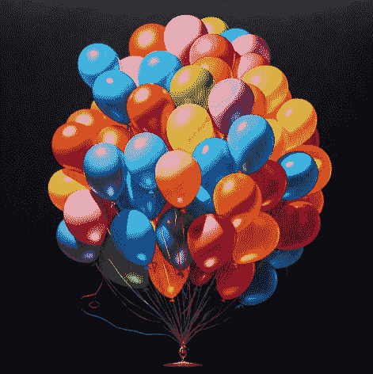
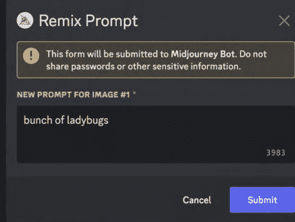
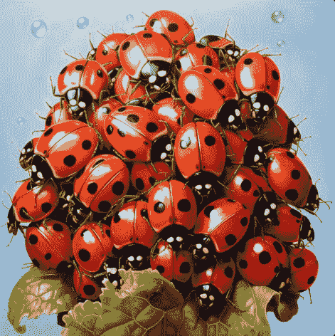

## 06 Remix 模式

你可以使用 `Remix` 模式在变体之间更改提示词、参数、模型版本或宽高比例。`Remix` 将取你初始图片的整体构图，并将其作为新任务的一部分。

> **提示** `Remix` 是一个实验性功能，这意味着它可以随时更改或移除。

### 使用 Remix

通过`/prefer remix`命令或使用`/settings`命令并切换 `Remix` 按钮来激活 `Remix` 模式。`Remix` 会改变变体按钮（V1, V2, V3, V4）的行为，并允许你在每次变体时编辑提示词。

要对放大（`upscale`）图片进行 `Remix`，请选择 `Vary`。

> 提示

> 完成 `Remix` 后，使用 `/settings` 或 `/prefer remix` 命令将其关闭。

提示词

一大束气球

修改或输入新提示词

结果
