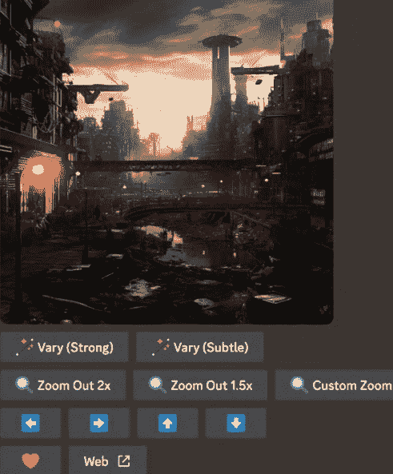
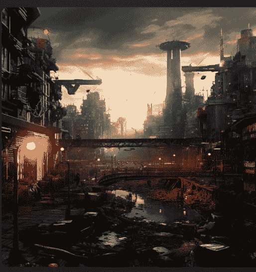
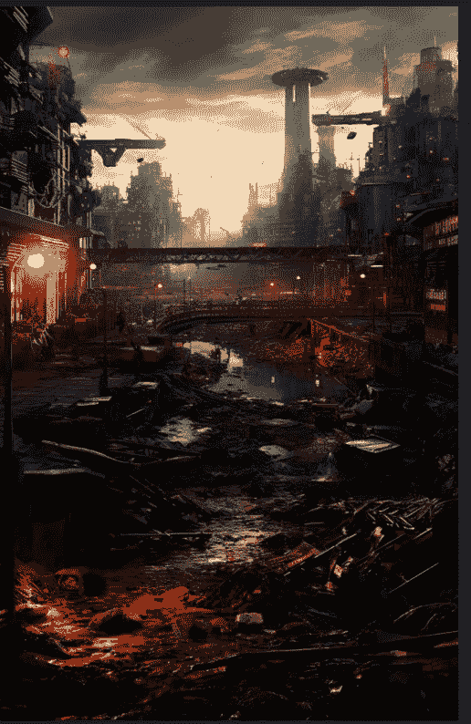
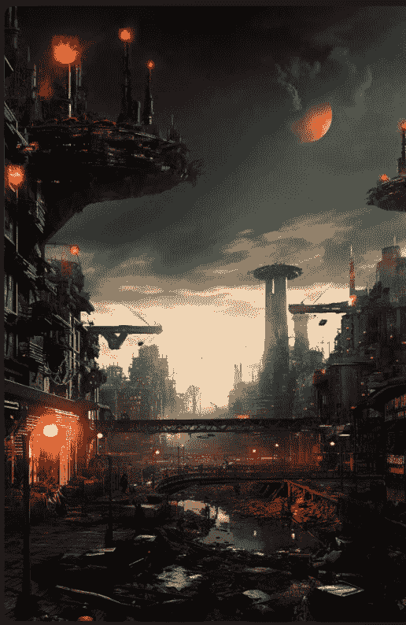
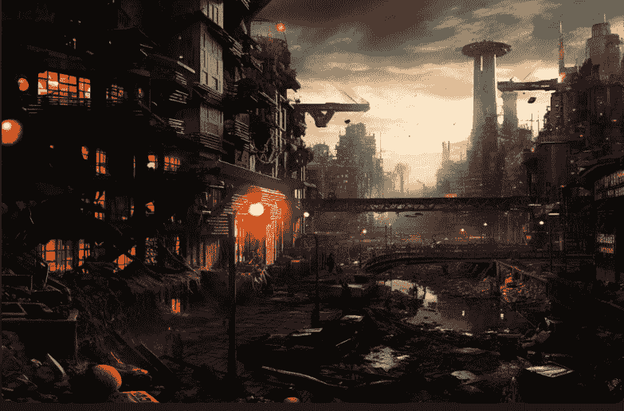
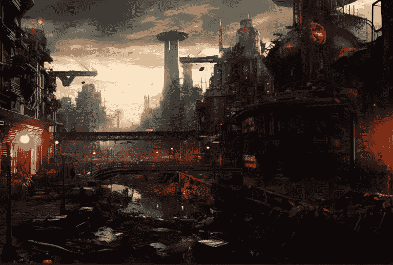
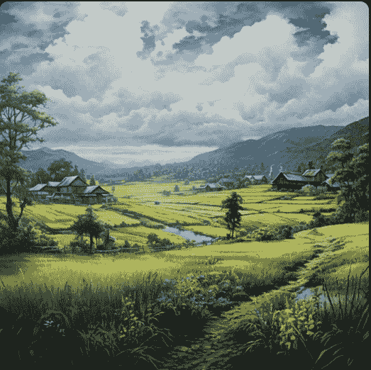
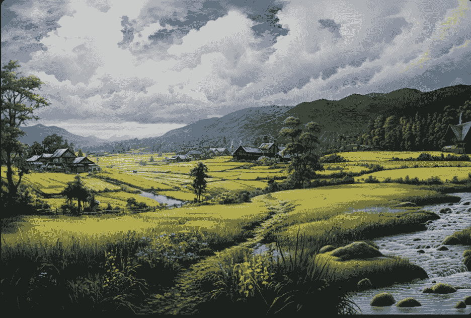

## 08 Pan（平移）选项

`Pan` 功能允许你在特定方向上拉伸图片，同时保持原始内容完整。

### 平移图片

`Pan` 按钮在放大图片后出现。在平移过程中，图片的新部分由提示词和最近的 512 像素决定。



提示词

末日后的城市

起始图片




# 平移 ↔

# 平移 ↕





# 平移 ↘



# 平移 ➡



> **提示**

> 一旦你在特定方向上平移了图片，你就被限制只能在相同方向（水平/垂直）上继续平移。你可以自由执行多次连续平移。然而，如果你执行多次且图片尺寸大到无法直接在 Discord 上分享，将为你提供图片的链接。

## Remix 模式下的 Pan

在 Remix 模式下 Pan 允许你在平移时更改提示词。



| 提示词 | |
| :--- | :--- |
| 乡村风景 | |

```
向右移动
此表单将提交给 Midjourney Bot。不要共享密码或其他敏感信息。
带新提示词的平移 *
乡村河流
3983
取消 提交
```


