# 1 生成式 AI 简介

## 在 Discord 上加入我们的书籍社区

[`packt.link/EarlyAccess`](https://packt.link/EarlyAccess)

你好！欢迎来到*ChatGPT 和 OpenAI 终极指南！*在本书中，我们将探索迷人的`生成式人工智能`（`GAI`）世界及其突破性的应用。生成式 AI 改变了我们与机器交互的方式，使计算机能够在没有显式人类指令的情况下创建、预测和学习。自 2023 年 11 月`ChatGPT`发布以来，我们见证了自然语言处理、图像和视频合成以及许多其他领域前所未有的进步。无论您是好奇的初学者还是经验丰富的从业者，本指南都将为您提供知识和技能，帮助您在激动人心的生成式 AI 领域中穿行。因此，让我们深入研究，从我们所处环境的一些定义开始。

本章提供了生成式 AI 领域的概述，该领域由使用`机器学习`（`ML`）算法创建新的独特数据或内容组成。

它重点关注生成式 AI 在各个领域的应用，如图像合成、文本生成和音乐创作，强调了生成式 AI 变革各行业的潜力。这一关于生成式 AI 的介绍将为该技术的所在位置提供背景，以及将其置于广阔的 AI、ML 和`深度学习`（`DL`）世界中的知识。然后，我们将通过具体的示例和近期进展，深入探讨生成式 AI 的主要应用领域，让您可以熟悉它对企业和整个社会可能产生的影响。

此外，了解通往当前生成式 AI 领先水平的研究历程，将让您能够更好地理解近期进展和顶尖模型的基础。

对于所有这些内容，我们将涵盖以下主题：

* 理解生成式 AI
* 探索生成式 AI 的领域
* 生成式 AI 研究的历史和现状

在本章结束时，您将熟悉生成式 AI 这一激动人心的世界、它的应用、背后的研究历史以及现状，这些发展可能已经且目前正在对企业产生颠覆性的影响。

## 介绍生成式 AI

AI 近年来一直取得了显著进展，其中增长相当大的领域之一就是生成式 AI。生成式 AI 是 AI 和 DL 的子领域，侧重于使用 ML 技术在现有数据上训练算法和模型来生成新内容，如图像、文本、音乐和视频。

为了更好地理解 AI、ML、DL 和生成式 AI 之间的关系，请将 AI 视为基础，而 ML、DL 和生成式 AI 代表了日益专业和专注的研究与应用领域：

* AI 代表创建可以执行任务的系统的广泛领域，展示出人类的智能和能力，并能够与生态系统交互。
* ML 是一个分支，专注于创建算法和模型，使这些系统能够随着时间和训练而进行自我学习和改进。ML 模型从现有数据中学习，并随着增长自动更新其参数。
* DL 是 ML 的一个子分支，因为它包含了深度 ML 模型。这些深度模型被称为`神经网络`，特别适用于训练应用或自然语言处理（`NLP`）等领域。当我们谈论 ML 和 DL 模型时，通常指的是判别式模型，其目标是在数据之上进行预测或推断模式。
* 最后，我们得到了生成式 AI，它是 DL 的进一步子分支，它不使用深度人工神经网络对现有数据进行聚类、分类或预测：它使用那些强大的人工神经网络模型来生成全新的内容，从图像到自然语言，从音乐到视频。

接下来的图表显示了这些研究领域之间的相互关系：

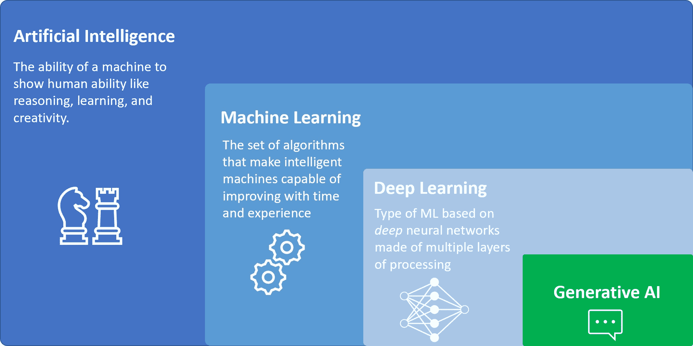

图 1.1 – AI、ML、DL 和生成式 AI 的关系

生成式 AI 模型可以在海量数据上进行训练，然后它们可以根据数据中的模式生成新的示例。这种生成过程与判别式模型不同，后者的目标是预测给定示例的类别或有标签输出。

具有生成式 AI 特性的神经网络类型被称为大基础模型（LFMs），对于`ChatGPT`这样的语言模型，我们称之为`大语言模型`（LLMs）。

> **大语言模型**是一种以 Transformer 架构为特征的人工神经网络。它们的特点是具有海量的参数（以万亿计），并已在数十亿词汇上进行过训练。给定训练集，LLMs 能够理解并生成自然语言。

尽管文本理解和生成可能是生成式 AI 最突出的特征之一，但该领域涵盖了许多领域。

### 生成式 AI 的领域

近年来，生成式 AI 取得了显著进展，并将其应用扩展到广泛的领域，如艺术、音乐、时尚、建筑等。在某些领域中，它确实改变了我们创造、设计和理解周围世界的方式。在其他领域，它正在改进并使现有的流程和操作更加高效。

生成式 AI 被应用于许多领域这一事实意味着它的模型可以处理不同类型的数据，从语言到音频或图像。让我们了解生成式 AI 如何处理不同类型的数据和领域。

### 文本生成

生成生成式 AI 的最大应用之一（也是我们在书中涵盖最多的部分）是它在自然语言产生新内容的能力。事实上，生成式 AI 算法可以用于生成新的文本，如文章、诗歌和产品描述。

例如，由 OpenAI 开发的 `GPT-4o` 等语言模型可以在生成文本数据上进行训练，然后用于生成不同语言（包括输入和输出）的新的、连贯且符合语法的文本，并从文本中提取相关特征，如关键词、主题或全文摘要。

以下是一个使用 GPT-3 的示例：

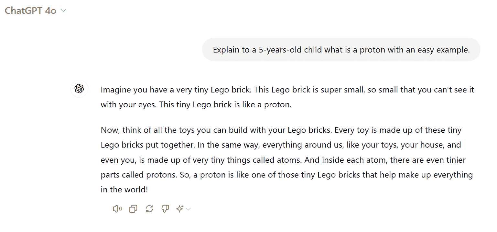

图 1.2 – ChatGPT 响应用户提示的示例，并添加了引用

接下来，我们将转向图像生成。

## 图像生成

生成式 AI 在图像合成领域最早且最为人知的例子之一，是 I. Goodfellow 等人在 2014 年的论文《生成对抗网络》（*Generative Adversarial Networks*）中引入的`生成对抗网络`（`GAN`）架构。`GAN` 的目的是生成与真实图像无区分的真实图像。这种能力具有许多有趣的业务应用，例如为训练计算机视觉模型生成合成数据集、生成真实的商品图像，以及为虚拟现实和增强现实应用生成真实的图像。

以下是一些并不存在的人脸示例，因为它们完全是由 AI 生成的：

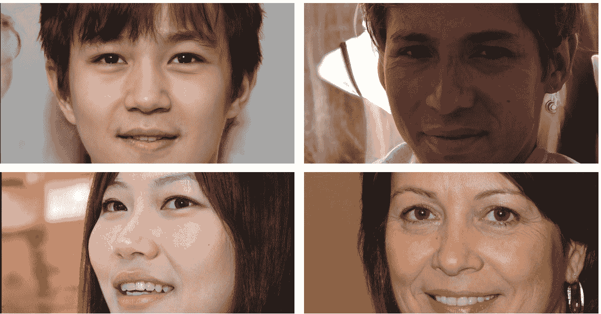

图 1.3 – 在 `https://this-person-does-not-exist.com/en` 由 `GAN StyleGAN2` 生成的虚构脸庞

然后，2021 年，OpenAI 在该领域引入了新的生成式 AI 模型 `DALL-E`。与 `GANs` 不同，`DALL-E` 模型设计用于根据自然语言描述生成图像（`GANs` 以随机噪声向量输入），并可以生成广泛的图像，这些图像可能并不看起来真实，但仍描绘所需的概念。

`DALL-E` 在广告、产品设计和时尚等创意产业中具有巨大的潜力，可以创建独特且创意的图像。

自首次发布以来（2024 年 12 月），`DALL-E` 有了巨大的改进，如下例所示。让我们看看下文由 `DALL-E` 在其诞生之初创作的一件艺术作品：

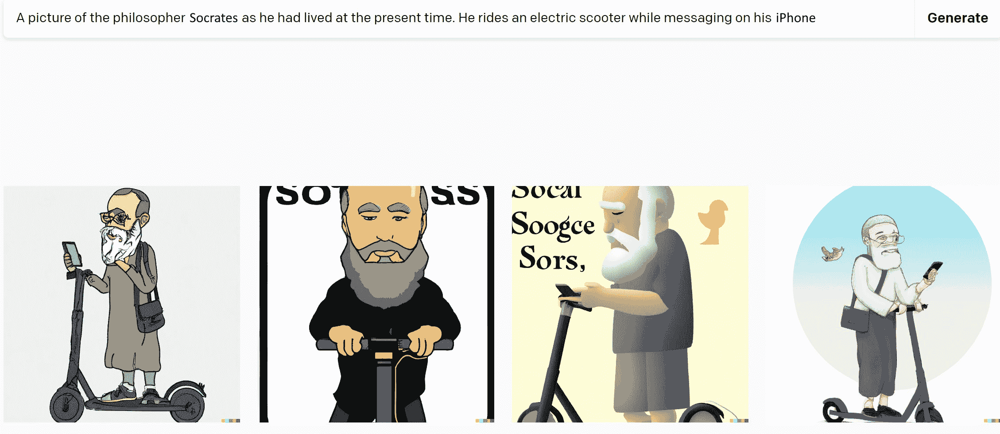

图 1.4 – 以自然语言提示作为输入 `DALL-E` 生成的图像

现在让我们看看 `DALL-E3`（本书编写时的最新版本）可以产生什么（在这里我使用了 Microsoft Image Creator，你可以在 [`copilot.microsoft.com/images/create`](https://copilot.microsoft.com/images/create) 尝试它）：

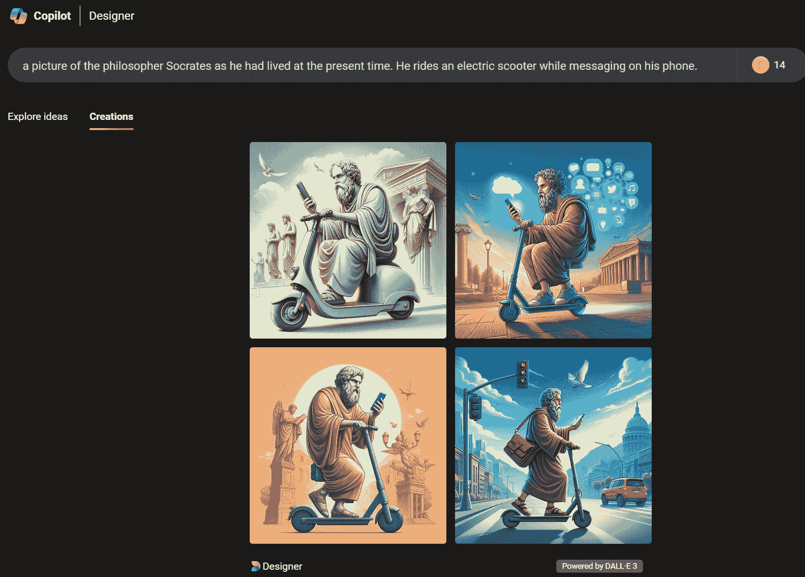

图 1.5 – 以自然语言提示作为输入 `DALL-E3` 生成的图像

看到这个模型在不到 18 个月内的改进水平令人印象深刻。有趣的是，我们仅仅接触到了过去几个月生成式 AI 领域发生的巨大改进的冰山一角。

## 音乐生成

音乐生成的生成式 AI 早期方法可以追溯到 50 年代，源于算法作曲领域的研究，这是一种使用算法生成音乐作曲的技术。事实上，1957 年，Lejaren Hiller 和 Leonard Isaacson 创建了《伊利亚克弦乐四重奏》（Illiac Suite for String Quartet）（[`www.youtube.com/watch?v=n0njBFLQSk8`](https://www.youtube.com/watch?v=n0njBFLQSk8)），这是第一首完全由 AI 作曲的音乐。以来，音乐生成式 AI 一直是几十年来持续的研究课题。在近年的发展中，新的架构和框架已经在公众中普及，例如 Google 在 2016 年引入的 `WaveNet` 架构，它能够生成高质量的音频样本；或者同样由 Google 开发的 `Magenta` 项目，它使用循环神经网络（`RNNs`）和其他机器学习技术来生成音乐和其他艺术形式。然后，在 2020 年，OpenAI 也宣布了 `Jukebox`，这是一种生成音乐的神经网络，可以在风格、流派、参考艺术家等方面进行自定义。

这些和其他框架构成了许多用于音乐生成的 AI 作曲助手的基础。例如是由 Sony CSL Research 开发的 `Flow Machines`。这个生成式 AI 系统在大型音乐作品数据库上进行训练，以创建各种风格的新音乐。它被法国作曲家 Benoît Carré 用于创作一张名为 *Hello World* 的专辑（[`www.helloworldalbum.net/`](https://www.helloworldalbum.net/)），该专辑包含了与多位人类音乐家的合作。

在这里，你可以看到完全由 `Music Transformer` 生成的曲目示例，它是 `Magenta` 项目中的模型之一：

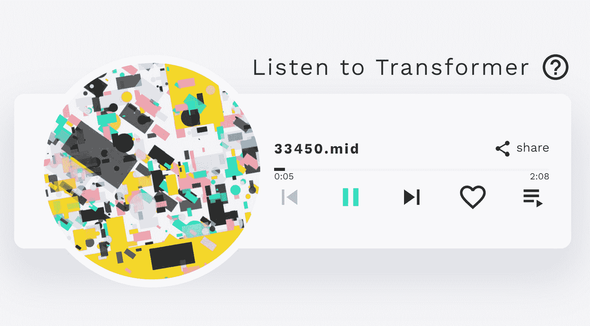

图 1.6 – `Music Transformer` 允许用户收听 AI 生成的音乐表演

音乐领域中生成式 AI 的另一个惊人应用是语音合成。确实可以找到许多 AI 工具，根据文本输入以知名歌手的声音创建音频。

例如，如果你一直想知道你的歌曲由凯尼·韦斯特演唱是什么样，甚至可以使用 `FakeYou.com`（[`fakeyou.com/`](https://fakeyou.com/)）或 `UberDuck.ai`（[`uberduck.ai/`](https://uberduck.ai/)）来试验：

图 1.7 – 使用 UberDuck.ai 进行语音合成

我必须说，结果非常令人印象深刻。如果你想玩玩，还可以尝试你最喜爱的卡通声音，例如维尼的配音……让我们更进一步。如果我们能从零开始生成一首歌，只需让生成式 AI 这样做会怎样？嗯，现在我们可以无缝地做到，而无需任何音乐知识。在音乐市场兴起的生成式 AI 产品中，一个好的例子是 `Suno`，它的使命是“……我们正在建立一个任何人都能创作绝佳音乐的未来。无论你是浴室歌手还是榜单艺术家，我们都打破了你与梦想歌曲之间的障碍。不需要乐器，只需要想象力。”（来源：[`suno.com/about`](https://suno.com/about)）。

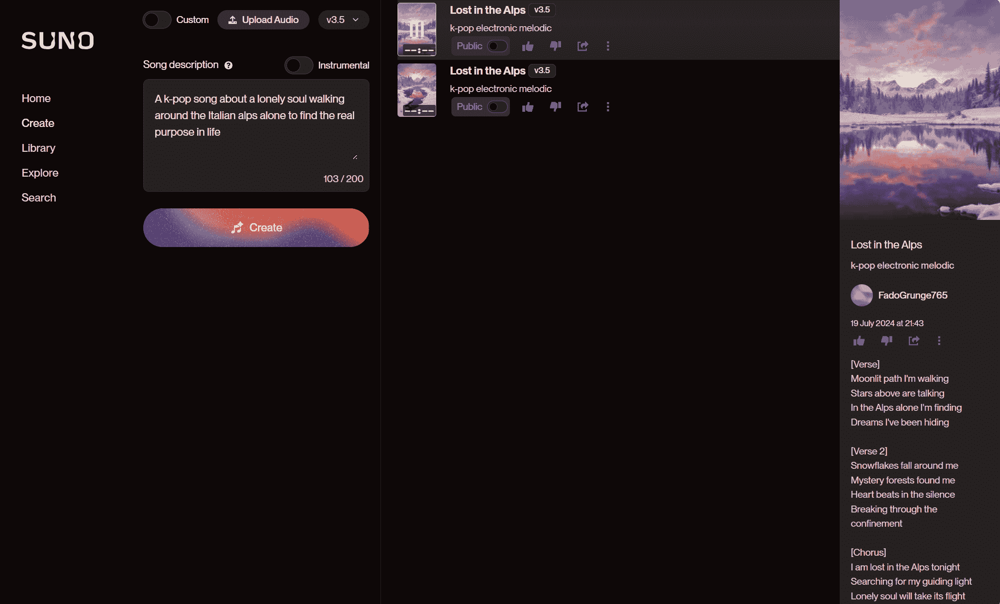

你能相信这成了我 2024 年夏季的热单吗？如果你也想创作自己的夏季热门单曲，可以在 [`suno.com/create`](https://suno.com/create) 免费尝试。

## 视频生成

视频生成的生成式 AI 在发展时间线上与图像生成相似。事实上，视频生成领域的一个关键进展之一是生成对抗网络的发展发展。得益于它们在生成真实图像方面的准确性，研究人员已开始将这些技术应用于视频生成。基于 `GAN` 的视频生成的著名例子之一是 DeepMind 的 `Motion to Video`，它从单张图像生成高质量视频。另一个很棒的例子是 NVIDIA 的视频转视频合成（`Vid2Vid`）深度学习框架，它使用 `GANs` 从输入视频合成生成高质量视频。

`Vid2Vid` 系统能够生成时间一致的视频，这意味着它们在时间推移过程中保持平滑且真实的运动。该技术可以执行各种视频合成任务，例如：

*   将视频转换为另一个领域（例如将白天视频转换为夜晚视频，或将素描转换为真实的图像）
*   修改现有视频（例如，更改视频中对象的样式或外观）
*   从静态图像创建新视频（例如，使一系列静态图像动画化）

2022 年 9 月，Meta 的研究人员宣布了 `Make-A-Video`（[`makeavideo.studio/`](https://makeavideo.studio/)）的开放可用，这是一种新的 AI 系统，允许用户将自然语言提示转换为视频片段。在这些技术背后，你可以识别出我们到目前为止在其他领域提到的许多模型：用于提示的语言理解、结合图像生成实现的图像和生成运动生成，以及由 AI 作曲家制作背景音乐。

现在，我们上面提到的所有内容与最新的文本转视频模型相比都相形猔拙。例如，OpenAI 在 2024 年 2 月宣布了一种名为 `SORA` 的新型文本到视频模型，并发布了一些出乎意料的早期实验：

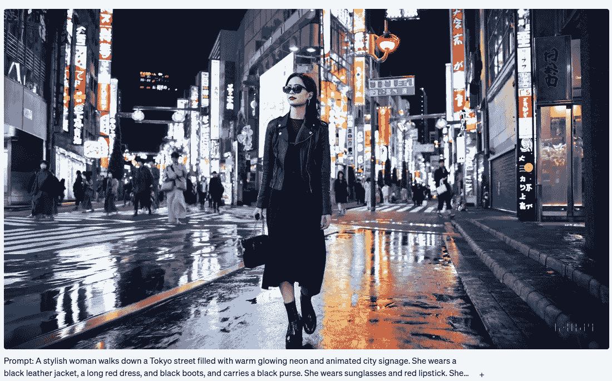

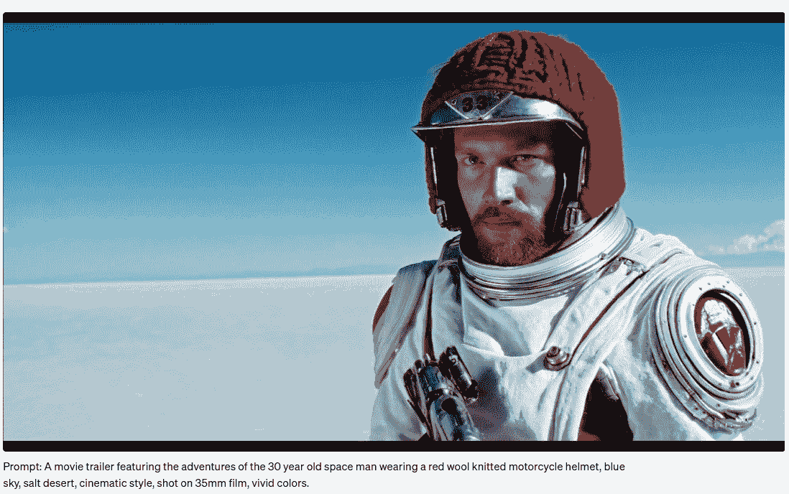

图 1：根据自然语言提示由 SORA 生成的视频。来源：`https://openai.com/index/sora/`

我非常建议你访问 `SORA` 网页查看它创建的惊人视频。在撰写本文时，`SORA` 尚未公开可用，因为它正在接受 OpenAI 红队运行的多项测试。

总的来说，生成式 AI 多年来影响了许多领域，某些 AI 工具已经能够持续支持艺术家、机构和普通用户。未来看起来非常有前景；然而，在跳转到目前市场上最顶尖的模型之前，我们首先需要深入了解生成式 AI 的根源、其研究历史以及最终导致当前 OpenAI 模型的最新进展。

## 研究的历史与现状

在之前的章节中，我们概述了生成式 AI 领域最新、最前沿的技术，这些都是在几年内开发的。然而，该领域的研究可以追溯到几十年前。

我们可以将生成式 AI 领域研究的起点标记在 20 世纪 60 年代，当时 Joseph Weizenbaum 开发了聊天机器人 `ELIZA`，这是 NLP（自然语言处理）系统的早期示例之一。它是一个基于规则的简单交互系统，旨在根据文本输入的响应与用户进行交互，为 NLP 和生成式 AI 的进一步发展铺平了道路。然而，我们知道现代生成式 AI 是深度学习（DL）的一个子领域，尽管第一个人工神经网络（`ANNs`）早在 20 世纪 40 年代就被引入，但研究人员面临着许多挑战，包括计算能力有限以及对大脑生物基础缺乏了解。因此，`ANNs` 直到 20 世纪 80 年代才获得广泛关注，当时除新硬件和神经科学的发展外，`backpropagation`（反向传播）算法的出现也促进了`ANNs`的训练阶段。事实上，在反向传播出现之前，训练神经网络是非常困难的，因为无法高效地计算误差相对于每个神经元的参数或权重的梯度，而 `backpropagation` 使得自动化训练过程成为可能，并实现了 `ANNs` 的应用。

随后，到 2000 年代和 2010 年代，计算能力的提升加剧了海量的可用训练数据，使得深度学习更具实用性并对公众开放，随之推动了研究的增长。

2013 年，Kingma 和 Welling 在他们的论文 `Auto-Encoding Variational Bayes`中引入了一种新的模型架构，被称为`变分自动编码器`（`VAEs`）。`VAEs` 是基于变分推理概念的生成模型。它们提供了一种通过数据的紧凑表示进行学习的方法，将数据编码到低维空间（称为`潜空间`，通过 `encoder` 编码器组件），然后将其解码回原始数据空间（通过 `decoder` 解码器组件）。

`VAEs` 的关键创新在于引入了`潜空间`的概率解释。`encoder` 不再学习输入到`潜空间`的确定性映射，而是将输入映射到`潜空间`上的概率分布。这使得 `VAEs` 可以通过从`潜空间`中采样并将样本解码到输入空间来生成新样本。

例如，假设我们想训练一个 `VAE`，它可以创建看起来像真实的猫和狗的新图片。

为了做到这一点，`VAE` 首先接收一张猫或狗的照片，将其压缩成一组较小的数字，这些数字代表了图片最重要的特征。这些数字被称为`潜变量`。

然后，`VAE` 获取这些`潜变量`并使用它们创建一张看起来像真实的猫或狗的照片。这张新图片可能与原始消息有些不同之处，但它看起来应该属于同一组图片。

`VAE` 随着时间的推移，通过将其生成的图片与真实图片进行比较并调整其`潜变量`，使生成的图片看起来更真实，从而得到提升。

# 生成式 AI 的演进与现状

`VAEs` 为生成式 AI 领域的快速发展铺平了道路。事实上，仅 1 年后，Ian Goodfellow 就引入了 `GANs`（生成对抗网络）。与主要元素为 `encoder` 和 `decoder` 的 `VAEs` 架构不同，`GANs` 由两个组成——`generator`（生成器）和 `discriminator`（判别器）——它们在了一个零和博弈中相互对抗。

`generator` 创建伪数据（对于图像而言，它创建一张新图像），目的是看起来像真实数据（例如，猫的照片）。`discriminator` 接收真实数据和伪数据，并试图区分它们——在我们艺术伪造者的例子中它就是 `critic`（评论家）。

在训练期间，`generator` 尝试创建能够欺骗 `discriminator` 认为其为真实的数据，而 `discriminator` 则试图变得更好地区分真伪数据。这两个部分在一个被称为`对抗训练`（adversarial training）的过程中被共同训练。

随着时间的推移，`generator`越来越擅长创建看起来像真实数据的伪数据，而 `discriminator` 越来越擅长区分真伪数据。最终，`generator` 创建伪数据的能力变得非常强大，以至于即使是 `discriminator` 也无法区分真伪数据。

这是一个完全由 `GAN` 生成的人脸示例：

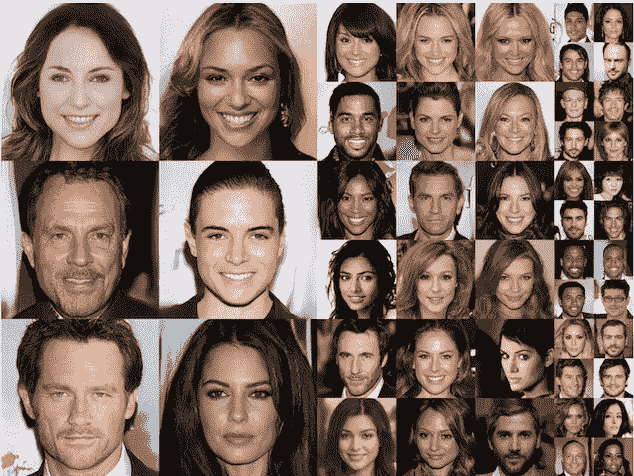

图 1.8 – GAN 生成的写实脸（取自 Progressive Growing of GANs for Improved Quality, Stability, and Variation, 2017: https://arxiv.org/pdf/1710.10196.pdf）

两种模型——`VAEs` 和 `GANs` 的目的是生成与原始样本无法区分的新数据，而且自诞生以来，它们的架构不断改进，并伴随着新模型如 Van den Oord 团队提出的 `PixelCNNs` 以及 Google DeepMind 开发的 `WaveNet` 的发展，推动了音频和语音生成的进步。

另一个伟大的里程碑是 2017 年，当时 Google 研究人员在论文中引入了一种名为 `Transformer` 的新架构——`Attention Is All You Need`。它在语言生成领域具有革命性，因为它在允许并行处理的同时保留了语言上下文的记忆，性能优于此前基于 RNN 或 `长短期记忆`（`LSTM`）框架的语言模型尝试。

`Transformer` 确实是名为 `Bidirectional Encoder Representations from Transformers`（`BERT`）的大规模语言模型的基础，该模型由 Google 于 2018 年引入，并迅速成为 NLP 实验的基准。

`Transformer` 也是 OpenAI 引入的所有 `Generative Pre-Trained`（`GPT`）模型的基础，包括 ChatGPT 背后的模型 `GPT-3`，以及其他大型基础模型（Large Foundation Models）。

尽管在这些几年取得了大量的研究和成就，但直到 2022 年下半年，公众的注意力才开始转向生成式 AI 领域。

并非巧合，2022 年被称为“生成式 AI 之年”。这一年，强大的 AI 模型和工具在普通民众中变得普及：基于扩散的图像服务（MidJourney、`DALL-E 2` 和 `Stable Diffusion`）、OpenAI 的 `ChatGPT`、文本生成视频（`Make-a-Video` 和 `Imagen Video`）以及文本生成 3D 工具（`DreamFusion`、`Magic3D` 和 `Get3D`）都向个人用户开放，有时甚至是免费的。

这产生了颠覆性的影响，原因有二：

- 一旦生成式 AI 模型在公众中普及，每个个人用户或组织都有可能尝试并欣赏其潜力，即使他们不是数据科学家或 ML 工程师。
- 这些新模型的输出及其嵌入的创造力在客观上是令人惊叹的，而且往往令人担忧。一种针对个人和政府的、适应变革的紧迫呼声随之而起。

因此，在不久的将来，我们可能会见证个人使用和企业级项目采用 AI 系统的激增。

# 18 个月后：主要趋势与创新

从 2022 年 11 月到今天，我们见证了生成式 AI（GenAI）领域海量的创新。这些创新许多与向公众开发并发布的全新模型有关，例如 OpenAI 的 `GPT-4o` 和 `DALL-E3`，以及 Google 的 `Gemini`、Meta 的 `Llama 3`、微软的 `Phi3` 等。

然而，最引注目的成就可能在于我们与这些模型交互以及围绕它们构建应用程序的方式。在本节中，我们将探索标记了生成式 AI 应用最流行的参考架构的三大主要进展。

## 检索增强生成（Retrieval Augmented Generation）

`ChatGPT` 以及广义上的 `LLMs` 的早期局限性之一是知识库截止。事实上，`LLMs` 的知识局限于它们训练过的训练集（由互联网上的公共信息组成），只要这些信息不是详尽的，它们就是过时的。此外，它们还缺少可能与我们或我们的组织相关的私有知识库。例如，如果你问 `ChatGPT` “我们公司员工健康保险的政策是什么？”，模型将无法回答，因为它无法访问这些信息。

为了绕过这一局限，设计了一种新框架，允许 `LLMs` 导航我们提供的自定义文档。这个框架被称为检索增强生成（`RAG`）。

`RAG` 背后的思想是将 `LLM` 与我们想要导航的知识库解耦。为了实现这一点，外部知识库需要通过一个名为 `embedding`（嵌入）的过程转换为数值向量，并存储在专门的 `Vector Database`（向量数据库）中。

> 嵌入是在低维空间（如向量）中表示高维非数值数据（如单词或句子）的方法。文本嵌入可以捕捉文本的语义和语法特征，例如含义、上下文和相似性。

> 每个嵌入都是一个浮点数向量，使得向量空间中两个嵌入之间的距离与原始格式中两个输入之间的语义相似性相关。

例如，如果两个概念相似，那么它们的向量表示也相似的。

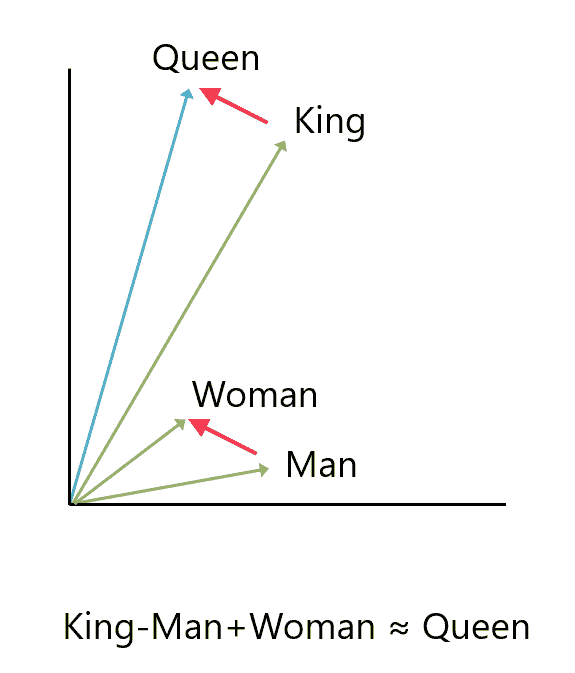

`RAG` 由三个阶段组成：

- **检索（Retrieval）**：给定用户的查询及其对应的向量，检索出最相似的文档片段（那些对应的向量接近用户查询向量的片段），并将其作为 `LLM` 的基础上下文。

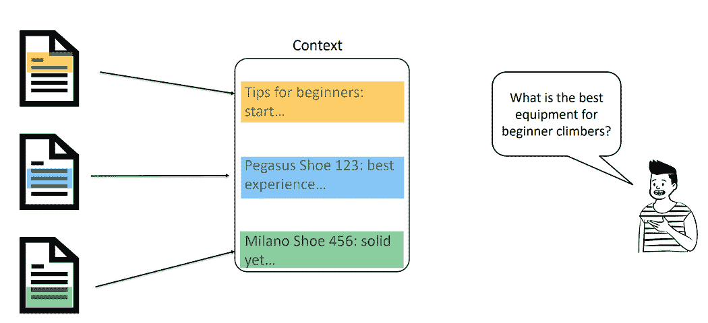

- **增强（Augmentation）**：通过额外的指令、规则、安全护栏以及类似于提示词工程（prompt engineering）技术的典型实践来丰富检索到的上下文（我们将在第 3 章中介绍提示词工程主题）。

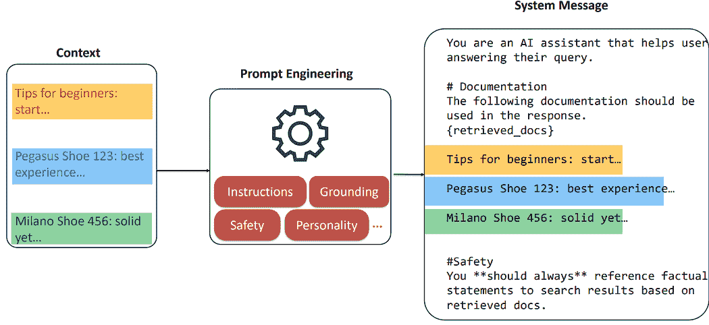

- **生成（Generation）**：基于增强的上下文，`LLM` 生成对用户查询的响应。

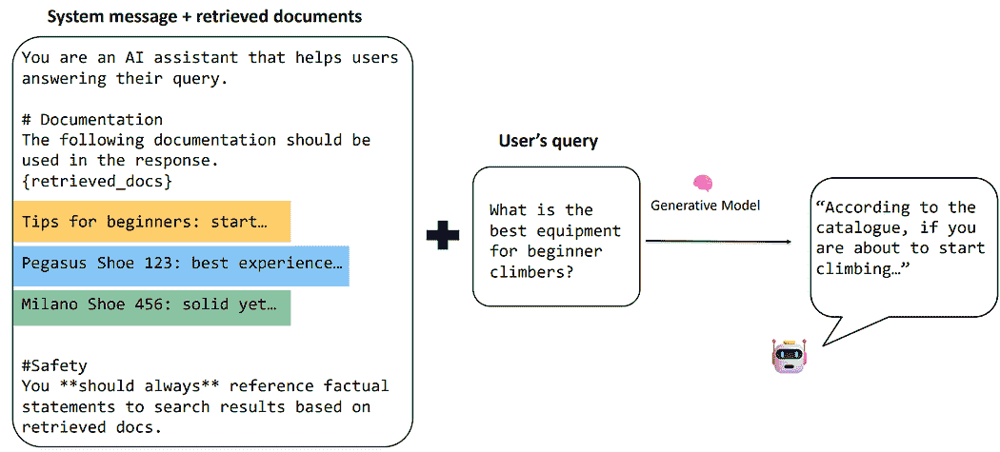

整个流程如下：

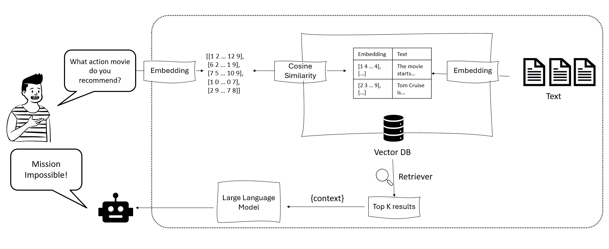

`RAG` 结合了生成式模型和信息检索系统的优势，以增强生成内容的质量和相关性。传统的生成式模型仅依赖其训练数据来产生响应，这有时会导致过时或无关的信息。`RAG` 通过在生成过程中整合外部知识库解决了这一局限性。

例如，OpenAI 的 `ChatGPT` 在通过 `RAG` 增强后，可以从可靠源获取当前数据，以回答关于近期事件的查询，这本属于其训练截止的范围。这种检索与生成的协同扩大了生成式 AI 的适用性，使其在动态、信息丰富的环境中更加稳健和实用。

## 多模态性（Multimodality）

在本章的第一段，我们看到了生成式 AI 的各个领域，从文本到图像，从视频到音乐。通常，大型基础模型倾向于特定领域，正如我们在语言理解和生成领域的大型语言模型（LLMs），或图像生成领域的 `DALL-E3` 中看到的那样。

然而，生成式 AI 的最新进展使得大型多模态模型（`LMMs`）成为可能，它们可以处理和生成不同类型的数据，如文本、图像、音频和视频。

`LMMs` 与“标准”大型语言模型（`LLMs`）共享大型基础模型典型的泛化和适应能力。然而，`LMMs` 能够处理异构数据，其理念是镜像人类与周围生态系统交互的方式——即通过我们所有的感官。

多模态模型的一个很好的例子是 OpenAI 的 `GPT-4o`，它能够通过文本、图像和音频与用户交互。让我们来看例子：

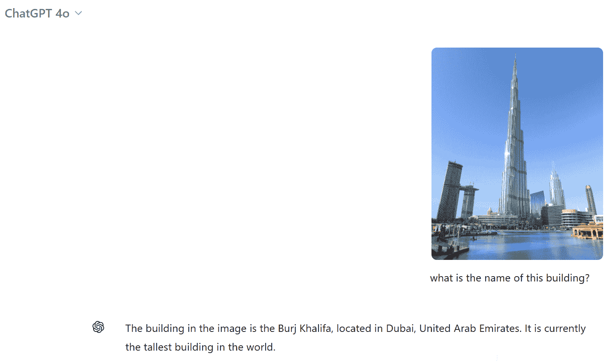

如你所示，模型能够分析图像并对其进行推理。现在让我们让模型生成一张插图：

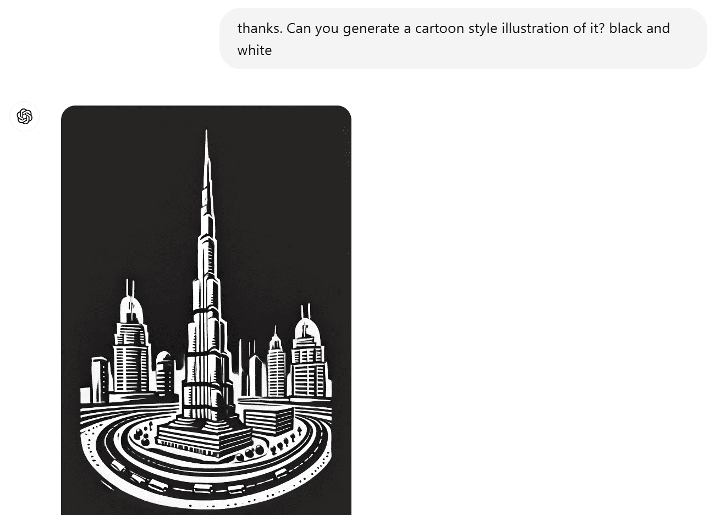

关于 `LMMs` 最有趣的事实是，它们保留了推理能力，使得它们适用于异构数据语境下的复杂推理。让我们考虑最后这个例子（仅显示响应的前几行）：

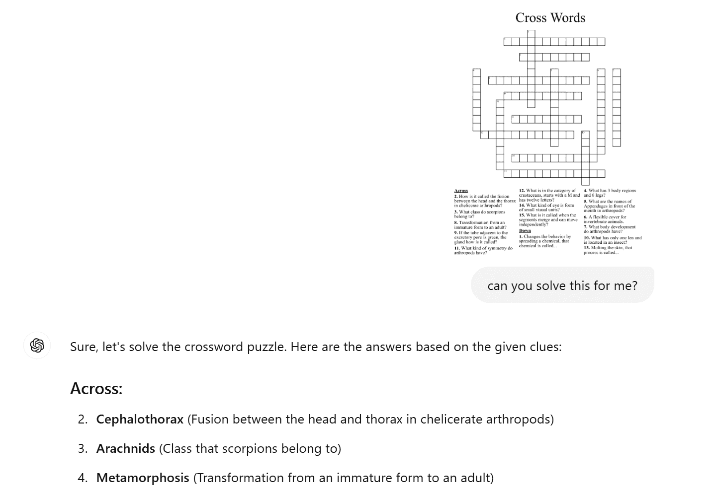

正如你所想象的，这为各个行业开启了应用前景，我们将在后续章节中看到一些示例。

## AI 代理（AI Agents）

在之前的节中，我们揭示了 `LFMs` 在共鸣和生成内容方面表现出色。然而，它们缺乏一种能力，即超越单个用户采取行动并与周围生态系统交互的能力。例如，如果我们希望 `LLM` 不仅能生成一条出色的 LinkedIn 帖子，还能将其发布在我们的页面上，呢？

为了克服这一局限性，AI 代理（AI agents）成为了关键角色。但它们究竟是什么呢？代理可以被看作是由大语言模型（LLM）驱动的 AI 系统，根据用户的查询，它们能够在我们允许范围内与周围的生态系统进行交互。生态系统的边界由我们为代理提供的工具（或插件）决定（在我们之前的示例中，我们可能会为代理提供一个 LinkedIn 插件，以便它能够发布生成的内容）。

代理体由以下要素组成：

- 一个作为 AI 系统推理引擎的 LLM（大语言模型）。
- 一条系统消息（system message），用于指示代理以特定的方式行为和思考。例如，你可以将一个代理体设计为学生的助教，并带有如下系统消息：“你是一个助教。给定学生的查询，**永远**提供最终答案，而是提供一些提示来帮助他们获得答案”。
- 一组代理可以利用其与周围生态系统进行交互的工具。

AI 代理体是“LLM 作为应用程序推理引擎”这一含义的完美体现。事实上，代理体的优之处在于，它们可以选择最合适的工具来完成用户的请求。例如，假设我们有一个用于生成 LinkedIn 内容的 AI 代理，并为其提供了两个工具：一个 LinkedIn 插件和一个网络搜索插件（每个插件都对其功能有适当的描述）。然后，让我们探索代理面对两个不同问题时的行为：

- 生成一个关于小狗在山间散步的故事 → 代理将在不涉及任何插件的情况下生成故事。
- 生成一个关于米兰当前天气的故事 → 代理将调用网络搜索插件获取米兰当前的天气。
- 生成一个关于米兰当前天气的 LinkedIn 帖子并发布在我的个人页上：代理将调用网络搜索插件获取米兰当前的天气，并调用 LinkedIn 插件将其发布到我的个人页。

指令和插件集的组合使得 AI 代理体极其多功能，你可以创建高度特化的实体来应对特定场景。

而且不仅于此。

既然你可以创建一个相互对话和协作的代理体团队，为什么要只用一个代理呢？想象一下多个代理，每个都有特定的专业知识和目标，它们之间相互通信和交互以完成任务。这就是`多代理应用`（multi-agent applications）的模样，在过去的几个月里，这种模式开始表现出涌现行为。

让我们考虑以下示例。我们想生成一个关于气候变化的电梯演讲（elevator pitch）。我们需要更新信息来完成（最新趋势和研究、未来展望等），以及基于学术论文的坚实研究。此外，我们需要保持简洁、敏锐且高效，在非常短的演讲中交付所有关键信息。

现在，我们可以向单个代理提出所有要求，为它提供所有需要的工具和长长的指令来完成任务。然而，事实证明，当我们给 LLM 安排“太多的要做的事情”时，它们的表现往往会变差。相反，让我们使用多代理方法，创建一个由以下 AI 专业人士组成的团队：

- 一个市场分析师，可以在网络上搜索有关气候变化的最新新闻；这将是一个拥有网络搜索插件和特定搜索指令的代理；
- 一个专家研究员，可以轻松查阅关于气候变化的学术论文；这将是一个拥有 `Arxiv` 插件和如何检索相关信息特定指令的代理；
- 一个演讲专家，可以轻松地将所有信息整合进一个电梯演讲中；这将是一个拥有如何进行完美演讲的恰当指令的代理；
- 一个批评者，将审查演讲并在需要时向演讲专家提出修改建议；这将是一个拥有如何进行完美演讲的恰当指令的代理；

因此，当用户提问“生成一个关于当前气候变化问题的电梯演讲”时，所有代理都可以开始开展该项目。

有很多框架可以帮助开发者构建多代理应用（包括 `AutoGen`、`LangGraph`、`CrewAI`），特别是涉及到我们希望代理遵循的“流程”时。例如，我们可能希望强制特定的迭代次数；或者所有代理至少被调用一次；或者甚至让我们作为用户参与每次迭代，提供进一步的反馈并将其整合到下次迭代中。

在编写此时，多代理框架显示出广阔的进展，但它仍然处于实验阶段，可能远未达到企业级水平。尽管如此，它是 LLM 后方卓越推理能力的一种瞥，展示了它们如何开启解决问题和创造的新方法。

## 小语言模型

大语言模型名如其义非常大。这意味着包含 LLM 的人工神经网络架构由海量参数组成，数量级达数万亿。理想情况下，参数数量越高，LLM 的推理能力越强。然而，高参数量也意味着高昂的训练和托管成本，因为需要强大的 AI 基础设施。此外，这些模型消耗的能源引发了关于 LLM 训练对环境的影响及其长期可持续性的严肃问题。为了让你有一个直观的概念，以下是与不同规模（以参数数量衡量）的开源 LLM 相关的一些数字：

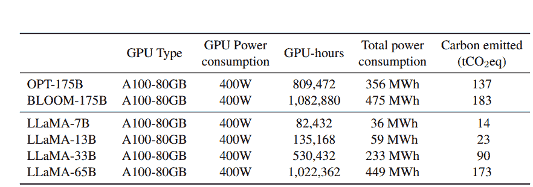

图 2：在同一数据中心训练不同模型所需的碳足迹和算力。来源：https://arxiv.org/pdf/2302.13971

幸运的是，在过去的几个月里，我们见证了对小模型研究兴趣和投入的增加，目标是在保持良好推理能力的同时减少参数数量。这种理念是，小模型即使“智能程度较低”，但如果专注于特定的活动，仍然可以满足需求。

这些较小的模型被称为小语言模型（SMLs），除了对基础设施的要求更轻、更低之外，它们还表现出了惊人的性能。

例如，如果我们考虑 `Phi-3` 的较小版本（微软开发的流行的 SLM 家族的一部分），它仅有 70 亿参数，我们可以看到它在所有最流行的 LLM 基准测试中都胜过了 `GPT-3.5-turbo`：

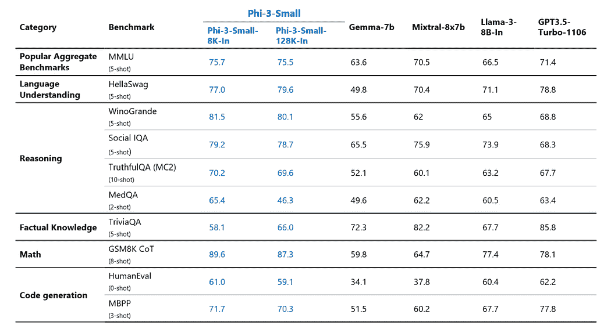

图 3：Phi-3 与其他 SLM 和 LLM 的能力对比表。来源：https://azure.microsoft.com/en-us/blog/introducing-phi-3-redefining-whats-possible-with-slms/

现在，我们可能会认为 `GPT-3.5-turbo` 已经过时，但我们必须记住，凭借 1750 亿参数在一年前还是市场上最强大的模型，看到一个 70 亿的模型能够产生更好的结果是非常令人惊讶的。

SLM 领域绝对值得关注的研究方向，特别是当我可能希望在本地部署模型甚至通过微调对其进行定制的场景时（我们将在下一章介绍微调）。

在本章中，我们探索了生成式 AI 的精彩世界及其各个应用领域，包括图像生成、文本生成、音乐生成和视频生成。我们学习了由 OpenAI 训练的 `ChatGPT` 和 `DALL-E` 等生成式 AI 模型如何利用 `DL` 技术学习大型数据集中的模式，并生成既新颖又连贯的新内容。我们还讨论了生成式 AI 的历史、起源以及目前的研究现状。

本章的目标是为生成式 AI 的基础提供坚实的基础，并启发你进一步探索这一迷人的领域。

在下一章中，我们将关注目前市场上最有前景的技术之一 `ChatGPT`：我们将介绍其背后的研究以及 OpenAI 的开发过程、模型架构，以及截至目前它可以解决的主要用例。

## 参考文献

- [`arxiv.org/abs/1406.2661`](https://arxiv.org/abs/1406.2661)
- [`www.youtube.com/watch?v=Iy9vRvyRf_E`](https://www.youtube.com/watch?v=Iy9vRvyRf_E)
- [`arxiv.org/abs/1912.04958`](https://arxiv.org/abs/1912.04958)
- 这个人不存在：[`this-person-does-not-exist.com`](https://this-person-does-not-exist.com)
- [`arxiv.org/abs/1808.06601`](https://arxiv.org/abs/1808.06601)
- [`www.microsoft.com/en-us/research/blog/a-deep-generative-model-trifecta-three-advances-that-work-towards-harnessing-large-scale-power/`](https://www.microsoft.com/en-us/research/blog/a-deep-generative-)
- [`tcwang0509.github.io/vid2vid/`](https://tcwang0509.github.io/vid2vid/)
- [`arxiv.org/pdf/2302.13971`](https://arxiv.org/pdf/2302.13971)

* [`azure.microsoft.com/en-us/blog/introducing-phi-3-redefining-whats-possible-with-slms/`](https://azure.microsoft.com/en-us/blog/introducing-phi-3-redefining-whats-possible-with-slms/)
