# 2 OpenAI 与 ChatGPT：超越市场炒作

## 在 Discord 上加入我们的书籍社区


[`packt.link/EarlyAccess`](https://packt.link/EarlyAccess)

本章介绍了 OpenAI 及其最著名的开发成果——`ChatGPT`，重点介绍了它的历史、技术和能力。

总目标是深入了解 `ChatGPT` 如何在各种行业和应用中用于改进通信和自动化流程，最后这些应用将如何影响技术世界及更广泛的领域。

我们将通过以下主题涵盖所有这些内容：

* 什么是 OpenAI？
* OpenAI 模型家族概览
* 通往 ChatGPT 之路：其背后的模型数学
* ChatGPT：领先水平

## 技术要求

为了能够测试本章中的示例，你需要以下内容：

* 一个 OpenAI 账户以访问 `Playground` 和 `Models API`（[`openai.com/api/login20`](https://openai.com/api/login20)）
* 你喜欢的 IDE 环境，例如 `Jupyter` 或 `Visual Studio`
* 安装了 `Python` 3.7.1+（[`www.python.org/downloads`](https://www.python.org/downloads)）
* 安装了 `pip`（[`pip.pypa.io/en/stable/installation/`](https://pip.pypa.io/en/stable/installation/)）
* OpenAI Python 库（[`pypi.org/project/openai/`](https://pypi.org/project/openai/)）

## 什么是 OpenAI？

OpenAI 是由 Elon Musk、Sam Altman、Greg Brockman、Ilya Sutskever、Wojciech Zaremba 和 John Schulman 于 2015 年创立的研究机构。正如 OpenAI 网页上所述，其使命是“确保通用人工智能 (AGI) 造福全人类”。由于其通用性，AGI 旨在具有学习和执行广泛任务的能力，而无需针对特定任务进行编程。

自 2015 年以来，OpenAI 将研究重点放在`深度强化学习` (`DRL`)，这是`机器学习` (`ML`) 的子集，结合了`强化学习` (`RL`) 和深度神经网络。该领域的第一个贡献可以追溯到 2016 年，当时公司发布了 `OpenAI Gym`，这是一个供研究人员开发和测试 `RL` 算法的工具包。

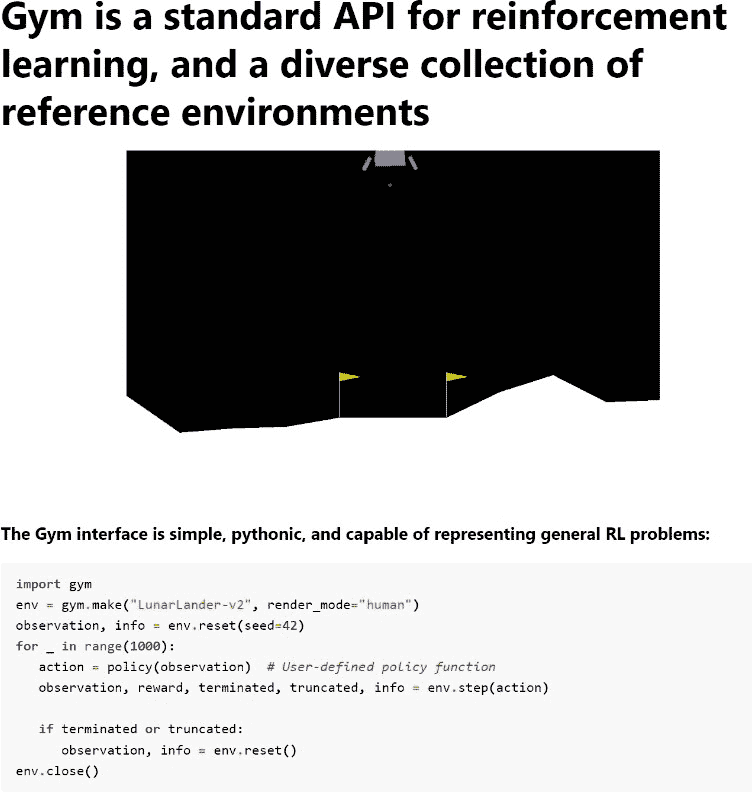

图 2.1 – Gym 文档首页 (https://www.gymlibrary.dev/)

OpenAI 在该领域持续进行研究和贡献，但它最著名的成就与生成式模型——生成式预训练 Transformer (`GPT`) 相关。

在本章中，我们将探索第一种方法，并在第 11 章中介绍如何整合 OpenAI 模型的 API。

在进入 Playground 之前，让我们先概览一下 OpenAI 的模型家族。

### OpenAI 模型家族

在过去的几年里，OpenAI 在模型开发领域取得了巨大的进展，以惊人的速度发布了新版本的模型。在本节中，我们将看到按领域划分的主要模型。

* **语言模型** 🡪 OpenAI 的 GPTs 是先进的语言模型，旨在根据给定的提示词（prompts）生成类人类文本。它们多才多艺，可以用于各种自然语言处理任务，如文本补全、翻译、摘要和编码。得益于其旗舰模型系列 GPTs，OpenAI 在这一领域展现了卓越的性能。自 2022 年 11 月 ChatGPT 发布以来，OpenAI 发布了：
    * `GPT-3.5-turbo`，第一版 ChatGPT 背后的模型
    * `GPT-4`（第一个多模态模型）和 `GPT-4-turbo`（针对聊天和助手进行了优化）
    * `GPT-4o`，最先进的多模态模型
    * `GPT-4o mini`，`GPT-4o` 的较小版本，速度更快且更便宜。

除了这些最新模型外，用户还可以访问一组所谓的“GPT 基础模型”，如 `Babbage-002` 或 `davinci-002`（`GPT-2`），它们代表了旧版的补全 API（pletions APIs）（我们将在下一节介绍补全 API）。

* **图像模型** 🡪 OpenAI 的图像模型（如 `DALL-E`）旨在根据描述生成并处理图像。`DALL-E` 模型可以创建高度详细且富有想象力的视觉效果，使用户创作独特的艺术品、设计概念等。例如，`DALL-E 3`（该模型的最新版本）能够根据复杂的提示词创建复杂且富有创意的图像，推向 AI 在视觉艺术领域的边界。这些模型在创意产业、数字营销以及任何受益于高质量、定制化视觉效果的领域都特别有用。

* **文本转语音和语音转文本** 🡪 在第 1 章中，我们已经提到了 OpenAI 开发的语音转文本（STT）模型 `Whisper`，它可以处理和分析音频输入。此外，OpenAI 还开发了文本转语音（TTS）模型，提供既清晰又具表现力的高质量输出，使其适用于从客服机器人到教育工具的广泛应用。OpenAI 开发的文本转语音（TTS）模型将文字文本转换为口语语言，产生真实且自然的音频。这些模型对于创建语音助手、提高视障用户的无障碍性以及生成自动公告至关重要。

* **文本转视频** 🡪 随着 `SORA` 的发布，OpenAI 展示了其尖端的文本转视频模型，模型能够根据文本描述生成现实且富有想象力的视频场景。通过借鉴 `DALL-E` 的技术并结合 Transformer，`SORA` 可以创建长达一分钟的高保真视频。它在保持 3D 一致性、物体持久性和模拟视频内交互方面表现出色。尽管在准确建模复杂物理和确保时间连贯性方面仍面临挑战，但 `SORA` 在创意产业具有巨大潜力，为视频制作和故事讲述提供了新的可能性。

* **嵌入（Embeddings）** 🡪 OpenAI 的嵌入模型将文本转换为称为向量（或嵌入）的数值表示，这些向量捕捉了语义含义并投影到多维向量空间中。

该空间中不同实例之间的数学距离代表了它们在含义上的相似性。例如，想象单词 `queen`（皇后）、`woman`（女性）、`king`（国王）和 `man`（男性）。理想情况下，在我们在这个向量空间中，如果表示是正确的，我们希望实现以下效果：

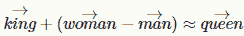

图 2.10 – 单词向量方程示例

这意味着 `woman` 和 `man` 之间的距离应该等于 `Queen` 和 `King` 之间的距离。

嵌入在智能搜索场景中非常有用。事实上，通过获取用户输入和用户想要搜索的文档的嵌入可以计算输入与文档之间的距离度量（即 `cosine similarity` 余弦相似度）。通过这种方式，我们可以检索在数学距离上更接近用户输入的文档。

OpenAI 的嵌入模型 `text-embedding-ada-002` 和 `text-embedding-3-large` 通过创建文本的稠密向量表示，在文本相似性、文本搜索和代码搜索等任务中提供了顶尖性能。这些嵌入允许对大型文本数据集进行高效有效的比较，提高了搜索的准确性和相关性。

* **审核（Moderation）** 🡪 OpenAI 的审核模型旨在检测并过滤文本中不适当、有害或不安全的内容。这些模型通过识别潜在的冒犯或有害语言，对于维护安全尊重的在线环境至关重要。最新的审核模型 `text-moderation-007` 在确保跨平台内容合规安全方面稳健且有效。它帮助开发者和公司执行社区准则并防止有害内容的传播，从而促进更安全的数字交互。

总体来说，OpenAI 近年来覆盖范围越来越广，用顶尖模型解决了生成式 AI 的各个领域。

### 在 Playground 中尝试 OpenAI 模型

要访问你的 OpenAI Playground，你需要创建一个 OpenAI 账户并访问 [`platform.openai.com/playground`](https://platform.openai.com/playground)。落地页的样式如下：

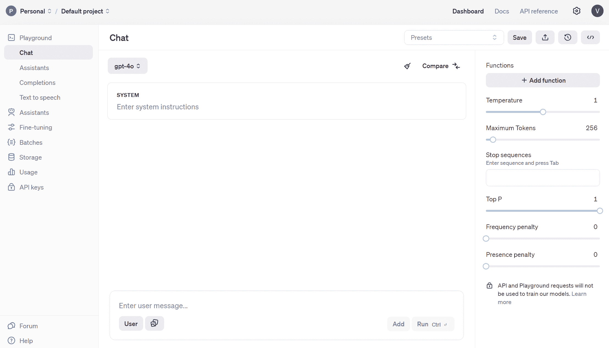

图 2.4 – https://platform.openai.com/playground 的 OpenAI Playground

从图 2.4 所示，Playground 提供了一个用户可以在其中与模型交互的界面，你可以在界面右侧选择模型。

在深入研究 Playground 的主要部分之前，让我们先定义一下章中会看到的术语：

* **Token（标记）**：Token 可以被视为 API 用于处理输入提示词的单词碎片或片段。与完整的单词不同，Token 可能包含尾随空格甚至部分子词。为了更好地理解 Token 的长度概念，有一些通用指南需要记住。例如，英语中的一个 Token 大约相当于四个字符，或四分之三个单词。
* **提示词（Prompt）**：在自然语言处理（NLP）和机器学习（ML）语境下，提示词是指输入 AI 语言模型以生成响应或输出的文本。提示词可以是问题、陈述或句子，用于为语言模型提供上下文和方向。
* **上下文（Context）**：在 GPT 领域，上下文是指用户提示词之前的单词和句子。语言模型利用这些上下文根据训练数据中发现的模式和关系生成最可能的下一个单词或短语。
* **模型置信度（Model confidence）**：模型置信度是指 AI 模型对特定预测或输出分配的确定程度或概率。在 NLP 语境下，模型置信度通常用于表示 AI 模型对其针对输入提示词生成的响应的正确性或相关性有多信心。

## 函数 (Functions)

函数是对第 1 章中引入的工具或插件概念的另一种定义。通过函数，我们为模型提供了一种额外的技能，模型可以调用该技能来完成用户的任务。函数始终包含一个自然语言编写的描述，以便模型知道何时调用它。

前面的定义对于理解如何使用 Azure OpenAI 模型系列以及如何配置它们的参数至关重要。

在 Playground（游场）中，有四个部分可以与模型交互：

### 聊天 (Chat)

在这里你可以测试今天可用的所有聊天模型，包括仅文本的模型（如 `GPT-3.5`）或多模态模型（如 `GPT-4o`）。你可以提供系统消息（system message）——即提供给模型的指令集，全部使用自然语言编写。你还可以在给定相同用户的情况下的情况下比较两个不同模型的输出。以下是此操作的示例：

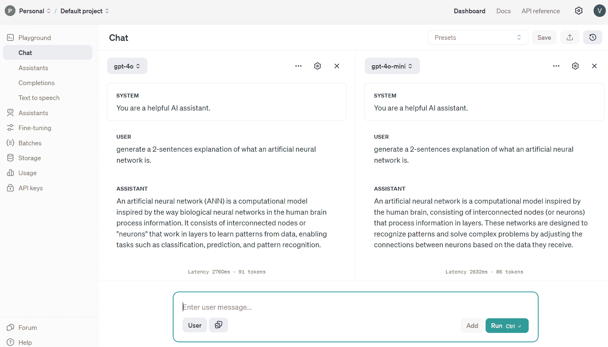

图 2.5 – 两个模型的比较示例。

对于每个模型，你还可以调整一些可以配置的参数。列表如下：

* **温度 (Temperature)**（范围从 0 到 1）：这控制模型响应的随机性。低温度会让你的模型更具确定性，这意味着它倾向于对相同的问题给出相同的输出。例如，如果我在温度设置为 0 的情况下多次询问我的模型*OpenAI 是什么？*，它将始终给出相同的答案。另一方面，如果我对一个温度设置为 1 的模型进行相同的操作，它会尝试在措辞和风格上每次都修改其答案。
* **最大标记数 (Max tokens)**：这控制模型对用户提示（prompt）响应的长度（以 token 为单位）。
* **停止序列 (Stop sequences)**（用户输入）：这使得响应在指定的点结束，例如句子或列表的末尾。
* **高概率 (Top probabilities)**（范围从 0 到 1）：这控制模型在生成响应时考虑哪些 token。将其设置为 0.9 将考虑所有可能的 token 中概率最高的前 90% 的部分。有人可能会问*为什么不将高概率设为 1 以选择所有最可能的 token 呢？*答案是，当模型置信度较低时，即使在得分最高的 token 中，用户可能仍然希望保持多样性。
* **频率惩罚 (Frequency penalty)**（范围从 0 到 1）：这控制生成响应中相同 token 的重复次数。惩罚越高，在同一个响应中看到相同 token 出现一次以上的概率就越低。惩罚根据 token 到此为止在文中出现的频率比例减少概率（这与下一个参数的关键区别）。
* **存在惩罚 (Presence penalty)**（范围从 0 到 2）：这与上一个参数类似但更严格。它减少了重复到此为止在文中出现过的任何 token 的概率。因为它比频率惩罚更严格，存在惩罚也增加了在响应中引入新话题的可能性。

除了在 Playground 中尝试 OpenAI 模型之外，你始终可以在自定义代码中调用模型 API 并模型嵌入到你的应用程序中。事实上，在 Playground 的右角，你可以点击 `View code`（查看代码）并按所示导出配置：

### 助手 (Assistants)

OpenAI 助手可以看作是一种更快速、更方便开发 AI 代理（在第 1 章中介绍）的方法。事实上，助手可以定义为由 LLM 驱动的实体，拥有一套需要遵循的指令和一套可使用的工具或插件——基本上与 AI 代理的定义相同！

在 OpenAI 助手的情况下，它们带有三个预构建工具：

* **文件搜索 (File Search)**：它允许用户上传自定义文档，以便助手可以导航这些文档以完成查询。它基于 RAG 框架运行。
* **函数调用 (Function Calling)**：它允许用户定义一组自定义函数，助手可以调用这些函数来完成给定任务。
* **代码解释器 (Code Interpreter)**：指的是助手针对提供的文档运行代码的能力（例如需要数学计算的电子表格或分析论文），或简单解决用户提供的复杂任务（例如复杂的数学问题）。

在接下面的图中，你可以看到一个名为“Chat with PDF”的助手的示例，它专门根据提供的文档进行回答（在我的情况下，我上传了 Hugo Touvron 等人的论文“LLaMA: Open and Efficient Foundation Language Models”）。

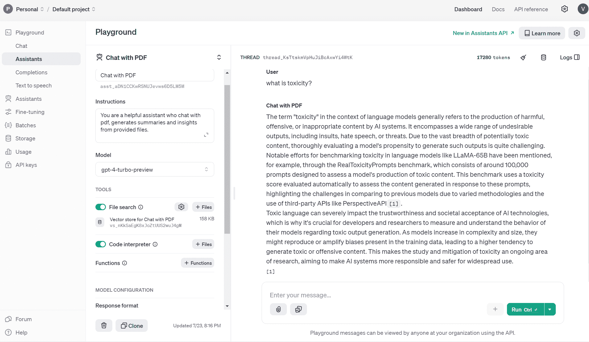

图 2.8 – OpenAI 助手的示例。

从前面的屏幕截可以看出，助手能够从提供的文档中检索知识来回答我的问题。事实上，我的问题相当模糊，因为“毒性”（toxicity）一词可以指多个领域；尽管如此，助手知道将提供的文档作为主要信息来源。

### 补全 (Completions)

此部分指的是类被称为“基础模型”（base models）的模型，如 `GPT-3`，它们是构建所谓的“助手模型”（或我们之前看到的聊天模型）的基础。例如，聊天模型 `GPT-3.5-turbo`（ChatGPT 背后的模型）是基础模型 `GPT-3` 的微调版本。

> 补全（基础）模型设计用于对提示生成单个响应，这使得它们适用于文本生成和摘要等任务，而无需在多次交互中维护上下文。相比之下，聊天（助手）模型针对交互式对话进行了优化，能够在多轮会话中维护上下文，是聊天机器人和虚拟助手等应用的理想选择。

在下面你可以看到 Playground 中一个典型补全任务的示例：

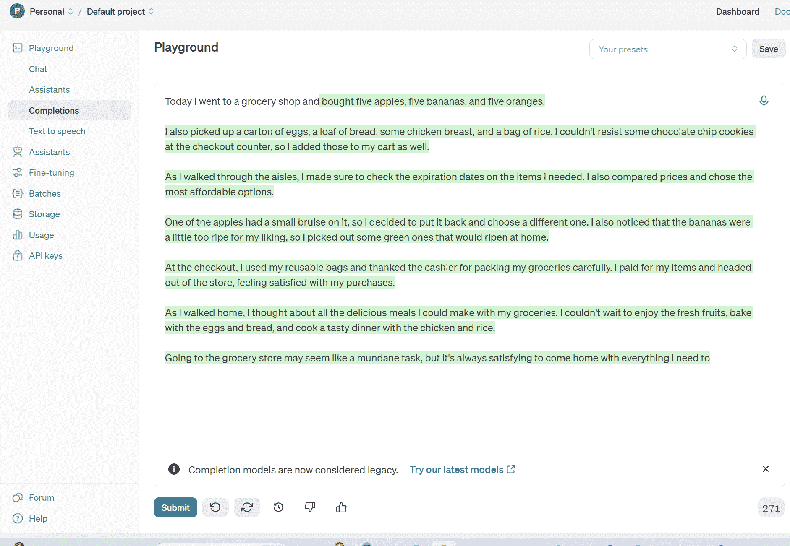

图 1: Playground 中的补全任务示例

如你所见，当我输入“今天我我去了一家杂货店并”，模型用最可能的词补全了句子。今天，补全模型很少使用，因为它们的性能被聊天模型超越，但它们可以进一步微调以适应特定的用例（我们稍后会介绍微调）。

* **文本转语音 (Text to speech)**：除了上述语音转文本模型 `Whisper` 外，OpenAI 还发布了其 `TTS`（文本转语音）模型，可以在 Playground 中直接测试。

让我们来看一个示例：

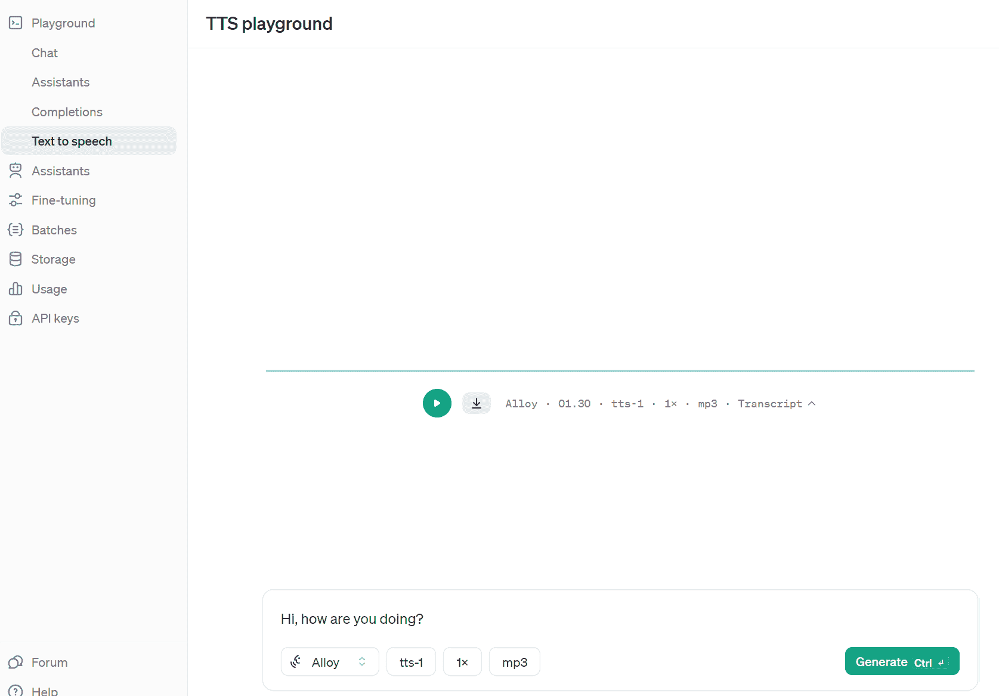

图 2: 在 Playground 中使用 OpenAI TTS 模型的示例

如上面的图片所示，你可以选择生成音频的语音、模型、速度和格式。

所有之前的模型都是预构建的，这意味着因为它们已经在海量知识库上进行了预训练。

然而，你有一些方法可以让你的模型更加定制化并适应你的用例。

第一种方法嵌入在模型的设计中，它涉及通过**少样本学习方法**（few-learning approach）为模型提供上下文（我们将在书中后面重点介绍这种技术）。具体来说，你可以要求模型生成一篇与你已经写的文章模板和词汇相类似的文章。为此，你可以为模型提供生成文章的查询*以及*之前的文章作为参考或上下文，以便模型为你的请求做好更好的准备。

以下是它的示例：

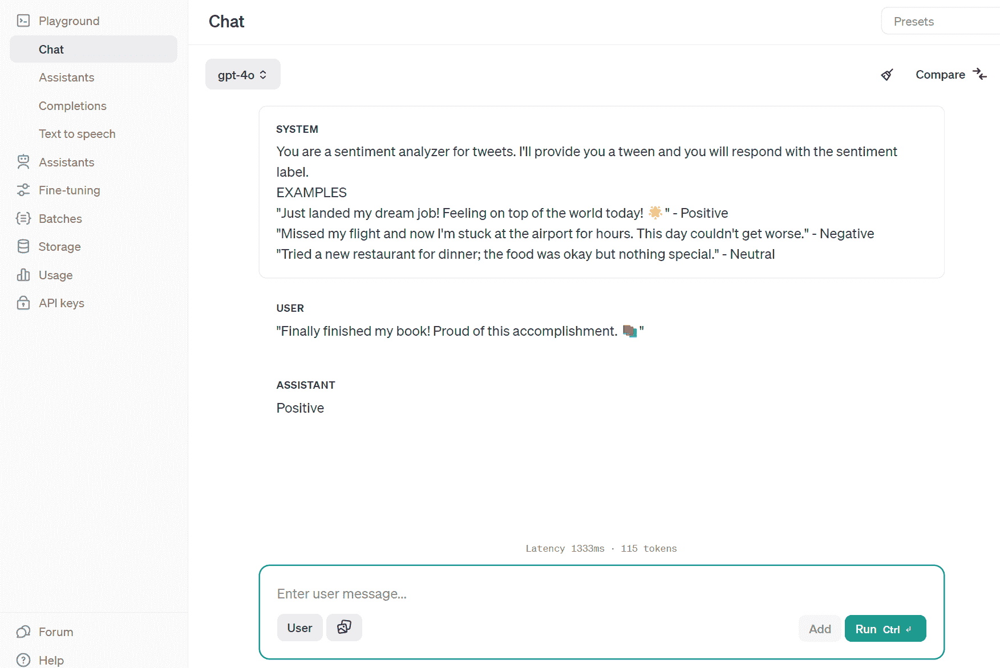

图 2.11 – OpenAI Playground 中带有少样本学习的对话示例

在之前的示例中，我指示模型仅输出推文情感的标签，并为它提供了三个示例来演示如何操作。

第二种方法更为复杂，被称为 `fine-tuning`（微调）。微调是将预训练模型适配到新任务的过程。

在微调过程中，预训练模型的参数会发生变化，这种变化通过调整现有参数或添加新参数，以更好地拟合新任务的数据。这是通过在特定于新任务的较小标注数据集上训练模型来实现的。微调背的核心思想是利用从预训练模型中学到的知识，并将其微调到新任务中，而不是从零开始训练模型。请看下图：

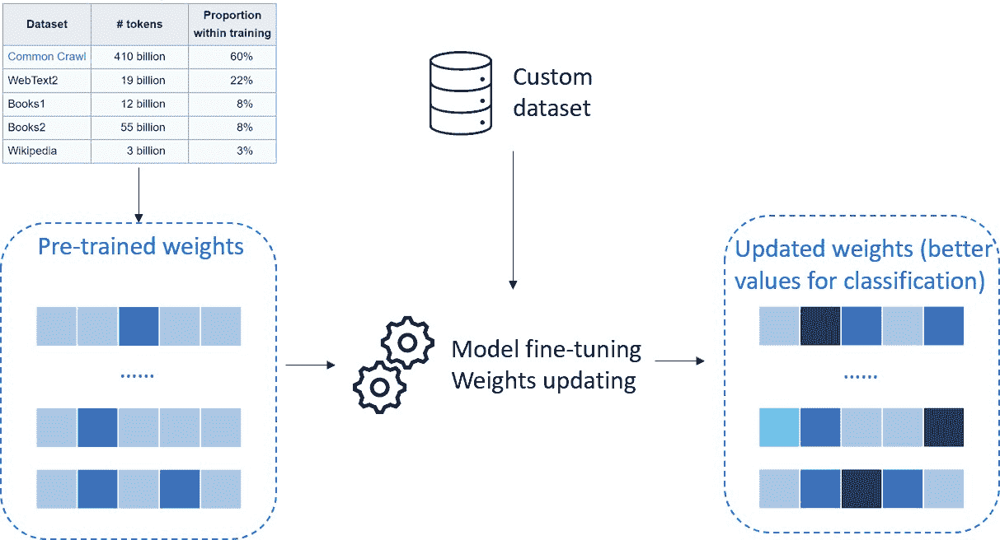


# 图 2.12 – 模型微调

在前面的图中，你可以看到一个关于微调如何在 OpenAI 预构建模型上工作的原理图。其核心是：你拥有一个具有通用权重或参数的预训练模型。然后，你向模型输入自定义数据，通常是以此处所示的 `key-value` 提示词（prompts）和完成项（completions）的形式：

```
{"prompt": "<prompt text>", "completion": "<ideal generated text>"}
{"prompt": "<prompt text>", "completion": "<ideal generated text>"}
{"prompt": "<prompt text>", "completion": "<ideal generated text>"}
...
```

一旦训练完成，你将获得一个自定义模型，它在特定任务上表现特别出色，例如对你公司的文档进行分类。

微调的妙处在于，你可以为自己的用例定制预构建模型，而无需从零开始重新训练，同时可以使用较小的训练数据集，从而缩短训练时间并减少计算量。同时，模型保留了通过原始训练（即在大规模数据集上进行的训练）学到的生成能力和准确性。

在本节中，我们概述了 OpenAI 向公众提供的模型，从你可以在 Playground 中直接尝试的（`GPT`、`Codex`）到更复杂的模型（如嵌入模型 embeddings）。我们还了解到，除了使用预构建状态的模型外，你还可以通过微调对它们进行定制，并提供一组示例供学习。

在接下来的章节中，我们将专注于这些模型的背景，从它们背后的数学原理开始，一直到让 ChatGPT 可能的伟大发现。

# ChatGPT：顶尖技术

2022 年 11 月，OpenAI 宣布了其对话 AI 系统 `ChatGPT` 的网页预览版并向公众开放。这引发了来自专家、机构和普通用户的巨大热潮——在发布仅 5 天后，该服务的用户量就达到了 100 万！

在开始介绍 ChatGPT 之前，我将让它自我介绍一下，这是发布几天后的快照：

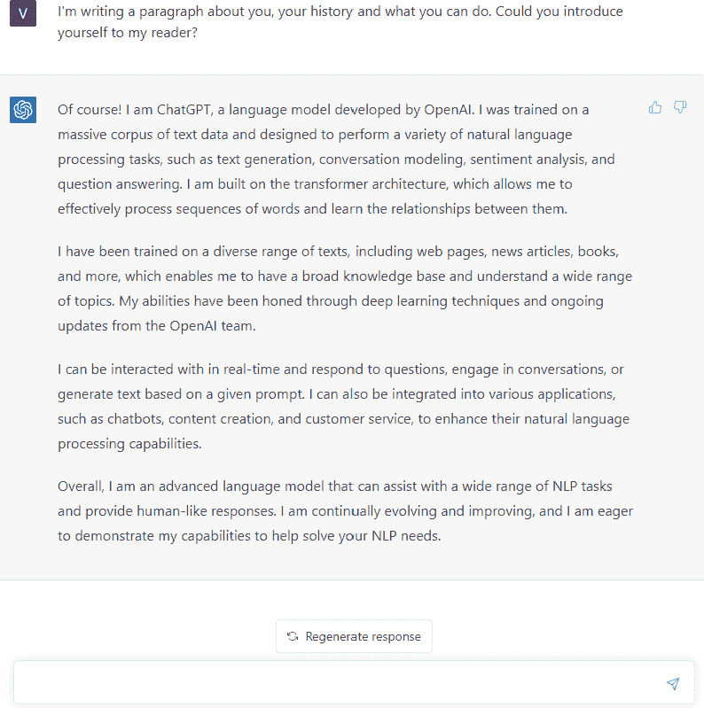

图 2.25 – ChatGPT 在 2022 年 11 月自我介绍。

如上所述，`ChatGPT` 的第一个版本构建在一个高级语言模型之上，该模型使用了 `GPT-3` 的修改版本，并专门针对对话进行了微调。这个微调后的版本被称为 `GPT-3.5-turbo`。优化过程涉及“基于人类反馈的强化学习”（`Reinforcement Learning with Human Feedback`, `RLHF`），这是一种利用人类输入来训练模型展现理想对话行为的技术。

我们将 `RLHF` 定义为一种机器学习方法，算法通过接收人类的反馈来学习执行某任务。算法被训练用于做出决策，以最大化人类提供的奖励信号，而人类则提供额外的反馈以改进算法的性能。当任务复杂到传统编程无法处理，或者预期结果难以预定义时，这种方法非常有用。

这里相关的区别在于，`ChatGPT` 在训练过程中包含了人类参与（humans in the loop），以便使其与用户保持一致（aligned）。通过引入 `RLHF`，`ChatGPT` 的设计旨在以更自然、更有互动的方式理解并响应人类语言。

> 同样的 `RLHF` 机制也被用于我们可以认为是 ChatGPT 前身的模型——`InstructGPT`。在 OpenAI 研究人员于 2022 年 1 月发表的相关论文中，`InstructGPT` 被介绍为一类在遵循英语指令方面优于 `GPT-3` 的模型。

`ChatGPT` 至今仍作为任何人都可以使用的免费应用程序可用；但自 2023 年 2 月起，OpenAI 宣布了一个名为 `ChatGPT Plus` 的新付费版本，每月费用 20 美元，为订阅者提供了若干优势，包括访问最新模型、最快的响应时间、一套强大的插件集，以及在 GPTs 游乐场中创建自己的助手的可能性。

让我们快速浏览一下当前日期的 ChatGPT 用户界面：

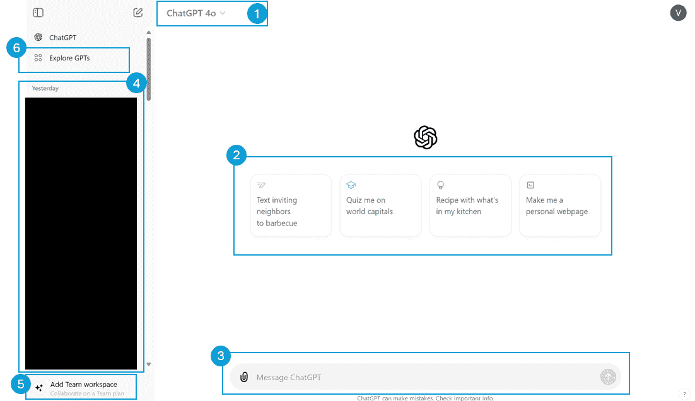

图 3: `chatgpt.com` 的 ChatGPT 首页

让我们双击每个部分：

1. 你可以决定 `ChatGPT` 后端使用的模型。在我情况下，我设置了 `GPT-4o`，它仅对付费订阅开放。这是我们在整本书中将使用的模型。

2. 系统向用户推荐一组预构建的提示词，帮助他们熟悉应用程序。

3. 文本框是用户提问的地方。注意左上角有一个小回针图标：它表示模型可以上传的文件。这些文件可以从本地上传，也可以从 `Google Drive` 或 `OneDrive` 等云存储检索。

4. 在左侧边栏中，你可以看到与 `ChatGPT` 的聊天列表。这是一个非常有用的工具，因为在每个聊天中，通过你与模型的多次交互，创建了模型感知的上下文。这意味着如果你想继续之前的对话，只需打开相应的聊天即可，无需再次描述整个场景。

5. 最近添加的一个很棒的功能是与其他用户共享工作空间的功能，以便你与团队成员协作。请注意这是一个额外的付费功能，不包含在 Plus 计划中，每月额外收费 5 美元。

6. 最后，`ChatGPT Plus` 提供了创建 GPTs 的可能性，这些是你为特定功能定制的个性化助手。你可以决定将 GPT 设置为私有，或将其发布到 GPTs 商店供任何人使用和评分。我们将在本书后后的专门章节中介绍 GPTs。

最后，`ChatGPT Plus` 带有两个可以根据需要自动调用的内置插件：网络搜索插件（用于检索最新信息）和代码解释器插件（用于处理分析文档或执行复杂的数学任务）。

在本书中，我们将利用 `ChatGPT Plus` 展示最新模型和功能的特性，尽管如此，我们涵盖的大多数示例通过免费版的 `ChatGPT` 实现（该版本目前由 `GPT-3.5-turbo` 驱动）。

ChatGPT 架构和训练方法的持续发展和改进有望进一步推向语言处理的边界。

## 总结

在本章中，我们回顾了 OpenAI 的历史、研究领域以及最新进展，直到 ChatGPT。我们深入探讨了用于测试的 OpenAI Playground 以及我们如何利用 OpenAI 的所有模型系列。

通过对 OpenAI 模型的初步了解，我们将看到测试或将预训练模型嵌入到你的应用程序中是多么简单：这里的关键因素在于，你不需要强大的硬件和花费数小时的时间来训练模型，因为它们已经可以供你使用，并在需要时还可以通过少量示例进行自定义。

在下一章中，我们将开始介绍本书的 `Part 2`，在 ways 我们将看到 ChatGPT 在各个领域的实际应用，以及如何释放它的潜力。你将学习如何通过正确设计提示（prompts）从 ChatGPT 中获得最高价值，如何提高你的日常工作效率，以及它如何成为开发者、营销人员和研究人员优秀的项目助手。

## 参考文献

* Radford, A., & Narasimhan, K. (2018). Improving language understanding by generative pre-training.

* Vaswani, A., Shazeer, N., Parmar, N., Uszkoreit, J., Jones, L., Gomez, A. N., Kaiser, L., & Polosukhin, I. (2017). Attention Is All You Need. ArXiv. [`doi.org/10.48550/ arXiv.1706.03762`](https://doi.org/10.48550/) OpenAI. Fine-Tuning Guide. OpenAI platform documentation. [`platform.openai.com/docs/guides/fine-tuning`](https://platform.openai.com/docs/guides/fine-tuning)。
