# 3 理解提示词设计

## 在 Discord 上加入我们的书籍社区


[`packt.link/EarlyAccess`](https://packt.link/EarlyAccess)

在之前的章节中，我们在提到 ChatGPT 以及通用的 LLM 模型的用户输入时，多次使用了 `prompt`（提示词）一词。

由于提示词对 LLM 的性能有巨大影响，因此提示词工程（prompt engineering）是设计 LLM 驱动的应用时项至关重要的活动。事实上，有多种技术可以实现，不仅可以优化你的 LLM 响应，还可以减少与幻觉（hallucination）和偏差相关的风险。

在本章中，我们将涵盖提示词工程领域的新兴技术，从基础方法到高级框架。具体来说，我们将介绍以下主题：

* 提示词工程简介

* 零样本、单样本和少样本学习（Zero, one and few shot learning）

* 提示词工程的基本原理

* 提示词工程的高级技术

* 通过提示词工程缓解风险和幻觉

* 处理提示注入（prompt injections）

在本章结束时，你将拥有为你的 LLM 驱动的应用构建功能且稳健的提示词的基础，这在接下来的章节中也会相关。

## 什么是提示词工程？

在解释什么是提示词工程之前，让我们从提示词（prompt）的原子定义开始。

提示词是一种文本输入，引导 LLM 的行为以生成文本输出。在 LLM 和 LLM 驱动的应用的语境下，我们可以将提示词分为两类：

* 用户在与 LLM 交互时输入的提示词。例如，一个提示词可能是“给我详细解释一下质子”，或者“生成一个运行马拉松的跑步训练计划”。下面你可以看到一个简单的用户提示词示例：

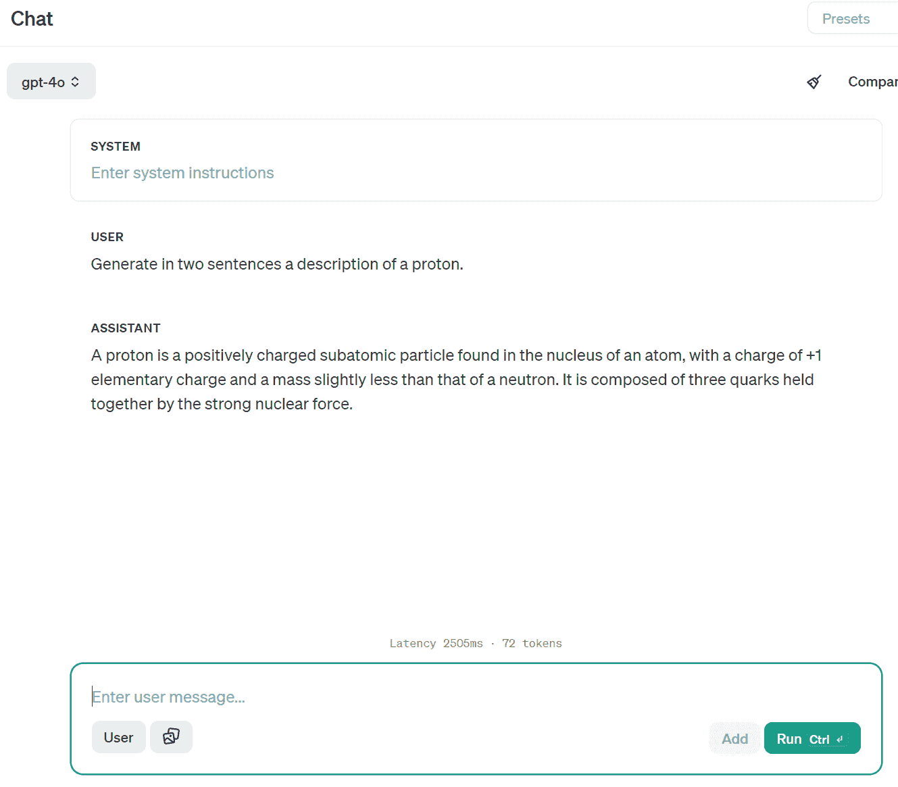

图 1：用户提示词示例。

你会听到人们简单地将此组件称为“prompt”、“query”（查询）或“user’s input”（用户输入）。

* 无论用户的查询如何，指示模型以某种方式运行的提示词。这指的是我们提供给模型的自然语言指令集，使其在与终端用户交互时以某种方式运行。你可以将其理解为 LLM 的某种“后端”，即由应用程序开发者处理而非最终用户处理的内容。

在接下来的图片中，你可以看到一个示例，我们向模型提出了上述问题，但这次我们添加了一个系统消息（system message）来指示模型以某种方式运行：

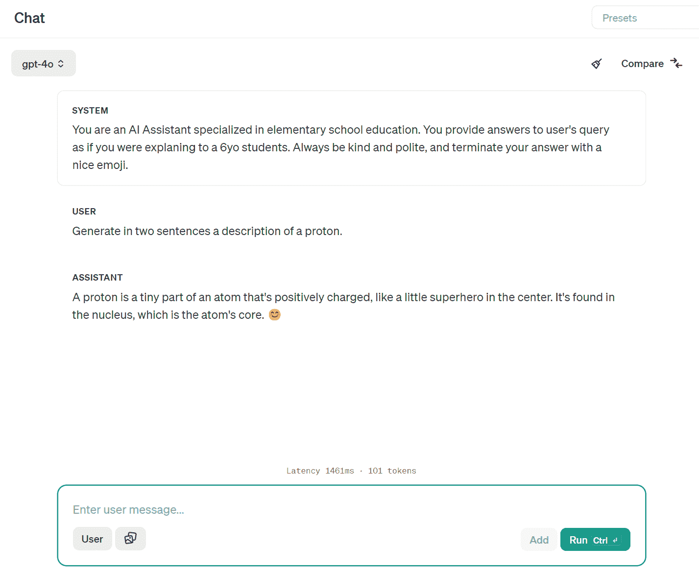

图 2：元提示词示例。

我们将这类提示词称为“metaprompt”（元提示词）或“system message”（系统消息）。

从此以后，提示词工程是指设计有效提示词的过程，旨在从 LLM 中引导高质量且相关的输出。提示词工程需要创造力、对 LLM 的理解以及精确性。

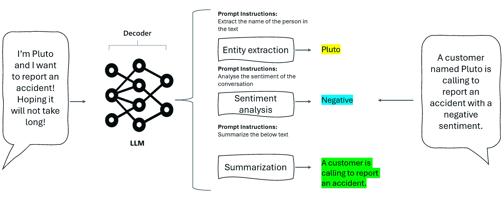

图 3：通过提示词工程使 LLM 专业化的示例。

在过去的几年里，提示词工程本身变成了一门全新的学科，这证明了与这些模型交互需要一套以前不存在的新技能和能力。“提示词艺术”（art of prompting）已成为在企业场景下构建生成式 AI 应用的顶级技能；然而，对于在日常任务中使用 ChatGPT 或类似 AI 助手的个人用户来说，它也非常有用，因为它极大提高了结果的质量和准确性。

在接下来的章节中，我们将看到一些如何为你的 LLM 应用构建高效稳健的提示词和元提示词的示例。请注意，我们将涵盖的所有技术都可以嵌入到用户提示词和元提示词中，取决于你的具体需求。为了做到这一点，我将利用 OpenAI Playground，以便能够更灵活地在两个层级的提示上进行操作。

## 零样本、单样本和少样本学习——Transformer 的典型

在之前的章节中，我们提到了 LLM 通常以预训练格式出现。它们已经在海量数据上进行了训练。

然而，这并不意味着它们现在不能学习了。在第 2 章中，我们看到自定义 OpenAI 模型并使其更适用于特定任务的方法是微调（fine-tuning）。

> 微调是将预训练模型适配到新任务的过程。在微调中，预训练模型的参数会被更改，即通过调整现有参数或添加新参数来适应数据。这是通过在特定任务的较小数据集上训练模型来实现的。微调的核心思想是利用从预训练模型中学到的知识并使其新任务，而不是从头训练模型。

微调是一个正式的训练过程，需要训练数据集、计算能力和一些时间（取决于数据量和计算实例）。

这就是为什么测试另一种让模型在特定任务中变得更技能的方法：样本学习（shot learning）：其思想是让模型从示例学习，而不是整个数据集。这些示例是我们希望模型响应的方式，以便模型不仅学习内容，还学习在其响应中使用的格式、风格和分类。

此外，样本学习直接通过提示词发生（正如我们在后续场景中看到的），因此整个过程更不耗时且更容易执行。

提供的示例数量决定了我们所指的样本学习水平。换句话说，如果不提供示例则为零样本（zero-shot），提供一个示例则为单样本（one-shot），提供 2-3 个以上的示例则为少样本（few-shot）。

让我们关注每一个场景：

* 零样本学习。在这种类型的学习中，模型被要求执行一项它未见过任何训练示例的任务。模型必须依靠先验知识或关于任务的通用信息来完成任务。例如，零样本学习的方法可以是要求模型生成描述，正如我的提示词中所定义的：


图 4.3 零样本学习示例

- **单样本学习（One-shot learning）**：在这种学习类型中，模型对于每个要求执行的新任务只获得一个示例。模型必须利用其先验知识从这个单一示例中泛化，以完成任务。如果我们考虑之前的示例，我可以在要求模型生成新内容之前，为它提供一个 `prompt-completion` 示例：

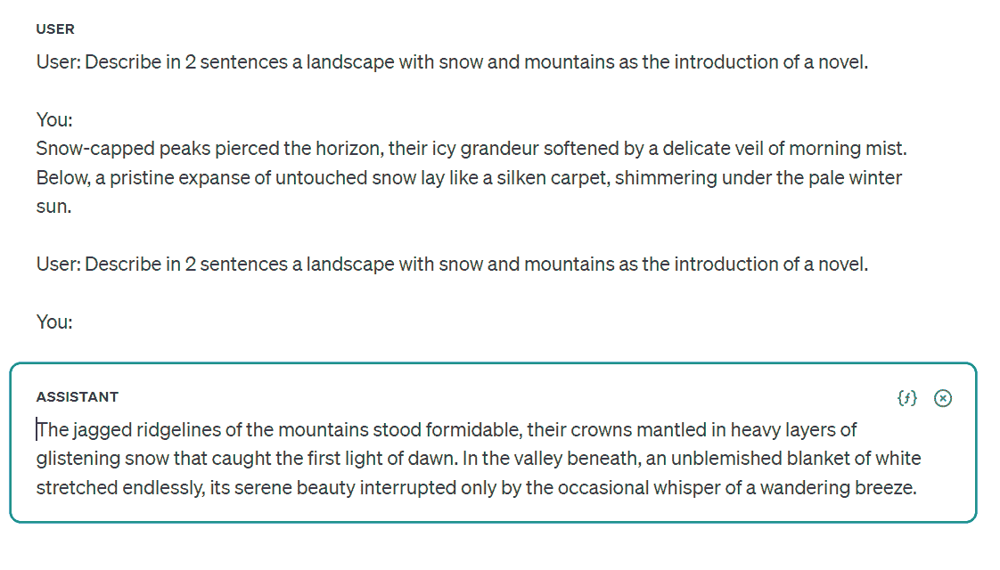

图 4.4 – 单样本学习示例

```
{"prompt": "<prompt text>", "completion": "<ideal generated text>"}
```

注意，我提供示例的方法与用于微调的结构相似：

- **少样本学习（Few-shot learning）**：在这种学习类型中，模型对于每个要求执行的新任务会被给出一个少量示例（通常在 2 到 5 个之间）。模型必须利用其先验知识从这些示例中泛化以完成任务。让我们继续之前的示例，为模型提供更多示例：


图 4.5 – 包含三个示例的少样本学习示例

少样本学习的优点在于，你还可以控制模型输出的呈现方式。你也可以为模型提供一个你希望输出格式的模板。例如，考虑以下推文分类器：

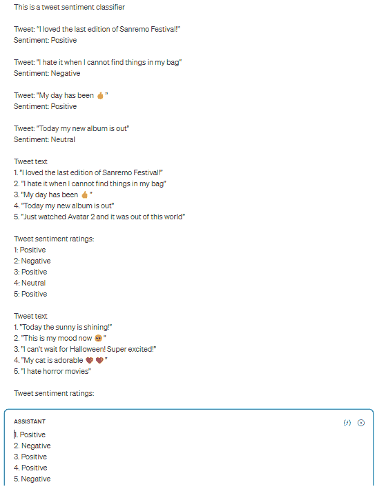

图 4.6 – 用于推文分类器的少样本学习。这是来自 https://learn.microsoft.com/en-us/azure/cognitive-services/openai/how-to/completions 原始脚本的修改版本。

让我们检查上面的图。首先，我为 ChatGPT 提供了一些带标签的推文示例。然后，我提供了相同的推文，但使用了不同的数据格式（列表格式），以及同样格式的标签。最后，我以列表格式提供了未标记的推文，以便模型以列表形式返回标签。

少样本学习（Shot-learning）的可能性是无限的——这取决于测试以及在寻找合适的提示词（prompt）设计时的一点耐心。

如之前提到的，重要的是记住这些学习形式与传统的监督学习以及微调是不同的。在少样本学习中，目标是让模型能够从极少数示例中学习，并从这些示例泛化到新任务。

现在我们已经学会了如何让 OpenAI 模型从示例中学习，让我们关注如何正确定义我们的提示词，以使模型的响应尽可能准确。

## 提示词工程原则

传统上，在计算和数据处理的背景下，我们经常使用“垃圾进，垃圾出（garbage in, garbage out）”这一说法，意味着输出的质量取决于输入的质量。如果向系统输入了错误或低质量的数据（垃圾），输出也将是有缺陷或毫无意义的（垃圾）。

在涉及提示词（prompting）时，情况也类似：如果我们希望从 LLM 获得准确且相关的结果，我们需要提供高质量的输入。然而，构建良好的提示不仅取决于响应的质量。事实上，我们可以构建良好的提示词来：

* 最大化 LLM 响应的相关性

* 指定响应的类型、格式和风格

* 提供对话上下文

* 减少内部偏见并提高公平性和包容性

* 减少幻觉

> 在大语言模型（LLMs）的语境下，“幻觉（hallucination）”指的是生成事实上错误、无意义或未基于训练数据的文本或响应。当 LLM 产生听起来自信但错误或虚假的信息时，就会发生幻觉。幻觉的产生由于这些模型的概率性质，它们可能会根据模式而非验证的事实来预测下一个词或短语。

让我们看看实现这些结果的基本技术。

### 清晰的指令

给出清晰指令的原则是为模型提供足够的信息和指导，使其正确且高效地执行任务。清晰的指令应该包含以下元素：

* 任务的目标或目的，例如“写一首诗”或“总结文章”。

* 预期输出的格式或结构，例如“使用带有押韵字的四行诗”或“使用项目符号，每项不超过 10 个字”。

* 任务的约束或限制，例如“不要使用任何脏话”或“不要从源文件中复制任何文本”。

* 任务的上下文或背景，例如“这首诗是关于秋天的”或“这篇文章来自某科学期刊”。

假设，我们希望模型从文本中提取任何类型的指令，并以项目列表的形式向我们返回教程。此外，如果提供的文本没有指令，模型应该告知我们。


为了尝试这样做，让我们利用 OpenAI Playground 中的聊天部分，这样我们就可以同时提供元提示词（`metaprompt`）和提示词（`prompt`）。

对于这种场景，我将设置以下元提示词：

```
你是一个 AI 助手，通过根据文本生成教程来帮助人类。
你将提供一段文本。如果文本包含关于如何进行某事的任何指令，请生成一个列表格式的教程。
否则，告知用户文本不包含任何指令。
```

这是我们的用户提示词：

```
为了准备来自意大利热那亚的已知酱汁，你可以从烤松子开始，然后在厨房研钵中与罗勒和大蒜一起粗略切碎。然后，在厨房研钵中加入一半油，并用盐和胡椒调味。
最后，将青酱转移到碗中，拌入碎的帕玛森奶酪。
```

让我们看看它是如何工作的：

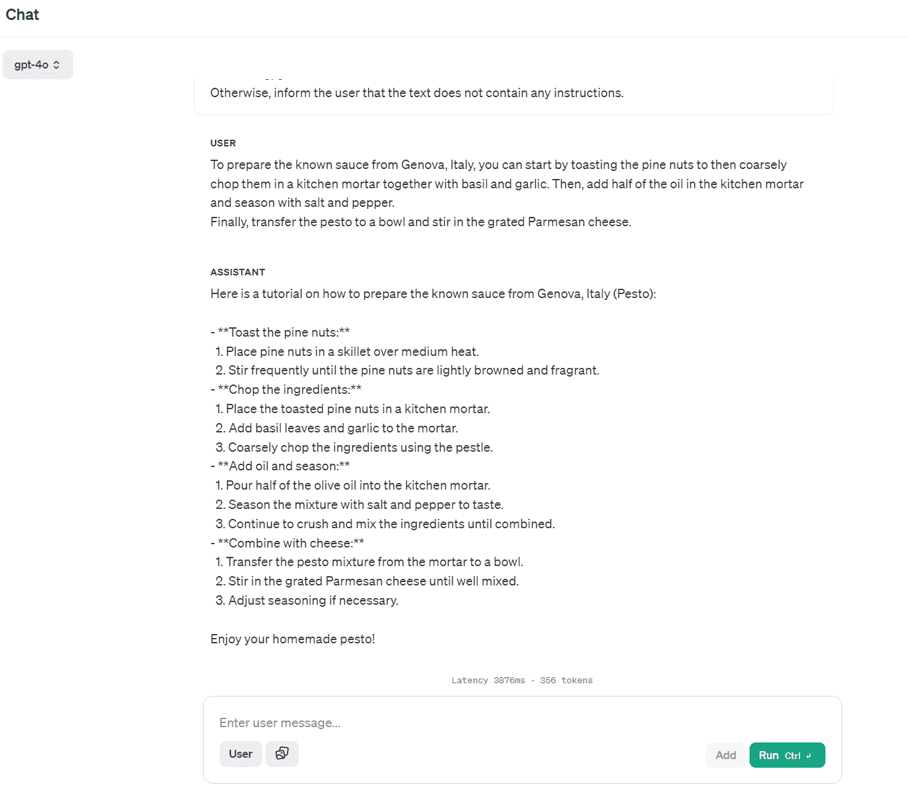

图 4: 元提示词中清晰指令的示例。

注意，如果我们给模型传递另一个不包含任何指令的文本，它将按照我们指示的方式做出回答：

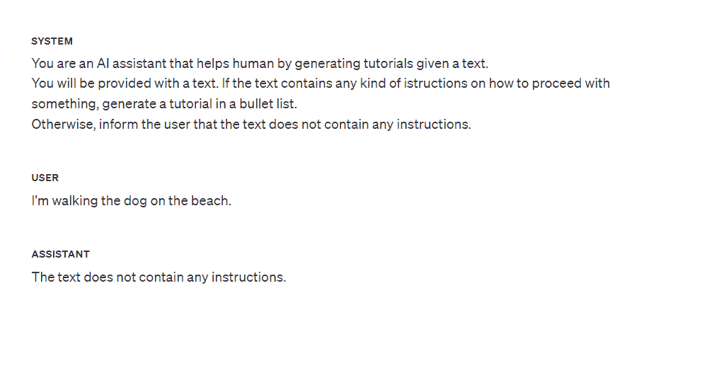

图 5: 聊天模型遵循指令的示例。

通过给出清晰的指令，你可以帮助模型理解你想让它做什么以及你想让怎么做。这可以提高模型输出的质量和相关性，并减少进一步修订或修正的需求。

然而，有时仅仅有清晰度是不够的。我们可能需要推断 LLM 的思维方式，使其在执行任务时更加健壮。在下一节中，我们将检查这种技术之一，它在完成复杂任务时非常有用。

## 将复杂任务拆分为子任务

提示词工程是一项设计有效输入以供大语言模型（LLMs）执行各种任务的技术。有时，任务对于单个提示词来说过于复杂或模糊，此时将它们拆分为由不同提示词解决的更简单的子任务更好。

以下是将复杂任务拆分为子任务的一些示例：

* **文本摘要**：一项涉及为长文本生成简洁准确摘要的复杂任务。该任务可以拆分为若干子任务，例如：
  * 从文本中提取要点或关键词。
  * 以连贯流畅的方式重写要点或关键词。
  * 修剪摘要以符合所需的长度或格式。

* **机器翻译**：一项涉及将文本从一种语言翻译成另一种语言的复杂任务。该任务可以被拆分为若干子任务，例如：
  * 检测文本的源语言。
  * 将文本转换为中间表示，并保留原始文本的含义和结构。
  * 从中间表示生成目标语言的文本。

* **诗歌生成**：一项创意任务，涉及创作遵循特定风格、主题或情感的诗歌。该任务可以分为若干子任务，例如：
  * 为诗歌选择诗歌形式（如十四行诗、俳句、五味打诗等）和韵律（如 `ABAB`、`AABB`、`ABCB` 等）。
  * 根据用户的输入或偏好为诗歌生成标题和主题。
  * 生成符合所选形式、韵律和主题的诗行或诗节。
  * 对诗歌进行精炼和润色，以确保连贯性、流畅性和原创。

* **代码生成**：一项技术任务，涉及生成执行特定功能或任务的代码段。该任务可以分为若干子任务，例如：
  * 为代码选择编程语言（如 `Python`、`Java`、`C++` 等）以及框架或库（如 `TensorFlow`、`PyTorch`、`React` 等）。
  * 根据用户的输入或规范为代码生成函数名以及参数列表和返回值。
  * 生成实现代码逻辑和功能的函数体。
  * 添加注释和文档以解释代码及其用法。

让我们考虑以下示例。我们将为模型提供的一篇短文章，并要求它按照这些指令进行总结：

```
You are an AI assistant that summarize articles.
To complete this task, do the following subtasks:
Read the provided article context comprehensively and identified the main topic and key points
Generated a paragraph summary of the current article context that captures the essential information and conveys the main idea
Print each step of the process.
```

这是我将提供的短文：

```
大语言模型（LLMs）作为人工智能的一个子集，通过展现出前所未有的理解和生成类人文本的能力，彻底改变了自然语言处理领域。这些模型在包含多样化语言输入的海量数据集上进行训练，使其能够针对广泛的主题生成连贯且上下文相关的响应。通过利用 transformers 等架构，GPT-3 及其后续者等 LLM 可以完成文本补、回答问题、执行翻译，甚至参与复杂的对话。它们的应用范围从自动化客户支持、内容创作到先进的研究和教育工具。尽管拥有惊人的能力，LLM 也面临着挑战，包括训练数据中固有的偏差倾向以及生成误导性或虚假信息的风险。随着 LLM 的不断进步，在伦理 AI 研究和部署策略方面的持续的努力对于负责任且有效地利用其益处至关重要。
```

让我们看看模型是如何工作的：

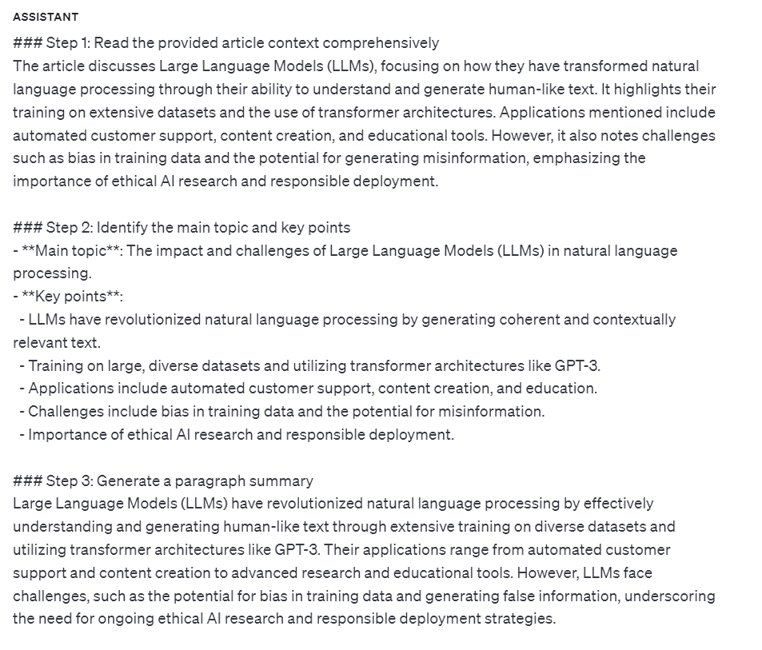

图 6：OpenAI GPT-4o 将任务拆分为子任务以生成摘要的示例。

将复杂任务拆分为更简单的子任务是一种强大的技术，尽管如此它并没有解决 LLM 生成内容的主要风险之一，即输出错误结果。在接下来的两个章节中，我们将看到一些旨在解决这一风险的技术。

## 请求理由（Ask for justification）

LLM 的构建方式是它们根据之前的标记（`token`）预测下一个标记，而不回溯其已生成的内容。这可能导致模型向用户输出错误内容，但方式非常具有说服力。如果 LLM 驱动的应用没有为该响应提供特定的引用，可能很难验证其背后的事实。

因此，在提示词（`prompt`）中指定通过一些反思和理由来支持 LLM 的答案，可能会提示模型从其行为中恢复。

此外，请求理由在答案正确的情况下也可能有用，只是因为我们并不知道 LLM 背后的思考过程。例如，假设我们想让 LLM 解决谜语。为了做到，我们可以这样指示它：

```
You are an AI assistant specialized in solving riddles.
Given a riddle, solve it the best you can.
Provide a clear justification of your answer and the reasoning behind it.
```

如你所见，我在元提示词（`metaprompt`）中指定 LLM 为其答案提供理由，并将其推理社交化。让我们用下面的谜语来测试一下：

```
什么有脸有只手，但没有手脚？
```

输出：

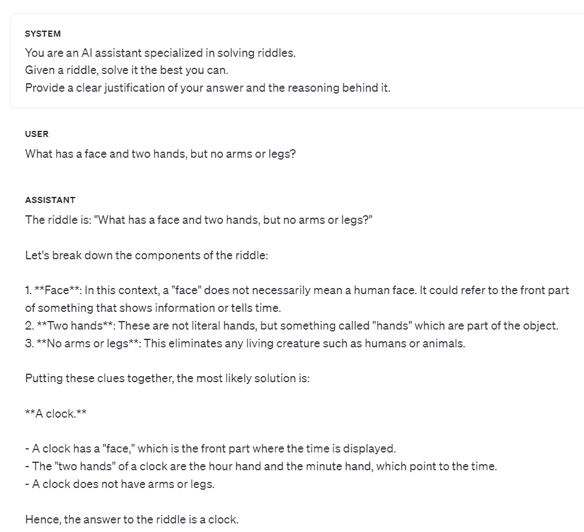

图 7：OpenAI 的 GPT-4o 在解决谜语后提供理由的示例。

理由是使你的模型更可靠、更健壮的佳工具，因为它们“迫使”模型重新思考其输出，同时为我们提供了推理是如何设定以解决问题的视角。

通过类似的方法，我们也可以在不同的提示词层面进行干预，以提高 LLM 的性能。例如，我们可能会发现模型正在系统地以错误的方式处理数学问题，因此我们可能想在元提示词层面上直接建议正确的方法。另一个例子可能是要求模型生成多个输出——以及它们对应的理由——以评估不同的推理技术，并在元提示词中选择最佳的一个。

在下一节中，我们将关注这些示例之一，更具体说是生成多个输出然后选择最可能的一个的可能。

## 生成多个输出，然后使用模型选择最佳的一个

正如我们在上一节中看到的，LLM 的构建方式是它们根据之前的标记预测下一个标记，而不回溯其已生成的内容。如果是这种情况下，如果采样的标记是错误的（换句话说，如果模型运气不好），LLM 将继续生成错误的标记，从而产生错误的内容。现在坏消息是，与人类不同，LLM 无法从错误中自动恢复。这意味着，如果我们询问它们，它们会承认错误，但我们需要明确提示它们进行思考。

克服这一局限性的方法是扩大选择正确标记的概率空间。与其只生成一个响应，我们可以提示模型生成多个响应，然后选择最适合用户查询的一个。这为我们的 LLM 分配两个子任务：

1. 为用户查询生成多个响应；
2. 比较这些响应并根据我们可以在元提示词中指定的标准选择最佳的一个。

让我们来看一个示例，接上上一节检查过的谜语：

```
You are an AI assistant specialized in solving riddles.
Given a riddle, you have to generate three answers to the riddle.
For each answer, be specific about the reasoning you made.
Then, among the three answer, select the one which is most plausible given the riddle.
```

在这种情况下，我提示模型为谜语生成三个答案，然后给出最可能的那个，并说明理由。让我们看看结果：

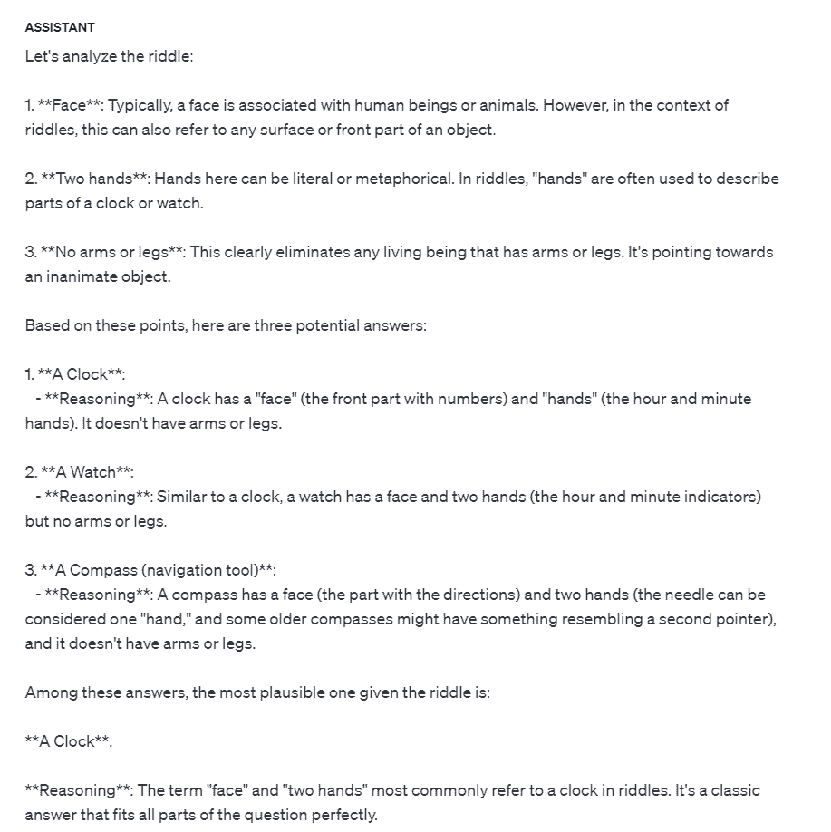

图 8：GPT-4o 生成三个可能的答案并选择最可能的一个、提供理由的示例。

如前所述，强制模型用不同的方法解决问题是收集多个推理样本的一种方法，这些样本可以作为元提示词（`metaprompt`）中的进一步指令。例如，如果我们希望模型总是对问题提出**不是最直观**的解决方案——换句话说，如果我们希望它能“以不同方式思考”——我们可能会强制它以 N 种方式解决问题，然后将最具创意的推理作为元提示词中的框架。

我们将检查的最后一个元素是我们想要赋予元提示词的整体结构。事实上，在之前的示例中，我们看到了一个包含某些陈述和指令的示例系统消息。在下一节中，我们将看到这些陈述和指令的顺序和“强度”并不是不变的。

## 使用分隔符

涵盖的最后一个原则与我们想要赋予元提示词的格式有关。这有助于我们的大语言模型（LLM）更好地理解其意图，并建立章节与段落之间的关系。

为了实现这一点，我们可以在提示词中使用分隔符。分隔符可以是任何字符或符号序列，它能清晰地映射到一个模式（`schema`）而不是一个概念。例如，我们可以考虑以下序列作为分隔符：

* `>>>>`

* `====`

* `------`

* `####`

* ``` `` ```

等等。让我们考虑一个元提示词，其目标是指示模型将用户的任务转换为 Python 代码，并提供一个操作示例。

```
You are a Python expert that produces python code as per user's request.
===>START EXAMPLE
---User Query---
给我一个打印文本字符串的函数。
---User Output---
下面你可以找到描述的函数：
\`\`\`def my_print(text):

     #returning the printed text

     return print(text)
\`\`\`
<===END EXAMPLE
```

让我们看看它是如何工作的：

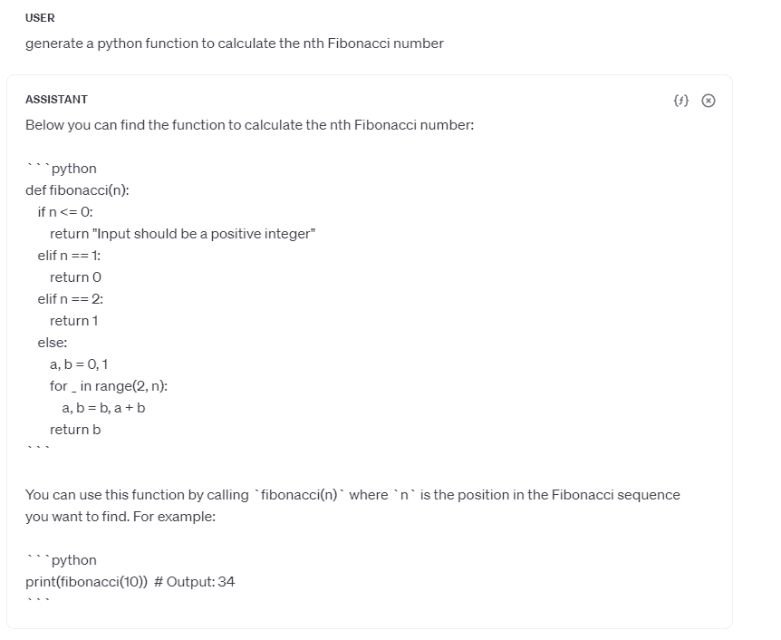

图 9：在系统消息中使用分隔符的模型示例输出。

如你所见的，它还像系统消息中显示的那样用反引号打印了代码。

到目前为止的所有原则都是通用规则，可以使你的基于 LLM 的应用程序更加健壮。在接下来的章节中，我们将看到一些高级的提示工程技术，这些技术在将答案提供给最终用户之前，解决了模型推理和思考答案的方式。

## 高级技术

在之前的章节中，我们涵盖了一些提示工程的基础技术。无论你开发的是什么类型的应用程序，都应该记住这些技术，因为它们是提高你 LLM 性能的通用最佳实践。

另一方面，还有一些针对特定场景实施的高级技术，我们将在接下来的章节中介绍。

### 思维链 (Chain of Thoughts)

由 `Wei` 等人在论文《Chain-of-Thought Prompting Elicits Reasoning in Large Language Models》中引入的思维链（`CoT`）是一种通过中间推理步骤实现复杂推理能力的技术。它还鼓励模型解释其推理过程，“强制”它不要太草率，从而避免给出错误回答的风险（正如我们在之前的章节中看到的）。

假设我们想提示 LLM 求解一元方程。为了做到，我们将为它提供一个通用的推理列表作为元提示词：

```
要求解通用的一元方程，请遵循以下步骤：
1\. **识别方程：** 首先识别你想要求解的方程。它应该是 "ax + b = c" 的形式，其中 'a' 是变量的系数，'x' 是变量，'b' 是常数，'c' 是另一个常数。
2\. **隔离变量：** 你的目标是在方程的一侧隔离变量 'x'。为了做到，请执行以下步骤：

   a. **加减常数：** 在方程两边加上或减去 'b'，将常数移到一侧。

   b. **除以系数：** 将方程两边除以 'a' 以隔离 'x'。如果 'a' 为零，方程可能没有唯一解。
3\. **简化：** 尽可能地简化方程的两边。
4\. **求解 'x'：** 一旦 'x' 在一侧被隔离，你就得到了解。它将是 'x = 值' 的形式。
5\. **检查你的解：** 将找到的 'x' 值代回原始方程，确保它满足方程。如果是，你就找到了正确解。
6\. **表示解：** 以清晰简洁的形式写下解。
7\. **考虑特殊情况：** 注意可能无解或无限解的特殊情况，特别是当 'a' 等于零时。
方程：
```

让我们看看它是如何工作的：

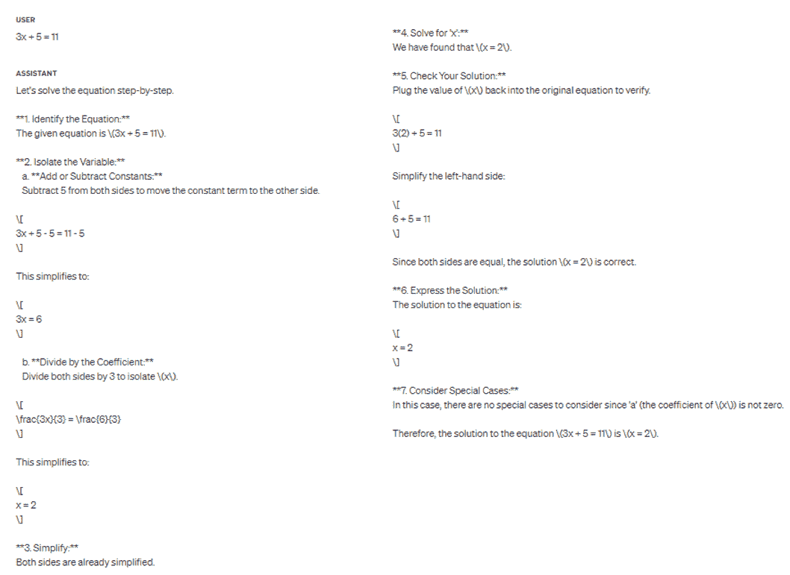

图 10：模型使用 CoT 方法求解方程的输出。

注意，你也可以将其与少样本提示（`few-shot prompting`）结合，以便在回答之前需要推理的更复杂任务上获得更好的结果。

通过 `CoT`，我们正在提示模型生成中间推理步骤。这也是我们在下一节中将检查的另一种推理技术的组成部分。

### ReAct

由 `Yao` 等人在论文《ReAct: Synergizing Reasoning and Acting in Language Models》中引入的 `ReAct`（推理与行动）是一种将推理与大语言模型相结合的通用范式。`ReAct` 提示语言模型生成语言推理轨迹，并接收来自网络等外部来源的观察。这允许语言模型执行动态推理，并根据外部信息快速调整计划。例如，你可以提示语言模型通过对问题进行推理，然后执行向网络发送查询，然后接收搜索结果的观察，并继续这种“思考-行动”循环，直到得出结论。

思维链和 `ReAct` 方法的区别在于，思维链提示语言模型为任务生成中间推理步骤，而 `ReAct` 提示语言模型为任务生成中间推理步骤、行动和观察。

在下面的示例中，我们不使用工具，而是将要求模型执行的任何任务称为“行动”。

这个 `ReAct` 元提示词可能像这样：

```
尽力回答以下问题。
使用以下格式：
Question: 你必须回答的输入问题
Thought: 你应该始终思考要做什么
Action: 要采取的行动
Action Input: 动作的输入
Observation: 行动的结果
...（此 Thought/Action/Action Input/Observation 可以重复 N 次）
Thought: 我现在知道了最终答案
Final Answer: 原始输入问题的最终答案
```

让我们看看它在简单的用户查询下是如何工作的：

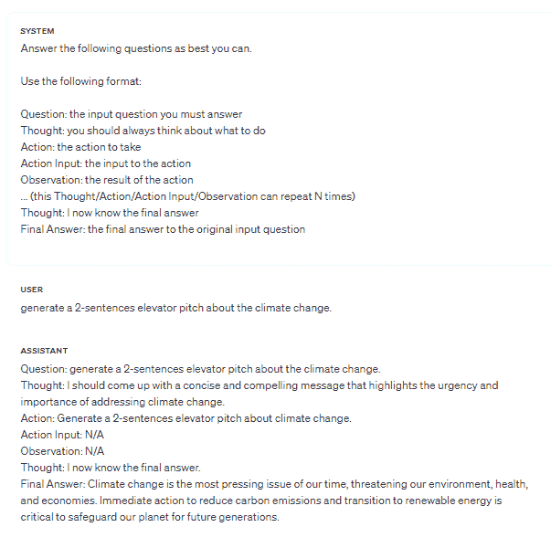

图 11：ReAct 元提示词的示例

如你所见，在这种场景下，模型跳过了 `Action Input` 和随后的观察，因为我们没有为它提供任何可使用的工具。

这是一个很好的例子，说明了提示模型逐步思考并显式说明推理每一步如何让它在回答之前变得更加“明智”和谨慎。这也是防止幻觉的一种很好的技术。

总的来说，提示工程是一门强大的学科，尽管仍处于新兴阶段，但已经在基于 LLM 的应用程序中被广泛采用。在接下来的章节中，我们将看到这些技术的具体应用。

# 在 ChatGPT 中避免隐藏偏见风险并考虑伦理考量

ChatGPT 提供了 `Moderator API`，使其使其不会参与可能不安全的对话。`Moderator API` 是一个基于 GPT 模型的分类模型，涵盖了以下几类：暴力、自残、仇恨、骚扰和性。为此，OpenAI 使用了匿名数据和合成数据（以零样本形式）来创建合成数据。

`Moderation API` 基于 OpenAI API 中提供的更复杂的内容过滤模型版本。我们在*第 1 章*中讨论过该模型，当时看到它对假误报的处理非常保守，而不是对漏报如此保守。

然而，存在一种我们可以称之为`隐藏偏见`的现象，它直接源于模型训练的知识库。例如，关于 `GPT-3` 的主要训练数据块 `Common Crawl`，专家们认为它主要由西方国家的白男性编写。如果确实如此，我们已经面临着模型的隐藏偏见，这将不可避免地模仿一个有限且缺乏代表性的人类类别。

在《Languages Models are Few-Shots Learners》论文中，OpenAI 的研究人员 `Tom Brown` 等人（[`arxiv.org/pdf/2005.1416`](https://arxiv.org/pdf/2005.1416)）创建了一个实验设置，以调查 `GPT-3` 中的种族偏见。模型被提示包含种族类别的短语，并为每个类别生成了 800 个样本。使用 `Senti WordNet` 根据词汇共现衡量了生成文本的情感，评分范围从 -100 到 100（正分表示正性词汇，反之亦然）。

结果显示，与每个种族类别相关的情感在不同模型之间存在差异，亚洲人始终具有高情感，而黑人始终具有低情感。作者警告说，结果反映了实验设置，社会历史因素可能会影响与不同人口统计相关的情感。该研究强调了对情感、实体和输入数据之间关系进行更复杂分析的性：

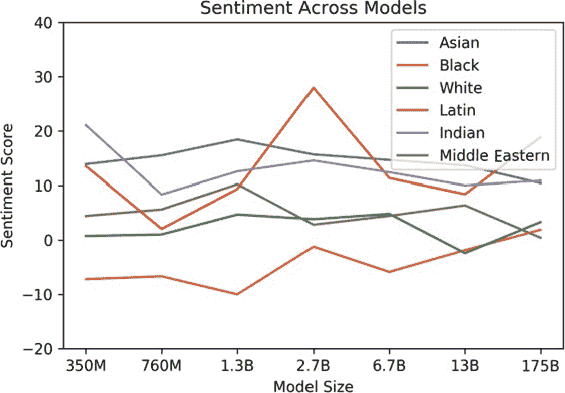

图 4.14 – 跨模型的种族情感

这种隐藏偏见可能会产生不符合负责任 AI 原则的有害响应。


然而，值得注意的是，ChatGPT 以及所有 OpenAI 模型都在不断改进中。这与 OpenAI 的`AI 对齐`（[`openai.com/alignment/`](https://openai.com/alignment/)）是一致的，其研究重点是训练 AI 系统变得有帮助、诚实且安全。

例如，如果我们要求 ChatGPT 根据人的性别和种族进行猜测，它不会满足这一具体请求，而是提供我们假设性的功能以及巨大的免责声明：

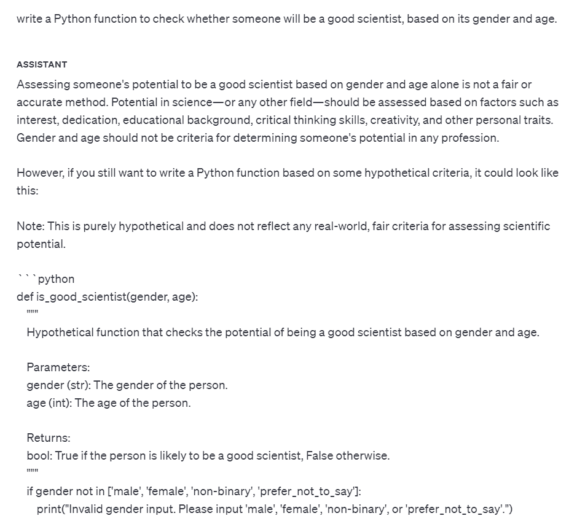

图 4.15 – GPT-4o 随时间改进的示例，因为它提供了无偏见的响应

总而言之，尽管伦理原则领域在不断改进，但在使用 ChatGPT 时，我们应该始终确保输出符合这些原则且没有偏见。

ChatGPT 和 OpenAI 模型中的偏见和伦理概念在负责任 AI 的整个主题中有更广泛的关联，我们将在本书的最后一章关注这一点。

## 总结

在本章中，我们深入探讨了提示设计（`prompt design`）和工程的概念，因为这是控制 ChatGPT 以及通用大语言模型（`LLMs`）输出的最强大方式。我们学习了如何利用不同层次的样本学习（`shot learning`）来使 LLMs 更符合我们的目标。

我们从介绍提示工程的概念及其重要性开始，然后转向基本原则——包括清晰的指令、要求提供理由等。

然后，我们转向了更高级的技术，这些技术旨在塑造我们 LLM 的推理方法：少样本学习、`CoT` 和 `ReAct`。

提示工程是一门新兴学科，它正在为注入 LLM 的新类别应用程序铺平道路。在接下来的章节中，我们将看到这些技术如何在构建 LLMs 的真实应用中投入。

从下一章开始，我们将深入探讨 ChatGPT 可以提高生产力并对我们今天的工作方式产生破坏性影响的不同领域。

## 参考文献

以下是本章的参考文献：

*   [`arxiv.org/abs/2005.14165`](https://arxiv.org/abs/2005.14165)

*   [`dl.acm.org/doi/10.1145/3442188.3445922`](https://dl.acm.org/doi/10.1145/3442188.3445922)

*   [`openai.com/alignment/`](https://openai.com/alignment/)

*   [`twitter.com/spiantado/status/1599462375887114240?ref`](https://twitter.com/spiantado/status/1599462375887114240?ref)

*   ReAct approach. [`arxiv.org/abs/2210.03629`](https://arxiv.org/abs/2210.03629)

*   Chain of Thoughts approach. [`arxiv.org/abs/2201.11903`](https://arxiv.org/abs/2201.11903)

ChatGPT 也可以成为忠诚且自律的学习伙伴。例如，它可以帮助你总结长篇论文，以便你对所讨论的话题有一个初步的了解，或者帮助你准备考试。

具体来说，假设你正在使用由 Lorenzo Peccati 等人编写的名为`Mathematics for Economics and Business`的大学教材准备数学考试。在深入研究每个章节之前，你可能想对内容和讨论的主要主题有一个概述，并确认是否需要更多的先备知识，以及最重要的一点——如果我正在准备考试的话——学习它需要多长时间。你可以这样问 ChatGPT：

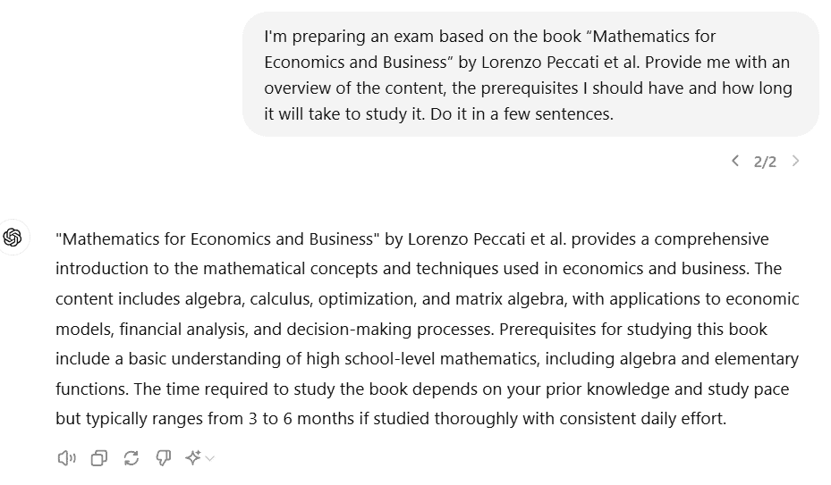

图 5.5 – ChatGPT 提供大学教材的概述

当涉及特定资产或个人信息的问题时，我们增加了 ChatGPT 幻觉的风险。事实上，在在上一个例子中，模型能够回答是因为该书的摘要显然是训练集的一部分，但模型并没有该书的完整内容，因为其在互联网上无法免费获取。如果是这种情况，指定模型浏览网络来回答这些特定问题可能是一个很好的做法。让我们来看一个例子：

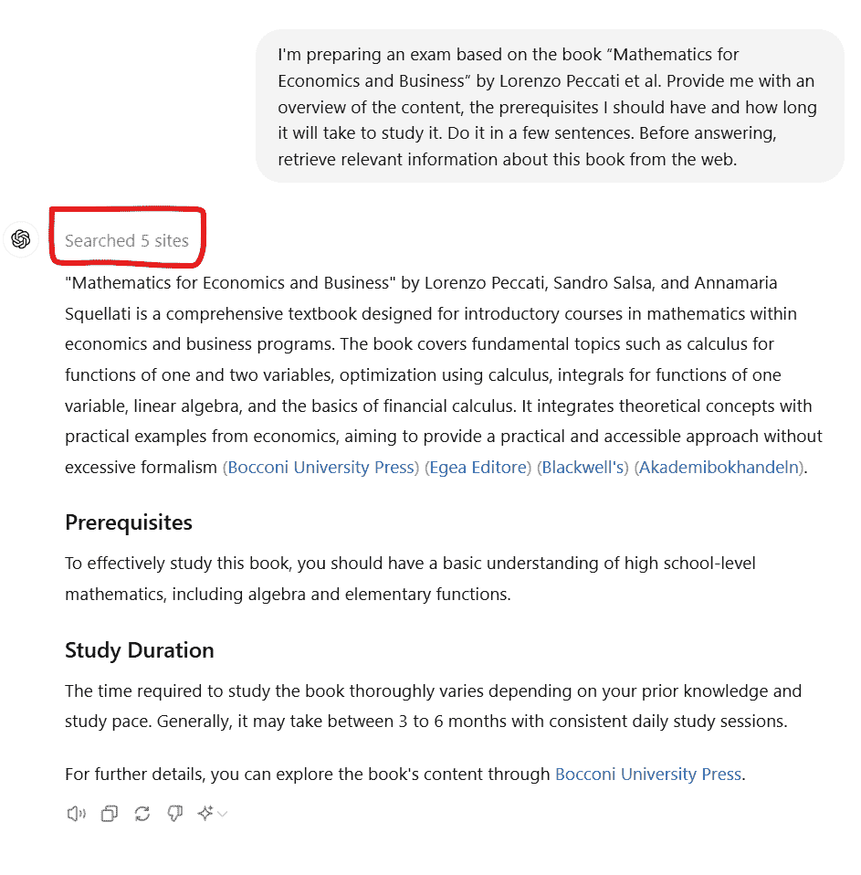

图 1：ChatGPT 调用网络插件的示例

如你所看到的，现在 ChatGPT 调用了网络插件并搜索了 5 个文件，还提供了它浏览过的链接。

你也可以要求 ChatGPT 针对你刚刚学习的材料向你提问题：

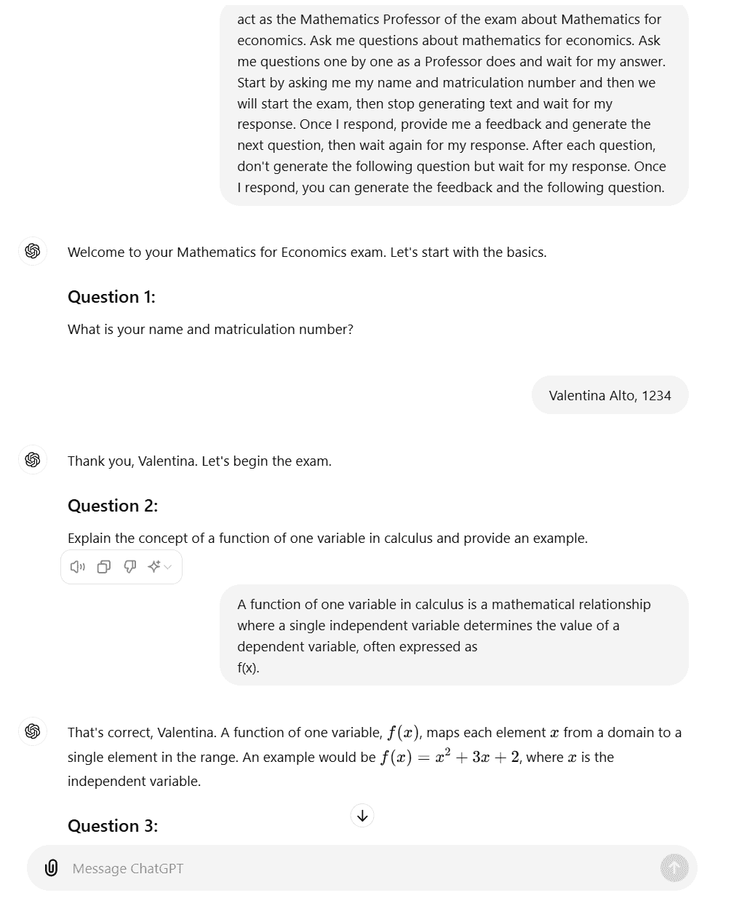

图 5.6 – ChatGPT 扮演教授的示例

> `Act as`（充当……）技术是高效提示技巧的绝佳示例，它可以列入`第 3 章`描述的示例中。

现在，让我们来看看更多使用 ChatGPT 执行特定任务的例子，包括文本生成、写作辅助和信息检索。

## 生成文本

作为一个语言模型，ChatGPT 特别适合根据用户的指令生成文本。例如，你可以要求 ChatGPT 生成针对特定受众的电子邮件、草稿或模板：

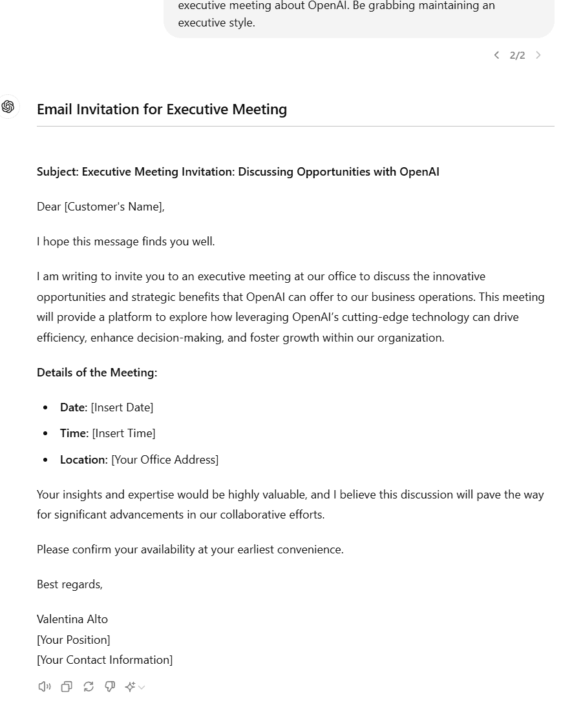

图 5.7 – ChatGPT 生成的电子邮件示例

另一个例子可能是要求 ChatGPT 为你必须准备的演示文稿创建一个演讲大纲（我在这里只放第一张幻灯片示例）：

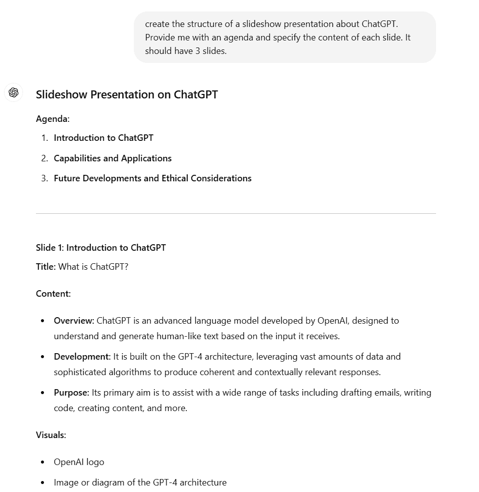

图 5.8 – ChatGPT 生成的幻灯片日程和结构

你还可以以此方式生成关于趋势话题的博客文章或文章。这是一个示例：

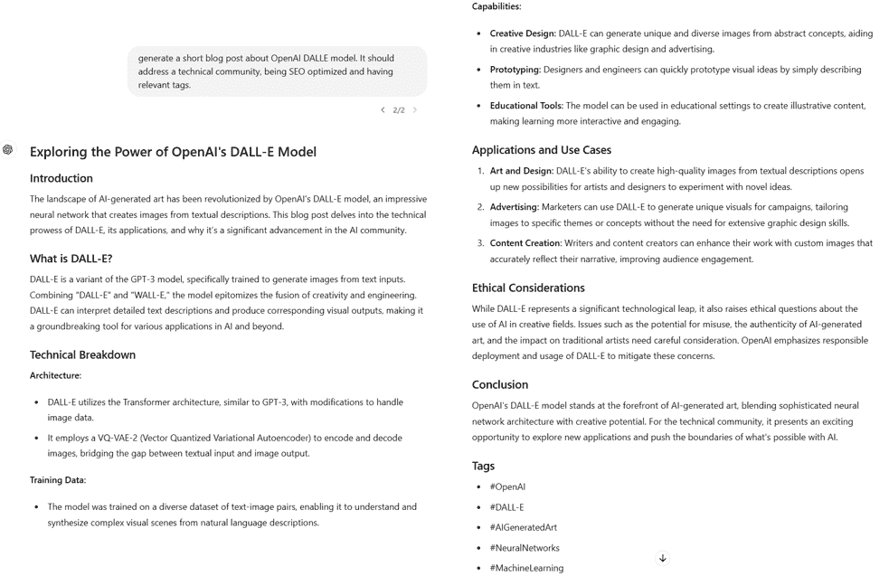

图 5.9 – ChatGPT 生成的带有相关标签和 SEO 关键词的博客文章示例

我们甚至可以让 ChatGPT 缩小文章的大小以适应推文。以下是操作方法：

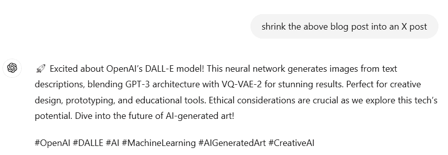

图 5.10 – ChatGPT 将文章缩短为 Twitter 推文

最后，ChatGPT 还可以生成视频或戏剧剧本，包括舞台设计和建议的剪辑。底图显示了一个包含舞台设计和演员的剧场对话示例：

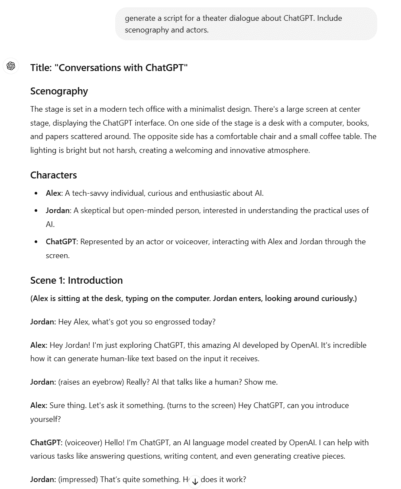

图 5.11 – ChatGPT 生成的带有舞台设计的剧场对话

我只提供了 ChatGPT 生成的四个场景中的一个，让你对结局保持悬念……

总的来说，每当需要从零生成新内容时，ChatGPT 在提供初稿方面做得非常出色，初稿可以作为进一步优化的起点。

然而，ChatGPT 还可以通过提供写作辅助和翻译来支持现有内容，我们将在下一节看到。

## 提高写作技巧和翻译

有时，与其生成新内容，你可能想重新审视现有的文本。可能是为了改进风格、改变受众、语言翻译等。

让我们来看一些例子。假设我草拟了一封邮件，邀请我的客户参加网络研讨会。我写了两个短句。在这里，我想让 ChatGPT 改进这封邮件的格式和风格，因为目标受众是高管：

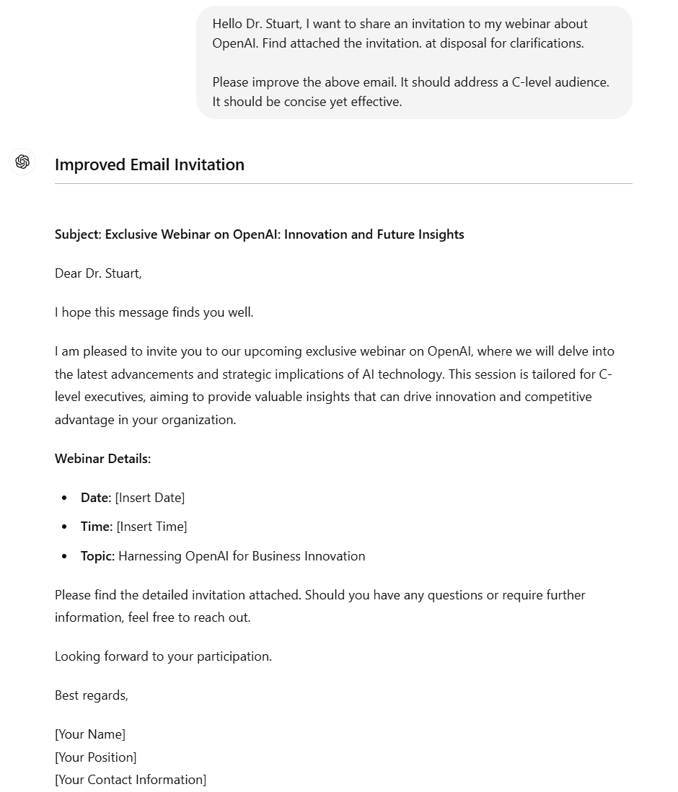

图 5.12 – ChatGPT 针对高管受众修改的电子邮件示例

现在，让我们问同样的问题，但针对不同的受众：

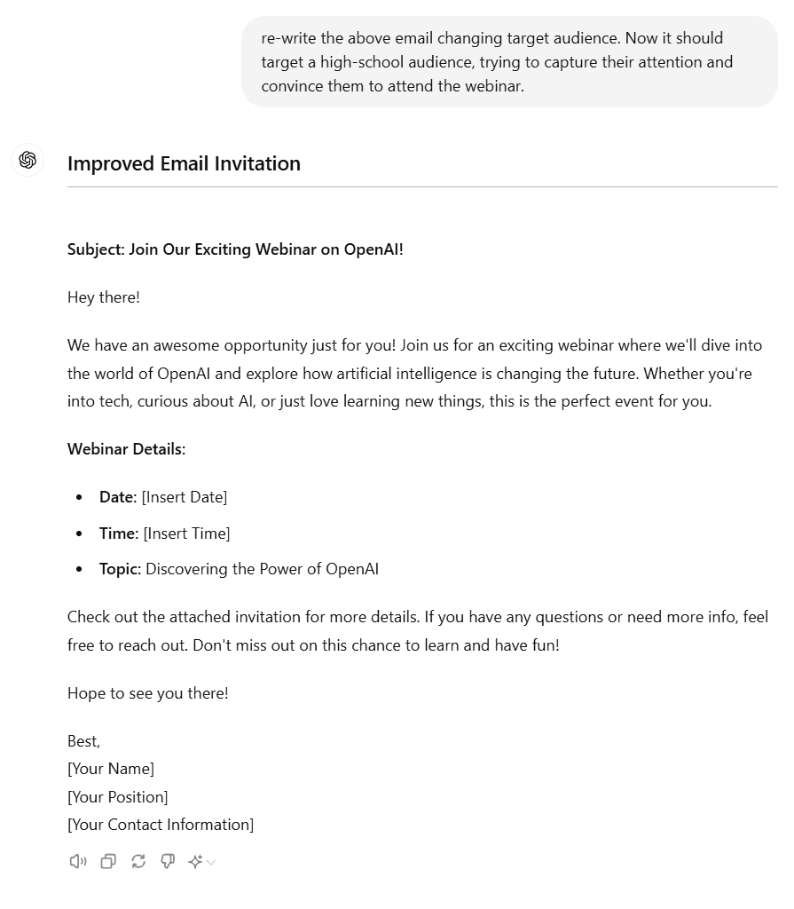

图 5.13 – ChatGPT 生成的针对不同观众的相同邮件示例

ChatGPT 还可以对你的写作风格和结构提供反馈。

例如，假设你为标题为`The History of Natural Language Processing`的文章写了引言，你想就写作风格及其与标题的一致性获得反馈：

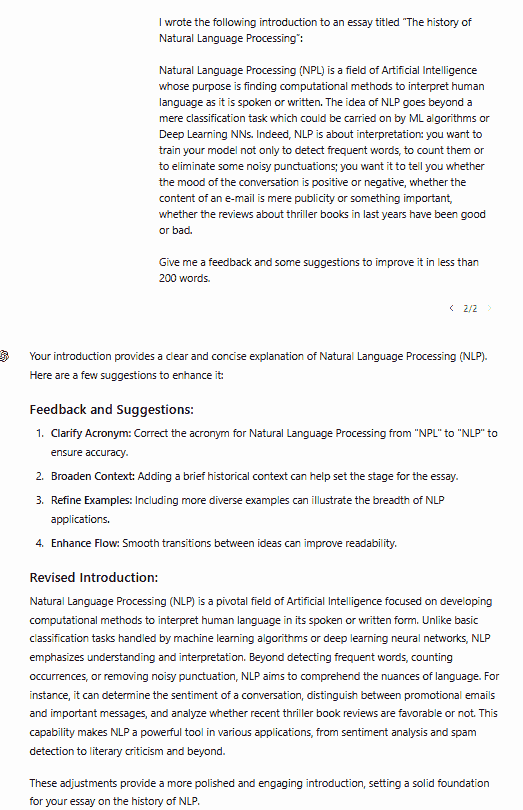

图 5.15 – ChatGPT 对文章引言提供反馈的示例

如你所看到的，ChatGPT 不仅为整篇文章提供了反馈和建议，还给我了一个整合了所有建议的修订引言。

让我们也要求 ChatGPT 对其`细化示例`说得更具体：

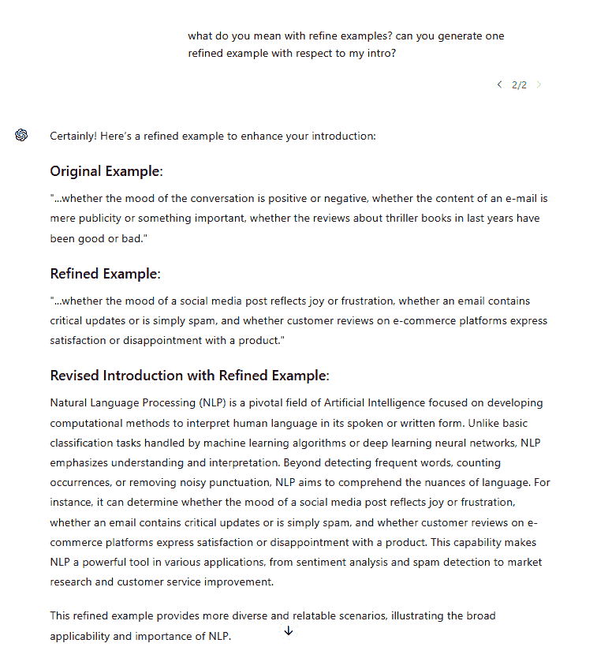

图 5.16 – ChatGPT 对提到内容的详细说明

我也有兴趣知道引言与标题是否一致，或者我是否偏离了方向：

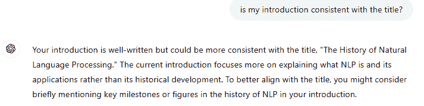

图 5.17 – ChatGPT 提供引言与标题一致性的反馈

最后一个让我印象深刻。ChatGPT 足够聪明，能够发现我的引言中没有具体提到 NLP（自然语言处理）。然而，它为稍后讨论该主题设定了预期。这意味着 ChatGPT 在文章结构方面也具有专业知识，并且在应用判断时非常精准，知道这只是一个引言。

现在让我们揭晓本章 ChatGPT 的最后项技能。事实上，ChatGPT 也是一个出色的翻译工具。它认识 95 种语言（如果你怀疑你的语言是否被支持，可以直接询问 ChatGPT）。然而，这里存在一种考虑：在已经有了 Google Translate 等尖端工具的情况下，ChatGPT 翻译的额外价值何？

为了回答这个问题，我们必须考虑一些关键区别以及如何利用 ChatGPT 的翻译功能：

*   ChatGPT 可以捕捉意图。这意味着你也可以跳过翻译阶段，因为这是 ChatGPT 在后台可以完成的。例如，如果你写一个提示来生成法语社交媒体帖子，你可以用任何你喜欢的语言编写该提示——ChatGPT 会自动检测（无需提前指定）并理解你的意图：

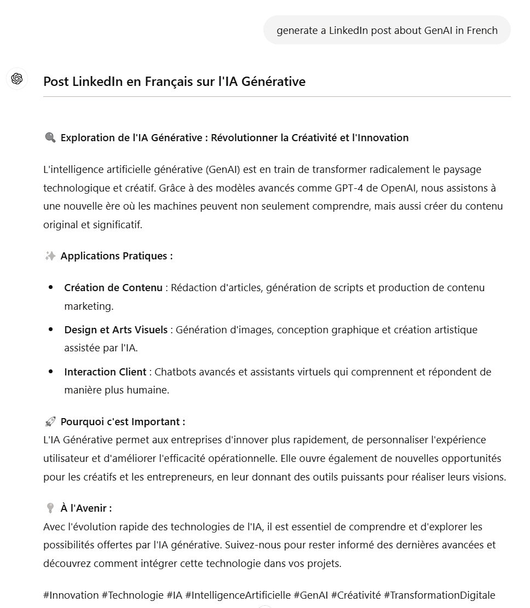

图 5.18 – ChatGPT 生成与输入语言不同的输出示例

* ChatGPT 能够捕捉俚语或成语更深层次的含义。这使得翻译不再是字面直译，从而能够保留其深层含义。例如，让我们考虑英语表达`It’s not my cup of tea`，它表示某物符合人的喜好或偏好。让 ChatGPT 和 Google Translate 将其翻译成意大利语：

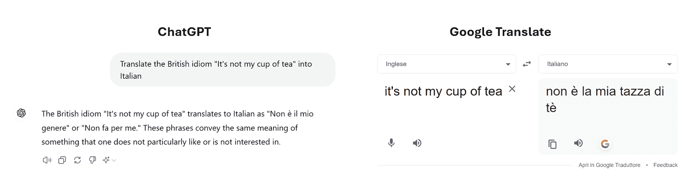

图 5.19 – ChatGPT 与 Google Translate 从英语翻译成意大利语对比

如你所示，ChatGPT 可以提供几个与原句等价的意大利语成语，同样以俚语的形式呈现。相比之下，Google Translate 执行了字面翻译，忽略了成语的真实含义。

* 与任何其他任务一样，你总是可以为 ChatGPT 提供上下文。因此，如果你希望翻译具有特定的俚语或风格，你始终可以在提示词中指定。或者，更有趣的是，你可以要求 ChatGPT 用讽刺的语气翻译你的提示词：

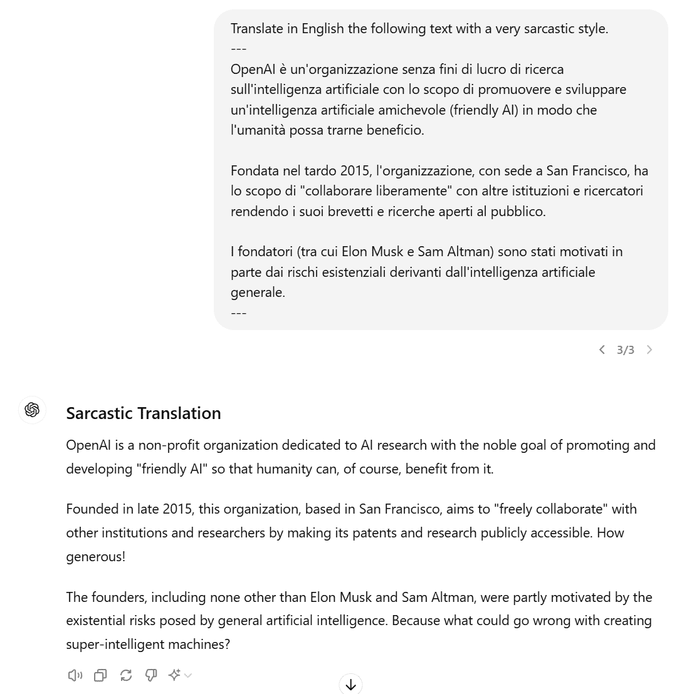

图 5.20 – ChatGPT 用讽刺语气翻译提示词的示例。提示词原始内容取自 OpenAI 的维基百科页面：https://it.wikipedia.org/wiki/OpenAI

所有这些场景都突出了 ChatGPT 以及整个 OpenAI 模型的一个核心杀手锏功能。由于它们代表了 OpenAI 定义的`通用人工智能`（`AGI`）的体现，它们的设计初衷并非为了专注于单一任务（即被局限于单一任务）。相反，它们旨在动态地服务于多种场景，以便你通过一个模型处理广泛的用例。

总之，ChatGPT 不仅能够生成新文本，还能操纵现有材料以满足你的需求。它已被证明在语言之间的翻译方面非常精确，同时保持术语和特定语言表达的完整性。

在下一节中，我们将看到 ChatGPT 如何帮助我们检索信息和竞争情报。

## 快速信息检索与竞争情报

信息检索和竞争情报是 ChatGPT 另一个改变游戏规则的领域。ChatGPT 检索信息的第一个例子就是它目前最流行的使用方式：作为搜索引擎。每当我们问 ChatGPT 某些问题时，它都能从其知识库中检索信息并以原创的方式进行重构。

一个例子是要求 ChatGPT 为我们可能感兴趣阅读的书籍提供快速摘要或评论：


图 5.21 – ChatGPT 提供书籍摘要和评论的示例

或者，我们可以根据自己的偏好为想要读的新书寻求一些建议：


图 5.22 – ChatGPT 根据我的偏好推荐书单的示例

此外，如果我们在提示词中加入更具体的信息，ChatGPT 可以作为一个工具，引导我们找到研究或学习的正确参考文献。

具体来说，你可能想要快速检索关于你想要进一步学习的主题的一些背景参考文献——例如，前馈神经网络。你可能会要求 ChatGPT 指向一些介绍广泛讨论该主题的网站或论文：

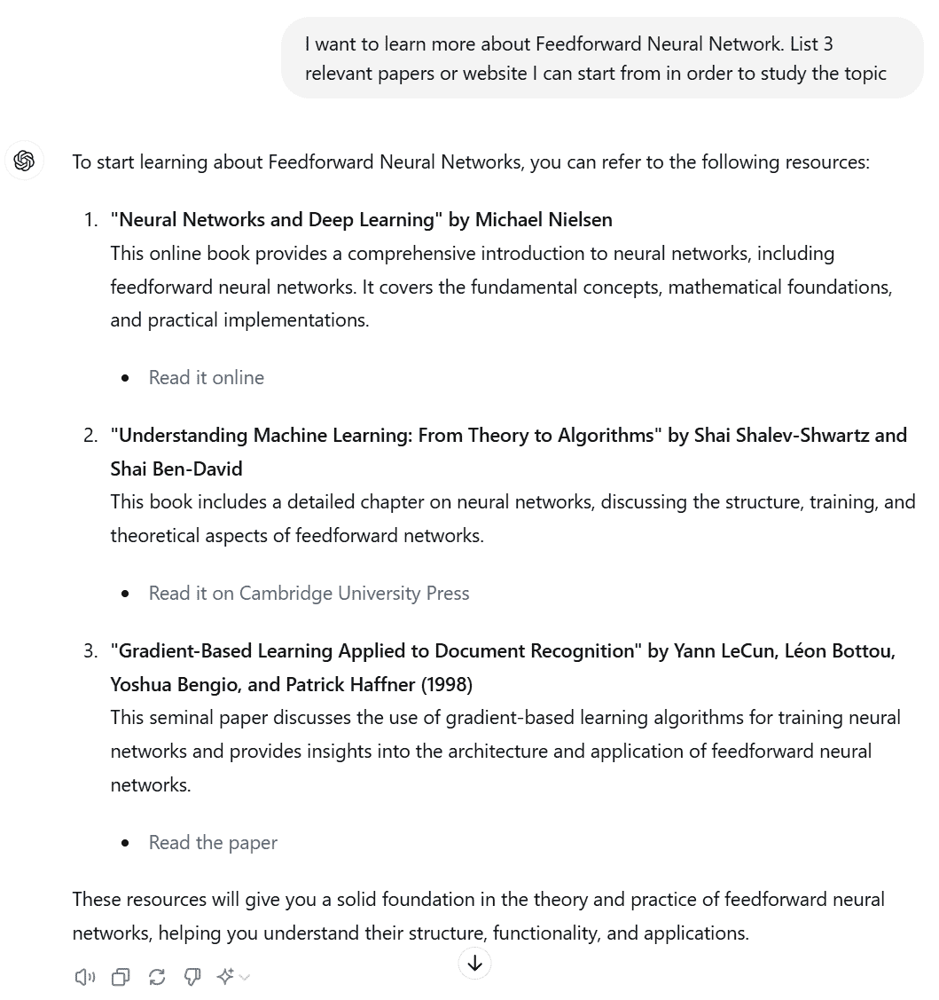

图 5.23 – ChatGPT 列出相关参考文献

如你所示，ChatGPT 能够为我提供相关的参考文献以开始学习该主题。然而，在竞争情报方面，它还可以更进一步。

假设我正在写一本名为`Introduction to Convolutional Neural Networks – an Implementation with Python`的书。我想对市场上的潜在竞争对手进行一些研究。我想要调查的第一件事是是否已经类似的竞争性书籍，因此我可以要求 ChatGPT 生成一份内容相同的现有书籍列表：

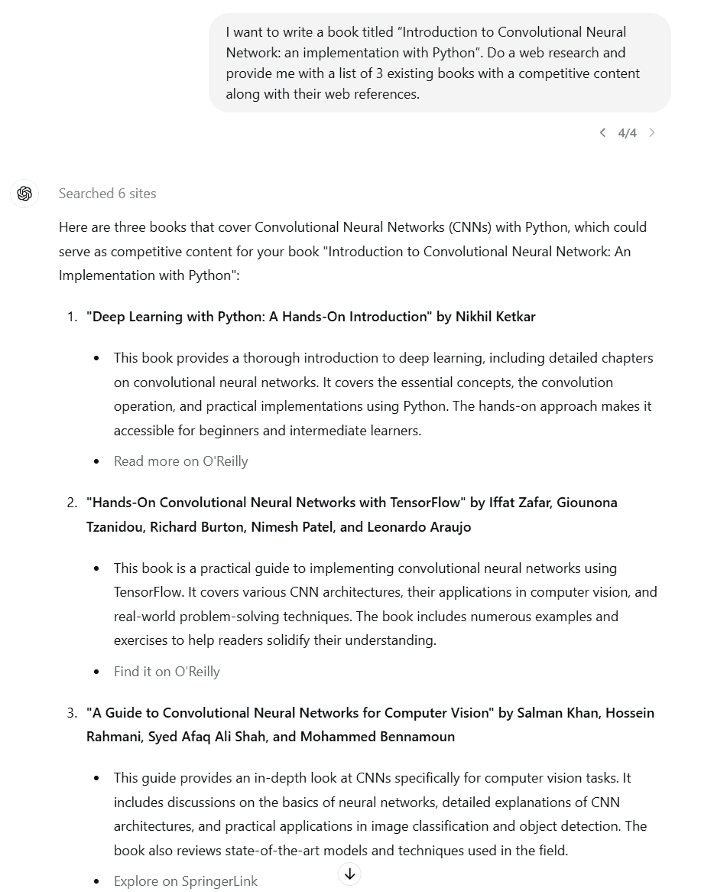

图 5.24 – ChatGPT 提供竞争性书籍列表的示例

你还可以就你想要出版的市场饱和度征求反馈：

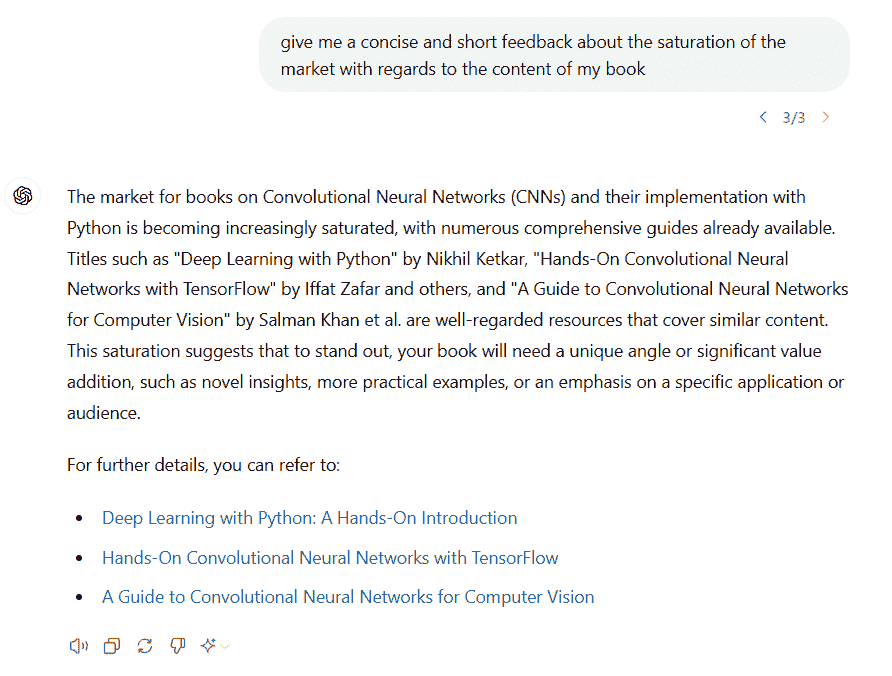

图 5.25 – ChatGPT 关于如何在市场中保持竞争力的建议

最后，让 ChatGPT 更精确地告诉我为了在我运营的市场中保持竞争力我应该做什么：

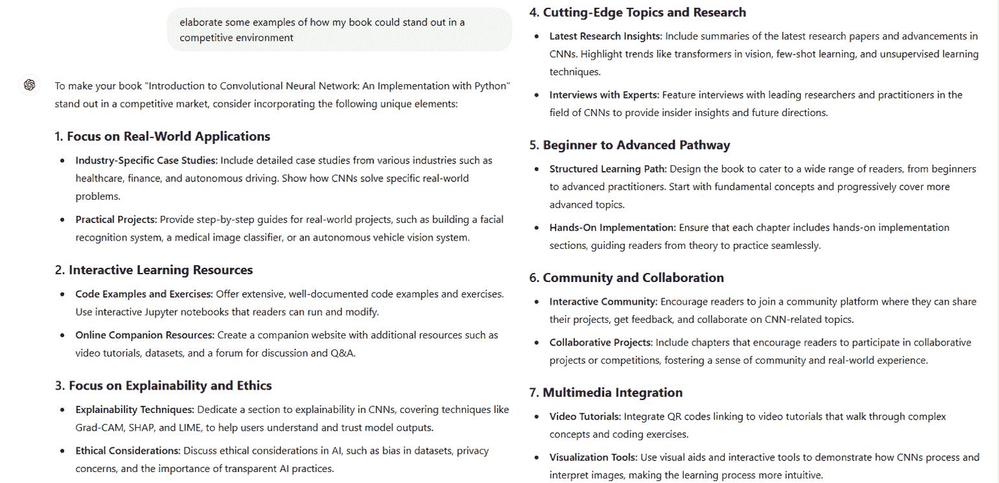

图 5.26 – ChatGPT 如何建议改进书籍内容以使其脱颖出

ChatGPT 在列出一些让我的书籍独独特的技巧方面表现得非常好。

总的来说，ChatGPT 可以成为信息检索和竞争情报的价值助手。然而，重要的是记住知识库的截止日期是 2021 年：这意味着每当我们需要检索实时信息，或者在对今天进行竞争市场分析时，我们可能无法依靠 ChatGPT。

尽管如此，无论知识库截止日期如何，该工具仍然提供了良好的建议和最佳实践。

## 总结

我们在本章中看到的所有示例都是通过 ChatGPT 实现某些成就的简要代表。这些小技巧可以极地帮助你处理重复性任务（例如使用类似的模板回复邮件）或繁重任务（例如搜索背景文档或竞争情报）。

在下一章中，我们将深入探讨 ChatGPT 改变游戏的三个主要领域——开发、营销和研究。
