# 5 使用 ChatGPT 开发未来

## 加入我们的 Discord 社区


[`packt.link/EarlyAccess`](https://packt.link/EarlyAccess)

在本章中，我们将讨论开发者如何利用 ChatGPT。本章重点关注 ChatGPT 在开发者领域的主要用例，包括代码审查和优化、文档生成以及代码生成。本章将提供示例并让你能够亲自尝试这些提示词。

在对为什么开发者应该利用 ChatGPT 作为日常助手进行通用介绍后，我们将关注 ChatGPT 以及它如何完成以下任务：

* 为什么开发者需要 ChatGPT？

* 生成、优化和调试代码

* 生成代码文档并调试你的代码

* 解释`机器学习`（`ML`）模型，帮助数据科学家和业务用户理解模型解释性

* 翻译不同的编程语言

在本章结束时，你将能够利用 ChatGPT 进行编码活动，并将其作为编码生产力的助手。

## 为什么开发者需要 ChatGPT？

我个人认为，ChatGPT 最令人惊讶的能力之一就是处理代码。处理任何类型的代码。我们已经在之前的章节中看到了一些 ChatGPT 生成 Python 代码的示例。然而，ChatGPT 对开发者而言的能力远超这个例子。它可以作为代码生成、解释和调试的日常助手。


在最流行的语言中，我们当然提到 Python、JavaScript、SQL 和 C#。然而，正如 ChatGPT 自己所言，它涵盖了广泛的语言：

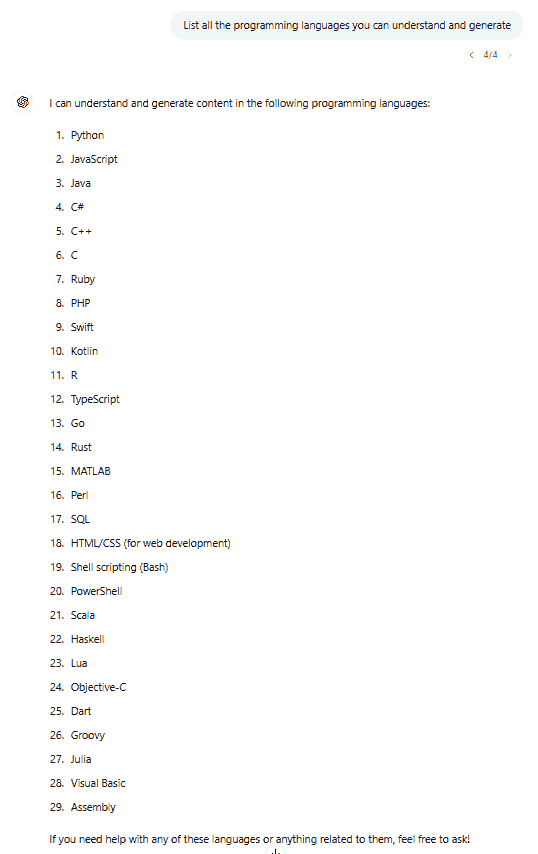

图 6.1 – ChatGPT 列出了它能够理解和生成的编程语言

无论你是后端/前端开发者、数据科学家还是数据工程师，只要你使用编程语言，ChatGPT 都能成为游戏规则的改变者，我们将在接下来几节的示例中看到这一点。

从下一节开始，我们将深入探讨 ChatGPT 在处理代码时可以实现的具体示例。我们将看到涵盖不同领域的端到端用用例，以便我们熟悉如何将 ChatGPT 作为代码助手。

## 生成、优化和调试代码

你应该利用的核心能力是 ChatGPT 的代码生成。你有多少次在寻找一段预构建的代码作为起点呢？例如生成 `utils` 函数、示例数据集、`SQL` 架构等？ChatGPT 能够根据自然语言输入生成代码：

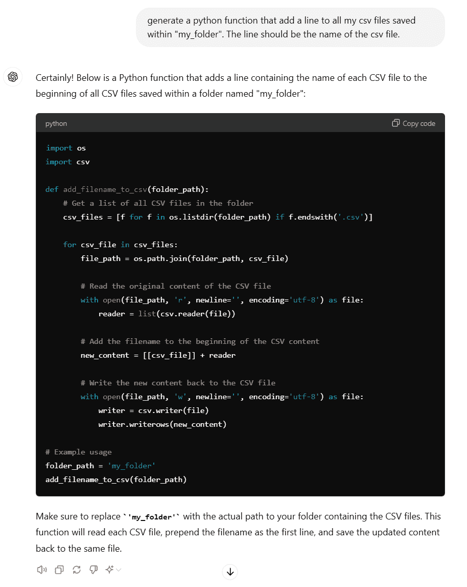

图 6.2 – ChatGPT 生成写入 CSV 文件的 Python 函数的示例

如你所见，ChatGPT 不仅能够生成该函数，还能解释该函数的功能、如何使用它，以及用诸如 `my_folder` 的通用占位符替换哪些内容。

现在让我们提高难度。如果 ChatGPT 能够生成一个 Python 函数，它还能生成整个视频游戏吗？让我们试一下。我想做给 ChatGPT 提供一张我想要开发的游戏类型的插图，并要求它用代码来实现。以下是我理想游戏的插图（你能猜出它的名字吗？）：


图 1：吃豆人游戏的插图。

现在让我们要求 ChatGPT 重现它：

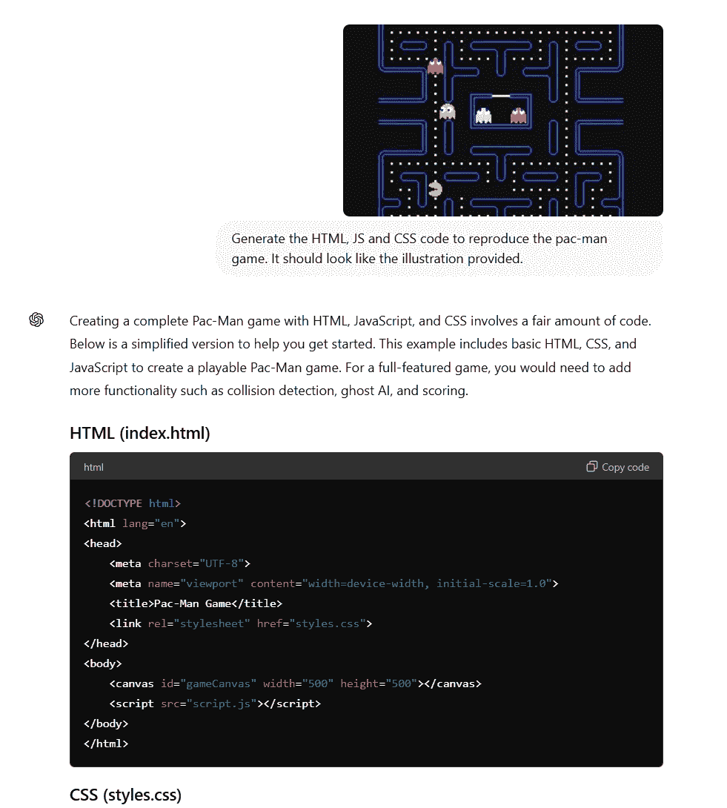

图 2：ChatGPT 生成 HTML、CSS 和 JS 代码的示例。

正如 ChatGPT 所言，完整游戏需要大量代码，但让我们看看生成的代码目前是如何运作的（为了运行代码，我使用了在线工具 `codepen.io`）：


图 3：ChatGPT 生成的吃豆人游戏。

如你所见，原型产品看起来已经与我的目标相似了！这是一个生成式 AI 如何帮助你克服“从零开始的魔咒”的例子：事实上，从一份白皮书开始有时会令人受阻，而拥有草案产品作为起点不仅可以加快整个过程，还能激发创意并提高结果质量。

ChatGPT 也是代码优化的出色助手。事实上，它可以通过根据我们的输入创建优化脚本，从而节省一些运行时间或计算能力。这种能力在自然语言领域，可以与我们在第 5 节“提高写作技巧和翻译”部分看到的写作辅助功能相比。

例如，假设你想从另一个列表创建一个奇数列表。为了实现这一结果，你写了以下 Python 脚本（为了练习，我还将使用 `timeit` 和 `datetime` 库来跟踪执行时间）：

```python
from timeit import default_timer as timer from datetime import timedelta
start = timer()
elements = list(range(1_000_000)) data = []
for el in elements: if not el % 2:
# 如果奇数 data.append(el)
end = timer() print(timedelta(seconds=end-start))
```

让我们看看运行需要多长时间：

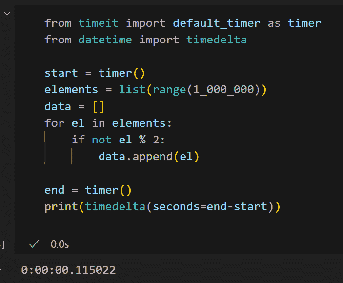

图 4：Python 函数的执行速度。

执行时间为 00.115022 秒。如果我们要求 ChatGPT 优化这个脚本会发生什么？

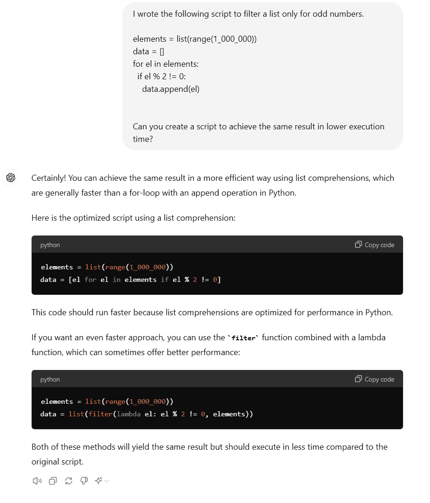

图 6.6 – ChatGPT 为 Python 脚本生成优化替代方案

ChatGPT 为我提供了两个示例，以更低的执行时间实现相同的结果。

让我们在 Jupyter Notebook 中测试两者：

```
2023-03-25 11:27:10.270 Uncaught app exception Traceback (most recent call):
File "C:\Users\vaalt\Anaconda3\lib\site-packages\streamlit\runtime\ scriptrunner\script_runner.py", line 565, in _run_script
exec(code, module. dict )
File "C:\Users\vaalt\OneDrive\Desktop\medium articles\llm.py", line 129, in <module>
user_input = get_text()
File "C:\Users\vaalt\OneDrive\Desktop\medium articles\llm.py", line 50, in get_text
```

当你处理新的应用程序或项目时，将代码与文档联系起来是一个良好的习惯。它可能以 docstring（文档字符串）的形式存在，你可以将其嵌入到函数或类中，以便他人可以在开发环境中直接调用它们。

例如，让我们考虑上一个节中开发的同一个函数，并将其转换为一个 Python 类：

```
class UnderscoreAdder:
    def __init__(self, word):
        self.word = word
    def add_underscores(self):
        new_word = ""
        for i in range(len(self.word)):
            new_word += self.word[i] + "_"
        return new_word
```

我们可以对其进行如下测试：

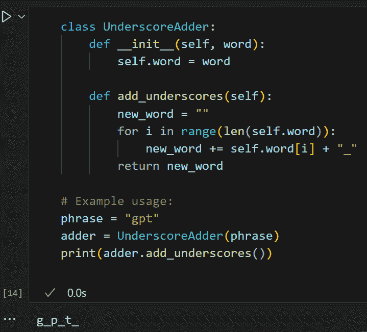

图 5：测试 `UnderscoreAdder` 类。

现在，假设我想要通过 `UnderscoreAdder` 约定来检索 docstring 文档。通过对 Python 包、函数和方法进行这种操作，我们可以获得该特定对象能力的完整文档，如下（使用 `pandas` Python 库的示例）：

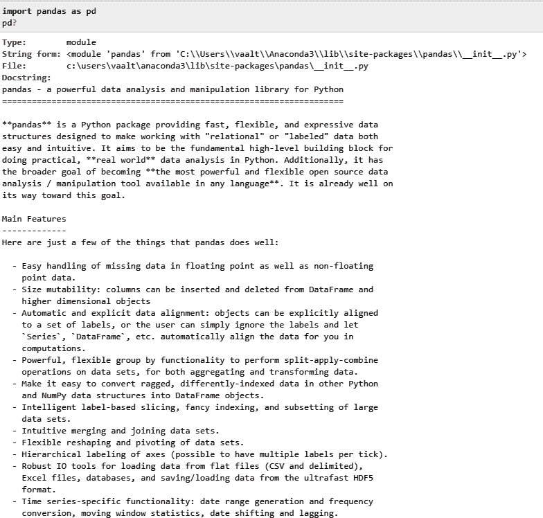

图 6.13 – `pandas` 库文档示例。

现在，让我们让 ChatGPT 为我们的 `UnderscoreAdder` 类产生相同的结果。

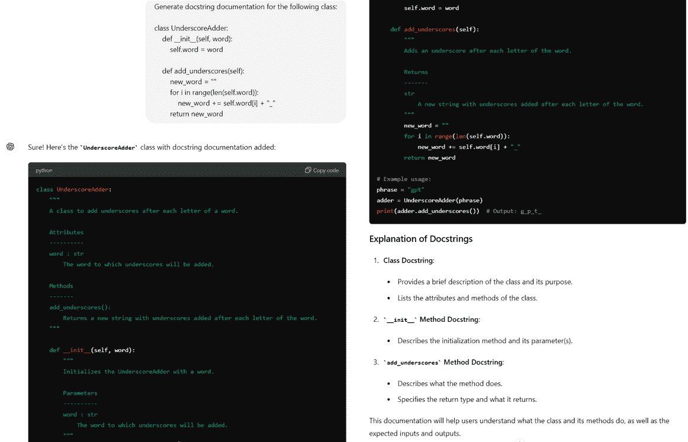

图 6.14 – ChatGPT 用文档更新代码。

结果，如果我们按照前面的代码更新了我们的类和 `UnderscoreAdder?`，我们将得到如下输出：

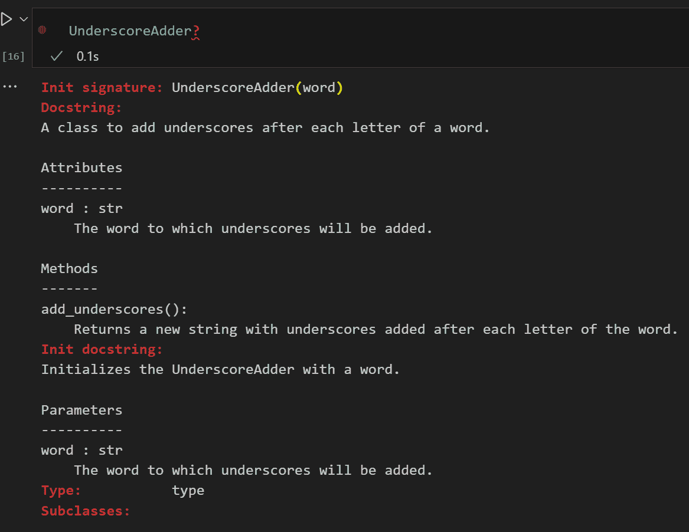

图 6.15 – 新的 `UnderscoreAdder` 类文档。

最后，还可以利用 ChatGPT 用自然语言解释脚本、函数、类或其他类似内容的功能。我们已经看到许多 ChatGPT 用清晰的解释来丰富其代码相关的回答的示例。然而，我们可以通过就代码理解方面提出特定问题来增强这种能力。

例如，让我们让 ChatGPT 向我们解释以下 Python 脚本的作用：

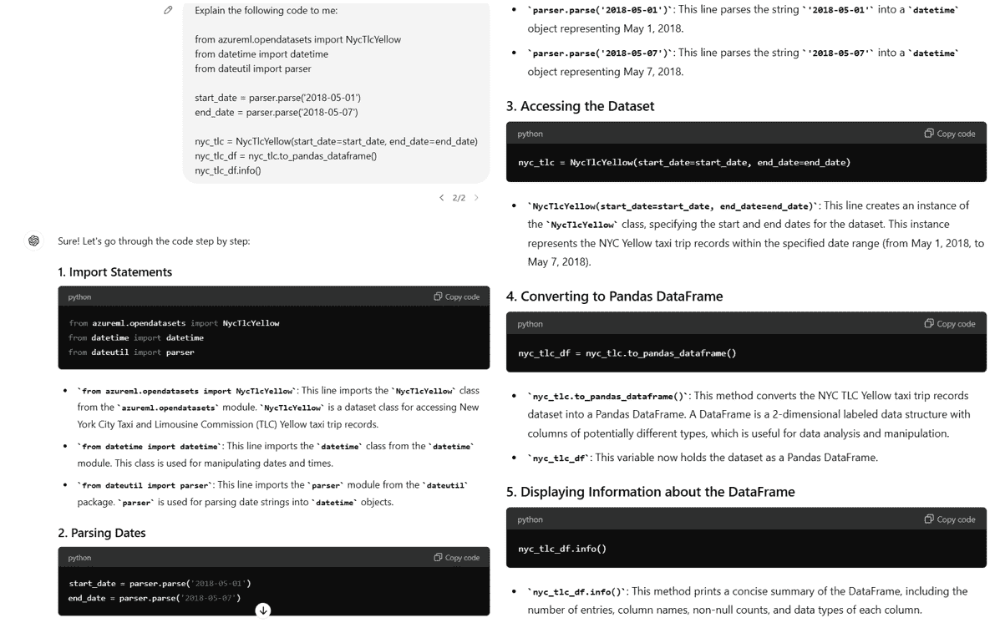

图 6.16 – ChatGPT 解释 Python 脚本的示例。

代码可解释性也可以是上述文档的一部分，也可以用于开发者之间，他们可能想更好地理解其他团队的复杂代码，或者（有时在我身上发生）记住他们以前写过的内容。

得益于 ChatGPT 和本节提到的功能，开发者可以轻松用自然语言跟踪项目生命周期，以便让新团队成员和非技术用户都更容易理解目前完成的工作。

我们将在下一节中看到，代码可解释性是数据科学项目中 ML 模型可解释性的关键一步。

## 理解 ML 模型可解释性

模型可解释性是指人类理解 ML 模型预测背后逻辑的难易程度。本质上，它是理解模型如何做出决策以及哪些变量对其预测做出贡献的能力。

让我们来看使用深度学习卷积神经网络（`CNN`）进行图像分类的模型可解释性示例。我使用 Python 和 `Keras` 构建了我的模型。为此，我将直接从 `keras.datasets` 下载 `CIFAR-10` 数据集：它包含 60,000 张 32x32 的彩色图像（即 3 通道图像），分为 10 类（飞机、汽车、鸟、猫、鹿、狗、蛙、马、船和卡车），每类 6,000 张图像。在这里，我将仅分享主体；你可以在书籍 GitHub 仓库中找到数据准备和预处理的所有相关代码：[`github.com/PacktPublishing/The-Ultimate-Guide-to-ChatGPT-and-OpenAI/tree/main/Chapter%206%20-%20ChatGPT%20for%20Developers/code`](https://github.com/PacktPublishing/The-Ultimate-Guide-to-ChatGPT-and-OpenAI/tree/main/Chapter%206%20-%20ChatGPT%20for%20Developers/code):

```
model=tf.keras.Sequential()
model.add(tf.keras.layers.Conv2D(32,kernel_ size=(3,3),activation='relu',input_shape= (32,32,1)))
model.add(tf.keras.layers.MaxPooling2D(pool_size=(2,2))) model.add(tf.keras.layers.Flatten()) model.add(tf.keras.layers.Dense(1024,activation='relu')) model.add(tf.keras.layers.Dense(10,activation='softmax'))
```

前面的代码由执行不同操作的几个层组成。我可能对模型结构的解释以及每一层的作用感兴趣。让我们让 ChatGPT 在这方面提供帮助（在下方你可以看到回复的片段）：

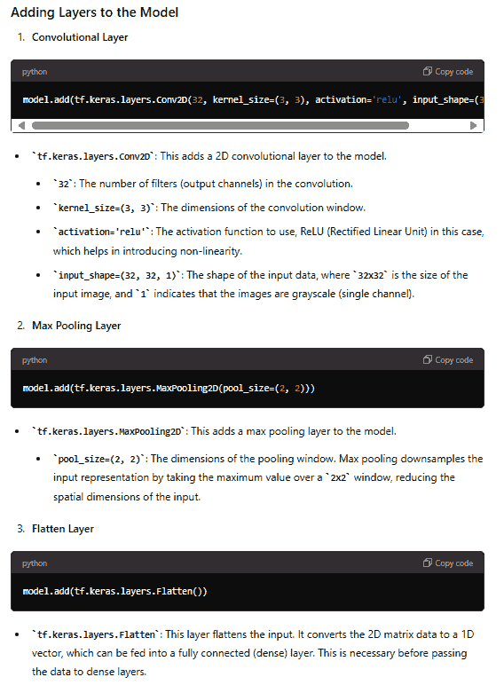

图 6.17 – 使用 ChatGPT 进行模型可解释性。

如前面的图所示，ChatGPT 能够为我们的 `CNN` 结构和层提供清晰的解释。它还会添加一些注释和提示，例如使用池化层有助于减少输入的维度。

我也可以通过 ChatGPT 在验证阶段支持解释结果。因此，在将数据分为训练集和测试集并在训练集上训练模型后，我想查看在测试集上的性能：

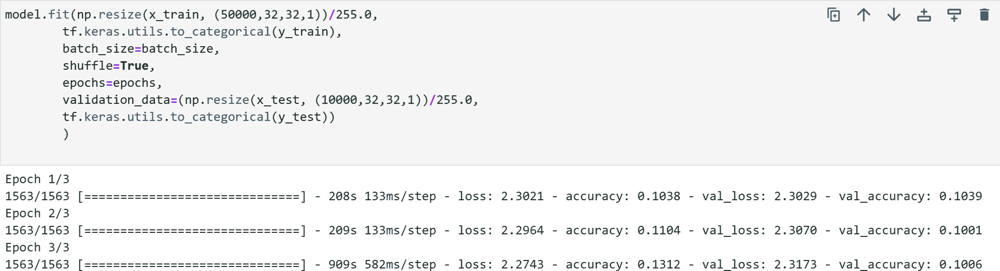

图 6.18 – 标。

让我们也让 ChatGPT 详细说明我们的验证指标（截断输出）：

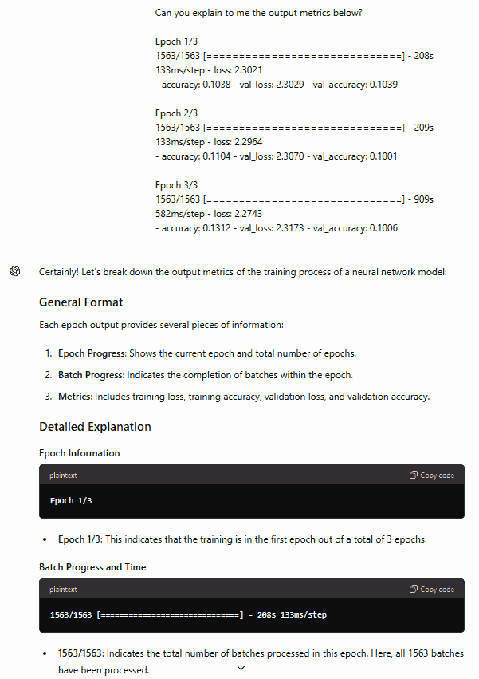

图 6.19 – ChatGPT 解释指标的示例。

再次，结果非常令人印象深刻，它就如何针对训练和测试集设置 ML 实验提供了清晰的指导。

模型可解释性重要有很多原因。一个关键因素是它缩小了业务用户与模型代码之间的差距。这是让业务用户理解模型如何运行以及将其转化为代码想法的关键。

此外，模型可解释性实现了负责任和伦理 AI 的核心原则之一，即 AI 系统背后思考和行为的透明度。解锁模型可解释性意味着检测模型在运行时可能出现的偏见或有害行为，并防止它们的发生。

总而言之，正如我们在前面的示例所示，ChatGPT 在模型可解释性方面可以提供价值支持。

我们将探索的下一个 ChatGPT 功能是开发者生产力的另一个助力，当同一个项目使用多种编程语言时。

## 不同编程语言之间的翻译

在第 5 节中，我们看到了 ChatGPT 在不同语言之间翻译的强大能力。真正令人惊的是，自然语言并不是它唯一的翻译对象。事实上，ChatGPT 能够在不同的编程语言之间进行翻译，同时保持相同的输出和风格（即保留存在的 docstring 文档）。

在许多场景下，这可能会改变游戏规则。

例如，你可能需要学习一种以前从未见过的新编程语言或统计工具，因为你需要快速交付该项目。在 ChatGPT 的帮助下，你可以用你偏好的语言开始编程，然后让它翻译成目标语言，你可以在翻译的过程中同时学习该语言。

想象一下，某个项目需要在 MATLAB（一种由 MathWorks 开发的专有数值计算和编程软件）中交付，而你一直都在用 Python 进行编程。该项目包含对**美国国家标准与技术研究院**（**MNIST**）数据集中的图像进行分类（原始数据集描述和相关论文可以在此处通过 [`yann.lecun.com/exdb/mnist/`](http://yann.lecun.com/exdb/mnist/) 找到）。该数据集包含大量手写数字，经常被用于教授各种图像处理系统。

首先，我编写了以下 Python 代码来初始化一个用于分类的深度学习模型：

```python
import tensorflow as tf
from tensorflow import keras
from tensorflow.keras import layers
## Load the MNIST dataset
(x_train, y_train), (x_test, y_test) = keras.datasets.mnist.load_ data()
# Preprocess the data
x_train = x_train.reshape(-1, 28*28) / 255.0 x_test = x_test.reshape(-1, 28*28) / 255.0 y_train = keras.utils.to_categorical(y_train) y_test = keras.utils.to_categorical(y_test)
# Define the model architecture model = keras.Sequential([
layers.Dense(256, activation='relu', input_shape=(28*28,)), layers.Dense(128, activation='relu'),
layers.Dense(10, activation='softmax')
])
# Compile the model
model.compile(optimizer='adam', loss='categorical_crossentropy', metrics=['accuracy'])
# Train the model
history = model.fit(x_train, y_train, validation_split=0.2, epochs=10, batch_size=128)
# Evaluate the model
test_loss, test_acc = model.evaluate(x_test, y_test, verbose=0) print('Test accuracy:', test_acc)
```

现在让我们看看如果我们将前面的代码作为上下文提供给 ChatGPT 并让它将其翻译成 MATLAB 会发生什么：

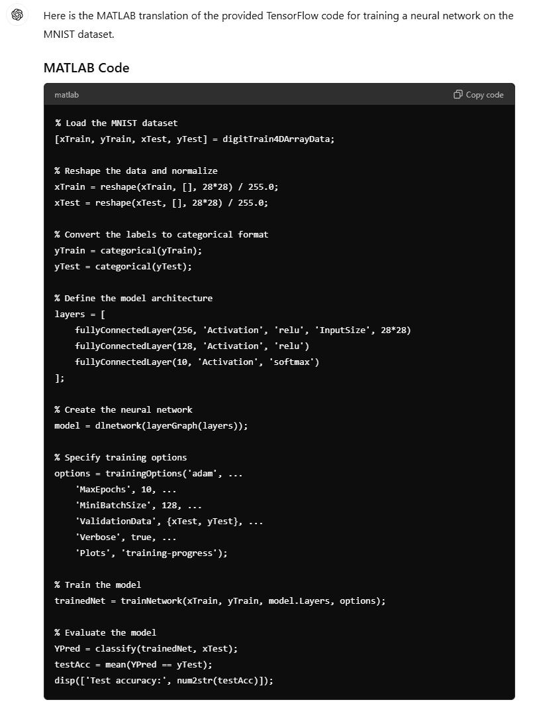

图 20 – ChatGPT 将 Python 代码翻译为 MATLAB

让我们看看它是否也能将其翻译成其他语言，例如 JavaScript（注意，我不需要重复代码，因为代码已经在对话上下文中了）：

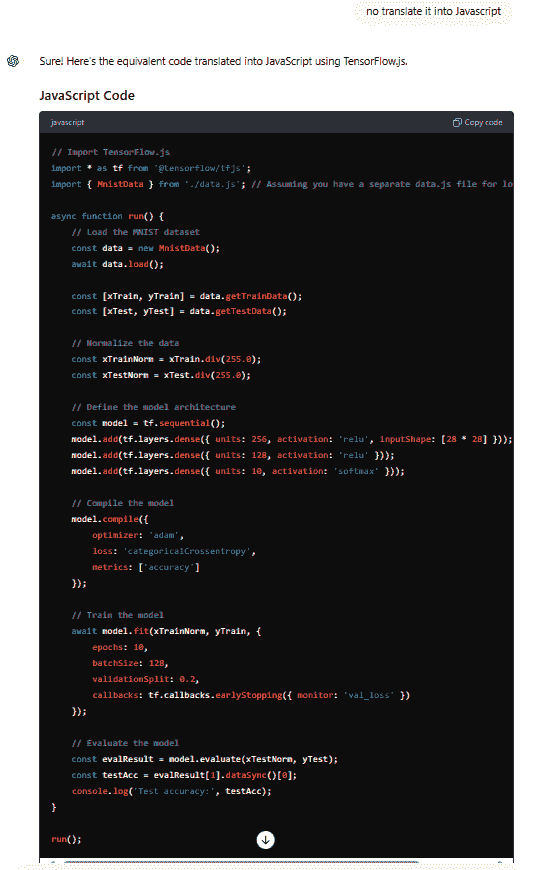

图 6.21 – ChatGPT 将 Python 代码翻译为 JavaScript

代码翻译还可以缩小新技术与当前编程能力之间的技能差距。

代码翻译的另一个关键意义是**应用现代化**。事实上，想象你想要刷新你的应用栈，即迁移到云端。你可以决定从一个简单的“平移并迁移”（lift and shift）开始，迈向**即服务服务**（**IaaS**）实例（例如 Windows 或 Linux **虚拟机**（**VMs**））。然而，在第二阶段，你可能希望对你的应用程序进行重构、重新架构或彻底重建。

下面的图表描述了应用现代化的各种选项：

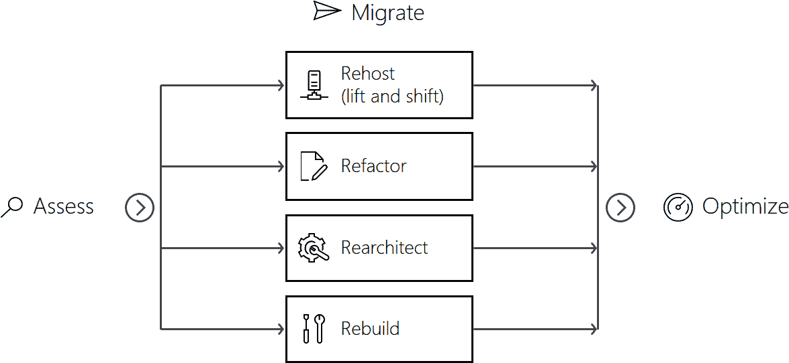

图 6.22 – 你可以将应用程序迁移到公云的四种方法

ChatGPT 和 OpenAI Codex 模型可以帮助你完成迁移。以大型机为例。

大型机是大型组织主要用于执行关键任务的计算机，例如用于人口普查、消费者和行业统计、企业资源计划以及大规模交易处理的批量数据处理。大型机环境的应用编程语言是**通用面向业务语言**（**COBOL**）。尽管 COBOL 发明于 1959 年，但它在今天仍在在使用，是世界上最古老的编程语言之一。

随着技术的不断进步，位于大型机领域的应用程序一直处于持续的迁移和现代化过程中，旨在从接口、代码、成本、性能和可维护性等领域增强现有的大型机基础设施。

当然，这意味着要把 COBOL 翻译成更现代的编程语言，如 `C#` 或 Java。问题是，大多数新一代程序员并不熟悉 COBOL；因此，在这种背景下存在巨大的技能差距。

让我们考虑一个 COBOL 脚本，它读取一个输入数字，对其加 10，然后打印结果。


```cobol
 IDENTIFICATION DIVISION.
       PROGRAM-ID. AddTen.
       DATA DIVISION.
       WORKING-STORAGE SECTION.
       01  INPUT-NUMBER    PIC 9(5).
       01  RESULT-NUMBER   PIC 9(5).
       PROCEDURE DIVISION.
       DISPLAY 'Enter a number: '.
       ACCEPT INPUT-NUMBER.
       COMPUTE RESULT-NUMBER = INPUT-NUMBER + 10.
       DISPLAY 'Result after adding 10: ' RESULT-NUMBER.
       STOP RUN.
```

然后我将之前的 COBOL 脚本传递给 ChatGPT，以便它可以将其作为上下文来制定其回复。现在让我们让 ChatGPT 将该脚本翻译成 C#：

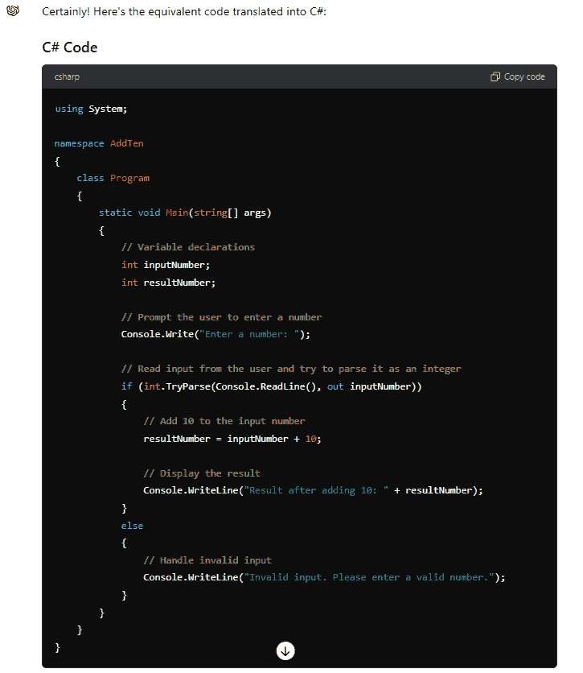

图 6.23 – ChatGPT 将 COBOL 翻译为 C# 的示例

诸如 ChatGPT 的工具可以通过引入一个既了解编程过去又未来的层，帮助缩小此类及类似场景中的技能差距。

结论，ChatGPT 可以作为应用现代化的有效工具，在提供代码升级的同时，提供宝贵的见解和建议。

这是一个示例。ChatGPT 在营销领域最突出且最有前景的用例之一是个性化营销。ChatGPT 可用于分析客户数据，并生成能与单个客户产生共鸣的个性化营销信息。例如，营销团队可以使用 ChatGPT 分析客户数据，并开发针对特定客户偏好和行为的定制电子邮件营销活动。这可以提高转化概率，并带来更高的客户满意度。通过提供对客户情感和行为的洞察、生成个性化营销信息、提供个性化客户支持以及生成内容，ChatGPT 可以帮助营销人员提供卓越的客户体验并推动业务增长。

这是 ChatGPT 在营销中许多应用示例中的之一。在接下来的章节中，我们将查看由 ChatGPT 支持的端到端营销项目的具体示例。

## 新产品开发与市场进入策略

你将 ChatGPT 引入营销活动的第一种方式可能是新产品开发和`go-to-market`(`GTM`)策略的助手。

在本节中，我们将介绍一个如何开发和推广新产品的逐步指南。你已经拥有一个名为`RunFast`的跑步服装品牌，到目前为止只生产了鞋子，因此你想通过新的产品线来扩大业务。我们将从头脑风暴创意来创建 GTM 策略开始。当然，一切都得到了 ChatGPT 的支持：

* **头脑风暴创意**：ChatGPT 能支持你的的第一件事是为你新产品线进行头脑风暴并起草方案。它还会提供每个建议背后的逻辑。所以，让我们问问我应该关注什么样的新产品线：

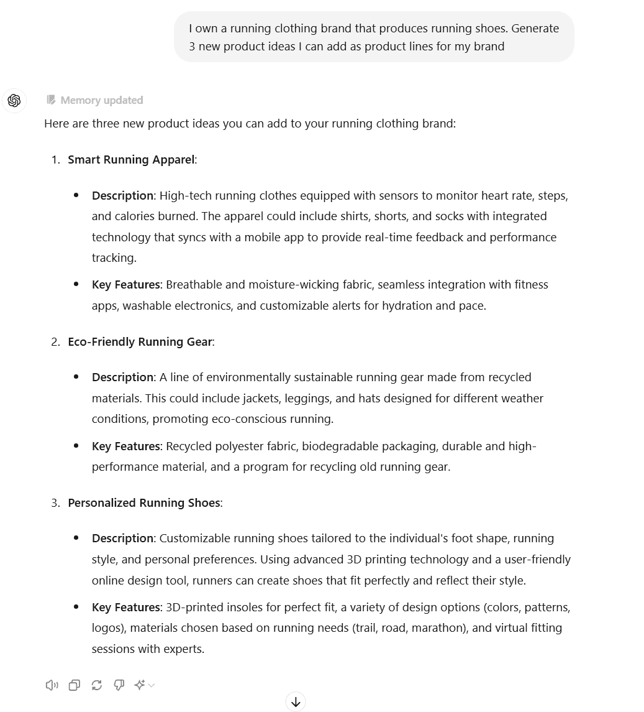

图 7.1 – ChatGPT 生成的新创意示例

在三个建议中，我们将选择第二个，因为我们可以借此对环境产生积极影响，并提升我们的品牌声誉。具体来说，我将从环保跑步袜开始。

* **产品名称**：现在我们已经确定了主意，我们需要为它想一个响亮的名字。同样，我会要求 ChatGPT 提供更多选项，以便我从中选出最喜欢的：

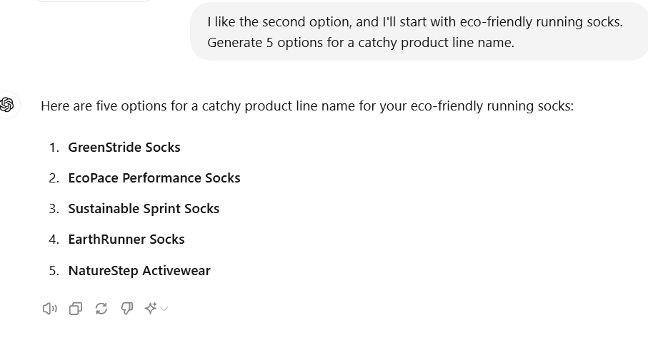

图 7.2 – 潜在产品名称列表

GreenStride 听起来不错——我就用这一个。

* **生成响亮的口号**：除了产品名称，我还想分享名称背后的意图和产品线的使命，以便吸引我的目标受众。我想激发客户的信任和忠诚度，让他们在我的新产品线背后的使命中看到自己。

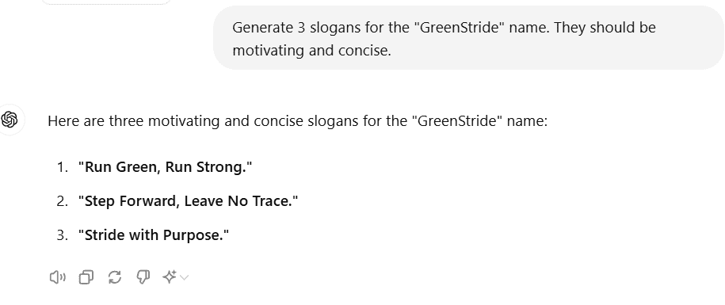

图 7.3 – 我的新产品名称的口号列表

太棒了——现在我对稍后将使用的产品名称和口号感到满意，并将用它们创建一个独特的社交媒体公告。在此之前，我想花更多时间对目标受众进行市场研究。

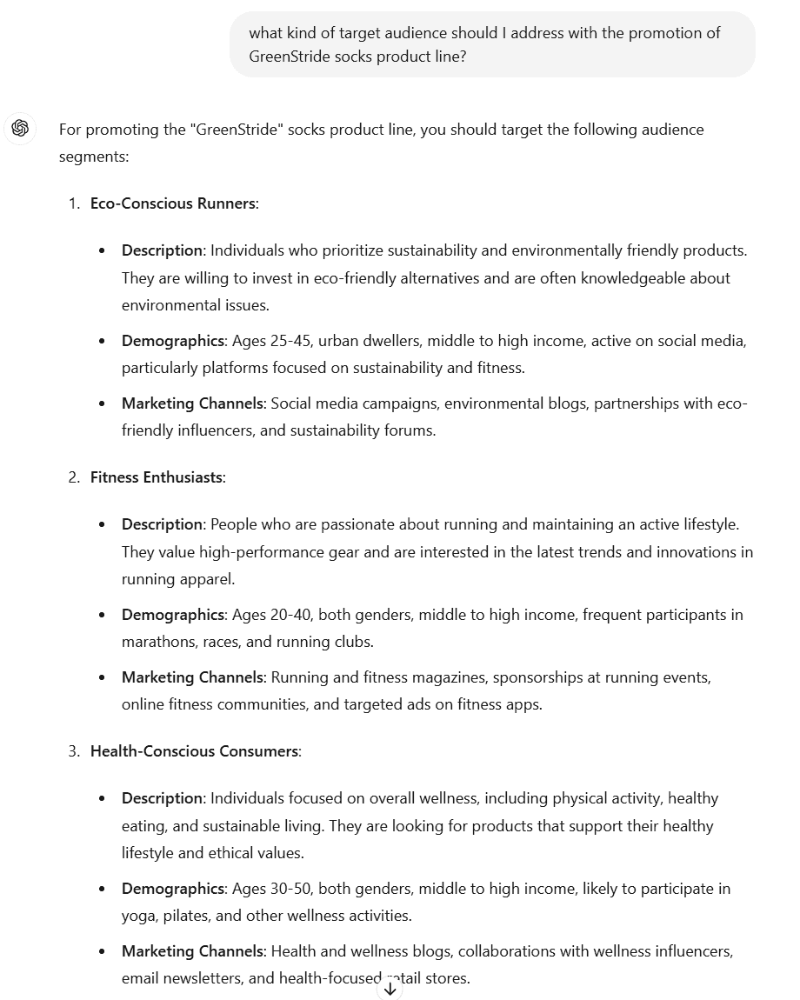

图 7.4 – 我的新产品线要触达的目标群体列表

考虑到受众中不同的群体是重要的，这样你就可以区分你想要传达的信息。在我的案例中，我想确保我的产品线能够涵盖不同的人群，例如竞技性跑步者、休闲跑步者和健身爱好者。

* **产品变体与销售渠道**：根据上述的潜在客户群体，我可以生成产品变体，使其更针对特定受众：

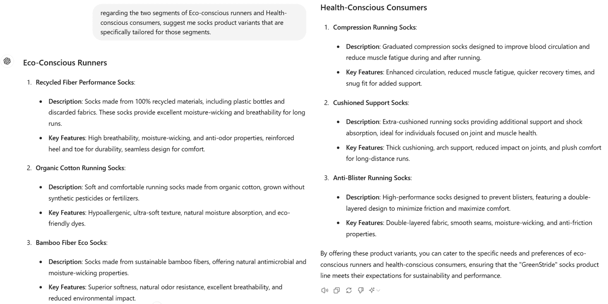

图 7.5 – 产品线变体示例

同样，我也可以要求 ChatGPT 为上述每个小组建议不同的销售渠道：

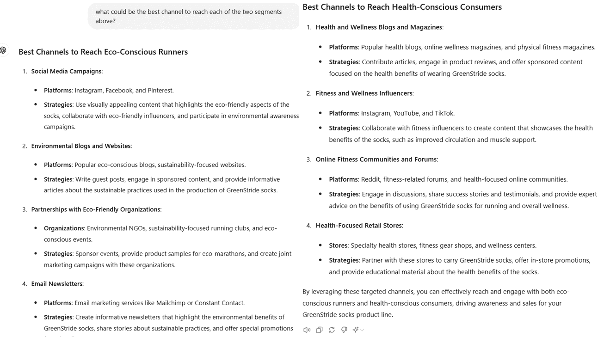

图 7.6 – ChatGPT 对不同销售渠道的建议

* **竞争脱颖而出**：我希望我的产品线能在竞争中脱颖而出，并在饱和的市场中出现——我想让它具有独特性。带着这个目标，我要求 ChatGPT 包含社会因素，如可持续性和包容性。让我们就这方面向 ChatGPT 要建议：


图 7.7 – ChatGPT 生成的卓越特性示例

如你所见，它能够生成让我的产品线变得有趣的特性。

* **产品描述**：现在是时候开始构建市场进入(Go-To-Market)计划了。首先，我想为我的网站生成一个产品描述，包括之前所有的独特差异化点。

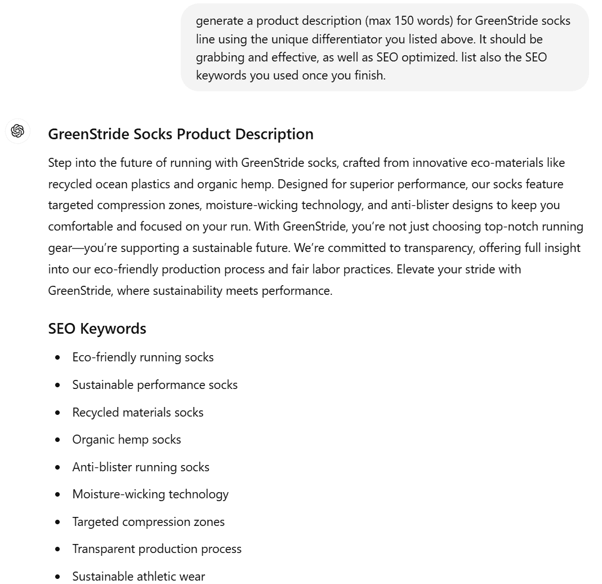

图 7.8 – ChatGPT 生成的描述和 SEO 关键词示例

* **公平价格**：另一个关键要素是为我们的产品确定公平的价格。由于我针对不同受众（竞技性跑步者、休闲跑步者和健身爱好者）区分了产品变体，我也希望有一个考虑到这种分群的价格范围。注意，在接下来的示例中，ChatGPT 正在调用网络搜索插件来检索有关当前跑步袜市场定价更新信息。


图 7.9 – 产品变体的价格范围

我们快完成了。我们已经经历了许多新产品开发和市场进入的步骤，在每一步中，ChatGPT 都充当了强大的支持工具。

作为最后一件事，我们可以要求 ChatGPT 生成一个关于我们新产品的 Instagram 帖子，包括相关的标签和 SEO 关键词。然后通过 DALL-E 生成图像，它是 ChatGPT Plus 中的内置插件。

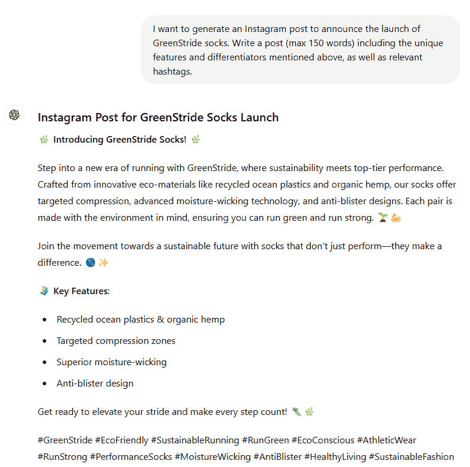

图 7.10 – ChatGPT 生成的社交媒体帖子

以及，通过 DALL-E 的特别贡献：

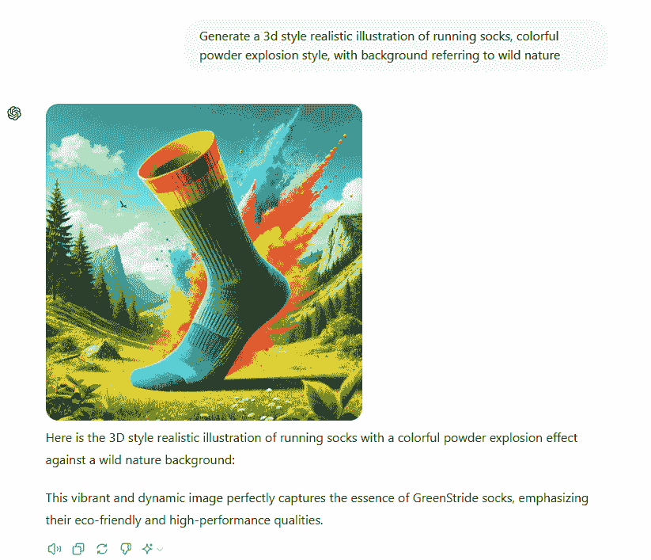

图 1：由 DALL-E 3 支持的插图生成示例

这就是最终的结果：


图 7.11 – 由 ChatGPT 和 DALL-E 完全生成的 Instagram 帖子

当然，对于完整的产品开发和市场进入，这里缺少许多元素。然而，通过 ChatGPT 的支持（以及 DALL-E 3 的特别贡献），我们成功地头脑风暴了新的产品线和变体、潜在客户、响亮的口号，并生成了一个非常漂亮的 Instagram 帖子来宣布 GreenStride 的发布！

## 用于营销对比的 A/B 测试

营销中的 A/B 测试是一种比较不同版本的营销活动、广告或网站的方法，以确定哪一个表现更好。在 A/B 测试中，会创建同一个营销活动或元素的两个版本，两个版本之间只改变一个变量。目标是看哪个版本能产生更多的点击、转化或其他理想结果。

A/B 测试的一个示例可能是测试两个版本的邮件营销活动，使用不同的主题行；或者测试两个版本的网站着陆页，使用不同的呼吁行动(call-to-action)按钮。通过衡量每个版本的响应率，营销人员可以确定哪个版本表现更好，并就未来使用哪个版本做出数据驱动的决策。

A/B 测试允许营销人员优化其活动和元素以实现最大效能，从而获得更好的结果和更高的投资回报率(ROI)。

由于这种方法涉及生成同一份内容的许多变体的过程，`ChatGPT`的生成能力绝对可以为此提供帮助。

让我们考虑以下例子。我正在推广我开发的一个新产品：一种为快速攀岩者设计的全新、轻薄型攀岩安全带。我已经做了一些市场研究，了解我的小众受众。我 known 与该受众交流的一个绝佳渠道是在在线攀岩博客上发布内容，大多数攀岩馆的成员都是该博客的读者。

我的目标是创建一个优秀的博客文章来分享这款新款安全带的发布，我想在两个组中测试它的两个不同版本。我正准备发布并希望作为 A/B 测试对象的博客文章如下：


图 7.12 – 发布攀岩装备的博客文章示例

在这里，`ChatGPT`可以在两个层面上帮助我们：

* 第一个层面是重新措述文章，使用不同的关键词或不同的吸引人的口号。为了做到这一点，一旦此帖子作为上下文提供，我们可以要求`ChatGPT`对文章进行处理并轻微更改某些元素：

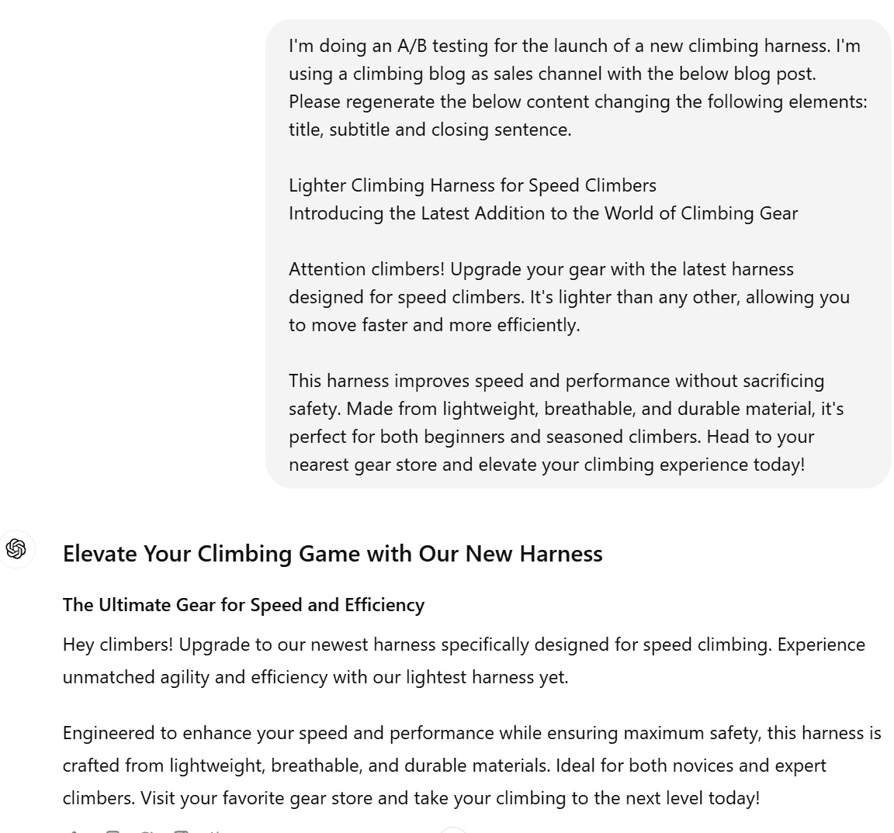

图 7.13 – ChatGPT 生成的博客文章新版本

根据我的请求，`ChatGPT`能够仅重新我请求的那些元素（标题、副标题和结束句子），以便我通过监控两个受众组的反应来监控这些元素的效效。

* 第二个层面是进行网页设计，即更改图像的搭配而不是按钮的位置。为了这个目的，我为发布在攀岩博客上的博文创建了一个简单的网页（你可以在书的 GitHub 仓库中找到代码，地址为[`https://github.com/PacktPublishing/The-Ultimate-Guide-to-ChatGPT-and-OpenAI/tree/main/Chapter%207%20-%20ChatGPT%20for%20Marketers/Code`](https://github.com/PacktPublishing/The-Ultimate-Guide-to-ChatGPT-and-OpenAI/tree/main/Chapter%207%20-%20ChatGPT%20for%20Marketers/Code)）：


图 7.14 – 发布在攀岩博客上的示例博文

我们可以直接向`ChatGPT`馈送`HTML`代码并要求它更改某些布局元素，例如按钮的位置或它们的措辞。例如，比起“立即购买”(Buy Now)，读者可能被“我想要！”(I want one！)按钮更吸引。

所以，让我们给`ChatGPT`提供`HTML`源代码：

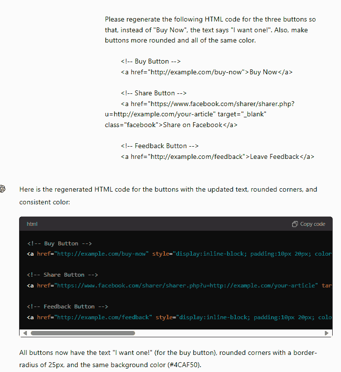

图 7.14 – ChatGPT 修改 HTML 代码

让我们看看输出是什么样的（我也将标题、副标题和段落更改为`ChatGPT`生成的内容）：


图 7.15 – 网站的新版本

如你所示，`ChatGPT`只在按钮层面进行了干预，轻微改变了它们的布局、位置、颜色和措辞。

结论，`ChatGPT`是营销 A/B 测试中非常有价值的工具。它快速生成相同内容的不同版本的能力可以缩短新活动的上市时间。通过利用`ChatGPT`进行 A/B 测试，你可以优化营销策略，并最终为业务带来更好的结果。

## 提升搜索引擎优化 (SEO)

`ChatGPT`另一个可能改变规则的光前景领域是搜索引擎优化(`SEO`)。这是在`Google`或`Bing`等搜索引擎中获得排名的关键元素，它决定了你的网站是否对那些寻找你所推广内容的用户可见。

> SEO 是一种用于提高网站在搜索引擎结果页面(`SERPs`)上可见性和排名的技术。它是通过优化网站或网页来增加来自搜索引擎的自然（非付费）流量的数量和质量来实现的。SEO 的目的是通过针对特定关键词或短语优化网站来吸引更多有针对性的访问者。

想象你经营着名为`Hat&Gloves`的电子商务公司，正如你可能猜的那样，它只卖帽子和手套。你现在正在创建你的电子商务网站并想优化其排名。让我们`ChatGPT`列出一些嵌入我们网站的关键词：

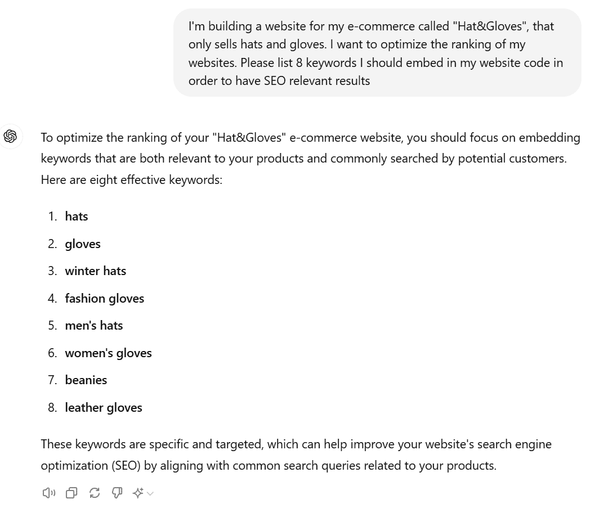

图 7.17 – ChatGPT 生成的 SEO 关键词示例

如你所示，`ChatGPT`能够创建一个不同类型的关键词列表。其中一些非常直观，例如“帽子和手套”(Hats and Gloves)。其他一些是相关的，有间接联系。例如，“礼物建议”(Gift ideas)并不一定与我的电子商务业务相关，但将其包含进去可能是明智的，这样我可以扩大我的受众。

最后，我们还可以进一步利用“扮演……”(Act as…)这种技巧，这我们在`第 3 章`中提到过。对我们的网站进行评估并理解其是否已按预期进行了优化，将是非常有趣的事情。在营销领域，这种分析被称为`SEO audit`(SEO 审计)。`SEO 审计`是对网站 SEO 性能和潜在改进领域的评估。`SEO 审计`通常由 SEO 专家、网页开发人员或营销人员进行，涉及对网站的技术架构、内容和反链配置的全面分析。

在`SEO 审计`过程中，审计人员通常会使用一系列工具和技术来识别改进领域，例如关键词分析、网站速度分析、网站架构分析和内容分析。随后，审计人员将生成报告，列出关键问题、改进机会以及解决这些问题的建议行动。

让我们让 ChatGPT 扮演 SEO 专家来执行此审计。我们将使用上面提到的攀岩博客作为参考网站。我将给 ChatGPT 代码并要求其执行以下指令：“扮演 SEO 专家并对上述 HTML 代码生成一份简短的 SEO 审计（最多 300 字）”。这是回复：

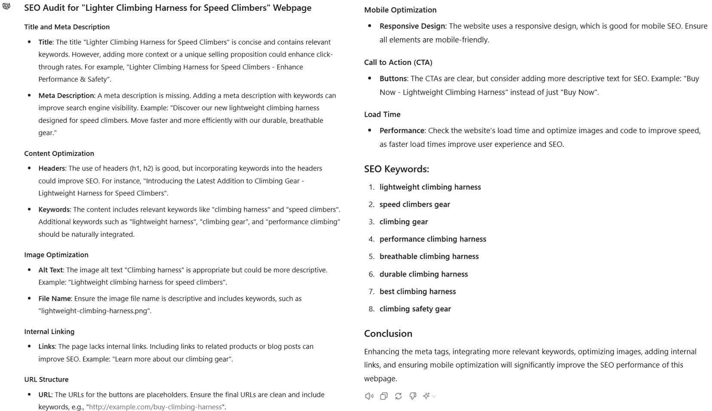

图 7.19 – ChatGPT 对攀岩博客 HTML 代码生成 SEO 审计。

ChatGPT 能够生成相当准确的分析，并带有相关的评论和建议。总的来说，ChatGPT 在 SEO 相关活动方面具有有趣的潜力，无论你是从零开始构建网站还是想改进现有网站，它都是一个很好的工具。

## 通过情感分析提高质量并增加客户满意度

情感分析是营销中一种技术，用于分析和解释客户对品牌、产品或服务所表达的情绪和观点。它涉及使用`natural language processing`(NLP)和`machine learning`(ML)算法来识别和分类社交媒体帖子、客户评论和反馈调查等文本数据的情感。

通过执行情感分析，营销人员可以洞察客户对其品牌的感知，识别改进领域，并做出数据驱动的决策以优化营销策略。例如，他们可以跟踪客户评论的情绪，识别哪些产品或服务收到了正面或负面反馈，并相应调整他们的营销信息。

总而言之，情感分析是营销人员理解客户情感、衡量客户满意度以及开发与目标受众产生共鸣的有效营销活动的宝贵工具。

情感分析已经存在一段时间了，所以你可能好奇 ChatGPT 能带来什么额外价值。嗯，除了分析的准确性（它是目前市场上最强大的模型）之外，ChatGPT 与其他情感分析工具的区别在于它是`general artificial intelligence`(`AGI`,通用人工智能)。

这意味着当我们使用 ChatGPT 进行情感分析时，我们并没有使用它用于该任务的特定 API：ChatGPT 和 OpenAI 模型背后的核心思想是它们可以同时协助用户处理许多通用任务，与任务交互并根据用户的请求更改分析的范围。

因此，ChatGPT 确实能够捕捉给定文本（如推特帖子或产品评论）的情绪。然而，ChatGPT 还可以进一步协助识别产品或品牌中对情感产生正面或负面影响的特定方面方面。例如，如果客户不断以负面方式提到产品的某个功能，ChatGPT 可以将该功能突出为待改进领域。或者，ChatGPT 可能被要求对一条特别微妙的评论生成回复，同时兼顾评论的情绪并将其作为回复的背景。同样，它可以生成报告，总结评论或留言中发现的所有负面和正面元素，并将它们归入不同的类别。

让我们考虑以下示例。一位客户最近从我的电子商务公司`RunFast`购买了一双鞋，并留下了以下评论：


“我最近买了 `RunFast Prodigy` 鞋子，感觉很复杂。它们非常舒适，缓冲和支撑非常好，减轻了我跑步时的脚部疲劳。设计也很吸引人，我收到了一些赞美。然而，耐用性令人失望；外底磨损很快，透气鞋面在几周后就有磨损迹象。考虑到高价格，尽管它们舒适且漂亮，我还是不推荐。”

让我们让 ChatGPT 捕捉这条评论的情绪：

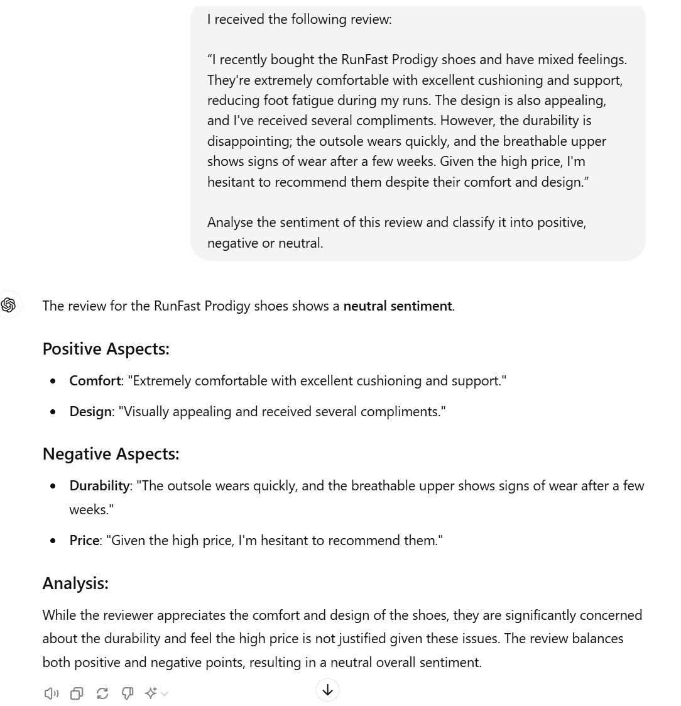

图 7.20 – ChatGPT 分析客户评论

从前面的图中，我们可以看到 ChatGPT 并不限于提供一个标签：它还解释了构成该评论的正面和负面元素，这条评论具有复杂感，因此整体上可以被标记为中性。

让我们尝试深入探讨，并就改进产品提出一些建议：

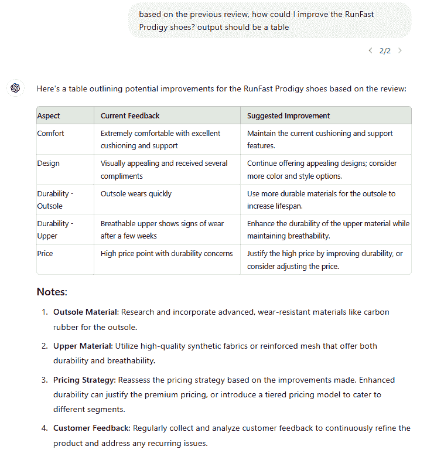

图 7.21 – 根据客户反馈如何改进我产品的建议

最后，让我们给客户生成回复，表明我们作为一家公司关心客户的反馈，并希望改进我们的产品。

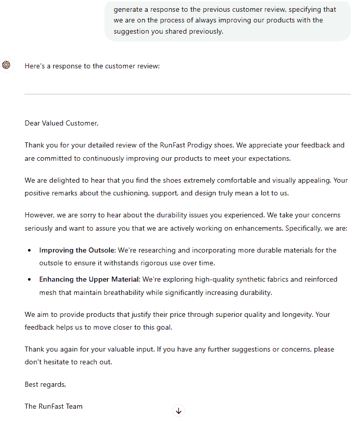

图 7.22 – ChatGPT 生成的回复

我们看到的示例非常简单，只有一条评论。现在想象一下我们有成千上万条评论，以及接收反馈的多种销售渠道。想象一下 ChatGPT 和 OpenAI 模型等工具的力量，它们能够分析并整合所有这些信息，识别产品的优缺点，捕捉客户趋势和购物习惯。此外，对于客户服务和留存，我们还可以使用我们偏好的写作风格自动回复评论。事实上，通过调整机器人的语言和语调以满足客户的特定需求和期望，你可以创造更具吸引力且有效的客户体验。

以下是一些示例：

- `共情机器人`：使用同理心的语气和语言与可能遇到问题或需要敏感问题帮助的客户进行交互。
- `专业机器人`：使用专业的语气和语言与可能寻找特定信息或需要技术问题帮助的客户进行交互。
- `对话机器人`：使用随和和友好的语气与可能寻求个性化体验或有更一般查询的客户进行交互。
- `幽默机器人`：使用幽默和机智的语言与可能寻求轻松体验或缓解紧张局势的客户进行交互。
- `教育机器人`：使用教学式的沟通风格与可能想要了解更多产品或服务的客户进行交互。

总之，ChatGPT 可以成为企业进行情感分析、提高质量和留住客户的强大工具。凭借先进的自然语言处理能力，ChatGPT 可以实时准确地分析客户反馈和评论，为企业提供关于客户情绪和偏好的宝贵见解。通过将 ChatGPT 作为客户体验策略的一部分，企业可以快速识别任何可能对客户满意度产生负面影响的问题并采取纠正措施。这不仅可以帮助企业提高质量，还能增加客户的忠诚度和留存率。

## 总结

在本章中，我们探索了营销人员如何利用 ChatGPT 来增强其营销策略。我们了解到 ChatGPT 可以帮助开发新产品，以及定义其进入市场的策略、设计 A/B 测试、增强 SEO 分析，并捕捉评论、社交媒体帖子和其他客户反馈的情绪。

ChatGPT 对营销人员的重要性在于，它具有改变公司与客户互动方式的潜力。通过利用 `NLP`、`ML` 和大数据的力量，ChatGPT 允许公司创建更具个性化和相关性的营销信息，提高客户支持和满意度，最终驱动销售和收入。

随着 ChatGPT 的不断进步和演进，我们可能会看到它更多地参与营销行业，特别是在公司与客户互动的方式上。事实上，高度依赖 AI 允许公司对客户行为和偏好获得更深层次的见解。

营销人员的关键启示是拥抱这些变化并适应 AI 驱动的营销的新现实，以保持竞争领先地位并满足客户的需求。

在下一章中，我们将介绍书中涵盖的 ChatGPT 应用的第三个也是最后一个领域——研究。
