# 第 7 章 用 ChatGPT 重塑研究

## 加入我们的 Discord 书籍社区

[`packt.link/EarlyAccess`](https://packt.link/EarlyAccess)

在本章中，我们重点关注希望利用 ChatGPT 的研究人员。本章将阐述 ChatGPT 可以解决的几个主要用例，以便你通过具体的示例学习如何在研究中使用 ChatGPT。

在本章结束时，你将熟悉如何以多种方式将 ChatGPT 作为研究助手，包括以下：

* 研究人员对 ChatGPT 的需求
* 为你的研究头脑风暴文献
* 为你的实验设计和框架提供支持
* 生成并格式化参考文献，以将其整合到你的研究中
* 针对不同受众交付关于你的研究推演或幻灯片演示

本章还将提供示例，并让你能够亲自尝试提示词（prompts）。

## 研究人员对 ChatGPT 的需求

ChatGPT 是各个领域研究人员极具价值的资源。作为一个在海量数据上训练的复杂语言模型，ChatGPT 可以快速准确地处理大量信息，并生成可能通过传统研究方法难以发现或耗时才能发现的见解。

此外，ChatGPT 可以通过分析人类研究人员可能无法立即察觉的模式和趋势，为研究人员提供其领域的独特视角。例如，想象一位研究人员正在研究气候变化，并希望理解公众对这一问题的看法。他们可能会要求 ChatGPT 分析与气候相关的社交媒体数据，并识别网上人们表达的最常见主题和情绪。然后，ChatGPT 可以为研究人员提供一份详尽报告，列出与该主题相关的常见词汇、短语和情感，以及任何可能需要了解的新趋势或模式。

通过与 ChatGPT 合作，研究人员可以获得端技术和见解，并保持在该领域的前沿。

现在让我们深入探讨 ChatGPT 提高研究效率的四个用例。

> 本章中提出的大多数示例都是基于最新信息的；事实上，你经常会看到 ChatGPT 调用网络搜索插件。如果你使用的是带有 `GPT-3.5-turbo` 的 ChatGPT（即免费版），请记住它没有启用网络搜索插件，因此其知识截止日期限制在 2021 年。如果你正在寻找更新的信息，以及通常来自网络的引用（以便你可以双击回答的可靠性），这可能是一个局限性。

## 为你的研究头脑风暴文献

文献综述是一个关键且系统的过程，旨在对特定主题或问题的现有已发表研究进行检查。它涉及搜索、评阅和综合相关的已发表研究和其他来源（如书籍、会议论文和灰色文献）。文献综述的目标是识别特定领域中的空白、不一致之处以及开展进一步研究的机会。

文献综述过程通常涉及以下步骤：

1. **定义研究问题**：进行文献综述的第一步是定义感兴趣主题的研究问题。假设我们正在进行关于社交媒体对心理健康影响的研究。现在我们想对头脑风暴一些可能的研究问题以集中我们的研究，我们可以利用 ChatGPT 来做到这一点：

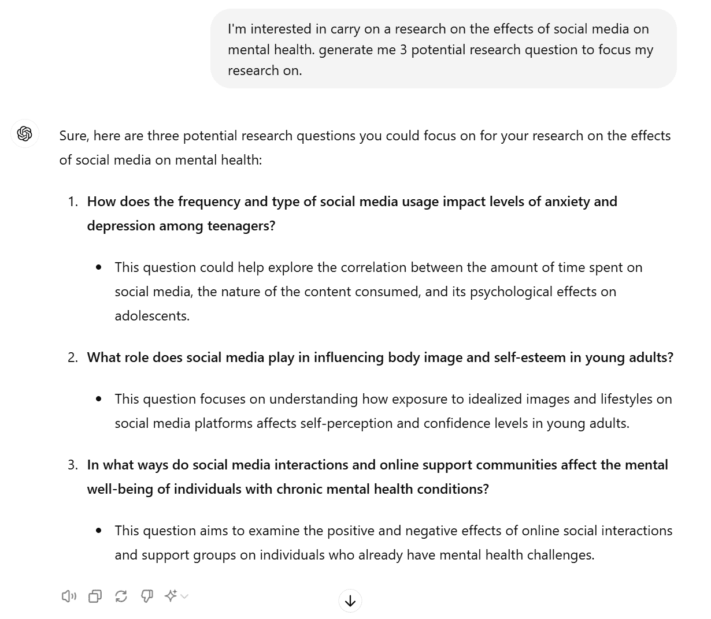

图 8.1 – 基于给定主题的研究问题示例

这些都是可以进一步调查的有趣问题。由于我特别对第一个感兴趣——“社交媒体互动和在线支持社区以哪些方式影响患有慢性心理健康状况个人的心理健康？”——我将保留这作为我们分析后续步骤的参考。

2. **搜索文献**：现在我们有了研究问题，下一步是使用各种数据库、搜索引擎和其他来源搜索相关文献。研究人员可以使用特定的关键词和搜索术语帮助识别相关研究。

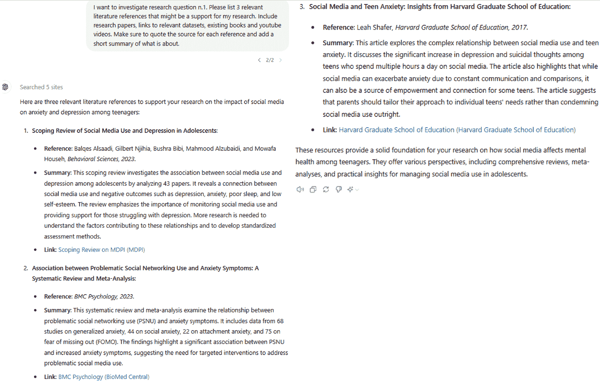

图 8.2 – 在 ChatGPT 支持下的文献检索

从 ChatGPT 的建议开始，我们可以深入研究这些参考文献。

3. **筛选文献**：一旦确定了相关文献，下一步是对研究进行筛选，以确定它们是否符合综述的标准。这通常涉及审阅摘要，并在必要时审阅研究全文。

假设我们想深入研究《社交媒体与青少年焦虑：来自哈佛大学教育学院的见解》研究论文。让我们让 ChatGPT 为我们筛选：

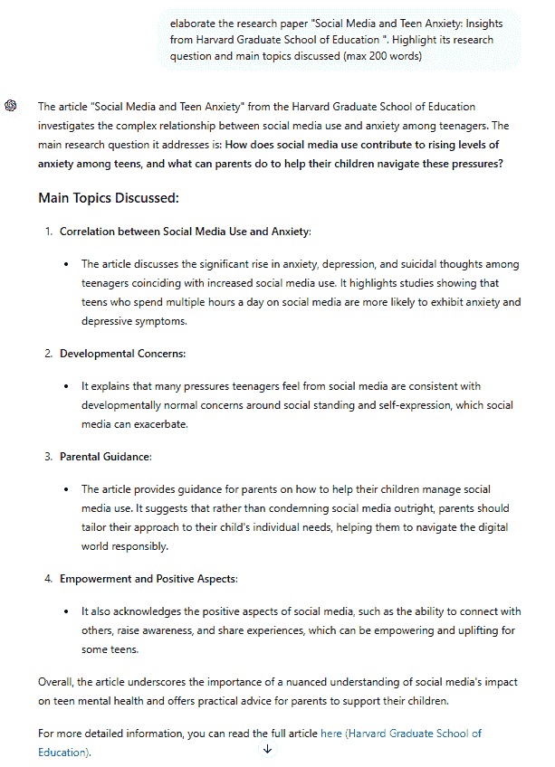

图 8.3 – 特定论文的筛选

ChatGPT 能够为我提供该论文的概述，考虑到其研究问题和讨论的主要主题，我认为它对我自己的研究非常有用。

4. **提取数据**：在确定了相关研究后，研究人员需要从每项研究中提取数据，例如研究设计、样本量、数据收集方法和主要发现。

例如，假设我们从 Hinduja 和 Patchin (2018) 年的《数字自残：流行率、动机和结果》论文中收集以下信息：

* 论文中收集的数据来源和研究对象
* 研究者采用的数据收集方法
* 数据样本量
* 分析的主要局限性和缺点
* 研究者采用的实验设计

具体如下：

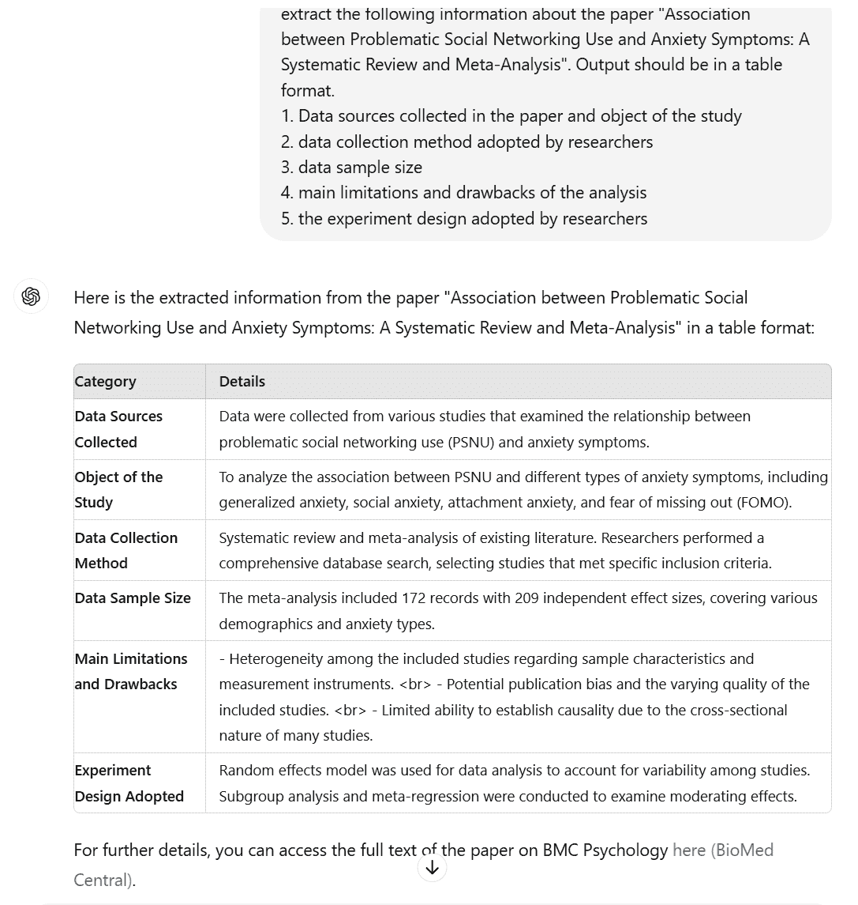

图 8.4 – 从给定论文中提取相关数据和框架

### 1. 文献综合

文献综述过程的最后一步是综合研究结果，并对该领域的当前知识状态得出结论。这可能涉及识别共同主题、突出文献中的空白或不一致之处，以及确定未来研究的机会。

让我们想象一下，除了 ChatGPT 提出的论文外，我们还收集了其他想要综合的标题和论文。更具体地说，我想了解它们是否得出了相同的结论、共同趋势是什么，以及哪种方法比其他方法更可靠。对于这种场景，我们将考虑三篇研究论文：

* *The Effects of Social Media on Mental Health: A Proposed Study*，作者为 Grant Sean Bossard ([`digitalcommons.bard.edu/cgi/viewcontent.cgi?article=1028&context=senproj_f2020`](https://digitalcommons.bard.edu/cgi/viewcontent.cgi?article=1028&context=senproj_f2020))
* *The Impact of Social Media on Mental Health*，作者为 Vardanush Palyan ([`www.spotlightonresearch.com/mental-health-research/the-impact-of-social-media-on-mental-health`](https://www.spotlightonresearch.com/mental-health-research/the-impact-of-social-media-on-mental-health))
* *The Impact of Social Media on Mental Health: a mixed methods research of service providers’ awareness*，作者为 Sarah Nichole Koehler 和 Bobbie Rose Parrell ([`scholarworks.lib.csusb.edu/cgi/viewcontent.cgi?article=2131&context=etd`](https://scholarworks.lib.csusb.edu/cgi/viewcontent.cgi?article=2131&context=etd))

结果显示如下：

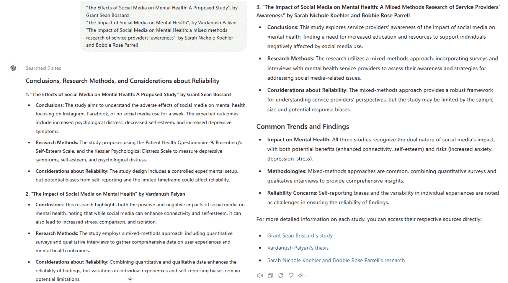

图 8.5 – 三篇研究论文的文献分析与基准测试

此外，在这种情况下，ChatGPT 能够对提供的三篇论文生成相关的总结和分析，包括方法之间的基准测试和可靠性考虑。

总的来说，ChatGPT 能够在文献综述领域开展许多活动，从研究问题的头脑风暴到文献综合。一如既常，循环中需要一个`领域专家`（`SME`）来审核结果，但在这种帮助下，许多活动可以更高效地完成。

另一个可以由 ChatGPT 支持的活动是研究者希望进行的实验设计。我们将在下一节介绍这一点。

## 为你的实验设计和框架提供支持

实验设计是计划和执行科学实验或研究以回答研究问题的过程。它涉及对研究设计、待测变量、样本量以及数据收集和分析程序的决策。

ChatGPT 可以通过向你建议研究框架（例如随机对照试验、准实验设计或相关性研究）来帮助研究的实验设计，并在设计的实施的同时提供支持。

让我们考虑以下场景。我们想调查新的教育计划对学生数学学习成果的影响。这种新计划涉及`项目制学习`（`PBL`），这意味着要求学生合作完成真实世界的项目，使用数学概念和技能来解决问题并创建解决方案。

为了实现这一目的，我们将研究问题定义如下：

新的 PBL 程序在提高学生表现方面与传统教学方法相比如何？

以下是 ChatGPT 如何提供帮助：

* **确定研究设计**：ChatGPT 可以协助为研究问题确定合适的研究设计，例如随机对照试验、准实验设计或相关性研究。

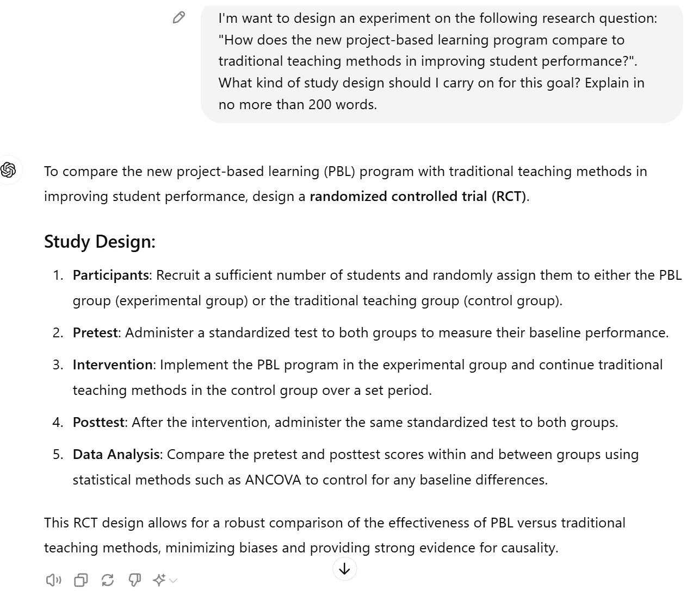

图 8.6 – ChatGPT 为你的实验建议合适的实验设计

ChatGPT 建议采用随机对照试验 (RCT)，并对其背后的原因提供了清晰的解释。对我来说，采用这种方法是合理的：下一步将确定实验中考虑的结果衡量和变量。

* **识别结果衡量**：ChatGPT 可以帮助你识别一些潜在的结果衡量，以确定测试结果。让我们为我们的研究寻求一些建议：

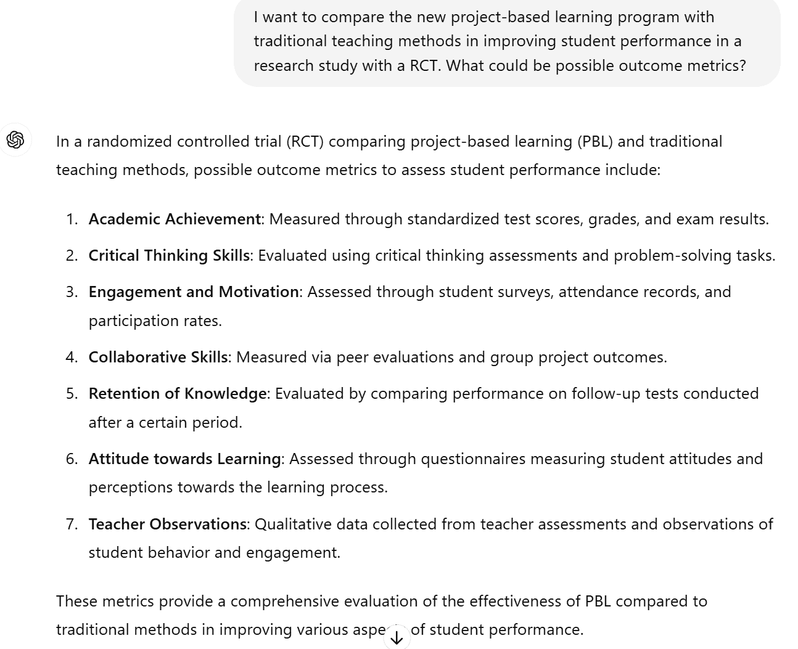

图 8.7 – 给定研究学习的学习成果

我选择测试分作为结果衡量是合理的。

* **识别变量**：ChatGPT 可以帮助研究者识别研究中的自变量和因变量：

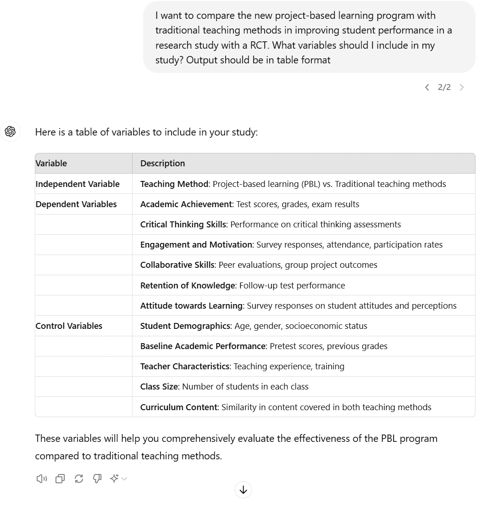

图 8.8 – ChatGPT 为给定研究生成变量

注意，ChatGPT 还能生成特定于我们考虑的研究设计（RCT）的变量类型，称为`控制变量`。

控制变量（也称为协变量）是在研究中保持保持不变或受控制的变量，以隔离自变量与因变量之间的关系。这些变量不是研究的重点，但将它们包含进来是为了减少混杂变量对结果的影响。通过控制这些变量，研究人员可以降低获得假阳性或假阴性结果的风险，并增加研究的内部效度。

有了上述变量，我们准备好建立实验了。现在我们需要选择参与者，ChatGPT 可以协助我们完成这一点。

* **采样策略**：ChatGPT 可以为研究建议潜在的采样策略：

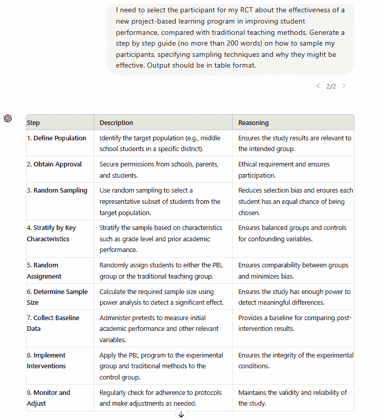

图 8.9 – ChatGPT 的 RCT 采样建议

注意，在现实场景中，要求 AI 工具生成带有解释的更多选项是一个良好的做法，这样你就可以做出合理的决策。对于这个例子，让我们按照 ChatGPT 给我们的建议进行，这还包括对目标群体和样本量的建议。

* **数据分析**：ChatGPT 可以协助研究者确定用于分析研究收集数据的合适统计方法，例如方差分析 (ANOVA)、t 检验或回归分析。

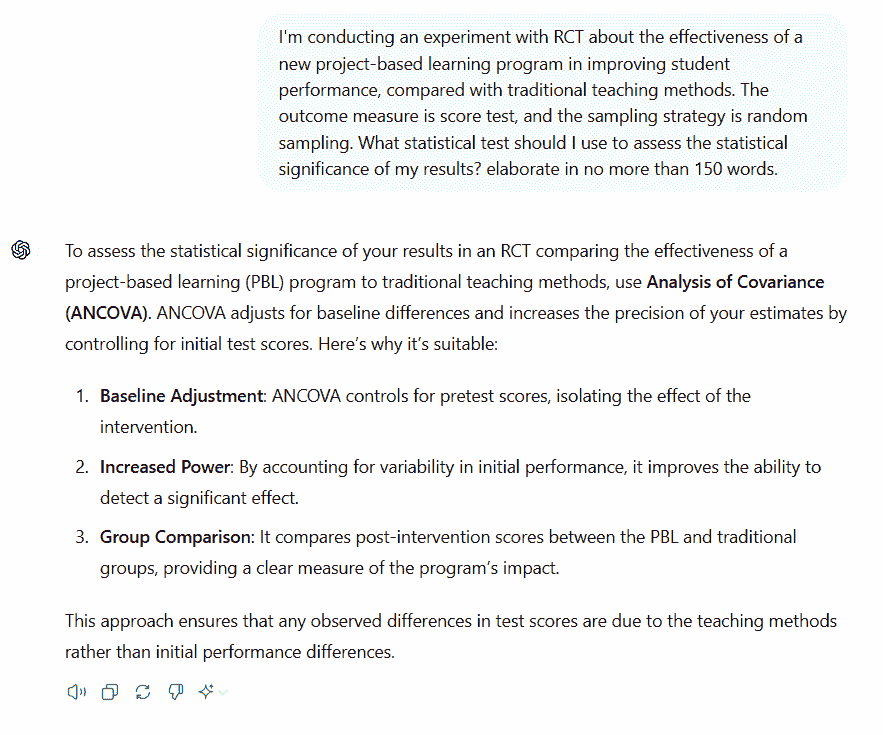

图 8.10 – ChatGPT 为给定研究建议统计检验

ChatGPT 建议的所有内容都是连贯的，并在关于如何进行统计检验的论文中找到了证实。它还能识别出我们可能谈论的是连续变量（即分数），以便我们知道后续的所有信息都是基于这一假设的。如果我们想要离散分数，我们可以通过添加此信息来调整提示词，ChatGPT 然后就会建议不同的方法。

ChatGPT 指明假设并解释其推理，这是根据其输入做出安全决策的关键。

结论，ChatGPT 在研究人员设计实验时是一项非常有价值的工具。通过利用其`自然语言处理`（`NLP`）能力和丰富的知识库，ChatGPT 可以帮助研究人员选择合适的研究设计、确定采样技术、识别变量和学习成果，甚至建议用于分析数据的统计方法。

在下一节中，我们将进一步探索 ChatGPT 如何支持研究人员，重点关注参考文献的生成。

## 生成和格式化参考文献

ChatGPT 可以通过提供自动化的引用和参考文献工具来支持研究人员生成参考文献。这些工具可以为各种来源（包括书籍、文章、网站等）生成准确的引用和参考文献。ChatGPT 了解多种引用格式，例如 `APA`、`MLA`、`Chicago` 和 `Harvard`，允许研究人员根据其工作选择合适的格式。此外，ChatGPT 还可以根据研究人员的输入建议相关的来源，帮助简化研究流程并确保所有必要的来源都包含在参考文献中。通过利用这些工具，研究人员可以节省时间，并确保参考文献的准确和全面。

让我们考虑以下例子。假设我们定了一篇题为《技术对工作生产力的影响：实证研究》（The Impact of Technology on Workplace Productivity: An Empirical Study）的论文。在研究和写作过程中，我们收集了以下论文、网站、视频和其他来源的引用，我们需要将其纳入参考文献（顺序为：三篇研究论文、一个 YouTube 视频和一个网站）：

* `The second machine age: Work, progress, and prosperity in a time a brilliant technologies`. Brynjolfsson, 2014. https://psycnet.apa.org/record/2014-07087-000
* `The Impact of Technostress on Role Stress and Productivity. Tarafdar`, 2014. Pages 301-328. https://www.tandfonline.com/doi/abs/10.2753/MIS0742-1222240109
* `The big debate about the future of work, explained`. Vox. https://www.youtube.com/watch?v=TUmyygCMMGA

显然，我们不能在研究论文中直接使用上述列表；我们需要对其进行正确的格式化。为了做到，我们可以向 ChatGPT 提供原始参考文献列表，并要求它以特定的格式重新生成，例如 `APA` 格式，这是美国心理学会（`APA`）的官方格式，常用于教育、心理学和社会科学的参考文献格式样式。

让我们看看 ChatGPT 是如何处理的：

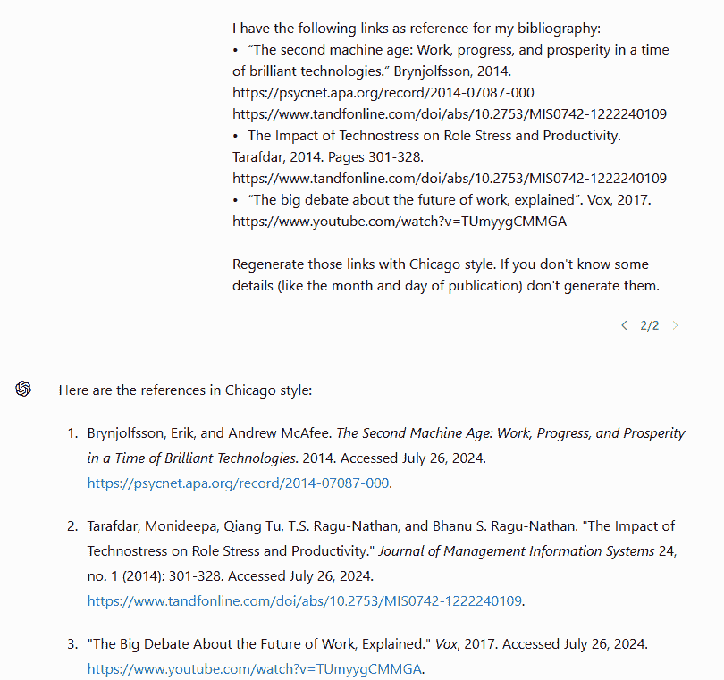

图 8.11 – ChatGPT 生成的 APA 格式参考文献列表

注意，我特别指定了不要添加细节，以防 ChatGPT 不知道这些信息。事实上，我注意到 ChatGPT 有时会添加出版的月份和日期，从而导致一些错误。

ChatGPT 可以提供的其他有趣帮助是建议我们可能想要引用的潜在参考文献。我们在本章的第一段已经看到了 ChatGPT 如何在写作过程之前对相关文献进行头脑风暴；然而，一旦论文完成，我们可能会忘记引用相关文献，甚至没有意识到引用了别人的工作。

# ChatGPT 在头脑风暴中的应用

ChatGPT 在头脑风暴我们可能遗漏的潜在参考文献方面可以是一个非常出色的助手。让我们再次考虑我们的论文，研究问题是“社交媒体互动和在线支持社区如何影响患有慢性心理健康状况个人的心理健康？”假设我们设定了以下标题和摘要，其摘要包含以下内容：

**Title**: 社交媒体和在线支持社区对慢性心理健康状况个人心理健康的影响

**Abstract**: 本研究探索了社交媒体互动和在线支持社区对慢性心理健康状况个人心理健康的影响。通过检查各种在线平台，该研究旨在识别积极和消极的影响。研究利用了定性和定量方法（包括问卷调查和访谈）来评估焦虑、抑郁和整体生活满意度的变化。初步结果表明，虽然在线支持可以提供宝贵的社交连接和情感支持，但过度使用和负面互动可能会加剧心理健康问题。

让我们让 ChatGPT 列出可能与此类研究相关的各种参考文献：

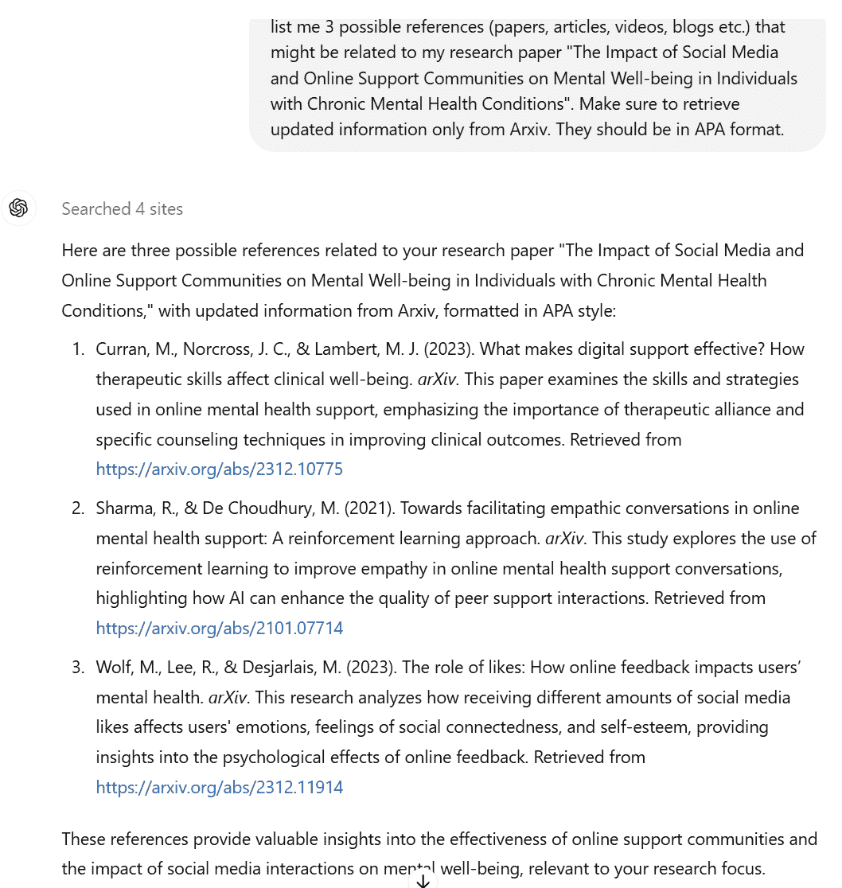

图 8.12 – 与提供的摘要相关的参考文献列表

你也可以对论文的其他部分重复此过程，以确保你没有遗漏任何需要包含在参考文献中的相关引用。

一旦你的研究准备就绪，你可能需要通过“电梯演讲”（elevator pitch）来展示它。在下一节中，我们将看到 ChatGPT 如何也支持这项任务。

## 生成研究演示报告

研究的“最后一公里”通常是向不同的观众进行展示。这可能涉及准备幻灯片组、演说稿（pitch）或网络研讨会，研究人员需要面对不同类型的听众。

例如，假设我们的研究《社交媒体和在线支持社区对慢性心理健康状况个人心理健康的影响》是为了硕士论文答辩准备。在这种情况下，我们可以要求 ChatGPT 生成一个持续 15 分钟并遵循科学方法的演说结构。让我们看看产生了什么样的结果（作为背景，我指的是上段的摘要）：

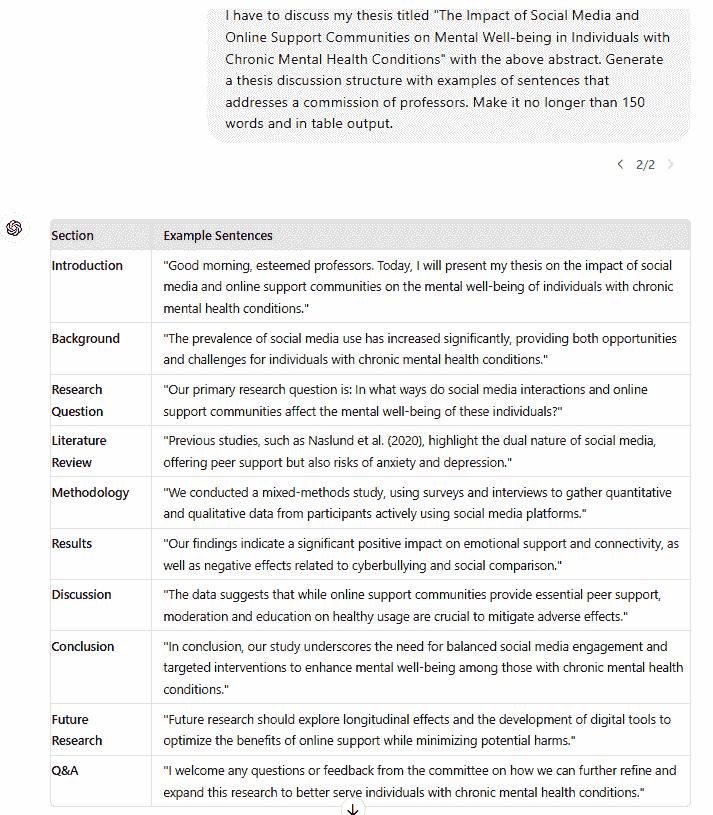

图 8.13 – ChatGPT 生成的论文答辩

这太令人印象深刻了！在我的大学时代，如果有这样一个工具来协助我设计答辩将非常有帮助。

从这个结构开始，我们还可以要求 ChatGPT 生成一个幻灯片组作为我们论文答辩的视觉辅助。让我们继续这个请求：

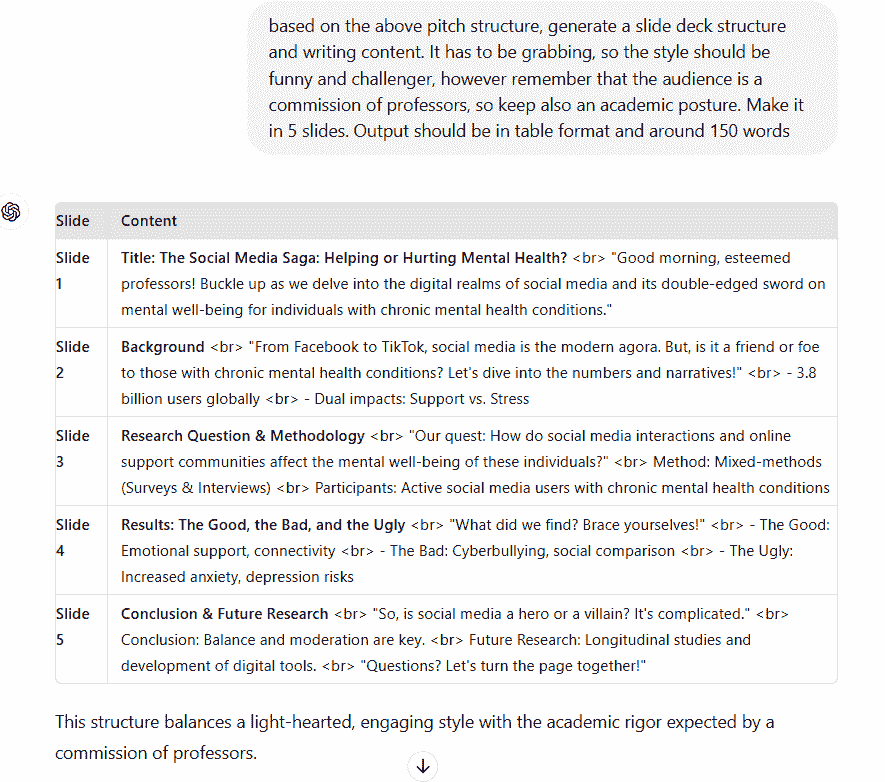

图 8.14 – 基于演说稿的幻灯片结构

最后，假设我们的论文答辩非常出色，以至于可能获得研究资金以继续调查该课题。现在我们需要一个电梯演讲来说服委员会。让我们向 ChatGPT 请求支持：

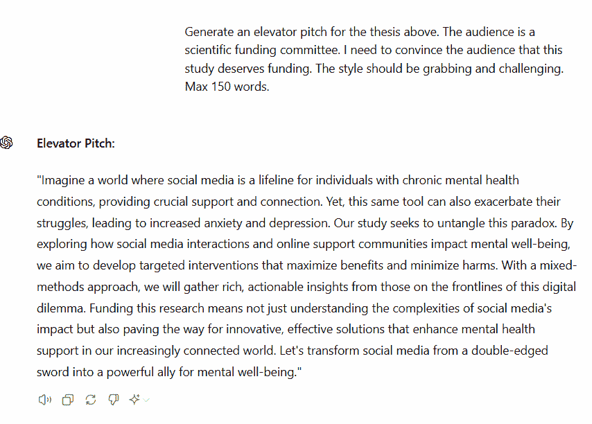

图 8.15 – 为给定论文的电梯演讲

我们可以随时调整结果，使其更符合我们的需求，然而，现成的结构和框架可以节省大量时间，让我们能够专注于我们想要呈现的技术内容。

总的来说，ChatGPT 能够支持研究的全全程，从文献收集和综述到研究的最终演示，我们已经证明了它可以成为研究人员极出色的 AI 助手。

此外，请注意在研究领域，最近开发了一些与 ChatGPT 不同但同样由 GPT 模型驱动的工具。例如`Humanata.ai`，这是一个 AI 驱动的工具，允许你上传文档并对其进行多种操作，包括摘要、即时问答以及基于上传的文件生成新论文。

这表明基于 GPT 的工具（包括 ChatGPT）正在为研究领域的若干创新铺平道路。

## 总结

在本章中，我们探索了 ChatGPT 作为研究人员价值工具的使用。通过文献综述、实验设计、参考文献生成和格式化以及演示报告生成，ChatGPT 可以帮助研究人员加速那些低价值或零价值的活动，让他们能够专注于相关的活动。

请注意，我们仅关注了 ChatGPT 可以支持研究人员的一小部分活动。在研究领域还有许多其他活动可以从 ChatGPT 的支持中受益，其中我们可以提到的数据收集、研究参与者招募、研究网络建立、公众参与等。

将此工具整合到工作中的研究人员可以从其多功能和节省时间的特性中受益，最终带来更有影响力的研究成果。

然而，重要的是记住，ChatGPT 仅仅是一个工具，应该结合专家知识和判断来使用。与任何研究项目一样，必须对研究问题和研究设计进行仔细考虑，以确保结果的有效性和可靠性。

通过本章，我们也结束了本书的第二部分，该部分重点关注了你可以利用 ChatGPT 的广泛场景和领域。然而，我们主要关注个人或小团队的使用，从个人生产力到研究辅助等。从第三部分开始，我们将讨论提升到大型组织如何利用 Microsoft Azure 云上提供的 OpenAI 模型 API，将 ChatGPT 背后的相同生成式 AI 用于企业级项目。

## 参考文献

- [`arxiv.org/abs/2312.11914`](https://arxiv.org/abs/2312.11914)
- [`arxiv.org/abs/2101.07714`](https://arxiv.org/abs/2101.07714)
- [`arxiv.org/abs/2101.07714`](https://arxiv.org/abs/2101.07714)
- [`psycnet.apa.org/record/2014-07087-000`](https://psycnet.apa.org/record/2014-07087-000)
- [`www.tandfonline.com/doi/abs/10.2753/MIS0742-1222240109`](https://www.tandfonline.com/doi/abs/10.2753/MIS0742-1222240109)
- [`www.youtube.com/watch?v=TUmyygCMMGA`](https://www.youtube.com/watch?v=TUmyygCMMGA)
